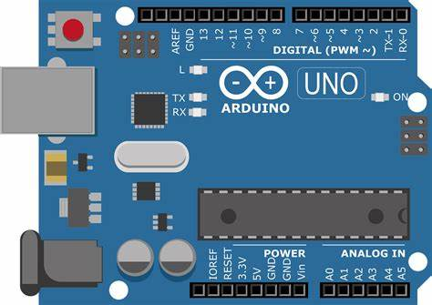

---
layout:
  width: default
  title:
    visible: false
  description:
    visible: false
  tableOfContents:
    visible: true
  outline:
    visible: true
  pagination:
    visible: true
  metadata:
    visible: true
  tags:
    visible: true
  actions:
    visible: true
  anchors:
    visible: true
---

# LED Ring 5V RGB WS2812B 12-Bit 50mm

### LED Ring 5V RGB WS2812B 12-Bit 50mm

***

### Product Link



### Introduction

Our **AZ-Delivery RGB-Led-Ring** with 12 LEDs impresses with its high luminosity at low power consumption.

The used WS2812b are **individually addressable**, **need only one data line** and can display a **large color space**.

<figure><figcaption></figcaption></figure>

Due to the twelve LEDs, the module is well suited to implement clocks or, for example, to accentuate a camera lens.

Due to the widespread use of WS2812b diodes, the product is compatible with most microcontrollers with 5V logic level and different libraries are available for easy application.

### Features

* Betriebsspannung: 5V DC
* Treiber Chip: WS2812b
* LED: 5050 RGB
* Farbe: Schwarz
* Durchmesser Aussen: 50 mm
* Durchmesser Innen: 36 mm
* Tiefe: 3.5mm
* Gewicht: 6g

### Pinout

<figure><figcaption></figcaption></figure>

### Dimensions

<figure><figcaption></figcaption></figure>

### How to Use

1. Connect the Arduino UNO using the serial cable.

<figure><figcaption></figcaption></figure>

2. Connect the Arduino and programmable RGB lights according to the wiring diagram, and then connect the serial port to the computer USB port.
3. Select the corresponding file of the effect you want to realize, as such as lighting up all the lights, running lights, running lights, breathing lights respectively.
4. Take the running light as an example, open the running light routine file, open Marquee.ino

<figure><figcaption></figcaption></figure>

5. After connecting the Arduino and module wires, click compile and upload.

<figure><figcaption></figcaption></figure>
