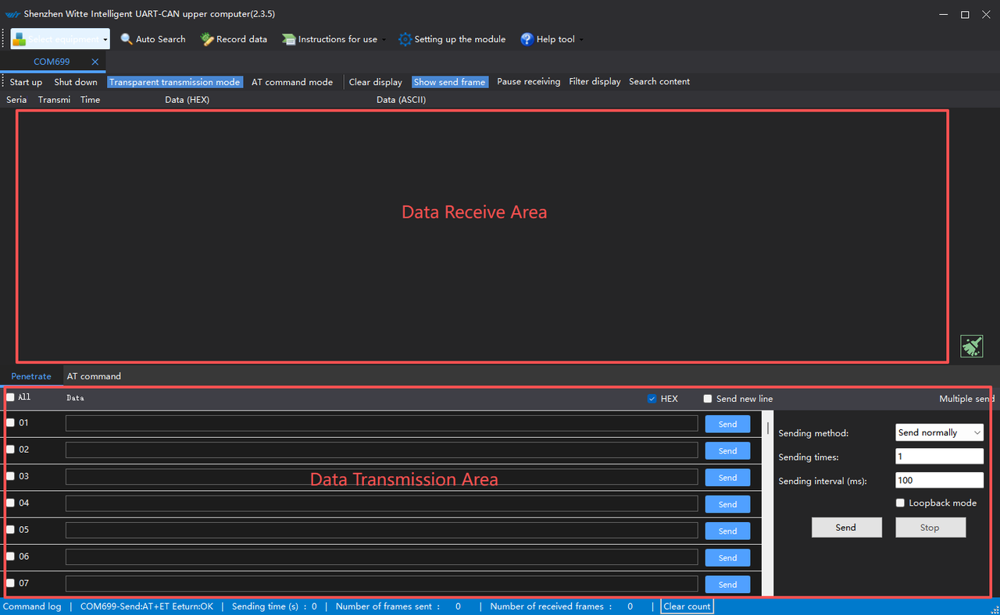

# USB-CAN-P Instruction Manual



<figure><figcaption></figcaption></figure>

### Data Download

&#x20;[CH340 Driver](https://wit-motion.yuque.com/wumwnr/aqvq6y/ygew9kd2fta8ob0u?singleDoc#%20%E3%80%8ACH340%E4%B8%B2%E5%8F%A3%E9%A9%B1%E5%8A%A8%E3%80%8B)&#x20;

[UART-CAN-P Host Computer](https://witpic-1253369323.cos.ap-guangzhou.myqcloud.com/wit-cloud/ep/uploadFile/UART-CAN%E4%B8%8A%E4%BD%8D%E6%9C%BA-1687339389350.zip)&#x20;

### 1. Performance Parameters&#x20;

● Power Supply: USB 5V&#x20;

● Current: <30mA&#x20;

● Serial Baud Rate: 1200～921600Bps, default 9600Bps&#x20;

● CAN Baud Rate: 3K～1MBps, default 1MBps&#x20;

● CAN Filter: 14 sets of mask filters&#x20;

● Filter Mode: Mask Mode/List Mode&#x20;

### 2. Pin Description

<figure><figcaption></figcaption></figure>

### 3. Mode Introduction

| Pattern Type     | Mode                                      | Mode Description                                                                                                                                                                                                                                                                                                                       | Mode Type Description                                                                                                                                                        |
| ---------------- | ----------------------------------------- | -------------------------------------------------------------------------------------------------------------------------------------------------------------------------------------------------------------------------------------------------------------------------------------------------------------------------------------- | ---------------------------------------------------------------------------------------------------------------------------------------------------------------------------- |
| Working Mode     | Normal Mode                               | The module can communicate with the CAN network in normal mode                                                                                                                                                                                                                                                                         | The working mode of the working mode control module can be configured as normal mode and loopback mode                                                                       |
| 
 
      | Self-transmitting and self-receiving mode | In the self-transmitting and self-receiving mode, the module cannot communicate with the CAN network, and the data frames sent out can only be received by the module itself, which is mostly used for module self-testing                                                                                                             | 
 
                                                                                                                                                                  |
| Interactive Mode | Configuration Mode                        | In configuration mode, configuration operations can be performed on the module                                                                                                                                                                                                                                                         | The interactive mode controls the communication of the TTL terminal, with optional configuration modes including configuration mode, pass-through mode, and AT command mode. |
| 
 
      | Pass-through Mode                         | In pass-through mode, the data received at the TTL end does not carry the frame ID and length. For frames coming from the CAN network, the module will first remove the frame ID and length before transmitting them to the TTL end; all data sent in pass-through mode are data frames (standard data frames or extended data frames) | 
 
                                                                                                                                                                  |
| 
 
      | AT Command Mode                           | In AT command mode, the data received at the TTL end will carry the frame ID and data length, and sending data requires specifying the frame ID and data length                                                                                                                                                                        | 
 
                                                                                                                                                                  |

### 4. Wiring Methods

#### 4.1 Connect to a PC while simultaneously connecting to a CAN device

Once the computer is connected to the module, the module can be controlled. The module comes with a supporting host computer for use, and can also be operated using commands. This section describes how to quickly operate the module using the host computer and commands.

#### 4.2 Quick Start with the Host Computer

Open the host computer directory, click UartToCan.exe to run the host computer. The host computer will "automatically search" for devices, or you can manually click "Select Device". After the host computer finds the device, select to enter the "pass-through mode". After entering the pass-through mode, the interface is as follows, where you can operate the module to send and receive data.

<figure><figcaption></figcaption></figure>

<figure><figcaption></figcaption></figure>

<figure><figcaption></figcaption></figure>

Example of sending data:&#x20;

Select the data to be sent in the "Send Data Area", enter the data, then click "Send". After sending, the received data area will display the sent data.

<figure><figcaption></figcaption></figure>

For more host computer operations, please read Section 5.&#x20;

#### 4.3 Quick Start with Instruction Operations&#x20;

During development, instructions need to be used to operate the module, and the serial port assistant can be used to send instructions to debug the module. The default serial port configuration of the module is baud rate 9600, data bits 8, stop bits 1, and parity bit none. The following uses the serial port assistant XCOM for debugging.

<figure><figcaption></figcaption></figure>

\
Example of sending data using the serial port assistant:&#x20;

Send AT+ET to enter pass-through mode, and send 123 to the module.

<figure><figcaption></figcaption></figure>

### 5. Usage of the Host Computer Software

#### 5.1 Connection Method

After connecting to the computer via the USB to TTL module and installing the corresponding driver for the serial USB-TTL module (if it is a six-in-one module, install the CP2102 driver; if it is a three-in-one module, install the CH340 driver), you can query the corresponding Port Number in the Device Manager.

<figure><figcaption></figcaption></figure>

The 3-in-1 driver is CH340 [Driver download address](https://witpic-1253369323.cos.ap-guangzhou.myqcloud.com/soft/CH340%E9%A9%B1%E5%8A%A8.rar)

The 6-in-1 driver is CP2102 [Driver download address ](https://witpic-1253369323.cos.ap-guangzhou.myqcloud.com/soft/CP2102%E9%A9%B1%E5%8A%A8.rar)

Connect the TTL-CAN to the computer using a USB-to-TTL adapter. Open the USB-CAN host computer. As shown in the figure below:

<figure><figcaption></figcaption></figure>

#### 5.2 Open Serial Port Selection Mode

The host computer will automatically search for the module, or you can click \[Select Device] in the upper left corner of the host computer, and select the corresponding COM port and baud rate in the pop-up prompt box. After selection, choose the pass-through mode or AT command mode.

1 Click \[Select Device]

<figure><figcaption></figcaption></figure>

2 Select the COM port and baud rate.

<figure><figcaption></figcaption></figure>

3 Select either pass-through mode or AT command mode

<figure><figcaption></figcaption></figure>

4 After opening, the selected COM port will appear in the device list. The host computer can open multiple devices. Repeating the above \[Select Device] step can open the second device.

<figure><figcaption></figcaption></figure>

5 When opening two devices

<figure><figcaption></figcaption></figure>

#### 5.4 Host Computer Configuration Module

5.4.1 Enter the Configuration Page

The host computer provides a convenient configuration module page. Click the \[Settings] button in the top toolbar to enter the configuration page. Clicking \[Settings] will operate on the currently selected device.

The selected device is COM699. Click \[Settings]

<figure><figcaption></figcaption></figure>

After entering the settings, if the device is online, the host computer will automatically read the parameters.

<figure><figcaption></figcaption></figure>

5.4.2 CAN Baud Rate Setting&#x20;

The module can set the CAN baud rate, with a range from 3K to 1M, and the default is 1M.&#x20;

Operation method: In the CAN Baud Rate Setting field, enter the baud rate and click the \[Set] button. After clicking Set, if "OK" is displayed in the lower left corner, the setting is successful.

<figure><figcaption></figcaption></figure>

5.4.3 Pass-through Frame Format Settings&#x20;

The module has a pass-through mode. In the pass-through mode, the frame type and frame ID of the data sent by the module are set here. All data sent in the pass-through mode uses the frame type and ID specified here. The default configuration is standard frame, standard frame ID: 01, extended frame ID: 00000000.&#x20;

Operation method: In the Pass-through Frame Format Settings field, select the frame type, enter the standard frame ID and extended frame ID. Click the \[Settings] button. After clicking the Settings button, if "OK" is displayed in the lower left corner, the settings are successful.

<figure><figcaption></figcaption></figure>

5.4.4 Filter Settings&#x20;

USB-CAN products have a filter function, and in AT command mode, unwanted data frames can be filtered out based on CAN ID.&#x20;

Filtering has two modes: enabled filtering and disabled mode.&#x20;

Filter function introduction:&#x20;

[1 Filter Introduction](https://www.bilibili.com/video/BV1sK4y1o77s/?spm_id_from=888.80997.embed_other.whitelist)&#x20;

[2 Enabled Filtering Introduction Video](https://www.bilibili.com/video/BV1z64y1y73h/?spm_id_from=888.80997.embed_other.whitelist)&#x20;

[3 Disabled Mode Introduction Video](https://www.bilibili.com/video/BV1j84y1F7eC/?spm_id_from=888.80997.embed_other.whitelist)&#x20;

The module comes with 14 sets of filters, which can be configured to allow or disallow the reception of frames. The host computer provides a visual filtering configuration page and a calculation page. When a certain frame is set to pass, the module can transmit data to the TTL interface; when a certain ID is set not to pass, the module will not transmit data to the TTL interface. By default, all filters are disabled.&#x20;

Operation method: In the filter configuration section, select the filter group number, filter enable, filtering mode, input filter register, and input mask register. After clicking "Set", if "OK" is displayed in the lower left corner, the setting is successful.

<figure><figcaption></figcaption></figure>

5.4.5 Serial Port Parameter Settings&#x20;

The module can set the serial port baud rate, which defaults to 9600.&#x20;

Operation method: In the serial port parameter settings area, click the drop-down box to select the baud rate, then click the \[Settings] button. After clicking the settings button, if "OK" is displayed in the lower left corner, it means the settings were successful.

<figure><figcaption></figcaption></figure>

#### 5.5 Pass-through Mode Transmit/Receive Frames

(Read Section 4 Mode Introduction and Subsection 7.3.3 Pass-through Frame Format Setting Introduction before using the pass-through mode)

The host computer can operate the module to enter the pass-through mode (refer to Section 4 Mode Introduction if you don't understand), and send and receive data. For example, two modules, COM278 and COM699, are opened, and the following demonstrates using the host computer to send data from COM699 to COM278

COM699 sends hexadecimal data 0x12

<figure><figcaption></figcaption></figure>

COM278 Receives Data

<figure><figcaption></figcaption></figure>

#### 5.6 AT Command Mode Send/Receive Frames&#x20;

(Read Section 4 Mode Introduction before using the AT command mode)&#x20;

The host computer can operate the module to enter the AT command mode (refer to Section 4 Mode Introduction if you don't understand), and send and receive data. For example, two modules, COM278 and COM699, are opened, and the following demonstrates using the host computer to send data from COM278 to COM699.&#x20;

COM699 sends a standard data frame with a frame ID of 0x50 and data of 0x12.

<figure><figcaption></figcaption></figure>

COM278 Receives Data

<figure><figcaption></figcaption></figure>

#### 5.7 Self-Transmit and Self-Receive&#x20;

(Read Section 4 on Mode Introduction before using the self-transmit and self-receive mode)&#x20;

In the lower right corner of the data sending area of the host computer, you can check the box to enable the module to enter the self-transmit and self-receive mode. In this mode, the module cannot communicate with the CAN network, and the data frames sent out can only be received by the module itself, which is mostly used for module self-testing.&#x20;

Operation method: Checking the box indicates entering the self-transmit and self-receive mode, while not checking it indicates not entering this mode.

<figure><figcaption></figcaption></figure>

#### 5.8 Record Data&#x20;

The host computer can record the data received by the module, and the recorded files will be saved in the /data folder of the host computer directory.&#x20;

Operation method: Click \[Start Recording] at the top of the menu bar, click \[Stop Recording] after the recording is completed, and after the recording ends, the host computer will prompt whether to enter the folder where the recorded files are located.&#x20;

Click Start Recording

<figure><figcaption></figcaption></figure>

Click to stop recording

<figure><figcaption></figcaption></figure>

Prompt whether to enter the record folder.

<figure><figcaption></figcaption></figure>

Open the log file

<figure><figcaption></figcaption></figure>

### 6. Instruction Protocol&#x20;

#### 6.1 AT Instruction Set and Response Format

| Command             | Function                            |
| ------------------- | ----------------------------------- |
| AT+ET               | Enter pass-through mode             |
| AT+AT               | Enter AT command mode               |
| AT+CG               | Enter configuration mode            |
| AT+CAN\_MODE        | Query/Set Working Mode              |
| AT+CAN\_FRAMEFORMAT | Query/Set Pass-through Frame Format |
| AT+CAN\_FILTER\<n>  | Query/Set Filter                    |
| AT+CAN\_BAUD        | Query/Set CAN Baud Rate             |
| AT+USART\_PARAM     | Query/Set Serial Port Parameters    |
| AT+DEFAULT          | Restore Default                     |

Note: All AT commands must be followed by a carriage return and line feed (\<CR>\<LF>).&#x20;

#### 6.2 AT Command Demonstration&#x20;

6.2.1 AT+ET Enter Pass-through Mode

| Description         | Enter pass-through mode. In pass-through mode, the module will send all received data other than AT+AT and AT+CG commands to the CAN network. The frame type and frame ID sent in pass-through mode are specified by AT+CANFRAMEFORMAT. |
| ------------------- | --------------------------------------------------------------------------------------------------------------------------------------------------------------------------------------------------------------------------------------- |
| Transmission Format | AT+ET\<CR>\<LF>                                                                                                                                                                                                                         |
| Reply Format        | OK\<CR>\<LF>                                                                                                                                                                                                                            |

(\<CR>\<LF> is carriage return and line feed) Example:

| Send/Receive | Content         | Meaning                                     |
| ------------ | --------------- | ------------------------------------------- |
| Send         | AT+ET\<CR>\<LF> | Send the command to enter pass-through mode |
| Reply        | OK\<CR>\<LF>    | has entered pass-through mode               |

Serial Assistant Screenshot:

<figure><figcaption></figcaption></figure>

6.2.2 AT+AT enters AT command mode

| Description         | Enter AT command mode. In AT command mode, the data received by the TTL port will include the frame ID and data length, and sending data requires specifying the frame ID and data length. |
| ------------------- | ------------------------------------------------------------------------------------------------------------------------------------------------------------------------------------------ |
| Transmission Format | AT=AT\<CR>\<LF>                                                                                                                                                                            |
| Reply Format        | OK\<CR>\<LF>                                                                                                                                                                               |

(\<CR>\<LF> is carriage return and line feed) Example:

| Send/Receive | Content         | Meaning                                   |
| ------------ | --------------- | ----------------------------------------- |
| Send         | AT=AT\<CR>\<LF> | Send the command to enter AT command mode |
| Reply        | OK\<CR>\<LF>    | has entered AT command mode               |

Serial Assistant Screenshot:

<figure><figcaption></figcaption></figure>

6.2.3 AT+CG Enter Configuration Mode

| Description         | Enter the configuration mode, where you can configure the module |
| ------------------- | ---------------------------------------------------------------- |
| Transmission Format | AT+CG\<CR>\<LF>                                                  |
| Reply Format        | OK\<CR>\<LF>                                                     |

(\<CR>\<LF> is carriage return and line feed) Example:

| Send/Receive | Content         | Meaning                                      |
| ------------ | --------------- | -------------------------------------------- |
| Send         | AT+CG\<CR>\<LF> | Send the command to enter configuration mode |
| Reply        | OK\<CR>\<LF>    | has entered configuration mode               |

Serial Assistant Screenshot:

<figure><figcaption></figcaption></figure>

6.2.4 AT+CAN\_MODE Query/Set Working Mode

| Description            | Query/Set the working mode, default is normal mode                                                                   |
| ---------------------- | -------------------------------------------------------------------------------------------------------------------- |
| Set the sending format | AT+CAN\_MODE=\<NUM>\<CR>\<LF> Parameter Description: \<NUM> : Value (0: Set to normal mode 1: Set to loopback mode)  |
| Set Reply Format       | OK\<CR>\<LF>                                                                                                         |
| Query sending format   | AT+CAN\_MODE=?\<CR>\<LF>                                                                                             |
| Query Response Format  | +AT+CAN\_MODE:\<NUM>\<CR>\<LF> Parameter Description: \<NUM> : Value (0: Set to normal mode 1: Set to loopback mode) |

(\<CR>\<LF> is carriage return and line feed) Note: To configure the working mode, you must first enter the configuration mode. Example: Set to normal mode, then query the working mode

| Send/Receive | Content                  | Meaning                                 |
| ------------ | ------------------------ | --------------------------------------- |
| Send         | AT+CG\<CR>\<LF>          | Enter configuration mode                |
| Receive      | OK\<CR>\<LF>             | Successfully entered configuration mode |
| Send         | AT+CAN\_MODE=0\<CR>\<LF> | Set to normal mode                      |
| Reply        | OK\<CR>\<LF>             | has entered normal mode                 |
| Send         | AT+CAN\_MODE=?\<CR>\<LF> | Query working mode                      |
| Reply        | +CAN\_MODE:0\<CR>\<LF>   | Currently in normal mode                |

Serial Assistant Screenshot:

<figure><figcaption></figcaption></figure>

6.2.5 AT+CAN\_FRAMEFORMAT Query/Set Pass-through Frame Format

| Description            | Query/set the frame format sent in pass-through mode. The frame type and frame ID of the data frames sent in pass-through mode will be configured according to this setting, and can be set to standard data frames or extended data frames                                                                                                                                       |
| ---------------------- | --------------------------------------------------------------------------------------------------------------------------------------------------------------------------------------------------------------------------------------------------------------------------------------------------------------------------------------------------------------------------------- |
| Set the sending format | AT+CAN\_FRAMEFORMAT=\<ENABLE>,\<TYPE>,\<STID>,\<EXID>\<CR>\<LF> Parameter Description: ENABLE: Enable pass-through mode (0: Disable 1: Enable) TYPE: Frame type (0: Standard data frame 1: Extended data frame) STID: Standard data frame ID range (0x0 - 0x07FF) (to be converted to decimal) EXID: Extended data frame ID range (0x0 - 0x1FFFFFFF) (to be converted to decimal) |
| Set reply format       | OK\<CR>\<LF>                                                                                                                                                                                                                                                                                                                                                                      |
| Query sending format   | AT+CAN\_FRAMEFORMAT=?                                                                                                                                                                                                                                                                                                                                                             |
| Query response format  | +CAN\_FRAMEFORMAT:\<ENABLE>,\<TYPE>,\<STID>,\<EXID>\<CR>\<LF> Parameter Description: ENABLE: Enable pass-through mode (0: Disable 1: Enable) TYPE: Frame type (0: Standard data frame 1: Extended data frame) STID: Standard data frame ID range (0x0 - 0x07FF) (to be converted to decimal) EXID: Extended data frame ID range (0x0 - 0x1FFFFFFF) (to be converted to decimal)   |

(\<CR>\<LF> is carriage return and line feed) Note: To configure the pass-through frame format, you must first enter the configuration mode. Example: Set the pass-through frame format to enabled, standard data frame, standard frame ID 0x01, extended frame ID 0x01, and then query the pass-through frame format.

| Send/Receive | Content                               | Meaning                                                                                                           |
| ------------ | ------------------------------------- | ----------------------------------------------------------------------------------------------------------------- |
| Send         | AT+CG\<CR>\<LF>                       | Enter configuration mode                                                                                          |
| Receive      | OK\<CR>\<LF>                          | Successfully entered configuration mode                                                                           |
| Send         | AT+CAN\_FRAMEFORMAT=1,0,1,1\<CR>\<LF> | Set the pass-through frame format to enabled, standard data frame, standard frame ID 0x01, extended frame ID 0x01 |
| Reply        | OK\<CR>\<LF>                          | Setting successful                                                                                                |
| Send         | AT+CAN\_FRAMEFORMAT=?\<CR>\<LF>       | Query pass-through frame format                                                                                   |
| Reply        | +CAN\_FRAMEFORMAT:1,0,1,1\<CR>\<LF>   | Pass-through frame format: enabled, standard data frame, standard data frame ID 0x01, extended data frame ID 0x01 |

Serial Assistant Screenshot:

<figure><figcaption></figcaption></figure>

6.2.6 AT+CAN\_FILTER\<n> Query/Set Filter

| Description            | Query/Set Filters. The module supports 14 sets of filters, which support two modes: mask bit mode and list mode. Before using the filters, you need to understand the transmission frame first. For the differences between the modes, please first refer to \[Example of Transmission Frame in AT Command Mode] and \[Example of Reception Frame in AT Command Mode], and then refer to the section \[Using Filters in AT Command Mode]. |
| ---------------------- | ----------------------------------------------------------------------------------------------------------------------------------------------------------------------------------------------------------------------------------------------------------------------------------------------------------------------------------------------------------------------------------------------------------------------------------------- |
| Set the sending format | AT+CAN\_FILTER\<n>=\<ENABLE>,\<MODE>,\<FILTREG>,\<MASKREG>\<CR>\<LF> Parameter Description: n: Filter bank number, total (0-13) filter banks ENABLE: Enable filter (0: Disable 1: Enable) MODE: Filter mode (0: Mask bit mode 1: List mode) FILTREG: Filter register Range (0x00-0xFFFFFFFF) MASKREG: Mask register Range (0x00-0xFFFFFFFF)                                                                                               |
| Set Reply Format       | OK\<CR>\<LF>                                                                                                                                                                                                                                                                                                                                                                                                                              |
| Query sending format   | AT+CAN\_FILTER\<n>=?\<CR>\<LF> Parameter Description: n: Filter group number, a total of (0-13) filter groups                                                                                                                                                                                                                                                                                                                             |
| Query Response Format  | +CAN\_FILTER\<n>:\<ENABEL>,\<MODE>,\<FILTREG>,\<MASKREG>\<CR>\<LF> Parameter Description: n: Filter bank number, total (0-13) filter banks ENABLE: Enable filter (0: Disable 1: Enable) MODE: Filter mode (0: Mask bit mode 1: List mode) FILTREG: Filter register Range (0x00-0xFFFFFFFF) MASKREG: Mask register Range (0x00-0xFFFFFFFF)                                                                                                 |

(\<CR>\<LF> is carriage return and line feed) Note: To configure the filter, you must first enter the configuration mode. Example: Set the 0th group filter to enabled, masked bit mode, with the filter register set to 0x00 and the mask register set to 0x00, and then query the 0th group filter

| Send/Receive    | Content                           | Meaning                                                                                                                             |
| --------------- | --------------------------------- | ----------------------------------------------------------------------------------------------------------------------------------- |
| Send            | AT+CG\<CR>\<LF>                   | Enter configuration mode                                                                                                            |
| Receive         | OK\<CR>\<LF>                      | Successfully entered configuration mode                                                                                             |
| 
Send 
 | AT+CAN\_FILTER0=1,0,0,0\<CR>\<LF> | Set the Group 0 filter to enabled, mask bit mode, filter register to 0x00, and mask register to 0x00                                |
| Reply           | OK\<CR>\<LF>                      | Successfully set the filter group 0                                                                                                 |
| Send            | AT+CAN\_FILTER0=?\<CR>\<LF>       | Query the Group 0 filter                                                                                                            |
| Reply           | +CAN\_FILTER0:1,0,0,0\<CR>\<LF>   | The 0th group of filters is queried to be enabled, in mask bit mode, with the filter register at 0x00 and the mask register at 0x00 |

Serial Assistant Screenshot:

<figure><figcaption></figcaption></figure>

6.2.7 AT+CAN\_BAUD Query/Set CAN Baud Rate

| Description            | Query/Set CAN Baud Rate                                                                            |
| ---------------------- | -------------------------------------------------------------------------------------------------- |
| Set the sending format | AT+CAN\_BAUD=\<NUM>\<CR>\<LF> Parameter Description: NUM: CAN baud rate (range 3000 - 1000000)     |
| Set reply format       | OK\<CR>\<LF>                                                                                       |
| Query sending format   | AT+CAN\_BAUD=?\<CR>\<LF>                                                                           |
| Query Response Mode    | +CAN\_BAUD:\<NUM>\<CR>\<LF> Parameter Description: NUM: CAN baud rate (value range 3000 - 1000000) |

(\<CR>\<LF> is carriage return and line feed) Note: To configure the CAN baud rate, you must first enter the configuration mode. Example: Set the CAN baud rate to 10000000, then query the CAN baud rate

| Send/Receive | Content                         | Meaning                                 |
| ------------ | ------------------------------- | --------------------------------------- |
| Send         | AT+CG\<CR>\<LF>                 | Enter configuration mode                |
| Receive      | OK\<CR>\<LF>                    | Successfully entered configuration mode |
| Send         | AT+CAN\_BAUD=10000000\<CR>\<LF> | Set the CAN baud rate to 10000000       |
| Reply        | \<OK>\<CR>\<LF>                 | Setting successful                      |
| Send         | AT+CAN\_BAUD=?\<CR>\<LF>        | Query CAN Baud Rate                     |
| Reply        | +CAN\_BAUD:10000000\<CR>\<LF>   | CAN baud rate is 10000000               |

Serial Assistant Screenshot:

<figure><figcaption></figcaption></figure>

6.2.8 AT+USART\_PARAM Query/Set Serial Port Parameters

| Description            | Query/Set Serial Port Parameters                                                                                                                                                                                                         |
| ---------------------- | ---------------------------------------------------------------------------------------------------------------------------------------------------------------------------------------------------------------------------------------- |
| Set the sending format | AT+USART\_PARAM=\<BAUD>,\<BIT>,\<STOP>,\<CLR>\<CR>\<LF> Parameter Description: BAUD: Serial baud rate (value range 2400 - 1382400) BIT: Data bits (0: 8 1: 9) STOP: Stop bits (0: 1 1: 1.5 2: 2) CLR: Parity bit (0: None 1: Odd 2: yip) |
| Set reply format       | \<OK>\<CR>\<LF>                                                                                                                                                                                                                          |
| Query sending format   | AT+USART\_PARAM=?\<CR>\<LF>                                                                                                                                                                                                              |
| Query Receiving Format | +USART\_PARAM:\<BAUD>,\<BIT>,\<STOP>,\<CLR>\<CR>\<LF> Parameter Description: BAUD: Serial baud rate (value range 2400 - 921600) BIT: Data bits (0: 8 1: 9) STOP: Stop bits (0: 1 1: 1.5 2: 2) CLR: Parity bit (0: None 1: Odd 2: En)     |

Data bits, stop bits, and parity bits are all fixed and unchangeable; only the baud rate is changeable. Therefore, all parameters other than the baud rate are fixedly displayed as -1. (\<CR>\<LF> represents carriage return and line feed) Note: To configure serial port parameters, you must first enter the configuration mode. Example: Set serial port parameters to baud rate 9600, data bits 8, stop bits 1, and parity bit None

| Send/Receive | Content                              | Meaning                                                                                     |
| ------------ | ------------------------------------ | ------------------------------------------------------------------------------------------- |
| Send         | AT+CG\<CR>\<LF>                      | Enter configuration mode                                                                    |
| Receive      | OK\<CR>\<LF>                         | Successfully entered configuration mode                                                     |
| Send         | AT+USART\_PARAM=9600,0,0,0\<CR>\<LF> | Set the serial port parameters to baud rate 9600, data bits 8, stop bits 1, and parity None |
| Reply        | OK\<CR>\<LF>                         | Serial port parameters set successfully                                                     |
| Send         | AT+USART\_PARAM=?\<CR>\<LF>          | Query baud rate                                                                             |
| Reply        | +USART\_PARAM:9600,0,0,0\<CR>\<LF>   | Serial port parameters are baud rate 9600, data bits 8, stop bits 1, and parity None        |

Data bits, stop bits, and parity bits are all fixed and unchangeable, only the baud rate is changeable.\
Serial Port Assistant Screenshot:

<figure><figcaption></figcaption></figure>

6.2.9 AT+DEFAULT Restore Defaults

| Description         | Restore default settings to reset all parameters to their default values. In addition to this command for restoring factory settings, you can also use the hardware restoration function by pulling the CFG pin low (connecting it to GND) |
| ------------------- | ------------------------------------------------------------------------------------------------------------------------------------------------------------------------------------------------------------------------------------------ |
| Transmission Format | AT+DEFAULT\<CR>\<LF>                                                                                                                                                                                                                       |
| Reply Format        | OK\<CR>\<LF> Default Con fig Success\<CR>\<LF>                                                                                                                                                                                             |

(\<CR>\<LF> is carriage return and line feed) Note: To restore the configuration to default, you must first enter the configuration mode. Example: Restore settings

| Send/Receive | Content                                        | Meaning                                 |
| ------------ | ---------------------------------------------- | --------------------------------------- |
| Send         | AT+CG\<CR>\<LF>                                | Enter configuration mode                |
| Receive      | OK\<CR>\<LF>                                   | Successfully entered configuration mode |
| Send         | AT+DEFAULT\<CR>\<LF>                           | Restore default settings                |
| Reply        | OK\<CR>\<LF> Default Con fig Success\<CR>\<LF> | Recovery successful                     |

Serial Assistant Screenshot:

<figure><figcaption></figcaption></figure>

6.2.10 AT+RST Restart the device

| Description         | Restart the device                            |
| ------------------- | --------------------------------------------- |
| Transmission Format | AT+RST\<CR>\<LF>                              |
| Reply Format        | reboot \<CR>\<LF> SOFTVERSION:13306\<CR>\<LF> |

(\<CR>\<LF> is carriage return and line feed) Note: To restore the configuration to default, you must first enter the configuration mode. Example: Restore settings

| Send/Receive | Content                                       | Meaning                                 |
| ------------ | --------------------------------------------- | --------------------------------------- |
| Send         | AT+CG\<CR>\<LF>                               | Enter configuration mode                |
| Receive      | OK\<CR>\<LF>                                  | Successfully entered configuration mode |
| Send         | AT+RST\<CR>\<LF>                              | Restart the device                      |
| Reply        | reboot \<CR>\<LF> SOFTVERSION:13306\<CR>\<LF> | Restart successful                      |

Serial Assistant Screenshot:

<figure><figcaption></figcaption></figure>

6.2.11 AT+SOFTVERSION=? Query the version number

| Description         | Read the device firmware version number |
| ------------------- | --------------------------------------- |
| Transmission Format | AT+SOFTVERSION=?\<CR>\<LF>              |
| Reply Format        | +SOFTVERSION:13306\<CR>\<LF>            |

(\<CR>\<LF> is carriage return and line feed) Note: To restore the configuration to default, you must first enter the configuration mode. Example: Restore settings

| Send/Receive | Content                      | Meaning                                 |
| ------------ | ---------------------------- | --------------------------------------- |
| Send         | AT+CG\<CR>\<LF>              | Enter configuration mode                |
| Receive      | OK\<CR>\<LF>                 | Successfully entered configuration mode |
| Send         | AT+SOFTVERSION=?\<CR>\<LF>   | Read device version number              |
| Reply        | +SOFTVERSION:13306\<CR>\<LF> | Reply Version Number                    |

Serial Assistant Screenshot:

<figure><figcaption></figcaption></figure>

#### 6.3 CAN\_ID (Message Identifier) Description&#x20;

CAN\_ID (Message Identifier) is a total of 4 ByteDance, which is 32 bits. The following table shows the segmentation of the 32 bits of CAN\_ID.

| bit31-bit21                                                   | bit20-bit4                                | Bit2                                                        | Bit1                                                 | Bit0       |
| ------------------------------------------------------------- | ----------------------------------------- | ----------------------------------------------------------- | ---------------------------------------------------- | ---------- |
| Standard Frame ID, the first 11 bits of the Extended Frame ID | The last 18 bits of the extended frame ID | 1 indicates an extended frame, 0 indicates a standard frame | 1 indicates a remote frame, 0 indicates a data frame | Fixed at 0 |

#### 6.4 Transmitting/Receiving Frames in Pass-Through Mode

(Read Section 4, Introduction to Modes and Introduction to Pass-Through Frame Format Settings, before using the pass-through mode)

Before this example, two modules were opened. The CANL and CANH of the two modules are respectively connected and are on the same CAN network. They are COM13 and COM19 respectively, and the configuration of the two modules is as follows:

CAN Baud Rate: 10000000bps

Pass-Through Frame Format: Enabled, Standard Data Frame, Standard Data Frame ID 0x01, Extended Data Frame ID 0x00

Note:

1. The configuration of CAN baud rate and frame type in the pass-through frame format must be consistent; otherwise, communication will not be possible.
2. The enablement of the pass-through frame format must be turned on.&#x20;

6.4.1 Configuration Query&#x20;

COM13 Configuration Query

<figure><figcaption></figcaption></figure>

COM19 Configuration Query

6.4.2 Example 1: Two modules enter pass-through mode&#x20;

1\. COM13 enters pass-through mode

| Send/Receive | Content         | Meaning                                |
| ------------ | --------------- | -------------------------------------- |
| Send         | AT+ET\<CR>\<LF> | Enter pass-through mode                |
| Receive      | OK\<CR>\<LF>    | Successfully entered pass-through mode |

<figure><figcaption></figcaption></figure>

2\. COM19 enters pass-through mode

| Send/Receive | Content         | Meaning                                |
| ------------ | --------------- | -------------------------------------- |
| Send         | AT+ET\<CR>\<LF> | Enter pass-through mode                |
| Receive      | OK\<CR>\<LF>    | Successfully entered pass-through mode |

<figure><figcaption></figcaption></figure>

<figure><figcaption></figcaption></figure>

6.4.3 Example 2: COM13 device sends the "HELLO" character to COM19&#x20;

1\. COM13 sends "HELLO"

| Send/Receive | Content         | Meaning                                                |
| ------------ | --------------- | ------------------------------------------------------ |
| Send         | HELLO\<CR>\<LF> | Send HELLO followed by a carriage return and line feed |

 

<figure><figcaption></figcaption></figure>

2\. COM19 Receive

| Send/Receive | Content         | Meaning                                                    |
| ------------ | --------------- | ---------------------------------------------------------- |
| Receive      | HELLO\<CR>\<LF> | Received HELLO followed by a carriage return and line feed |

<figure><figcaption></figcaption></figure>

<figure><figcaption></figcaption></figure>

#### 6.5 AT Command Mode Transmit/Receive Frames&#x20;

(Read Section 4 Mode Introduction before using AT command mode)&#x20;

Before this example, two modules were opened, with their CANL and CANH respectively connected, and they are on the same CAN network. They are COM13 and COM19 respectively, and the configuration of the two modules is as follows:&#x20;

CAN Baud Rate: 10000000bps&#x20;

Note:&#x20;

1\. The CAN baud rate configuration must be consistent; otherwise, communication will not be possible.&#x20;

6.5.1 AT Command Transmit Frame Format

| Description                                              | When sending data frames in AT command mode, you need to specify the frame type and frame ID, and the command should be preceded by "AT" and followed by a carriage return and line feed. The sending format is as follows | 
 
                                                        | 
 
   |
| -------------------------------------------------------- | -------------------------------------------------------------------------------------------------------------------------------------------------------------------------------------------------------------------------- | ------------------------------------------------------------------ | ------------- |
| Transmission Format                                      | AT\<FRAME\_FORMAT>\<CR>\<LF> Parameter Description: FRAME\_FORMAT: Format of the transmitted frame, as shown in the following table, 4 ByteDance                                                                           | 1 ByteDance                                                        | 1-8 ByteDance |
| CAN\_ID, message identifier, please refer to Section 6.3 | Length of transmitted data, 1-8; if it is a remote frame, this ByteDance cannot be present                                                                                                                                 | The transmitted data, if it is a remote frame, must not carry data | 
 
   |

(\<CR>\<LF> is carriage return and line feed)&#x20;

6.5.2 Configuration Query&#x20;

COM13 Configuration Query

<figure><figcaption></figcaption></figure>

COM19 Configuration Query

<figure><figcaption></figcaption></figure>

6.5.3 Example 1: Two modules enter AT command mode&#x20;

1\. COM13 enters AT command mode

| Send/Receive | Content         | Meaning                              |
| ------------ | --------------- | ------------------------------------ |
| Send         | AT+AT\<CR>\<LF> | Enter AT command mode                |
| Receive      | OK\<CR>\<LF>    | Successfully entered AT command mode |

<figure><figcaption></figcaption></figure>

<figure><figcaption></figcaption></figure>

2\. COM19 enters AT command mode

| Send/Receive | Content         | Meaning                              |
| ------------ | --------------- | ------------------------------------ |
| Send         | AT+AT\<CR>\<LF> | Enter AT command mode                |
| Receive      | OK\<CR>\<LF>    | Successfully entered AT command mode |

<figure><figcaption></figcaption></figure>

<figure><figcaption></figcaption></figure>

6.5.4 Example 2: COM13 device sends the character "HELLO" to COM19&#x20;

Sending data frames in AT mode requires reference to the section \[AT Command Transmission Frame Format]. The following example shows a standard data frame with a frame ID of 0x01 and data of "HELLO"&#x20;

Refer to \[AT Command Transmission Frame Format], the corresponding hexadecimal for transmission is

| Segmentation | Character AT | Frame Type | Frame ID    | Data Length | Frame Data     | Carriage Return and Line Feed Characters |
| ------------ | ------------ | ---------- | ----------- | ----------- | -------------- | ---------------------------------------- |
| Hexadecimal  | 41 54        | 00         | 00 20 00 00 | 05          | 48 45 4C 4C 4F | 0D 0A                                    |

Data Explanation:&#x20;

1\. The hexadecimal string corresponding to "AT" is 0x41 54.&#x20;

2\. The hexadecimal string of the standard data frame with id 0x01 is 0x00 20 00 00.&#x20;

3\. The hexadecimal string corresponding to "HELLO" is 0x48 45 4C 4C 4F.&#x20;

4\. The hexadecimal string corresponding to "\<CR>\<LF>" (carriage return and line feed) is 0x0D 0A.&#x20;

1\. COM13 sends a standard data frame with id 0x01 and data "HELLO" (check the hexadecimal send option when sending).

| Send/Receive | Content                                   | Meaning                                                        |
| ------------ | ----------------------------------------- | -------------------------------------------------------------- |
| Send         | 41 54 00 20 00 00 05 48 45 4C 4C 4F 0D 0A | Send a standard data frame with frame ID 0x01 and data "HELLO" |

<figure><figcaption></figcaption></figure>

<figure><figcaption></figcaption></figure>

2\. COM19 Receives Data

| Send/Receive | Content                                   | Meaning                                                            |
| ------------ | ----------------------------------------- | ------------------------------------------------------------------ |
| Receive      | 41 54 00 20 00 00 05 48 45 4C 4C 4F 0D 0A | Received a standard data frame with frame ID 0x01 and data "HELLO" |

<figure><figcaption></figcaption></figure>

### 7. Term Introduction&#x20;

#### 7.1 CAN Network:&#x20;

The CAN network is a communication network composed of multiple CAN devices. The CAN network has two main signal lines, CANL and CANH. The CAN network has features such as framing processing of communication data, fast communication speed, long communication distance, unlimited number of connection points, and simple structure. The communication speed of CAN can reach up to 1Mbps (distance less than 40M), and the communication distance can reach up to 1KM (rate less than 5Kbps). CAN network is suitable for short-distance communication with large data volume or long-distance communication with small data volume, where real-time requirements are relatively high, and it is used in scenarios with multi-master multi-slave or equal nodes.&#x20;

#### 7.2 Frame Introduction:&#x20;

Data transmitted in a CAN network is called a frame, and the CAN bus[ communication interface ](https://baike.baidu.com/item/%E9%80%9A%E4%BF%A1%E6%8E%A5%E5%8F%A3)integrates the [physical layer ](https://baike.baidu.com/item/%E7%89%A9%E7%90%86%E5%B1%82)and [data link layer ](https://baike.baidu.com/item/%E6%95%B0%E6%8D%AE%E9%93%BE%E8%B7%AF%E5%B1%82)functions of the CAN protocol, which can perform [framing ](https://baike.baidu.com/item/%E6%88%90%E5%B8%A7)processing on communication data, including bit stuffing, [data block ](https://baike.baidu.com/item/%E6%95%B0%E6%8D%AE%E5%9D%97)encoding, [cyclic redundancy check ](https://baike.baidu.com/item/%E5%BE%AA%E7%8E%AF%E5%86%97%E4%BD%99%E6%A3%80%E9%AA%8C), priority determination, and other tasks.&#x20;

7.2.1 Standard Data Frame and Extended Data Frame Formats:

<figure><figcaption></figcaption></figure>

7.2.2 Remote Frames and Data Frames:

<figure><figcaption></figcaption></figure>
