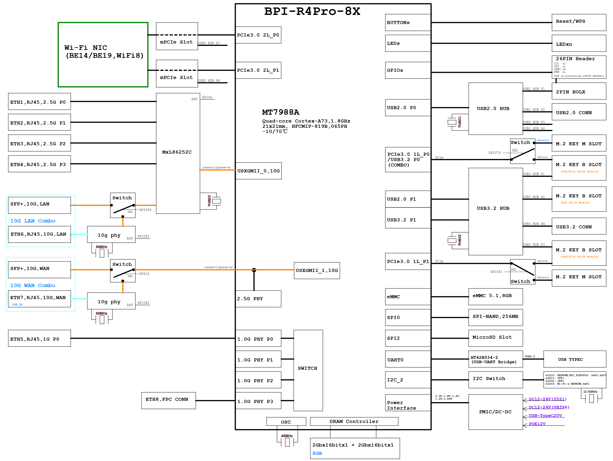

# Banana Pi BPI-R4 Pro 8X: image selection and first network setup


[**View Banana Pi BPI-R4 Pro 8X on OpenELAB**](https://openelab.io/products/banana-pi-bpi-r4-pro)

**Model:** BPI-R4 Pro 8X · **SKU:** `BPI-R4P-8X` · **Option:** 8GB DDR4 mainboard; identify the actual fitted Wi-Fi, cellular, storage, cooling and enclosure parts separately.


## Product overview <a href="#product-and-scope" id="product-and-scope"></a>

The BPI-R4 Pro 8X is a MediaTek MT7988A router-development board with 10GbE combo interfaces, four 2.5GbE copper ports and expansion for wireless, cellular and storage projects. **Its SFP/RJ45 combo sockets and some NVMe/cellular PCIe lanes share hardware resources.** Identify those relationships before assigning ports or installing modules; the 4E and original R4 use different hardware/image configurations. [Banana Pi model documentation](https://docs.banana-pi.org/en/BPI-R4_Pro/BananaPi_BPI-R4_Pro)

[Banana Pi manufacturer directory](./) · [AIoT documentation](../aiot-wiki-home-page.md)

## Applications

* Develop a wired router/firewall with explicitly documented LAN/WAN, VLAN and management interfaces.
* Evaluate Wi-Fi 6E/7 using a fitted, supported mPCIe radio, correct antennas and the selected image’s drivers.
* Prototype cellular failover with a supported modem, appropriate SIM configuration, antenna system and power budget.
* Build a network-storage experiment with NVMe while accounting for shared PCIe lanes and actual link throughput.
* Compare isolated network paths using finite `iperf3` tests and recorded thermal conditions. A 10GbE link rate is not a routed, encrypted or application-throughput guarantee.

## Specifications

| Item               | BPI-R4 Pro 8X                                                          | Important distinction                                                                            |
| ------------------ | ---------------------------------------------------------------------- | ------------------------------------------------------------------------------------------------ |
| Processor          | MT7988A Filogic 880; four Cortex-A73 cores at 1.8GHz                   | Do not substitute R4 Lite/Mini or MT7987 configuration                                           |
| Memory             | 8GB DDR4                                                               | 4E is a separate 4GB variant                                                                     |
| Onboard storage    | 8GB eMMC; principal model page lists 256MB SPI-NAND                    | Getting-started introduction still says 128MB; inspect the actual NAND/boot log before any erase |
| 10GbE WAN          | SFP+ and RJ45, shared combo                                            | One of the pair is usable at a time                                                              |
| 10GbE LAN          | SFP+ and RJ45, shared combo                                            | Inserting an SFP module can switch away from copper                                              |
| Other Ethernet     | Four 2.5GbE RJ45 LAN, one 1GbE RJ45 LAN, one 1GbE FPC connection       | A raw FPC connection needs a correctly designed external interface                               |
| Wi-Fi expansion    | Two mPCIe slots, PCIe 3.0 two-lane paths                               | Not evidence that ordinary mPCIe modules tolerate BPI’s additional 12V pins                      |
| Storage expansion  | Two M-Key 2280 PCIe 3.0 x1 slots                                       | Lanes can instead be routed to B-Key slots 1/2                                                   |
| Cellular expansion | Three B-Key slots with USB connectivity                                | The third does not gain a PCIe lane merely by fitting a PCIe modem                               |
| External USB       | One USB3.2 Type-A and one USB2.0 Type-A                                | Type-C debug and PD functions are separate connections                                           |
| Debug              | Onboard USB-to-UART at CN41                                            | 115200 baud, 8 data bits, no parity, 1 stop bit, no flow control                                 |
| Other interfaces   | 26-pin GPIO, two PWM fan connectors, RTC battery and extension headers | Signal levels and connector pinouts differ from Raspberry Pi                                     |
| Board outline      | 132 × 194mm                                                            | Confirm case/standoff clearances against official drawings                                       |

Hardware source: [model specifications](https://docs.banana-pi.org/en/BPI-R4_Pro/BananaPi_BPI-R4_Pro), [detailed interfaces](https://docs.banana-pi.org/en/BPI-R4_Pro/GettingStarted_BPI-R4_Pro). The 4E has a different copper-port layout and requires a different combo-switching method; its U-Boot commands must not be copied into an 8X setup.

## Hardware and connections <a href="#hardware-and-technical-documents" id="hardware-and-technical-documents"></a>

### Power and cooling baseline

For initial bring-up, use the documented **12V DC supply** at the center-positive DC5521 input CN44, with capacity selected for the complete assembly. The model page specifies 12V/5.2A or 19V/3.2A examples; the getting-started guide recommends 12V/5A. Use a correctly rated supplied/recommended adapter and check the received board/supply label rather than treating a low-load demonstration as the full peripheral budget. Connect one intended input initially.

USB-PD input is a separate power function from the CN41 debug console. The detailed guide recommends a supply capable of **20V PD and at least 65W**. It also describes wider DC input limits; the conservative first result here uses the documented 12V route. PoE requires an appropriate separate module: the documented RT5400 option is limited to approximately 30W and cannot be assumed sufficient for a fully populated system. [Power inputs and outputs](https://docs.banana-pi.org/en/BPI-R4_Pro/GettingStarted_BPI-R4_Pro#dc-in)

Fit the correct thermal pads/heatsinks and case airflow before sustained tests. The manufacturer’s assembly guide distinguishes a fixed 4010 fan, an alternative 5020 duct arrangement and optional BE14 fan/heatsink configurations. Follow the illustrated assembly sequence for the actual case and avoid installing both alternative arrangements indiscriminately. Manufacturer power and temperature tests are reference configurations, not measurements of your unit. [Assembly and thermal tests](https://docs.banana-pi.org/en/BPI-R4_Pro/TEST-R4_Pro)

### Network ports are not independent counts



Diagram: Banana Pi, [8X getting-started guide](https://docs.banana-pi.org/en/BPI-R4_Pro/GettingStarted_BPI-R4_Pro). The original source also provides a separate 4E block diagram.

| Shared path           | 8X behavior to account for                                                                                                                  |
| --------------------- | ------------------------------------------------------------------------------------------------------------------------------------------- |
| 10G WAN: SFP+ or RJ45 | Default documented image switches to SFP when a module is inserted; remove the SFP module when intentionally testing the paired copper port |
| 10G LAN: SFP+ or RJ45 | Same one-at-a-time constraint; verify the selected path in logs and link status                                                             |
| SFP SerDes            | Source documents a fixed 10Gbps SerDes; an arbitrary 1G-only SFP is not established compatible                                              |
| Copper 10G PHY        | Requires the correct PHY driver and cooling; supported lower link rates depend on the image release                                         |
| 2.5G group            | Uses the onboard MxL switch; separate board revisions can use compatible C/S-family parts                                                   |
| PCIe lane 0           | GPIO79 selects CN13 M-Key versus CN15 B-Key                                                                                                 |
| PCIe lane 1           | GPIO63 selects CN14 M-Key versus CN18 B-Key                                                                                                 |

The manufacturer describes high selecting M-Key and low selecting the corresponding B-Key path, but this guide does **not** recommend changing raw GPIOs during operation. Use the exact image/device-tree configuration and check module power/reset requirements first. Avoid assuming an NVMe SSD and cellular module can both use the same lane concurrently. [Ethernet and expansion routing](https://docs.banana-pi.org/en/BPI-R4_Pro/GettingStarted_BPI-R4_Pro)

### GPIO, fan and external power precautions

CON1’s 26-pin GPIO signals are **3.3V**. Separate 5V supply pins do not make the signal pins 5V-tolerant. Fan headers CN36/CN38 provide pin 1 ground, pin 2 12V, pin 3 unconnected and pin 4 PWM; they share PWM control and do not provide tachometer feedback. Do not substitute a 5V fan because another SBC uses one. [GPIO and fan tables](https://docs.banana-pi.org/en/BPI-R4_Pro/GettingStarted_BPI-R4_Pro#pin-definition)

CN3 is a system-input passthrough, **not a fixed 12V output**. CN2 has separate 12V/5V outputs, with the 5V rail shared with board functions. An output rail is not an invitation to power additional high-current equipment without a complete budget. M.2 supply adjustment can raise a nominal rail to 3.95V; mPCIe adjustment can raise it to 3.57V. Leave those settings unchanged until the exact module’s allowed voltage and the board schematic have been checked.

The source assigns `PCA_A_IO1_3` to both B-Key A reset and USB power control in different sections. That conflict is unresolved here: **raw reset/power-control writes involving that signal are excluded** until the received revision’s schematic establishes the mapping. The ordinary factory boot and read-only network checks below do not require those writes.

## Software and development resources <a href="#development-software-and-recovery" id="development-software-and-recovery"></a>

### Select 8X, its boot medium and an actual release

| Resource                                                                                        | Scope and compatibility decision                                                                            |
| ----------------------------------------------------------------------------------------------- | ----------------------------------------------------------------------------------------------------------- |
| [8X OpenWrt source](https://github.com/BPI-SINOVOIP/BPI-R4PRO-8X-OPENWRT-V24.10.0-Master-Devel) | Correct board repository; record an immutable commit when building                                          |
| [4E OpenWrt source](https://github.com/BPI-SINOVOIP/BPI-R4PRO-4E-OPENWRT-V24.10.0-Master-Devel) | Comparison/reference only; not the image target for this SKU                                                |
| `8X … DSA-251229` image in the model page                                                       | Release notes add RM500U/RM520N-GL/EM05 support, SSH-only MLD configuration and lower copper 10G PHY rates  |
| `8X … DSA-251125` image                                                                         | Source explicitly says no 5G cellular support and copper 10G ports limited to 10GBASE-T                     |
| BpiRouterOS                                                                                     | Separate firmware family; use its exact 8X image, management defaults and upgrade method                    |
| MxL firmware packages                                                                           | Separate switch firmware, not a complete boot image; verify exact part/version before considering an update |

The model’s [system image section](https://docs.banana-pi.org/en/BPI-R4_Pro/BananaPi_BPI-R4_Pro#system-image) contains the observed Google Drive/Baidu downloads and release notes. Cloud-hosted file availability is distinct from independently verifying image hashes, bootability or SDK builds. Do not label a mutable repository or filename as a tested software release.

### Choose a boot path without erasing the factory system

| SW3-A | SW3-B | Documented boot selection |
| ----- | ----- | ------------------------- |
| 1     | 1     | MicroSD                   |
| 0     | 1     | SPI-NAND                  |
| 1     | 0     | eMMC                      |

These are the source’s binary switch labels; confirm their physical orientation in the [bootstrap photograph](https://docs.banana-pi.org/bpi-r4_pro/bpi-r4pro-bootstrap3.png), not an assumed ON/OFF convention. Change boot straps with power disconnected. A `System halt!` message can mean the selected medium has no usable system; it does not immediately justify erasing another medium.

SD and eMMC share the SoC’s storage controller. The manufacturer’s eMMC migration procedure starts from **NAND**, not an SD-rooted system. Its NAND example targets the model-specific whole-NAND `mtd3` mapping, unlike the original R4’s example. Never paste an erase command on the basis of the model name alone: check the boot medium, partition listing, exact image and backup first. [Boot and installation procedures](https://docs.banana-pi.org/en/BPI-R4_Pro/GettingStarted_BPI-R4_Pro)

## Getting started

### 1. First serial login and board inventory

1. Record the 8X board label/revision, installed modules, adapter rating and intended image. Begin with an isolated bench network and the factory installation where available.
2. With power disconnected, choose the documented factory NAND boot setting and attach a USB data cable from the PC to **CN41**, the USB-to-UART debug connector.
3. Identify the new host serial port. Configure **115200, 8N1, no hardware/software flow control**. Use the known working terminal rather than guessing a universal port name.
4. Apply the intended power input and capture the boot log. Confirm a board/model and memory report consistent with **BPI-R4 Pro 8X / 8GB** before modifying software.
5. Log in according to the actual image’s instructions; create/change credentials and retain the image release’s management-address information. Do not assume another router’s default password or IP address.

The model’s [Power ON procedure](https://docs.banana-pi.org/en/BPI-R4_Pro/GettingStarted_BPI-R4_Pro#power-on) is the source for the console sequence. On the running OpenWrt shell, this original read-only inventory uses ordinary Linux/OpenWrt status interfaces:

```bash
uname -a
cat /etc/openwrt_release
cat /proc/meminfo
cat /proc/mtd
cat /proc/partitions
ip link show
ip address show
ip route show
```

**Expected result:** the selected OpenWrt release, approximately 8GB-class installed memory, visible storage partitions and a repeatable interface inventory. Available memory is lower than the nominal capacity. Partition labels and interface names are image-specific; save the actual output rather than copying the sample names from another release.

### 2. Establish one wired management path

Connect the PC to one deliberately identified LAN port and check carrier/link status and address assignment before attaching an uplink. If the image supplies a web interface, use the management address documented for that exact image; otherwise retain serial access while examining the network configuration. Save the original network configuration before changing bridges, VLANs, DHCP, firewall rules or WAN assignments.

Verify one port at a time. For the copper 10G test, leave the paired SFP socket empty and use a suitable peer and cable. Use the actual interface identified above; if installed in the image, `ethtool` reports negotiation and link detection. Match the source’s network topology before interpreting a result. [Official interface tests](https://docs.banana-pi.org/en/BPI-R4_Pro/GettingStarted_BPI-R4_Pro)

### 3. Run a finite throughput check after connectivity

The manufacturer uses `iperf3` for separate 10G, 2.5G and 1G paths. On an isolated test peer, start an `iperf3` server. On the client, substitute that peer’s **observed** address; the shell deliberately requires it to be set:

```bash
: "${TEST_PEER:?Set TEST_PEER to the isolated iperf3 server address}"
iperf3 -c "$TEST_PEER" -t 10
iperf3 -c "$TEST_PEER" -t 10 -R
```

**Expected result:** both finite tests complete with a throughput report and no link loss. The result measures that specific path, configuration and traffic direction. Record interface speed, packet errors, CPU load, NAT/offload state, peer performance and temperatures. Do not use a manufacturer’s laboratory number as a guaranteed routed/firewall/VPN rate. [Manufacturer test method](https://docs.banana-pi.org/en/BPI-R4_Pro/GettingStarted_BPI-R4_Pro)

### 4. Add optional modules one at a time

| Expansion            | Commissioning checks                                                                                                                                                                                       |
| -------------------- | ---------------------------------------------------------------------------------------------------------------------------------------------------------------------------------------------------------- |
| BE14/Wi-Fi NIC       | Verify the BPI-specific mPCIe electrical interface, mounting/heatsink, correct antenna connections and supported image; then inspect radio enumeration before configuring a network                        |
| Cellular             | Confirm modem model, allowed supply, USB/PCIe transport, SIM selection and antenna system; manufacturer-listed working examples are RM500U-CNV, RM520N-GL and EM05-E, not every module with a matching key |
| NVMe                 | Power off to install, verify 2280 fit and the lane mux; inspect enumeration before partitioning or formatting                                                                                              |
| USB                  | Confirm combined supply budget; the guide lists 5V/1.3A at each Type-A connector, with shared control considerations                                                                                       |
| RTC                  | Follow the documented CR1220 battery connector/orientation; do not infer rechargeability                                                                                                                   |
| External SIM/LED/FPC | Use the exact full pin table and a purpose-designed adapter; the documentation calls these reserved/extension functions                                                                                    |

For cellular modules, the source distinguishes onboard SIM1 routing, external CN45 signals and a second SIM signal set that only works if the modem supports it. Network-status LEDs are modem-specific outputs. A fitted SIM does not establish operator/band support or successful registration.

### 5. Recovery and image development

Prepare a known-compatible removable recovery image and backups before altering NAND/eMMC. In an image-writing utility, select the exact removable device and verify completion; a normal file copy is not equivalent to flashing an SD image. The official FAQ’s SD-startup remedy is to recreate the medium correctly and try another high-speed card after checking the boot selection. Do not run a generic disk-wipe command against an unverified host disk.

For custom OpenWrt development, use the **8X** repository and its build instructions/configuration, record the commit and package feeds, build away from production data, and validate on a recoverable board. Treat upstream kernel patches and MediaTek white papers as background resources rather than proof that a particular prebuilt image implements every feature. Preserve the last working image and configuration before changing switch firmware, U-Boot or wireless drivers.

## Troubleshooting and FAQs <a href="#faqs" id="faqs"></a>

| Symptom                                         | Ordered checks                                                                                                                                 |
| ----------------------------------------------- | ---------------------------------------------------------------------------------------------------------------------------------------------- |
| `System halt!` on serial                        | Check SW3 orientation and selected medium; verify that medium contains the correct 8X image before changing another storage device             |
| SD does not boot                                | Recreate the complete image on the correctly identified card, check write verification and try a suitable alternative card; retain serial logs |
| Paired 10G RJ45 stops when SFP is fitted        | Check combo-port selection first; remove the module for a deliberate copper-only test                                                          |
| 1G/2.5G peer will not link on a 10G copper port | Check the exact image release’s PHY-rate support; the older documented release only supports 10GBASE-T on those ports                          |
| M-Key SSD or PCIe modem absent                  | Check shared lane destination, module transport and power; avoid raw mux writes while a device is active                                       |
| Wi-Fi absent                                    | Verify that a supported NIC is physically installed, has correct cooling/antennas and uses the intended firmware/driver                        |
| Cellular module unrecognized                    | Check that the image supports cellular, then power, USB enumeration, SIM routing and the module’s own registration diagnostics                 |
| Fan speed not reported                          | The documented fan header has no tachometer feedback; an absent RPM reading does not by itself prove a stopped fan                             |
| Instability after adding modules                | Return to the baseline, compare supply capability and heat, then add each load separately                                                      |
| Reset press erases configuration                | Button behavior is image-specific; the 251229 image distinguishes short restart and long reset. Back up configuration before testing           |
| USB power/reset control mapping is unclear      | Do not issue writes to the conflicting `PCA_A_IO1_3` assignment; resolve the received board’s schematic first                                  |

Sources: [model guide](https://docs.banana-pi.org/en/BPI-R4_Pro/BananaPi_BPI-R4_Pro), [detailed interface/setup guide](https://docs.banana-pi.org/en/BPI-R4_Pro/GettingStarted_BPI-R4_Pro), [official SD-startup FAQ](https://docs.banana-pi.org/en/BPI-R4Pro/BananaPi_BPI-R4Pro_FAQ).

## Connector and measured-reference appendix

The following factual connection tables are transcribed from [Banana Pi’s R4 Pro interface documentation](https://docs.banana-pi.org/en/BPI-R4_Pro/GettingStarted_BPI-R4_Pro). They supplement the commissioning procedure; verify the received revision and schematic before designing adapters. `NI` marks a source-designated unimplemented connection and `NOTCH` is the mechanical key. Supply rails, signal domains and pin numbering must remain distinct. The reset/control conflict described above remains excluded from raw-write procedures.

### FAN (CN36/CN38)

| PIN No. | Connection Destination |
| ------- | ---------------------- |
| 1       | GND                    |
| 2       | 12V                    |
| 3       | NC                     |
| 4       | PWM（5V）                |

### 26 GPIO Header(CON1)

| Connection Destination     | PIN No. | PIN No. | Connection Destination                   |
| -------------------------- | ------- | ------- | ---------------------------------------- |
| 3.3VD                      | 1       | 2       | 5VD                                      |
| GPIO18/I2C\_1\_SDA         | 3       | 4       | 5VD                                      |
| GPIO17/I2C\_1\_SCL         | 5       | 6       | GND                                      |
| GPIO62/JTAG\_JTRST\_N/PWM6 | 7       | 8       | GPIO59/JTAG\_JTDO/UART1\_TX/UART2\_TX    |
| GND                        | 9       | 10      | GPIO58/JTAG\_JTDI/UART1\_RX/UART2\_RX    |
| GPIO81/UART1\_TXD          | 11      | 12      | GPIO51/PCM\_CLK\_I2S\_BCLK               |
| GPIO80/UART1\_RXD          | 13      | 14      | GND                                      |
| GPIO50/PCM\_FS\_I2S\_LRCK  | 15      | 16      | GPIO61/JTAG\_JTCLK/UART1\_RTS/UART2\_RTS |
| 3.3VD                      | 17      | 18      | GPIO60/JTAG\_JTMS/UART1\_CTS/UART2\_CTS  |
| GPIO30/SPI1\_MOSI          | 19      | 20      | GND                                      |
| GPIO29/SPI1\_MISO          | 21      | 22      | GPIO53/PCM\_DTX\_I2S\_DOUT               |
| GPIO31/SPI1\_CLK           | 23      | 24      | GPIO28/SPI1\_CSB                         |
| GND                        | 25      | 26      | GPIO52/PCM\_DRX\_I2S\_DIN                |

### miniPCIe Slot1(CN7)

| Connection Destination       | PIN No. | PIN NO. | Connection Destination       |
| ---------------------------- | ------- | ------- | ---------------------------- |
| PCIE\_2L\_0\_WAKE\_N(3.3V)   | 1       | 2       | PCIe\_3V3#2                  |
| NI                           | 3       | 4       | GND                          |
| NI                           | 5       | 6       | PCIe\_12V#2                  |
| PCIE\_2L\_0\_CLKREQ\_N(3.3V) | 7       | 8       | mPCIe\_A\_USIM\_VDD          |
| GND                          | 9       | 10      | mPCIe\_A\_USIM\_DATA         |
| PCIE\_2L\_0\_SOC\_CKn        | 11      | 12      | mPCIe\_A\_USIM\_CLK          |
| PCIE\_2L\_0\_SOC\_CKp        | 13      | 14      | mPCIe\_A\_USIM\_RST          |
| GND                          | 15      | 16      | NI                           |
| PCIE\_2L\_0\_LN1\_SOC\_RXn   | 17      | 18      | GND                          |
| PCIE\_2L\_0\_LN1\_SOC\_RXp   | 19      | 20      | NI                           |
| GND                          | 21      | 22      | PCIE\_2L\_0\_PRESET\_N(3.3V) |
| PCIE\_2L\_0\_LN0\_SOC\_RXn   | 23      | 24      | PCIe\_3V3#2                  |
| PCIE\_2L\_0\_LN0\_SOC\_RXp   | 25      | 26      | GND                          |
| GND                          | 27      | 28      | PCIe\_12V#2                  |
| GND                          | 29      | 30      | I2C\_SCL\_EXT\_WiFi          |
| PCIE\_2L\_0\_LN0\_SOC\_TXn   | 31      | 32      | I2C\_SDA\_EXT\_WiFi          |
| PCIE\_2L\_0\_LN0\_SOC\_TXp   | 33      | 34      | GND                          |
| GND                          | 35      | 36      | USB2HUB-D3M                  |
| GND                          | 37      | 38      | USB2HUB-D3P                  |
| PCIe\_3V3#2                  | 39      | 40      | GND                          |
| PCIe\_3V3#2                  | 41      | 42      | WiFi-LED-5G                  |
| GND                          | 43      | 44      | mPCIe\_A\_USIM\_DET          |
| PCIE\_2L\_0\_LN1\_SOC\_TXn   | 45      | 46      | WiFi-LED-2G                  |
| PCIE\_2L\_0\_LN1\_SOC\_TXp   | 47      | 48      | PCIe\_12V#2                  |
| GND                          | 49      | 50      | GND                          |
| MT7996\_EINT\_RESETB(1.8V)   | 51      | 52      | PCIe\_3V3#2                  |

### miniPCIe Slot2(CN9)

| Connection Destination       | PIN | PIN | Connection Destination       |
| ---------------------------- | --- | --- | ---------------------------- |
| PCIE\_2L\_1\_WAKE\_N(3.3V)   | 1   | 2   | PCIe\_3V3#1                  |
| NI                           | 3   | 4   | GND                          |
| NI                           | 5   | 6   | PCIe\_12V#1                  |
| PCIE\_2L\_1\_CLKREQ\_N(3.3V) | 7   | 8   | mPCIe\_B\_USIM\_VDD          |
| GND                          | 9   | 10  | mPCIe\_B\_USIM\_DATA         |
| PCIE\_2L\_1\_SOC\_CKn        | 11  | 12  | mPCIe\_B\_USIM\_CLK          |
| PCIE\_2L\_1\_SOC\_CKp        | 13  | 14  | mPCIe\_B\_USIM\_RST          |
| GND                          | 15  | 16  | NI                           |
| PCIE\_2L\_1\_LN1\_SOC\_RXn   | 17  | 18  | GND                          |
| PCIE\_2L\_1\_LN1\_SOC\_RXp   | 19  | 20  | NI                           |
| GND                          | 21  | 22  | PCIE\_2L\_1\_PRESET\_N(3.3V) |
| PCIE\_2L\_1\_LN0\_SOC\_RXn   | 23  | 24  | PCIe\_3V3#1                  |
| PCIE\_2L\_1\_LN0\_SOC\_RXp   | 25  | 26  | GND                          |
| GND                          | 27  | 28  | PCIe\_12V#1                  |
| GND                          | 29  | 30  | I2C\_SCL\_EXT\_WiFi          |
| PCIE\_2L\_1\_LN0\_SOC\_TXn   | 31  | 32  | I2C\_SDA\_EXT\_WiFi          |
| PCIE\_2L\_1\_LN0\_SOC\_TXp   | 33  | 34  | GND                          |
| GND                          | 35  | 36  | USB2HUB-D2M                  |
| GND                          | 37  | 38  | USB2HUB-D2P                  |
| PCIe\_3V3#1                  | 39  | 40  | GND                          |
| PCIe\_3V3#1                  | 41  | 42  | WiFi-LED-6G                  |
| GND                          | 43  | 44  | mPCIe\_B\_USIM\_DET          |
| PCIE\_2L\_1\_LN1\_SOC\_TXn   | 45  | 46  | NI                           |
| PCIE\_2L\_1\_LN1\_SOC\_TXp   | 47  | 48  | PCIe\_12V#1                  |
| GND                          | 49  | 50  | GND                          |
| NI                           | 51  | 52  | PCIe\_3V3#1                  |

### M.2 B-KEY Slot1(CN15)

| Connection Destination | PIN No. | PIN NO. | Connection Destination |
| ---------------------- | ------- | ------- | ---------------------- |
| NI                     | 1       | 2       | VDD\_BKEY\_A           |
| GND                    | 3       | 4       | VDD\_BKEY\_A           |
| GND                    | 5       | 6       | NI(10K PullUp to 3.3V) |
| USBHUB\_USB1\_Dp       | 7       | 8       | NI                     |
| USBHUB\_USB1\_Dn       | 9       | 10      | BKEY-A-NET-STUn LED    |
| GND                    | 11      | 12      | NOTCH                  |
| NOTCH                  | 13      | 14      | NOTCH                  |
| NOTCH                  | 15      | 16      | NOTCH                  |
| NOTCH                  | 17      | 18      | NOTCH                  |
| NOTCH                  | 19      | 20      | NI                     |
| NI                     | 21      | 22      | NI                     |
| NI                     | 23      | 24      | NI                     |
| NI                     | 25      | 26      | NI                     |
| GND                    | 27      | 28      | NI                     |
| USBHUB\_USB1\_RXn      | 29      | 30      | USIM\_RST-1A           |
| USBHUB\_USB1\_RXp      | 31      | 32      | USIM\_CLK-1A           |
| GND                    | 33      | 34      | USIM\_DATA-1A          |
| USBHUB\_USB1\_TXn      | 35      | 36      | USIM\_VDD-1A           |
| USBHUB\_USB1\_TXp      | 37      | 38      | NI                     |
| GND                    | 39      | 40      | NI                     |
| PCIE\_SW\_A\_C\_RXn    | 41      | 42      | USIM\_DATA-1B          |
| PCIE\_SW\_A\_C\_RXp    | 43      | 44      | USIM\_CLK-1B           |
| GND                    | 45      | 46      | USIM\_RST-1B           |
| PCIE\_SW\_A\_C\_TXn    | 47      | 48      | USIM\_VDD-1B           |
| PCIE\_SW\_A\_C\_TXp    | 49      | 50      | BKEY-A-PRESET\_3P3V    |
| GND                    | 51      | 52      | BKEY-A-CLKREQ\_3P3V    |
| PCIE\_SW\_A\_C\_CKn    | 53      | 54      | BKEY-A-WAKE\_3P3V      |
| PCIE\_SW\_A\_C\_CKp    | 55      | 56      | NI                     |
| GND                    | 57      | 58      | NI                     |
| NI                     | 59      | 60      | NI                     |
| NI                     | 61      | 62      | NI                     |
| NI                     | 63      | 64      | NI                     |
| NI                     | 65      | 66      | USIM\_DET-1A           |
| BKEY-A-RST             | 67      | 68      | NI                     |
| NI                     | 69      | 70      | VDD\_BKEY\_A           |
| GND                    | 71      | 72      | VDD\_BKEY\_A           |
| GND                    | 73      | 74      | VDD\_BKEY\_A           |
| NI                     | 75      |         |                        |

### M.2 B-KEY Slot2(CN18)

| Connection Destination | PIN No. | PIN NO. | Connection Destination |
| ---------------------- | ------- | ------- | ---------------------- |
| NI                     | 1       | 2       | VDD\_BKEY\_B           |
| GND                    | 3       | 4       | VDD\_BKEY\_B           |
| GND                    | 5       | 6       | NI(10K PullUp to 3.3V) |
| USBHUB\_USB2\_Dp       | 7       | 8       | NI                     |
| USBHUB\_USB2\_Dn       | 9       | 10      | BKEY-B-NET-STUn LED    |
| GND                    | 11      | 12      | NOTCH                  |
| NOTCH                  | 13      | 14      | NOTCH                  |
| NOTCH                  | 15      | 16      | NOTCH                  |
| NOTCH                  | 17      | 18      | NOTCH                  |
| NOTCH                  | 19      | 20      | NI                     |
| NI                     | 21      | 22      | NI                     |
| NI                     | 23      | 24      | NI                     |
| NI                     | 25      | 26      | NI                     |
| GND                    | 27      | 28      | NI                     |
| USBHUB\_USB2\_RXn      | 29      | 30      | USIM\_RST-2A           |
| USBHUB\_USB2\_RXp      | 31      | 32      | USIM\_CLK-2A           |
| GND                    | 33      | 34      | USIM\_DATA-2A          |
| USBHUB\_USB2\_TXn      | 35      | 36      | USIM\_VDD-2A           |
| USBHUB\_USB2\_TXp      | 37      | 38      | NI                     |
| GND                    | 39      | 40      | NI                     |
| PCIE\_SW\_B\_C\_RXn    | 41      | 42      | USIM\_DATA-2B          |
| PCIE\_SW\_B\_C\_RXp    | 43      | 44      | USIM\_CLK-2B           |
| GND                    | 45      | 46      | USIM\_RST-2B           |
| PCIE\_SW\_B\_C\_TXn    | 47      | 48      | USIM\_VDD-2B           |
| PCIE\_SW\_B\_C\_TXp    | 49      | 50      | BKEY-B-PRESET\_3P3V    |
| GND                    | 51      | 52      | BKEY-B-CLKREQ\_3P3V    |
| PCIE\_SW\_B\_C\_CKn    | 53      | 54      | BKEY-B-WAKE\_3P3V      |
| PCIE\_SW\_B\_C\_CKp    | 55      | 56      | NI                     |
| GND                    | 57      | 58      | NI                     |
| NI                     | 59      | 60      | NI                     |
| NI                     | 61      | 62      | NI                     |
| NI                     | 63      | 64      | NI                     |
| NI                     | 65      | 66      | USIM\_DET-2A           |
| BKEY-A\_RSTn           | 67      | 68      | NI                     |
| NI                     | 69      | 70      | VDD\_BKEY\_B           |
| GND                    | 71      | 72      | VDD\_BKEY\_B           |
| GND                    | 73      | 74      | VDD\_BKEY\_B           |
| NI                     | 75      |         |                        |

### M.2 B-KEY Slot3(CN21)

| Connection Destination | PIN No. | PIN NO. | Connection Destination     |
| ---------------------- | ------- | ------- | -------------------------- |
| NI                     | 1       | 2       | VDD\_BKEY\_C               |
| GND                    | 3       | 4       | VDD\_BKEY\_C               |
| GND                    | 5       | 6       | NI(10K PullUp to 3.3V)     |
| USBHUB\_USB4\_Dp       | 7       | 8       | NI                         |
| USBHUB\_USB4\_Dn       | 9       | 10      | BKEY-C-NET-STUn LED        |
| GND                    | 11      | 12      | NOTCH                      |
| NOTCH                  | 13      | 14      | NOTCH                      |
| NOTCH                  | 15      | 16      | NOTCH                      |
| NOTCH                  | 17      | 18      | NOTCH                      |
| NOTCH                  | 19      | 20      | NI                         |
| NI                     | 21      | 22      | NI                         |
| NI                     | 23      | 24      | NI                         |
| NI                     | 25      | 26      | NI                         |
| GND                    | 27      | 28      | NI                         |
| USBHUB\_USB4\_RXn      | 29      | 30      | USIM\_RST-3A               |
| USBHUB\_USB4\_RXp      | 31      | 32      | USIM\_CLK-3A               |
| GND                    | 33      | 34      | USIM\_DATA-3A              |
| USBHUB\_USB4\_TXn      | 35      | 36      | USIM\_VDD-3A               |
| USBHUB\_USB4\_TXp      | 37      | 38      | NI                         |
| GND                    | 39      | 40      | NI                         |
| NI                     | 41      | 42      | USIM\_DATA-3B              |
| NI                     | 43      | 44      | USIM\_CLK-3B               |
| GND                    | 45      | 46      | USIM\_RST-3B               |
| NI                     | 47      | 48      | USIM\_VDD-3B               |
| NI                     | 49      | 50      | BKEY-C\_PCIE\_PERST\_3P3V  |
| GND                    | 51      | 52      | BKEY-C\_PCIE\_CLKREQ\_3P3V |
| NI                     | 53      | 54      | BKEY-C\_PCIE\_PEWAKE\_3P3V |
| NI                     | 55      | 56      | NI                         |
| GND                    | 57      | 58      | NI                         |
| NI                     | 59      | 60      | NI                         |
| NI                     | 61      | 62      | NI                         |
| NI                     | 63      | 64      | NI                         |
| NI                     | 65      | 66      | USIM\_DET-3A               |
| BKEY-C\_RSTn           | 67      | 68      | NI                         |
| NI                     | 69      | 70      | VDD\_BKEY\_C               |
| GND                    | 71      | 72      | VDD\_BKEY\_C               |
| GND                    | 73      | 74      | VDD\_BKEY\_C               |
| NI                     | 75      |         |                            |

### M.2 M-KEY Slot1(CN13)

| Connection Destination | PIN | PIN | Connection Destination |
| ---------------------- | --- | --- | ---------------------- |
| GND                    | 1   | 2   | VDD\_MKEY\_A           |
| GND                    | 3   | 4   | VDD\_MKEY\_A           |
| NI                     | 5   | 6   | NI                     |
| NI                     | 7   | 8   | NI                     |
| GND                    | 9   | 10  | MKEY-A-SSD-LEDn        |
| NI                     | 11  | 12  | VDD\_MKEY\_A           |
| NI                     | 13  | 14  | VDD\_MKEY\_A           |
| GND                    | 15  | 16  | VDD\_MKEY\_A           |
| NI                     | 17  | 18  | VDD\_MKEY\_A           |
| NI                     | 19  | 20  | NI                     |
| GND                    | 21  | 22  | NI                     |
| NI                     | 23  | 24  | NI                     |
| NI                     | 25  | 26  | NI                     |
| GND                    | 27  | 28  | NI                     |
| NI                     | 29  | 30  | NI                     |
| NI                     | 31  | 32  | NI                     |
| GND                    | 33  | 34  | NI                     |
| NI                     | 35  | 36  | NI                     |
| NI                     | 37  | 38  | NI                     |
| GND                    | 39  | 40  | NI                     |
| PCIE\_SW\_A\_B\_RXn    | 41  | 42  | NI                     |
| PCIE\_SW\_A\_B\_RXp    | 43  | 44  | NI                     |
| GND                    | 45  | 46  | NI                     |
| PCIE\_SW\_A\_B\_TXn    | 47  | 48  | NI                     |
| PCIE\_SW\_A\_B\_TXp    | 49  | 50  | MKEY-A-PRESET\_3P3V    |
| GND                    | 51  | 52  | MKEY-A-CLKREQ\_3P3V    |
| PCIE\_SW\_A\_B\_CKn    | 53  | 54  | MKEY-A-WAKE\_3P3V      |
| PCIE\_SW\_A\_B\_CKp    | 55  | 56  | NI                     |
| GND                    | 57  | 58  | NI                     |
| NOCTH                  | 59  | 60  | NOCTH                  |
| NOCTH                  | 61  | 62  | NOCTH                  |
| NOCTH                  | 63  | 64  | NOCTH                  |
| NOCTH                  | 65  | 66  | NOCTH                  |
| NI                     | 67  | 68  | NI                     |
| NI                     | 69  | 70  | VDD\_MKEY\_A           |
| GND                    | 71  | 72  | VDD\_MKEY\_A           |
| GND                    | 73  | 74  | VDD\_MKEY\_A           |
| GND                    | 75  |     |                        |

### M.2 M-KEY Slot2(CN14)

| Connection Destination | PIN | PIN | Connection Destination |
| ---------------------- | --- | --- | ---------------------- |
| GND                    | 1   | 2   | VDD\_MKEY\_B           |
| GND                    | 3   | 4   | VDD\_MKEY\_B           |
| NI                     | 5   | 6   | NI                     |
| NI                     | 7   | 8   | NI                     |
| GND                    | 9   | 10  | MKEY-B-SSD-LEDn        |
| NI                     | 11  | 12  | VDD\_MKEY\_B           |
| NI                     | 13  | 14  | VDD\_MKEY\_B           |
| GND                    | 15  | 16  | VDD\_MKEY\_B           |
| NI                     | 17  | 18  | VDD\_MKEY\_B           |
| NI                     | 19  | 20  | NI                     |
| GND                    | 21  | 22  | NI                     |
| NI                     | 23  | 24  | NI                     |
| NI                     | 25  | 26  | NI                     |
| GND                    | 27  | 28  | NI                     |
| NI                     | 29  | 30  | NI                     |
| NI                     | 31  | 32  | NI                     |
| GND                    | 33  | 34  | NI                     |
| NI                     | 35  | 36  | NI                     |
| NI                     | 37  | 38  | NI                     |
| GND                    | 39  | 40  | NI                     |
| PCIE\_SW\_B\_B\_RXn    | 41  | 42  | NI                     |
| PCIE\_SW\_B\_B\_RXp    | 43  | 44  | NI                     |
| GND                    | 45  | 46  | NI                     |
| PCIE\_SW\_B\_B\_TXn    | 47  | 48  | NI                     |
| PCIE\_SW\_B\_B\_TXp    | 49  | 50  | MKEY-B-PRESET\_3P3V    |
| GND                    | 51  | 52  | MKEY-B-CLKREQ\_3P3V    |
| PCIE\_SW\_B\_B\_CKn    | 53  | 54  | MKEY-B-WAKE\_3P3V      |
| PCIE\_SW\_B\_B\_CKp    | 55  | 56  | NI                     |
| GND                    | 57  | 58  | NI                     |
| NOCTH                  | 59  | 60  | NOCTH                  |
| NOCTH                  | 61  | 62  | NOCTH                  |
| NOCTH                  | 63  | 64  | NOCTH                  |
| NOCTH                  | 65  | 66  | NOCTH                  |
| NI                     | 67  | 68  | NI                     |
| NI                     | 69  | 70  | VDD\_MKEY\_B           |
| GND                    | 71  | 72  | VDD\_MKEY\_B           |
| GND                    | 73  | 74  | VDD\_MKEY\_B           |
| GND                    | 75  |     |                        |

### 1G FPC Connector(CN37)

| PIN No. | Connection Destination |
| ------- | ---------------------- |
| 1       | X4N-M8                 |
| 2       | X4P-M8                 |
| 3       | X3N-M8                 |
| 4       | X3P-M8                 |
| 5       | X2N-M8                 |
| 6       | X2P-M8                 |
| 7       | X1N-M8                 |
| 8       | X1P-M8                 |
| 9       | PGND                   |
| 10      | RJ45\_LED\_D           |
| 11      | 3.3VD                  |

### External LED connector(CN40)

| PIN No. | Connection Destination    |
| ------- | ------------------------- |
| 1       | NI(BootStrap\_SW3\_A)     |
| 2       | NI(BootStrap\_SW3\_B)     |
| 3       | NI(SYSRSTB\_MT7988\_1p8V) |
| 4       | NI(GPIO13\_RESET\_1p8V)   |
| 5       | NI(GPIO14\_WPS\_1p8V)     |
| 6       | DEBUG\_UART\_TXD          |
| 7       | DEBUG\_UART\_RXD          |
| 8       | SYS\_LEDBn-3p3V           |
| 9       | SYS\_LEDRn-3p3V           |
| 10      | MKEY-A-SSD-LEDn           |
| 11      | MKEY-B-SSD-LEDn           |
| 12      | BKEY-A-NET-STUn           |
| 13      | BKEY-B-NET-STUn           |
| 14      | BKEY-C-NET-STUn           |
| 15      | WiFi-LED-2G               |
| 16      | WiFi-LED-5G               |
| 17      | WiFi-LED-6G               |
| 18      | GND                       |
| 19      | 3.3VD                     |
| 20      | 3.3VD                     |

### External SIM Card connector(CN45)

| PIN No. | Connection Destination   |
| ------- | ------------------------ |
| 1       | USIM\_VDD-1A-FPC         |
| 2       | USIM\_RST-1A-FPC         |
| 3       | USIM\_CLK-1A-FPC         |
| 4       | USIM\_DATA-1A-FPC        |
| 5       | USIM\_DET-1A-FPC         |
| 6       | GND                      |
| 7       | USIM\_VDD-2A-FPC         |
| 8       | USIM\_RST-2A-FPC         |
| 9       | USIM\_CLK-2A-FPC         |
| 10      | USIM\_DATA-2A-FPC        |
| 11      | USIM\_DET-2A-FPC         |
| 12      | GND                      |
| 13      | USIM\_VDD-3A-FPC         |
| 14      | USIM\_RST-3A-FPC         |
| 15      | USIM\_CLK-3A-FPC         |
| 16      | USIM\_DATA-3A-FPC        |
| 17      | USIM\_DET-3A-FPC         |
| 18      | GND                      |
| 19      | mPCIe\_B\_USIM\_VDD-FPC  |
| 20      | mPCIe\_B\_USIM\_RST-FPC  |
| 21      | mPCIe\_B\_USIM\_CLK-FPC  |
| 22      | mPCIe\_B\_USIM\_DATA-FPC |
| 23      | mPCIe\_B\_USIM\_DET-FPC  |
| 24      | GND                      |
| 25      | mPCIe\_A\_USIM\_VDD-FPC  |
| 26      | mPCIe\_A\_USIM\_RST-FPC  |
| 27      | mPCIe\_A\_USIM\_CLK-FPC  |
| 28      | mPCIe\_A\_USIM\_DATA-FPC |
| 29      | mPCIe\_A\_USIM\_DET-FPC  |
| 30      | 3.3VD                    |

### DC-IN connector(CN44)

| PIN No. | Connection Destination |
| ------- | ---------------------- |
| 1       | DCIN\_12\_24V          |
| 2       | GND                    |

### DC-IN connector(CN6)

| PIN No. | Connection Destination |
| ------- | ---------------------- |
| 1       | VH396\_DCIN            |
| 2       | GND                    |

### DC-OUT connector(CN3)

| PIN No. | Connection Destination |
| ------- | ---------------------- |
| 1       | VDD\_SYS               |
| 2       | GND                    |

### DC-OUT connector(CN2)

| PIN No. | Connection Destination |
| ------- | ---------------------- |
| 1       | VDD\_12V               |
| 2       | GND                    |
| 3       | GND                    |
| 4       | +5VD                   |

### Published power and temperature reference configurations

These are **manufacturer-reported tests**, not OpenELAB measurements, supply-design maxima or guaranteed temperatures. The source describes roughly 1W instantaneous variation, distinguishes low network traffic from simultaneous interface tests, and measures temperatures with probes. Retain each configuration and its stated conditions when comparing the numbers. [Original power, thermal and assembly reference](https://docs.banana-pi.org/en/BPI-R4_Pro/TEST-R4_Pro)

#### No-load power

| Peripheral device status        | Equipment in unused state Voltage（V） | Electric current(A) | Power consumption(W) |
| ------------------------------- | ------------------------------------ | ------------------- | -------------------- |
| Only the board                  | 20.26                                | 0.45                | 9.18                 |
| BE14 WiFi                       | 20.20                                | 0.78                | 15.90                |
| One EM05 on M.2KEY B            | 20.26                                | 0.46                | 9.33                 |
| Two EM05 on M.2KEY B            | 20.25                                | 0.49                | 9.97                 |
| Three EM05 on M.2KEY B          | 20.25                                | 0.52                | 10.57                |
| Two SFP network ports           | 20.23                                | 0.61                | 12.53                |
| BE14 WiFi+Two SFP network ports | 20.18                                | 0.94                | 19.07                |
| One NVME SSD                    | 20.26                                | 0.47                | 9.64                 |
| Two NVME SSD                    | 20.25                                | 0.54                | 10.95                |

#### Load power

| Equipment usage status                                             | Voltage（V） | Electric current(A) | Power consumption(W) |
| ------------------------------------------------------------------ | ---------- | ------------------- | -------------------- |
| Only the board (stress-ng --cpu 4)                                 | 20.23      | 0.54                | 11.03                |
| BE14 WiFi                                                          | 20.21      | 0.81                | 16.39                |
| Two SFP network ports                                              | 20.21      | 0.63                | 13.19                |
| BE14 WiFi+Two SFP network ports                                    | 20.19      | 0.93                | 19.52                |
| One NVME SSD                                                       | 20.25      | 0.55                | 11.31                |
| Two NVME SSD                                                       | 20.20      | 0.73                | 14.93                |
| Two FAN (One 4010 FAN+One 5020 FAN)                                | 20.23      | 0.52                | 10.65                |
| Two FAN (Two 4010 FAN)                                             | 20.24      | 0.48                | 9.74                 |
| BE14 WiFi+Two SFP network ports+Two FAN(One 4010 FAN+One 5020 FAN) | 20.16      | 1.01                | 20.50                |
| BE14 WiFi+Two SFP network ports+Two FAN(Two 4010 FAN)              | 20.18      | 0.97                | 19.70                |

#### Temperature data

| Equipment usage status                                        | CPU heatsink temperature(℃) | BE14 heatsink temperature(℃) | SFP WAN module temperature(℃) | SFP LAN module temperature(℃) |
| ------------------------------------------------------------- | --------------------------- | ---------------------------- | ----------------------------- | ----------------------------- |
| without BE14 fan (with One 4010 FAN+One 5020 FAN) + Idle load | 35.44                       | 32.2                         | 32.24                         | 31.23                         |
| without BE14 fan (with One 4010 FAN+One 5020 FAN) + Full load | 40.83                       | 33.64                        | 43.59                         | 40.7                          |
| without BE14 fan (with Two 4010 FAN) + Idle load              | 41.45                       | 32.97                        | 38.21                         | 37.42                         |
| without BE14 fan (with Two 4010 FAN) + Full load              | 49.58                       | 34.09                        | 57.1                          | 55.42                         |
| with BE14 fan (with One 4010 FAN+One 5020 FAN) + Idle load    | 34.63                       | 28.91                        | 32.01                         | 30.67                         |
| with BE14 fan (with One 4010 FAN+One 5020 FAN) + Full load    | 38.06                       | 28.95                        | 42.23                         | 38.39                         |
| with BE14 fan (with Two 4010 FAN) + Idle load                 | 37.59                       | 29.67                        | 36.36                         | 35.83                         |
| with BE14 fan (with Two 4010 FAN) + Full load                 | 45.24                       | 31.09                        | 54.7                          | 52.97                         |

## Downloads and technical documents

| Official resource                                                                                         | What it provides                                                                                                                          |
| --------------------------------------------------------------------------------------------------------- | ----------------------------------------------------------------------------------------------------------------------------------------- |
| [R4 Pro model page](https://docs.banana-pi.org/en/BPI-R4_Pro/BananaPi_BPI-R4_Pro)                         | 8X/4E comparison, layout/photos, accessory selection, source repositories, mechanical/electrical resources and image notes                |
| [Getting started and full interfaces](https://docs.banana-pi.org/en/BPI-R4_Pro/GettingStarted_BPI-R4_Pro) | Boot straps, SD/NAND/eMMC workflows, Ethernet and PCIe muxing, Wi-Fi/cellular power, USB, RTC, EEPROM, LEDs and complete connector tables |
| [Power, temperature and installation tests](https://docs.banana-pi.org/en/BPI-R4_Pro/TEST-R4_Pro)         | Manufacturer test configurations and four illustrated case/cooling options; not a guaranteed maximum operating envelope                   |
| [SD startup FAQ](https://docs.banana-pi.org/en/BPI-R4Pro/BananaPi_BPI-R4Pro_FAQ)                          | Recovery checks and reference boot logs                                                                                                   |
| [8X source](https://github.com/BPI-SINOVOIP/BPI-R4PRO-8X-OPENWRT-V24.10.0-Master-Devel)                   | OpenWrt development tree/configuration; preserve its licenses and component notices                                                       |
| [Hardware resources section](https://docs.banana-pi.org/en/BPI-R4_Pro/BananaPi_BPI-R4_Pro#resources)      | Assembly, schematic, DXF, 3D files, MT7988A documents and upstream references; Google Drive/Baidu mirrors are listed by the manufacturer  |
| [System images](https://docs.banana-pi.org/en/BPI-R4_Pro/BananaPi_BPI-R4_Pro#system-image)                | Separate 8X/4E images, release notes and MxL firmware files                                                                               |
| [BpiRouterOS documentation](https://docs.banana-pi.org/en/BpiRouterOS/BananaPi_BpiRouterOS)               | Separate firmware family and its configuration/upgrade path                                                                               |

Do not treat a document-center link as a verified downloaded archive. The resource index below retains the observed technical downloads and all connector reference-table facts from the model documentation; commercial marketplace links and social/community promotions are not setup prerequisites.

### Direct manufacturer-listed technical downloads

Use the file description and variant at the source page to select the correct resource. These links were observed in the official directory; cloud file contents and image hashes have not all been independently verified. The manufacturer’s Baidu listings show access code `8888`. A 4E file is a reference resource, not an 8X installation target.

| Source section    | Direct technical resource                                                                                                                                                                                                                                                                                                  |
| ----------------- | -------------------------------------------------------------------------------------------------------------------------------------------------------------------------------------------------------------------------------------------------------------------------------------------------------------------------- |
| Resources         | [https://pan.baidu.com/s/1ix8wILBORD-GJtnKWFVm-Q](https://pan.baidu.com/s/1ix8wILBORD-GJtnKWFVm-Q)                                                                                                                                                                                                                         |
| Resources         | [https://drive.google.com/file/d/12-lTec9SDS9YWoO8XpEYGNCZRS0LTZ2r/view?usp=sharing](https://drive.google.com/file/d/12-lTec9SDS9YWoO8XpEYGNCZRS0LTZ2r/view?usp=sharing)                                                                                                                                                   |
| Resources         | [https://pan.baidu.com/s/1IrZcV\_2Vtx3LO\_AKpMOtCA](https://pan.baidu.com/s/1IrZcV_2Vtx3LO_AKpMOtCA)                                                                                                                                                                                                                       |
| Resources         | [https://drive.google.com/file/d/1u\_o2giOYb0oZ2j2-cl8OjmO-AI4aX2x-/view?usp=sharing](https://drive.google.com/file/d/1u_o2giOYb0oZ2j2-cl8OjmO-AI4aX2x-/view?usp=sharing)                                                                                                                                                  |
| Resources         | [https://pan.baidu.com/s/1H-1wZXx1EKgN6mTe221YyQ](https://pan.baidu.com/s/1H-1wZXx1EKgN6mTe221YyQ)                                                                                                                                                                                                                         |
| Resources         | [https://drive.google.com/file/d/13YkgnhBSS8RY4rk94ZdcDvZ1cYcMlirp/view?usp=sharing](https://drive.google.com/file/d/13YkgnhBSS8RY4rk94ZdcDvZ1cYcMlirp/view?usp=sharing)                                                                                                                                                   |
| Resources         | [https://pan.baidu.com/s/1dsTm5ya5JMWvzOjhj0B5Qg](https://pan.baidu.com/s/1dsTm5ya5JMWvzOjhj0B5Qg)                                                                                                                                                                                                                         |
| Resources         | [https://drive.google.com/file/d/1gaaA4vUO-cg86A4YuzBRD3pZQsh4MnEe/view?usp=sharing](https://drive.google.com/file/d/1gaaA4vUO-cg86A4YuzBRD3pZQsh4MnEe/view?usp=sharing)                                                                                                                                                   |
| Resources         | [https://pan.baidu.com/s/1-eSVD4DhyPAkfgrE9BtLmA?pwd=8888](https://pan.baidu.com/s/1-eSVD4DhyPAkfgrE9BtLmA?pwd=8888)                                                                                                                                                                                                       |
| Resources         | [https://drive.google.com/drive/folders/1XiVchy0a4syYFVlTndhVCETNJ9x7KOYi?usp=sharing](https://drive.google.com/drive/folders/1XiVchy0a4syYFVlTndhVCETNJ9x7KOYi?usp=sharing)                                                                                                                                               |
| Resources         | [https://www.spinics.net/lists/kernel/msg4821673.html](https://www.spinics.net/lists/kernel/msg4821673.html)                                                                                                                                                                                                               |
| Resources         | [https://lore.kernel.org/lkml/80a853f182eac24735338f3c1f505e5f580053ca.1680180959.git.daniel@makrotopia.org/](https://lore.kernel.org/lkml/80a853f182eac24735338f3c1f505e5f580053ca.1680180959.git.daniel@makrotopia.org/)                                                                                                 |
| Resources         | [https://forum.banana-pi.org/t/banana-pi-bpi-r4-wifi-7-router-board-with-mediatek-mt7988a-filogic-880-4g-ram-and-8g-emmc/15757](https://forum.banana-pi.org/t/banana-pi-bpi-r4-wifi-7-router-board-with-mediatek-mt7988a-filogic-880-4g-ram-and-8g-emmc/15757)                                                             |
| Resources         | [https://www.mediatek.com/products/broadband-wifi/mediatek-filogic-880](https://www.mediatek.com/products/broadband-wifi/mediatek-filogic-880)                                                                                                                                                                             |
| Resources         | [https://mediatek-marketing.files.svdcdn.com/production/documents/Key-Advantages-of-Wi-Fi-7\_MediaTek-White-Paper-WF70222.pdf](https://mediatek-marketing.files.svdcdn.com/production/documents/Key-Advantages-of-Wi-Fi-7_MediaTek-White-Paper-WF70222.pdf)                                                                |
| Resources         | [https://mediatek-marketing.files.svdcdn.com/production/documents/MLO-Infographic-How-Smart-Link-Dispatching-drives-Wi-Fi-7-White-Paper-Infographic-0223.pdf](https://mediatek-marketing.files.svdcdn.com/production/documents/MLO-Infographic-How-Smart-Link-Dispatching-drives-Wi-Fi-7-White-Paper-Infographic-0223.pdf) |
| Resources         | [https://mediatek-marketing.files.svdcdn.com/production/documents/Wi-Fi-7-MLO-White-Paper-WF7MLOWP0622.pdf](https://mediatek-marketing.files.svdcdn.com/production/documents/Wi-Fi-7-MLO-White-Paper-WF7MLOWP0622.pdf)                                                                                                     |
| Resources         | [https://wikidevi.wi-cat.ru/Banana\_Pi\_BPI-R4-NIC-BE14](https://wikidevi.wi-cat.ru/Banana_Pi_BPI-R4-NIC-BE14)                                                                                                                                                                                                             |
| R4Pro 8X OpenWRT  | [https://pan.baidu.com/s/15oDSZpSMqhSY1x5hPW9oUw?pwd=8888](https://pan.baidu.com/s/15oDSZpSMqhSY1x5hPW9oUw?pwd=8888)                                                                                                                                                                                                       |
| R4Pro 8X OpenWRT  | [https://drive.google.com/file/d/1hjnuJb-BgeMq4YS53VQVeG1MvW6gMbo-/view?usp=sharing](https://drive.google.com/file/d/1hjnuJb-BgeMq4YS53VQVeG1MvW6gMbo-/view?usp=sharing)                                                                                                                                                   |
| R4Pro 8X OpenWRT  | [https://pan.baidu.com/s/1\_h0JLKi-Bms7pLfGfLX1EA?pwd=8888](https://pan.baidu.com/s/1_h0JLKi-Bms7pLfGfLX1EA?pwd=8888)                                                                                                                                                                                                      |
| R4Pro 8X OpenWRT  | [https://drive.google.com/drive/folders/1CX69Psq1pP6AcNJoHAFFRbRbhPBrn1kJ?usp=sharing](https://drive.google.com/drive/folders/1CX69Psq1pP6AcNJoHAFFRbRbhPBrn1kJ?usp=sharing)                                                                                                                                               |
| R4Pro 4E OpenWRT  | [https://pan.baidu.com/s/1ua5rsYfvhIsRWIck5JAq-w?pwd=8888](https://pan.baidu.com/s/1ua5rsYfvhIsRWIck5JAq-w?pwd=8888)                                                                                                                                                                                                       |
| R4Pro 4E OpenWRT  | [https://drive.google.com/file/d/14yLY03b0ZTOKOQII\_fjmhaBkov8ja-oC/view?usp=sharing](https://drive.google.com/file/d/14yLY03b0ZTOKOQII_fjmhaBkov8ja-oC/view?usp=sharing)                                                                                                                                                  |
| mxl chip firmware | [https://drive.google.com/file/d/1UWM9FcXXODB3urIuEHKBPlv8zLsU08\_E/view?usp=sharing](https://drive.google.com/file/d/1UWM9FcXXODB3urIuEHKBPlv8zLsU08_E/view?usp=sharing)                                                                                                                                                  |
| mxl chip firmware | [https://pan.baidu.com/s/1dgXbMNBZUGYdJ9GgM0ZB4g?pwd=8888](https://pan.baidu.com/s/1dgXbMNBZUGYdJ9GgM0ZB4g?pwd=8888)                                                                                                                                                                                                       |
| mxl chip firmware | [https://forum.banana-pi.org/t/new-1-0-85-mxl-firmware/27876](https://forum.banana-pi.org/t/new-1-0-85-mxl-firmware/27876)                                                                                                                                                                                                 |
| mxl chip firmware | [https://drive.google.com/drive/folders/1xgYXWYAl\_wiU-pC-dyDegxbBbyNOrEAG](https://drive.google.com/drive/folders/1xgYXWYAl_wiU-pC-dyDegxbBbyNOrEAG)                                                                                                                                                                      |
| mxl chip firmware | [https://pan.baidu.com/s/1dl2jbVtLR3KKGyu78D-Lug?pwd=8888](https://pan.baidu.com/s/1dl2jbVtLR3KKGyu78D-Lug?pwd=8888)                                                                                                                                                                                                       |

### Historical firmware entry

[The previously linked BpiRouterOS v1.6.0 forum entry](https://forum.banana-pi.org/t/bpirouteros-v1-6-0-official-version-released/28490) redirected to a remote-networking PDF during this review; use the actual current image directory to verify an 8X artifact.

## References and validation <a href="#sources-and-validation" id="sources-and-validation"></a>

Reviewed **24 November 2026**. The model page, detailed getting-started/interface page, hardware test page, SD-startup FAQ, 8X repository entry and OpenELAB SKU listing were read. The guide adds an original inventory/throughput procedure, explicit variant/lane decisions and a non-destructive recovery sequence.

The source conflicts on NAND capacity and on one reset/USB-control assignment are disclosed above. Inspect actual storage before writing; raw writes involving the conflicting control are excluded. The complete cloud-hosted schematic/3D/image archives were not independently downloaded and validated, and no custom adapter design is approved by this guide. Firmware builds, flashing, network tests and physical hardware tests were **not run**; all described outputs are expected checkpoints.
