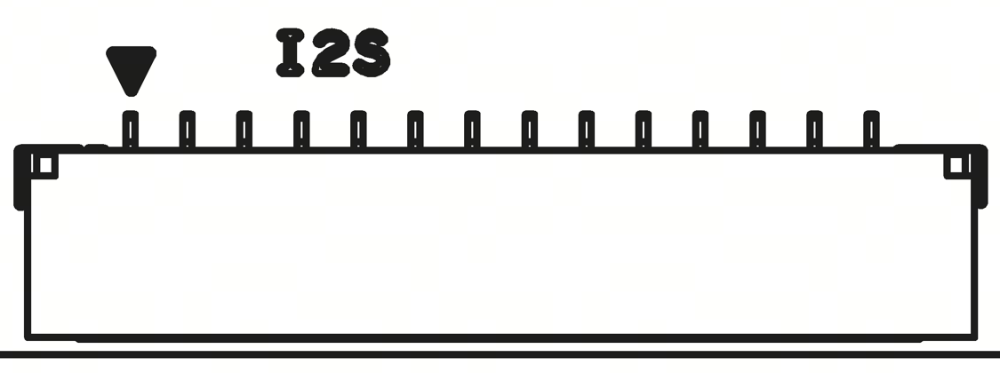

# D-Robotics RDK Audio Kit: 4/6-Mic Wiring, USB/I2S and Eight-Channel Capture


**D-Robotics RDK Audio Kit — not yet listed on OpenELAB; SKU/product link pending.**

Manufacturer reference for the Audio Expansion Board, its adapter, and the separate 4-Mic and 6-Mic arrays. No accessory SKU, included bundle or OpenELAB purchasing URL has been verified.


The RDK Audio Kit captures eight synchronized channels and plays stereo audio through separate ALSA devices. It can operate as a USB Audio Class device or through a host-specific I2S connection. Select the correct electrical level and host software before treating it as a microphone input; X5/S100 and S600 use different I2S configurations.

## Product overview <a href="#product-overview" id="product-overview"></a>

The family has four named components: **RDK Audio Expansion Board**, **RDK Audio Expansion Board Adapter**, **RDK Audio Expansion Board 4-Mic Array** and **RDK Audio Expansion Board 6-Mic Array**. The expansion board contains the codecs and speaker connections; the adapter breaks out a host's 40-pin audio signals; the selected array connects through a 36-pin ribbon. The 6-Mic array additionally has six LEDs. These are identifiable components, not four verified OpenELAB listings. [Product introduction](https://d-robotics.github.io/accessories_audio_kit_doc/en/introduction).

| Host               | Current manual support / required connection                                                              |
| ------------------ | --------------------------------------------------------------------------------------------------------- |
| RDK X5             | Supported; 40-pin Audio Expansion Board Adapter and matched digital cable for I2S                         |
| RDK X5 Module      | Supported; illustrated official carrier plus adapter; a bare compute module is not a matching connector   |
| RDK S100 / S100P   | Supported; adapter on 40-pin header, PCM0 routed away from default Bluetooth audio                        |
| RDK S600           | Supported; its dedicated audio interface; supports a second I2S clock path unavailable on X5/S100         |
| RDK X3 / X3 Module | Not supported/tested in this new Audio Kit table; older third-party Audio HAT guides are not this product |
| USB mode           | Standard UAC connection to the host USB port; enumerate its actual capture/playback devices               |

The new kit's support table is separate from an older `hobot_audio` README that describes X3 and Waveshare microphone HATs. Do not use the latter to assign a new-kit board voltage, driver or channel geometry. [Compatibility and component definitions](https://d-robotics.github.io/accessories_audio_kit_doc/en/introduction#supported-boards).

## Applications <a href="#applications" id="applications"></a>

Use the kit for microphone-array recordings, stereo output, full-duplex acoustic experiments and development of echo cancellation, direction-of-arrival or speech-processing applications. Channels 7/8 provide amplifier loopback references useful for echo analysis; they are not two additional spatial microphones. An audio stream alone does not establish a calibrated sound direction, wake-word model, ASR service or robot-control policy.

Keep the microphone geometry and channel ordering with each dataset. In an enclosure, provide a suitable acoustic path instead of covering microphone ports or locating a speaker where it mechanically rattles the array. A simultaneous recording/playback check demonstrates duplex acquisition, not a measured echo-cancellation result. [Kit purpose](https://d-robotics.github.io/accessories_audio_kit_doc/en/overview), [mounting/acoustic enclosure notes](https://d-robotics.github.io/accessories_audio_kit_doc/en/hardware#mounting-instructions).

## Specifications <a href="#specifications" id="specifications"></a>

| Parameter               | Current Audio Kit specification / limit                                                                               |
| ----------------------- | --------------------------------------------------------------------------------------------------------------------- |
| DAC                     | 1× ES8156; manufacturer-reported SNR 110 dB                                                                           |
| ADC                     | 2× ES7210; manufacturer-reported SNR 102 dB                                                                           |
| Capture                 | Eight synchronized channels: up to six microphone inputs plus two amplifier loopbacks                                 |
| Playback                | Two-channel stereo, independent capture/playback nodes                                                                |
| Sample rates            | 8 / 11.025 / 16 / 22.05 / 32 / 44.1 / 48 / 88.2 / 96 kHz                                                              |
| Interfaces              | USB, I2S and I2C control; not interchangeable pin protocols                                                           |
| J10 supply              | 4.5–5.5 V at `VCC_IN`, pin 14; ground pin 13                                                                          |
| I2S reference selection | S1 switch 3: 0 = 1.8 V, 1 = 3.3 V; independent of the 5 V power input                                                 |
| Operating temperature   | 0–65 °C                                                                                                               |
| Mechanical fasteners    | Expansion board 4× M2.5; adapter 1× M2.5; 4-Mic array 4× M3; 6-Mic array 3× M6 according to the current hardware page |

Use the actual selected ALSA hardware format/rate capabilities; a product-wide rate list does not prove every simultaneous combination on each host. Speaker impedance, continuous amplifier power and maximum supply current were not specified in the reviewed manual, so no custom speaker/load rating is invented here. [Specifications](https://d-robotics.github.io/accessories_audio_kit_doc/en/introduction#key-specifications), [power and mounting](https://d-robotics.github.io/accessories_audio_kit_doc/en/hardware).

## Hardware and connections <a href="#hardware-and-connections" id="hardware-and-connections"></a>

### Power-off assembly and cable direction <a href="#power-off-assembly-and-cable-direction" id="power-off-assembly-and-cable-direction"></a>

1. Disconnect all power before inserting the adapter, FFC or digital cable and before changing S1.
2. Connect the selected 4/6-Mic array to expansion-board **J11** with the documented **36-pin, 0.5 mm pitch, same-side-contact FFC/FPC**. At these connectors the contact side faces the PCB. Do not transfer the stereo camera's ribbon orientation to the audio array.
3. Connect left/right speakers to **J1/J2** using the matching HC1.25 connectors and the marked polarity. These are **differential amplifier outputs**; do not tie a speaker terminal to chassis ground or join the two negative terminals as though they were headphone grounds.
4. For X5/X5 Module/S100, use the matching 40-pin adapter, then its digital connection to board J10 with the specified **GH1.25-14P both-ends-reversed cable**. A cable with the same housing and straight-through wiring is not automatically suitable. S600 uses its dedicated audio header.
5. For USB, set S1 switch 1 to 0 (`0XXX`) and connect host USB to expansion-board **J7 USB-C**. Do not introduce a second external supply or improvised dual-power cable whose power interaction is undocumented.



_Official D-Robotics J10 view; use its Mark/pin-1 indication with the actual connector, not a mirrored cable-end view._ [Installation photographs and cable types](https://d-robotics.github.io/accessories_audio_kit_doc/en/installation), [J10 drawing](https://d-robotics.github.io/accessories_audio_kit_doc/en/hardware#j10-audio-digital-interface).

### J10 digital audio pinout and S1 modes <a href="#j10-digital-audio-pinout-and-s1-modes" id="j10-digital-audio-pinout-and-s1-modes"></a>

| J10 pin   | Signal                                         | Function                                             |
| --------- | ---------------------------------------------- | ---------------------------------------------------- |
| 1 / 2 / 3 | `OUTCON_MCLK` / `OUTCON_BCLK` / `OUTCON_WS`    | Codec master clock, bit clock and sample/frame clock |
| 4         | `OUTCON_SDIN`                                  | Data into DAC for playback                           |
| 5         | `OUTCON_SDOUT1`                                | ADC data output                                      |
| 6 / 7 / 8 | `OUTCON_MCLK2` / `OUTCON_BCLK2` / `OUTCON_WS2` | Second I2S clock group                               |
| 9         | N/A                                            | Do not repurpose                                     |
| 10        | `OUTCON_SDOUT2`                                | Second ADC serial output                             |
| 11 / 12   | `OUTCON_I2C_SDA` / `OUTCON_I2C_CLK`            | Control bus                                          |
| 13 / 14   | GND / `VCC_IN`                                 | Reference ground / 4.5–5.5 V supply                  |

| S1 switches 1–4 | Intended mode                                           | Supported lane                                 |
| --------------- | ------------------------------------------------------- | ---------------------------------------------- |
| `0XXX`          | USB UAC; remaining switches irrelevant to USB selection | USB first-data path                            |
| `101X`          | I2S, one clock group, 3.3 V logic                       | X5/X5 Module and S100/S100P                    |
| `100X`          | I2S, one clock group, 1.8 V logic                       | S600 full duplex                               |
| `110X`          | I2S, two clock groups, 1.8 V logic                      | S600 independent-rate simplex capture/playback |

Here X means the documented unused/don't-care position, not a value to infer from another product. The hardware page describes 0 as the switch's default and flipping upward as 1; match the printed switch numbers and its photograph rather than reading the four-bit code backward. In one-clock full duplex, capture and playback must use the **same sample rate and sample format**. Two-clock operation uses pins 1–4 for playback and 6–10 for capture and can use different rates; X5/S100 do not gain that capability by toggling switch 2. [Complete switch/electrical definition](https://d-robotics.github.io/accessories_audio_kit_doc/en/hardware#s1-audio-interface-selector-switch), [host-specific modes](https://d-robotics.github.io/accessories_audio_kit_doc/en/quick_start).

### J11 microphone/LED routing and mechanical mounting <a href="#j11-microphoneled-routing-and-mechanical-mounting" id="j11-microphoneled-routing-and-mechanical-mounting"></a>

The J11 drawing places pin 1 near the Mark point at the right-hand end of the depicted connector. Its 36 positions are:

| Pins  | Signals in ascending pin order                          |
| ----- | ------------------------------------------------------- |
| 1–12  | `LED1+`, `LED1-`, through `LED6+`, `LED6-` as six pairs |
| 13–16 | `MIC1N_B`, `MIC1P_B`, `MICBIAS1_B`, AGND                |
| 17–20 | `MIC2P_B`, `MIC2N_B`, `MICBIAS2_B`, AGND                |
| 21–24 | `MIC1N_A`, `MIC1P_A`, `MICBIAS1_A`, AGND                |
| 25–28 | `MIC2P_A`, `MIC2N_A`, `MICBIAS2_A`, AGND                |
| 29–32 | `MIC3N_A`, `MIC3P_A`, `MICBIAS3_A`, AGND                |
| 33–36 | `MIC4P_A`, `MIC4N_A`, `MICBIAS4_A`, AGND                |

These are analog differential microphone/bias connections, not GPIO inputs. Use the supplied array/cable rather than driving them with digital logic. J10's specified connector is **XKB X1251WRS-14HF-LPSW**; speaker J1/J2 are **HC-1.25-2PWT**. **J4 debug UART, K1 reset and K2 LOAD/debug entry** are not normal acquisition interfaces. Do not invoke LOAD or flash firmware just because a microphone is silent. Use washers and alternate screw tightening; do not apply an invented torque to the PCB. [J11, buttons and mounting](https://d-robotics.github.io/accessories_audio_kit_doc/en/hardware).

## Software and development resources <a href="#software-and-development-resources" id="software-and-development-resources"></a>

### Choose the correct host driver lane <a href="#choose-the-correct-host-driver-lane" id="choose-the-correct-host-driver-lane"></a>

USB mode uses the host's UAC/ALSA support and does not require the I2S patch procedure. For native I2S, the accessory manual identifies these exact release combinations:

| Host lane    | Documented prerequisite and configuration                                                                                                                                                                       |
| ------------ | --------------------------------------------------------------------------------------------------------------------------------------------------------------------------------------------------------------- |
| X5/X5 Module | RDK OS **3.5.0**; named boot/DTB/kernel-header patches, then `srpi-config` → `3 Interface Options` → `I5 Audio` → **Audio Driver HAT V2**, reboot                                                               |
| S100/S100P   | RDK OS **4.0.5-20260507** as source baseline plus its named 6.1.158-rt58 patches; set hardware **PCM0 function switch OFF** to route pins away from default Wi-Fi/Bluetooth audio; reboot and load S100 modules |
| S600         | RDK OS **5.1.0** source baseline plus its named kernel patch; choose S600 full-duplex or separate-clock module and the source's drive-strength configuration                                                    |

Read `cat /etc/version`, `uname -r` and installed package versions first. The current resource-center S600 lane is newer than the audio page's 5.1.0 example; this does not establish that an old kernel package belongs on a current S600 image. Use the matched official release procedure and retain a recoverable host image before changing boot/kernel/DTB packages. The manual's broad `dpkg -i hobot-*` or `linux-*` globs are not a reason to install every file in a shared download directory. [Exact host recipe and package links](https://d-robotics.github.io/accessories_audio_kit_doc/en/quick_start#hardware-and-software-configuration).

S100's named modules are `hobot_cpudai_super`, `snd-soc-es8156`, `snd-soc-es7210` and **`hobot_snd_s100_ac_fdx_host`**. S600 substitutes **`hobot_snd_super_ac_fdx_host`** or **`hobot_snd_super_ac_master`** for its appropriate mode. The S600 example additionally writes drive-strength values `0x33` at `0x33805088` and `0x3380508c`, and `0x17171717` at `0x34830020`, all as 32-bit accesses; the page says these reset after reboot. Those are **S600/release-specific board register operations**, not S100 or X5 troubleshooting commands. No patch, module or register operation was executed here.

### ALSA is the acquisition API; card numbers are observations <a href="#alsa-is-the-acquisition-api-card-numbers-are-observations" id="alsa-is-the-acquisition-api-card-numbers-are-observations"></a>

Use `/proc/asound/cards`, `arecord -l` and `aplay -l` to associate the kit with its actual capture/playback endpoints. The manual identifies `duplexaudioi2s1` on X5, `s100snd2` on S100, `s600snd2` on S600 and an **AudioArray/USB** entry in USB mode. Its sample device numbers differ:

| Source example   | Capture / playback                                        |
| ---------------- | --------------------------------------------------------- |
| X5 native I2S    | `hw:0,1` / `hw:0,0`                                       |
| S100/S600 native | Device 0 capture / device 1 playback on the observed card |
| USB example      | Card 1, device 0 capture / device 1 playback              |

The source's card/node descriptions sometimes mix a card-name observation with a `pcmC0...` example. Do not treat any `hw:0,...` value as permanent. `hw:` requests the hardware format directly; `plughw:` may convert formats, which is useful for playback but should not hide a mismatch during channel-layout validation. [Enumeration and ALSA commands](https://d-robotics.github.io/accessories_audio_kit_doc/en/quick_start#feature-walkthrough).

### Speech algorithms are a separate compatibility question <a href="#speech-algorithms-are-a-separate-compatibility-question" id="speech-algorithms-are-a-separate-compatibility-question"></a>

The accessory guide links to **Smart Voice Box** for preprocessing, direction finding, VAD, wake words, ASR and TTS. That exact X5 v3.5.0 link returned a product/version “Page Not Found” response during this review, so an executable new-kit algorithm setup was not established from it.

The inspected `hobot_audio` commit **`0d2548db7ad38d82661c42f413c219fea9c06145`** instead documents **RDK X3, Ubuntu 20.04 and Waveshare 2/4-microphone HATs**. Its `/audio_smart` (`audio_msg/msg/SmartAudioData`) and `/audio_asr` (`std_msgs/msg/String`) outputs, `micphone_name`, `micphone_chn`, `asr_mode` and `asr_channel` fields belong to that stated lane. They do not verify this new 6-Mic Audio Kit or its DOA geometry. Establish a kit-supported current algorithm release before applying those settings. [Read repository and explicit older BOM](https://github.com/D-Robotics/hobot_audio/blob/0d2548db7ad38d82661c42f413c219fea9c06145/README.md).

## Getting started <a href="#getting-started" id="getting-started"></a>

### First eight-channel recording, preferably through USB <a href="#first-eight-channel-recording-preferably-through-usb" id="first-eight-channel-recording-preferably-through-usb"></a>

1. Complete the power-off connections and select `0XXX` for the USB checkpoint. Connect to host USB, boot, and inspect:

```bash
cat /proc/asound/cards
arecord -l
aplay -l
ls -l /dev/snd
```

2. Identify the kit's **capture** card/device and its separate playback endpoint. Substitute them in the commands below. For example, `hw:1,0` is appropriate only when enumeration actually identifies that capture device; do not substitute an HDMI device or webcam microphone.
3. With playback stopped, record a short stationary test. This example uses the documented 16 kHz, signed 16-bit little-endian hardware format and **eight** channels:

```bash
arecord -D hw:1,0 -d 5 -r 16000 -f S16_LE -c 8 audio-eight.wav
```

4. Speak or tap near each microphone in turn without touching the diaphragm. For a 4-Mic array, physical microphone channels are 1–4 and positions 5/6 are unused/noisy; for a 6-Mic array, microphone channels are 1–6. Channels 7/8 are amplifier loopbacks in both cases. The manual's phrase “recording with 4 channels” is inconsistent with its explicit requirement to acquire eight: retain the eight-channel acquisition layout.
5. If silent, inspect the actual card's controls before changing gain:

```bash
amixer -c 1 sget ADC
amixer -c 1 sget DAC
```

Only use card 1 if it is the kit. The native recipe documents ADC/DAC percentage adjustments; USB controls may enumerate differently. Make a small deliberate adjustment, retain the old value and check for clipping rather than copying a high gain universally.

**Expected result:** `audio-eight.wav` contains eight interleaved channels and approximately five seconds of audio at the selected rate. A successful open does not prove each microphone works; inspect per-channel energy and the known channel order. [Documented capture format and layout](https://d-robotics.github.io/accessories_audio_kit_doc/en/quick_start#record-multi-channel-audio).

### Original offline channel inspection and two-channel extraction <a href="#original-offline-channel-inspection-and-two-channel-extraction" id="original-offline-channel-inspection-and-two-channel-extraction"></a>

This original program reads an existing **16-bit PCM, eight-channel WAV**. It opens no audio device. Save it as `audio_channels.py` and run `python3 audio_channels.py audio-eight.wav stereo-preview.wav`:

```python
import array
import math
import sys
import wave

with wave.open(sys.argv[1], 'rb') as source:
    channels, width, rate, frames = (source.getnchannels(),
        source.getsampwidth(), source.getframerate(), source.getnframes())
    if (channels, width, source.getcomptype()) != (8, 2, 'NONE'):
        raise SystemExit('Expected eight-channel, signed16-bit PCM WAV')
    raw = source.readframes(frames)
samples = array.array('h')
samples.frombytes(raw)
if sys.byteorder != 'little':
    samples.byteswap()
if len(samples) != frames * channels:
    raise SystemExit('Truncated interleaved PCM data')
for index in range(channels):
    track = samples[index::channels]
    rms = math.sqrt(sum(value * value for value in track) / max(1, frames))
    peak = max((abs(value) for value in track), default=0)
    print(index + 1, 'RMS counts', round(rms, 2), 'peak', peak)
stereo = array.array('h')
for index in range(frames):
    stereo.extend(samples[index * channels:index * channels + 2])
if sys.byteorder != 'little':
    stereo.byteswap()
with wave.open(sys.argv[2], 'wb') as target:
    target.setnchannels(2)
    target.setsampwidth(2)
    target.setframerate(rate)
    target.writeframes(stereo.tobytes())
print('Duration seconds', frames / rate)
```

**Expected result:** eight RMS/peak rows and a stereo file containing microphone channels 1/2. The numerical results depend on the recording; no measured microphone data are claimed here. RMS counts are not calibrated sound pressure. The program deliberately extracts two channels: the manual's `aplay record.wav` example should not be assumed to make a direct stereo hardware device accept an eight-channel file automatically.

### Stereo playback and simultaneous record/playback <a href="#stereo-playback-and-simultaneous-recordplayback" id="stereo-playback-and-simultaneous-recordplayback"></a>

1. Select the actual kit playback endpoint. With a two-channel file at the intended rate/format, start at a conservative volume and run, for example, `aplay -D hw:1,1 stereo-preview.wav` only if that is the enumerated playback device. Verify left/right sound and polarity.
2. For native one-clock I2S, match **both sample rate and format** between playback and recording. A 48 kHz playback file plus 16 kHz capture is not this mode's supported independent-rate test. Prepare the test file to match rather than silently relying on conversion.
3. In terminal A play the matching stereo file. In terminal B record eight channels for five seconds using the actual capture device. Keep microphones clear and a moderate acoustic level.
4. Inspect microphone tracks and loopback channels separately. Playback audible in a microphone verifies an acoustic path; channels 7/8 establish the loopback path. Neither observation proves echo cancellation.
5. Stop both streams before changing the DIP mode or driver configuration. On S600 only, a separately commissioned two-clock path can use independent rates; do not transfer that result to X5/S100.

**Expected result:** playback and capture operate concurrently without format/clock conflicts, and the file preserves the expected microphone/loopback layout. No acquisition, playback, driver installation or board test was executed for this guide. [Duplex constraints and procedure](https://d-robotics.github.io/accessories_audio_kit_doc/en/quick_start#record-and-play-back-in-full-duplex-mode).

## Troubleshooting and FAQs <a href="#troubleshooting-and-faqs" id="troubleshooting-and-faqs"></a>

### No AudioArray or native sound card appears <a href="#no-audioarray-or-native-sound-card-appears" id="no-audioarray-or-native-sound-card-appears"></a>

Check the actual USB host/device port and S1 mode first. For native I2S, verify 3.3 V versus 1.8 V selection, the reversed digital cable, adapter seating, host image/patch pairing and reboot. On S100 check the PCM0 hardware route before blaming a codec. Do not change a 5 V supply to 1.8 V: logic-reference and power pins are different.

### ALSA says the channel count or rate is unsupported <a href="#alsa-says-the-channel-count-or-rate-is-unsupported" id="alsa-says-the-channel-count-or-rate-is-unsupported"></a>

Confirm capture versus playback device and direct `hw:` capabilities. Capture is eight channels even with a four-microphone board; playback is stereo. Use the offline extractor for a two-channel preview. In one-clock I2S, stop both applications and choose matching formats/rates before restarting them.

### Capture is noisy or speech processing gives the wrong direction <a href="#capture-is-noisy-or-speech-processing-gives-the-wrong-direction" id="capture-is-noisy-or-speech-processing-gives-the-wrong-direction"></a>

Check per-microphone energy, clipping, mounting/acoustic obstructions and inactive channels. Keep array position/orientation with the data. A DOA model trained/configured for an older four-microphone HAT cannot be assumed to interpret this six-microphone array. First validate raw audio, then a specifically supported algorithm and calibration.

### Should I press LOAD, flash firmware or use the debug UART? <a href="#should-i-press-load-flash-firmware-or-use-the-debug-uart" id="should-i-press-load-flash-firmware-or-use-the-debug-uart"></a>

Not as normal audio recovery. The guide reserves J4 for internal debugging and K2 for debug entry; no complete public firmware/recovery package was validated. Save enumeration/errors and verify wiring, mode and host configuration first. A link saying that J7 can flash firmware is not a license to use an unrelated image.

## Downloads and technical documents <a href="#downloads-and-technical-documents" id="downloads-and-technical-documents"></a>

| Resource                                                                                                                                                           | Exact scope                                                                                                           |
| ------------------------------------------------------------------------------------------------------------------------------------------------------------------ | --------------------------------------------------------------------------------------------------------------------- |
| [Audio Kit manual](https://d-robotics.github.io/accessories_audio_kit_doc/en/overview)                                                                             | All six chapters: component identity, installation, host bringup, capture/playback, pinout and downloads              |
| [Hardware pinout and switch table](https://d-robotics.github.io/accessories_audio_kit_doc/en/hardware)                                                             | J10/J11, differential speaker outputs, selector and mounting                                                          |
| [Host patch download links](https://d-robotics.github.io/accessories_audio_kit_doc/en/quick_start#hardware-and-software-configuration)                             | Exact dated X5/S100/S600 package names; image/release match required, binaries not executed or independently verified |
| [Expansion Board V1P0 STEP](https://rdk-doc.oss-cn-beijing.aliyuncs.com/doc/img/accessories/04_audio_kit/file/RDK_Audio_Expansion_Board_Pcb_V1P0_Community.STEP)   | Codec/speaker board mechanical model                                                                                  |
| [Adapter V1P0 STEP](https://rdk-doc.oss-cn-beijing.aliyuncs.com/doc/img/accessories/04_audio_kit/file/RDK_Audio_Expansion_Board_Interface_Pcb_V1P0_Community.STEP) | 40-pin adapter mechanical model                                                                                       |
| [4-Mic V1P0 STEP](https://rdk-doc.oss-cn-beijing.aliyuncs.com/doc/img/accessories/04_audio_kit/file/RDK_Audio_Expansion_Board_4_Mic_Array_Pcb_V1P0_Community.STEP) | Four-microphone array mechanical model                                                                                |
| [6-Mic V1P0 STEP](https://rdk-doc.oss-cn-beijing.aliyuncs.com/doc/img/accessories/04_audio_kit/file/RDK_Audio_Expansion_Board_6_Mic_Array_Pcb_V1P0_Community.STEP) | Six-microphone array mechanical model                                                                                 |
| [USB audio programming overview](https://developer.d-robotics.cc/case_doc/en/getting_started/usb_peripherals#usb-audio)                                            | Generic USB-audio APIs; not new-kit I2S driver certification                                                          |

The six exact host patch filenames and direct URLs are retained in the private source record and on the linked host-specific manufacturer procedure. No custom driver build or current-kit speech SDK is substituted from an unrelated older repository. Mechanical downloads are observed official resources; their CAD content was not checked as a manufacturing release.

## References and validation <a href="#references-and-validation" id="references-and-validation"></a>

Reviewed **24 November 2026**: all six current Audio Kit manual pages, J10/J11 orientation figures, the linked USB-audio article and the older `hobot_audio` repository's stated compatibility/API scope. The offline WAV program is original; its synthetic-data checks are separate from hardware operation. No SDK installation, kernel/DTB patching, firmware operation, ALSA acquisition/playback or ROS/hardware test was run.

The first-data paths are USB/UAC and the explicitly versioned native host procedures. Maximum amplifier current/load, public firmware recovery and a verified current-kit speech-algorithm release remain unestablished in the reviewed material; the page does not turn those gaps into guessed ratings or executable recovery instructions.

**Related guides:** [D-Robotics boards, modules and peripherals](./).

* [D-Robotics RDK X5: Setup, BPU Inference, Cameras and I/O](rdk-x5.md)
* [D-Robotics RDK X5 Module: carrier, power, boot and AI development reference](rdk-x5-module.md)
* [D-Robotics RDK X5 Magicbox: Stereo, Voice and Safe Peripheral Setup](rdk-x5-magicbox.md)
* [D-Robotics SC230AI, GS130W and GS130WI Stereo Cameras: Wiring and Capture](rdk-stereo-camera.md)
* [D-Robotics BMI088 IMU Module: X5 Wiring, C/Python and ROS2 Data](rdk-bmi088-imu-module.md)
