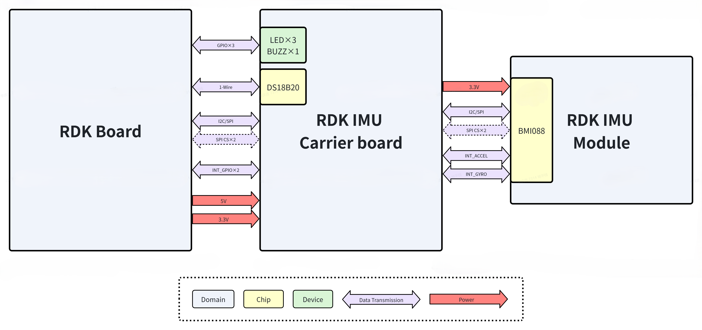

# D-Robotics BMI088 IMU Module: X5 Wiring, C/Python and ROS2 Data


**D-Robotics RDK BMI088 IMU Module — not yet listed on OpenELAB; SKU/product link pending.**

Manufacturer reference for the BMI088 core board and its 40-pin carrier. No OpenELAB accessory SKU or purchasing URL has been verified.


The RDK IMU Module provides separate three-axis acceleration and angular-rate measurements over I2C or SPI. Its Linux SDK timestamps data-ready events and can interpolate the two sensors to a common sample time. This is not an attitude sensor with a ready-made orientation quaternion. The working configuration below is the official RDK X5 carrier connection; S100/S100P wiring and GPIO assignments require separate adaptation.

## Product overview <a href="#product-overview" id="product-overview"></a>

The product is an assembly: a Bosch BMI088 core board connects vertically to a carrier through a 2×7 header/socket, and the carrier connects to the host through a 40-pin socket. The carrier also contains three indicator LEDs, an active buzzer and a DS18B20 1-Wire temperature sensor. Those extras are not additional BMI088 axes, and the SDK's IMU API does not establish a documented LED, buzzer or DS18B20 control API. [Manufacturer overview](https://d-robotics.github.io/accessories_bmi088_doc/en/introduction).

| Host                | Manufacturer support                         | Connection and software boundary                                                                               |
| ------------------- | -------------------------------------------- | -------------------------------------------------------------------------------------------------------------- |
| RDK X5              | Supported                                    | Illustrated direct 40-pin installation; SDK supplies an X5 GPIO configuration                                  |
| RDK X5 Module       | Supported                                    | Use the appropriate carrier; do not connect the accessory directly to a bare compute module                    |
| RDK S100 / S100P    | Supported                                    | Cannot mount directly; jumper wiring is required. X5 GPIO chip/line defaults are not an S100 wiring definition |
| RDK S600            | Supported                                    | Jumper wiring required; no claim that S100 or X5 pin assignments transfer                                      |
| RDK X3 / X3 Module  | Not supported in this module's support table | A generic BMI088 kernel-driver reference mentioning X3 does not approve this accessory's physical installation |
| Other 40-pin boards | User adaptation required                     | Linux bus access, electrical compatibility and interrupt mapping must all be established                       |

These are the current accessory manual's support statements, not hardware tests performed here. [Exact support table](https://d-robotics.github.io/accessories_bmi088_doc/en/introduction#supported-boards).

## Applications <a href="#applications" id="applications"></a>

Use the module for robot acceleration/angular-rate logging, vibration studies and development of visual-inertial or wheel-inertial estimators. A recorded stationary interval is useful for checking bias, noise and timestamps before introducing motion. An accelerometer senses gravity as well as motion: integrating it twice without bias, orientation and gravity handling does not produce reliable displacement.

The SDK's “fused” output is **time interpolation of two three-axis streams**, not accelerometer/gyro attitude fusion. Mount the assembly rigidly and measure its transform to the robot frame; a flexible header connection can add motion that the main robot body did not experience. The manufacturer illustrates seven M2.5×11 standoffs/screws across the core/carrier/host installation. [Mounting](https://d-robotics.github.io/accessories_bmi088_doc/en/installation), [read semantics](https://d-robotics.github.io/accessories_bmi088_doc/en/software/c_api#reading-imu-data).

## Specifications <a href="#specifications" id="specifications"></a>

| Parameter                       | Documented value / interpretation                                                    |
| ------------------------------- | ------------------------------------------------------------------------------------ |
| Sensor / resolution             | BMI088, independent 3-axis accelerometer and gyroscope, 16-bit data                  |
| Acceleration ranges             | ±3 / ±6 / ±12 / ±24 g                                                                |
| Angular-rate ranges             | ±125 / ±250 / ±500 / ±1000 / ±2000 °/s                                               |
| Accelerometer output data rates | 12.5 / 25 / 50 / 100 / 200 / 400 / 800 / 1600 Hz                                     |
| Gyroscope output data rates     | 100 / 200 / 400 / 1000 / 2000 Hz; bandwidth selected with ODR                        |
| Overview offset references      | 20 mg accelerometer, 0.5 °/s gyroscope; not a measured installed-unit calibration    |
| Host transports                 | I2C or SPI; select the matching five jumper connections                              |
| Carrier power domains           | 5 V and 3.3 V from the matched header; sensor/core domain is 3.3 V                   |
| Bare BMI088 electrical limits   | VDD 2.4–3.6 V; VDDIO 1.2–3.6 V. These chip limits do not make host GPIO 5 V tolerant |
| SDK default acquisition profile | X5: acceleration ±24 g at 400 Hz; gyro ±2000 °/s with ODR400/BW47                    |
| SDK software FIFO               | Default 256 entries, overwrite-oldest policy; power-of-two length required           |

The rates/ranges describe sensor configuration, not guaranteed delivered application throughput. [Module specifications](https://d-robotics.github.io/accessories_bmi088_doc/en/introduction#key-specifications), [power topology](https://d-robotics.github.io/accessories_bmi088_doc/en/hardware#topology), [Bosch electrical table](https://archive.d-robotics.cc/downloads/hardware/accessories/imu/BMI088_Datasheet.pdf), [pinned defaults](https://github.com/D-Robotics/rdk-imu-module-sdk/blob/e355db0e6fab2fa18d2b90be040844362e82809e/core/include/rdkimu.h).

## Hardware and connections <a href="#hardware-and-connections" id="hardware-and-connections"></a>

### Assemble the correct core, carrier and jumper configuration <a href="#assemble-the-correct-core-carrier-and-jumper-configuration" id="assemble-the-correct-core-carrier-and-jumper-configuration"></a>

1. Shut the host down and disconnect power before attaching the module or changing jumper caps.
2. Identify the core's 2×7 header and carrier's corresponding socket. Insert vertically with every row aligned; do not infer orientation from the position of a USB-shaped connector in an older schematic.
3. Select **I2C** or **SPI** using all five caps on the carrier's 3×5 selector. Each cap joins its center pin to the side labeled with the chosen mode. Do not mix one I2C row with four SPI rows.
4. For the documented X5 assembly, align the carrier's physical pin 1 with host pin 1 and fit the complete 40-pin socket without an offset. Secure the intended mounting holes without loading the sensor PCB or shorting its underside.
5. For S100/S100P/S600, stop before custom wiring until the exact host header, module revision, supply and interrupt routes have been reconciled. “Supported” does not supply an executable X5-to-S100 wiring conversion.



_D-Robotics manufacturer topology, reviewed with the current hardware article. It distinguishes host/carrier supply from the 3.3 V sensor domain; it is not a connector-face pin drawing._ [Installation](https://d-robotics.github.io/accessories_bmi088_doc/en/installation), [selector photographs](https://d-robotics.github.io/accessories_bmi088_doc/en/hardware#communication-mode-selector).

### Current manual's physical 40-pin assignments <a href="#current-manuals-physical-40-pin-assignments" id="current-manuals-physical-40-pin-assignments"></a>

| Function                                         | Host physical pins used by the current module manual                              |
| ------------------------------------------------ | --------------------------------------------------------------------------------- |
| 3.3 V                                            | 1, 17                                                                             |
| 5 V                                              | 2, 4                                                                              |
| Connected grounds identified in the module table | 9, 25, 39; other positions labeled N/A are not additional assigned module signals |
| I2C SDA / SCL                                    | 3 / 5                                                                             |
| SPI SDI / SDO / SCK                              | 19 / 21 / 23                                                                      |
| SPI acceleration / gyro select                   | 24 / 26                                                                           |
| Indicator LED connections                        | 11, 13, 15                                                                        |
| Buzzer                                           | 31                                                                                |
| Accelerometer INT1 / gyro INT3                   | 36 / 38                                                                           |
| DS18B20 DQ                                       | 37                                                                                |

These are **physical header positions**, not Linux GPIO offsets. Pin 3/5 I2C and pin 19/23 SPI reach the selected transport through the jumper arrangement; they are not instructions to drive both buses simultaneously. [Current physical table](https://d-robotics.github.io/accessories_bmi088_doc/en/hardware#40-pin-header).

The downloadable **20 May 2025 connector schematic** uses a different J1 odd/even labeling convention from this current physical table and depicts an older selector arrangement. Do not combine its J1 contact numbers with the newer physical numbering or construct a custom cable from the two drawings. The factory X5 stacking procedure above follows the current installation guide. A revision-matched connector-face/net mapping remains necessary for custom S100/S600 wiring. [Legacy connector schematic](https://archive.d-robotics.cc/downloads/hardware/accessories/imu/RDK_IMU_CONNECTOR.pdf), [core schematic](https://archive.d-robotics.cc/downloads/hardware/accessories/imu/RDK_IMU_Module.pdf).

## Software and development resources <a href="#software-and-development-resources" id="software-and-development-resources"></a>

### Version and three development interfaces <a href="#version-and-three-development-interfaces" id="version-and-three-development-interfaces"></a>

This guide inspected **rdk-imu-module-sdk v1.0.0**, commit **`e355db0e6fab2fa18d2b90be040844362e82809e`**, on the observed **master** branch. The web quick start says main, but that was not the repository's observed default. Pin the commit instead of substituting a similarly named historical driver. The SDK is MIT-licensed; retain its notices when redistributing code. Its C layer uses Linux I2C/SPI and libgpiod, and the web guide describes an aarch64 Linux kernel ≥5.10 target in principle; that is not validation of every board/kernel combination. [Repository](https://github.com/D-Robotics/rdk-imu-module-sdk/tree/e355db0e6fab2fa18d2b90be040844362e82809e), [software scope](https://d-robotics.github.io/accessories_bmi088_doc/en/software/overview).

| Layer  | Lifecycle and actual contract                                                                                                                                                                  |
| ------ | ---------------------------------------------------------------------------------------------------------------------------------------------------------------------------------------------- |
| C      | `create_default` → `bus_init` → `device_init` → `enable` → FIFO/read calls → `disable` → `device_deinit` → `bus_deinit` → `destroy`; every name has prefix `rdk_imu_`                          |
| Python | `IMU()` → `bus()` → `config()` → `enable()` → `read_indep()` or `read_fused()` → `disable()`/`close()`; ctypes wrapper raises `RuntimeError` on failed C operations                            |
| ROS2   | Build C library first, then the `ros2` colcon workspace; `rdk_imu_node` publishes `sensor_msgs/msg/Imu` and has Trigger enable/disable services                                                |
| IIO    | A separate kernel-driver route. The accessory's IIO page links elsewhere and does not document a complete current setup; do not run it concurrently with a user-space owner of the same device |

The C handle is opaque: allocate it through the constructor, not as a by-value stack object. Auto bus discovery is intended for one IMU; specify buses/addresses/selects explicitly in a multi-device design. The web C example's I2C comment says bus 5 while its assignment uses 1; neither is a universal host bus number. SPI's illustrated 1 MHz is a configured example, not a requirement to increase every bus clock. [C API](https://d-robotics.github.io/accessories_bmi088_doc/en/software/c_api), [Python API](https://d-robotics.github.io/accessories_bmi088_doc/en/software/python_api).

The pinned private header checks chip-ID register `0x00` for acceleration ID **0x1E** and gyro ID **0x0F**; these are two devices, not one six-axis register block. A chip-ID mismatch should stop configuration rather than be accepted as a different range. The README's simplified bus-budget arithmetic is inconsistent: its written I2C expression `100000/(2×6×9)` evaluates to about **926**, not 1042, and its SPI expression `1000000/112` to about **8929**, not 8333. These simplified transfer budgets omit scheduling, transaction overhead and other clients; neither is a measured safe sum ODR. Choose rates with margin, then inspect actual interrupt/FIFO continuity. [Chip checks and bus implementation](https://github.com/D-Robotics/rdk-imu-module-sdk/blob/e355db0e6fab2fa18d2b90be040844362e82809e/core/src/rdkimu_bus.c), [source throughput discussion](https://github.com/D-Robotics/rdk-imu-module-sdk/blob/e355db0e6fab2fa18d2b90be040844362e82809e/README.md).

### Sample validity, units and timestamp corrections <a href="#sample-validity-units-and-timestamp-corrections" id="sample-validity-units-and-timestamp-corrections"></a>

The pinned implementation is decisive for these source discrepancies:

| Field                                 | What the inspected code actually does                                                                                                         |
| ------------------------------------- | --------------------------------------------------------------------------------------------------------------------------------------------- |
| `data.accel.valid`, `data.gyro.valid` | The populated side is **1**. The web prose saying 0 means valid contradicts `parse_accel_data`, `parse_gyro_data` and interpolation setting 1 |
| Acceleration axes                     | Signed raw count × selected g range × 9.80665 / 32768 → m/s²                                                                                  |
| Gyro axes                             | Signed raw count × selected °/s range × π/180 / 32768 → **rad/s**, despite the C/Python web prose labeling them °/s                           |
| `timestamp_ns`                        | GPIO event/monotonic time in ns, not Unix UTC                                                                                                 |
| `read_indep`                          | One three-axis side per FIFO entry; inspect validity rather than using the other side's placeholders                                          |
| `read_fused`                          | Interpolates the other stream at the chosen sensor timestamp; `max_age_ns` limits interpolation span, not an application timeout              |

Do not apply an extra degrees-to-radians conversion to this pinned SDK's gyro output. Fused reads can wait indefinitely for suitable samples, so a deadline checked only after the call returns cannot guarantee bounded shutdown. Establish interrupts with independent reads before using interpolation. The pinned interrupt thread also divides its timeout by `100000000`, rather than the nanoseconds-per-second value `1000000000`; default timeout behavior can therefore differ from the one-second prose. These are source observations, not a tested patch. [Actual conversion, validity, wait and timeout implementation](https://github.com/D-Robotics/rdk-imu-module-sdk/blob/e355db0e6fab2fa18d2b90be040844362e82809e/core/src/rdkimu.c).

At 400 Hz, one sensor period is 2.5 ms; the documentation recommends interpolation allowance ≥3 periods, or 7.5 ms. Its default is 50 ms. A wide window tolerates larger gaps but does not recover lost dynamics. `DROP` rejects new FIFO entries when full; `OVERWRITE` replaces the oldest. Monitor remaining depth and timestamps instead of treating continuous output as proof of no loss.

### ROS2 parameters and clock boundary <a href="#ros2-parameters-and-clock-boundary" id="ros2-parameters-and-clock-boundary"></a>

| Parameter group                               | Default / accepted values                                                                                                              |
| --------------------------------------------- | -------------------------------------------------------------------------------------------------------------------------------------- |
| `frame_id`, `imu_topic`                       | `imu_link`, `rdkimu/data`                                                                                                              |
| `fuse_by`, `max_age_ns`                       | `accel` or `gyro`; 50,000,000 ns default                                                                                               |
| `publish_rate`, `auto_start`                  | 0.0 means publish as reads arrive; true starts acquisition                                                                             |
| `enable_service_name`, `disable_service_name` | `~/enable`, `~/disable`, both Trigger                                                                                                  |
| `accel_bwp`                                   | `OSR4`, `OSR2`, `NORMAL` (default); ODR-dependent filtering                                                                            |
| `accel_odr`                                   | `12_5`, `25`, `50`, `100`, `200`, `400` (default), `800`, `1600`                                                                       |
| `accel_range`, `gyro_range`                   | `3G/6G/12G/24G` (24G default); `125DPS/250DPS/500DPS/1000DPS/2000DPS` (2000 default)                                                   |
| `gyro_bandwidth`                              | `ODR2000_BW532`, `ODR2000_BW230`, `ODR1000_BW116`, `ODR400_BW47` (default), `ODR200_BW23`, `ODR100_BW12`, `ODR200_BW64`, `ODR100_BW32` |
| Interrupt selection                           | `accel_drdy_int:INT1`, `gyro_drdy_int:INT3`; modes `PP_H/PP_L/OD_H/OD_L`, default push-pull high                                       |
| X5 interrupt GPIO defaults                    | Accel chip 4/line 2, gyro chip 3/line 12; these are not physical header numbers                                                        |
| FIFO                                          | `fifo_length:256`, `fifo_mode:OVERWRITE`; use a power of two                                                                           |
| Worker                                        | `irq_priority:-1` automatic; explicit priorities −1…99; `irq_thread_timeout_ns:1000000000` with implementation caveat above            |

Parameters are read at startup, not live retuning. The pinned launch hardcodes its node parameters and has **no declared launch arguments** forwarding `imu_topic:=…` or `publish_rate:=…`. Use a reviewed launch copy or node `--ros-args -p` overrides, then read back the parameters. [Launch source](https://github.com/D-Robotics/rdk-imu-module-sdk/blob/e355db0e6fab2fa18d2b90be040844362e82809e/ros2/src/rdk_imu_module/launch/rdk_imu.launch.py), [node implementation](https://github.com/D-Robotics/rdk-imu-module-sdk/blob/e355db0e6fab2fa18d2b90be040844362e82809e/ros2/src/rdk_imu_module/src/rdk_imu_node.cpp).

The node directly labels a monotonic sample count as `RCL_ROS_TIME`; it does not establish a conversion to a camera's wall-clock/ROS epoch. Verify a common clock mapping before multi-sensor fusion. It marks orientation covariance unknown and does not assign a measured orientation quaternion; ignore orientation rather than expecting the web page's stated identity quaternion. Its diagonal acceleration/gyro covariances are bandwidth/noise-density estimates, not a calibration of this assembled robot. [Actual publisher](https://github.com/D-Robotics/rdk-imu-module-sdk/blob/e355db0e6fab2fa18d2b90be040844362e82809e/ros2/src/rdk_imu_module/src/rdk_imu_node.cpp).

## Getting started <a href="#getting-started" id="getting-started"></a>

### Build and acquire the first stationary stream on RDK X5 <a href="#build-and-acquire-the-first-stationary-stream-on-rdk-x5" id="build-and-acquire-the-first-stationary-stream-on-rdk-x5"></a>

These commands are instructions for a correctly assembled X5 and its matching Linux image. They were not executed for this guide. Resolve the bus/pin-mux and GPIO device permissions on that host first; do not copy X5 settings onto S100.

1. Complete the power-off assembly and jumper check. Record board/image/kernel, selected transport and physical mounting. Boot and inspect, without changing pin assignments:

```bash
cat /etc/os-release
uname -a
ls /dev/i2c-* /dev/spidev* /dev/gpiochip*
```

2. Obtain the exact SDK into a new directory and build its C layer. The dependency packages named by the accessory guide are `build-essential`, `cmake`, `libgpiod-dev`, `python3-pip`, `setuptools` and `wheel`; use the package procedure appropriate to the installed RDK image. This SDK expects the libgpiod API used by the source, not an arbitrary replacement ABI.

```bash
git clone --branch master https://github.com/D-Robotics/rdk-imu-module-sdk.git
cd rdk-imu-module-sdk
git checkout e355db0e6fab2fa18d2b90be040844362e82809e
cd core
make
ls -l lib/librdkimu.so* out/test
```

3. With the module stationary and one bus owner, run `sudo ./out/test`. The supported example initializes/configures the device and prints axes, monotonic timestamp, FIFO depth and frequency; it is not a passive register-only probe. Expect acceleration magnitude near local gravity and low stationary angular rate, allowing mounting, bias and vibration. The configured reference is 400 Hz; do not treat a single displayed frequency as a benchmark. If no data arrives, diagnose interrupts before waiting inside a fused read.
4. Stop through the application's normal termination. If a blocked acquisition does not respond, inspect its process and GPIO ownership; do not disconnect a powered header to unblock it. The pinned fused wait and worker-timeout caveats above apply.
5. For Python, retain the built `core/lib` directory, build from the separate `python` directory and install the generated wheel into the intended Python environment:

```bash
cd ../python
make
python3 -m pip install dist/rdkimu-*.whl
```

The top README's statement that the core install builds a wheel is inconsistent with the actual Makefiles: `core/make install` installs C headers/libraries; the Python wheel is a separate build. Keep shared-library symlinks when deploying it. [Build and first-result guide](https://d-robotics.github.io/accessories_bmi088_doc/en/quick_start), [core Makefile](https://github.com/D-Robotics/rdk-imu-module-sdk/blob/e355db0e6fab2fa18d2b90be040844362e82809e/core/Makefile), [Python Makefile](https://github.com/D-Robotics/rdk-imu-module-sdk/blob/e355db0e6fab2fa18d2b90be040844362e82809e/python/Makefile).

**Expected result:** a known X5 profile yields changing timestamps and plausible stationary acceleration/gyro samples. Missing bus, wrong chip ID, missing interrupts and excessive FIFO backlog are different faults; a successful build alone proves none of them.

### Original bounded independent-read logger <a href="#original-bounded-independent-read-logger" id="original-bounded-independent-read-logger"></a>

After the Python wrapper is installed, save this original example as `imu_stationary_log.py`. It avoids the indefinitely waiting fused-read API and deliberately reports independent samples. It configures the sensor through the installed SDK; no vendor module was imported or executed while authoring this guide. Cleanup can still wait on the pinned interrupt-thread implementation.

```python
import csv
import sys
import time
from rdkimu import IMU, RDK_X5_DEFAULT_CONFIG

writer = csv.writer(sys.stdout)
writer.writerow(["sensor", "timestamp_ns", "x", "y", "z", "remaining"])
with IMU() as imu:
    imu.bus(spi_accel_speed=1000000, spi_gyro_speed=1000000)
    imu.config(dict(RDK_X5_DEFAULT_CONFIG))
    imu.enable()
    end = time.monotonic() + 5.0
    while time.monotonic() < end:
        if not imu.fifo_available():
            time.sleep(0.002)
            continue
        data, remaining = imu.read_indep()
        for name in ("accel", "gyro"):
            sample = getattr(data, name)
            if sample.valid == 1:
                writer.writerow([name, sample.timestamp_ns,
                                 sample.x, sample.y, sample.z, remaining])
```

Run with the reviewed device permissions, for example `sudo python3 imu_stationary_log.py > stationary.csv` on the supplied image. **Expected result:** the file has separate acceleration (m/s²) and gyro (rad/s) rows with monotonic nanoseconds. Two adjacent rows are not automatically synchronized six-axis data. Record the source commit and use the actual code's validity convention; do not invert it to match the erroneous prose.

### ROS2 topic and pause/resume checkpoint <a href="#ros2-topic-and-pauseresume-checkpoint" id="ros2-topic-and-pauseresume-checkpoint"></a>

1. Stop other SDK readers. Source the exact installed ROS2/TROS distribution's setup file; inspect the actual directory rather than sourcing an unexpanded wildcard from a generic example.
2. From `rdk-imu-module-sdk/ros2`, run `colcon build`, then `source install/setup.bash`. The C shared library from the earlier build must still exist.
3. Run the node directly when changing startup parameters:

```bash
ros2 run rdk_imu_module rdk_imu_node --ros-args -p imu_topic:=/rdkimu/data -p publish_rate:=200.0
```

4. In a separately sourced terminal inspect `ros2 topic echo /rdkimu/data --once`, `ros2 topic hz /rdkimu/data` and `ros2 param get /rdk_imu_node publish_rate`. Verify axes/units/frame and the clock caveat before fusion.
5. Pause and resume using the resolved node name:

```bash
ros2 service call /rdk_imu_node/disable std_srvs/srv/Trigger '{}'
ros2 service call /rdk_imu_node/enable std_srvs/srv/Trigger '{}'
```

**Expected result:** typed IMU messages arrive, the parameter readback matches the intended profile, and acquisition pauses/resumes only after the service result and actual message flow agree. A 200 Hz host publication limit is not a sensor ODR change. No ROS build, service or topic test was run here. [ROS2 reference](https://d-robotics.github.io/accessories_bmi088_doc/en/software/ros2).

## Troubleshooting and FAQs <a href="#troubleshooting-and-faqs" id="troubleshooting-and-faqs"></a>

### Bus initialization succeeds but no samples arrive <a href="#bus-initialization-succeeds-but-no-samples-arrive" id="bus-initialization-succeeds-but-no-samples-arrive"></a>

Confirm the selected five jumpers, exact interrupt wiring, X5 GPIO chip/line availability and permissions. A responding I2C address does not prove either data-ready interrupt is reaching the SDK. Stop duplicate readers/kernel owners, then try independent FIFO reads before interpolation. Do not use repeated enable calls as recovery: the C API reports `DEVICE_BUSY` for duplicate acquisition ownership.

### Why do units or validity disagree with the web example? <a href="#why-do-units-or-validity-disagree-with-the-web-example" id="why-do-units-or-validity-disagree-with-the-web-example"></a>

For the pinned commit, use valid=1, acceleration m/s² and gyro rad/s as shown by its implementation. Preserve that version with a capture. A future release may change behavior; recheck its conversion rather than retaining a compensating unit multiplier indefinitely. Raw signed 16-bit counts use the configured range and denominator 32768, not 65535.

### Why can shutdown take longer than one second? <a href="#why-can-shutdown-take-longer-than-one-second" id="why-can-shutdown-take-longer-than-one-second"></a>

The worker's timeout conversion and blocking fused-read loop differ from the prose's simple timeout interpretation. Diagnose the pinned source and interrupt flow; no tested source patch is supplied here. `max_age_ns` is not a cancellation timer. Keep process shutdown distinct from removing power or changing jumpers.

### Which errors should an application distinguish? <a href="#which-errors-should-an-application-distinguish" id="which-errors-should-an-application-distinguish"></a>

The header separates parameter errors, I2C/SPI read/write failures, directory/file open failures, no-device and chip-ID errors, enable/configuration errors, GPIO initialization, FIFO full/empty, device busy, thread creation and FIFO allocation. Preserve the actual error enum and stage. Empty FIFO is not a valid all-zero sample; an incorrect chip ID is not fixed by changing acceleration scale. [Error enums and lifecycle](https://github.com/D-Robotics/rdk-imu-module-sdk/blob/e355db0e6fab2fa18d2b90be040844362e82809e/core/include/rdkimu.h).

### Can the module supply orientation or replace a complete calibration? <a href="#can-the-module-supply-orientation-or-replace-a-complete-calibration" id="can-the-module-supply-orientation-or-replace-a-complete-calibration"></a>

No measured orientation is produced by this SDK. Its interpolation aligns sample times; it does not estimate roll/pitch/yaw or compensate robot mounting. Record stationary bias/noise, verify the board-axis diagram and robot transform, then use a separately validated estimator with correct timing. Carrier temperature and BMI088 internal temperature are also different measurements; the documented SDK does not provide a DS18B20 acquisition recipe.

## Downloads and technical documents <a href="#downloads-and-technical-documents" id="downloads-and-technical-documents"></a>

| Resource                                                                                                              | Purpose / scope                                                                      |
| --------------------------------------------------------------------------------------------------------------------- | ------------------------------------------------------------------------------------ |
| [Current accessory manual](https://d-robotics.github.io/accessories_bmi088_doc/en/introduction)                       | Support, installation, hardware and API chapters                                     |
| [BMI088 datasheet](https://archive.d-robotics.cc/downloads/hardware/accessories/imu/BMI088_Datasheet.pdf)             | Chip electrical limits, registers, axes and timing; not carrier-header wiring        |
| [DS18B20 datasheet](https://archive.d-robotics.cc/downloads/hardware/accessories/imu/DS18B20_Datasheet.pdf)           | Carrier 1-Wire temperature component; linked, not fully audited here                 |
| [Core schematic](https://archive.d-robotics.cc/downloads/hardware/accessories/imu/RDK_IMU_Module.pdf)                 | 20 May 2025 circuit reference; distinguish revision and header labeling              |
| [Connector/carrier schematic](https://archive.d-robotics.cc/downloads/hardware/accessories/imu/RDK_IMU_CONNECTOR.pdf) | Legacy logical connector labels; not interchangeable with current physical numbering |
| [STEP mechanical model](https://archive.d-robotics.cc/downloads/hardware/accessories/imu/RDK_IMU_Module.STEP)         | Mounting reference; linked file, not a checked manufacturing drawing                 |
| [Pinned SDK source](https://github.com/D-Robotics/rdk-imu-module-sdk/tree/e355db0e6fab2fa18d2b90be040844362e82809e)   | MIT C/Python/ROS2 library, examples and actual version-specific behavior             |

No separate module firmware download or firmware-flashing procedure was established in the reviewed accessory manual. Host software installation does not require inventing one.

## References and validation <a href="#references-and-validation" id="references-and-validation"></a>

Sources reviewed on **24 November 2026**: all ten current accessory-manual pages, the two dated schematic sheets, relevant Bosch electrical/register reference and the pinned v1.0.0 SDK's public interfaces, core conversion/acquisition logic, Python wrapper/build and ROS2 node/launch. The original logger received syntax review only; SDK installation/compilation, sensor acquisition, ROS execution and hardware validation were **not run**.

This reference provides a first-data procedure for the documented X5 assembly and explicitly bounds unresolved custom host wiring, older schematic indexing and SDK documentation conflicts. It does not certify S100/S600 interrupt mapping, measured timing accuracy, orientation estimation or third-party 40-pin compatibility. For host software selection use the current [RDK X5 v3.5.0 documentation lane](https://d-robotics.github.io/rdk_x_doc/en/RDK?v=3.5.0\&p=RDK+X5); the board image and accessory SDK version remain separate records.

**Related guides:** [D-Robotics boards, modules and peripherals](./).

* [D-Robotics RDK X5: Setup, BPU Inference, Cameras and I/O](rdk-x5.md)
* [D-Robotics RDK X5 Module: carrier, power, boot and AI development reference](rdk-x5-module.md)
* [D-Robotics RDK X5 Magicbox: Stereo, Voice and Safe Peripheral Setup](rdk-x5-magicbox.md)
* [D-Robotics SC230AI, GS130W and GS130WI Stereo Cameras: Wiring and Capture](rdk-stereo-camera.md)
* [D-Robotics RDK Audio Kit: 4/6-Mic Wiring, USB/I2S and Eight-Channel Capture](rdk-audio-kit.md)
