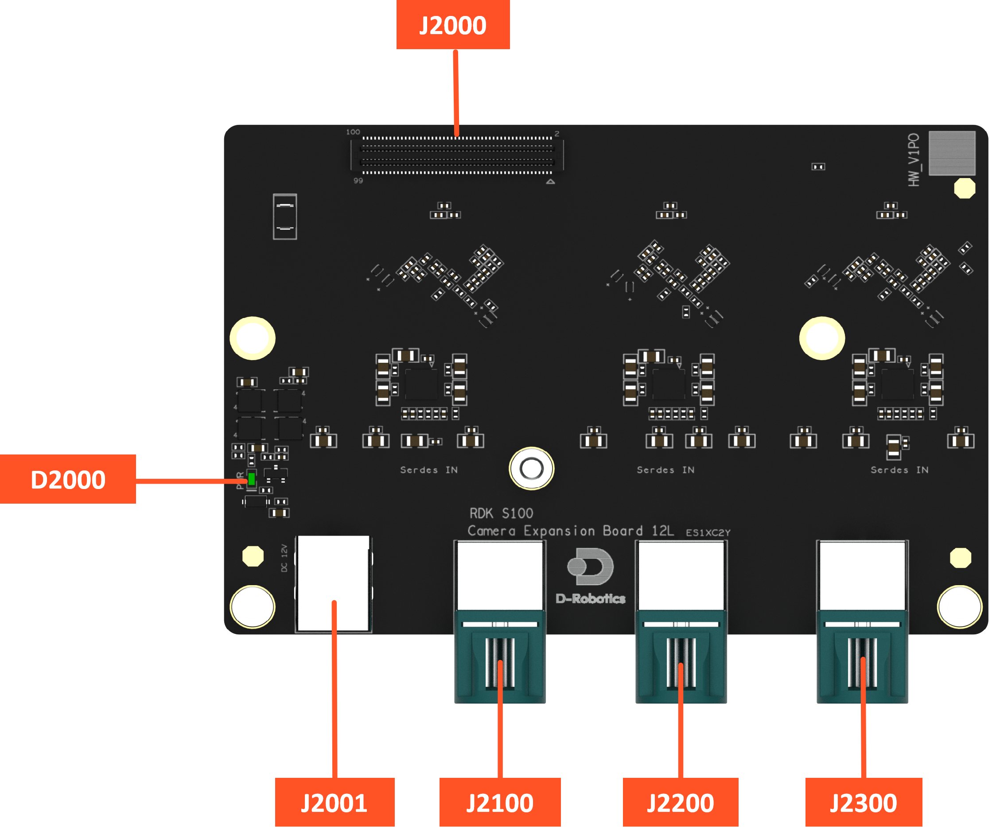

# RDK S100 Camera Expansion Board 12L: PoC, pinout and capture reference


**Manufacturer reference:** [**D-Robotics RDK S100 Camera Expansion Board 12L**](https://d-robotics.github.io/rdk_s_doc/en/Quick_start/hardware_introduction/rdk_s100/rdk_s100_camera_expansion_board/rdk_s100_camera_expansion_board_12l/)

**Model:** Camera Expansion Board 12L; the official interface illustration shows `ES1XC2Y` · **Revision:** V1P0 reference design · **OpenELAB SKU and product URL:** unverified. This is an unlisted manufacturer reference; the standard board's `D-Robotics-31642` is not assigned to 12L.


## Product overview <a href="#product-overview" id="product-overview"></a>

The S100 Camera Expansion Board 12L connects an **RDK S100-series** host to twelve GMSL2 cameras through three MAX96712 deserializers. Three keyed four-channel coaxial connectors carry the camera links and power over coax. The board is a camera interface and power-distribution accessory; host software supplies acquisition, processing and inference. “12L” denotes this twelve-link product, not twelve MIPI ribbon sockets. [Official hardware manual](https://d-robotics.github.io/rdk_s_doc/en/Quick_start/hardware_introduction/rdk_s100/rdk_s100_camera_expansion_board/rdk_s100_camera_expansion_board_12l/).

It differs from the standard S100 board, which provides two MIPI sockets and four GMSL channels, and from the S600 eight-channel board. The mounting connector, host rails, number of deserializers and software configuration must match the actual product. A sensor appearing in another board's HDMI example does not establish a working twelve-camera pipeline here. Start with a passive host/configuration inventory; enable a single verified camera only after the power, cable and driver checks below.



_Official D-Robotics interface illustration, visually inspected: J2000 host connection, J2001 DC input, J2100/J2200/J2300 camera groups and D2000 indicator. It shows pin-number ends and the triangular pin-1 mark. The web connector table's final `J2201` row conflicts with this figure and the interface description's `J2300`; use the actual board and schematic, not the stray table label._ [Source and assembly instructions](https://d-robotics.github.io/rdk_s_doc/en/Quick_start/hardware_introduction/rdk_s100/rdk_s100_camera_expansion_board/rdk_s100_camera_expansion_board_12l/).

## Applications <a href="#applications" id="applications"></a>

Use 12L for multi-camera perception, surround-view research, synchronized capture experiments and camera-driver integration on a supported S100/S100P system. Establish independent evidence for exposure synchronization, timestamps, calibration and sustained bandwidth. Twelve physical links do not promise twelve arbitrary resolutions/frame rates simultaneously.

A useful development sequence is one identified camera and serializer → one stable frame → correct pixel format/stride → a second link with distinct addressing → synchronization and calibration → sustained multi-camera acquisition. Retain each camera's sensor, serializer, lens, firmware, link position and calibration record. [Capture sample architecture](https://d-robotics.github.io/rdk_s_doc/en/Advanced_development/multimedia_development/multimedia_application/sample_vin/?v=4.0.5\&p=RDK+S100), [hardware compatibility rows](https://d-robotics.github.io/rdk_s_doc/en/Quick_start/hardware_introduction/rdk_s100/rdk_s100_camera_expansion_board/rdk_s100_camera_expansion_board_12l/).

## Specifications <a href="#specifications" id="specifications"></a>

| Item                      | 12L reference                                                                                                                  |
| ------------------------- | ------------------------------------------------------------------------------------------------------------------------------ |
| Supported host family     | RDK S100 series only                                                                                                           |
| Camera transport          | Twelve GMSL2 links, grouped 4+4+4                                                                                              |
| Deserializers             | Three MAX96712 devices; the summary table names the device family, while the interface text/schematic establishes the quantity |
| Host connector            | J2000, 100-pin board-to-board                                                                                                  |
| Camera connectors         | J2100, J2200, J2300; Mini-FAKRA four-in-one Z code                                                                             |
| Camera power              | 12 V over coax; documented maximum 550 mA per camera channel                                                                   |
| Host-fed camera aggregate | Manual permits operation without external 12 V only while total 12 V camera demand is within 700 mA                            |
| Supplemental input        | J2001, 12 V DC; published maximum 7.2 A; 2.5 mm inner / 5.5 mm outer plug dimensions                                           |
| Operating environment     | 0–45 °C                                                                                                                        |
| Dimensioned PCB outline   | 100 × 70 mm in the 2026-05-08 drawing; this is not a complete installed/cable envelope                                         |
| Host signals              | MIPI CSI, I²C, trigger/status signals, 12 V and 3.3 V; logic/reference domains must remain distinct                            |

These are product limits from the [12L manual](https://d-robotics.github.io/rdk_s_doc/en/Quick_start/hardware_introduction/rdk_s100/rdk_s100_camera_expansion_board/rdk_s100_camera_expansion_board_12l/), not measured results. The downloadable reference schematic has 600 mA annotations beside individual PoC circuits; those design annotations do not increase the public product's 550 mA operating limit. Do not interpret a MOSFET or connector rating as permission to exceed a camera-channel limit. [V1P0 reference design, schematic sheets 3–6](https://archive.d-robotics.cc/downloads/hardware/rdk_s100/rdk_s100_camera_expansion_board/rdk_s100_camera_expansion_board_12L/drobotics_rdk_s100_camera_expansion_board_reference_design.zip).

### Compare the three camera expansion products <a href="#compare-the-three-camera-expansion-products" id="compare-the-three-camera-expansion-products"></a>

| Product                         | Physical camera outputs       | Host / scope                                                       |
| ------------------------------- | ----------------------------- | ------------------------------------------------------------------ |
| Standard S100 camera board      | 2 × MIPI CSI-2 plus 4 × GMSL2 | S100-series; listed SKU 31642 belongs to this separate product     |
| S100 Camera Expansion Board 12L | 12 × GMSL2                    | S100-series; this reference                                        |
| S600 Camera Expansion Board     | 8 × GMSL2                     | S600-series only; different 80-pin host connector and power limits |

[Standard S100 manual](https://d-robotics.github.io/rdk_s_doc/en/Quick_start/hardware_introduction/rdk_s100/rdk_s100_camera_expansion_board/rdk_s100_camera_expansion_board/), [S600 manual](https://d-robotics.github.io/rdk_s_doc/en/Quick_start/hardware_introduction/rdk_s600/rdk_s600_camera_expansion_board/). Neither the coaxial connector's appearance nor a shared MAX96712 establishes interchangeable wiring.

## Hardware and connections <a href="#hardware-and-connections" id="hardware-and-connections"></a>

### Power-off assembly and connector orientation <a href="#power-off-assembly-and-connector-orientation" id="power-off-assembly-and-connector-orientation"></a>

1. Shut down the host, disconnect its DC supply and all independently powered cameras, and confirm the board is unpowered. Do not hot-plug the board-to-board connector or coaxial cameras.
2. Identify the actual 12L silkscreen, mounting hardware and connector pin-1 triangle. The illustrated J2000 has pin 1 at the marked end, with odd and even rows on opposite sides. The host's mating view is mirrored; do not turn a diagram into a guessed cable drawing.
3. Keep the mainboard and expansion board parallel and engage the connector evenly. Use the matching supports/screws so camera-cable load does not act on the connector. Do not force a partly aligned connector or substitute mounting screws by appearance.
4. Use the manufacturer's recommended **Z-coded Mini-FAKRA four-in-one harness**, documenting which breakout lead is A/B/C/D. The product manual does not establish every third-party harness's colour order or a universal camera-side coax connector. Verify both ends before connection.
5. Connect only a camera/serializer assembly supported by the installed driver. Inspect the complete power path before applying either host or supplemental power.

[Manufacturer assembly procedure/video](https://d-robotics.github.io/rdk_s_doc/en/Quick_start/hardware_introduction/rdk_s100/rdk_s100_camera_expansion_board/rdk_s100_camera_expansion_board_12l/), [dimensioned 2D drawing](https://archive.d-robotics.cc/downloads/hardware/rdk_s100/rdk_s100_camera_expansion_board/rdk_s100_camera_expansion_board_12L/drobotics_rdk_s100_camera_expansion_board_12l_2d_v1p0_20260508.pdf). The drawing is linked for measured mounting geometry; dimensions should be read with their view and tolerances rather than reconstructed from the product photograph.

### Connector models and revision matching <a href="#connector-models-and-revision-matching" id="connector-models-and-revision-matching"></a>

| Reference              | Manufacturer / documented part                  | Revision boundary                                                                                                               |
| ---------------------- | ----------------------------------------------- | ------------------------------------------------------------------------------------------------------------------------------- |
| J2000, newer connector | Amphenol `10165430-110000LF`                    | Listed as the new 100-pin host connector                                                                                        |
| J2000, older connector | Huacan Tianlu `HC-PBB05-2-100-M-H4.0-G1-R-P-04` | Listed as the old connector; identify the actual board and mating carrier revision                                              |
| J2001                  | G-Switch `DC-044B-D025`                         | DC-input connector; the stated plug dimensions do not independently establish polarity                                          |
| J2100 / J2200 / J2300  | SYNCONN `112038-161410`                         | Four-in-one camera connectors; the source table's final `J2201` label conflicts with its own J2300 interface description/figure |

These are the manufacturer's listed component identities, not a declaration that the old and new J2000 parts can be substituted on every carrier. Confirm the exact mating part, connector height, board support and pin-1/mating orientation for the physical revision before assembly. A matching 100-contact count or net table alone does not establish mechanical interchangeability. [Official connector-model table and interface descriptions](https://d-robotics.github.io/rdk_s_doc/en/Quick_start/hardware_introduction/rdk_s100/rdk_s100_camera_expansion_board/rdk_s100_camera_expansion_board_12l/).

### Host connector, signal groups and rails <a href="#host-connector-signal-groups-and-rails" id="host-connector-signal-groups-and-rails"></a>

The V1P0 schematic routes three MIPI groups to separate deserializers. Its sheet 3 labels the S100 receive groups RX0→DES3, RX1→DES2 and RX2→DES1. These are schematic names, not `/dev/videoN` numbers. I²C control and error/lock/PoC signals accompany the image lanes. [Reference schematic, sheet 3](https://archive.d-robotics.cc/downloads/hardware/rdk_s100/rdk_s100_camera_expansion_board/rdk_s100_camera_expansion_board_12L/drobotics_rdk_s100_camera_expansion_board_reference_design.zip).

The complete **host J25** pin table follows. It is the manufacturer's S100 V1P1 host reference, not an independently verified custom extension-cable layout. The board schematic and actual host revision must agree before cable or carrier design. Differential MIPI contacts are not GPIO and have no ordinary 1.8/3.3 V logic interpretation. [Host pin workbook, J25 sheet](https://archive.d-robotics.cc/downloads/hardware/rdk_s100/rdk_s100/drobotics_rdk_s100_pinlist_v1p1_20261022.xlsx).

| Pin | Host signal / voltage | Pin | Host signal / voltage     |
| --- | --------------------- | --- | ------------------------- |
| 1   | `GND`                 | 2   | `GND`                     |
| 3   | `MIPI_RX0_DP0_A0`     | 4   | `I2C1_SDA_1V8 / 1.8V`     |
| 5   | `MIPI_RX0_DN0_B0`     | 6   | `I2C1_SCL_1V8 / 1.8V`     |
| 7   | `GND`                 | 8   | `GND`                     |
| 9   | `MIPI_RX0_DP1_C0`     | 10  | `I2C2_SDA_1V8 / 1.8V`     |
| 11  | `MIPI_RX0_DN1_C1`     | 12  | `I2C2_SCL_1V8 / 1.8V`     |
| 13  | `GND`                 | 14  | `GND`                     |
| 15  | `MIPI_RX0_CLKP_A1`    | 16  | `I2C3_SDA_1V8 / 1.8V`     |
| 17  | `MIPI_RX0_CKN_B1`     | 18  | `I2C3_SCL_1V8 / 1.8V`     |
| 19  | `GND`                 | 20  | `GND`                     |
| 21  | `MIPI_RX0_DP2_A2`     | 22  | `GPIO_CAM_0_1V8 / 1.8V`   |
| 23  | `MIPI_RX0_DN2_B2`     | 24  | `GPIO_CAM_1_1V8 / 1.8V`   |
| 25  | `GND`                 | 26  | `GPIO_CAM_2_1V8 / 1.8V`   |
| 27  | `MIPI_RX0_DP3_C2`     | 28  | `GPIO_CAM_3_1V8 / 1.8V`   |
| 29  | `MIPI_RX0_DN3`        | 30  | `GND`                     |
| 31  | `GND`                 | 32  | `Reserve`                 |
| 33  | `GND`                 | 34  | `SENSOR0_ERR_1V8 / 1.8V`  |
| 35  | `MIPI_RX1_DP0_A0`     | 36  | `SENSOR1_ERR_1V8 / 1.8V`  |
| 37  | `MIPI_RX1_DN0_B0`     | 38  | `SENSOR2_ERR_1V8 / 1.8V`  |
| 39  | `GND`                 | 40  | `SENSOR3_ERR_1V8 / 1.8V`  |
| 41  | `MIPI_RX1_DP1_C0`     | 42  | `SENSOR4_ERR_1V8 / 1.8V`  |
| 43  | `MIPI_RX1_DN1_C1`     | 44  | `SENSOR5_ERR_1V8 / 1.8V`  |
| 45  | `GND`                 | 46  | `GND`                     |
| 47  | `MIPI_RX1_CLKP_A1`    | 48  | `CAMERA_BOARD_ID / 1.8V`  |
| 49  | `MIPI_RX1_CLKN_B1`    | 50  | `DES1_LOCK_1V8 / 1.8V`    |
| 51  | `GND`                 | 52  | `DES1_ERR_1V8 / 1.8V`     |
| 53  | `MIPI_RX1_DP2_A2`     | 54  | `DES1_PWRON_1V8 / 1.8V`   |
| 55  | `MIPI_RX1_DN2_B2`     | 56  | `DES1_POC_INT_1V8 / 1.8V` |
| 57  | `GND`                 | 58  | `DES1_POC_EN_3V3 / 3.3V`  |
| 59  | `MIPI_RX1_DP3_C2`     | 60  | `GND`                     |
| 61  | `MIPI_RX1_DN3`        | 62  | `DES2_LOCK_1V8 / 1.8V`    |
| 63  | `GND`                 | 64  | `DES2_ERR_1V8 / 1.8V`     |
| 65  | `GND`                 | 66  | `DES2_PWRON_3V3 / 3.3V`   |
| 67  | `MIPI_RX2_DP0_A0`     | 68  | `DES2_POC_INT_1V8 / 1.8V` |
| 69  | `MIPI_RX2_DN0_B0`     | 70  | `DES2_POC_EN_3V3 / 3.3V`  |
| 71  | `GND`                 | 72  | `GND`                     |
| 73  | `MIPI_RX2_DP1_C0`     | 74  | `DES3_LOCK_1V8 / 1.8V`    |
| 75  | `MIPI_RX2_DN1_C1`     | 76  | `DES3_ERR_1V8 / 1.8V`     |
| 77  | `GND`                 | 78  | `DES3_PWRON_3V3 / 3.3V`   |
| 79  | `MIPI_RX2_CLKP_A1`    | 80  | `DES3_POC_INT_1V8 / 1.8V` |
| 81  | `MIPI_RX2_CLKN_B1`    | 82  | `DES3_POC_EN_3V3 / 3.3V`  |
| 83  | `GND`                 | 84  | `GND`                     |
| 85  | `MIPI_RX2_DP2_A2`     | 86  | `VDDIO_TOP_1V8 / 1.8V`    |
| 87  | `MIPI_RX2_DN2_B2`     | 88  | `VDD_PERI_3V3 / 3.3V`     |
| 89  | `GND`                 | 90  | `VDD_PERI_3V3 / 3.3V`     |
| 91  | `MIPI_RX2_DP3_C2`     | 92  | `VDD_PERI_3V3 / 3.3V`     |
| 93  | `MIPI_RX2_DN3`        | 94  | `VDD_PERI_3V3 / 3.3V`     |
| 95  | `GND`                 | 96  | `VDD_PERI_3V3 / 3.3V`     |
| 97  | `VDD_PERI_12V / 12V`  | 98  | `VDD_PERI_12V / 12V`      |
| 99  | `VDD_PERI_12V / 12V`  | 100 | `VDD_PERI_12V / 12V`      |

J2000 receives the host's 12 V and 3.3 V domains. The schematic derives a common deserializer 1.2 V rail and per-deserializer 1.8 V rails from 3.3 V. Its **VDDIO\_TOP\_1V8 is a reference, explicitly not a load supply**. Do not power external logic from that reference. The resistor-coded `CAMERA_BOARD_ID` identifies the expansion design to the host; it is not a user GPIO or a jumper to force another product identity. [Schematic sheet 3](https://archive.d-robotics.cc/downloads/hardware/rdk_s100/rdk_s100_camera_expansion_board/rdk_s100_camera_expansion_board_12L/drobotics_rdk_s100_camera_expansion_board_reference_design.zip).

The S100 host guide separately rates J25 at 1.7 A on 3.3 V and 0.8 A on 12 V; VDDIO\_TOP\_1V8 has a 50 mA low-power reference allowance. Those host-connector ratings do not increase the 12L manual's 0.7 A host-fed camera threshold. The host guide turns these peripheral rails off in light/deep sleep. Independently powered cameras must not backfeed an unpowered host. [Host hardware guide](https://d-robotics.github.io/rdk_s_doc/en/01_Quick_start/01_hardware_introduction/01_rdk_s100/01_rdk_s100_kit?v=4.0.5\&p=RDK+S100).

The schematic shows separate host-fed and DC-jack paths into the camera 12 V distribution. That circuit is not a blanket guarantee that arbitrary supplies may be paralleled. Match the approved adapter and connector polarity; plug dimensions alone do not establish polarity. Custom power leads remain outside the commissioning procedure until their mating contacts and polarity are verified.

### Coax contacts and driver-controlled PoC <a href="#coax-contacts-and-driver-controlled-poc" id="coax-contacts-and-driver-controlled-poc"></a>

The reference circuit uses **MAX20087** quad power-protection/switch devices between the selected 12 V rail and the four PoC outputs in each camera group. Enabling the deserializer alone does not establish that its camera power switch is enabled or fault-free. Camera-power enable/interrupt state, coax lock and image output must be diagnosed separately. The board schematic maps connector contacts **1/2/3/4 to GMSL A/B/C/D**, with contacts **5–8 ground** in that connector library. This is a contact/net reference, not a viewed-from-the-cable photograph; confirm the exact manufacturer mating orientation and breakout harness before making a cable. [Circuit source](https://archive.d-robotics.cc/downloads/hardware/rdk_s100/rdk_s100_camera_expansion_board/rdk_s100_camera_expansion_board_12L/drobotics_rdk_s100_camera_expansion_board_reference_design.zip).

The MAX96712 strap table labels its addresses as **8-bit**, whereas the PoC-controller table labels its addresses as **7-bit**. Linux I²C device addresses normally use the latter convention: an 8-bit write address 0x52 corresponds arithmetically to 7-bit 0x29. That example is not a board-wide address assignment or a probe command. Check each physical bus, strap and runtime alias; several identical sensors require managed aliases, and an address copied without its convention can target the wrong device.

### Plan both aggregate and per-camera PoC demand <a href="#plan-both-aggregate-and-per-camera-poc-demand" id="plan-both-aggregate-and-per-camera-poc-demand"></a>

Record each camera's **worst-case input current**, including startup/inrush and operating mode, rather than dividing typical watts by 12 and calling that a peak. For every occupied link, compare demand with 0.55 A. Then sum all occupied links and compare the result with the 0.70 A host-fed camera allowance and the selected supply/system constraints.

For example, two cameras each requiring 0.40 A give 0.80 A total: each is below the channel limit, but their aggregate exceeds 0.70 A, so host-only camera power is not the documented route. Twelve cameras at 0.55 A total **6.60 A / 79.2 W at 12 V**, an arithmetic boundary, not a demonstrated continuous system configuration. Cable loss, startup, temperature and the host's other loads still require review. The 7.2 A input specification is not an instruction to allocate 7.2 A to cameras regardless of those checks. [Power limits](https://d-robotics.github.io/rdk_s_doc/en/Quick_start/hardware_introduction/rdk_s100/rdk_s100_camera_expansion_board/rdk_s100_camera_expansion_board_12l/).

D2000 green establishes that the board is connected and the host supplies 3.3 V. It does **not** establish twelve healthy PoC outputs, serializer lock, valid image data or synchronization.

## Software and development resources <a href="#software-and-development-resources" id="software-and-development-resources"></a>

### Match the host image, overlay, SerDes and sensor <a href="#match-the-host-image-overlay-serdes-and-sensor" id="match-the-host-image-overlay-serdes-and-sensor"></a>

Use the **S100/S100P 4.0.5** documentation lane for this reference. The host release notes describe additional GMSL daughterboard overlay support, but the reviewed 12L manual does not supply a universal overlay filename or prove that any pre-existing four-channel overlay enables all twelve links. Inspect the installed `/boot/config.txt`, live device tree and matching BSP source before changing anything. Keep the original boot configuration and a recovery console. [S100 release notes](https://d-robotics.github.io/rdk_s_doc/en/Release_Note/s100/v4_0_5/), [config.txt semantics](https://d-robotics.github.io/rdk_s_doc/en/System_configuration/config_txt/?v=4.0.5\&p=RDK+S100).

In this boot system, manual U-Boot settings can override the configuration file; the documented precedence is `setenv` → config file → previous `saveenv`. Overlay settings therefore need verification against the **live** device tree after boot, not only the text file. This guide does not provide an unverified overlay name or destructive boot command.

| Layer                | What must match                                                                       | Observable check                                                     |
| -------------------- | ------------------------------------------------------------------------------------- | -------------------------------------------------------------------- |
| Physical link        | Camera sensor, serializer, 12 V requirement, harness mapping and GMSL mode            | Identified BOM and correct port; no unexplained load or polarity     |
| Deserializer         | MAX96712 address/alias, enabled links, output CSI port and virtual-channel allocation | Matching driver configuration and lock/error reports                 |
| Sensor driver        | Resolution, frame rate, bit depth, RAW/YUV mode, exposure and trigger mode            | Driver identity and negotiated mode agree with the physical assembly |
| VIN/HBN/VIO pipeline | MIPI host, channel, format, stride and buffer count                                   | Frame metadata matches the selected source                           |
| Application          | One owner of the camera/PoC configuration; explicit calibration and timestamps        | Stable increasing frame IDs/timestamps and a changing scene          |

The installation table names **SG8S-AR0820C-5300-G2A, LEC28736A11 (X3C Module), and RealSense D457** on the GMSL groups. A listed mechanical/interface combination does not mean every SDK sample exposes every sensor mode. The external AVL is linked but its current contents were not readable during this review; no complete compatibility-list claim is made. [Camera rows and AVL link](https://d-robotics.github.io/rdk_s_doc/en/Quick_start/hardware_introduction/rdk_s100/rdk_s100_camera_expansion_board/rdk_s100_camera_expansion_board_12l/).

### Capture parameters are discovered, not fixed sensor indices <a href="#capture-parameters-are-discovered-not-fixed-sensor-indices" id="capture-parameters-are-discovered-not-fixed-sensor-indices"></a>

The official `get_vin_data` example under `/app/multimedia_samples/sample_vin/get_vin_data` documents `-s <sensor_index>`, `-l <link_port>` and `-h`. For SerDes cameras, link ports are **0:A, 1:B, 2:C, 3:D within a deserializer**, not global channel numbers 0–11. The installed sensor list determines `-s`; an example's index 2 is not a permanent AR0820 identity. Multiple deserializers also require the correct host/alias configuration beyond this local link number. [Sample VIN guide](https://d-robotics.github.io/rdk_s_doc/en/Advanced_development/multimedia_development/multimedia_application/sample_vin/?v=4.0.5\&p=RDK+S100).

After electrical and driver review, the manufacturer's interactive sample supports `g` for one frame, `l` for a 12-frame set and `q` to quit. These operations initialize/stream the camera and can configure PoC; they are **not** the passive first check below. The multi-camera example exposes repeatable `-c "sensor=… link=…"` configurations and documents at most six repetitions for that sample. That software sample limit must not be turned into a claim that twelve-link hardware always streams twelve pipelines, or that a copied six-pipeline configuration is a complete 12L setup.

## Getting started <a href="#getting-started" id="getting-started"></a>

### First result: passive identity and configuration inventory <a href="#first-result-passive-identity-and-configuration-inventory" id="first-result-passive-identity-and-configuration-inventory"></a>

Prerequisites: an identified S100-series host, known-good matching image, access through the normal terminal, the board mounted while unpowered, and **no unverified cameras or supplemental DC lead connected**. Boot the host normally using its approved supply. These commands only inspect files and registered objects; they do not scan I²C addresses, enable a link, start capture or change PoC:

```bash
cat /etc/version
uname -r
tr '\000' '\n' < /proc/device-tree/model
cat /boot/config.txt
find -L /sys/class/video4linux -maxdepth 2 -name name -exec cat {} \;
find -L /sys/bus/i2c/devices -maxdepth 2 -name name -exec cat {} \;
find /app/multimedia_samples/sample_vin -maxdepth 2 -type f -name 'get*vin_data*' -print
```

1. Record the host model, kernel and image version. An S600 image or an X-series example is not an acceptable substitute.
2. Record D2000, the exact board marking, host revision and the disconnected camera/harness inventory. A lit LED alone is not a capture pass.
3. Read the boot configuration and registered device names. Missing classes or permissions should be recorded, not repaired by speculative probes or writes.
4. Compare the observed driver/DTB/SerDes allocation with the BSP and the camera BOM. Stop at this inventory if the 12L overlay, aliases or power path are unresolved.

**Expected result:** a reproducible identity/configuration record and known existing device nodes. An empty camera list with no cameras attached is legitimate. This first result does not prove a functional GMSL link. No commands above were run on a board during authoring.

### Separate, supervised one-camera validation <a href="#separate-supervised-one-camera-validation" id="separate-supervised-one-camera-validation"></a>

Once the exact power path, polarity, driver and link mapping have been independently established, connect one qualified camera with power off, then follow the matching installed sample's own help. Select its sensor mode and local A–D link; acquire one frame before adding other links. Check frame ID, timestamp, dimensions, bit depth, stride and file length together. A RAW file is not necessarily packed as `width × height × 2`, and a timestamp's unit/clock must come from the driver contract. Compare two frames while moving an inanimate target. Add cameras one at a time and recheck currents and lane/virtual-channel allocation after each addition.

**Expected result:** the intended camera, not merely any detected sensor, yields changing coherent data at its configured mode. Retain errors and the exact configuration if lock succeeds but images do not. Arbitrary sensor register writes or forced address scans are not a recovery procedure.

### Original offline PoC arithmetic check <a href="#original-offline-poc-arithmetic-check" id="original-offline-poc-arithmetic-check"></a>

Save the following as `check_12l_budget.py`, and put worst-case camera currents such as `[0.4, 0.4]` in `loads.json`. Run `python3 check_12l_budget.py loads.json` on an ordinary computer. This original example reads only that JSON file. It checks declared current arithmetic, not adapter wiring, startup or a real power rail.

```python
"""Original arithmetic-only check. Never reads a device or authorizes power-on."""
import json
import math
import sys
from pathlib import Path
loads = json.loads(Path(sys.argv[1]).read_text())
if not isinstance(loads, list) or len(loads) > 12:
    raise SystemExit('Provide a list of at most 12 camera currents in amperes')
if any(isinstance(x, bool) or not isinstance(x, (int, float)) or
       not math.isfinite(x) or x < 0 for x in loads):
    raise SystemExit('Every current must be a finite nonnegative number')
total = math.fsum(loads)
print('channels=', len(loads), 'total_A=', round(total, 6),
      'camera_W_at_12V=', round(total * 12, 6))
print('per_channel_550mA_check=', all(x <= 0.55 for x in loads))
print('within_documented_host_camera_700mA=', total <= 0.70)
print('within_published_input_7p2A_arithmetic=', total <= 7.2)
print('Arithmetic only: startup, cable loss, polarity and thermal checks remain')
```

**Expected result:** the two-camera example totals 0.8 A and 9.6 W, passes the individual 550 mA comparison and fails the host-camera 700 mA comparison. A true result on another line is not a commissioning approval. Synthetic offline checks were run separately; no camera SDK was executed.

## Troubleshooting and FAQs <a href="#troubleshooting-and-faqs" id="troubleshooting-and-faqs"></a>

| Symptom                                    | Ordered checks                                                                                                                                           |
| ------------------------------------------ | -------------------------------------------------------------------------------------------------------------------------------------------------------- |
| D2000 off                                  | Power off; inspect seating, mounting and host 3.3 V path. Do not assume an external 12 V adapter powers the entire board                                 |
| LED on, no SerDes device                   | Compare host revision, board-ID/DTB selection and registered I²C device; the LED does not test I²C                                                       |
| Deserializer present, no camera lock       | Verify serializer/GMSL mode, harness breakout order, camera power requirement and exact local A–D link; inspect approved driver lock status              |
| Lock but blank/corrupt frames              | Check CSI host/virtual channel, output bit depth, lane rate, resolution and stride. Preserve a RAW frame before changing ISP tuning                      |
| Only one group works                       | Verify all three deserializers, aliases, host RX allocation and the 12L-specific configuration; do not reuse a four-link board overlay blindly           |
| Reboots or intermittent link loss          | Stop capture, disconnect power safely, review startup current and voltage drop per lead; adding a larger host adapter does not remove per-channel limits |
| Several cameras show identical content     | Check I²C aliases, sensor selection and virtual-channel routing before concluding that calibration is wrong                                              |
| D457 enumerates but expected output absent | Distinguish this GMSL path from a USB RealSense procedure; verify serializer, synchronization and installed mode support                                 |

**Can I use a passive coax cable of any colour?** No universal colour mapping is established. Use the actual harness specification, connector coding and continuity record.

**Does the board calibrate the cameras?** No. Intrinsics, distortion, camera-to-camera extrinsics and time alignment belong to the exact camera set and application. Save calibration with sensor/lens/serial and mounting information.

## Downloads and technical documents <a href="#downloads-and-technical-documents" id="downloads-and-technical-documents"></a>

| Resource                                                                                                                                                                                                                            | Purpose / access                                                                                                    |
| ----------------------------------------------------------------------------------------------------------------------------------------------------------------------------------------------------------------------------------- | ------------------------------------------------------------------------------------------------------------------- |
| [12L hardware manual](https://d-robotics.github.io/rdk_s_doc/en/Quick_start/hardware_introduction/rdk_s100/rdk_s100_camera_expansion_board/rdk_s100_camera_expansion_board_12l/)                                                    | Product limits, connector/indicator descriptions and assembly video; article read, video not independently reviewed |
| [V1P0 reference-design ZIP](https://archive.d-robotics.cc/downloads/hardware/rdk_s100/rdk_s100_camera_expansion_board/rdk_s100_camera_expansion_board_12L/drobotics_rdk_s100_camera_expansion_board_reference_design.zip)           | BRD, DSN and six-sheet schematic; PDF read, native CAD files listed but not opened in a CAD application             |
| [Dimensioned drawing, 2026-05-08](https://archive.d-robotics.cc/downloads/hardware/rdk_s100/rdk_s100_camera_expansion_board/rdk_s100_camera_expansion_board_12L/drobotics_rdk_s100_camera_expansion_board_12l_2d_v1p0_20260508.pdf) | Exact 12L mounting and envelope views; drawing visually inspected                                                   |
| [STEP model, V1P0](https://archive.d-robotics.cc/downloads/hardware/rdk_s100/rdk_s100_camera_expansion_board/rdk_s100_camera_expansion_board_12L/drobotics_rdk_s100_camera_expansion_board_12l_3d_model_v1p0_20260508.STEP)         | Mechanical integration; linked, not imported or fit-tested                                                          |
| [Host pin workbook, V1P1](https://archive.d-robotics.cc/downloads/hardware/rdk_s100/rdk_s100/drobotics_rdk_s100_pinlist_v1p1_20261022.xlsx)                                                                                         | Full J25 contact definitions and logic domains; read as a spreadsheet                                               |
| [S100 resource summary](https://d-robotics.github.io/rdk_s_doc/en/Quick_start/download/?v=4.0.5\&p=RDK+S100)                                                                                                                        | Other image/design/photo resources; commercial/FTP material is not treated as read                                  |
| [Sample VIN guide](https://d-robotics.github.io/rdk_s_doc/en/Advanced_development/multimedia_development/multimedia_application/sample_vin/?v=4.0.5\&p=RDK+S100)                                                                    | Single/multi-camera parameter and frame-dump contracts; source-reviewed, not run                                    |
| [S100 camera standard-board guide](https://d-robotics.github.io/rdk_s_doc/en/Quick_start/hardware_introduction/rdk_s100/rdk_s100_camera_expansion_board/rdk_s100_camera_expansion_board/)                                           | Comparison only; not a replacement 12L wiring document                                                              |

## References and validation <a href="#references-and-validation" id="references-and-validation"></a>

This is an original manufacturer engineering reference, reviewed on 24 November 2026. The 12L article, actual schematic, host contact workbook and applicable sample/boot documentation were read. Official connector/topology and schematic views were visually inspected. The current external AVL, native BRD/DSN editing, commercial BSP archives and assembly video were not fully reviewed. No SDK was installed, compiled or executed; no board, camera, PoC output or supply was tested. Unresolved purchase matching, custom power-lead polarity, exact installed 12L overlay/alias selection and complete twelve-pipeline performance remain explicit boundaries.

**Related guides:** [D-Robotics boards, modules and peripherals](./).

* [D-Robotics RDK S100/S100P — hardware, image and BPU development](rdk-s100-s100p-engineering-guide.md)
* [RDK S100 MCU1, CANHAL and IPC development reference](rdk-s100-mcu-canhal-ipc-reference.md)
* [D-Robotics RDK S100 Camera Expansion Board: MIPI/GMSL wiring and first video](rdk-s100-camera-expansion-board.md)
* [D-Robotics RDK S100 MCU Port Expansion Board: pinout, CANHAL and first readback](rdk-s100-mcu-port-expansion-board-reference.md)
