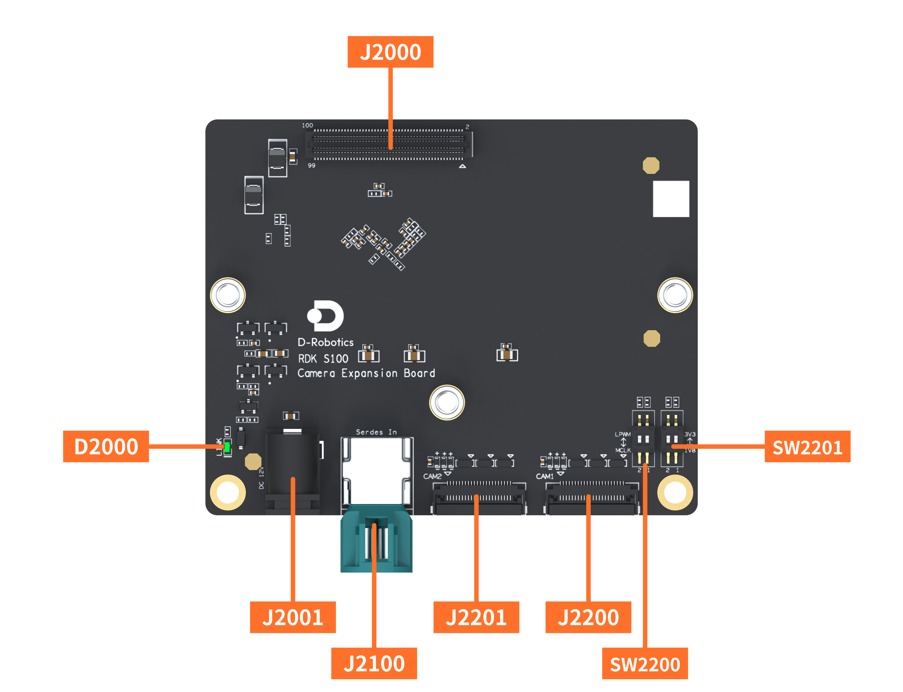

# D-Robotics RDK S100 Camera Expansion Board: MIPI/GMSL wiring and first video


[**View the D-Robotics RDK S100 Camera Expansion Board on OpenELAB**](https://openelab.io/products/d-robotics-rdk-s100-camera)

**Model:** RDK S100 Camera Expansion Board, standard 2-MIPI / 4-GMSL version · **Manufacturer model:** `ES1XC1Y` · **SKU:** `D-Robotics-31642` · **Software scope:** RDK S100, `v=4.0.5&p=RDK+S100`


## Product overview <a href="#overview" id="overview"></a>

The RDK S100 Camera Expansion Board connects the S100 mainboard's J25 camera connector to two 22-pin MIPI CSI-2 camera sockets and a four-channel GMSL2 input through a MAX96712 deserializer. It supplies interfaces and power distribution; image acquisition, ISP processing, calibration and inference run on the host. The V1.1 datasheet identifies the standard board as **ES1XC1Y**. The separately documented **Camera Expansion Board 12L** is a different product and its routing/overlays must not be substituted. [Hardware guide](https://raw.githubusercontent.com/D-Robotics/rdk_s_doc/fac1c7ac05443a4890232c537a6f99bebfdb6a9f/i18n/en/docusaurus-plugin-content-docs/current/01_Quick_start/01_hardware_introduction/01_rdk_s100/02_rdk_s100_camera_expansion_board/01_rdk_s100_camera_expansion_board.md), [V1.1 datasheet, PDF pages 2–3](https://archive.d-robotics.cc/downloads/hardware/rdk_s100/rdk_s100_camera_expansion_board/d_robotics_rdk_s100_camera_expansion_board_en_v1_1.pdf).

The OpenELAB packing list contains **one camera expansion board**. The S100/S100P mainboard, camera modules and camera cables are separate components. A manufacturer datasheet's accessory-kit entry does not establish that additional accessories are included in this store option. [OpenELAB listing](https://openelab.io/products/d-robotics-rdk-s100-camera).

This guide targets the **S100 4.0.5 software lane**, including the dated `RDKS100_LNX_SDK_V4.0.5_20260507` maintenance image when applicable. A documentation selector is not proof of the installed image. Capture the device's version before choosing its libraries or overlays. S600 5.1.1 camera examples and RDK X5 pin assignments are outside this scope. [4.0.5 release](https://raw.githubusercontent.com/D-Robotics/rdk_s_doc/fac1c7ac05443a4890232c537a6f99bebfdb6a9f/i18n/en/docusaurus-plugin-content-docs/current/10_Release_Note/s100/02_v4_0_5.md), [20260507 maintenance release](https://raw.githubusercontent.com/D-Robotics/rdk_s_doc/fac1c7ac05443a4890232c537a6f99bebfdb6a9f/i18n/en/docusaurus-plugin-content-docs/current/10_Release_Note/s100/01_v4_0_5_260507.md).



Manufacturer interface illustration, linked from the [exact board hardware guide](https://raw.githubusercontent.com/D-Robotics/rdk_s_doc/fac1c7ac05443a4890232c537a6f99bebfdb6a9f/i18n/en/docusaurus-plugin-content-docs/current/01_Quick_start/01_hardware_introduction/01_rdk_s100/02_rdk_s100_camera_expansion_board/01_rdk_s100_camera_expansion_board.md). It identifies components and pin-1 marks; it does not identify the contact face of an arbitrary camera cable.

## Applications <a href="#applications" id="applications"></a>

* **First camera image:** establish a single supported MIPI sensor and HDMI preview, then retain a VIN RAW frame and ISP YUV frame to separate transport from image processing.
* **Remote GMSL acquisition:** use a supported serialized camera and the correct Mini FAKRA breakout, with per-channel and aggregate 12 V power budgets checked before connection.
* **Stereo and multi-view experiments:** coordinate sensor mode, virtual channel, LPWM trigger and calibration. Two sockets do not by themselves produce a calibrated depth image.
* **Custom sensor adaptation:** port the sensor driver and its mode/tuning data to the S100 HBN or V4L2 framework. Choose one framework for a capture session.

These workflows follow the [MIPI example](https://raw.githubusercontent.com/D-Robotics/rdk_s_doc/fac1c7ac05443a4890232c537a6f99bebfdb6a9f/i18n/en/docusaurus-plugin-content-docs/current/03_Basic_Application/01_Image/01_mipi_camera.md), [VIN/ISP examples](https://raw.githubusercontent.com/D-Robotics/rdk_s_doc/fac1c7ac05443a4890232c537a6f99bebfdb6a9f/i18n/en/docusaurus-plugin-content-docs/current/07_Advanced_development/03_multimedia_development/02_multimedia_application/02_sample_vin.md) [C7](https://raw.githubusercontent.com/D-Robotics/rdk_s_doc/fac1c7ac05443a4890232c537a6f99bebfdb6a9f/i18n/en/docusaurus-plugin-content-docs/current/07_Advanced_development/03_multimedia_development/02_multimedia_application/03_sample_isp.md), and [camera bring-up guide](https://raw.githubusercontent.com/D-Robotics/rdk_s_doc/fac1c7ac05443a4890232c537a6f99bebfdb6a9f/i18n/en/docusaurus-plugin-content-docs/current/07_Advanced_development/03_multimedia_development/01_multimedia_development/02_camera_bringup.md). Maximum connector count is not an assurance that every resolution, frame rate and camera combination will run concurrently.

## Specifications <a href="#specifications" id="specifications"></a>

| Parameter                | Standard S100 camera board and conditions                                                                                                                         |
| ------------------------ | ----------------------------------------------------------------------------------------------------------------------------------------------------------------- |
| Host connection          | J2000, 100-pin board-to-board connector, mating to S100 mainboard J25                                                                                             |
| Direct camera inputs     | J2200 and J2201, each 22-pin, four-lane **CSI-2 D-PHY**                                                                                                           |
| Serialized inputs        | J2100, Mini FAKRA 4-in-1 **Z-code**, four compatible GMSL2 channels; MAX96712                                                                                     |
| MIPI camera supply       | `VDD_PERI_3V3`; **500 mA maximum shared across both camera interfaces**; switched off in light/deep sleep                                                         |
| MIPI control logic       | SW2201 selects **1.8 V or 3.3 V** separately for each socket; this does not change the 3.3 V camera supply or the differential PHY                                |
| Timing on MIPI pin 5     | SW2200 selects LPWM or **24 MHz MCLK**; MCLK comes from the board's active oscillator                                                                             |
| Host-powered GMSL budget | **700 mA at 12 V combined** for all connected GMSL cameras                                                                                                        |
| Supplemental GMSL supply | **12 V DC**, required above the combined 700 mA demand; datasheet lists a **2.4 A maximum** external supply specification                                         |
| Per GMSL channel         | **550 mA maximum at 12 V**; do not infer 2.4 A is available to one camera                                                                                         |
| J2001 plug dimensions    | Published **2.5 mm inner / 6 mm outer diameter**; verify the actual mating plug and polarity before using an adapter                                              |
| Environment              | **0–45 °C**, with suitable cooling and support                                                                                                                    |
| Mechanical reference     | V1.1 PDF page 4 shows an **82 × 66 mm plan outline**; use the original drawing/STEP for holes and clearances, and identify threaded versus smooth support pillars |

Electrical values and switch behavior come from the [primary hardware guide](https://raw.githubusercontent.com/D-Robotics/rdk_s_doc/fac1c7ac05443a4890232c537a6f99bebfdb6a9f/i18n/en/docusaurus-plugin-content-docs/current/01_Quick_start/01_hardware_introduction/01_rdk_s100/02_rdk_s100_camera_expansion_board/01_rdk_s100_camera_expansion_board.md); external-input specification and mechanical outline are also in the [V1.1 datasheet](https://archive.d-robotics.cc/downloads/hardware/rdk_s100/rdk_s100_camera_expansion_board/d_robotics_rdk_s100_camera_expansion_board_en_v1_1.pdf). The processor's general C/DPHY capability does not make these two fitted sockets C-PHY interfaces.

For example, two cameras each specified at 400 mA on their 12 V inputs total **800 mA**, so host-only GMSL power is insufficient even though each camera is below 550 mA. This is arithmetic using the documented limits, not a tested camera pairing. Include camera startup demand in the design; do not use average current to dismiss a documented peak.

## Hardware and connections <a href="#hardware" id="hardware"></a>

### Identify the board, host slot and cable before applying power <a href="#board-identification" id="board-identification"></a>

The standard board has J2100, **one** MAX96712, J2200/J2201 and SW2200/SW2201. Verify these labels, the ES1XC1Y datasheet scope, the host revision and the supplied board-to-board connector. The hardware guide lists both new Amphenol `10165430-110000LF` and old Huacan Tianlu `HC-PBB05-2-100-M-H4.0-G1-R-P-04` variants for J2000. Match the installed mating pair rather than assuming every replacement connector is mechanically interchangeable. [C1](https://archive.d-robotics.cc/downloads/hardware/rdk_s100/rdk_s100_camera_expansion_board/d_robotics_rdk_s100_camera_expansion_board_en_v1_1.pdf).

1. Shut down the host, disconnect its DC plug and disconnect the camera board's supplemental supply if fitted. Do not insert/remove an FFC or board-to-board connector while powered.
2. Mount the camera board on **mainboard J25**, keeping both boards parallel and applying even mating pressure. J23 is the MCU expansion connector; it is not a camera slot. Secure the supported mounting points without flexing the board.
3. Identify whether the actual support pillars are threaded or smooth-hole. Use the corresponding [threaded assembly video](http://rdk-doc.oss-cn-beijing.aliyuncs.com/doc/video/camera_expansion_board_assembly_guide.mp4) or [smooth-hole assembly video](http://rdk-doc.oss-cn-beijing.aliyuncs.com/doc/video/camera_expansion_board_assembly_guide_smooth_hole_support.mp4). No screw torque or engagement depth is specified here.
4. For the camera cable, match **pin 1 at both ends**, contact face, pitch, pin count and the complete sensor-module pin assignment. The board pinlist does not establish whether an unlabelled ribbon requires same-side or opposite-side contacts. **Do not power an unidentified cable/module combination.**

The mounting steps and connector distinctions are supported by the [camera guide](https://raw.githubusercontent.com/D-Robotics/rdk_s_doc/fac1c7ac05443a4890232c537a6f99bebfdb6a9f/i18n/en/docusaurus-plugin-content-docs/current/01_Quick_start/01_hardware_introduction/01_rdk_s100/02_rdk_s100_camera_expansion_board/01_rdk_s100_camera_expansion_board.md) and [S100 host guide](https://raw.githubusercontent.com/D-Robotics/rdk_s_doc/fac1c7ac05443a4890232c537a6f99bebfdb6a9f/i18n/en/docusaurus-plugin-content-docs/current/01_Quick_start/01_hardware_introduction/01_rdk_s100/01_rdk_s100.md). The original [V1P0 reference-design archive](https://archive.d-robotics.cc/downloads/hardware/rdk_s100/rdk_s100_camera_expansion_board/drobotics_rdk_s100_camera_expansion_board_reference_design_v1p0.zip) contains schematics; it does not prove an unidentified production board has that exact revision.

### Complete MIPI socket pinout <a href="#mipi-pinout" id="mipi-pinout"></a>

The following table combines both sheets of the official camera-board **V1P0 `_0924` pinlist**. Pin numbers are electrical identifiers, not a cable viewing convention. Control lines marked ADJ follow SW2201. The `MIPI_RX…` signals are differential D-PHY inputs, not GPIOs to drive at 1.8/3.3 V. [Camera pinlist](https://archive.d-robotics.cc/downloads/hardware/rdk_s100/rdk_s100_camera_expansion_board/drobotics_rdk_s100_camera_expansion_board_pinlist_v1p0_0924.xlsx).

| Pin | J2200 / Camera 1 net | J2201 / Camera 2 net | Function / level                                 |
| --- | -------------------- | -------------------- | ------------------------------------------------ |
| 1   | `VDD_PERI_3V3`       | `VDD_PERI_3V3`       | 3.3 V camera supply; shared 500 mA budget        |
| 2   | `CAM1_SDA_ADJ`       | `CAM2_SDA_ADJ`       | I2C SDA, selectable logic                        |
| 3   | `CAM1_SCL_ADJ`       | `CAM2_SCL_ADJ`       | I2C SCL, selectable logic                        |
| 4   | `GND`                | `GND`                | Ground                                           |
| 5   | `CAM1_LPWM_MCLK_ADJ` | `CAM2_LPWM_MCLK_ADJ` | LPWM / 24 MHz MCLK, selectable logic             |
| 6   | `CAM1_EN_ADJ`        | `CAM2_EN_ADJ`        | Camera enable, selectable logic                  |
| 7   | `GND`                | `GND`                | Ground                                           |
| 8   | `MIPI_RX0_DP3_C2`    | `MIPI_RX1_DP3_C2`    | Differential D-PHY input; preserve pair/polarity |
| 9   | `MIPI_RX0_DN3`       | `MIPI_RX1_DN3`       | Differential D-PHY input; preserve pair/polarity |
| 10  | `GND`                | `GND`                | Ground                                           |
| 11  | `MIPI_RX0_DP2_A2`    | `MIPI_RX1_DP2_A2`    | Differential D-PHY input; preserve pair/polarity |
| 12  | `MIPI_RX0_DN2_B2`    | `MIPI_RX1_DN2_B2`    | Differential D-PHY input; preserve pair/polarity |
| 13  | `GND`                | `GND`                | Ground                                           |
| 14  | `MIPI_RX0_CLKP_A1`   | `MIPI_RX1_CLKP_A1`   | Differential D-PHY input; preserve pair/polarity |
| 15  | `MIPI_RX0_CLKN_B1`   | `MIPI_RX1_CLKN_B1`   | Differential D-PHY input; preserve pair/polarity |
| 16  | `GND`                | `GND`                | Ground                                           |
| 17  | `MIPI_RX0_DP1_C0`    | `MIPI_RX1_DP1_C0`    | Differential D-PHY input; preserve pair/polarity |
| 18  | `MIPI_RX0_DN1_C1`    | `MIPI_RX1_DN1_C1`    | Differential D-PHY input; preserve pair/polarity |
| 19  | `GND`                | `GND`                | Ground                                           |
| 20  | `MIPI_RX0_DP0_A0`    | `MIPI_RX1_DP0_A0`    | Differential D-PHY input; preserve pair/polarity |
| 21  | `MIPI_RX0_DN0_B0`    | `MIPI_RX1_DN0_B0`    | Differential D-PHY input; preserve pair/polarity |
| 22  | `GND`                | `GND`                | Ground                                           |

For the two sockets, I2C lines have documented 10 kΩ pull-ups; enable signals are also pulled up. Pin 5's pull behavior depends on the selected function. Preserve the module's permitted pull-up, reset and clock arrangement when designing an adapter. FPC reference-plane continuity and controlled impedance are explicit hardware-guide requirements. [C1](https://archive.d-robotics.cc/downloads/hardware/rdk_s100/rdk_s100_camera_expansion_board/drobotics_rdk_s100_camera_expansion_board_pinlist_v1p0_0924.xlsx).

### Host J25 signal reference <a href="#host-j25-pinout" id="host-j25-pinout"></a>

This is the **S100 mainboard V1P1, 20261022 J25** pinlist, useful for custom carrier review. It is not permission to wire directly to the high-density connector. The older V1P0 host workbook is also linked in Downloads. Names such as `MIPI_RX2…` are preserved from the hardware netlist; the S100 camera framework identifies the deserializer capture endpoint as **logical host RX4**. Do not derive a software host ID from a net suffix. Some additional DES signals serve other expansion-board configurations and do not imply that the standard board contains extra deserializers. [Host pinlist](https://archive.d-robotics.cc/downloads/hardware/rdk_s100/rdk_s100/drobotics_rdk_s100_pinlist_v1p1_20261022.xlsx), [S100 bring-up routing table](https://raw.githubusercontent.com/D-Robotics/rdk_s_doc/fac1c7ac05443a4890232c537a6f99bebfdb6a9f/i18n/en/docusaurus-plugin-content-docs/current/07_Advanced_development/03_multimedia_development/01_multimedia_development/02_camera_bringup.md).

| Odd pin | Signal             | Level       | Even pin | Signal             | Level             |
| ------- | ------------------ | ----------- | -------- | ------------------ | ----------------- |
| 1       | `GND`              | GND         | 2        | `GND`              | GND               |
| 3       | `MIPI_RX0_DP0_A0`  | D-PHY input | 4        | `I2C1_SDA_1V8`     | 1.8V              |
| 5       | `MIPI_RX0_DN0_B0`  | D-PHY input | 6        | `I2C1_SCL_1V8`     | 1.8V              |
| 7       | `GND`              | GND         | 8        | `GND`              | GND               |
| 9       | `MIPI_RX0_DP1_C0`  | D-PHY input | 10       | `I2C2_SDA_1V8`     | 1.8V              |
| 11      | `MIPI_RX0_DN1_C1`  | D-PHY input | 12       | `I2C2_SCL_1V8`     | 1.8V              |
| 13      | `GND`              | GND         | 14       | `GND`              | GND               |
| 15      | `MIPI_RX0_CLKP_A1` | D-PHY input | 16       | `I2C3_SDA_1V8`     | 1.8V              |
| 17      | `MIPI_RX0_CKN_B1`  | D-PHY input | 18       | `I2C3_SCL_1V8`     | 1.8V              |
| 19      | `GND`              | GND         | 20       | `GND`              | GND               |
| 21      | `MIPI_RX0_DP2_A2`  | D-PHY input | 22       | `GPIO_CAM_0_1V8`   | 1.8V              |
| 23      | `MIPI_RX0_DN2_B2`  | D-PHY input | 24       | `GPIO_CAM_1_1V8`   | 1.8V              |
| 25      | `GND`              | GND         | 26       | `GPIO_CAM_2_1V8`   | 1.8V              |
| 27      | `MIPI_RX0_DP3_C2`  | D-PHY input | 28       | `GPIO_CAM_3_1V8`   | 1.8V              |
| 29      | `MIPI_RX0_DN3`     | D-PHY input | 30       | `GND`              | GND               |
| 31      | `GND`              | GND         | 32       | `Reserve`          | — (not specified) |
| 33      | `GND`              | GND         | 34       | `SENSOR0_ERR_1V8`  | 1.8V              |
| 35      | `MIPI_RX1_DP0_A0`  | D-PHY input | 36       | `SENSOR1_ERR_1V8`  | 1.8V              |
| 37      | `MIPI_RX1_DN0_B0`  | D-PHY input | 38       | `SENSOR2_ERR_1V8`  | 1.8V              |
| 39      | `GND`              | GND         | 40       | `SENSOR3_ERR_1V8`  | 1.8V              |
| 41      | `MIPI_RX1_DP1_C0`  | D-PHY input | 42       | `SENSOR4_ERR_1V8`  | 1.8V              |
| 43      | `MIPI_RX1_DN1_C1`  | D-PHY input | 44       | `SENSOR5_ERR_1V8`  | 1.8V              |
| 45      | `GND`              | GND         | 46       | `GND`              | GND               |
| 47      | `MIPI_RX1_CLKP_A1` | D-PHY input | 48       | `CAMERA_BOARD_ID`  | 1.8V              |
| 49      | `MIPI_RX1_CLKN_B1` | D-PHY input | 50       | `DES1_LOCK_1V8`    | 1.8V              |
| 51      | `GND`              | GND         | 52       | `DES1_ERR_1V8`     | 1.8V              |
| 53      | `MIPI_RX1_DP2_A2`  | D-PHY input | 54       | `DES1_PWRON_1V8`   | 1.8V              |
| 55      | `MIPI_RX1_DN2_B2`  | D-PHY input | 56       | `DES1_POC_INT_1V8` | 1.8V              |
| 57      | `GND`              | GND         | 58       | `DES1_POC_EN_3V3`  | 3.3V              |
| 59      | `MIPI_RX1_DP3_C2`  | D-PHY input | 60       | `GND`              | GND               |
| 61      | `MIPI_RX1_DN3`     | D-PHY input | 62       | `DES2_LOCK_1V8`    | 1.8V              |
| 63      | `GND`              | GND         | 64       | `DES2_ERR_1V8`     | 1.8V              |
| 65      | `GND`              | GND         | 66       | `DES2_PWRON_3V3`   | 3.3V              |
| 67      | `MIPI_RX2_DP0_A0`  | D-PHY input | 68       | `DES2_POC_INT_1V8` | 1.8V              |
| 69      | `MIPI_RX2_DN0_B0`  | D-PHY input | 70       | `DES2_POC_EN_3V3`  | 3.3V              |
| 71      | `GND`              | GND         | 72       | `GND`              | GND               |
| 73      | `MIPI_RX2_DP1_C0`  | D-PHY input | 74       | `DES3_LOCK_1V8`    | 1.8V              |
| 75      | `MIPI_RX2_DN1_C1`  | D-PHY input | 76       | `DES3_ERR_1V8`     | 1.8V              |
| 77      | `GND`              | GND         | 78       | `DES3_PWRON_3V3`   | 3.3V              |
| 79      | `MIPI_RX2_CLKP_A1` | D-PHY input | 80       | `DES3_POC_INT_1V8` | 1.8V              |
| 81      | `MIPI_RX2_CLKN_B1` | D-PHY input | 82       | `DES3_POC_EN_3V3`  | 3.3V              |
| 83      | `GND`              | GND         | 84       | `GND`              | GND               |
| 85      | `MIPI_RX2_DP2_A2`  | D-PHY input | 86       | `VDDIO_TOP_1V8`    | 1.8V              |
| 87      | `MIPI_RX2_DN2_B2`  | D-PHY input | 88       | `VDD_PERI_3V3`     | 3.3V              |
| 89      | `GND`              | GND         | 90       | `VDD_PERI_3V3`     | 3.3V              |
| 91      | `MIPI_RX2_DP3_C2`  | D-PHY input | 92       | `VDD_PERI_3V3`     | 3.3V              |
| 93      | `MIPI_RX2_DN3`     | D-PHY input | 94       | `VDD_PERI_3V3`     | 3.3V              |
| 95      | `GND`              | GND         | 96       | `VDD_PERI_3V3`     | 3.3V              |
| 97      | `VDD_PERI_12V`     | 12V         | 98       | `VDD_PERI_12V`     | 12V               |
| 99      | `VDD_PERI_12V`     | 12V         | 100      | `VDD_PERI_12V`     | 12V               |

J25's `VDDIO_TOP_1V8` is an I/O reference rail, **not a camera-load supply** in the V1P0 camera reference design. The host workbook also contains some inconsistent direction/format cells; use the schematic and installed revision for custom electrical design. This guide does not authorize repurposing those pins. [C4](https://archive.d-robotics.cc/downloads/hardware/rdk_s100/rdk_s100_camera_expansion_board/drobotics_rdk_s100_camera_expansion_board_reference_design_v1p0.zip).

### Switch positions, module selection and power <a href="#switches-and-power" id="switches-and-power"></a>

| Socket           | SW2200 selector                                   | SW2201 selector                                   | S100 HBN routing from the bring-up table                                              |
| ---------------- | ------------------------------------------------- | ------------------------------------------------- | ------------------------------------------------------------------------------------- |
| J2200 / Camera 1 | Switch **1, right**, LPWM or 24 MHz MCLK on pin 5 | Switch **1, right**, 1.8 V or 3.3 V control logic | host 0 / RX0, I2C bus 1, documented control GPIO 502; LPWM0\_DOUT0                    |
| J2201 / Camera 2 | Switch **2**, LPWM or 24 MHz MCLK on pin 5        | Switch **2**, 1.8 V or 3.3 V control logic        | host 1 / RX1, I2C bus 2, documented control GPIO 494; LPWM0\_DOUT1                    |
| J2100 GMSL       | Not these MIPI switches                           | Not these MIPI switches                           | logical host 4 / RX4, I2C bus 3, MAX96712 address `0x29`, MAX20087 POC address `0x28` |

These GPIO numbers describe the cited S100 configuration, not a sequence to toggle arbitrary pins. The factory board supplies MCLK externally; a log saying `mipi mclk is not configed` is not alone evidence of a missing camera clock. [C1](https://raw.githubusercontent.com/D-Robotics/rdk_s_doc/fac1c7ac05443a4890232c537a6f99bebfdb6a9f/i18n/en/docusaurus-plugin-content-docs/current/07_Advanced_development/03_multimedia_development/01_multimedia_development/02_camera_bringup.md)[C6](https://raw.githubusercontent.com/D-Robotics/rdk_s_doc/fac1c7ac05443a4890232c537a6f99bebfdb6a9f/i18n/en/docusaurus-plugin-content-docs/current/07_Advanced_development/03_multimedia_development/02_multimedia_application/02_sample_vin.md).

The hardware installation table sets LPWM for its documented IMX219 modules, but distinguishes **Yahboom IMX219: 1.8 V** from **Waveshare IMX219: 3.3 V**. It lists SC230AI Dual Camera V3 and SC132GS Dual Camera at 3.3 V with LPWM. A sensor chip name alone is insufficient to select the logic voltage: identify the assembled module. The small HDMI test below documents IMX219/SC230AI support; a board installation row is not proof that every sample supports every listed camera. [C1](https://raw.githubusercontent.com/D-Robotics/rdk_s_doc/fac1c7ac05443a4890232c537a6f99bebfdb6a9f/i18n/en/docusaurus-plugin-content-docs/current/03_Basic_Application/01_Image/01_mipi_camera.md).

For GMSL, the reference guide lists SG8S-AR0820C-5300-G2A, LEC28736A11/X3C and RealSense D457. The serializer, firmware, cable and driver still need matching. D435i is a **USB** path to the host, not a J2100 camera. Do not attach a generic FAKRA connector merely because it fits a breakout. [C1](https://raw.githubusercontent.com/D-Robotics/rdk_s_doc/fac1c7ac05443a4890232c537a6f99bebfdb6a9f/i18n/en/docusaurus-plugin-content-docs/current/07_Advanced_development/03_multimedia_development/01_multimedia_development/02_camera_bringup.md).

Before using supplemental 12 V, verify actual J2001 polarity and adapter mating from the installed board/connector design. The primary schematic connects its positive supply net to J2001 pin 1 and return to pins 2/3, but this does not establish the contact face of a loose harness or unknown barrel adapter. **Unverified polarity blocks supplemental-power connection.** Never transfer the host's wider DC input range to this camera board. [CDESIGN, sheet 3](https://archive.d-robotics.cc/downloads/hardware/rdk_s100/rdk_s100_camera_expansion_board/drobotics_rdk_s100_camera_expansion_board_reference_design_v1p0.zip), [C1](https://raw.githubusercontent.com/D-Robotics/rdk_s_doc/fac1c7ac05443a4890232c537a6f99bebfdb6a9f/i18n/en/docusaurus-plugin-content-docs/current/01_Quick_start/01_hardware_introduction/01_rdk_s100/02_rdk_s100_camera_expansion_board/01_rdk_s100_camera_expansion_board.md).

## Software and development resources <a href="#software" id="software"></a>

### Establish a matching 4.0.5 installation <a href="#software-version" id="software-version"></a>

The base 4.0.5 release is dated **3 March 2026**; the **7 May 2026** maintenance release is `RDKS100_LNX_SDK_V4.0.5_20260507`. Both document Ubuntu 22.04/Jammy userspace, Linux **6.1.158-rt58**, U-Boot 2022.04 and AArch64 cross-toolchain **11.3.rel1**. The maintenance release fixes S100 V1P1 hardware support. Record the actual package/image build rather than assuming all systems called 4.0.5 are identical. [C12](https://raw.githubusercontent.com/D-Robotics/rdk_s_doc/fac1c7ac05443a4890232c537a6f99bebfdb6a9f/i18n/en/docusaurus-plugin-content-docs/current/10_Release_Note/s100/01_v4_0_5_260507.md).

The release changes relevant to cameras include the 12-channel GMSL daughterboard overlay, POC properties obtained from DTS, V4L2 streaming improvements, and shared `vp_sensors` configuration moved to **`hobot-spdev/src/vp_sensors`**. Installed multimedia examples still use `/app/multimedia_samples/vp_sensors`; distinguish the source-package location from the installed location. A 12-channel overlay added in this release does not change ES1XC1Y hardware into that board. [C12](https://raw.githubusercontent.com/D-Robotics/rdk_s_doc/fac1c7ac05443a4890232c537a6f99bebfdb6a9f/i18n/en/docusaurus-plugin-content-docs/current/10_Release_Note/s100/02_v4_0_5.md).

### HBN, SPDEV/VIO and V4L2 are distinct interfaces <a href="#capture-api" id="capture-api"></a>

For a direct RAW sensor, the basic processing path is sensor → MIPI/CIM (**VIN**) → ISP → PYM/downscale → application/display. A serialized camera adds serializer → coax → MAX96712 before MIPI input. A YUV-output camera may use a different ISP path. Select the sample's sensor configuration for the actual output format. [C5](https://raw.githubusercontent.com/D-Robotics/rdk_s_doc/fac1c7ac05443a4890232c537a6f99bebfdb6a9f/i18n/en/docusaurus-plugin-content-docs/current/07_Advanced_development/03_multimedia_development/01_multimedia_development/01_camsys.md).

| Interface                                                           | Inputs and operation                                                                                                           | Output and lifecycle                                              |
| ------------------------------------------------------------------- | ------------------------------------------------------------------------------------------------------------------------------ | ----------------------------------------------------------------- |
| `sp_init_vio_module()`                                              | Create VIO object; check for NULL                                                                                              | Object used by subsequent SPDEV calls                             |
| `sp_open_camera(obj, pipe_id, video_index, chn_num, width, height)` | `pipe_id` typically 0; `video_index=-1` auto-detects, otherwise select the actual host; configure 1–6 output sizes             | Zero succeeds, −1 fails; only downscaling is documented           |
| `sp_open_camera_v2(...)`                                            | Adds `sp_sensors_parameters`: `raw_width`, `raw_height`, `fps`; these are source-sensor parameters, separate from output sizes | The cited table documents IMX219 1920×1080 at 30 fps              |
| `sp_vio_get_frame(obj, buffer, width, height, timeout)`             | Request a configured output size, with preallocated buffer; timeout is **milliseconds**, commonly 2000 in the guide            | NV12; packed buffer size `width × height × 3 / 2`; zero succeeds  |
| `sp_open_vps(...)` / `sp_vio_set_frame(...)`                        | Processing of an input image; SCALE or SCALE\_CROP; rotation currently unsupported                                             | Up to six configured outputs; width aligned to 16, height to 2    |
| `sp_vio_close(obj)` then `sp_release_vio_module(obj)`               | Close active capture/processing, then release the object                                                                       | Check failure returns; release resources on partial setup failure |

These are the [documented VIO contracts](https://raw.githubusercontent.com/D-Robotics/rdk_s_doc/fac1c7ac05443a4890232c537a6f99bebfdb6a9f/i18n/en/docusaurus-plugin-content-docs/current/03_Basic_Application/04_multi_media/multi_media_api/cdev/vio_api.md), not an executed integration. Its RAW/ISP helper entries contain an inconsistency: width/height are declared as integers but described as accepting NULL. Do not copy those ambiguous calls into a new program; use the installed header/sample and the explicit VIN/ISP workflows below.

For lower-level HBN development, open the VIN/ISP nodes with `hbn_vnode_open`, set base/input/output and buffer attributes, create a flow with `hbn_vflow_create`, add nodes and bind channels with `hbn_vflow_add_vnode` / `hbn_vflow_bind_vnode`. A direct sensor uses `hbn_camera_create` and `hbn_camera_attach_to_vin`. With MAX96712, create the deserializer, attach the camera to the selected deserializer link, then attach that link to VIN; do not also attach the same camera directly to VIN. Start the configured flow before any separately required `hbn_camera_start`. [HBN lifecycle and signatures](https://raw.githubusercontent.com/D-Robotics/rdk_s_doc/fac1c7ac05443a4890232c537a6f99bebfdb6a9f/i18n/en/docusaurus-plugin-content-docs/current/07_Advanced_development/03_multimedia_development/01_multimedia_development/01_camsys.md).

A successful `hbn_vnode_getframe` must be paired with `hbn_vnode_releaseframe` on the same output channel. ISP/PYM aggregated outputs use the corresponding `getframe_group` / `releaseframe_group` pair; use the returned plane sizes, stride and valid-layer bitmap. Preserve the allocation while the consumer is using it. Stop the started flow in controlled cleanup, destroy the camera **before** `hbn_vflow_destroy` as required by the camera API, and release the separately created deserializer resources with their matching detach/destroy operations. The guide says flow destruction closes its managed vnodes, so do not additionally close those nodes as though they were independent. Check errors at each initialization stage and unwind only resources actually acquired. [C8](https://raw.githubusercontent.com/D-Robotics/rdk_s_doc/fac1c7ac05443a4890232c537a6f99bebfdb6a9f/i18n/en/docusaurus-plugin-content-docs/current/07_Advanced_development/03_multimedia_development/01_multimedia_development/01_camsys.md).

VIN offline output is channel 0 and online output is channel 1. ISP uses channel 0 for DDR and channel 1 for online output. **Online** means a direct hardware link; **offline** means DDR buffering, not an internet setting. ISP slots 0–3 serve online inputs and 4–11 offline inputs; parallel streams need distinct slots. Keep the ISP/PYM/YNR context relationship consistent with the selected pipeline. [C8](https://raw.githubusercontent.com/D-Robotics/rdk_s_doc/fac1c7ac05443a4890232c537a6f99bebfdb6a9f/i18n/en/docusaurus-plugin-content-docs/current/07_Advanced_development/03_multimedia_development/01_multimedia_development/01_camsys.md).

`hbn_vnode_getframe` takes a timeout in **milliseconds** and returns an image descriptor including frame ID, timestamps and memory stride. Pair every successful acquisition with `hbn_vnode_releaseframe`. ISP/PYM grouped output instead uses `hbn_vnode_getframe_group` paired with `hbn_vnode_releaseframe_group`. Do not treat padded frame planes as tightly packed RGB. Stop the flow, release acquired frames, destroy camera resources **before** destroying their flow; a flow destroy closes its managed nodes, so do not close them twice. Preserve the first failing return code. [C8](https://raw.githubusercontent.com/D-Robotics/rdk_s_doc/fac1c7ac05443a4890232c537a6f99bebfdb6a9f/i18n/en/docusaurus-plugin-content-docs/current/07_Advanced_development/03_multimedia_development/01_multimedia_development/01_camsys.md).

HBN is the documented default. V4L2 requires a deliberate driver-stack switch after all capture owners stop. The official procedure unloads the HBN modules, loads the V4L2 sensor/CIM/ISP/PYM components, selects a `vid_v4l2` scene and starts `isp_service`. Use the complete [S100 switching procedure](https://raw.githubusercontent.com/D-Robotics/rdk_s_doc/fac1c7ac05443a4890232c537a6f99bebfdb6a9f/i18n/en/docusaurus-plugin-content-docs/current/07_Advanced_development/03_multimedia_development/01_multimedia_development/01_camsys.md) rather than combining a V4L2 command with a still-running HBN application. On S100, scene 0 exposes RX0/RX1 and RX4 streams; scene 1 is CIM-online-ISP-DDR. Those relative `/dev/video*` assignments must be checked after loading the chosen scene. V4L2 node numbering is not the HBN host number.

### New driver and ISP calibration workflow <a href="#driver-and-calibration" id="driver-and-calibration"></a>

1. Obtain the exact module's sensor settings, power/reset timing, clock, lane count, link rate, data type and calibration/tuning package. These are required inputs; neither connector fit nor an I2C response establishes correct timing.
2. In the S100 device tree, review `drobot-s100-pinctrl.dtsi` video GPIO assignment and the `vcon` node's I2C/PHY/LPWM routing. The bring-up chapter contains generic example DTS values that differ from its standard-board routing table; use the actual schematic and table, not the generic RX0/bus-2 example verbatim.
3. In HBN, adapt `hobot-camera/drivers/sensor` with matching module/file names. Implement initialization, power, start/stop, gain and exposure callbacks. **Sensor initialization must not start streaming before the MIPI receiver is ready.** Deploy the matching sensor `.so` under `/usr/hobot/lib/sensor` only as part of a controlled matching SDK deployment.
4. Match `name`, 7-bit I2C `addr`, `sensor_mode`, `fps`, `width`, `height`, CSI `format`, `extra_mode`, `config_index` and `calib_lname`. RAW8/10/12 CSI types are `0x2A/0x2B/0x2C`; YUV422 8-bit is `0x1E`. Configure real sensor line/frame lengths and PHY settle timing from the module, not a guessed resolution ratio.
5. On GMSL, also match MAX96712 address/link, serializer type and address-remapping scheme. `link_desp` uses `name:extra_mode@config_index`; multiple identical sensors require distinct remapped addresses. The 4.0.5 release obtains POC properties from DTS, so an older JSON `poc` example is not a reason to override a working current configuration.
6. For image tuning, the guide uses `/app/tuning_tool/scripts/tuning_menu.sh` and a sensor-specific folder under `/app/tuning_tool/cfg/matrix` containing `hb_j6dev.json`, `mipi.json`, `vpm_config.json`. Run `bash run_tuning.sh` from the scripts directory and select the exact sensor case. Connect **hbplayer** to the board's reachable address, Apply, then Connect. Use `/app/tuning_tool/control_tool/server_isp0_8000.sh` for the corresponding ISP instance; its network selection may default to `eth1`, so inspect `eth_id` before changing it.

This is an adaptation workflow from the [bring-up chapter](https://raw.githubusercontent.com/D-Robotics/rdk_s_doc/fac1c7ac05443a4890232c537a6f99bebfdb6a9f/i18n/en/docusaurus-plugin-content-docs/current/07_Advanced_development/03_multimedia_development/01_multimedia_development/02_camera_bringup.md), not a universal configuration file. Preserve sensor/lens identity, Bayer order, mode, tuning library version, lighting and exposure settings with captured RAW/YUV pairs. ISP tuning does not supply stereo intrinsics, camera-to-robot extrinsics or a new lens's geometric calibration. For RAW feedback the documented `dummy_sensor` Bayer settings must match the input; otherwise colors can invert. V4L2 sensor gain-LUT libraries are a separate helper (`lib<sensor_name>_v4l2.so`), not interchangeable with an HBN tuning file. [C5](https://raw.githubusercontent.com/D-Robotics/rdk_s_doc/fac1c7ac05443a4890232c537a6f99bebfdb6a9f/i18n/en/docusaurus-plugin-content-docs/current/07_Advanced_development/03_multimedia_development/02_multimedia_application/03_sample_isp.md).

### GMSL depth cameras and V4L2 stream allocation <a href="#depth-camera-boundaries" id="depth-camera-boundaries"></a>

The current S100 bring-up chapter documents RealSense **D457** and Orbbec **Gemini 335Lg** through the GMSL/V4L2 path. It states that depth and color are supported but **IR is not**; D457 IMU is not supported in that solution, whereas 335Lg IMU can be obtained through its official SDK. These are documented integration boundaries, not tests of a connected camera or proof that an arbitrary 4.0.5 installation contains the required files. [C5](https://raw.githubusercontent.com/D-Robotics/rdk_s_doc/fac1c7ac05443a4890232c537a6f99bebfdb6a9f/i18n/en/docusaurus-plugin-content-docs/current/07_Advanced_development/03_multimedia_development/01_multimedia_development/02_camera_bringup.md).

Each depth/color stream consumes a deserializer input/virtual-channel allocation. The standard board has one deserializer and the cited scheme supports four input streams: two cameras producing depth plus color consume all four. A four-depth-stream arrangement is different from four cameras each producing both depth and color. Match sensor/serializer addresses, `vc_id`, `cam-type`, `data_type`, physical SerDes link and video-node binding for every stream. [C5](https://raw.githubusercontent.com/D-Robotics/rdk_s_doc/fac1c7ac05443a4890232c537a6f99bebfdb6a9f/i18n/en/docusaurus-plugin-content-docs/current/07_Advanced_development/03_multimedia_development/01_multimedia_development/02_camera_bringup.md).

| Observed S100 overlay identifier in the bring-up chapter            | Documented board/stream scope                                                                       |
| ------------------------------------------------------------------- | --------------------------------------------------------------------------------------------------- |
| `s100_d457_rx4_4v_dpeth.dtbo`                                       | Standard S100 board, RX4, four D457 **depth** streams; identifier spelling retained from the source |
| `s100_335lg_rx4_2v_portA_portB_depth_color.dtbo`                    | Standard S100 board, RX4, two 335Lg units with depth and color                                      |
| `s100_12v_camera_board_d457_rx4_portAC_rx1_portAC_depth_color.dtbo` | Separate 12-channel board; **not an ES1XC1Y overlay choice**                                        |

The procedure places a matching compiled overlay under `/boot/overlays`, selects it through `dtbo_file_path` in the boot configuration and reboots to apply it; confirm the exact installed file and board/module configuration before changing boot settings. A source example named for another board is not a substitute when a file is absent. Preserve the working boot configuration and obtain the matching supported package rather than fabricating an overlay or video-node numbering. A V4L2 mode change also requires releasing HBN owners first. The chapter's camera SDK adaptation/symlink examples are camera-specific and do not establish a generic `/dev/videoN` assignment. [C5](https://raw.githubusercontent.com/D-Robotics/rdk_s_doc/fac1c7ac05443a4890232c537a6f99bebfdb6a9f/i18n/en/docusaurus-plugin-content-docs/current/07_Advanced_development/03_multimedia_development/01_multimedia_development/01_camsys.md).

Use the camera's own calibration and SDK requirements for depth scale and intrinsics; the board's ISP tuning workflow does not calibrate a depth camera or provide its extrinsics to the robot. Record module/firmware identity, selected streams and returned frame format with each sample. No depth scale or precision was measured here.

### Synchronization and timestamp interpretation <a href="#synchronization" id="synchronization"></a>

S100 LPWM has three modules with four channels each. Channels in one module share a trigger source but may have different waveform parameters. The HBN JSON interface uses **microseconds** for `period`, `offset` and `duty_time`; `offset` and high time must fit the period. `trigger_mode=1` chooses external trigger; `trigger_source=8` is Acore ETH0 PPS, 9 ETH1 PPS, 10 MCU ETH PPS. Do not confuse these with the V4L2 trigger callbacks whose period/duty parameters are in **nanoseconds**. [LPWM parameter reference](https://raw.githubusercontent.com/D-Robotics/rdk_s_doc/fac1c7ac05443a4890232c537a6f99bebfdb6a9f/i18n/en/docusaurus-plugin-content-docs/current/07_Advanced_development/03_multimedia_development/01_multimedia_development/01_camsys.md), [synchronization guide](https://raw.githubusercontent.com/D-Robotics/rdk_s_doc/fac1c7ac05443a4890232c537a6f99bebfdb6a9f/i18n/en/docusaurus-plugin-content-docs/current/07_Advanced_development/03_multimedia_development/01_multimedia_development/05_camerasync.md), [V4L2 trigger interface](https://raw.githubusercontent.com/D-Robotics/rdk_s_doc/fac1c7ac05443a4890232c537a6f99bebfdb6a9f/i18n/en/docusaurus-plugin-content-docs/current/07_Advanced_development/03_multimedia_development/01_multimedia_development/02_camera_bringup.md).

For the documented 30 fps PPS example, an integer period of 33333 µs leaves 10 µs per second; the reference recommends offset 11 µs and duty 100 µs to avoid an extra pulse. Its separate AR0820/LiDAR phase-alignment example uses offset 29800 µs to compensate a specific ETH PPS phase. These offsets solve different requirements and must not be substituted for one another. Configure the sensor's supported slave/shutter synchronization and SerDes FSYNC routing, then verify captured timestamps and frame counts. The board's pin-5 switch alone does not establish synchronized exposure. [C8](https://raw.githubusercontent.com/D-Robotics/rdk_s_doc/fac1c7ac05443a4890232c537a6f99bebfdb6a9f/i18n/en/docusaurus-plugin-content-docs/current/07_Advanced_development/03_multimedia_development/01_multimedia_development/05_camerasync.md).

Retain frame ID, system timestamp, frame-start hardware `tv` and trigger `trig_tv` with the capture. A trigger timestamp is meaningful only for the mode and timebase that generated it. Matching timestamps do not establish equal exposure start when sensor exposure/readout behavior differs. No synchronization accuracy is claimed here. [C8](https://raw.githubusercontent.com/D-Robotics/rdk_s_doc/fac1c7ac05443a4890232c537a6f99bebfdb6a9f/i18n/en/docusaurus-plugin-content-docs/current/07_Advanced_development/03_multimedia_development/01_multimedia_development/05_camerasync.md).

## Getting started <a href="#getting-started" id="getting-started"></a>

### Prerequisites and first live HDMI image <a href="#first-video" id="first-video"></a>

Use a working S100/S100P with a matching S100 4.0.5 image, the standard camera board, one specifically identified supported **IMX219 or SC230AI module**, its verified cable, HDMI display, keyboard/terminal and the proper host supply. Keep a custom/unidentified cable and any unverified supplemental-power polarity disconnected. The following commands are manufacturer-documented board procedures; they were **not run during this review**. [C1](https://raw.githubusercontent.com/D-Robotics/rdk_s_doc/fac1c7ac05443a4890232c537a6f99bebfdb6a9f/i18n/en/docusaurus-plugin-content-docs/current/03_Basic_Application/01_Image/01_mipi_camera.md)[C12](https://raw.githubusercontent.com/D-Robotics/rdk_s_doc/fac1c7ac05443a4890232c537a6f99bebfdb6a9f/i18n/en/docusaurus-plugin-content-docs/current/10_Release_Note/s100/02_v4_0_5.md).

1. Complete the powered-off assembly and module-specific switch checks above. For first bring-up use one camera and stay within verified power limits. Reconnect host power only after those checks.
2. On the **S100 Linux terminal**, capture `cat /etc/version` and `rdkos_info`; confirm the S100 4.0.5 lane. Stop other capture applications through their own normal exit procedure. Do not force-unload a driver while a camera owner is active.
3. Run the installed example from its documented directory:

```bash
cd /app/pydev_demo/mipi_camera_sample
python 05_mipi_camera_streamer.py -w 1920 -h 1080
```

4. **Expected result:** a changing live camera view on HDMI, rather than a single stale image. The 4.0.5-relevant example supports IMX219 and SC230AI; additional sensor-selection behavior documented only for 5.1.1 must not be assumed here. Retain the actual printed sensor name, selected host, dimensions and any errors. [MIPI sample](https://raw.githubusercontent.com/D-Robotics/rdk_s_doc/fac1c7ac05443a4890232c537a6f99bebfdb6a9f/i18n/en/docusaurus-plugin-content-docs/current/03_Basic_Application/01_Image/01_mipi_camera.md).
5. End the foreground example normally before starting VIN, ISP, sunrise\_camera or another program. A successful HDMI image verifies this image path under its current conditions; it does not validate every camera input, calibration or long-run throughput.

### Capture one RAW frame, then one ISP frame <a href="#vin-isp-first-frame" id="vin-isp-first-frame"></a>

The following **separate** tests use the installed S100 multimedia examples. Build only in the appropriate directory if the matching executable is absent. Their `make` relies on the installed BSP headers/libraries (`/usr/hobot/include`, `/usr/hobot/lib`, including VPF/VIO/camera/hbmem) and the sensor configuration set; installing an unrelated example tree is not a repair. [Sample environment](https://raw.githubusercontent.com/D-Robotics/rdk_s_doc/fac1c7ac05443a4890232c537a6f99bebfdb6a9f/i18n/en/docusaurus-plugin-content-docs/current/07_Advanced_development/03_multimedia_development/02_multimedia_application/01_overview.md), [C6](https://raw.githubusercontent.com/D-Robotics/rdk_s_doc/fac1c7ac05443a4890232c537a6f99bebfdb6a9f/i18n/en/docusaurus-plugin-content-docs/current/07_Advanced_development/03_multimedia_development/02_multimedia_application/03_sample_isp.md).

```bash
cd /app/multimedia_samples/sample_vin/get_vin_data
./get_vin_data -h
```

Read the actual sensor list. In the cited example, index 0 is `imx219-30fps`; **only if your local list agrees and that camera is fitted**, run `./get_vin_data -s 0`. Enter `g` for one frame, then `q`. For SerDes, `-l` must additionally select the physically connected link: 0=A, 1=B, 2=C, 3=D. Do not apply a link number to an unidentified breakout position. [C6](https://raw.githubusercontent.com/D-Robotics/rdk_s_doc/fac1c7ac05443a4890232c537a6f99bebfdb6a9f/i18n/en/docusaurus-plugin-content-docs/current/07_Advanced_development/03_multimedia_development/02_multimedia_application/02_sample_vin.md).

**Expected result:** a saved RAW file with width, height, stride, frame ID and timestamp in its log/name. The IMX219 RAW10 example uses 1920×1080 with 2400-byte packed row stride, or **2,592,000 bytes** per frame. Confirm the real format/stride before opening the file. A RAW dump is not yet an ISP color image. The sample's `l` command requests 12 frames; use `g` first to bound storage. [C6](https://raw.githubusercontent.com/D-Robotics/rdk_s_doc/fac1c7ac05443a4890232c537a6f99bebfdb6a9f/i18n/en/docusaurus-plugin-content-docs/current/07_Advanced_development/03_multimedia_development/02_multimedia_application/02_sample_vin.md).

After VIN exits:

```bash
cd /app/multimedia_samples/sample_isp/get_isp_data
./get_isp_data -h
```

For the same verified index-0 IMX219 case, run `./get_isp_data -s 0`; press `g`, then `q`. `-o 1` selects VIN-to-ISP online mode and `-o 0` offline mode, with offline documented as default. Keep the selected mode and reported hardware/slot IDs in the record. SerDes still needs its actual `-l` link. **Expected result:** ISP YUV frame data; the 1920×1080 example reports 2,073,600 Y bytes plus 1,036,800 UV bytes, **3,110,400 bytes total**. Actual buffer descriptors and stride take precedence over assumed packing. [C7](https://raw.githubusercontent.com/D-Robotics/rdk_s_doc/fac1c7ac05443a4890232c537a6f99bebfdb6a9f/i18n/en/docusaurus-plugin-content-docs/current/07_Advanced_development/03_multimedia_development/02_multimedia_application/03_sample_isp.md).

For ISP feedback, run `./isp_feedback -h` in `/app/multimedia_samples/sample_isp/isp_feedback`. Its actual inputs are `-f` RAW filename, `-F raw8/raw10/raw12`, `-W` width, `-H` height and `-l` repeat count. A captured IMX219 RAW10 frame can be used with `-F raw10 -W 1920 -H 1080`; substitute its real filename and keep the dummy sensor's Bayer configuration consistent. This exercises the ISP path with stored input, not physical camera acquisition. [C7](https://raw.githubusercontent.com/D-Robotics/rdk_s_doc/fac1c7ac05443a4890232c537a6f99bebfdb6a9f/i18n/en/docusaurus-plugin-content-docs/current/07_Advanced_development/03_multimedia_development/02_multimedia_application/03_sample_isp.md).

### Browser preview after basic capture works <a href="#browser-preview" id="browser-preview"></a>

Use `/app/multimedia_samples/sunrise_camera`; compile with `make` if needed, then start the documented `sh ./start_app.sh`. On an isolated development network, open the **actual board IP** in Chrome, select **Configure Application Scheme → Intelligent Camera**, inspect detected cameras and their parameters, then **Submit**. Submit is temporary; **Save Current Configuration** persists it. The default application is an analysis-box scheme, so merely opening the web page does not prove a camera is selected. Read the displayed RTSP address rather than constructing a stream URL. [Sunrise Camera user guide](https://raw.githubusercontent.com/D-Robotics/rdk_s_doc/fac1c7ac05443a4890232c537a6f99bebfdb6a9f/i18n/en/docusaurus-plugin-content-docs/current/07_Advanced_development/03_multimedia_development/02_multimedia_application/10_sunrise_camera_user_guide.md).

The application guide's camera mode supports up to two sensors; it does not promise six-sensor preview simply because the expansion board has six possible camera paths. A saved configuration may leave a newly added camera disabled after reboot. Restore Default Configuration returns to the default analysis-box scheme, not a universal camera recovery profile. Use the UI's actual device/version readout when reporting a problem. [C15](https://raw.githubusercontent.com/D-Robotics/rdk_s_doc/fac1c7ac05443a4890232c537a6f99bebfdb6a9f/i18n/en/docusaurus-plugin-content-docs/current/07_Advanced_development/03_multimedia_development/02_multimedia_application/10_sunrise_camera_user_guide.md).

### Original offline frame-size check <a href="#offline-check" id="offline-check"></a>

This Python example performs arithmetic only; it neither loads the SDK nor connects to a camera. For a **tightly packed** 1920×1080 NV12 SPDEV frame, the documented VIO allocation rule gives 3,110,400 bytes. HBN buffers may contain padding and must use their returned stride/plane sizes. [C9](https://raw.githubusercontent.com/D-Robotics/rdk_s_doc/fac1c7ac05443a4890232c537a6f99bebfdb6a9f/i18n/en/docusaurus-plugin-content-docs/current/07_Advanced_development/03_multimedia_development/01_multimedia_development/01_camsys.md).

```python
def packed_nv12_bytes(width, height):
    if width <= 0 or height <= 0 or width % 16 or height % 2:
        raise ValueError("S100 VIO output needs positive 16-by-2 alignment")
    return width * height * 3 // 2

assert packed_nv12_bytes(1920, 1080) == 3_110_400
```

### Diagnostic capture <a href="#diagnostic-capture" id="diagnostic-capture"></a>

Record the physical board/module labels, host revision, cable ends/pin-1 marks, SW2200/SW2201 positions and power arrangement. Save the image version, `rdkos_info`, full sample command/help, sensor name/index, MIPI host, link, format, resolution, frame rate, frame IDs, stride, timestamps, first error and capture filename/size. Keep a short RAW/YUV pair when permitted by the scene's privacy requirements. Do not replace logs with the phrase “camera not working.”

For a source-level issue also retain the installed sensor `.so`, tuning-library and relevant configuration identifiers/hashes, plus the framework chosen. `logcat` is the bring-up guide's diagnostic route for sensor-library loading failures. Capture these before changing packages, device tree, gain tables or driver mode. [C5](https://raw.githubusercontent.com/D-Robotics/rdk_s_doc/fac1c7ac05443a4890232c537a6f99bebfdb6a9f/i18n/en/docusaurus-plugin-content-docs/current/07_Advanced_development/03_multimedia_development/01_multimedia_development/01_camsys.md)[C12](https://raw.githubusercontent.com/D-Robotics/rdk_s_doc/fac1c7ac05443a4890232c537a6f99bebfdb6a9f/i18n/en/docusaurus-plugin-content-docs/current/10_Release_Note/s100/02_v4_0_5.md).

## Troubleshooting and FAQs <a href="#troubleshooting" id="troubleshooting"></a>

| Symptom                              | Ordered checks and bounded recovery                                                                                                                                                                                                         |
| ------------------------------------ | ------------------------------------------------------------------------------------------------------------------------------------------------------------------------------------------------------------------------------------------- |
| D2000 dark                           | Stop and disconnect power; check J2000/J25 engagement and host 3.3 V availability. D2000 green proves that supply indication, not a functioning sensor or 12 V camera channel.                                                              |
| Sensor absent / error 207            | Identify module and cable pinout first, then logic switch, power/reset/clock and correct I2C/host configuration. `207 / HB_CAM_I2C_WRITE_FAIL` is an I2C failure, not evidence that arbitrary address scans or GPIO toggles are safe.       |
| Error 203 or 205                     | Initialization/start failure: compare fitted sensor, mode and library name; inspect I2C and power before changing the frame graph.                                                                                                          |
| Error 217/218                        | Sensor power-on/off failure: inspect the exact GPIO routing and polarity against the module. Do not copy an example GPIO sequence for another sensor.                                                                                       |
| RAW works; ISP colors wrong          | Match RAW packing/Bayer order, sensor mode, tuning library and ISP feedback settings. A dummy feedback library does not establish the physical sensor's calibration.                                                                        |
| HBN timeout or version/size mismatch | Preserve the error; verify initialized/bound channels, frame-release pairing and matching kernel/userspace packages. HBN magnitude 21 is timeout, 51 version mismatch, 57 structure-size mismatch; APIs generally return negative failures. |
| GMSL camera intermittently drops     | Check individual and aggregate 12 V requirements, verified supplemental supply, actual link and cable/serializer compatibility. Then inspect POC/deserializer configuration and capture errors. Do not increase voltage.                    |
| V4L2 device differs from an example  | Confirm chosen S100 scene and loaded stack, then discover its nodes. Stop other owners before switching; a `/dev/video0` name does not identify a particular physical connector across scenes.                                              |
| Capture stops after many dumps       | Check storage: samples can fill the `/app` partition. Capture a bounded frame count and move retained data deliberately; do not delete unknown files as an automatic recovery.                                                              |
| Sync setting produces no frames      | Check whether the module requires slave trigger, whether LPWM reaches its FSYNC pin, the shared trigger source and µs/ns interface units. Preserve the original working unsynchronized profile for comparison.                              |

Sources: [board indicator/electrical rules](https://raw.githubusercontent.com/D-Robotics/rdk_s_doc/fac1c7ac05443a4890232c537a6f99bebfdb6a9f/i18n/en/docusaurus-plugin-content-docs/current/01_Quick_start/01_hardware_introduction/01_rdk_s100/02_rdk_s100_camera_expansion_board/01_rdk_s100_camera_expansion_board.md), [camera error codes and driver bring-up](https://raw.githubusercontent.com/D-Robotics/rdk_s_doc/fac1c7ac05443a4890232c537a6f99bebfdb6a9f/i18n/en/docusaurus-plugin-content-docs/current/07_Advanced_development/03_multimedia_development/01_multimedia_development/02_camera_bringup.md), [HBN errors/lifecycle](https://raw.githubusercontent.com/D-Robotics/rdk_s_doc/fac1c7ac05443a4890232c537a6f99bebfdb6a9f/i18n/en/docusaurus-plugin-content-docs/current/07_Advanced_development/03_multimedia_development/01_multimedia_development/01_camsys.md), [sample storage limits](https://raw.githubusercontent.com/D-Robotics/rdk_s_doc/fac1c7ac05443a4890232c537a6f99bebfdb6a9f/i18n/en/docusaurus-plugin-content-docs/current/07_Advanced_development/03_multimedia_development/02_multimedia_application/01_overview.md), [synchronization conditions](https://raw.githubusercontent.com/D-Robotics/rdk_s_doc/fac1c7ac05443a4890232c537a6f99bebfdb6a9f/i18n/en/docusaurus-plugin-content-docs/current/07_Advanced_development/03_multimedia_development/01_multimedia_development/05_camerasync.md).

## Downloads and technical documents <a href="#downloads" id="downloads"></a>

| Resource                                                                                                                                                                                                                                                                                                                                                                                                                                                                                                                                                                                                                                                                                                                                                                                                                                                                                                                                                                                 | Purpose and scope                                                                                                               |
| ---------------------------------------------------------------------------------------------------------------------------------------------------------------------------------------------------------------------------------------------------------------------------------------------------------------------------------------------------------------------------------------------------------------------------------------------------------------------------------------------------------------------------------------------------------------------------------------------------------------------------------------------------------------------------------------------------------------------------------------------------------------------------------------------------------------------------------------------------------------------------------------------------------------------------------------------------------------------------------------- | ------------------------------------------------------------------------------------------------------------------------------- |
| [Standard board hardware guide](https://raw.githubusercontent.com/D-Robotics/rdk_s_doc/fac1c7ac05443a4890232c537a6f99bebfdb6a9f/i18n/en/docusaurus-plugin-content-docs/current/01_Quick_start/01_hardware_introduction/01_rdk_s100/02_rdk_s100_camera_expansion_board/01_rdk_s100_camera_expansion_board.md) / [V1.1 datasheet](https://archive.d-robotics.cc/downloads/hardware/rdk_s100/rdk_s100_camera_expansion_board/d_robotics_rdk_s100_camera_expansion_board_en_v1_1.pdf)                                                                                                                                                                                                                                                                                                                                                                                                                                                                                                        | Exact ES1XC1Y interface, power and original dimensioned drawing; distinguish 12L                                                |
| [Camera-board V1P0 pinlist](https://archive.d-robotics.cc/downloads/hardware/rdk_s100/rdk_s100_camera_expansion_board/drobotics_rdk_s100_camera_expansion_board_pinlist_v1p0_0924.xlsx)                                                                                                                                                                                                                                                                                                                                                                                                                                                                                                                                                                                                                                                                                                                                                                                                  | Both complete 22-pin socket sheets                                                                                              |
| [S100 V1P1 host pinlist](https://archive.d-robotics.cc/downloads/hardware/rdk_s100/rdk_s100/drobotics_rdk_s100_pinlist_v1p1_20261022.xlsx) / [V1P0 host pinlist](https://archive.d-robotics.cc/downloads/hardware/rdk_s100/rdk_s100/drobotics_rdk_s100_pinlist_v1p0_0924.xlsx)                                                                                                                                                                                                                                                                                                                                                                                                                                                                                                                                                                                                                                                                                                           | J25 and other mainboard connections; match host revision                                                                        |
| [Camera V1P0 reference design](https://archive.d-robotics.cc/downloads/hardware/rdk_s100/rdk_s100_camera_expansion_board/drobotics_rdk_s100_camera_expansion_board_reference_design_v1p0.zip)                                                                                                                                                                                                                                                                                                                                                                                                                                                                                                                                                                                                                                                                                                                                                                                            | PDF schematic plus DSN/BRD; hardware design inspection, not a production-revision guarantee                                     |
| [Camera V1P0 STEP model](https://archive.d-robotics.cc/downloads/hardware/rdk_s100/rdk_s100_camera_expansion_board/drobotics_rdk_s100_camera_expansion_board_v1p0.step)                                                                                                                                                                                                                                                                                                                                                                                                                                                                                                                                                                                                                                                                                                                                                                                                                  | Mechanical integration; listed resource, not rendered/fit-tested here                                                           |
| [S100 4.0.5 resource summary](https://raw.githubusercontent.com/D-Robotics/rdk_s_doc/fac1c7ac05443a4890232c537a6f99bebfdb6a9f/i18n/en/docusaurus-plugin-content-docs/current/01_Quick_start/download.md)                                                                                                                                                                                                                                                                                                                                                                                                                                                                                                                                                                                                                                                                                                                                                                                 | Official image/BSP, hbplayer, hardware and tool destinations; commercial/gated content remains subject to its access conditions |
| [Sensor driver/ISP tuning guide](https://raw.githubusercontent.com/D-Robotics/rdk_s_doc/fac1c7ac05443a4890232c537a6f99bebfdb6a9f/i18n/en/docusaurus-plugin-content-docs/current/07_Advanced_development/03_multimedia_development/01_multimedia_development/02_camera_bringup.md)                                                                                                                                                                                                                                                                                                                                                                                                                                                                                                                                                                                                                                                                                                        | HBN/V4L2 adaptation, calibration libraries and hbplayer preview                                                                 |
| [VIN](https://raw.githubusercontent.com/D-Robotics/rdk_s_doc/fac1c7ac05443a4890232c537a6f99bebfdb6a9f/i18n/en/docusaurus-plugin-content-docs/current/07_Advanced_development/03_multimedia_development/02_multimedia_application/02_sample_vin.md), [ISP](https://raw.githubusercontent.com/D-Robotics/rdk_s_doc/fac1c7ac05443a4890232c537a6f99bebfdb6a9f/i18n/en/docusaurus-plugin-content-docs/current/07_Advanced_development/03_multimedia_development/02_multimedia_application/03_sample_isp.md), [VIO](https://raw.githubusercontent.com/D-Robotics/rdk_s_doc/fac1c7ac05443a4890232c537a6f99bebfdb6a9f/i18n/en/docusaurus-plugin-content-docs/current/03_Basic_Application/04_multi_media/multi_media_api/cdev/vio_api.md), [Camsys/HBN](https://raw.githubusercontent.com/D-Robotics/rdk_s_doc/fac1c7ac05443a4890232c537a6f99bebfdb6a9f/i18n/en/docusaurus-plugin-content-docs/current/07_Advanced_development/03_multimedia_development/01_multimedia_development/01_camsys.md) | Capture commands, APIs, formats and release/lifecycle constraints                                                               |
| [Camera/LiDAR synchronization](https://raw.githubusercontent.com/D-Robotics/rdk_s_doc/fac1c7ac05443a4890232c537a6f99bebfdb6a9f/i18n/en/docusaurus-plugin-content-docs/current/07_Advanced_development/03_multimedia_development/01_multimedia_development/05_camerasync.md)                                                                                                                                                                                                                                                                                                                                                                                                                                                                                                                                                                                                                                                                                                              | LPWM, sensor FSYNC and timestamp/timebase conditions                                                                            |
| [Sunrise Camera](https://raw.githubusercontent.com/D-Robotics/rdk_s_doc/fac1c7ac05443a4890232c537a6f99bebfdb6a9f/i18n/en/docusaurus-plugin-content-docs/current/07_Advanced_development/03_multimedia_development/02_multimedia_application/10_sunrise_camera_user_guide.md)                                                                                                                                                                                                                                                                                                                                                                                                                                                                                                                                                                                                                                                                                                             | Browser acquisition/configuration workflow after basic capture                                                                  |

## References and validation <a href="#references-and-validation" id="references-and-validation"></a>

Primary documentation was reviewed on **24 November 2026**, with repository content pinned to commit `fac1c7ac05443a4890232c537a6f99bebfdb6a9f`. The public resource center now selects S100 through the current `rdk_s_doc` lane; do not assume the archived `rdk_doc` tree has the current routing or release. Use the [S100 4.0.5 entry](https://d-robotics.github.io/rdk_s_doc/en/RDK?v=4.0.5\&p=RDK+S100) when navigating the rendered manual.

Review included the exact hardware pages, both camera pinlist sheets, S100 J25 host pinlists, V1.1 PDF interface/mechanical pages, V1P0 schematic, capture/API/driver/tuning/synchronization instructions and 4.0.5 release notes. Original diagrams are attributed to D-Robotics. The prose and offline arithmetic example are original synthesis; vendor code and schematics are linked rather than republished wholesale.

**Validation performed:** document/diagram and pinlist comparison; local structure/link/alias checks and synthetic frame-size arithmetic. **Not run:** SDK installation/build, camera drivers, Linux/ROS examples, video acquisition, flashing, calibration, power measurements or physical fit tests. The listed STEP/DSN/BRD resources were not mechanically validated. A camera-specific cable contact face, actual connector revision, supplemental-adapter polarity and module startup demand must be verified before their affected electrical procedure. No universal harness or camera calibration is established by this page.

**Related guides:** [D-Robotics boards, modules and peripherals](./).

* [D-Robotics RDK S100/S100P — hardware, image and BPU development](rdk-s100-s100p-engineering-guide.md)
* [RDK S100 MCU1, CANHAL and IPC development reference](rdk-s100-mcu-canhal-ipc-reference.md)
* [D-Robotics RDK S100 MCU Port Expansion Board: pinout, CANHAL and first readback](rdk-s100-mcu-port-expansion-board-reference.md)
* [RDK S100 Camera Expansion Board 12L: PoC, pinout and capture reference](rdk-s100-camera-expansion-board-12l-reference.md)
