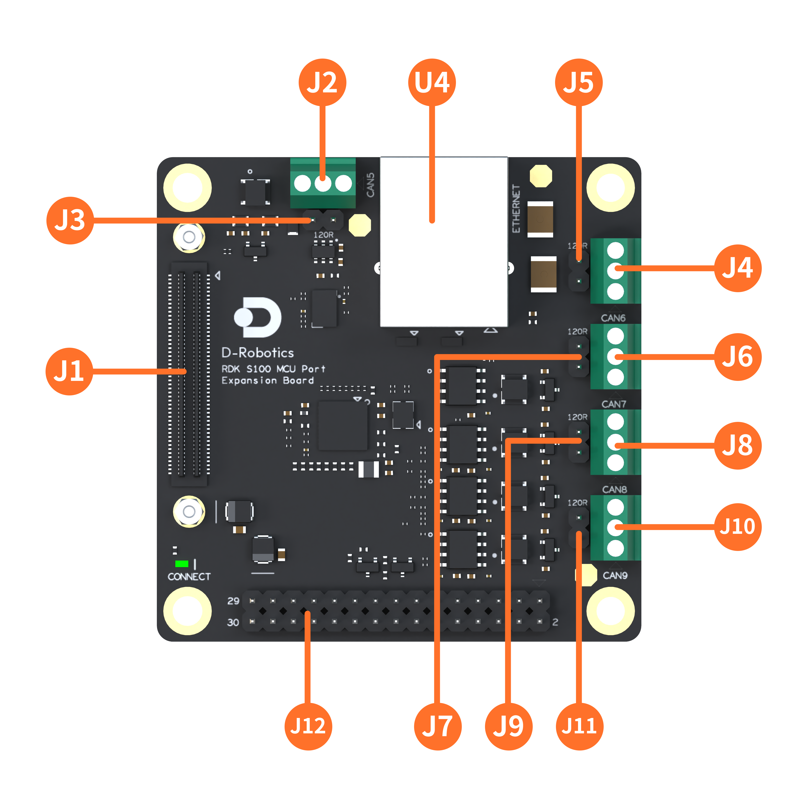

# D-Robotics RDK S100 MCU Port Expansion Board: pinout, CANHAL and first readback


**Manufacturer reference: D-Robotics RDK S100 MCU Port Expansion Board.** No matching OpenELAB SKU or product listing has been verified. This page documents the manufacturer board and does not imply that it is included with an S100 kit or available as a store option.

**Hardware scope:** S100 MCU-domain expansion board with matching MAIN/SUB FPC, five CAN FD interfaces, J12 30-pin header, Gigabit Ethernet and BMI088 · **Software scope:** RDK S100 `v=4.0.5&p=RDK+S100`, with the dated 20260507 MCU community package identified below.


## Product overview <a href="#overview" id="overview"></a>

The RDK S100 MCU Port Expansion Board exposes peripherals belonging to the S100's **MCU domain**. Its 100-pin J1 connects through the matched FPC to **S100 mainboard J23**. It provides CAN5–CAN9 terminals, a 30-pin peripheral header J12, MCU-domain Ethernet U4 and an onboard Bosch BMI088 IMU on SPI5. It is distinct from the mainboard's J22 MCU header, J24 Acore header, J25 camera connector and the S600 MCU expansion board. [Manufacturer hardware guide](https://raw.githubusercontent.com/D-Robotics/rdk_s_doc/fac1c7ac05443a4890232c537a6f99bebfdb6a9f/i18n/en/docusaurus-plugin-content-docs/current/01_Quick_start/01_hardware_introduction/01_rdk_s100/03_rdk_s100_mcu_port_expansion_board.md), [V1.1 datasheet](https://archive.d-robotics.cc/downloads/hardware/rdk_s100/rdk_s100_mcu_port_expansion_board/d_robotics_rdk_s100_mcu_port__expansion_board_en_v1_1.pdf), [S100 host guide](https://raw.githubusercontent.com/D-Robotics/rdk_s_doc/fac1c7ac05443a4890232c537a6f99bebfdb6a9f/i18n/en/docusaurus-plugin-content-docs/current/01_Quick_start/01_hardware_introduction/01_rdk_s100/01_rdk_s100.md).

Exact-board evidence is the manufacturer's named hardware chapter, the V1.1 October 2025 datasheet's interface drawing, and its V1P0 reference-design archive. The observed drawings carry **RDK S100 MCU Port Expansion Board** labels and J1/J2/J4/J6/J8/J10/J12 designators. No separate verified alphanumeric order code or OpenELAB SKU is assigned here. A similar green CAN terminal or a 100-pin connector is insufficient to identify another board. [M1](https://archive.d-robotics.cc/downloads/hardware/rdk_s100/rdk_s100_mcu_port_expansion_board/d_robotics_rdk_s100_mcu_port__expansion_board_en_v1_1.pdf)[MDESIGN](https://archive.d-robotics.cc/downloads/hardware/rdk_s100/rdk_s100_mcu_port_expansion_board/drobotics_rdk_s100_mcu_port_expansion_board_reference_design_v1p0.zip).



Official component-location illustration from [M1](https://raw.githubusercontent.com/D-Robotics/rdk_s_doc/fac1c7ac05443a4890232c537a6f99bebfdb6a9f/i18n/en/docusaurus-plugin-content-docs/current/01_Quick_start/01_hardware_introduction/01_rdk_s100/03_rdk_s100_mcu_port_expansion_board.md). Refer to its numbered pin marks and the installed board's rear CAN labels, rather than reading left/right positions from a rotated image.

## Applications <a href="#applications" id="applications"></a>

* **Read peripheral state before control:** record MCU version/alive counters, then inspect the board-identification ADC or onboard IMU with its matching sample.
* **CAN FD bench acquisition:** receive known inert traffic on one isolated CAN channel through MCU CAN2IPC and the Acore CANHAL library; establish channel/instance mapping before any transmission.
* **Low-level sensor integration:** connect a verified 3.3 V I2C/SPI peripheral or a conditioned analog input to J12, with its specific pinmux and driver ownership established.
* **Time and Ethernet experiments:** use the MCU-domain Ethernet API and timestamping features; it is not automatically another Linux network interface.

These are development uses from the [MCU framework](https://raw.githubusercontent.com/D-Robotics/rdk_s_doc/fac1c7ac05443a4890232c537a6f99bebfdb6a9f/i18n/en/docusaurus-plugin-content-docs/current/07_Advanced_development/05_mcu_development/01_basic_information.md), [CAN guide](https://raw.githubusercontent.com/D-Robotics/rdk_s_doc/fac1c7ac05443a4890232c537a6f99bebfdb6a9f/i18n/en/docusaurus-plugin-content-docs/current/07_Advanced_development/05_mcu_development/09_mcu_can.md), [IPC guide](https://raw.githubusercontent.com/D-Robotics/rdk_s_doc/fac1c7ac05443a4890232c537a6f99bebfdb6a9f/i18n/en/docusaurus-plugin-content-docs/current/07_Advanced_development/05_mcu_development/08_mcu_ipc.md), and [peripheral guides](https://raw.githubusercontent.com/D-Robotics/rdk_s_doc/fac1c7ac05443a4890232c537a6f99bebfdb6a9f/i18n/en/docusaurus-plugin-content-docs/current/07_Advanced_development/05_mcu_development/10_mcu_i2c.md) [SPI](https://raw.githubusercontent.com/D-Robotics/rdk_s_doc/fac1c7ac05443a4890232c537a6f99bebfdb6a9f/i18n/en/docusaurus-plugin-content-docs/current/07_Advanced_development/05_mcu_development/06_mcu_spi.md) [ADC](https://raw.githubusercontent.com/D-Robotics/rdk_s_doc/fac1c7ac05443a4890232c537a6f99bebfdb6a9f/i18n/en/docusaurus-plugin-content-docs/current/07_Advanced_development/05_mcu_development/07_mcu_adc.md) [ETH](https://raw.githubusercontent.com/D-Robotics/rdk_s_doc/fac1c7ac05443a4890232c537a6f99bebfdb6a9f/i18n/en/docusaurus-plugin-content-docs/current/07_Advanced_development/05_mcu_development/11_mcu_eth.md). The expansion board does not provide actuator current, a universal motion protocol, galvanic isolation or a safety-certified control system.

## Specifications <a href="#specifications" id="specifications"></a>

| Parameter           | S100 MCU expansion scope and conditions                                                                                                                                                                              |
| ------------------- | -------------------------------------------------------------------------------------------------------------------------------------------------------------------------------------------------------------------- |
| Host interface      | J1 100-pin through matched FPC to S100 mainboard J23; not J25 camera                                                                                                                                                 |
| CAN                 | Five physical **CAN FD** channels: CAN5–CAN9; manufacturer maximum **8 Mbit/s**, with the CAN guide explicitly saying its laboratory verification reached **5 Mbit/s**                                               |
| CAN termination     | One selectable **120 Ω** resistor per channel, enabled by the corresponding two-pin jumper                                                                                                                           |
| J12                 | 30-pin header: seven ADC inputs, two I2C groups and two SPI groups, plus multiplexed PWM/PPS/GPIO and supply/return pins                                                                                             |
| Digital I/O at J12  | Listed signal logic **3.3 V**, as detailed in the table; this is not 5 V tolerance                                                                                                                                   |
| ADC input domain    | J12 ADC5–ADC11 are **1.8 V analog** pins; schematic says 0–1.8 V support, while the ADC guide specifies **100–1700 mV measurement range**                                                                            |
| J12 supply outputs  | 5 V **300 mA**, 3.3 V **600 mA**, 1.8 V **300 mA** maximum, per hardware guide; these rails remain powered in light/deep sleep                                                                                       |
| Ethernet            | U4, MCU-domain Gigabit RJ45; maximum documented link/data interface rate **1000 Mbit/s**, not measured application throughput                                                                                        |
| IMU                 | Bosch BMI088 at U8, connected through **SPI5**; 4.0.2 lacked corresponding functionality, and 4.0.5 adds MCU daughterboard IMU support                                                                               |
| Environment         | **0–45 °C**                                                                                                                                                                                                          |
| Mechanical conflict | Current hardware page states **70 × 70 × 17 mm**; the V1.1 PDF page-4 PCB outline shows **60 × 60 mm**. Match the actual board revision before enclosure/hole design; these are not merged into one dimension claim. |

Sources: [hardware guide](https://raw.githubusercontent.com/D-Robotics/rdk_s_doc/fac1c7ac05443a4890232c537a6f99bebfdb6a9f/i18n/en/docusaurus-plugin-content-docs/current/01_Quick_start/01_hardware_introduction/01_rdk_s100/03_rdk_s100_mcu_port_expansion_board.md), [V1.1 datasheet](https://archive.d-robotics.cc/downloads/hardware/rdk_s100/rdk_s100_mcu_port_expansion_board/d_robotics_rdk_s100_mcu_port__expansion_board_en_v1_1.pdf), [schematic](https://archive.d-robotics.cc/downloads/hardware/rdk_s100/rdk_s100_mcu_port_expansion_board/drobotics_rdk_s100_mcu_port_expansion_board_reference_design_v1p0.zip), [ADC operating conditions](https://raw.githubusercontent.com/D-Robotics/rdk_s_doc/fac1c7ac05443a4890232c537a6f99bebfdb6a9f/i18n/en/docusaurus-plugin-content-docs/current/07_Advanced_development/05_mcu_development/07_mcu_adc.md), [CAN capabilities](https://raw.githubusercontent.com/D-Robotics/rdk_s_doc/fac1c7ac05443a4890232c537a6f99bebfdb6a9f/i18n/en/docusaurus-plugin-content-docs/current/07_Advanced_development/05_mcu_development/09_mcu_can.md), [4.0.5 release](https://raw.githubusercontent.com/D-Robotics/rdk_s_doc/fac1c7ac05443a4890232c537a6f99bebfdb6a9f/i18n/en/docusaurus-plugin-content-docs/current/10_Release_Note/s100/02_v4_0_5.md). Current limits for the J12 rails are output budgets, not permission to feed external supplies back into those pins. Internal I/O-reference rails on the host connector are not spare load supplies.

## Hardware and connections <a href="#hardware" id="hardware"></a>

### Power-off assembly and exact connector routing <a href="#assembly" id="assembly"></a>

1. Identify the S100 host revision, the MCU expansion-board labels and the matching FPC. Disconnect host DC power and all independently powered attached peripherals. Sleep is insufficient: J12 supplies remain live in sleep.
2. Follow the FPC labels: **MAIN → S100 J23**, **SUB → expansion-board J1**. Keep the connectors parallel, seat evenly and secure the supported mounting points. Do not insert this cable into the camera J25 connector.
3. Use the [official assembly video](http://rdk-doc.oss-cn-beijing.aliyuncs.com/doc/video/mcu_port_expansion_board_assembly_guide.mp4) for the matching physical assembly. MAIN/SUB labels establish the destination ends; they do not establish the exposed contact face of a substitute cable. **An unverified replacement FPC contact arrangement blocks connection and power-on.**
4. Check that standoffs cannot touch components or conductive surfaces. Because the two primary mechanical references disagree, custom mounting-hole patterns, screw lengths and enclosure clearances require the actual board/drawing revision. No torque is inferred.
5. Before adding a J12 peripheral, compare every supply, return, signal level, pin number and active pinmux against the device datasheet. Establish a common signal reference where the interface requires it. Do not attach motor, relay-coil or high-current loads to a logic pin.

These destination and power rules come from the [board guide](https://raw.githubusercontent.com/D-Robotics/rdk_s_doc/fac1c7ac05443a4890232c537a6f99bebfdb6a9f/i18n/en/docusaurus-plugin-content-docs/current/01_Quick_start/01_hardware_introduction/01_rdk_s100/03_rdk_s100_mcu_port_expansion_board.md), [host guide](https://raw.githubusercontent.com/D-Robotics/rdk_s_doc/fac1c7ac05443a4890232c537a6f99bebfdb6a9f/i18n/en/docusaurus-plugin-content-docs/current/01_Quick_start/01_hardware_introduction/01_rdk_s100/01_rdk_s100.md), and [original schematic](https://archive.d-robotics.cc/downloads/hardware/rdk_s100/rdk_s100_mcu_port_expansion_board/drobotics_rdk_s100_mcu_port_expansion_board_reference_design_v1p0.zip). The board's green **CONNECT** LED means the board connection/5 V supply indication is present; it does not verify firmware, CAN wiring, Ethernet link or IMU data.

### CAN terminals and termination <a href="#can-wiring" id="can-wiring"></a>

| CAN channel | Three-pin connector | 120 Ω enable jumper | S100 4.0.5 IPC instance/channel |
| ----------- | ------------------- | ------------------- | ------------------------------- |
| CAN5        | J2                  | J3                  | 0 / 4                           |
| CAN6        | J4                  | J5                  | 0 / 6                           |
| CAN7        | J6                  | J7                  | 4 / 7                           |
| CAN8        | J8                  | J9                  | 4 / 2                           |
| CAN9        | J10                 | J11                 | 0 / 3                           |

The MCU CAN hardware guide identifies **pin 1, triangle mark = GND**, **middle = CAN\_L**, **remaining = CAN\_H**. Cross-check the installed rear silkscreen before wiring; a wire-entry view and a PCB view can reverse perceived left/right. These are physical CAN bus lines after the transceiver, not raw MCU TX/RX pins or a power supply. [M1](https://raw.githubusercontent.com/D-Robotics/rdk_s_doc/fac1c7ac05443a4890232c537a6f99bebfdb6a9f/i18n/en/docusaurus-plugin-content-docs/current/07_Advanced_development/05_mcu_development/09_mcu_can.md).

For the manufacturer's isolated two-node CAN5/CAN6 bench arrangement, connect H-to-H, L-to-L and the required reference ground, and enable the two endpoint 120 Ω resistors with J3/J5. Keep only the appropriate two end terminations for that bench bus. Do not insert all five jumpers on a single multi-node bus. Verify the real network's topology and pre-existing terminations; the source's broad “open-loop” terminology is not used here to authorize an unterminated arbitrary high-speed bus. [CAN wiring and samples](https://raw.githubusercontent.com/D-Robotics/rdk_s_doc/fac1c7ac05443a4890232c537a6f99bebfdb6a9f/i18n/en/docusaurus-plugin-content-docs/current/07_Advanced_development/05_mcu_development/09_mcu_can.md).

**Do not connect an unidentified actuator harness.** Neither the three-pin terminal shape nor CAN protocol establishes the harness's power pins, voltage, application IDs or safe commands. The first test below receives known bench frames and does not require a motor.

### Complete J12 30-pin signal and pinmux reference <a href="#j12-pinout" id="j12-pinout"></a>

The table follows the manufacturer's interactive pinout embedded by the [board chapter](https://raw.githubusercontent.com/D-Robotics/rdk_s_doc/fac1c7ac05443a4890232c537a6f99bebfdb6a9f/i18n/en/docusaurus-plugin-content-docs/current/01_Quick_start/01_hardware_introduction/01_rdk_s100/03_rdk_s100_mcu_port_expansion_board.md), with its original data pinned in [the pinout source](https://raw.githubusercontent.com/D-Robotics/rdk_s_doc/fac1c7ac05443a4890232c537a6f99bebfdb6a9f/static/pinout/s100_mcu_expansion_board_pinout_en/index.html). It preserves physical pin numbers. The **Port index** is separately derived by matching each SIP pin name against the S100 Port User Guide; it is neither the physical pin number nor always the GPIO number. Alternative functions must be selected deliberately, not used concurrently. [Port guide](https://raw.githubusercontent.com/D-Robotics/rdk_s_doc/fac1c7ac05443a4890232c537a6f99bebfdb6a9f/i18n/en/docusaurus-plugin-content-docs/current/07_Advanced_development/05_mcu_development/12_mcu_port/01_user_manual.md).

| J12 pin | Signal           | Voltage / role | SIP Port index | Multiplexed functions 0 → 3 / pulls                                    |
| ------- | ---------------- | -------------- | -------------- | ---------------------------------------------------------------------- |
| 1       | `PWM1_IO_3V3`    | 3.3V           | 87             | 0: `PWM1_IO` ; 1: `PMIC_ERR1` ; 3: `GPIO_MCU[86]`; PU, 10K             |
| 2       | `PPS_OUT_3V3`    | 3.3V           | 2              | 0: `PPS_IN2` ; 1: `PPS_OUT` ; 3: `GPIO_MCU[2]`; PD                     |
| 3       | `GND`            | GND            | —              | 0: `GND`; /                                                            |
| 4       | `GND`            | GND            | —              | 0: `GND`; /                                                            |
| 5       | `SPI4_CSN1_3V3`  | 3.3V           | 26             | 0: `SPI4_CSN1` ; 1: `PPS_IN1` ; 2: `TRC_DATA4` ; 3: `GPIO_MCU[26]`; PD |
| 6       | `GPIO_MCU_4_3V3` | 3.3V           | 4              | 0: `LIN2_TXD` ; 1: `UART6_TXD` ; 2: `SPI6_CSN2` ; 3: `GPIO_MCU[4]`; PD |
| 7       | `SPI4_CSN0_3V3`  | 3.3V           | 25             | 0: `SPI4_CSN0` ; 2: `TRC_DATA3` ; 3: `GPIO_MCU[25]`; PD                |
| 8       | `I2C9_SCL_3V3`   | 3.3V           | 86             | 0: `PWM0_IO` ; 1: `I2C9_SCL` ; 3: `GPIO_MCU[85]`; PU, 3.2K             |
| 9       | `SPI4_SCLK_3V3`  | 3.3V           | 29             | 0: `SPI4_SCLK` ; 2: `TRC_DATA7` ; 3: `GPIO_MCU[29]`; PD                |
| 10      | `I2C9_SDA_3V3`   | 3.3V           | 70             | 0: `BIFSPI_MISO` ; 1: `I2C9_SDA` ; 3: `GPIO_MCU[70]`; PU, 3.2K         |
| 11      | `SPI4_MOSI_3V3`  | 3.3V           | 27             | 0: `SPI4_MOSI` ; 2: `TRC_DATA5` ; 3: `GPIO_MCU[27]`; PD                |
| 12      | `I2C8_SCL_3V3`   | 3.3V           | 84             | 0: `I2C8_SCL` ; 1: `PWM10_IO` ; 3: `GPIO_MCU[83]`; PU, 4.7K            |
| 13      | `SPI4_MISO_3V3`  | 3.3V           | 28             | 0: `SPI4_MISO` ; 2: `TRC_DATA6` ; 3: `GPIO_MCU[28]`; PD                |
| 14      | `I2C8_SDA_3V3`   | 3.3V           | 85             | 0: `I2C8_SDA` ; 1: `PWM11_IO` ; 3: `GPIO_MCU[84]`; PU, 4.7K            |
| 15      | `GPIO_MCU_1_3V3` | 3.3V           | 1              | 0: `FUSA_ERR1` ; 1: `SPI2_CSN3` ; 3: `GPIO_MCU[1]`; PD                 |
| 16      | `VDD_1V8`        | 1.8V           | —              | 0: `VDD_1V8`; /                                                        |
| 17      | `SPI2_CSN0_3V3`  | 3.3V           | 16             | 0: `SPI2_CSN0` ; 3: `GPIO_MCU[16]`; PD                                 |
| 18      | `ADC_11`         | 1.8V ADC       | —              | 0: `ADC_IO[11]`; /                                                     |
| 19      | `SPI2_SCLK_3V3`  | 3.3V           | 19             | 0: `SPI2_SCLK` ; 3: `GPIO_MCU[19]`; PD                                 |
| 20      | `ADC_10`         | 1.8V ADC       | —              | 0: `ADC_IO[10]`; /                                                     |
| 21      | `SPI2_MOSI_3V3`  | 3.3V           | 17             | 0: `SPI2_MOSI` ; 3: `GPIO_MCU[17]`; PD                                 |
| 22      | `ADC_9`          | 1.8V ADC       | —              | 0: `ADC_IO[9]`; /                                                      |
| 23      | `SPI2_MISO_3V3`  | 3.3V           | 18             | 0: `SPI2_MISO` ; 3: `GPIO_MCU[18]`; PD                                 |
| 24      | `ADC_8`          | 1.8V ADC       | —              | 0: `ADC_IO[8]`; /                                                      |
| 25      | `GND`            | GND            | —              | 0: `GND`; /                                                            |
| 26      | `ADC_7`          | 1.8V ADC       | —              | 0: `ADC_IO[7]`; /                                                      |
| 27      | `VDD_3V3`        | 3.3V           | —              | 0: `VDD_AON_PERI_MCU_3V3`; /                                           |
| 28      | `ADC_6`          | 1.8V ADC       | —              | 0: `ADC_IO[6]`; /                                                      |
| 29      | `VDD_5V`         | 5V             | —              | 0: `VDD_AON_PERI_MCU_5V`; /                                            |
| 30      | `ADC_5`          | 1.8V ADC       | —              | 0: `ADC_IO[5]`; /                                                      |

J12 I2C9 SCL/SDA have 3.2 kΩ pull-ups in the interactive reference; I2C8 SCL/SDA have 4.7 kΩ pull-ups. PWM1 pin 1 has a documented 10 kΩ pull-up. Other signal pull states are recorded in the linked pinout. **Do not add external pull-downs to I2C9 SCL/SDA when repurposing them as GPIO**, as the board guide expressly forbids this. [PINOUT](https://raw.githubusercontent.com/D-Robotics/rdk_s_doc/fac1c7ac05443a4890232c537a6f99bebfdb6a9f/i18n/en/docusaurus-plugin-content-docs/current/01_Quick_start/01_hardware_introduction/01_rdk_s100/03_rdk_s100_mcu_port_expansion_board.md).

The mainboard J23 100-pin connection includes mixed 1.8/3.3 V interfaces, raw CAN TX/RX, RGMII, ADC, reference rails and peripheral supplies. That connector's levels are not identical to every translated J12 level. Use the [S100 V1P1 host pinlist, J23 sheet](https://archive.d-robotics.cc/downloads/hardware/rdk_s100/rdk_s100/drobotics_rdk_s100_pinlist_v1p1_20261022.xlsx) or [V1P0 workbook](https://archive.d-robotics.cc/downloads/hardware/rdk_s100/rdk_s100/drobotics_rdk_s100_pinlist_v1p0_0924.xlsx) for a custom carrier, plus the [MCU-board V1P0 schematic](https://archive.d-robotics.cc/downloads/hardware/rdk_s100/rdk_s100_mcu_port_expansion_board/drobotics_rdk_s100_mcu_port_expansion_board_reference_design_v1p0.zip). Several workbook cells are internally inconsistent: V1P1 J23 pin 40 is named `EMAC_TX_CLK_1V8` but its function cell says GND; pin 44 is named `GPIO_MCU_35_3V3` while its function/GPIO cells identify EMAC\_TX\_CLK / GPIO\_MCU\[51]. These are unresolved source conflicts, not alternative wiring choices. Custom use of those contacts is blocked until the correct revision's schematic resolves them.

### Analog inputs and rail limits <a href="#analog-and-rails" id="analog-and-rails"></a>

J12 pins **30, 28, 26, 24, 22, 20, 18** carry **ADC5, 6, 7, 8, 9, 10, 11** respectively. ADC12 is used for MCU daughterboard identification through the host connector and is not another J12 user input. The schematic's 0–1.8 V analog-domain limit and the ADC guide's 100–1700 mV measurement range describe different constraints; design a source within both applicable conditions. A 3.3 V digital signal must not be applied directly to an ADC pin. [PINOUT](https://archive.d-robotics.cc/downloads/hardware/rdk_s100/rdk_s100_mcu_port_expansion_board/drobotics_rdk_s100_mcu_port_expansion_board_reference_design_v1p0.zip)[ADC](https://raw.githubusercontent.com/D-Robotics/rdk_s_doc/fac1c7ac05443a4890232c537a6f99bebfdb6a9f/i18n/en/docusaurus-plugin-content-docs/current/07_Advanced_development/05_mcu_development/07_mcu_adc.md).

Measure only an identified, appropriately conditioned input with its source and return verified. Do not short a supply rail to an ADC to “test full scale.” The published output-current limits do not establish reverse-current protection or isolation; an unknown external supply/ground arrangement blocks connection. The ADC guide requires POST completion and calls for calibration when ambient temperature changes by more than ±20 °C. It does not provide a board-specific calibration command in the reviewed procedure, so none is invented here. [M1](https://raw.githubusercontent.com/D-Robotics/rdk_s_doc/fac1c7ac05443a4890232c537a6f99bebfdb6a9f/i18n/en/docusaurus-plugin-content-docs/current/07_Advanced_development/05_mcu_development/07_mcu_adc.md).

## Software and development resources <a href="#software" id="software"></a>

### Linux Acore, MCU0 and MCU1 have different jobs <a href="#execution-domains" id="execution-domains"></a>

The **Acore** runs Linux and applications. **MCU0** handles boot and power management; its complete implementation is not included in the community source package. **MCU1** runs application functions under FreeRTOS **V10.0.1** on Cortex-R52+ and is controlled through the Linux remoteproc framework. A CAN terminal on this board is therefore not established by an X5-style `ip link set can0 …` command. [MCU framework](https://raw.githubusercontent.com/D-Robotics/rdk_s_doc/fac1c7ac05443a4890232c537a6f99bebfdb6a9f/i18n/en/docusaurus-plugin-content-docs/current/07_Advanced_development/05_mcu_development/01_basic_information.md), [community/commercial package description](https://raw.githubusercontent.com/D-Robotics/rdk_s_doc/fac1c7ac05443a4890232c537a6f99bebfdb6a9f/i18n/en/docusaurus-plugin-content-docs/current/07_Advanced_development/05_mcu_development/00_code_release.md), [CAN architecture](https://raw.githubusercontent.com/D-Robotics/rdk_s_doc/fac1c7ac05443a4890232c537a6f99bebfdb6a9f/i18n/en/docusaurus-plugin-content-docs/current/07_Advanced_development/05_mcu_development/09_mcu_can.md).

For S100, MCU1 owns the application CAN gateway and Ethernet; I2C8/I2C9 are assigned to MCU1 while I2C6/I2C7 belong to MCU0 in the documented division. The peripheral driver may exist in the package without every controller being exposed at J12. SPI5 is used by the onboard BMI088 and must not be repurposed casually. [M5](https://raw.githubusercontent.com/D-Robotics/rdk_s_doc/fac1c7ac05443a4890232c537a6f99bebfdb6a9f/i18n/en/docusaurus-plugin-content-docs/current/01_Quick_start/01_hardware_introduction/01_rdk_s100/03_rdk_s100_mcu_port_expansion_board.md).

The `RDKS100_LNX_SDK_V4.0.5` release, dated **3 March 2026**, specifies Linux **6.1.158-rt58**, Ubuntu 22.04/Jammy and U-Boot 2022.04; its **20260507** maintenance release fixes V1P1 hardware support. Linux/BSP cross-compilation uses AArch64 **11.3.rel1**, whereas the MCU build script identifies **gcc-arm-none-eabi-10.3-2021.10**. These are different targets/toolchains. [REL](https://raw.githubusercontent.com/D-Robotics/rdk_s_doc/fac1c7ac05443a4890232c537a6f99bebfdb6a9f/i18n/en/docusaurus-plugin-content-docs/current/10_Release_Note/s100/01_v4_0_5_260507.md)[M5](https://archive.d-robotics.cc/downloads/os_images/rdk_s100/RDKS100-V4.0.5_20260507/RDK_MCU_SDK/board_support_package/mcu-community.tar.gz).

### Exact community package and build inputs <a href="#mcu-sdk" id="mcu-sdk"></a>

The inspected public package is the official **`RDKS100-V4.0.5_20260507/RDK_MCU_SDK/board_support_package/mcu-community.tar.gz`**, SHA-256:

```
a6b2b56e5cfded8350cf562dc0bbacf783c21760eb52b3fbf0027712a796bb7a
```

It was read as source data only. No package script was imported or executed and no compiler/toolchain was installed. Its community source directory is **`mcu/Build/FreeRtos_mcu1_community`**, rather than assuming the enterprise guide's `FreeRtos_mcu1` folder exists. [Official dated archive](https://archive.d-robotics.cc/downloads/os_images/rdk_s100/RDKS100-V4.0.5_20260507/RDK_MCU_SDK/board_support_package/mcu-community.tar.gz).

For a separately prepared matching MCU development environment, the package's script and S100 YAML establish this build invocation:

```bash
cd mcu/Build/FreeRtos_mcu1_community
python3 build_freertos.py lite matrix B s100 gcc mcu1 debug
```

The parser recognizes `s100`, `gcc` and `debug` as options and forms `build_config/S100/lite-matrix-B-mcu1.yaml` from the other tokens. Thus the quick-start's `… s100 mcu1 gcc debug` and release note's `… s100 gcc mcu1 debug` select the same YAML in **this inspected package**. This conclusion is source inspection, not a successful build. The YAML names `gen_s100_sip_B_mcu1`, S100 target files and sample groups including CAN, GPIO, ADC, I2C, UART, IMU and IPC. [SDK](https://raw.githubusercontent.com/D-Robotics/rdk_s_doc/fac1c7ac05443a4890232c537a6f99bebfdb6a9f/i18n/en/docusaurus-plugin-content-docs/current/07_Advanced_development/05_mcu_development/01_basic_information.md)[REL](https://raw.githubusercontent.com/D-Robotics/rdk_s_doc/fac1c7ac05443a4890232c537a6f99bebfdb6a9f/i18n/en/docusaurus-plugin-content-docs/current/10_Release_Note/s100/02_v4_0_5.md).

The MCU quick-start recommends an Ubuntu 22.04 host and names Python 3.8.10; the general BSP release uses Ubuntu 20.04 x64 as its build environment. Follow the selected package's dependency instructions and record actual interpreter/tool versions. Do not silently use the BSP's AArch64 compiler for Cortex-R52 code. The script may download a toolchain on its first real execution, which was not done here. Its documented output includes `S100_MCU_DEBUG.elf` for MCU1; the output's `SIP_V2.0` name is not a claim that the expansion PCB is revision 2.0. [M5](https://raw.githubusercontent.com/D-Robotics/rdk_s_doc/fac1c7ac05443a4890232c537a6f99bebfdb6a9f/i18n/en/docusaurus-plugin-content-docs/current/10_Release_Note/s100/02_v4_0_5.md)[SDK](https://archive.d-robotics.cc/downloads/os_images/rdk_s100/RDKS100-V4.0.5_20260507/RDK_MCU_SDK/board_support_package/mcu-community.tar.gz).

The public community package supplies headers/static libraries/configuration and samples, while deeper McalCdd/Service/Platform sources and MCU0 modification can require commercial access. Public availability of an archive does not grant permission to republish its proprietary code. Link the original package and keep new application code original. [CODE](https://archive.d-robotics.cc/downloads/os_images/rdk_s100/RDKS100-V4.0.5_20260507/RDK_MCU_SDK/board_support_package/mcu-community.tar.gz).

### Pinmux and input readback without whole-board reinitialization <a href="#pinmux" id="pinmux"></a>

For the S100 MCU1 target, pin configuration lives in `Config/McalCdd/gen_s100_sip_B_mcu1/Port/inc/Port_FuncCfg.h` and `Port/src/Port_FuncCfg.c`. The community API header is `Include/Port_Func.h`; the enterprise documentation also names `McalCdd/Port/inc/Port_Func.h`. [PORTDEV](https://archive.d-robotics.cc/downloads/os_images/rdk_s100/RDKS100-V4.0.5_20260507/RDK_MCU_SDK/board_support_package/mcu-community.tar.gz).

`Port_SetFunctionPins(PORT_FUNC_SPI4)` selects the documented SPI4 group; choose `PORT_FUNC_I2C8`, `PORT_FUNC_I2C9` or another actual group only after checking conflicts and the board's pin table. GPIO operations use `Port_SetGpioByIndex(PinIdx)`, `Port_GpioDirectionInput(PinIdx)` and `Port_GpioGetValue(PinIdx)`. For instance, J12 pin 14 is I2C8\_SDA at **Port index 85**, while its GPIO number is **84**; passing physical pin number 14 would select another signal. [PORT](https://raw.githubusercontent.com/D-Robotics/rdk_s_doc/fac1c7ac05443a4890232c537a6f99bebfdb6a9f/static/pinout/s100_mcu_expansion_board_pinout_en/index.html).

Use an input first on an unoccupied, externally verified pin. A floating input's value depends on configured pulls and is not a sensor measurement. Check return values and the installed header's blacklist; do not bypass it. The Port Development Guide explicitly warns **not to call `Port_Init()` again on MCU1**, because it can reinitialize power/system pins already established by MCU0. The I2C guide's generic initialization paragraph is not a reason to override that system-specific warning. [PORT](https://raw.githubusercontent.com/D-Robotics/rdk_s_doc/fac1c7ac05443a4890232c537a6f99bebfdb6a9f/i18n/en/docusaurus-plugin-content-docs/current/07_Advanced_development/05_mcu_development/12_mcu_port/02_development_manual.md)[I2C](https://raw.githubusercontent.com/D-Robotics/rdk_s_doc/fac1c7ac05443a4890232c537a6f99bebfdb6a9f/i18n/en/docusaurus-plugin-content-docs/current/07_Advanced_development/05_mcu_development/10_mcu_i2c.md).

### CANHAL configuration and API contracts <a href="#canhal" id="canhal"></a>

S100 CAN traffic follows **physical transceiver → MCU CAN driver/CanIf → CAN2IPC → IPC → Acore CANHAL → application**. CAN5/6/9 use instance 0 and CAN7/8 instance 4 in 4.0.5. The current S600 mapping differs; a CAN6 mapping from an S600 example must not be copied. One process/thread owns a particular IPC channel; two competing receivers do not create independent subscriptions. [M6](https://raw.githubusercontent.com/D-Robotics/rdk_s_doc/fac1c7ac05443a4890232c537a6f99bebfdb6a9f/i18n/en/docusaurus-plugin-content-docs/current/10_Release_Note/s100/02_v4_0_5.md).

An Acore sample reads three JSON files from **its current working directory's `config/`**:

| File                | Relevant configuration                                                                                                       | Meaning                                                            |
| ------------------- | ---------------------------------------------------------------------------------------------------------------------------- | ------------------------------------------------------------------ |
| `nodes.json`        | unique `target`, `enable`, `mode` (`R`, `W`, `RW`), `clk_source`, `io_channel.device_type`, `channel_id`, `raw_protocol`     | Application-visible virtual node and its logical channel reference |
| `ipcf_channel.json` | `libipcf_path`, matching channel `id`, physical `instance` and `channel`, `dev_path=/dev/ipcdrv`, FIFO/packet/timeout fields | Maps that logical reference to the MCU-side IPC allocation         |
| `channels.json`     | `io_channels.ipcf`                                                                                                           | Points to `./config/ipcf_channel.json`                             |

The guide uses `/usr/hobot/lib/libhbipcfhal.so.1`, `raw_protocol="built_1.0"`, `clk_source="/dev/hrtc0"`, FIFO size 64000 and maximum packet 4096 in its example. Preserve the installed matching schema and MCU protocol; these values are not arbitrary tuning knobs. `recv_timeout` is a library setting—do not infer its unit from another API's timeout name. [M6](https://raw.githubusercontent.com/D-Robotics/rdk_s_doc/fac1c7ac05443a4890232c537a6f99bebfdb6a9f/i18n/en/docusaurus-plugin-content-docs/current/07_Advanced_development/05_mcu_development/09_mcu_can.md).

For a **separate receive-only CAN5 bench configuration**, the relationship is: enabled target `bypass` → logical `channel_id=0` → the entry with `id=0` in `ipcf_channel.json`, whose physical tuple is **instance 0/channel 4**. A node ID is not the physical CAN controller number. These original one-channel files adapt the documented schema to CAN5 receive-only use; compare them with the matching installed package before use, and keep them separate from a deployed application's configuration. [M6](https://raw.githubusercontent.com/D-Robotics/rdk_s_doc/fac1c7ac05443a4890232c537a6f99bebfdb6a9f/i18n/en/docusaurus-plugin-content-docs/current/07_Advanced_development/05_mcu_development/09_mcu_can.md).

`config/nodes.json`:

```json
{"nodes":[{"id":0,"enable":true,"mode":"R","target":"bypass",
  "clk_source":"/dev/hrtc0",
  "io_channel":{"device_type":"ipcf","channel_id":0},
  "raw_protocol":"built_1.0"}]}
```

`config/ipcf_channel.json`:

```json
{"enable":true,"libipcf_path":"/usr/hobot/lib/libhbipcfhal.so.1",
 "channels":[{"id":0,"channel":{"name":"bypass","instance":0,
   "channel":4,"fifo_size":64000,"fifo_type":0,"pkg_size_max":4096,
   "dev_path":"/dev/ipcdrv","dev_name":"ipcdrv","recv_timeout":4000}}]}
```

`config/channels.json`:

```json
{"io_channels":{"ipcf":"./config/ipcf_channel.json"}}
```

These files have only been checked as static JSON and against the cited S100 allocation. They have not been loaded by CANHAL or tested on a bus. Mode `R` is the documented read-only node mode; it does not make the attached CAN controller a guaranteed electrically silent monitor.

The application lifecycle is **`canInit()` → receive/send calls → `canDeInit()`**. `canRecvMsgFrame(target, frame, &pack)` is nonblocking in the documented pseudocode; allocate sufficient frame capacity and inspect the packet's returned count/metadata before processing. `-CAN_TRY_AGAIN` is a retry condition, not a received empty frame. Use a bounded wait/backoff in original applications. `canSendMsgFrame(target, frame, &pack)` sends according to that mapped target; it is not needed for the first receive-only checkpoint. The guide's `pack` carries frame count plus MCU/Acore timestamp information, so retain those clocks with latency observations. [M6](https://raw.githubusercontent.com/D-Robotics/rdk_s_doc/fac1c7ac05443a4890232c537a6f99bebfdb6a9f/i18n/en/docusaurus-plugin-content-docs/current/07_Advanced_development/05_mcu_development/09_mcu_can.md).

At the MCU driver layer, `Can_Init(const Can_ConfigType*)`, `Can_SetControllerMode`, `Can_GetControllerMode`, `Can_GetControllerErrorState`, `Can_GetControllerRxErrorCounter` and `Can_GetControllerTxErrorCounter` provide configuration/state access. `Can_Write` requests transmission and can return `CAN_BUSY`; a request acceptance is not an application-level acknowledgement. In polling configurations, the appropriate `Can_MainFunction_Read/Write/BusOff/Mode` services must be scheduled. Do not reinitialize a controller already owned by the gateway. [M6](https://raw.githubusercontent.com/D-Robotics/rdk_s_doc/fac1c7ac05443a4890232c537a6f99bebfdb6a9f/i18n/en/docusaurus-plugin-content-docs/current/07_Advanced_development/05_mcu_development/09_mcu_can.md), [matching package header](https://archive.d-robotics.cc/downloads/os_images/rdk_s100/RDKS100-V4.0.5_20260507/RDK_MCU_SDK/board_support_package/mcu-community.tar.gz).

CAN filters are configured in `gen_s100_sip_B_mcu1/Can/src/Can_PBcfg.c`: ONE\_ID matches code/mask, RANGE\_ID accepts an ID range, TWO\_ID accepts either of two IDs. Standard IDs are 11-bit (`0x7FF` maximum), extended IDs 29-bit (`0x1FFFFFFF`). Keep their filter sets distinct. The guide maps baud IDs 0–5 to 500k/1M, 500k/2M, 1M/2M, two 1M/5M profiles and 1M/8M. Match the actual peer/transceiver/cable and compiled `u16DefaultBaudrateID`; an 8 Mbit/s capability is not a verified operating point. [M6](https://raw.githubusercontent.com/D-Robotics/rdk_s_doc/fac1c7ac05443a4890232c537a6f99bebfdb6a9f/i18n/en/docusaurus-plugin-content-docs/current/07_Advanced_development/05_mcu_development/09_mcu_can.md).

The MCU gateway's default merge count is 1 and timeout 1000 µs. `Can_Set_Merge_Num` and `Can_Set_Merge_Time` change aggregation and latency, not the physical bus rate. Change these only after a baseline record and retain original settings. CANHAL latency warnings require MCU RTC/Acore PHC synchronization; unsynchronized timestamps cannot establish transport latency. [M6](https://raw.githubusercontent.com/D-Robotics/rdk_s_doc/fac1c7ac05443a4890232c537a6f99bebfdb6a9f/i18n/en/docusaurus-plugin-content-docs/current/07_Advanced_development/02_linux_development/04_driver_development_super/12_driver_timesync.md).

### IPC, I2C/SPI ownership and onboard IMU <a href="#ipc-and-peripherals" id="ipc-and-peripherals"></a>

IPC reserves instance 7 for IpcBox and instance 8 for MCU1 boot in the S100 allocation. IpcBox maps RunCmd/UART/SPI/I2C to channels 0/1/2/3 of instance 7 in the reviewed reference. The 4.0.4-Beta → 4.0.5-Beta refactor changed packet structure/channel/defaults, so pair MCU firmware with the Linux IPC library. In the guide's configuration RunCmd is enabled while UART/SPI/I2C are disabled; status must be observed rather than assumed. [M7](https://raw.githubusercontent.com/D-Robotics/rdk_s_doc/fac1c7ac05443a4890232c537a6f99bebfdb6a9f/i18n/en/docusaurus-plugin-content-docs/current/07_Advanced_development/02_linux_development/04_driver_development_super/06_driver_ipc.md).

On the **MCU console**, `ipcbox_set_mode debug` inspects ownership and `ipcbox_loglevel show` reports logging. `ipcbox_set_mode i2c 1` or `spi 1` is a state change and must only be used after the selected peripheral is free; the corresponding `… 0` disables it and releases its task resources. The S100 default IpcBox SPI example uses **SPI3**, which is **not one of J12's SPI2/SPI4 groups**. Do not short J12 pins expecting the unmodified SPI3 loopback to use them. UART5 is exposed at mainboard J22 and similarly does not become a J12 UART by name. [M7](https://raw.githubusercontent.com/D-Robotics/rdk_s_doc/fac1c7ac05443a4890232c537a6f99bebfdb6a9f/i18n/en/docusaurus-plugin-content-docs/current/07_Advanced_development/02_linux_development/04_driver_development_super/06_driver_ipc.md)[UART](https://raw.githubusercontent.com/D-Robotics/rdk_s_doc/fac1c7ac05443a4890232c537a6f99bebfdb6a9f/i18n/en/docusaurus-plugin-content-docs/current/07_Advanced_development/05_mcu_development/04_mcu_uart.md).

For MCU-side IPC extensions, `Ipc_MDMA_Init` must follow DMA initialization; `Ipc_MDMA_OpenInstance` and `Ipc_MDMA_CheckRemoteCoreReady` establish readiness before `Ipc_MDMA_SendMsg`. The latter's timeout is **microseconds**; DMA send buffer address/size alignment is **16 bytes** in the guide. Instance ownership, matching local/remote memory/channel configuration and IRQ priority matter; do not duplicate an instance across cores or alter boot/power IPC allocations as a peripheral test. [M7](https://raw.githubusercontent.com/D-Robotics/rdk_s_doc/fac1c7ac05443a4890232c537a6f99bebfdb6a9f/i18n/en/docusaurus-plugin-content-docs/current/07_Advanced_development/05_mcu_development/08_mcu_ipc.md). `Ipc_MDMA_PollMsg(instance)` is the receive path when interrupts are not used; a no-data return is distinct from a received message. `Ipc_MDMA_TryGetHwResource(instance, channel, size)` reports availability rather than reserving an unlimited transfer budget. Pair an opened instance with `Ipc_MDMA_CloseInstance` and deinitialize the owned instance with `Ipc_MDMA_DeInit` on controlled cleanup. Handle timeout, unopened instance, busy and no-memory returns explicitly. [M7](https://raw.githubusercontent.com/D-Robotics/rdk_s_doc/fac1c7ac05443a4890232c537a6f99bebfdb6a9f/i18n/en/docusaurus-plugin-content-docs/current/07_Advanced_development/05_mcu_development/08_mcu_ipc.md).

For J12 I2C8/I2C9, configure the corresponding Port function and match the peripheral's address, pull-ups and bus speed. `I2c_Init`, `I2c_SyncDataTrans`, `I2c_AsyncDataTrans` and `I2c_StatusGet` are MCU driver interfaces, not Linux `/dev/i2c-*` calls. High-speed 3.4 Mbit/s mode is explicitly unsupported by the documented driver; Fast Mode Plus is the default controller setting. An IpcBox get/set may require device-specific address/register handling, so a successful scan is not proof of a correct multi-byte transaction. [I2C](https://raw.githubusercontent.com/D-Robotics/rdk_s_doc/fac1c7ac05443a4890232c537a6f99bebfdb6a9f/i18n/en/docusaurus-plugin-content-docs/current/07_Advanced_development/05_mcu_development/08_mcu_ipc.md).

For SPI, configure channel/job/sequence and external-buffer setup before `Spi_SyncTransmit`/`Spi_AsyncTransmit`. Inspect completion/result and cancel/reset a failed transfer state using the matching API; the guide warns it does not reset automatically. DMA requires an 8-byte-aligned transfer length, 64-byte-aligned send/receive buffers and at most 4096 bytes per channel in the documented constraints. Those are different from IPC's alignment. Do not select the onboard IMU's SPI5 while running another SPI5 owner. [SPI](https://raw.githubusercontent.com/D-Robotics/rdk_s_doc/fac1c7ac05443a4890232c537a6f99bebfdb6a9f/i18n/en/docusaurus-plugin-content-docs/current/01_Quick_start/01_hardware_introduction/01_rdk_s100/03_rdk_s100_mcu_port_expansion_board.md).

The dated community package contains `samples/Imu/src/Bmi088_Test.c`, the exported `Bmi088_Init`, `Bmi088_TestAcc`, `Bmi088_TestGyr` and `Bmi088_ReadTemp` commands, and SPI5 accelerometer/gyroscope sequences. Its configured identity values are ACC **0x1E** and GYR **0x0F**. The tests can print range readback and scaled acceleration in **g**, angular velocity in **degrees/s**, or temperature in **°C**. These are package-specific expected interfaces, not observed measurements. Keep the initialized range/ODR and axis/mounting convention with any data; do not publish a temperature or gyro bias calibration claim from an identity read alone. [SDK](https://raw.githubusercontent.com/D-Robotics/rdk_s_doc/fac1c7ac05443a4890232c537a6f99bebfdb6a9f/i18n/en/docusaurus-plugin-content-docs/current/10_Release_Note/s100/02_v4_0_5.md)[M1](https://raw.githubusercontent.com/D-Robotics/rdk_s_doc/fac1c7ac05443a4890232c537a6f99bebfdb6a9f/i18n/en/docusaurus-plugin-content-docs/current/01_Quick_start/01_hardware_introduction/01_rdk_s100/03_rdk_s100_mcu_port_expansion_board.md).

## Getting started <a href="#getting-started" id="getting-started"></a>

### First checkpoint: version and MCU state <a href="#first-readback" id="first-readback"></a>

Prerequisites are an identified S100 host and matching official expansion board/FPC, verified powered-off assembly, a known working S100 4.0.5 system, and access to the appropriate Linux terminal and MCU debug console. Leave unknown J12 loads, actuator buses and harnesses disconnected. The following are documented target procedures; none was executed during this review.

1. Boot the known matching system. Record the CONNECT LED indication and the board labels; do not infer a hardware test pass from the LED alone.
2. On **S100 Linux**, record the image and read the documented remoteproc diagnostic attributes:

```bash
cat /etc/version
rdkos_info
cat /sys/class/remoteproc/remoteproc_mcu0/name
cat /sys/class/remoteproc/remoteproc_mcu0/state
cat /sys/class/remoteproc/remoteproc_mcu0/mcu_version
cat /sys/class/remoteproc/remoteproc_mcu1/alive
cat /sys/class/remoteproc/remoteproc_mcu1/taskcounter
cat /sys/class/remoteproc/remoteproc_mcu1/mcu_version
cat /proc/remoteproc_mcu1
```

3. **Expected result:** device-specific version information and a live MCU state/counter when MCU1 is running. The `alive` value is updated at one-second intervals; an immediate repeated read can legitimately match. The guide's remoteproc control naming is unusual: the **`remoteproc_mcu0/state` control starts the MCU1 application through MCU0**. Do not “correct” the path by guessing that `remoteproc_mcu1/state` is the startup control. The 4.0.5 release moved logs to `/proc/remoteproc_mcu0` and `/proc/remoteproc_mcu1`; older `/sys/…/log` examples are not the current logging path. [M5](https://raw.githubusercontent.com/D-Robotics/rdk_s_doc/fac1c7ac05443a4890232c537a6f99bebfdb6a9f/i18n/en/docusaurus-plugin-content-docs/current/10_Release_Note/s100/02_v4_0_5.md).
4. If MCU1 is not running, stop the peripheral experiment. Use only the matching approved firmware/recovery procedure for that installed system. The documented development startup writes the verified `S100_MCU_DEBUG.elf` firmware name and `start` to `remoteproc_mcu0`; it is not necessary to replace a healthy factory image just to read state. Preserve current firmware/version first. [M5](https://raw.githubusercontent.com/D-Robotics/rdk_s_doc/fac1c7ac05443a4890232c537a6f99bebfdb6a9f/i18n/en/docusaurus-plugin-content-docs/current/07_Advanced_development/05_mcu_development/01_basic_information.md).

If MCU1 is intentionally stopped for development, the guide requires waiting until the system enters **WFI** before restarting it; restarting too early can overwrite still-running SRAM code and crash the system. No automatic stop/start loop or MCU0 flashing procedure is offered as routine troubleshooting. [M5](https://raw.githubusercontent.com/D-Robotics/rdk_s_doc/fac1c7ac05443a4890232c537a6f99bebfdb6a9f/i18n/en/docusaurus-plugin-content-docs/current/07_Advanced_development/05_mcu_development/01_basic_information.md).

### Read the MCU daughterboard identification ADC <a href="#adc-first-result" id="adc-first-result"></a>

The 20260507 package's S100 `Adc_Cmd.c` exports **`Adc_Test`**, and its single-channel branch requires two arguments: instance and channel. The implementation fixes the S100 instance internally and uses the second argument as channel. It accepts channels below 14 or channel 15. The documentation's abbreviated `AdcTest`/one-argument prose does not match that source. [SDK](https://raw.githubusercontent.com/D-Robotics/rdk_s_doc/fac1c7ac05443a4890232c537a6f99bebfdb6a9f/i18n/en/docusaurus-plugin-content-docs/current/07_Advanced_development/05_mcu_development/07_mcu_adc.md).

After POST, with a matching MCU1 sample build already running and no competing ADC operation, enter on the **MCU console**, not Linux:

```
Adc_Test 0 12
```

ADC12 is the MCU daughterboard identification input in the board schematic/host pinlist. **Expected result:** a returned raw code plus integer millivolts for instance 0/channel 12, followed by the sample's success indication if the driver call succeeded. No universal code/voltage is asserted: it depends on the actual board-ID network and revision, and a successful ADC transaction alone does not prove the board identity. Compare the record with the matched schematic/physical labels. This first read needs no user voltage wired to J12. [SDK](https://archive.d-robotics.cc/downloads/hardware/rdk_s100/rdk_s100_mcu_port_expansion_board/drobotics_rdk_s100_mcu_port_expansion_board_reference_design_v1p0.zip)[HOSTPIN1](https://archive.d-robotics.cc/downloads/hardware/rdk_s100/rdk_s100/drobotics_rdk_s100_pinlist_v1p1_20261022.xlsx).

The sample converts raw code with integer arithmetic `(raw × 1800) / 4095`. That nominal scaling does not establish ADC accuracy, calibration, resistor tolerance or the recommended measurement range. For an external measurement later, use only an identified J12 ADC5–11 input within its permitted analog domain and measure the applied voltage independently. [SDK](https://raw.githubusercontent.com/D-Robotics/rdk_s_doc/fac1c7ac05443a4890232c537a6f99bebfdb6a9f/i18n/en/docusaurus-plugin-content-docs/current/07_Advanced_development/05_mcu_development/07_mcu_adc.md).

### Receive a first known CAN frame on an isolated bench bus <a href="#can-first-frame" id="can-first-frame"></a>

Use a known compliant external CAN test peer with its bus timing, frame format, reference and termination agreed before power-on. No actuator is required. For the first receive, choose **CAN5/J2**, configure its endpoint termination according to the actual two-node bench network, and have the peer provide one benign frame with a known ID/data payload. The receive API may acknowledge valid physical CAN traffic; “receive-only application” is not a claim of electrically silent monitor mode. [M6](https://raw.githubusercontent.com/D-Robotics/rdk_s_doc/fac1c7ac05443a4890232c537a6f99bebfdb6a9f/i18n/en/docusaurus-plugin-content-docs/current/07_Advanced_development/05_mcu_development/09_mcu_can.md).

1. Confirm MCU1 and its gateway are running, and no other application owns **instance 0/channel 4**. Preserve the initial firmware and JSON files.
2. Enter `/app/Can/can_get`. Inspect its `config/nodes.json`, `config/ipcf_channel.json`, `config/channels.json`. For the documented target name `bypass`, ensure its enabled node points to the logical channel whose physical mapping is **instance 0/channel 4** for CAN5. Match `built_1.0`, the library/device paths and `clk_source` to the installed S100 package. Use `mode="R"` only if supported by that sample's matching configuration; do not invent a target or overwrite a deployed application's files.
3. If the sample is not built, the documented directory contains a Makefile; building requires the matching installed Acore libraries. Then run from that directory:

```bash
./canhal_get bypass
```

4. Have the agreed external peer supply the benign frame. **Expected result:** the receiver reports the matching ID, payload and packet/timestamp fields. Treat those as expected fields, not fixed values copied from a vendor log. Stop the foreground receiver with its normal interrupt handling when the bounded check is complete.
5. If it initializes but no frame arrives, check H/L/reference, terminations, peer bitrate/frame type, compiled filter and the 0/4 gateway mapping in that order. The sample may continue waiting; bound the observation and do not interpret an empty wait as proof that the bus is broken. A separate transmitter or multi-channel sample is unnecessary for this first checkpoint. [M6](https://raw.githubusercontent.com/D-Robotics/rdk_s_doc/fac1c7ac05443a4890232c537a6f99bebfdb6a9f/i18n/en/docusaurus-plugin-content-docs/current/07_Advanced_development/05_mcu_development/09_mcu_can.md).

The manufacturer's CAN5↔CAN6 loopback example is an optional isolated two-controller test. It requires **different IPC channels for the sender and receiver**, because a channel cannot be owned twice. Never run the multi-channel transmitter on an unknown vehicle/robot bus as a discovery tool. [M6](https://raw.githubusercontent.com/D-Robotics/rdk_s_doc/fac1c7ac05443a4890232c537a6f99bebfdb6a9f/i18n/en/docusaurus-plugin-content-docs/current/07_Advanced_development/05_mcu_development/09_mcu_can.md).

### Optional onboard IMU readback <a href="#imu-readback" id="imu-readback"></a>

In the matching package's MCU console, inspect available command names first. With SPI5 free and the supported firmware present, `Bmi088_Init` establishes the configured sensor state; `Bmi088_TestAcc 1` and `Bmi088_TestGyr 1` request bounded sample counts, and `Bmi088_ReadTemp` performs a temperature read. These paths initialize/configure the IMU, so they are not hardware-state-free operations. Preserve previous configuration before use. [SDK](https://archive.d-robotics.cc/downloads/os_images/rdk_s100/RDKS100-V4.0.5_20260507/RDK_MCU_SDK/board_support_package/mcu-community.tar.gz).

**Expected result:** identity/range readback and finite axes in the configured units; a stationary accelerometer's vector includes gravity and a stationary gyro can have bias. Do not force each acceleration axis to zero or call this a calibrated robot frame. A failing chip-ID/range read should lead to SPI5 ownership, board/release and power checks before any unrelated pinmux change. The 4.0.5 release's added IMU support does not retroactively make 4.0.2 functional. [SDK](https://raw.githubusercontent.com/D-Robotics/rdk_s_doc/fac1c7ac05443a4890232c537a6f99bebfdb6a9f/i18n/en/docusaurus-plugin-content-docs/current/01_Quick_start/01_hardware_introduction/01_rdk_s100/03_rdk_s100_mcu_port_expansion_board.md)[REL](https://raw.githubusercontent.com/D-Robotics/rdk_s_doc/fac1c7ac05443a4890232c537a6f99bebfdb6a9f/i18n/en/docusaurus-plugin-content-docs/current/10_Release_Note/s100/02_v4_0_5.md).

### Original offline checks and diagnostic capture <a href="#offline-and-diagnostics" id="offline-and-diagnostics"></a>

This original Python example checks a nominal ADC conversion and the documented S100 CAN allocation only. It does not import a driver, connect to an IPC device or run MCU code. [SDK](https://raw.githubusercontent.com/D-Robotics/rdk_s_doc/fac1c7ac05443a4890232c537a6f99bebfdb6a9f/i18n/en/docusaurus-plugin-content-docs/current/07_Advanced_development/05_mcu_development/09_mcu_can.md).

```python
S100_CAN_IPC = {5: (0, 4), 6: (0, 6), 7: (4, 7),
                8: (4, 2), 9: (0, 3)}

def adc_nominal_mv(raw):
    if not isinstance(raw, int) or not 0 <= raw <= 4095:
        raise ValueError("raw must be a 12-bit unsigned code")
    return raw * 1800 // 4095

assert adc_nominal_mv(2048) == 900  # synthetic input, not a measurement
assert S100_CAN_IPC[6] == (0, 6)   # S100, not the S600 allocation
```

Keep the host/expansion labels and revisions, both FPC ends, J12 harness map, measured supply arrangement and CAN jumper locations in the physical record. For software, save image/MCU versions, alive/counter observations, `/proc/remoteproc_mcu1`, exact domain/command, all three CAN JSON files, peer timing/filter/ID, first error and frame metadata. Capture the original log before changing verbosity or aggregation; verbose logging itself can affect throughput. [M5](https://raw.githubusercontent.com/D-Robotics/rdk_s_doc/fac1c7ac05443a4890232c537a6f99bebfdb6a9f/i18n/en/docusaurus-plugin-content-docs/current/07_Advanced_development/05_mcu_development/09_mcu_can.md)[M7](https://raw.githubusercontent.com/D-Robotics/rdk_s_doc/fac1c7ac05443a4890232c537a6f99bebfdb6a9f/i18n/en/docusaurus-plugin-content-docs/current/07_Advanced_development/05_mcu_development/08_mcu_ipc.md).

## Troubleshooting and FAQs <a href="#troubleshooting" id="troubleshooting"></a>

| Symptom                                   | Ordered checks and recovery boundary                                                                                                                                                                             |
| ----------------------------------------- | ---------------------------------------------------------------------------------------------------------------------------------------------------------------------------------------------------------------- |
| CONNECT LED off                           | Disconnect power and inspect MAIN→J23, SUB→J1, cable seating and board identity. Check host 5 V availability. Do not hot-plug the FPC.                                                                           |
| CAN terminals present but no Linux `can0` | Use the S100 MCU CAN2IPC/CANHAL path and its current mappings. Do not substitute X5 SocketCAN setup or S600 channel numbers.                                                                                     |
| CANHAL `-100` / `-101`                    | Validate the three JSON files, current working directory, unique enabled target and modes. File discovery occurs relative to the sample directory.                                                               |
| `-301` / `-302` / repeated `-303`         | Confirm MCU1, `/dev/ipcdrv`, matching `libhbipcfhal.so.1`, instance/channel allocation and one owner. Then check whether the peer is actually sending.                                                           |
| `-406` sequence discontinuity             | Capture packet counters and lower send/merge pressure deliberately. The guide says parsed frames may still be returned with this error; do not treat it as a clean, lossless sample.                             |
| `-408` latency warning                    | Establish MCU RTC/Acore PHC synchronization and inspect system load; the guide's default 28 ms threshold is not a system latency guarantee.                                                                      |
| `-409` CRC or `-402` protocol failure     | Compare MCU/Acore protocol and release, lengths and payload structure before changing electrical timing.                                                                                                         |
| ADC command only prints usage             | Use the actual matched sample's `Adc_Test 0 CHANNEL` form; distinguish Linux shell from MCU console. Do not add a voltage to compensate for a command syntax error.                                              |
| ADC near rail or implausible              | Confirm J12 ADC pin/channel, permitted input range, return path and POST/calibration conditions. Stop if voltage domain is unknown; nominal raw-to-mV conversion is not calibration.                             |
| GPIO read changes unexpectedly            | Check Port index versus physical/GPIO number, pulls, floating input and competing I2C/PWM function. Do not bypass the blacklist or call MCU1 `Port_Init()` globally.                                             |
| I2C/SPI test fails                        | Confirm selected controller is physically exposed, its mux and ownership, matching levels and IpcBox state. The default S100 SPI3 IPC loopback is not J12 SPI2/SPI4.                                             |
| IMU command missing / identity wrong      | Record actual firmware/package, confirm 4.0.5 support and SPI5 ownership, then compare installed sample/header. Do not flash an unverified MCU0 image as a routine repair.                                       |
| MCU1 stops/crashes                        | Preserve `/proc/remoteproc_mcu1` and remoteproc status. Follow matching firmware recovery; wait for WFI before an intended restart. Do not repeatedly restart a peripheral controller or overwrite running SRAM. |

Sources: [M1](https://raw.githubusercontent.com/D-Robotics/rdk_s_doc/fac1c7ac05443a4890232c537a6f99bebfdb6a9f/i18n/en/docusaurus-plugin-content-docs/current/07_Advanced_development/05_mcu_development/01_basic_information.md)[M6](https://raw.githubusercontent.com/D-Robotics/rdk_s_doc/fac1c7ac05443a4890232c537a6f99bebfdb6a9f/i18n/en/docusaurus-plugin-content-docs/current/07_Advanced_development/05_mcu_development/08_mcu_ipc.md)[PORT](https://raw.githubusercontent.com/D-Robotics/rdk_s_doc/fac1c7ac05443a4890232c537a6f99bebfdb6a9f/i18n/en/docusaurus-plugin-content-docs/current/07_Advanced_development/05_mcu_development/12_mcu_port/02_development_manual.md)[ADC](https://raw.githubusercontent.com/D-Robotics/rdk_s_doc/fac1c7ac05443a4890232c537a6f99bebfdb6a9f/i18n/en/docusaurus-plugin-content-docs/current/07_Advanced_development/02_linux_development/04_driver_development_super/06_driver_ipc.md)[SDK](https://archive.d-robotics.cc/downloads/os_images/rdk_s100/RDKS100-V4.0.5_20260507/RDK_MCU_SDK/board_support_package/mcu-community.tar.gz).

The MCU Ethernet port requires its own firmware/controller setup and is not automatically managed through Linux `eth0`. The driver sample's ARP flow allocates a buffer with `Eth_ProvideTxBuffer`, transmits with `Eth_Transmit`, and releases the polling-mode buffer through `Eth_TxConfirmation`. Its fixed example MAC/IP values must be adapted in source before use on a real network; packet capture validates the actual frame. No Ethernet transmit procedure is included in the first readback. [ETH](https://raw.githubusercontent.com/D-Robotics/rdk_s_doc/fac1c7ac05443a4890232c537a6f99bebfdb6a9f/i18n/en/docusaurus-plugin-content-docs/current/07_Advanced_development/05_mcu_development/11_mcu_eth.md).

## Downloads and technical documents <a href="#downloads" id="downloads"></a>

| Resource                                                                                                                                                                                                                                                                                                                                                                                                                                                                                                                                                                                                                                                                                                                                                                                                                                                                                                                                                                                                                                                                              | Purpose and access boundary                                                                        |
| ------------------------------------------------------------------------------------------------------------------------------------------------------------------------------------------------------------------------------------------------------------------------------------------------------------------------------------------------------------------------------------------------------------------------------------------------------------------------------------------------------------------------------------------------------------------------------------------------------------------------------------------------------------------------------------------------------------------------------------------------------------------------------------------------------------------------------------------------------------------------------------------------------------------------------------------------------------------------------------------------------------------------------------------------------------------------------------- | -------------------------------------------------------------------------------------------------- |
| [S100 MCU board hardware guide](https://raw.githubusercontent.com/D-Robotics/rdk_s_doc/fac1c7ac05443a4890232c537a6f99bebfdb6a9f/i18n/en/docusaurus-plugin-content-docs/current/01_Quick_start/01_hardware_introduction/01_rdk_s100/03_rdk_s100_mcu_port_expansion_board.md) / [V1.1 datasheet](https://archive.d-robotics.cc/downloads/hardware/rdk_s100/rdk_s100_mcu_port_expansion_board/d_robotics_rdk_s100_mcu_port__expansion_board_en_v1_1.pdf)                                                                                                                                                                                                                                                                                                                                                                                                                                                                                                                                                                                                                                 | Exact board, interface drawing and mechanical references; dimension conflict remains explicit      |
| [Interactive J12 pinout source](https://raw.githubusercontent.com/D-Robotics/rdk_s_doc/fac1c7ac05443a4890232c537a6f99bebfdb6a9f/static/pinout/s100_mcu_expansion_board_pinout_en/index.html) / [rendered pinout](https://d-robotics.github.io/rdk_s_doc/en/pinout/s100_mcu_expansion_board_pinout_en/index.html)                                                                                                                                                                                                                                                                                                                                                                                                                                                                                                                                                                                                                                                                                                                                                                      | Full 30-pin assignment, logic, alternatives and pulls                                              |
| [Host V1P1 pinlist](https://archive.d-robotics.cc/downloads/hardware/rdk_s100/rdk_s100/drobotics_rdk_s100_pinlist_v1p1_20261022.xlsx) / [V1P0 pinlist](https://archive.d-robotics.cc/downloads/hardware/rdk_s100/rdk_s100/drobotics_rdk_s100_pinlist_v1p0_0924.xlsx)                                                                                                                                                                                                                                                                                                                                                                                                                                                                                                                                                                                                                                                                                                                                                                                                                  | Mainboard J23 and other host connectors; revision-specific                                         |
| [MCU board V1P0 reference design](https://archive.d-robotics.cc/downloads/hardware/rdk_s100/rdk_s100_mcu_port_expansion_board/drobotics_rdk_s100_mcu_port_expansion_board_reference_design_v1p0.zip)                                                                                                                                                                                                                                                                                                                                                                                                                                                                                                                                                                                                                                                                                                                                                                                                                                                                                  | PDF schematic plus DSN/BRD; not a fit test or proof of an unidentified board revision              |
| [PCB STEP](https://archive.d-robotics.cc/downloads/hardware/rdk_s100/rdk_s100_mcu_port_expansion_board/drobotics_rdk_s100_mcu_port_expansion_board_v1p0.step) / [FPC STEP](https://archive.d-robotics.cc/downloads/hardware/rdk_s100/rdk_s100_mcu_port_expansion_board/drobotics_rdk_s100_mcu_port_expansion_board_fpc_v1p0.step)                                                                                                                                                                                                                                                                                                                                                                                                                                                                                                                                                                                                                                                                                                                                                     | Listed mechanical resources; not rendered/validated here                                           |
| [Dated MCU community archive](https://archive.d-robotics.cc/downloads/os_images/rdk_s100/RDKS100-V4.0.5_20260507/RDK_MCU_SDK/board_support_package/mcu-community.tar.gz)                                                                                                                                                                                                                                                                                                                                                                                                                                                                                                                                                                                                                                                                                                                                                                                                                                                                                                              | Inspected source package, configs, libraries and samples for the S100 4.0.5\_20260507 distribution |
| [MCU package structure](https://raw.githubusercontent.com/D-Robotics/rdk_s_doc/fac1c7ac05443a4890232c537a6f99bebfdb6a9f/i18n/en/docusaurus-plugin-content-docs/current/07_Advanced_development/05_mcu_development/00_code_release.md), [quick start](https://raw.githubusercontent.com/D-Robotics/rdk_s_doc/fac1c7ac05443a4890232c537a6f99bebfdb6a9f/i18n/en/docusaurus-plugin-content-docs/current/07_Advanced_development/05_mcu_development/01_basic_information.md), [Port user](https://raw.githubusercontent.com/D-Robotics/rdk_s_doc/fac1c7ac05443a4890232c537a6f99bebfdb6a9f/i18n/en/docusaurus-plugin-content-docs/current/07_Advanced_development/05_mcu_development/12_mcu_port/01_user_manual.md) / [Port development](https://raw.githubusercontent.com/D-Robotics/rdk_s_doc/fac1c7ac05443a4890232c537a6f99bebfdb6a9f/i18n/en/docusaurus-plugin-content-docs/current/07_Advanced_development/05_mcu_development/12_mcu_port/02_development_manual.md)                                                                                                                    | Domains, toolchain, lifecycle, pinmux and community/commercial boundaries                          |
| [CAN](https://raw.githubusercontent.com/D-Robotics/rdk_s_doc/fac1c7ac05443a4890232c537a6f99bebfdb6a9f/i18n/en/docusaurus-plugin-content-docs/current/07_Advanced_development/05_mcu_development/09_mcu_can.md), [MCU IPC](https://raw.githubusercontent.com/D-Robotics/rdk_s_doc/fac1c7ac05443a4890232c537a6f99bebfdb6a9f/i18n/en/docusaurus-plugin-content-docs/current/07_Advanced_development/05_mcu_development/08_mcu_ipc.md), [Acore IPC](https://raw.githubusercontent.com/D-Robotics/rdk_s_doc/fac1c7ac05443a4890232c537a6f99bebfdb6a9f/i18n/en/docusaurus-plugin-content-docs/current/07_Advanced_development/02_linux_development/04_driver_development_super/06_driver_ipc.md), [time synchronization](https://raw.githubusercontent.com/D-Robotics/rdk_s_doc/fac1c7ac05443a4890232c537a6f99bebfdb6a9f/i18n/en/docusaurus-plugin-content-docs/current/07_Advanced_development/02_linux_development/04_driver_development_super/12_driver_timesync.md)                                                                                                                      | Per-domain transport, ownership, API and timestamp configuration                                   |
| [ADC](https://raw.githubusercontent.com/D-Robotics/rdk_s_doc/fac1c7ac05443a4890232c537a6f99bebfdb6a9f/i18n/en/docusaurus-plugin-content-docs/current/07_Advanced_development/05_mcu_development/07_mcu_adc.md), [SPI](https://raw.githubusercontent.com/D-Robotics/rdk_s_doc/fac1c7ac05443a4890232c537a6f99bebfdb6a9f/i18n/en/docusaurus-plugin-content-docs/current/07_Advanced_development/05_mcu_development/06_mcu_spi.md), [I2C](https://raw.githubusercontent.com/D-Robotics/rdk_s_doc/fac1c7ac05443a4890232c537a6f99bebfdb6a9f/i18n/en/docusaurus-plugin-content-docs/current/07_Advanced_development/05_mcu_development/10_mcu_i2c.md), [UART](https://raw.githubusercontent.com/D-Robotics/rdk_s_doc/fac1c7ac05443a4890232c537a6f99bebfdb6a9f/i18n/en/docusaurus-plugin-content-docs/current/07_Advanced_development/05_mcu_development/04_mcu_uart.md), [Ethernet](https://raw.githubusercontent.com/D-Robotics/rdk_s_doc/fac1c7ac05443a4890232c537a6f99bebfdb6a9f/i18n/en/docusaurus-plugin-content-docs/current/07_Advanced_development/05_mcu_development/11_mcu_eth.md) | Peripheral-specific contracts and examples; board exposure must still be checked                   |
| [4.0.5 release](https://raw.githubusercontent.com/D-Robotics/rdk_s_doc/fac1c7ac05443a4890232c537a6f99bebfdb6a9f/i18n/en/docusaurus-plugin-content-docs/current/10_Release_Note/s100/02_v4_0_5.md) / [20260507 patch](https://raw.githubusercontent.com/D-Robotics/rdk_s_doc/fac1c7ac05443a4890232c537a6f99bebfdb6a9f/i18n/en/docusaurus-plugin-content-docs/current/10_Release_Note/s100/01_v4_0_5_260507.md) / [resource summary](https://raw.githubusercontent.com/D-Robotics/rdk_s_doc/fac1c7ac05443a4890232c537a6f99bebfdb6a9f/i18n/en/docusaurus-plugin-content-docs/current/01_Quick_start/download.md)                                                                                                                                                                                                                                                                                                                                                                                                                                                                         | Image/package matching and official download destinations                                          |

## References and validation <a href="#references-and-validation" id="references-and-validation"></a>

Primary documentation was reviewed on **24 November 2026**. Documentation repository material is pinned at `fac1c7ac05443a4890232c537a6f99bebfdb6a9f`; the binary/source archive snapshot is separately identified by its complete hash above. Navigate the rendered manual through [RDK S100 4.0.5](https://d-robotics.github.io/rdk_s_doc/en/RDK?v=4.0.5\&p=RDK+S100). S600 5.1.1 sections and Linux X5 examples are not interchangeable with these target procedures.

**Validation performed:** read primary hardware/pinout/schematic/datasheet and applicable MCU/IPC/CAN/peripheral/release sections; inspected the dated package's build parser, S100 target YAML, ADC and IMU sample interfaces; compared pin/index mappings; performed original synthetic arithmetic and static document checks. **Not run:** SDK installation, compiler/build scripts, firmware flashing, Linux board commands, MCU applications, CAN/Ethernet transmission, ROS, power/fit measurement, calibration or hardware operation.

OpenELAB store match remains unverified, as explicitly permitted for this manufacturer reference. The current web dimensions and V1.1 mechanical drawing conflict; custom fixtures are blocked until matched to the installed revision. The contact face of a substitute FPC, an unknown peripheral's rails/harness and its application bus protocol are not established here. Restricted commercial sources, unread CAD/DSN/BRD internals and complete production BSP builds are outside this reference. No physical commissioning readiness follows from a successful static check.

**Related guides:** [D-Robotics boards, modules and peripherals](./).

* [D-Robotics RDK S100/S100P — hardware, image and BPU development](rdk-s100-s100p-engineering-guide.md)
* [RDK S100 MCU1, CANHAL and IPC development reference](rdk-s100-mcu-canhal-ipc-reference.md)
* [D-Robotics RDK S100 Camera Expansion Board: MIPI/GMSL wiring and first video](rdk-s100-camera-expansion-board.md)
* [RDK S100 Camera Expansion Board 12L: PoC, pinout and capture reference](rdk-s100-camera-expansion-board-12l-reference.md)
