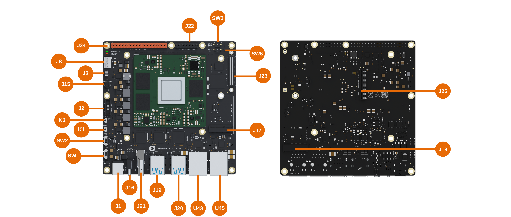

# D-Robotics RDK S100/S100P — hardware, image and BPU development


[**View RDK S100 on OpenELAB**](https://openelab.io/products/d-robotics-rdk-s100-robotics?variant=45780626964678) — **SKU:** `D-Robotics-31641`, 12 GB / 80 TOPS.

[**View RDK S100P on OpenELAB**](https://openelab.io/products/d-robotics-rdk-s100-robotics?variant=45780626997446) — **SKU:** `D-Robotics-32030`, 24 GB / 128 TOPS.

**Scope:** S100-series developer kit; current S100 documentation lane **4.0.5**, including the `20260507` image update. Identify the carrier's V1P0/V1P1 revision before using its connector workbook.


## Product overview <a href="#product-overview" id="product-overview"></a>

RDK S100 and S100P combine Linux application processing, Nash BPU neural-network inference and a separate Cortex-R52+ MCU domain. S100P changes CPU frequency, RAM and BPU capacity; it does not turn the carrier into an S600. Both listed kits include the selected board, acrylic protective case and power adapter. Cameras, camera/MCU expansion boards, SSD and wireless module require separate selection. [Model table](https://d-robotics.github.io/rdk_s_doc/en/01_Quick_start/01_hardware_introduction/01_rdk_s100/01_rdk_s100_kit?v=4.0.5\&p=RDK+S100), [OpenELAB package](https://openelab.io/products/d-robotics-rdk-s100-robotics).

The practical development sequence is board identification → stable power and cooling → matched system image → passive interface checks → one model's input/output contract → sensor integration. Real-time MCU tasks and Linux/BPU workloads have different build targets, memory ownership and recovery paths. A headline TOPS figure does not specify model latency or a robot's control deadline.



_D-Robotics interface illustration, inspected against the connector table. Its pictured carrier is marked V1P0; use the V1P1 pin workbook for a V1P1 board. Connector location is not a mating-face wiring diagram._ [_Figure and revision-specific pinlists_](https://d-robotics.github.io/rdk_s_doc/en/01_Quick_start/01_hardware_introduction/01_rdk_s100/01_rdk_s100_kit?v=4.0.5\&p=RDK+S100)_._

## Applications <a href="#applications" id="applications"></a>

| Task                               | Useful hardware/software path                                               | Integration condition                                                                                                 |
| ---------------------------------- | --------------------------------------------------------------------------- | --------------------------------------------------------------------------------------------------------------------- |
| Robot perception                   | Camera → multimedia processing → HBM model → result parser                  | Sensor driver, input color format, calibration and model target must agree                                            |
| Multiple concurrent models         | Linux processes plus BPU task scheduling                                    | Check measured memory, compile-time BPU core use and worst-case latency rather than adding peak TOPS                  |
| Motion-controller integration      | Linux perception → IPC → MCU1 application → external transceiver/controller | Acore CAN access on S100 uses CANHAL/IPC; it is not the S600 SocketCAN tutorial                                       |
| Speech and multimodal applications | S-series model examples and matched LLM runtime                             | Memory/quantization/context limits belong to each deployed model; generation is not permission to actuate             |
| Custom carrier evaluation          | Revision-specific pinlists, power-domain design and BSP                     | Commercial design material is access-controlled; the public kit guide does not establish every SIP design requirement |

The current Model Zoo guide maps supported examples by model and board. Some rows explicitly include S100P, others say S100 or S600. Inspect the individual example's model artifact and target before treating a family-level list as support for every option. [Model support and branch mapping](https://d-robotics.github.io/model_zoo_doc/en/rdk_s_guide?v=4.0.5\&p=RDK+S100).

## Specifications <a href="#specifications" id="specifications"></a>

### Sold model differences <a href="#sold-model-differences" id="sold-model-differences"></a>

| Parameter                 | RDK S100                                             | RDK S100P                                       |
| ------------------------- | ---------------------------------------------------- | ----------------------------------------------- |
| OpenELAB SKU              | `D-Robotics-31641`                                   | `D-Robotics-32030`                              |
| Manufacturer model        | KS1E55Y                                              | KS1P75Y                                         |
| SoC                       | S100E                                                | S100P                                           |
| CPU                       | 6 × Cortex-A78AE, 1.5 GHz                            | 6 × Cortex-A78AE, 2.0 GHz                       |
| BPU                       | Nash, 80 TOPS; current artifact target Nash-E        | Nash, 128 TOPS; current artifact target Nash-M  |
| RAM                       | 12 GB LPDDR5, 96-bit                                 | 24 GB LPDDR5, 96-bit                            |
| System storage            | 64 GB eMMC 5.1                                       | 64 GB eMMC 5.1                                  |
| MCU hardware              | 4 × Cortex-R52+, 1 DCLS + 1 Split-Lock configuration | Same described architecture                     |
| Current public image lane | RDK S100 4.0.5                                       | Same S100-series lane; preserve option identity |

Hardware values come from the model specification; the target-march mapping is separately established by the current pinned Model Zoo delivery. These are not application benchmarks. [Current target mapping](https://raw.githubusercontent.com/D-Robotics/rdk_model_zoo/0cde44d10b3be5075f6839ef552a6cecac4b4a12/README.md). The 4.0.5 release notes still list MCU1 lockstep unlocking as unsupported; the hardware configuration does not prove this software operation works. [Datasheet V1.2, specification page](https://archive.d-robotics.cc/downloads/hardware/rdk_s100/rdk_s100/d_robotics_rdk_s100_board_en_v1_2.pdf), [current image correction](https://d-robotics.github.io/rdk_s_doc/en/Release_Note/s100/v4_0_5_260507?v=4.0.5\&p=RDK+S100).

### Carrier and environmental limits <a href="#carrier-and-environmental-limits" id="carrier-and-environmental-limits"></a>

| Item                       | Documented S100-series value / boundary                                                                            |
| -------------------------- | ------------------------------------------------------------------------------------------------------------------ |
| DC input                   | 12–20 V; board input maximum 150 W                                                                                 |
| Supplied adapter           | Current kit guide describes 90 W; inspect the delivered adapter's voltage/current label                            |
| DC connector rating        | 20 V / 10 A component rating; it does **not** raise the board limit to 200 W                                       |
| Reference supply scenarios | Guide illustrates 12 V / 5.5 A and 20 V / 7.5 A supply scenarios; total attached loads determine required capacity |
| Ambient operation          | 0–45 °C; maintain ventilation and an effective heatsink/fan path                                                   |
| Kit size                   | Datasheet envelope 121 × 120 × 52.4 mm; use STEP/dimension drawing for mounting, not a scaled photograph           |
| USB host                   | 4 × USB 3.2 Gen 1x1 Type-A; each port 5 V / 1 A maximum in kit guide                                               |
| Debug/download             | J16 USB 2.0 Type-C, device mode; main and MCU serial bridges plus image download                                   |
| Display                    | HDMI; documented software mode up to 2560 × 1440 at 60 Hz                                                          |
| Network                    | 2 × Gigabit Ethernet; optional compatible M.2 wireless module                                                      |
| Camera host                | J25, 100-pin; 3 × four-lane CSI-2 paths, requiring a compatible daughterboard/harness                              |
| Expansion                  | J24 main-domain 40-pin, J22 MCU 16-pin, J23 MCU 100-pin                                                            |

The older V1.2 PDF calls the power jack 5.5 mm, while the current web guide describes 6 mm outside / 2.5 mm inside. Use the supplied matched adapter; **a replacement plug size is unresolved without the actual board/jack revision**. Do not force a nominally similar barrel connector. The PDF's HDMI interface designation and the implemented display mode also describe different layers. [Kit interfaces/power](https://d-robotics.github.io/rdk_s_doc/en/01_Quick_start/01_hardware_introduction/01_rdk_s100/01_rdk_s100_kit?v=4.0.5\&p=RDK+S100), [datasheet, PDF pages 3–5](https://archive.d-robotics.cc/downloads/hardware/rdk_s100/rdk_s100/d_robotics_rdk_s100_board_en_v1_2.pdf).

## Hardware and connections <a href="#hardware-and-connections" id="hardware-and-connections"></a>

### Power sequence and rail budget <a href="#power-sequence-and-rail-budget" id="power-sequence-and-rail-budget"></a>

Switch off and disconnect the adapter from its upstream power before inserting headers, M.2 cards, camera cables or daughterboards. Only USB, HDMI and Ethernet are identified as hot-pluggable in the preparation guide. Power the S100 first, then independently powered peripherals, to avoid reverse powering a board rail. The DC input supplies the kit; J16 Type-C and header supply outputs are not substitute main power inputs. [Preparation](https://d-robotics.github.io/rdk_s_doc/en/Quick_start/install_os/rdk_s100/preparation?v=4.0.5\&p=RDK+S100), [power/backfeed notes](https://d-robotics.github.io/rdk_s_doc/en/01_Quick_start/01_hardware_introduction/01_rdk_s100/01_rdk_s100_kit?v=4.0.5\&p=RDK+S100).

| Connector / rail                                        | Maximum output in kit guide | Sleep behavior and use                                                                 |
| ------------------------------------------------------- | --------------------------- | -------------------------------------------------------------------------------------- |
| J2 auxiliary control: AON 5 V / DCIN / peripheral 3.3 V | 50 mA / 5 mA / 100 mA       | Only external LED/button/control circuits; 3.3 V switches off in sleep                 |
| J8 fan, 12 V                                            | 200 mA                      | Peripheral 12 V switches off in light/deep sleep                                       |
| J17 Key E, AON 3.3 V                                    | 750 mA                      | Remains powered in light/deep sleep; wake support requires matched engineering support |
| J18 Key M, 3.3 V                                        | 700 mA                      | Off in light/deep sleep; no documented SSD wake support                                |
| J22 MCU 3.3 V / 5 V                                     | 300 mA / 200 mA             | Remain powered in light/deep sleep                                                     |
| J23 MCU AON 3.3 V / 5 V                                 | 1000 mA each                | Remain powered in light/deep sleep                                                     |
| J23 MCU I/O 3.3 V / 1.8 V reference rails               | 50 mA each                  | Low-power level shifting/pulls/dividers; off in deep sleep                             |
| J24 main 3.3 V / 5 V                                    | 1000 mA each                | Off in light/deep sleep                                                                |
| J25 camera 3.3 V / 12 V / I/O 1.8 V                     | 1700 mA / 800 mA / 50 mA    | Off in light/deep sleep; the 1.8 V rail is a signal-reference supply                   |

These are connector/domain limits, not permission to draw every maximum simultaneously. Add the actual peripherals to the adapter and thermal budget, and respect stricter daughterboard limits. A sensor that remains powered while its host I/O rail disappears needs a design that prevents backfeed. [Rail-by-rail conditions](https://d-robotics.github.io/rdk_s_doc/en/01_Quick_start/01_hardware_introduction/01_rdk_s100/01_rdk_s100_kit?v=4.0.5\&p=RDK+S100).

### J24 40-pin signals and SW6 selection <a href="#j24-40-pin-signals-and-sw6-selection" id="j24-40-pin-signals-and-sw6-selection"></a>

Main-header digital signals use 3.3 V logic. Keep physical pin numbers distinct from GPIO numbers, Linux chip offsets and alternate-function names. The `40PIN_GPIO0…9` signals come from an I²C expander; they cannot become SoC SPI/UART/PWM pins by changing a Linux pinmux setting. [Header definition](https://d-robotics.github.io/rdk_s_doc/en/Basic_Application/03_40pin_user_guide/s100/01_40pin_define?v=4.0.5\&p=RDK+S100), [V1P1 pin workbook](https://archive.d-robotics.cc/downloads/hardware/rdk_s100/rdk_s100/drobotics_rdk_s100_pinlist_v1p1_20261022.xlsx).

| Physical pins                | Function on the V1P1 workbook                                            |
| ---------------------------- | ------------------------------------------------------------------------ |
| 1, 17                        | 3.3 V supply output                                                      |
| 2, 4                         | 5 V supply output                                                        |
| 6, 9, 14, 20, 25, 30, 34, 39 | Ground                                                                   |
| 3 / 5                        | I2C5 SDA / SCL, selected by SW6                                          |
| 8 / 10                       | UART2 TX / RX, alternative SW6 route for the shared I2C5/UART2 signals   |
| 7 / 12 / 35 / 38 / 40        | PCM0 MCLK / BCLK / FSYNC / DATA0 / DATA1                                 |
| 19 / 21 / 23                 | SPI0 MOSI / MISO / clock                                                 |
| 24 / 26                      | SPI0 CS0 / CS1; inspect alternate UART3 use before reassigning pin 26    |
| 27 / 28                      | I2C4 SDA / SCL, also used by board functions                             |
| 11 / 13 / 15 / 29 / 31 / 37  | Expander GPIO0 / 1 / 2 / 3 / 4 / 5                                       |
| 16 / 18 / 22 / 36            | Expander GPIO6 / 7 / 8 / 9                                               |
| 32 / 33                      | GPIO\_CAM5 / GPIO\_CAM4, LPWM-capable signals; inspect the installed mux |

SW6's `40 PIN` selection chooses I2C5 at pins 3/5 or UART2 at pins 8/10. Its `PCM0` selection routes PCM0 between the main header and Key E. Match both the physical switch and software configuration; a device node alone does not prove the signal reaches the connector. I2C4 also serves the RTC and fan controller; do not scan/write arbitrary addresses as a first check. The guide prohibits external pull-downs on the named I2C4/I2C5/UART2 signals when used as GPIO. [Switch and pull-state restrictions](https://d-robotics.github.io/rdk_s_doc/en/01_Quick_start/01_hardware_introduction/01_rdk_s100/01_rdk_s100_kit?v=4.0.5\&p=RDK+S100), [GPIO interface](https://d-robotics.github.io/rdk_s_doc/en/Basic_Application/03_40pin_user_guide/s100/gpio?v=4.0.5\&p=RDK+S100).

### MCU headers and boot-sensitive pins <a href="#mcu-headers-and-boot-sensitive-pins" id="mcu-headers-and-boot-sensitive-pins"></a>

J22's V1P1 signal grouping is:

| Pin(s)      | Function                                   |
| ----------- | ------------------------------------------ |
| 1 / 2       | MCU AON 3.3 V / named MCU AON 5 V rail     |
| 3, 4, 6     | Ground                                     |
| 5 / 7       | I2C9 SDA / SCL                             |
| 8 / 10 / 12 | SPI3 MISO / MOSI / clock                   |
| 14 / 16     | SPI3 CS0 / CS1                             |
| 9 / 11      | MCU GPIO37 / GPIO36, alternate PWM7 / PWM6 |
| 13 / 15     | UART5 TX / RX                              |

The workbook's pin-2 voltage cell says 3.3 V although its signal name and kit guide say 5 V. Treat that cell as a conflict: do not use pin 2 as a voltage-reference assumption; verify the delivered board/rail before powering an accessory. GPIO36/37-connected peripheral pins must default low at power-on. I2C9 has board pull-ups; external pull-downs are prohibited for GPIO reuse. [J22 rules](https://d-robotics.github.io/rdk_s_doc/en/01_Quick_start/01_hardware_introduction/01_rdk_s100/01_rdk_s100_kit?v=4.0.5\&p=RDK+S100), [workbook J22 sheet](https://archive.d-robotics.cc/downloads/hardware/rdk_s100/rdk_s100/drobotics_rdk_s100_pinlist_v1p1_20261022.xlsx).

J23 is a mixed 1.8 V/3.3 V MCU signal connector exposing CAN5–9 logic, SPI/I2C, RGMII and other functions. **CAN TX/RX logic is not CAN\_H/CAN\_L:** a correct transceiver/interface board is required. Several MCU pins participate in boot/default-state constraints; preserve the pinlist's pull states before connecting a powered external controller. J25 is likewise mixed-voltage camera/control wiring. Neither 100-pin connector is a general 5 V-tolerant GPIO bus. [MCU/camera connector rules](https://d-robotics.github.io/rdk_s_doc/en/01_Quick_start/01_hardware_introduction/01_rdk_s100/01_rdk_s100_kit?v=4.0.5\&p=RDK+S100).

### Storage, wireless, RTC and cooling <a href="#storage-wireless-rtc-and-cooling" id="storage-wireless-rtc-and-cooling"></a>

J18 provides PCIe Gen3 ×1 NVMe expansion, but the current S100 installation page explicitly limits **boot to eMMC**. Leave SW3 in its eMMC setting; a silkscreen NVMe position does not establish supported boot firmware. Add an SSD as storage only after confirming its current and driver requirements, then identify the device with `lsblk` before any partitioning. [Boot restrictions](https://d-robotics.github.io/rdk_s_doc/en/Quick_start/install_os/rdk_s100/burn?v=4.0.5\&p=RDK+S100), [M.2 interface](https://d-robotics.github.io/rdk_s_doc/en/01_Quick_start/01_hardware_introduction/01_rdk_s100/01_rdk_s100_kit?v=4.0.5\&p=RDK+S100).

The prose hardware guide and store describe Key E as PCIe Wi-Fi plus four-wire UART Bluetooth, with no USB/SDIO. However, the newer V1P1 J17 workbook labels USB\_DP/DM and other signals not reconciled by that prose. **Do not infer USB-Bluetooth support from either the M.2 key shape or a generic Wi-Fi-card description.** A module needs exact carrier-revision, bus, driver and Bluetooth-transport confirmation. An enumerated PCIe Wi-Fi function does not prove its separate Bluetooth function works. [Current prose](https://d-robotics.github.io/rdk_s_doc/en/01_Quick_start/01_hardware_introduction/01_rdk_s100/01_rdk_s100_kit?v=4.0.5\&p=RDK+S100), [V1P1 J17 sheet](https://archive.d-robotics.cc/downloads/hardware/rdk_s100/rdk_s100/drobotics_rdk_s100_pinlist_v1p1_20261022.xlsx).

The Wi-Fi driver chapter names **AW-XM612**, using PCIe `brcmfmac`. Separately, the Bluetooth initialization chapter uses **XM612/CYW55560** as its UART example, with `hobot-bluetooth`, `/dev/ttyS1` and `CYW55560A1.hcd`. Its reset GPIO and UART assignment belong to the installed board configuration; do not replay them against a different module. Generic USB Bluetooth support in that chapter can refer to an external USB adapter and does not resolve Key E's V1P1 routing. Check PCIe enumeration, Bluetooth firmware/service state and `bluetoothctl list` separately: Wi-Fi association is not a Bluetooth test. [Module-specific Wi-Fi path](https://d-robotics.github.io/rdk_s_doc/en/Advanced_development/linux_development/driver_development_super/driver_wifi?v=4.0.5\&p=RDK+S100), [UART/USB Bluetooth initialization](https://d-robotics.github.io/rdk_s_doc/en/Advanced_development/linux_development/bluetooth_init?v=4.0.5\&p=RDK+S100).

The RTC is YSN8130E on I2C4, address `0x32`; fan control is at `0x2f`. The current V1P1 RTC description has pin 1 VRTC and pins 2–4 ground, whereas the older PDF describes a two-pin connector. Follow the actual revision. The guide recommends a 3 V battery and 2.5–3.5 V range. Never enable charging for a non-rechargeable cell. After losing both board and battery power, RTC FOUT/charge settings require reconfiguration according to the battery type. [RTC conditions](https://d-robotics.github.io/rdk_s_doc/en/01_Quick_start/01_hardware_introduction/01_rdk_s100/01_rdk_s100_kit?v=4.0.5\&p=RDK+S100).

For cooling diagnosis read sensor names, temperatures and active policy before changing anything. S100's five sensors cover main, MCU and BPU domains; input units are millidegrees Celsius. The described default policy uses staged fan control, CPU/BPU throttling around 95 °C and shutdown trips at 120 °C. Those are junction-control defaults, **not** a 120 °C ambient rating or permission to disable protection. CPU frequencies are reported in kHz. A headless desktop's X11 CPU-rendering fallback can raise CPU load independently of the model workload. [Thermal policy](https://d-robotics.github.io/rdk_s_doc/en/System_configuration/frequency_management?v=4.0.5\&p=RDK+S100), [release known issues](https://d-robotics.github.io/rdk_s_doc/en/Release_Note/s100/v4_0_5_260507?v=4.0.5\&p=RDK+S100).

## Software and development resources <a href="#software-and-development-resources" id="software-and-development-resources"></a>

### Keep the system, MCU and toolchain release together <a href="#keep-the-system-mcu-and-toolchain-release-together" id="keep-the-system-mcu-and-toolchain-release-together"></a>

| Layer                      | Source-supported S100 selection                                                                                                                          |
| -------------------------- | -------------------------------------------------------------------------------------------------------------------------------------------------------- |
| Board image/BSP            | `RDKS100-V4.0.5_20260507`; May update adds V1P1 support                                                                                                  |
| Board OS/kernel/bootloader | Ubuntu 22.04 Jammy; 6.1.158-rt58; U-Boot 2022.04                                                                                                         |
| Linux cross-compiler       | Arm GNU 11.3.rel1, aarch64; release build host Ubuntu 20.04 x64                                                                                          |
| MCU1 compiler / OS         | GCC Arm none-eabi 10.3-2021.10; FreeRTOS kernel 10.0.1 in MCU guide                                                                                      |
| BPU model examples         | Current repository delivery **`main`**; doc-center `rdk_s` instructions describe a preserved historical branch. Select one checkout/recipe/artifact set. |
| Python runtime             | S-series `hbm_runtime`, backed by `libhbucp`/DNN dependencies; same module name as X5 does not mean identical binaries                                   |
| Algorithm toolchain        | OE 3.7.0 S100/S600 package; wrapper explicitly pairs it with system 4.0.5                                                                                |
| LLM toolchain              | S-series LLM 2.0.0 supports S100/S100P 4.0.5+; old S100 LLM 1.0.0 is historical                                                                          |
| Robotics middleware        | TROS Humble lane on this Jammy image; do not copy S600 Jazzy/Noble package names                                                                         |

Use `cat /etc/version`, `rdkos_info`, installed package records and MCU version readbacks as a set. A toolchain version is not an image version; a current web page is not proof that an older installed binary exposes every newly documented API. Match the model's compiler target/runtime requirements before upgrading one library. Full commercial BSP/MCU0 internals require separate access; no NDA archive contents are assumed here. [Release pairing](https://d-robotics.github.io/rdk_s_doc/en/Release_Note/s100/v4_0_5_260507?v=4.0.5\&p=RDK+S100), [downloads](https://d-robotics.github.io/rdk_s_doc/en/Quick_start/download?v=4.0.5\&p=RDK+S100), [MCU scope](https://d-robotics.github.io/rdk_s_doc/en/Advanced_development/mcu_development/basic_information?v=4.0.5\&p=RDK+S100), [OE package](https://d-robotics.github.io/rdk_s_doc/en/Advanced_development/toolchain_development/algorithm_toolchain/overview?v=4.0.5\&p=RDK+S100), [LLM package](https://d-robotics.github.io/rdk_s_doc/en/Advanced_development/toolchain_development/LLM_Toolchain/rdk_s100/LLM_Toolchain_v2_0_0?v=4.0.5\&p=RDK+S100), [Model Zoo](https://d-robotics.github.io/model_zoo_doc/en/rdk_s_guide?v=4.0.5\&p=RDK+S100).

### Model Zoo delivery versus the doc-center branch <a href="#model-zoo-delivery-versus-the-doc-center-branch" id="model-zoo-delivery-versus-the-doc-center-branch"></a>

The live repository now identifies **`main` as delivery**, `develop` as development, and `rdk_s` as a historical per-board line. The doc-center guide still recommends `rdk_s`; that is a real documentation/version difference. This page's current-target example uses **main commit `0cde44d10b3be5075f6839ef552a6cecac4b4a12`**. Historical `rdk_s` examples were independently inspected at `4d9f7f20767c119777730b565cb25fa581afbda6`; do not combine their paths or CLI with current main. [Current repository](https://raw.githubusercontent.com/D-Robotics/rdk_model_zoo/0cde44d10b3be5075f6839ef552a6cecac4b4a12/README.md), [doc-center instructions](https://d-robotics.github.io/model_zoo_doc/en/rdk_s_guide?v=4.0.5\&p=RDK+S100).

Current artifact selectors are **`s100` → Nash-E**, **`s100p` → Nash-M**, and **`s600` → Nash-P**. The newer DINOv2 example supplies independently compiled artifacts for all three; identical source model names do not make those HBM files interchangeable. Keep the target selector, artifact manifest/hash, installed runtime and conversion recipe together. [Target-specific example](https://raw.githubusercontent.com/D-Robotics/rdk_model_zoo/0cde44d10b3be5075f6839ef552a6cecac4b4a12/samples/vision/dinov2/README.md).

### BPU inputs, outputs and scheduling <a href="#bpu-inputs-outputs-and-scheduling" id="bpu-inputs-outputs-and-scheduling"></a>

`HB_HBMRuntime` loads an HBM path or list of paths. Inspect `model_names`, `input_names`, `input_shapes`, `input_dtypes`, output metadata and compile-time BPU-core information before allocating tensors. `run()` returns a nested model-name → output-name → array result, including the single-model case. Multi-input dict keys must be exact tensor names. Use metadata-derived dtypes; do not fall back silently to float32 for an unfamiliar quantized or packed type. [Python API](https://d-robotics.github.io/rdk_s_doc/en/Algorithm_Application/python-api?v=4.0.5\&p=RDK+S100).

The S-series vision examples commonly use **separate NV12 Y and UV inputs**. X5's packed-input example is not interchangeable. The example wrapper performs resize/letterboxing and color conversion, inference, then model-specific decoding/NMS and coordinate restoration. Wrong UV ordering, stride, scale or letterbox reversal can produce plausible but wrong boxes. Record original dimensions and padding with each frame. [Sample data flow](https://d-robotics.github.io/model_zoo_doc/en/rdk_s_guide?v=4.0.5\&p=RDK+S100).

Model defaults set by `set_scheduling_params` are distinct from `run()`'s per-call overrides. The latter do not permanently rewrite another thread's configuration. Bind only to supported runtime cores and account for the model's compile-time core use. GIL release/concurrent submission does not guarantee linear throughput growth: memory copies, camera preprocessing and BPU contention still contribute latency. Query the installed API rather than borrowing a four-core example from another device. [Runtime contract](https://d-robotics.github.io/rdk_s_doc/en/Algorithm_Application/python-api?v=4.0.5\&p=RDK+S100).

OE conversion starts from the exact model/export and preprocessing contract, runs supported-operator/shape checks, prepares representative calibration data, quantizes/compiles for the selected S-series target, and validates accuracy before board timing. Keep the ONNX, calibration recipe, toolchain version, HBM, input normalization and postprocessor together. LLM 2.0.0 adds separate calibration/quantization and runtime/server workflows; select the S100 model-resolution list, not `resolve_model_s600.md`. Model support lists do not establish that every listed model/context fits 12 GB. [OE](https://d-robotics.github.io/rdk_s_doc/en/Advanced_development/toolchain_development/algorithm_toolchain/overview?v=4.0.5\&p=RDK+S100), [LLM model/runtime scope](https://d-robotics.github.io/rdk_s_doc/en/Advanced_development/toolchain_development/LLM_Toolchain/rdk_s100/LLM_Toolchain_v2_0_0?v=4.0.5\&p=RDK+S100).

### C/C++ runtime lifecycle <a href="#cc-runtime-lifecycle" id="cc-runtime-lifecycle"></a>

The OE basic sample documents a lower-level lifecycle beneath the Python binding:

| Stage            | API and data responsibility                                                                         |
| ---------------- | --------------------------------------------------------------------------------------------------- |
| Load/query       | `hbDNNInitializeFromFiles`, model-name list/handle and input/output count/name/tensor properties    |
| Allocate/prepare | UCP allocation, cached-buffer choice and `hbUCPMemFlush`; construct the exact model inputs          |
| Execute/wait     | `hbDNNInferV2` creates work; `hbUCPSubmitTask` and `hbUCPWaitTaskDone` govern submission/completion |
| Decode/release   | Interpret quantization/output properties; release task, UCP allocations and model handles           |

Do not read/free output while work is pending, and unwind partially allocated resources on failure. Retain the installed headers/runtime ABI with the compiled HBM. [OE runtime sample](https://developer.d-robotics.cc/oe_s_doc/en/guide/ucp/runtime/basic_sample.html).

That OE sample's model-directory discussion groups S100/S100P under `nash-e`, whereas the current pinned Model Zoo delivery exposes an independent **S100P Nash-M** artifact. These are different source/recipe contexts, not permission to rename or interchange files. Use the selected recipe's target, manifest and compatible runtime together. [OE sample path](https://developer.d-robotics.cc/oe_s_doc/en/guide/ucp/runtime/basic_sample.html), [current independent targets](https://raw.githubusercontent.com/D-Robotics/rdk_model_zoo/0cde44d10b3be5075f6839ef552a6cecac4b4a12/README.md).

### Camera, codec and memory lifecycle <a href="#camera-codec-and-memory-lifecycle" id="camera-codec-and-memory-lifecycle"></a>

A typical path is sensor/VIN → ISP/YNR → pyramid resize (PYM) → optional geometric correction (GDC) → codec/display or BPU input. Configuration includes sensor mode, CSI route, link port, pixel format, dimensions, stride and frame timing. `sample_pipeline` accepts `-s` sensor index and `-l` SerDes link; indices come from that installed binary's help, not a permanent camera SKU numbering scheme. Its documented example saves selected pyramid NV12 frames and an encoded stream; inspect file growth and frame metadata rather than assuming HDMI preview proves the entire pipeline. [Pipeline parameters](https://d-robotics.github.io/rdk_s_doc/en/Advanced_development/multimedia_development/multimedia_application/sample_pipeline?v=4.0.5\&p=RDK+S100).

The simpler installed MIPI streaming example currently names IMX219 and SC230AI. Other modules appearing in lower-level driver examples require their own exact driver/mode validation. Camera installation needs a compatible daughterboard and its switch/voltage configuration; the mainboard's J25 rail maximum does not override the camera board's limits. Start one camera owner, validate raw capture, then add resize/inference/display individually. [MIPI sample](https://d-robotics.github.io/rdk_s_doc/en/Basic_Application/Image/mipi_camera?v=4.0.5\&p=RDK+S100), [camera connector](https://d-robotics.github.io/rdk_s_doc/en/01_Quick_start/01_hardware_introduction/01_rdk_s100/01_rdk_s100_kit?v=4.0.5\&p=RDK+S100).

Shared multimedia buffers have ownership, cache and lifetime rules. A returned frame's valid width differs from allocation stride; do not infer byte size from visible dimensions alone. Obtain → process → release each frame on all success/error paths. Cache flush/invalidate and imported/exported buffer lifetimes matter when CPU and accelerator share memory. Unreleased buffers can exhaust a pipeline even when process RAM looks modest. [Buffer management](https://d-robotics.github.io/rdk_s_doc/en/Advanced_development/linux_development/driver_development_super/driver_hbmem/s100_hbmem_software?v=4.0.5\&p=RDK+S100).

### Multimedia Python objects and actual parameter boundaries <a href="#multimedia-python-objects-and-actual-parameter-boundaries" id="multimedia-python-objects-and-actual-parameter-boundaries"></a>

The S100 Python wrapper is imported from `hobot_vio.libsrcampy`. Its object API is a convenience layer over the lower media pipeline; check the installed classes/signatures before adapting a snippet. The introduction calls the encoder/decoder classes `Encode`/`Decode`, while their method pages use `Encoder`/`Decoder`. Several getter return-value tables are inconsistent with examples that consume byte buffers; do not treat a generic “0 success” row as a complete image-buffer contract. [Wrapper introduction](https://d-robotics.github.io/rdk_s_doc/en/Basic_Application/multi_media/multi_media_api/pydev/pydev_multimedia_api_s100?v=4.0.5\&p=RDK+S100), [encoder methods](https://d-robotics.github.io/rdk_s_doc/en/Basic_Application/multi_media/multi_media_api/pydev/object_encoder?v=4.0.5\&p=RDK+S100), [decoder methods](https://d-robotics.github.io/rdk_s_doc/en/Basic_Application/multi_media/multi_media_api/pydev/object_decoder?v=4.0.5\&p=RDK+S100).

| Object flow     | Configuration/input → output and cleanup                                                                                                                                                                                                                                                                                                                                                                                                                                                 |
| --------------- | ---------------------------------------------------------------------------------------------------------------------------------------------------------------------------------------------------------------------------------------------------------------------------------------------------------------------------------------------------------------------------------------------------------------------------------------------------------------------------------------- |
| Camera/VPS      | `open_cam` selects pipe, host, fps and output dimensions; host `-1` requests detection. `open_vps` describes source/destination size, processing mode, crop/rotation. `get_img` dimensions must match configured output; `set_img` supplies VPS input. Close the camera after use. [Camera methods](https://d-robotics.github.io/rdk_s_doc/en/Basic_Application/multi_media/multi_media_api/pydev/object_camera?v=4.0.5\&p=RDK+S100)                                                     |
| Encoder         | `encode(channel,type,width,height,bits)` selects channel 0–31, H264/H265/MJPEG type 1/2/3 and bitrate in kbps; documented width/height limits are 4096. Feed NV12 via `encode_file`, obtain encoded data, then close. Those API limits are not a promised combined-stream frame rate. [Encoder](https://d-robotics.github.io/rdk_s_doc/en/Basic_Application/multi_media/multi_media_api/pydev/object_encoder?v=4.0.5\&p=RDK+S100)                                                        |
| Decoder         | Configure file or streaming mode, channel/type/dimensions; `set_img(img,chn,eos)` feeds an encoded frame, with `eos` distinguishing continuation/end. Retrieve decoded output and close. Streaming mode uses an empty file parameter in the guide. [Decoder](https://d-robotics.github.io/rdk_s_doc/en/Basic_Application/multi_media/multi_media_api/pydev/object_decoder?v=4.0.5\&p=RDK+S100)                                                                                           |
| Display/binding | Video input is NV12; the wrapper's display method documents up to 1920×1080, separate from the carrier's higher HDMI mode. Graphics rectangles/text use their own layer, flush behavior and ARGB color; text encoding is GB2312 in the method page. `bind` connects configured source/destination objects; `unbind` before teardown. [Display/binding](https://d-robotics.github.io/rdk_s_doc/en/Basic_Application/multi_media/multi_media_api/pydev/object_display?v=4.0.5\&p=RDK+S100) |

**Development checkpoint:** initialize one producer and one consumer, verify format/dimensions and a valid returned buffer, then add binding/graphics/encoding. Check actual return shapes and errors rather than assuming an example's spelling or table applies to every package release. Unbind, stop and close on all exit paths; a hanging getter needs timeout/producer diagnosis, not a second owner of the camera.

### System configuration, pin drivers and synchronized networking <a href="#system-configuration-pin-drivers-and-synchronized-networking" id="system-configuration-pin-drivers-and-synchronized-networking"></a>

`/boot/config.txt` is interpreted by the documented boot flow. Its priority is temporary U-Boot `setenv` → configuration file → previously saved environment. Each line uses `key=value`, with a 1024-character maximum; the feature is unavailable with AVB enabled. Back up the file and current boot configuration before changes. `fdt-enable`/`fdt-disable` take actual full DTS paths separated by semicolons, including the final semicolon. Device-tree overlays need the matching base tree and driver-compatible peripheral description; the tutorial's sample SPI compatible string is not a real sensor driver. [Configuration syntax and priority](https://d-robotics.github.io/rdk_s_doc/en/System_configuration/config_txt?v=4.0.5\&p=RDK+S100).

Use `srpi-config` for supported system/user/network choices, but inspect the model-specific chapter before changing peripherals or memory reservation. Its generic memory-size example is not a measured S100 application requirement. To enable header UART2, the documented flow selects SW6, enables the UART2 node and disables I2C5; confirm the resulting serial device rather than assuming a fixed `/dev/tty*` number. SPI0 is master-only on this header; match mode, chip select and peer clock limit before a transfer. [UART configuration](https://d-robotics.github.io/rdk_s_doc/en/Basic_Application/03_40pin_user_guide/s100/uart?v=4.0.5\&p=RDK+S100), [SPI example](https://d-robotics.github.io/rdk_s_doc/en/Basic_Application/03_40pin_user_guide/s100/spi?v=4.0.5\&p=RDK+S100).

The supplied I2C test is **not read-only**: its displayed code reads a byte and writes it back, scans the selected bus and evaluates an entered address expression. Do not run that example against shared RTC/fan/power devices as an identification test. Use the known device's driver and a documented non-mutating register read; inspect the physical bus/address convention first. [Actual I2C example](https://d-robotics.github.io/rdk_s_doc/en/Basic_Application/03_40pin_user_guide/s100/i2c?v=4.0.5\&p=RDK+S100).

For network diagnosis separate carrier/negotiated speed, IP/subnet, routing/DNS and application ports. Prefer the desktop network manager for persistent settings; a temporary `ip` change can be replaced by its connection profile. Sensor synchronization adds another layer: `ptp4l` aligns the NIC hardware clock under the selected E2E/P2P and UDP/L2 profile, while `phc2sys` aligns a selected PHC and Linux system clock in the configured direction. Confirm hardware timestamp support and one clock authority before starting either servo. PPS/MCU/camera trigger timing and ROS frame transforms need separate validation. The SoC HSIS lane configuration is shared by PCIe/Ethernet; custom U-Boot and kernel configurations must agree. Keep the factory lane arrangement for kit bring-up. [Ethernet driver design](https://d-robotics.github.io/rdk_s_doc/en/Advanced_development/linux_development/driver_development_super/driver_ethernet/ethernet?v=4.0.5\&p=RDK+S100), [clock roles and parameters](https://d-robotics.github.io/rdk_s_doc/en/Advanced_development/linux_development/driver_development_super/driver_timesync?v=4.0.5\&p=RDK+S100).

### MCU, CANHAL and IPC <a href="#mcu-canhal-and-ipc" id="mcu-canhal-and-ipc"></a>

MCU0 owns boot and power management; MCU1 is the application target. Preserve the verified MCU0 firmware and reserved IPC/services. Linux controls MCU1 through remoteproc, mediated by MCU0. Stopping/restarting that domain affects attached control devices and is not a harmless diagnostic. The companion [S100 MCU1, CANHAL and IPC reference](rdk-s100-mcu-canhal-ipc-reference.md) explains build arguments, resource ownership, CAN mapping, timing/filtering, peripheral APIs and crash recovery. [MCU system](https://d-robotics.github.io/rdk_s_doc/en/Advanced_development/mcu_development/basic_information?v=4.0.5\&p=RDK+S100).

For S100 the Linux CAN page explicitly says SocketCAN and its bypass stack are not yet supported. Its later generic `can0`/FlexCAN troubleshooting also describes S600 behavior; **do not apply those writes to S100**. The supported documented host path uses CANHAL (`canInit`, `canSendMsgFrame`, `canRecvMsgFrame`, deinitialization), configured virtual targets and IPC. A `target` such as `can6_ins0ch6` is a logical CANHAL name, not a Linux `can0` interface. [S100 CAN boundary](https://d-robotics.github.io/rdk_s_doc/en/Advanced_development/linux_development/driver_development_super/driver_can?v=4.0.5\&p=RDK+S100), [actual MCU/CANHAL flow](https://d-robotics.github.io/rdk_s_doc/en/Advanced_development/mcu_development/mcu_can?v=4.0.5\&p=RDK+S100).

### TROS and zero-copy transport <a href="#tros-and-zero-copy-transport" id="tros-and-zero-copy-transport"></a>

The S100 installation lane names `tros-humble` and `/opt/tros/humble/setup.bash`. First establish an ordinary ROS talker/listener; then validate camera topics, message types, timestamps and frame IDs before a perception graph. TROS supplies sensor, codec, CV, DNN and visualization components, but each node's model/platform parameters still matter. [Install](https://d-robotics.github.io/tros_doc/en/quick_start/install_tros?v=4.0.5\&p=RDK+S100), [non-actuating first graph](https://d-robotics.github.io/tros_doc/en/quick_start/hello_world?v=4.0.5\&p=RDK+S100).

Hobot shared-memory transport is same-board IPC. Its documented constraints include fixed-size messages without dynamic strings/arrays, KeepLast history, finite memory and callback-bound subscriber lifetime. Loaned-message acquisition can fail; check validity before use. Humble guidance prefers SensorDataQoS/best-effort; a default reliable QoS does not establish this path is stable. Both processes need compatible middleware/profile configuration. Zero-copy is not camera-to-BPU end-to-end zero-copy merely because one ROS edge uses shared memory. [Zero-copy constraints and environment](https://d-robotics.github.io/tros_doc/en/tros_dev/zero_copy?v=4.0.5\&p=RDK+S100).

## Getting started <a href="#getting-started" id="getting-started"></a>

### 1. Prepare a versioned, non-actuating setup <a href="#id-1-prepare-a-versioned-non-actuating-setup" id="id-1-prepare-a-versioned-non-actuating-setup"></a>

1. Identify S100 versus S100P and the carrier revision from labels. Keep the supplied adapter/case/cooling. Leave external motor/servo outputs disconnected.
2. With power off, attach HDMI, a keyboard if used, Ethernet and a shielded data-capable Type-C cable to J16. Keep headers and daughterboards disconnected for initial boot.
3. Confirm eMMC boot selection on SW3. If the board has a known compatible image, boot and record it before considering replacement. The preparation guide says factory test firmware should be replaced with the released image before development.
4. Use the main debug serial bridge at **921600 baud, 8 data bits, no parity, 1 stop bit, no flow control**. Do not select the MCU bridge merely because both appear as CH340 devices.
5. Power the board, then separately powered peripherals. Allow first-boot setup to finish; capture a full serial log if HDMI remains absent.

**Expected result:** stable Linux boot, an identified S100 image, no repeating reset and the expected board option. These are expected checkpoints, not bench results obtained for this page. [Boot preparation](https://d-robotics.github.io/rdk_s_doc/en/Quick_start/install_os/rdk_s100/preparation?v=4.0.5\&p=RDK+S100), [serial/network](https://d-robotics.github.io/rdk_s_doc/en/Quick_start/remote_login?v=4.0.5\&p=RDK+S100).

### 2. Record identity, network and temperature before changes <a href="#id-2-record-identity-network-and-temperature-before-changes" id="id-2-record-identity-network-and-temperature-before-changes"></a>

The management port `eth1` defaults to `192.168.127.10/24`; `eth0` normally uses DHCP. A directly connected PC can use an unused address such as `192.168.127.100/24` on that isolated interface. Check routing before installing a default gateway; two reachable ports do not imply correct DNS/internet access. Default user credentials are `sunrise` / `sunrise`; root credentials are separately documented. Change factory passwords before shared-network use. [Login guide](https://d-robotics.github.io/rdk_s_doc/en/Quick_start/remote_login?v=4.0.5\&p=RDK+S100).

```bash
cat /etc/os-release
cat /etc/version
rdkos_info
uname -r
ip -br address
ip route
lsblk -o NAME,SIZE,MODEL,FSTYPE,MOUNTPOINTS
cat /sys/class/thermal/thermal_zone0/type
cat /sys/class/thermal/thermal_zone0/temp
```

**Expected result:** Jammy/S100 release information, the intended network address and correctly identified storage. A temperature of 46837 would mean 46.837 °C; it is an illustrative conversion, not a measured value here. If the image/kernel/MCU package family differs, stop the tutorial and resolve the release pairing. [Version command](https://d-robotics.github.io/rdk_s_doc/en/Release_Note/s100/v4_0_5_260507?v=4.0.5\&p=RDK+S100), [thermal units](https://d-robotics.github.io/rdk_s_doc/en/System_configuration/frequency_management?v=4.0.5\&p=RDK+S100).

### 3. If required, install the matched full image <a href="#id-3-if-required-install-the-matched-full-image" id="id-3-if-required-install-the-matched-full-image"></a>

This procedure overwrites eMMC and NOR miniboot; back up applications, calibration, keys, network settings and recoverable images first.

1. Obtain the observed `RDKS100-V4.0.5_20260507` **S100** package from the official index. Extract the `product` directory and verify `img_packages` and `xmodem_tools` exist. Do not substitute the S600 UFS package.
2. Install the host-side drivers/dependencies described for XBurn on the host OS. Connect J16 with a short data cable and use the DC adapter for board power.
3. For DFU recovery: switch SW1 up/off, SW2 up/download, then SW1 down/on. The red DOWNLOAD LED should light. For an already bootable board, XBurn can enter Fastboot through ADB; manual U-Boot entry uses the spacebar and `fastboot 0`.
4. In XBurn select **RDK S100 → USB → DFU+Fastboot or Fastboot → eMMC → secure**, then the extracted `product` directory. Check the identified device before starting.
5. Wait for completion without disconnecting power. Return SW2 to normal boot, power off and then boot normally with HDMI/serial attached.
6. Recheck OS/kernel/MCU versions and the hardware revision. First-boot configuration is described as roughly 45 seconds; a persistent blank display needs serial diagnosis, not repeated blind flashes.

**Expected result:** the released S100 image boots from eMMC and reports a coherent software set. The page's author did not flash a device. [Exact UI and mode selection](https://d-robotics.github.io/rdk_s_doc/en/Quick_start/install_os/rdk_s100/burn?v=4.0.5\&p=RDK+S100), [official image index](https://archive.d-robotics.cc/downloads/os_images/rdk_s100/RDKS100-V4.0.5_20260507/).

### 4. Inspect one HBM contract with original code <a href="#id-4-inspect-one-hbm-contract-with-original-code" id="id-4-inspect-one-hbm-contract-with-original-code"></a>

Save the following as `inspect_s100_hbm.py` on a properly provisioned S100. It loads model metadata only; it does not run inference or open an actuator interface. Pass an actual S-series HBM selected from the installed examples, rather than renaming an ONNX/X5 artifact.

```python
import argparse
from pathlib import Path
from hbm_runtime import HB_HBMRuntime

parser = argparse.ArgumentParser(description="Inspect an S-series HBM contract")
parser.add_argument("model", type=Path)
args = parser.parse_args()
if not args.model.is_file() or args.model.suffix.lower() != ".hbm":
    parser.error("supply an existing S-series .hbm file")
runtime = HB_HBMRuntime(str(args.model))
if not runtime.model_names:
    raise RuntimeError("the artifact exposes no model")
for name in runtime.model_names:
    print("MODEL", name)
    for tensor in runtime.input_names[name]:
        print(" INPUT", tensor, "shape=", runtime.input_shapes[name][tensor],
              "dtype=", runtime.input_dtypes[name][tensor])
    print(" OUTPUTS", runtime.output_names[name])
```

Run `python3 inspect_s100_hbm.py /actual/path/model.hbm`, replacing the argument with the selected real artifact. **Expected result:** model name(s), exact input shapes/types and output names. Two NV12 planes must remain two named tensors when the model declares them. A load error should first be investigated as target/runtime/artifact mismatch, not solved by silently replacing the installed binary libraries. [Documented metadata properties](https://d-robotics.github.io/rdk_s_doc/en/Algorithm_Application/python-api?v=4.0.5\&p=RDK+S100).

For a board-specific feature result, obtain the official repository at main commit `0cde44d10b3be5075f6839ef552a6cecac4b4a12` and meet that sample's Python/runtime dependencies. From its root, explicitly download **one target's** DINOv2 artifact and then run it. The S100 commands are:

```bash
python3 samples/vision/dinov2/model/download.py --target s100
python3 samples/vision/dinov2/runtime/python/main.py --target s100 --output cls_feat
```

For S100P, use **`--target s100p` in both commands**. This DINOv2 recipe uses normalized RGB float32 FEATUREMAP input `(1,3,224,224)`, not the NV12 vision path described earlier. Let its wrapper perform the declared preprocessing. The first prepares a target-specific model; the second does not download implicitly. The default historical artifact and an explicitly selected O1 variant have different validation histories; do not attribute historical benchmark measurements to a newly compiled file. **Expected result:** a JSON feature summary for `cls_feat`; the documented feature shape is `(1,384)`, with an optional second-image similarity. This is feature extraction, not class-label output, and the runtime does not add softmax or L2 normalization. No latency/result values are fabricated here. [Exact commands, targets and output contract](https://raw.githubusercontent.com/D-Robotics/rdk_model_zoo/0cde44d10b3be5075f6839ef552a6cecac4b4a12/samples/vision/dinov2/README.md).

The older YOLOv5 path under `rdk_s` remains useful only with its own pinned checkout, model/image/label files and postprocessor. It is not the current main DINOv2 workflow, and a legacy S100 file is not automatically the S100P target. [Historical sample parameters](https://d-robotics.github.io/model_zoo_doc/en/rdk_s_guide?v=4.0.5\&p=RDK+S100).

### 5. Verify ROS communication before perception/control <a href="#id-5-verify-ros-communication-before-perceptioncontrol" id="id-5-verify-ros-communication-before-perceptioncontrol"></a>

On the matched Jammy image, inspect package availability and install `tros-humble` only from its configured matching repository if absent. The official hello-world guide also requires the Humble minimal publisher/subscriber example packages. Source the same environment in both terminals:

```bash
source /opt/tros/humble/setup.bash
ros2 run examples_rclcpp_minimal_subscriber subscriber_member_function
```

In the second terminal:

```bash
source /opt/tros/humble/setup.bash
ros2 run examples_rclcpp_minimal_publisher publisher_member_function
```

**Expected result:** an increasing message sequence reaches the subscriber. This verifies that graph, not CAN, camera calibration or MCU timing. Stop both examples before introducing the sensor/inference pipeline. For a real pipeline, record topic type/QoS, source time, frame ID, loss counters and latency at each edge. [Exact package names and first result](https://d-robotics.github.io/tros_doc/en/quick_start/hello_world?v=4.0.5\&p=RDK+S100).

## Troubleshooting and FAQs <a href="#troubleshooting-and-faqs" id="troubleshooting-and-faqs"></a>

### Board resets or the desktop stays blank <a href="#board-resets-or-the-desktop-stays-blank" id="board-resets-or-the-desktop-stays-blank"></a>

1. Verify delivered adapter voltage/power, J1 seating, switch state and boot medium. Remove nonessential peripherals with power disconnected.
2. Distinguish green POWER, red DOWNLOAD and orange SYSTEM indications. Red download with no desktop can be the selected mode, not a broken kernel.
3. Capture main serial from power-on at 921600 8N1. Separate U-Boot stop, kernel failure, root filesystem error and display failure.
4. If the system is alive over serial/SSH, inspect HDMI/mode and CPU load before reflashing. Headless X11 fallback is a known release issue.

Use the exact kit guide for DC power; generic FAQ advice about 5 V USB-C or MicroSD is not an S100 power/boot instruction. [S100 hardware](https://d-robotics.github.io/rdk_s_doc/en/01_Quick_start/01_hardware_introduction/01_rdk_s100/01_rdk_s100_kit?v=4.0.5\&p=RDK+S100), [known software issue](https://d-robotics.github.io/rdk_s_doc/en/Release_Note/s100/v4_0_5_260507?v=4.0.5\&p=RDK+S100).

### Camera opens but frames or inference results are wrong <a href="#camera-opens-but-frames-or-inference-results-are-wrong" id="camera-opens-but-frames-or-inference-results-are-wrong"></a>

Stop duplicate capture owners. Check sensor/mode support, daughterboard voltage/switches, CSI/link route, raw dimensions/stride, timestamps and dropped frames. Verify NV12 Y/UV separation and calibration before investigating inference. A model that loads correctly can still receive wrong color order, resize or quantization. Compare a known image through the sample's preprocessing and postprocessor before a live multi-camera setup. [Camera](https://d-robotics.github.io/rdk_s_doc/en/Basic_Application/Image/mipi_camera?v=4.0.5\&p=RDK+S100), [pipeline](https://d-robotics.github.io/rdk_s_doc/en/Advanced_development/multimedia_development/multimedia_application/sample_pipeline?v=4.0.5\&p=RDK+S100), [runtime/model wrapper](https://d-robotics.github.io/model_zoo_doc/en/rdk_s_guide?v=4.0.5\&p=RDK+S100).

### An M.2 card enumerates only partly <a href="#an-m2-card-enumerates-only-partly" id="an-m2-card-enumerates-only-partly"></a>

Separate NVMe storage from boot support, and PCIe Wi-Fi from Bluetooth transport. Confirm slot rail budget and the actual V1P0/V1P1 wiring. The Key E prose/workbook discrepancy remains an exact compatibility question; do not solve it by assuming every PCIe+USB combo card is supported. Never hot-plug the card. [Revision-specific resources](https://d-robotics.github.io/rdk_s_doc/en/01_Quick_start/01_hardware_introduction/01_rdk_s100/01_rdk_s100_kit?v=4.0.5\&p=RDK+S100).

### MCU is alive but Linux cannot receive CAN <a href="#mcu-is-alive-but-linux-cannot-receive-can" id="mcu-is-alive-but-linux-cannot-receive-can"></a>

Read MCU version/alive state and IPC device/configuration first. Check virtual target name, instance/channel, driver plugin path and receive timeout. Acore CANHAL needs MCU routing and compatible firmware; creating a Linux `can0` does not replace it. Then inspect transceiver power/standby, ground, termination, bit timing and ID filters on an isolated test bus. Preserve counters and packet timestamps before increasing buffers. [CANHAL/IPC](https://d-robotics.github.io/rdk_s_doc/en/Advanced_development/mcu_development/mcu_can?v=4.0.5\&p=RDK+S100), [MCU diagnostics](https://d-robotics.github.io/rdk_s_doc/en/Advanced_development/mcu_development/basic_information?v=4.0.5\&p=RDK+S100).

### Backup or recovery needs a newer U-Boot <a href="#backup-or-recovery-needs-a-newer-u-boot" id="backup-or-recovery-needs-a-newer-u-boot"></a>

The backup guide requires XBurn ≥1.2.2 and describes a U-Boot fix for partitions over 4 GB. Its boundary wording mentions 4.0.5 on both sides of the prerequisite; verify the installed U-Boot capability rather than assuming the version string alone settles it. Keep the original product package, matching boot components and restore plan. A full backup uses the specified miniboot regions plus partitions; do not mix that selection with a second full eMMC region unintentionally. Large backups can take tens of minutes. NOR miniboot, eMMC miniboot and `system` are distinct recovery scopes. [Backup/restore procedure](https://d-robotics.github.io/rdk_s_doc/en/Quick_start/install_os/rdk_s100/backup?v=4.0.5\&p=RDK+S100).

## Downloads and technical documents <a href="#downloads-and-technical-documents" id="downloads-and-technical-documents"></a>

| Resource                                                                                                                                                                                                                           | Revision / purpose                                                                   |
| ---------------------------------------------------------------------------------------------------------------------------------------------------------------------------------------------------------------------------------- | ------------------------------------------------------------------------------------ |
| [S100 hardware guide](https://d-robotics.github.io/rdk_s_doc/en/01_Quick_start/01_hardware_introduction/01_rdk_s100/01_rdk_s100_kit?v=4.0.5\&p=RDK+S100)                                                                           | Mainboard interfaces, switches, rails and revision notes                             |
| [S100 datasheet PDF](https://archive.d-robotics.cc/downloads/hardware/rdk_s100/rdk_s100/d_robotics_rdk_s100_board_en_v1_2.pdf)                                                                                                     | V1.2, 7 PDF pages; model table, envelope/dimensions and kit contents                 |
| [V1P1 connector workbook](https://archive.d-robotics.cc/downloads/hardware/rdk_s100/rdk_s100/drobotics_rdk_s100_pinlist_v1p1_20261022.xlsx)                                                                                        | `20261022`, sheet-by-sheet signals, voltage/pulls and alternate functions            |
| [V1P0 connector workbook](https://archive.d-robotics.cc/downloads/hardware/rdk_s100/rdk_s100/drobotics_rdk_s100_pinlist_v1p0_0924.xlsx)                                                                                            | Older carrier; select by physical revision                                           |
| [S100 STEP model](https://archive.d-robotics.cc/downloads/hardware/rdk_s100/rdk_s100/drobotics_rdk_s100_v1p0.step)                                                                                                                 | V1P0 mechanical layout; do not assume a V1P1 enclosure is identical                  |
| [System image/BSP index](https://archive.d-robotics.cc/downloads/os_images/rdk_s100/RDKS100-V4.0.5_20260507/)                                                                                                                      | `RDKS100-V4.0.5_20260507`; inspect actual package names and checksums                |
| [MCU SDK directory](https://archive.d-robotics.cc/downloads/os_images/rdk_s100/RDKS100-V4.0.5_20260507/RDK_MCU_SDK/)                                                                                                               | Public MCU application delivery; MCU0/commercial internals are separate              |
| [Official resource summary](https://d-robotics.github.io/rdk_s_doc/en/Quick_start/download?v=4.0.5\&p=RDK+S100)                                                                                                                    | Cross-compiler, CH340, XBurn, power workbook, certification and peripheral resources |
| [Current Model Zoo delivery](https://raw.githubusercontent.com/D-Robotics/rdk_model_zoo/0cde44d10b3be5075f6839ef552a6cecac4b4a12/README.md) / [historical S-series branch](https://github.com/D-Robotics/rdk_model_zoo/tree/rdk_s) | Distinct delivery generations; retain checkout, target and artifact digest           |
| [OE 3.7.0 package information](https://d-robotics.github.io/rdk_s_doc/en/Advanced_development/toolchain_development/algorithm_toolchain/overview?v=4.0.5\&p=RDK+S100)                                                              | Quantization/compilation toolchain and corresponding manual                          |
| [S-series LLM 2.0.0 package information](https://d-robotics.github.io/rdk_s_doc/en/Advanced_development/toolchain_development/LLM_Toolchain/rdk_s100/LLM_Toolchain_v2_0_0?v=4.0.5\&p=RDK+S100)                                     | Model-resolution lists, quantization and on-board runtime/server                     |
| [S100 MCU1/CANHAL/IPC supporting reference](rdk-s100-mcu-canhal-ipc-reference.md)                                                                                                                                                  | Firmware ownership, APIs, configuration audit and recovery                           |

A public download listing is not evidence that every archive was inspected or that a commercial package is available without authorization. The public pinlists/PDF were read for this guide; image/SDK software was not installed or executed. The public MCU community archive was downloaded only to inspect its build-parser member; its remaining contents are not claimed as audited.

## References and validation <a href="#references-and-validation" id="references-and-validation"></a>

Sources were reviewed on **24 November 2026** with explicit S100/4.0.5 product/version filtering. The documentation migration means old `rdk_doc` links are not the release authority for this guide. Hardware images are attributed to D-Robotics; copyright remains with their owner. No general asset-reuse license is inferred.

The original metadata example and shell snippets are provided for source-reviewed development. **No board, SDK installation, inference, ROS graph, firmware flash or MCU control operation was executed for this guide.** Local syntax checks are reported separately in the private evidence record. Replacement barrel sizing, the V1P1 Key E wiring discrepancy, the J22 pin-2 voltage-cell conflict and the large-partition backup version boundary remain explicitly bounded; none is silently converted into a wiring or flashing instruction.

**Related guides:** [D-Robotics boards, modules and peripherals](./).

* [RDK S100 MCU1, CANHAL and IPC development reference](rdk-s100-mcu-canhal-ipc-reference.md)
* [D-Robotics RDK S100 Camera Expansion Board: MIPI/GMSL wiring and first video](rdk-s100-camera-expansion-board.md)
* [D-Robotics RDK S100 MCU Port Expansion Board: pinout, CANHAL and first readback](rdk-s100-mcu-port-expansion-board-reference.md)
* [RDK S100 Camera Expansion Board 12L: PoC, pinout and capture reference](rdk-s100-camera-expansion-board-12l-reference.md)
