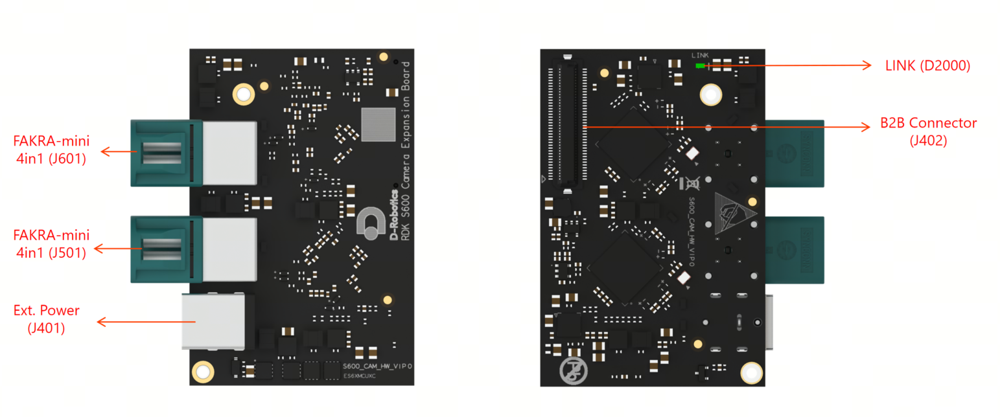

# RDK S600 Camera Expansion Board: eight-link GMSL and power reference


**Manufacturer reference:** [**D-Robotics RDK S600 Camera Expansion Board**](https://d-robotics.github.io/rdk_s_doc/en/Quick_start/hardware_introduction/rdk_s600/rdk_s600_camera_expansion_board/)

**Model:** `ES6XCAMXC` · **Revision:** V1P0; Rev. 1.0 May 2026 brief and current V1P0 hardware article · **OpenELAB SKU and product URL:** unverified. This unlisted accessory is not the S100 camera board or SKU 31642.


## Product overview <a href="#product-overview" id="product-overview"></a>

The RDK S600 Camera Expansion Board connects an **S600-series** host to eight GMSL cameras through two MAX96712 deserializers and two four-channel Mini-FAKRA connectors. Its 80-pin board-to-board interface carries image/control signals and host rails. The accessory does not independently perform perception inference or guarantee synchronized, calibrated images. [Hardware manual](https://d-robotics.github.io/rdk_s_doc/en/Quick_start/hardware_introduction/rdk_s600/rdk_s600_camera_expansion_board/), [Rev. 1.0 brief, PDF pages 4–5](https://archive.d-robotics.cc/downloads/hardware/rdk_s600/rdk_s600_camera_expansion_board/drobotics_rdk_s600_camera_expansion_board_brief_v1p0_zh.pdf).

This reference is scoped to **V1P0** and S600 software **5.1.1**. Older V0P3/V0P2 boards are linked by the manufacturer but are not interchangeable pinout or power evidence. The S100 standard camera board and S100 12L use different host connections and power rules.



_Official D-Robotics V1P0 illustration, visually inspected. Its arrows label both coax groups J501, while the manual's connector table and actual schematic distinguish **J501 and J601**. The rendering's model marking also conflicts with the camera brief's ES6XCAMXC. Use the physical board/revision and schematic for identification rather than silently accepting those image labels. J402 is the host connection and J401 the supplemental supply._ [Manual](https://d-robotics.github.io/rdk_s_doc/en/Quick_start/hardware_introduction/rdk_s600/rdk_s600_camera_expansion_board/), [schematic sheets 4–6](https://archive.d-robotics.cc/downloads/hardware/rdk_s600/rdk_s600_camera_expansion_board/hardware_reference_design/RDK_S600_Camera_Expansion_Board_V1P0_20260610.pdf).

## Applications <a href="#applications" id="applications"></a>

Use this accessory for S600 GMSL camera evaluation, multi-camera perception and custom camera/serializer integration. Start with one identified camera and one link, then add streams after verifying power, address aliases, CSI routing and timestamps. Eight connectors/channels do not establish eight streams at any requested rate, or a universal surround-view calibration.

Treat exposure synchronization, frame synchronization and timestamp synchronization as separate contracts. A deserializer lock means the transport link is established; it does not certify exposure simultaneity, camera-to-camera extrinsics, ISP tuning or application latency. [S600 camera pipeline documentation](https://d-robotics.github.io/rdk_s_doc/en/Advanced_development/multimedia_development/multimedia_application/sample_vin/?v=5.1.1\&p=RDK+S600), [S600 5.1.1 release notes](https://d-robotics.github.io/rdk_s_doc/en/Release_Note/s600/v5_1_1/).

## Specifications <a href="#specifications" id="specifications"></a>

| Item                    | V1P0 reference                                                                               |
| ----------------------- | -------------------------------------------------------------------------------------------- |
| Manufacturer model      | ES6XCAMXC                                                                                    |
| Host compatibility      | RDK S600 series only                                                                         |
| Deserializers           | 2 × ADI/Maxim MAX96712                                                                       |
| Camera links            | 8 GMSL camera channels, grouped 4+4                                                          |
| Coax connectors         | J501/J601, Mini-FAKRA four-in-one Z code; SYNCONN 112038-161410                              |
| Host connector          | J402, 80-pin; KEL DY11-080SB-1                                                               |
| Supplemental DC jack    | J401, DC-044B-D025; 12 V, 2.5 mm inner / 5.5 mm outer plug dimensions                        |
| Published input maximum | 4.8 A in the summary/brief; not an independently tested continuous PoC output budget         |
| Per-camera current      | Manual maximum 550 mA at 12 V                                                                |
| Operating temperature   | 0–65 °C                                                                                      |
| Brief dimensions        | 60 × 49 × 17 mm; use the matching CAD for mounting/clearance                                 |
| Brief packing list      | Expansion board and accessory pack; camera, harness and host are not established as included |

[Manual](https://d-robotics.github.io/rdk_s_doc/en/Quick_start/hardware_introduction/rdk_s600/rdk_s600_camera_expansion_board/), [brief pages 5–6](https://archive.d-robotics.cc/downloads/hardware/rdk_s600/rdk_s600_camera_expansion_board/drobotics_rdk_s600_camera_expansion_board_brief_v1p0_zh.pdf).

### The host-fed current threshold is conflicting <a href="#the-host-fed-current-threshold-is-conflicting" id="the-host-fed-current-threshold-is-conflicting"></a>

The current web specification and May brief say supplemental 12 V is required above **2.4 A**. The same web page's DC-input and GMSL instructions instead use **2 A**. The S600 host guide rates each camera expansion connector's 12 V rail at **2 A**. These are unresolved source statements, not two values to average. This reference does **not** authorize a host-fed operating point in the disputed interval, infer two sockets' rails may be combined, or choose a convenient threshold. Resolve the exact board/host power policy with D-Robotics before powered multi-camera commissioning. [Conflicting product sections](https://d-robotics.github.io/rdk_s_doc/en/Quick_start/hardware_introduction/rdk_s600/rdk_s600_camera_expansion_board/), [brief](https://archive.d-robotics.cc/downloads/hardware/rdk_s600/rdk_s600_camera_expansion_board/drobotics_rdk_s600_camera_expansion_board_brief_v1p0_zh.pdf), [host rails](https://d-robotics.github.io/rdk_s_doc/en/01_Quick_start/01_hardware_introduction/02_rdk_s600/01_rdk_s600_kit?v=5.1.1\&p=RDK+S600).

Keep the independent per-link 550 mA limit even after that policy is resolved. Eight channels at 0.55 A total 4.40 A, or **52.8 W at 12 V**. This arithmetic does not prove the whole board, power selector, harness and thermal design can sustain that combination, and excludes inrush and conversion losses.

## Hardware and connections <a href="#hardware-and-connections" id="hardware-and-connections"></a>

### Mounting, cable identity and rail separation <a href="#mounting-cable-identity-and-rail-separation" id="mounting-cable-identity-and-rail-separation"></a>

1. Shut down S600 and disconnect host DC, camera supplies and all supplemental DC before mounting or changing camera cables.
2. Identify V1P0 and the actual connector keys/pin-1 marking. Align J402 with the specified S600 camera connector **J12 or J14**, keeping boards parallel; engage evenly and install the matching supports. Never put it on the S100 100-pin camera port or the S600 MCU connector J15.
3. Record the four-lead harness order A/B/C/D and the camera/serializer at each end. Z coding and a four-in-one shell do not establish a universal lead-colour assignment or the sensor-side connector.
4. Verify the approved adapter and polarity before using J401. Plug dimensions establish mechanical fit, not polarity. A custom lead remains unqualified without connector-contact and continuity evidence.
5. Check the complete PoC current plan and the unresolved host-fed threshold before cameras are energized. The first workflow below is deliberately a passive host inventory.

[Assembly warnings](https://d-robotics.github.io/rdk_s_doc/en/Quick_start/hardware_introduction/rdk_s600/rdk_s600_camera_expansion_board/), [host and power schematic, sheet 4](https://archive.d-robotics.cc/downloads/hardware/rdk_s600/rdk_s600_camera_expansion_board/hardware_reference_design/RDK_S600_Camera_Expansion_Board_V1P0_20260610.pdf).

### What the circuit distributes <a href="#what-the-circuit-distributes" id="what-the-circuit-distributes"></a>

The schematic shows a selected host/DC-jack 12 V path for camera power and separate 3.3 V-derived deserializer rails: a common 1.2 V rail plus two 1.8 V rails. Its **VDDIO\_TOP\_1V8 contact is a reference, explicitly not a load supply**. Do not use it to power external logic. Deserializer control/trigger/error signals are predominantly 1.8 V; PoC-enable/interrupt signals include 3.3 V. Those domains are not interchangeable with 12 V power over coax. [Schematic sheet 4](https://archive.d-robotics.cc/downloads/hardware/rdk_s600/rdk_s600_camera_expansion_board/hardware_reference_design/RDK_S600_Camera_Expansion_Board_V1P0_20260610.pdf).

The LED in the current article/figure is labelled D2000; the reference schematic and brief call the 3.3 V indicator **D402**. Its useful meaning is host connection/3.3 V presence. It does not prove the camera supply, PoC switching, lock, frame content or eight operational channels. Preserve this designator discrepancy when diagnosing a physical unit.

### Host connector pin reference <a href="#host-connector-pin-reference" id="host-connector-pin-reference"></a>

The following complete table transcribes the **S600 host J12** workbook, not a new custom cable drawing. Pin orientation is the connector's documented mating view; confirm the actual board triangle and connector datasheet before wiring. High-speed MIPI pairs are not GPIO. [Host connector workbook, J12/J14 sheets](https://archive.d-robotics.cc/downloads/hardware/rdk_s600/rdk_s600/D-Robotics_RDK_S600_Connector_Application_Note_V1P0-20260922_EN.xlsx).

| Pin | Host J12 signal / voltage     | Pin | Host J12 signal / voltage                           |
| --- | ----------------------------- | --- | --------------------------------------------------- |
| 1   | `GND`                         | 2   | `MAIN_I2C0_SCL_1V8 / 1.8V`                          |
| 3   | `MIPI_RX0_DP0_A0`             | 4   | `MAIN_I2C0_SDA_1V8 / 1.8V`                          |
| 5   | `MIPI_RX0_DN0_B0`             | 6   | `GND`                                               |
| 7   | `GND`                         | 8   | `MAIN_I2C1_SCL_1V8 / 1.8V`                          |
| 9   | `MIPI_RX0_DP1_C0`             | 10  | `MAIN_I2C1_SCL_1V8 / 1.8V [name/function conflict]` |
| 11  | `MIPI_RX0_DN1_C1`             | 12  | `GND`                                               |
| 13  | `GND`                         | 14  | `CAM0_PWM_1V8 / 1.8V`                               |
| 15  | `MIPI_RX0_CKP_A1`             | 16  | `CAM1_PWM_1V8 / 1.8V`                               |
| 17  | `MIPI_RX0_CKN_B1`             | 18  | `CAM2_PWM_1V8 / 1.8V`                               |
| 19  | `GND`                         | 20  | `CAM3_PWM_1V8 / 1.8V`                               |
| 21  | `MIPI_RX0_DP2_A2`             | 22  | `GND`                                               |
| 23  | `MIPI_RX0_DN2_B2`             | 24  | `DES0_SENSOR_ERR_1V8 / 1.8V`                        |
| 25  | `GND`                         | 26  | `DES1_SENSOR_ERR_1V8 / 1.8V`                        |
| 27  | `MIPI_RX0_DP3_C2`             | 28  | `GND`                                               |
| 29  | `MIPI_RX0_DN3`                | 30  | `DES0_LOCK_1V8 / 1.8V`                              |
| 31  | `GND`                         | 32  | `DES0_ERR_1V8 / 1.8V`                               |
| 33  | `MIPI_RX1_DP0_A0`             | 34  | `DES0_PWRON_1V8 / 1.8V`                             |
| 35  | `MIPI_RX1_DN0_B0`             | 36  | `DES0_POC_INT_3V3 / 3.3V`                           |
| 37  | `MIPI_RX1_DP1_C0`             | 38  | `DES0_POC_EN_3V3 / 3.3V`                            |
| 39  | `GND`                         | 40  | `GND`                                               |
| 41  | `MIPI_RX1_CKP_A1`             | 42  | `DES1_LOCK_1V8 / 1.8V`                              |
| 43  | `MIPI_RX1_CKN_B1`             | 44  | `DES1_ERR_1V8 / 1.8V`                               |
| 45  | `MIPI_RX1_DN1_C1`             | 46  | `DES1_PWRON_1V8 / 1.8V`                             |
| 47  | `GND`                         | 48  | `DES1_POC_INT_3V3 / 3.3V`                           |
| 49  | `MIPI_RX1_DP2_A2`             | 50  | `DES1_POC_EN_3V3 / 3.3V`                            |
| 51  | `MIPI_RX1_DN2_B2`             | 52  | `GND`                                               |
| 53  | `MIPI_RX1_DP3_C2`             | 54  | `GND`                                               |
| 55  | `GND`                         | 56  | `GND`                                               |
| 57  | `MIPI_RX1_DN3`                | 58  | `GND`                                               |
| 59  | `GND`                         | 60  | `GND`                                               |
| 61  | `GND`                         | 62  | `GND`                                               |
| 63  | `GND`                         | 64  | `GND`                                               |
| 65  | `GND`                         | 66  | `GND`                                               |
| 67  | `GND`                         | 68  | `VDDIO_TOP_1V8 / 1.8V`                              |
| 69  | `VDD_PERI2_FAN_CAM_12V / 12V` | 70  | `GND`                                               |
| 71  | `VDD_PERI2_FAN_CAM_12V / 12V` | 72  | `VDD_PERI_3V3 / 3.3V`                               |
| 73  | `VDD_PERI2_FAN_CAM_12V / 12V` | 74  | `VDD_PERI_3V3 / 3.3V`                               |
| 75  | `VDD_PERI2_FAN_CAM_12V / 12V` | 76  | `VDD_PERI_3V3 / 3.3V`                               |
| 77  | `VDD_PERI2_FAN_CAM_12V / 12V` | 78  | `VDD_PERI_3V3 / 3.3V`                               |
| 79  | `VDD_PERI2_FAN_CAM_12V / 12V` | 80  | `VDD_PERI_3V3 / 3.3V`                               |

For **J14**, the same physical pin positions instead use RX2/RX3 rather than RX0/RX1, I²C2/I²C3 rather than I²C0/I²C1, CAM4–CAM7 rather than CAM0–CAM3, and DES2/DES3 rather than DES0/DES1. The rail/ground positions remain the workbook's corresponding J14 definitions. The source's pin 10 is named `…SCL…` while described as I²C data on both sheets; the board schematic shows the data net. That conflicting cell is identified in the table, not silently turned into a verified SCL pin. [Workbook](https://archive.d-robotics.cc/downloads/hardware/rdk_s600/rdk_s600/D-Robotics_RDK_S600_Connector_Application_Note_V1P0-20260922_EN.xlsx), [schematic sheet 4](https://archive.d-robotics.cc/downloads/hardware/rdk_s600/rdk_s600_camera_expansion_board/hardware_reference_design/RDK_S600_Camera_Expansion_Board_V1P0_20260610.pdf).

The workbook notes that J12's I²C1/RX1 are unavailable on **host V0P1**. Do not use a current V1P0 accessory illustration as evidence that every earlier host exposes both deserializer outputs. Record both host and accessory revision.

### Coax contacts and driver-controlled PoC <a href="#coax-contacts-and-driver-controlled-poc" id="coax-contacts-and-driver-controlled-poc"></a>

The reference circuit uses **MAX20087** quad power-protection/switch devices between the selected 12 V rail and the four PoC outputs in each camera group. Enabling the deserializer alone does not establish that its camera power switch is enabled or fault-free. Camera-power enable/interrupt state, coax lock and image output must be diagnosed separately. The board schematic maps connector contacts **1/2/3/4 to GMSL A/B/C/D**, with contacts **5–8 ground** in that connector library. This is a contact/net reference, not a viewed-from-the-cable photograph; confirm the exact manufacturer mating orientation and breakout harness before making a cable. [Circuit source](https://archive.d-robotics.cc/downloads/hardware/rdk_s600/rdk_s600_camera_expansion_board/hardware_reference_design/RDK_S600_Camera_Expansion_Board_V1P0_20260610.pdf).

The MAX96712 strap table labels its addresses as **8-bit**, whereas the PoC-controller table labels its addresses as **7-bit**. Linux I²C device addresses normally use the latter convention: an 8-bit write address 0x52 corresponds arithmetically to 7-bit 0x29. That example is not a board-wide address assignment or a probe command. Check each physical bus, strap and runtime alias; several identical sensors require managed aliases, and an address copied without its convention can target the wrong device.

### PoC, control and image routing are separate checks <a href="#poc-control-and-image-routing-are-separate-checks" id="poc-control-and-image-routing-are-separate-checks"></a>

| Layer                     | Relevant evidence                                                                      |
| ------------------------- | -------------------------------------------------------------------------------------- |
| Host power/board presence | Correct host connector, mounting, 3.3 V indication and negotiated system state         |
| Deserializer control      | The installed board's I²C bus, aliases, PWRON/ERR/LOCK and driver configuration        |
| Camera power              | Per-link PoC-enable/current path, actual load and cable drop; host-fed policy resolved |
| Coax transport            | Correct serializer/GMSL configuration, harness link and stable lock                    |
| CSI image output          | Correct RX host, lane mode/rate, virtual channel, output format and sensor timing      |
| Application               | Correct buffers, stride, timestamp clock and matching calibration                      |

Do not write a lock/status contact as a GPIO experiment, short PoC enables, or assume an I²C address scan is passive. Driver-controlled SerDes/power setup should come from the matched BSP, not guessed register writes.

## Software and development resources <a href="#software-and-development-resources" id="software-and-development-resources"></a>

### Version and ownership contract <a href="#version-and-ownership-contract" id="version-and-ownership-contract"></a>

Use an S600 **5.1.1** host/BSP/MCU set, recording the actual installed versions before changing overlays or drivers. The release specifies Ubuntu 24.04 and adds SC233HGS with NS6012/NS6603 serializers, RealSense D405G and Orbbec Gemini 305G support, and D457 hardware `esync` work. These are release-scoped additions, not a claim that every camera with the same sensor or every older image works. [5.1.1 release](https://d-robotics.github.io/rdk_s_doc/en/Release_Note/s600/v5_1_1/).

The BSP must agree on sensor driver, serializer/deserializer mode, I²C aliases, CSI host/virtual channels, pixel format/bit depth and exposure/trigger settings. Camera device-node numbers are assigned by the running system and cannot be inferred from J501/J601. The current accessory page links an external AVL whose contents were inaccessible during review; full current camera qualification remains unverified.

`/boot/config.txt` may request overlays, but U-Boot settings can take precedence; examine the live device tree as well. The reviewed product page does not identify one universal eight-camera overlay filename. Do not copy a S100/12L configuration or promote a source example's alias values into a permanent board definition. [Boot configuration semantics](https://d-robotics.github.io/rdk_s_doc/en/System_configuration/config_txt/?v=5.1.1\&p=RDK+S600).

### Capture/API reference before execution <a href="#captureapi-reference-before-execution" id="captureapi-reference-before-execution"></a>

The shared official VIN guide describes the installed `get_vin_data` example and its `-s <sensor_index>`, `-l <local_link>` and `-h` options; SerDes link 0–3 means A–D within one deserializer. Sensor indices and host routing come from the installed software and camera BOM. Its interactive `g` captures one frame, `l` a set and `q` exits. Running the capture application initializes hardware and can change camera/PoC state, so it is outside the passive first result. [Sample VIN](https://d-robotics.github.io/rdk_s_doc/en/Advanced_development/multimedia_development/multimedia_application/sample_vin/?v=5.1.1\&p=RDK+S600).

The `get_multi_vin_data` guide describes repeated `-c "sensor=… link=…"` entries, with a stated six-configuration sample limit. That limit belongs to the sample. It is neither an eight-camera board proof nor permission to choose a mode solely because it appears in a generic list. Match the actual S600 sample/help and BSP implementation before capture.

Keep one owner of camera configuration. A V4L2 client, HBN/VIO sample and ROS camera node can conflict over the same capture resources even if each launches successfully. A BPU model benchmark is not a camera validation result. [Multimedia workflow](https://d-robotics.github.io/rdk_s_doc/en/Advanced_development/multimedia_development/multimedia_application/sample_vin/?v=5.1.1\&p=RDK+S600).

## Getting started <a href="#getting-started" id="getting-started"></a>

### First result: inspect without configuring cameras <a href="#first-result-inspect-without-configuring-cameras" id="first-result-inspect-without-configuring-cameras"></a>

Prerequisites: a normally bootable identified S600, matching image, approved host supply, the accessory mounted while unpowered, and no unverified camera/supplemental-power connection. This inventory neither enables a camera link nor sends SerDes transactions:

```bash
cat /etc/version
uname -r
tr '\000' '\n' < /proc/device-tree/model
cat /boot/config.txt
find -L /sys/class/video4linux -maxdepth 2 -name name -exec cat {} \;
find -L /sys/bus/i2c/devices -maxdepth 2 -name name -exec cat {} \;
find /app/multimedia_samples/sample_vin -maxdepth 2 -type f -name 'get*vin_data*' -print
```

1. Record host/accessory revision and the exact image/kernel identity. An earlier host with missing RX/I²C resources must be identified before adding cameras.
2. Inspect the green connection indication and registered nodes. No attached cameras can legitimately mean no camera node.
3. Preserve the boot configuration and compare device names/live DT with the matching BSP's board description. Record missing files or permission restrictions without inventing them away.
4. Build the camera/serializer/harness/current map and explicitly leave supplemental-power commissioning unresolved while the threshold/polarity questions remain.

**Expected result:** a traceable host/configuration record, not eight live streams. No SDK or board command was executed during authoring. An absent deserializer in this passive record is a diagnostic starting point; do not enable power or scan a bus merely to make the inventory look complete.

### After the electrical and driver boundary is resolved <a href="#after-the-electrical-and-driver-boundary-is-resolved" id="after-the-electrical-and-driver-boundary-is-resolved"></a>

Connect one qualified assembly with all power off. Bring up the host and camera in the manufacturer-approved sequence, inspect driver lock/errors and select one verified sensor mode/local link. Capture one frame using the **installed** sample contract, then quit. Check changing scene content, frame IDs, timestamps, dimensions, format, stride and saved size. A lock bit or a nonempty file alone is insufficient. Repeat after adding a second camera; only then review sustained multi-camera acquisition and synchronization.

For RAW data, calculate buffer size from the driver-reported packing and stride. For example, 1920×1080 RAW10 may be packed with a 2400-byte row stride; assuming 16-bit unpacked pixels gives the wrong file-size expectation. This is an interpretation example from the official VIN guide, not a verified S600-camera configuration. [Frame metadata example](https://d-robotics.github.io/rdk_s_doc/en/Advanced_development/multimedia_development/multimedia_application/sample_vin/?v=5.1.1\&p=RDK+S600).

## Troubleshooting and FAQs <a href="#troubleshooting-and-faqs" id="troubleshooting-and-faqs"></a>

| Symptom                                    | Useful ordered checks                                                                                                                     |
| ------------------------------------------ | ----------------------------------------------------------------------------------------------------------------------------------------- |
| No connection indication                   | Power off; check J402 mating, support and host 3.3 V. Do not rely on D2000/D402 label agreement across sources                            |
| Both groups labelled J501 in the drawing   | Check physical board and schematic; the two circuits are J501/J601, not a duplicated connector identity                                   |
| Deserializer absent                        | Verify host J12/J14 selection, board revision and matching driver/DTB before probing addresses                                            |
| Lock unstable                              | Check current plan, camera/serializer mode, harness/cable loss and driver error logs; do not increase voltage                             |
| Lock stable but no image                   | Check CSI/virtual-channel routing, sensor timing, bit depth and pipeline ownership                                                        |
| One group works, another does not          | Verify both deserializers and the host RX/I²C resources; old host V0P1 has a documented J12 limitation                                    |
| Reboots when adding cameras                | Revisit inrush, shared host loads and the unresolved 2 A/2.4 A threshold; a larger adapter does not resolve a rail specification conflict |
| D457 synchronization differs after upgrade | Record exact firmware/BSP and `esync` mode; transport lock and timestamp synchronization are separate                                     |

**Can two expansion boards be used simultaneously?** Two host connectors exist, but that alone does not verify a sixteen-camera mode, global power allowance or sustained software pipeline. Obtain a concrete supported configuration.

**Is there an onboard calibration or independent firmware image to flash?** The board's SerDes/power setup is controlled by the host/camera stack. The reviewed resources do not establish a separate universal user-flashable board firmware procedure. Do not flash the host to diagnose an unidentified cable.

## Downloads and technical documents <a href="#downloads-and-technical-documents" id="downloads-and-technical-documents"></a>

| Resource                                                                                                                                                                                                                 | Revision / purpose / access                                                                         |
| ------------------------------------------------------------------------------------------------------------------------------------------------------------------------------------------------------------------------ | --------------------------------------------------------------------------------------------------- |
| [Current hardware article](https://d-robotics.github.io/rdk_s_doc/en/Quick_start/hardware_introduction/rdk_s600/rdk_s600_camera_expansion_board/)                                                                        | V1P0 interface, power and assembly; read; V0P3/V0P2 links are historical comparison only            |
| [Camera brief](https://archive.d-robotics.cc/downloads/hardware/rdk_s600/rdk_s600_camera_expansion_board/drobotics_rdk_s600_camera_expansion_board_brief_v1p0_zh.pdf)                                                    | Rev. 1.0, May 2026; six PDF pages read; model/size/packing reference                                |
| [Six-sheet schematic](https://archive.d-robotics.cc/downloads/hardware/rdk_s600/rdk_s600_camera_expansion_board/hardware_reference_design/RDK_S600_Camera_Expansion_Board_V1P0_20260610.pdf)                             | V1P0 2026-06-10; actual PDF read and relevant circuit views visually inspected                      |
| [Designator drawing](https://archive.d-robotics.cc/downloads/hardware/rdk_s600/rdk_s600_camera_expansion_board/hardware_reference_design/RDK_S600_Camera_Expansion_Board_Reference_Designator_Drawing_V1.0_20260610.pdf) | V1.0 2026-06-10; placement reference, not a connector mating drawing                                |
| [Host connector workbook](https://archive.d-robotics.cc/downloads/hardware/rdk_s600/rdk_s600/D-Robotics_RDK_S600_Connector_Application_Note_V1P0-20260922_EN.xlsx)                                                       | V1P0 2026-09-22 English; J12/J14 contacts read, ambiguous cells retained                            |
| [Reference-design directory](https://archive.d-robotics.cc/downloads/hardware/rdk_s600/rdk_s600_camera_expansion_board/hardware_reference_design/)                                                                       | Native BRD/DSN listed, not opened in a CAD tool                                                     |
| [STEP model](https://archive.d-robotics.cc/downloads/hardware/rdk_s600/rdk_s600_camera_expansion_board/RDK_S600_CAMERA_EXPANSION_BOARD_3D_Model_V1P0_20260420.STEP)                                                      | V1P0 2026-04-20; linked, not mechanically fit-tested                                                |
| [S600 download center](https://d-robotics.github.io/rdk_s_doc/en/Quick_start/download/?v=5.1.1\&p=RDK+S600)                                                                                                              | Image, tools, board resources and commercial/FTP paths; linked archives are not all treated as read |

## References and validation <a href="#references-and-validation" id="references-and-validation"></a>

Reviewed on 24 November 2026 as an original manufacturer reference. Actual product text, brief, schematic, host contact workbook and relevant VIN/boot/release content were reviewed. Interface and circuit illustrations were visually inspected. Purchase matching, exact installed eight-camera configuration, complete AVL, custom supply/harness qualification, historical-board interchangeability and the conflicting host-fed threshold remain bounded. No installation, upstream SDK execution, flashing, capture, calibration or hardware test was performed.

**Related guides:** [D-Robotics boards, modules and peripherals](./).

* [D-Robotics RDK S600 — V1P0 hardware and RDKOS 5.1.1 development](rdk-s600-manufacturer-engineering-reference.md)
* [D-Robotics RDK S600 Module: MS6 Specifications and Carrier Integration Reference](rdk-s600-module.md)
* [RDK S600 MCU Port Expansion Board: CAN ownership and pin reference](rdk-s600-mcu-port-expansion-board-reference.md)
