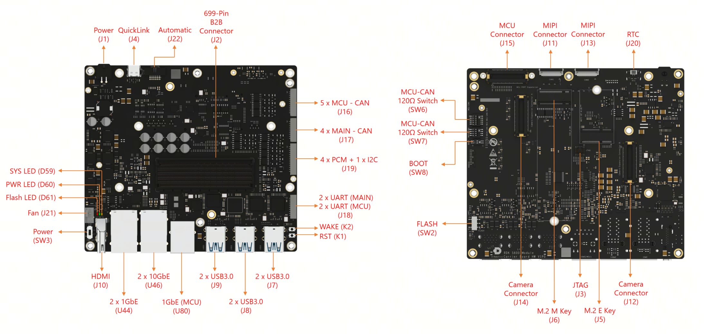

# D-Robotics RDK S600 — V1P0 hardware and RDKOS 5.1.1 development


**Manufacturer reference — RDK S600 developer kit. No verified OpenELAB product listing or SKU is available for these S600 options.**

[**Official RDK S600 hardware guide**](https://d-robotics.github.io/rdk_s_doc/en/01_Quick_start/01_hardware_introduction/02_rdk_s600/01_rdk_s600_kit?v=5.1.1\&p=RDK+S600) — current **V1P0** carrier; **KS6X032064C** (32 GB / 64 GB UFS) and **KS6X064256C** (64 GB / 256 GB UFS). Documentation lane **5.1.1**. TROS/Model Zoo have separately versioned **5.1.0** resource-center entries.


## Product overview <a href="#product-overview" id="product-overview"></a>

RDK S600 is a robotics developer kit with 18 Cortex-A78AE application cores, four Nash BPU cores totaling up to **560 TOPS INT8**, a separate six-core Cortex-R52+ MCU domain and multiple sensor/network interfaces. The two current official kit options differ in RAM and UFS capacity. This reference describes the assembled **S600 V1P0 developer kit**, not a bare compute module or the older V0P1/V0P2 carriers. [Kit model table](https://d-robotics.github.io/rdk_s_doc/en/01_Quick_start/01_hardware_introduction/02_rdk_s600/01_rdk_s600_kit?v=5.1.1\&p=RDK+S600), [official brief](https://archive.d-robotics.cc/downloads/hardware/rdk_s600/rdk_s600/brief/drobotics_rdk_s600_brief_v1p0_zh.pdf).

S600 is not a drop-in S100 software/pinout upgrade. It changes power connector, storage/boot options, camera connectors, MCU resource allocation and the Linux/TROS distribution. Keep the full image, MCU firmware, BPU toolchain and model artifact coherent before connecting robot controllers. A processor's lockstep capability does not prove a complete safety-rated robot or an implemented stop function.



_D-Robotics illustration, inspected for connector locations. Some figure labels differ from the text/workbook: the SW7 label repeats MCU-CAN although the text assigns it to MAIN-CAN, and the 10GbE reference differs. Use physical port function plus the current connector workbook for wiring; do not use that annotation as a pinout._ [_Original figure_](https://d-robotics.github.io/rdk_s_doc/en/01_Quick_start/01_hardware_introduction/02_rdk_s600/01_rdk_s600_kit?v=5.1.1\&p=RDK+S600)_,_ [_V1P0 connector workbook_](https://archive.d-robotics.cc/downloads/hardware/rdk_s600/rdk_s600/D-Robotics_RDK_S600_Connector_Application_Note_V1P0-20260922_EN.xlsx)_._

## Applications <a href="#applications" id="applications"></a>

| Engineering use                | Relevant S600 path                                                                                | Boundary to verify                                                                                                     |
| ------------------------------ | ------------------------------------------------------------------------------------------------- | ---------------------------------------------------------------------------------------------------------------------- |
| Multi-camera perception        | Two direct MIPI interfaces plus two camera expansion interfaces, multimedia preprocessing and BPU | Sensor/SerDes mode, shared bandwidth, synchronization and calibration                                                  |
| High-bandwidth robot sensors   | Two main-domain 1GbE and two 10GbE ports                                                          | Negotiated link, PHY firmware, timestamp support and sustained application throughput                                  |
| Large or concurrent models     | 32/64 GB LPDDR5, S-series HBM/runtime and four BPU cores                                          | Compiler target, tensor contract, memory copies and measured tail latency                                              |
| Real-time fieldbus integration | MCU-domain peripherals, CANHAL/IPC, or explicitly configured S600 SocketCAN                       | One owner per controller/IRQ/clock and external transceiver/bus topology                                               |
| Multimodal robot research      | LLM/VLM/VLA examples with matching S600 artifacts                                                 | Generated outputs remain data until a separately verified command/stop boundary accepts them                           |
| Carrier/system development     | 699-pin compute-module interface and official design resources                                    | Detailed commercial design material requires authorized access; kit documentation is not a full module design sign-off |

## Specifications <a href="#specifications" id="specifications"></a>

### Official kit options <a href="#official-kit-options" id="official-kit-options"></a>

| Parameter                | RDK S600 32G                                          | RDK S600 64G               |
| ------------------------ | ----------------------------------------------------- | -------------------------- |
| Manufacturer model       | KS6X032064C                                           | KS6X064256C                |
| OpenELAB SKU/product URL | Unverified / none assigned                            | Unverified / none assigned |
| RAM                      | 32 GB LPDDR5                                          | 64 GB LPDDR5               |
| UFS                      | 64 GB UFS 3.1                                         | 256 GB UFS 3.1             |
| CPU                      | 18 × Cortex-A78AE, 2.0 GHz                            | Same                       |
| BPU                      | 4 × Nash, up to 560 TOPS INT8 total                   | Same                       |
| MCU                      | 6 × Cortex-R52+; 1 DCLS + 2 Split-Lock configurations | Same                       |
| Memory interface         | 256-bit, up to 6400 MT/s                              | Same                       |

Both official model numbers come from the current kit guide; no store option is inferred from them. The public brief also identifies Mali-G78AE graphics and hardware multimedia processing. Codec maxima are separate from the number/rate of simultaneously usable camera streams and end-to-end model performance. [Model specifications](https://d-robotics.github.io/rdk_s_doc/en/01_Quick_start/01_hardware_introduction/02_rdk_s600/01_rdk_s600_kit?v=5.1.1\&p=RDK+S600), [brief, pages 1–2](https://archive.d-robotics.cc/downloads/hardware/rdk_s600/rdk_s600/brief/drobotics_rdk_s600_brief_v1p0_zh.pdf).

### Mainboard interfaces and limits <a href="#mainboard-interfaces-and-limits" id="mainboard-interfaces-and-limits"></a>

| Item                                       | S600 V1P0 scope                                                                                                         |
| ------------------------------------------ | ----------------------------------------------------------------------------------------------------------------------- |
| Input power                                | 12–28 V DC through four-pin Micro-Fit connector; hardware guide states 16 A maximum input current                       |
| Supplied adapter described by manufacturer | 24 V, up to 8 A; this 192 W adapter capacity is separate from connector and peripheral limits                           |
| Envelope                                   | 140 × 123 × 78 mm, assembled-kit figure                                                                                 |
| Operating ambient                          | 0–60 °C in the official S600 brief; enclosure/cooling and workload still matter                                         |
| USB                                        | Six USB 3.2 Gen 1×1 Type-A host ports; 5 V / 1 A maximum per port                                                       |
| Debug/download                             | One USB 2.0 Type-C device interface, two CH340 serial paths; not the kit's main power input                             |
| Display                                    | HDMI; current guide describes up to 2K at 60 fps                                                                        |
| Network                                    | 2 × 1GbE main, 2 × 10GbE main, 1 × 1GbE MCU-domain port                                                                 |
| SSD                                        | Key M PCIe Gen4 ×2; 3.3 V rail limit 700 mA in the guide                                                                |
| Wireless                                   | Key E PCIe Gen3 ×1 plus documented USB2/UART Bluetooth options and SDIO/PCM signals; exact module/driver still required |
| Cameras                                    | Two 22-pin direct MIPI connectors plus two 80-pin camera expansion connectors                                           |
| Control interfaces                         | MCU/main CAN, combined UART, PCM/I2C, MCU expansion, RTC, fan and external-control connector                            |

Do not add all connector maxima to claim an available total power budget. Determine actual simultaneous board/peripheral demand and temperature from the deployed configuration. [Electrical/interface limits](https://d-robotics.github.io/rdk_s_doc/en/01_Quick_start/01_hardware_introduction/02_rdk_s600/01_rdk_s600_kit?v=5.1.1\&p=RDK+S600), [ambient/envelope](https://archive.d-robotics.cc/downloads/hardware/rdk_s600/rdk_s600/brief/drobotics_rdk_s600_brief_v1p0_zh.pdf).

## Hardware and connections <a href="#hardware-and-connections" id="hardware-and-connections"></a>

### DC input, orientation and sequencing <a href="#dc-input-orientation-and-sequencing" id="dc-input-orientation-and-sequencing"></a>

J1 uses a four-pin power connector. The **V1P0 workbook** assigns pins **1/2 to positive 12–28 V** and **3/4 to ground**. Locate the actual connector's numbered mating view/keying before making a harness; the numbers are not a left-to-right instruction from a web photo. Use the supplied, correctly keyed adapter rather than a lookalike reversed cable. The kit guide names Molex **430450400** for the board connector. [J1 sheet](https://archive.d-robotics.cc/downloads/hardware/rdk_s600/rdk_s600/D-Robotics_RDK_S600_Connector_Application_Note_V1P0-20260922_EN.xlsx), [connector model and input rating](https://d-robotics.github.io/rdk_s_doc/en/01_Quick_start/01_hardware_introduction/02_rdk_s600/01_rdk_s600_kit?v=5.1.1\&p=RDK+S600).

Power off and remove the DC source before inserting an SSD, wireless module, camera flex or expansion board. After assembly, power the mainboard before independently powered peripherals to avoid backfeed/protection-triggered boot failure. Leave the cooling path unobstructed and mount on a nonconductive stable surface. The fan port J21 is 12 V with a 200 mA limit; its peripheral rail is off during sleep. [Power sequencing and fan](https://d-robotics.github.io/rdk_s_doc/en/01_Quick_start/01_hardware_introduction/02_rdk_s600/01_rdk_s600_kit?v=5.1.1\&p=RDK+S600).

### Expansion rails are not interchangeable <a href="#expansion-rails-are-not-interchangeable" id="expansion-rails-are-not-interchangeable"></a>

| Connector/domain                | Documented budget/behavior                                                                       |
| ------------------------------- | ------------------------------------------------------------------------------------------------ |
| Key E                           | AON 3.3 V, 750 mA; stays on in light/deep sleep; wake support requires manufacturer confirmation |
| Key M                           | 3.3 V, 700 mA; off in light/deep sleep; no documented SSD wake function                          |
| Each direct MIPI interface      | 3.3 V, up to 1 A; I2C control uses 3.3 V logic                                                   |
| Each camera expansion interface | 12 V up to 2 A; 3.3 V up to 1 A; 1.8 V reference up to 50 mA                                     |
| MCU expansion J15               | 5 V / 3.3 V up to 1 A each; on in light sleep, off in deep sleep                                 |
| MCU I/O-reference rails         | 1.8 V / 3.3 V, 50 mA each; low-power pulls/translation/dividers, not motor/sensor load rails     |
| External control J22            | AON 5 V 50 mA, DCIN 5 mA, peripheral 3.3 V 100 mA; control/indicator circuits only               |

The S600 MCU expansion supply behavior differs from S100's always-on MCU peripheral rails. A sensor that is still powered during deep sleep can drive into an unpowered S600 I/O domain; design isolation/sequence around the actual rail states. [Rail and sleep conditions](https://d-robotics.github.io/rdk_s_doc/en/01_Quick_start/01_hardware_introduction/02_rdk_s600/01_rdk_s600_kit?v=5.1.1\&p=RDK+S600).

### CAN and UART: physical wiring versus controller names <a href="#can-and-uart-physical-wiring-versus-controller-names" id="can-and-uart-physical-wiring-versus-controller-names"></a>

The connector workbook gives the following **bus-side** pairs on the current kit:

| Connector    | Pins                       | Signals                                          |
| ------------ | -------------------------- | ------------------------------------------------ |
| J16 MCU CAN  | 1, 6                       | Ground                                           |
| J16          | 2/3, 4/5, 7/8, 9/10, 11/12 | CAN5 H/L, CAN6 H/L, CAN7 H/L, CAN8 H/L, CAN9 H/L |
| J17 main CAN | 1, 6                       | Ground                                           |
| J17          | 2/3, 4/5, 7/8, 9/10        | CAN0 H/L, CAN1 H/L, CAN2 H/L, CAN3 H/L           |
| J18 UART     | 1, 6                       | Ground                                           |
| J18          | 2/3, 4/5                   | MCU UART10 TX/RX, UART11 TX/RX, 3.3 V logic      |
| J18          | 7/8, 9/10                  | Main UART6 TX/RX, UART7 TX/RX, 3.3 V logic       |

The guide's termination switch names say MCU-CAN1…5 and MAIN-CAN1…4, while the workbook uses controller-style CAN5…9 and CAN0…3. Treat these as different numbering schemes: verify the intended physical pair and switch position before enabling termination. SW6 controls MCU-bus termination; SW7 controls main-bus termination. Place 120 Ω termination at the two actual bus ends, not automatically at every attached port. [Wiring worksheet](https://archive.d-robotics.cc/downloads/hardware/rdk_s600/rdk_s600/D-Robotics_RDK_S600_Connector_Application_Note_V1P0-20260922_EN.xlsx), [switch roles](https://d-robotics.github.io/rdk_s_doc/en/01_Quick_start/01_hardware_introduction/02_rdk_s600/01_rdk_s600_kit?v=5.1.1\&p=RDK+S600).

The J15 MCU expansion connector exposes different controllers (including CAN1/2/3/4/10) as mixed-voltage **logic signals**. Those are not extra copies of the J16 differential bus pairs. J18 is logic UART, not RS-232/RS-485; the workbook also notes older V0P1 carriers lack the main-UART pins. The current guide/workbook describe J19 as a 14-pin PCM/I2C connector; a summary bullet calling it 10-pin must not be used to select a cable. [Exact connector sheets](https://archive.d-robotics.cc/downloads/hardware/rdk_s600/rdk_s600/D-Robotics_RDK_S600_Connector_Application_Note_V1P0-20260922_EN.xlsx).

### Cameras, SSD, wireless and RTC <a href="#cameras-ssd-wireless-and-rtc" id="cameras-ssd-wireless-and-rtc"></a>

The direct MIPI J11/J13 interfaces and 80-pin J12/J14 expansion connectors have different physical/electrical roles. Each expansion connector supports two D-PHY paths or a D-PHY/C-PHY configuration, trigger PWM, deserializer/error/power-control signals and sensor supplies. A connector count does not guarantee any chosen six sensors can run at maximum resolution concurrently. Match sensor/SerDes driver, lane configuration and synchronization before calibration. [Camera topology](https://d-robotics.github.io/rdk_s_doc/en/01_Quick_start/01_hardware_introduction/02_rdk_s600/01_rdk_s600_kit?v=5.1.1\&p=RDK+S600).

Key M supports Gen4 ×2 NVMe; Key E supports the documented Wi-Fi/Bluetooth interfaces but still needs a compatible module, antenna, firmware and driver. S100's “no USB/SDIO” prose is not an S600 compatibility rule. Enumerate PCIe/USB/UART functions separately; Wi-Fi association alone does not validate Bluetooth or sleep/wake. Keep SSD current within the slot's 700 mA budget. [M.2 interfaces](https://d-robotics.github.io/rdk_s_doc/en/01_Quick_start/01_hardware_introduction/02_rdk_s600/01_rdk_s600_kit?v=5.1.1\&p=RDK+S600).

J20 is a two-pin RTC battery connector; its workbook labels VRTC and ground with a 3.3 V value. Battery chemistry/charging instructions from S100's different RTC design are not a supported S600 procedure. Use the S600-specific approved battery arrangement or obtain confirmation before attaching/charging a replacement cell. [J20 sheet](https://archive.d-robotics.cc/downloads/hardware/rdk_s600/rdk_s600/D-Robotics_RDK_S600_Connector_Application_Note_V1P0-20260922_EN.xlsx).

## Software and development resources <a href="#software-and-development-resources" id="software-and-development-resources"></a>

### Version set for the current S600 guide <a href="#version-set-for-the-current-s600-guide" id="version-set-for-the-current-s600-guide"></a>

| Layer                    | Observed version / scope                                                                                             |
| ------------------------ | -------------------------------------------------------------------------------------------------------------------- |
| Main system              | RDK S600 **5.1.1**, released 23 October 2026                                                                         |
| Root filesystem          | RDKOS 5.1.1, Ubuntu **24.04 Noble**                                                                                  |
| Kernel                   | `6.1.158-rt58-DR-5.1.1`                                                                                              |
| Bootloader               | U-Boot 2022.04                                                                                                       |
| MCU                      | Supported MCU version **2.0.3** in the 5.1.1 release table                                                           |
| Linux cross-compiler     | Arm GNU 13.2.Rel1, aarch64; release build host Ubuntu 20.04 x64                                                      |
| Default board login      | `sunrise` / `sunrise`; change factory credentials before shared-network use                                          |
| MCU application delivery | 5.1.1 Cluster-1 firmware and community/static-library SDK; commercial source is separate                             |
| Algorithm toolchain      | OE 3.7.0 listed by S600 5.1.1 resources; use the S600 target and corresponding runtime                               |
| LLM toolchain            | S-series LLM 2.0.0 in the current resource summary                                                                   |
| TROS documentation       | **5.1.0 / RDK S600**, Jazzy; separate documentation version from OS 5.1.1                                            |
| Model Zoo documentation  | **5.1.0 / RDK S600** doc-center entry; current repository delivery is `main`, while its `rdk_s` branch is historical |

The resource center and the 5.1.1 release notes were read independently. The public image archive contains **both 5.1.0 and 5.1.1** directories; select by recorded filename/release, not whichever directory is first. Do not install S100 Jammy/Humble packages into this Noble/Jazzy system. The generic TROS preparation page contains older Ubuntu output; its screenshot is not the S600 5.1.1 OS specification. [Release](https://d-robotics.github.io/rdk_s_doc/en/Release_Note/s600/v5_1_1?v=5.1.1\&p=RDK+S600), [resources](https://d-robotics.github.io/rdk_s_doc/en/Quick_start/download?v=5.1.1\&p=RDK+S600), [TROS package lane](https://d-robotics.github.io/tros_doc/en/quick_start/install_tros?v=5.1.0\&p=RDK+S600), [Model Zoo](https://d-robotics.github.io/model_zoo_doc/en/rdk_s_guide?v=5.1.0\&p=RDK+S600).

### Cooling and persistent configuration <a href="#cooling-and-persistent-configuration" id="cooling-and-persistent-configuration"></a>

S600's thermal chapter describes **19 sensors**: seven CPU, four DDR and eight BPU readings, exposed with labels and millidegree-Celsius values. Match labels before assuming a stable `hwmon` index. The described CPU/BPU control zones stage the fan at 45/65 °C, throttle at 95 °C, warn at 110 °C and shut down at 115 °C; DDR has warning/shutdown trips. These are junction-policy defaults, separate from the 0–60 °C kit ambient rating. CPU zone2 and BPU zone16 can both control the fan, so changing only one policy does not establish a fixed fan speed. Read policy/trips and current cooling state before tuning, and preserve automatic protection. [S600 sensor and cooling map](https://d-robotics.github.io/rdk_s_doc/en/System_configuration/frequency_management?v=5.1.1\&p=RDK+S600).

The documented `/boot/config.txt` flow supports boot arguments, log level and temporary DTS/overlay selection. Temporary U-Boot settings take precedence over the file; AVB-enabled boot disables this file mechanism. Back up the file/base image, use full actual node paths and terminating semicolons for node-enable/disable lists, and change one peripheral at a time. A schema/example from an S100 UART address is not an S600 node path. `srpi-config` supplies system choices, but the installed BSP remains the authority for available features and memory reservation. [Config-file contract](https://d-robotics.github.io/rdk_s_doc/en/System_configuration/config_txt?v=5.1.1\&p=RDK+S600).

### CAN has two distinct host paths <a href="#can-has-two-distinct-host-paths" id="can-has-two-distinct-host-paths"></a>

The S600 5.1.1 release explicitly adds MCU-domain CAN access through SocketCAN and extended/remote frame support. Older MCU-guide text that says S600 does not support extended frames is superseded for this release; verify both board and MCU versions before relying on the new behavior. [5.1.1 changes](https://d-robotics.github.io/rdk_s_doc/en/Release_Note/s600/v5_1_1?v=5.1.1\&p=RDK+S600).

The Linux CAN guide describes four main-domain FlexCAN channels. CAN0/1 conflict with SPI0; CAN2 conflicts with UART3 and CAN3 with UART4 at the SoC pinmux. Enable the selected DTS CAN node and disable the conflicting peripheral. Load the matching CAN framework/raw/FlexCAN modules if not built in, and verify the main transceiver's standby control. The documented current-board example uses GPIO369 (expander line 7) low to enable it; confirm that mapping in the installed device tree before any write. A generic GPIO number is not portable across images. [S600 driver configuration](https://d-robotics.github.io/rdk_s_doc/en/Advanced_development/linux_development/driver_development_super/driver_can?v=5.1.1\&p=RDK+S600).

For Acore takeover of MCU-domain controllers, firmware and Linux must agree on the single owner. The guide requires MCU interrupt/startup removal for the relinquished controller and a clock-control change, plus enabling the corresponding Linux node. Merely creating `can4` or loading a module does not transfer ownership. Preserve a matched MCU/image recovery set before making that coordinated change. The older CANHAL/IPC path remains a different application architecture with its own JSON and MCU routing. Do not let both software paths own one controller/interrupt. [Ownership/takeover guide](https://d-robotics.github.io/rdk_s_doc/en/Advanced_development/linux_development/driver_development_super/driver_can?v=5.1.1\&p=RDK+S600).

The optional Fastpath uses kernel shared-memory RX/TX rings. `canFastTxOpen`/`canFastRxOpen` open a named interface and discard stale ring contents; close releases mappings/descriptors. Send/receive calls operate on batches: a partial positive send count means retry the remaining frames, and `-EAGAIN` means wait for space rather than treating the batch as delivered. `canFastPollTx`/`canFastPollRx` accept wait time; `canFastRxDropped` reveals overrun. The same handle must not be called concurrently from multiple threads. This path has frame/flag/length and lifetime rules; it is not an automatically faster SocketCAN application drop-in. [Fastpath APIs and error semantics](https://d-robotics.github.io/rdk_s_doc/en/Advanced_development/linux_development/driver_development_super/driver_can?v=5.1.1\&p=RDK+S600).

### BPU runtime, conversion and model interpretation <a href="#bpu-runtime-conversion-and-model-interpretation" id="bpu-runtime-conversion-and-model-interpretation"></a>

The doc-center branch guide still points to `rdk_s`, but the current repository marks it historical and delivers through **main**. Use a pinned checkout; the current example reviewed here is main commit `0cde44d10b3be5075f6839ef552a6cecac4b4a12`. Its artifacts select `s100`/Nash-E, `s100p`/Nash-M or **`s600`/Nash-P**. Do not run an old branch's model/download paths against the new tree. [Current branch/target authority](https://raw.githubusercontent.com/D-Robotics/rdk_model_zoo/0cde44d10b3be5075f6839ef552a6cecac4b4a12/README.md), [target-specific DINOv2 artifacts](https://raw.githubusercontent.com/D-Robotics/rdk_model_zoo/0cde44d10b3be5075f6839ef552a6cecac4b4a12/samples/vision/dinov2/README.md).

Current S-series examples use `hbm_runtime` with `libhbucp`-backed dependencies. HBM loading exposes model names and tensor metadata. Input may be a single array, an exact input-name dict or a nested model-name dict; `run()` returns results nested by model and output name. Keep dtypes/shapes/layouts and NV12 Y/UV plane separation consistent with the compiled model. Do not use an X5 packed-NV12 sample or a renamed S100 HBM as proof of S600 support. [S600 Python API](https://d-robotics.github.io/rdk_s_doc/en/Algorithm_Application/python-api?v=5.1.1\&p=RDK+S600), [S-series sample flow](https://d-robotics.github.io/model_zoo_doc/en/rdk_s_guide?v=5.1.0\&p=RDK+S600).

`set_scheduling_params` supplies reusable defaults; supported `run()` overrides affect that call. Inspect runtime and compile-time core information before binding tasks across the four BPU cores. Multi-threading can overlap submission, but camera preprocessing, transfer/copy and memory contention still affect latency. Benchmark with the real batch/shape and concurrent workload, retaining warmup, percentile latency, memory and thermal state rather than reporting TOPS as fps. [Runtime scheduling](https://d-robotics.github.io/rdk_s_doc/en/Algorithm_Application/python-api?v=5.1.1\&p=RDK+S600).

For a native implementation, preserve the same load/query → allocate/cache-sync → infer/submit/wait → decode/release lifecycle. Do not free buffers on submission acceptance or copy S100-specific model-directory paths; use the S600 artifact and installed UCP headers/runtime. [OE native-runtime workflow](https://developer.d-robotics.cc/oe_s_doc/en/guide/ucp/runtime/basic_sample.html).

Use the selected model's conversion configuration, ONNX/export version, representative calibration inputs and S600 toolchain target together. Validate operator support and numerical accuracy before profiling. Retain the HBM, compiler/runtime versions, preprocessing and postprocessing as one reproducible release. The LLM package's S600 model-resolution list is separate from S100's; context size, precision and memory need model-specific validation even on the 64 GB option. Runtime HTTP streaming/tool-call support does not make generated commands trustworthy actuator instructions. [Model workflow](https://d-robotics.github.io/model_zoo_doc/en/rdk_s_guide?v=5.1.0\&p=RDK+S600), [toolchain resources](https://d-robotics.github.io/rdk_s_doc/en/Quick_start/download?v=5.1.1\&p=RDK+S600).

### Camera/codec buffers, network and time <a href="#cameracodec-buffers-network-and-time" id="cameracodec-buffers-network-and-time"></a>

Bring a camera up in stages: control/SerDes lock → raw acquisition/timestamps → ISP/YNR/PYM/GDC as used → display/encode/inference. Treat link index, sensor mode, lane mapping, stride and buffer format as configuration, not auto-detected universal properties. The 5.1.1 release adds specific sensors/SerDes combinations and mixed multi-deserializer streaming; this is not support for any camera with a mating connector. [Camera changes](https://d-robotics.github.io/rdk_s_doc/en/Release_Note/s600/v5_1_1?v=5.1.1\&p=RDK+S600), [hardware routing](https://d-robotics.github.io/rdk_s_doc/en/01_Quick_start/01_hardware_introduction/02_rdk_s600/01_rdk_s600_kit?v=5.1.1\&p=RDK+S600).

Shared buffer lifetimes matter across CPU/BPU/media engines. Keep allocation stride separate from visible width, synchronize CPU/accelerator cache ownership where required, and release every acquired frame on error and normal exit. A preview frame can look correct while stale timestamps, unreleased buffers or an incorrect tensor plane cause downstream failures. Use the actual S600 multimedia API/sample lane rather than S100 binary names.

The actual S600 samples live under `/app/multimedia_samples`. Their core input/output contracts are:

| Sample                    | Parameters/data → observable output                                                                                                                                                                                                                                                                                                                                                                                                                                                             |
| ------------------------- | ----------------------------------------------------------------------------------------------------------------------------------------------------------------------------------------------------------------------------------------------------------------------------------------------------------------------------------------------------------------------------------------------------------------------------------------------------------------------------------------------- |
| `sample_vin/get_vin_data` | `-s` selects the installed sensor mode, `-m` the MIPI host and `-l` SerDes link A/B/C/D (0/1/2/3). Inspect raw capture metadata before adding ISP. Multi-VIN repeats pipeline configuration up to six times; it does not prove every six-camera combination works. [VIN](https://d-robotics.github.io/rdk_s_doc/en/Advanced_development/multimedia_development/S600_multimedia_application/sample_vin?v=5.1.1\&p=RDK+S600)                                                                      |
| `sample_pipeline`         | The shown VIN→ISP→YNR→PYM→VPU path saves NV12 pyramid images periodically and an encoded stream. SerDes examples require host/link mapping; the chapter currently limits those examples to MIPI hosts 0,2,4,5. GDC variants add a matching `-f` calibration/configuration binary. Sensor indices are binary/version-specific. [Pipeline](https://d-robotics.github.io/rdk_s_doc/en/Advanced_development/multimedia_development/S600_multimedia_application/sample_pipeline?v=5.1.1\&p=RDK+S600) |
| `sample_isp`              | `get_isp_data` selects sensor/host/link and online/offline mode; feedback tests take RAW filename, RAW8/10/12 format, width, height and loop count. An incorrectly declared RAW layout is not repaired by color tuning. [ISP](https://d-robotics.github.io/rdk_s_doc/en/Advanced_development/multimedia_development/S600_multimedia_application/sample_isp?v=5.1.1\&p=RDK+S600)                                                                                                                 |
| `sample_pym`              | NV12 file, input width/height and optional feedback mode → downscaled pyramid YUV files. Match file dimensions/stride to the input declaration. [PYM](https://d-robotics.github.io/rdk_s_doc/en/Advanced_development/multimedia_development/S600_multimedia_application/sample_pym?v=5.1.1\&p=RDK+S600)                                                                                                                                                                                         |
| `sample_codec`            | INI configuration plus `-e`/`-d` stream-selection **bitmasks** and `-v` verbosity. `0x1` selects stream1; `0x3` selects streams 1 and 2. Each stream still needs its codec, dimensions, filenames and rate settings. [Codec](https://d-robotics.github.io/rdk_s_doc/en/Advanced_development/multimedia_development/S600_multimedia_application/sample_codec?v=5.1.1\&p=RDK+S600)                                                                                                                |
| `sample_gdc`              | Static verification takes `-c` GDC configuration, `-i` NV12 input, `-o` output, `-w/-h` input dimensions and optional output dimensions/feedback mode. Geometry/calibration must match the actual camera/view; a transformation result is not automatically a calibrated rectification. [GDC](https://d-robotics.github.io/rdk_s_doc/en/Advanced_development/multimedia_development/S600_multimedia_application/sample_gdc?v=5.1.1\&p=RDK+S600)                                                 |

**Contained camera procedure:** power down to attach the supported camera/harness, stop other capture owners, confirm its physical host/link and select that exact mode from the installed help. Run one VIN path, inspect frame number/time/format/dimensions, then add one processing stage. Compare its output size/content and release behavior before starting multiple streams. Ensure the output directory has space: the documentation identifies `/app` as a mounted partition that sample dumps can fill. Do not use an unbounded dump or stress-test script as the first camera check. [S600 sample layout and storage condition](https://d-robotics.github.io/rdk_s_doc/en/Advanced_development/multimedia_development/S600_multimedia_application/overview?v=5.1.1\&p=RDK+S600).

The current kit's main 1GbE management port `eth1` defaults to `192.168.127.10/24`; `eth0` uses DHCP. Treat MCU Ethernet as a separate domain rather than assuming the fifth RJ45 appears as an ordinary Linux NIC. The 5.1.1 notes warn that some 10GbE ports require firmware loading to reach full performance. First inspect driver/firmware version, negotiated speed, errors and the manufacturer procedure; do not improvise a PHY-flashing command. [Port roles](https://d-robotics.github.io/rdk_s_doc/en/01_Quick_start/01_hardware_introduction/02_rdk_s600/01_rdk_s600_kit?v=5.1.1\&p=RDK+S600), [known issues](https://d-robotics.github.io/rdk_s_doc/en/Release_Note/s600/v5_1_1?v=5.1.1\&p=RDK+S600).

For synchronized sensors, distinguish the NIC's PTP hardware clock, Linux system time, MCU time and camera trigger time. A link speed says nothing about timestamp accuracy. Select a single clock authority and matching PTP delay/transport profile; verify hardware timestamp capability and stable offset before comparing cross-domain timestamps. ROS frame IDs and calibration transforms remain separate from clock synchronization. [Time synchronization guide](https://d-robotics.github.io/rdk_s_doc/en/Advanced_development/linux_development/driver_development_super/driver_timesync?v=5.1.1\&p=RDK+S600).

### MCU and robotics middleware <a href="#mcu-and-robotics-middleware" id="mcu-and-robotics-middleware"></a>

MCU0 retains boot/power responsibilities; application development uses the delivered MCU application cluster/package. The public 5.1.1 resource table lists firmware and a static-library SDK, while the commercial FTP table names a different source-form delivery. No NDA implementation is inferred from that table. Match generated ELF/map and firmware/library version, preserve interrupt/IPC ownership and establish a de-energized recovery path before replacing firmware. Lockstep unlocking remains a known unsupported feature. [MCU delivery](https://d-robotics.github.io/rdk_s_doc/en/Quick_start/download?v=5.1.1\&p=RDK+S600), [release limitation](https://d-robotics.github.io/rdk_s_doc/en/Release_Note/s600/v5_1_1?v=5.1.1\&p=RDK+S600).

The model-specific MCU resource table also differs from S100:

| MCU resource | S600 documented input/state/output contract                                                                                                                                                                                                                                                                                                                                                                                                                                                                                |
| ------------ | -------------------------------------------------------------------------------------------------------------------------------------------------------------------------------------------------------------------------------------------------------------------------------------------------------------------------------------------------------------------------------------------------------------------------------------------------------------------------------------------------------------------------- |
| UART         | Four instances UART8–11; UART8 is the shared debug console, J18 exposes UART10/11. Default example is 921600 8N1; DMA TX/RX buffers require 64-byte alignment. Query status/bytes transferred before reusing an asynchronous buffer. [UART](https://d-robotics.github.io/rdk_s_doc/en/Advanced_development/mcu_development/mcu_uart?v=5.1.1\&p=RDK+S600)                                                                                                                                                                   |
| ADC          | Two independent units, eight channels each (16 total), 100–1700 mV measurement range. Complete POST, initialize group/result storage, start conversion, inspect status/read results and stop/deinitialize. Hardware-trigger/inject configuration still has a single shared group restriction. [ADC](https://d-robotics.github.io/rdk_s_doc/en/Advanced_development/mcu_development/mcu_adc?v=5.1.1\&p=RDK+S600)                                                                                                            |
| GPT timer    | Ten instances × four 32-bit channels. Configure the actual instance/channel, clock-derived duration/mode and interrupt before using elapsed/remaining values; S100's six-instance map is wrong here. [Timer](https://d-robotics.github.io/rdk_s_doc/en/Advanced_development/mcu_development/mcu_timer?v=5.1.1\&p=RDK+S600)                                                                                                                                                                                                 |
| IPC/CANHAL   | Both ends must agree on instance/channel, buffer pools and ownership. The documented simple S600 `bypass` example uses instance 4/channel 0; that is not the S100 instance 0/channel 6 route. Keep application timeout/retry and message-length checks around the HAL. [MCU CAN/host route](https://d-robotics.github.io/rdk_s_doc/en/Advanced_development/mcu_development/mcu_can?v=5.1.1\&p=RDK+S600), [IPC](https://d-robotics.github.io/rdk_s_doc/en/Advanced_development/mcu_development/mcu_ipc?v=5.1.1\&p=RDK+S600) |

For passive MCU diagnosis enumerate the actual remoteproc nodes and read name/state/alive/version; save matching logs/ELF before any control write. Normal MCU1 stop/start and exception recovery are separate flows. A stop/reload must wait for the documented standby/WFI completion rather than overwriting a still-running image; use the S600 package's own firmware name and memory layout, not an S100 example ELF. [MCU lifecycle](https://d-robotics.github.io/rdk_s_doc/en/Advanced_development/mcu_development/basic_information?v=5.1.1\&p=RDK+S600).

TROS Jazzy installation is `tros-jazzy`, with `/opt/tros/jazzy/setup.bash`. First verify plain publish/subscribe, then one camera/perception graph. Cross-device ROS transport is different from same-device loaned/shared-memory messages. A zero-copy edge needs compatible fixed-size messages, middleware/QoS and buffer lifetime; it does not imply an entire camera→inference pipeline avoids copies. [TROS S600 lane](https://d-robotics.github.io/tros_doc/en/quick_start/install_tros?v=5.1.0\&p=RDK+S600), [hello-world](https://d-robotics.github.io/tros_doc/en/quick_start/hello_world?v=5.1.0\&p=RDK+S600).

## Getting started <a href="#getting-started" id="getting-started"></a>

### 1. Identify the kit and obtain a coherent image set <a href="#id-1-identify-the-kit-and-obtain-a-coherent-image-set" id="id-1-identify-the-kit-and-obtain-a-coherent-image-set"></a>

1. Read the manufacturer model and carrier V1P0 marking; distinguish 32 GB/64 GB UFS from 64 GB/256 GB UFS.
2. Record delivered adapter label, UFS state and current image/MCU versions. Retain application data/calibration before any replacement.
3. Obtain the **S600 5.1.1** package from the observed archive directory and inspect its file list/checksum. Extract its `product` directory; confirm the expected image/tool subdirectories.
4. Keep original MCU/miniboot and system packages together. Leave custom I/O, CAN and external drive outputs disconnected.

**Expected result:** an identified V1P0 kit, the correct storage option and an S600 release set. No OpenELAB SKU is assigned by this identification procedure. [Image preparation](https://d-robotics.github.io/rdk_s_doc/en/Quick_start/install_os/rdk_s600/preparation?v=5.1.1\&p=RDK+S600), [5.1.1 archive](https://archive.d-robotics.cc/downloads/os_images/rdk_s600/RDKS600-V5.1.1/).

### 2. Choose UFS or a deliberately built NVMe boot image <a href="#id-2-choose-ufs-or-a-deliberately-built-nvme-boot-image" id="id-2-choose-ufs-or-a-deliberately-built-nvme-boot-image"></a>

For ordinary first commissioning, use the manufacturer's UFS package. SW8 `D12=ON,D13=ON` or both OFF selects UFS. `D12=OFF,D13=ON` selects NVMe; the remaining ON/OFF combination is not a documented boot choice. Keep that switch setting consistent before and after flashing. [Boot selection](https://d-robotics.github.io/rdk_s_doc/en/Quick_start/install_os/rdk_s600/burn?v=5.1.1\&p=RDK+S600).

NVMe boot needs an **NVMe-specific image**, not just an SSD inserted beside the UFS image. The build guide names `RDK_DISK_MEDIUM="nvme"`; obtain the authorized matching BSP/build environment, compile the correct product and verify the generated medium/layout. That custom build is not asserted to have been performed here. UFS boot with an SSD used as storage is a separate operation and does not require changing the boot selector.

### 3. Flash only when required, using the S600 mode/medium <a href="#id-3-flash-only-when-required-using-the-s600-modemedium" id="id-3-flash-only-when-required-using-the-s600-modemedium"></a>

1. With power off, attach HDMI and J4 Type-C to the PC using a shielded data cable. Attach the correctly keyed DC adapter; install host drivers/dependencies for XBurn.
2. For a blank/corrupt V1P0 board set **SW3 OFF → SW2 ON/DFU → SW3 ON**. The D61 flash LED should remain lit. Do not apply the older V0P1 jumper-cap instructions to V1P0.
3. For a bootable board, Fastboot can be entered through ADB; manual U-Boot entry uses the spacebar and `fastboot 0`.
4. In XBurn select **RDK S600 → USB → DFU+Fastboot or Fastboot → UFS** (or the deliberately matched NVMe case) **→ secure**, then the extracted `product` folder.
5. Recheck selected device, medium and release. Full-image flashing overwrites that system. Wait without interrupting power or USB.
6. Exit download mode as required by the selected workflow, power off and boot normally. Allow first-start configuration, then record the resulting release/MCU and storage.

**Expected result:** normal boot from the selected medium with coherent S600 versions. If HDMI stays blank for over two minutes, capture the main-domain serial log rather than repeatedly flashing. [Exact current procedure](https://d-robotics.github.io/rdk_s_doc/en/Quick_start/install_os/rdk_s600/burn?v=5.1.1\&p=RDK+S600).

### 4. First passive identity, storage and network result <a href="#id-4-first-passive-identity-storage-and-network-result" id="id-4-first-passive-identity-storage-and-network-result"></a>

Main/MCU debug serial uses **921600 baud, 8N1, no flow control** through the two CH340 paths. Select the main path for Linux boot logs. On an isolated direct link, give the PC an unused `192.168.127.x/24` address and reach `eth1` at `192.168.127.10`; do not reuse the board's own address. [Serial and network defaults](https://d-robotics.github.io/rdk_s_doc/en/01_Quick_start/01_hardware_introduction/02_rdk_s600/01_rdk_s600_kit?v=5.1.1\&p=RDK+S600).

```bash
cat /etc/os-release
cat /etc/version
rdkos_info
uname -r
ip -br address
ip -s link
lsblk -o NAME,SIZE,MODEL,FSTYPE,MOUNTPOINTS
```

For an installed Ethernet name, this original shell check queries driver/link capabilities without changing them:

```bash
if command -v ethtool >/dev/null 2>&1; then
  for dev in /sys/class/net/*; do
    name=${dev##*/}
    [ "$name" = lo ] && continue
    printf '\nINTERFACE %s\n' "$name"
    ethtool -i "$name"
    ethtool "$name"
  done
fi
```

**Expected result:** Noble/S600 5.1.1 identity, actual UFS/SSD enumeration and per-interface link state. Record unsupported-query errors as such; do not turn them into a fabricated 10GbE result. No network command above sets CAN, changes clocks or enables a motor. [Release identity](https://d-robotics.github.io/rdk_s_doc/en/Release_Note/s600/v5_1_1?v=5.1.1\&p=RDK+S600), [port capabilities](https://d-robotics.github.io/rdk_s_doc/en/01_Quick_start/01_hardware_introduction/02_rdk_s600/01_rdk_s600_kit?v=5.1.1\&p=RDK+S600).

### 5. Verify one model contract and one ROS graph <a href="#id-5-verify-one-model-contract-and-one-ros-graph" id="id-5-verify-one-model-contract-and-one-ros-graph"></a>

Use the reviewed main checkout `0cde44d10b3be5075f6839ef552a6cecac4b4a12` and its S600-specific DINOv2 artifact. Meet the sample's declared dependencies and inspect its download manifest before preparing the model. From the repository root:

```bash
python3 samples/vision/dinov2/model/download.py --target s600
python3 samples/vision/dinov2/runtime/python/main.py --target s600 --output cls_feat
```

The selected DINOv2 recipe uses normalized RGB float32 input `(1,3,224,224)`, distinct from the NV12 models discussed above. **Expected result:** a JSON feature summary for `cls_feat` with documented shape `(1,384)` and optional second-image cosine similarity. The sample returns features, not class names; softmax/L2 normalization are not applied. The S600 Nash-P artifact is independent of the S100/S100P files. Historical measured performance is not proof that a later explicit O1 artifact was board-tested; retain the chosen variant and digest. No model or upstream script was run for this guide. [Current target/CLI/result contract](https://raw.githubusercontent.com/D-Robotics/rdk_model_zoo/0cde44d10b3be5075f6839ef552a6cecac4b4a12/samples/vision/dinov2/README.md).

For robotics communication, the official S600 hello-world requires the Jazzy minimal publisher/subscriber example packages after matched TROS installation. In one terminal:

```bash
source /opt/tros/jazzy/setup.bash
ros2 run examples_rclcpp_minimal_subscriber subscriber_member_function
```

In another:

```bash
source /opt/tros/jazzy/setup.bash
ros2 run examples_rclcpp_minimal_publisher publisher_member_function
```

**Expected result:** the subscriber receives an increasing sequence from the publisher. Stop both before adding camera/AI nodes. A talker/listener pass does not verify CAN ownership, camera synchronization or drive safety. [Actual Jazzy package/environment lane](https://d-robotics.github.io/tros_doc/en/quick_start/hello_world?v=5.1.0\&p=RDK+S600).

### 6. Commission one isolated CAN path only after passive checks <a href="#id-6-commission-one-isolated-can-path-only-after-passive-checks" id="id-6-commission-one-isolated-can-path-only-after-passive-checks"></a>

1. Choose main-domain SocketCAN, an MCU-controller takeover or the firmware's CANHAL route. Record the owner/controller/connector/termination map; do not configure two paths for one controller.
2. With power off, wire the documented bus pair/reference and termination on a test bus with no active drive load.
3. Verify the exact DTS pinmux/conflicting SPI/UART state, matching modules, transceiver standby mapping and clock/rate settings from the S600 guide. Treat changing firmware/DTS as a separately recoverable change.
4. Start with receive/error statistics. Match classic/FD, nominal/data rates, sample points and ID format to a known peer; do not replay an arbitrary drive command as a connectivity test.
5. For Fastpath retain packet-drop, partial-send and retry counts. Close handles on every exit. Recheck bus-off/error counters before adding application traffic.

**Expected result:** correctly attributed frames/error statistics from the intended isolated bus. No CAN setup, bus transmission or physical test was executed in writing this guide. [S600 configuration and error semantics](https://d-robotics.github.io/rdk_s_doc/en/Advanced_development/linux_development/driver_development_super/driver_can?v=5.1.1\&p=RDK+S600).

## Troubleshooting and FAQs <a href="#troubleshooting-and-faqs" id="troubleshooting-and-faqs"></a>

### DFU appears but normal boot does not <a href="#dfu-appears-but-normal-boot-does-not" id="dfu-appears-but-normal-boot-does-not"></a>

Confirm SW2 returns to the required normal position and SW8 matches the flashed medium. Separate DFU LED detection, U-Boot execution, kernel startup and root filesystem mounting from HDMI output. Capture serial at 921600 8N1. A UFS package flashed while SW8 requests NVMe is not repaired by changing an unrelated DTS node. [Mode/medium selection](https://d-robotics.github.io/rdk_s_doc/en/Quick_start/install_os/rdk_s600/burn?v=5.1.1\&p=RDK+S600).

### Can I boot any NVMe SSD without rebuilding? <a href="#can-i-boot-any-nvme-ssd-without-rebuilding" id="can-i-boot-any-nvme-ssd-without-rebuilding"></a>

No. The documented default delivery is UFS. NVMe boot needs a compatible SSD, correct SW8 selection and an NVMe image built with the matching medium configuration. Verify the slot's current limit and the image's layout before any formatting. [Supported boot path](https://d-robotics.github.io/rdk_s_doc/en/Quick_start/install_os/rdk_s600/burn?v=5.1.1\&p=RDK+S600).

### Main CAN is silent despite an enabled interface <a href="#main-can-is-silent-despite-an-enabled-interface" id="main-can-is-silent-despite-an-enabled-interface"></a>

Check the physical pair/termination, transceiver standby, pinmux conflict and actual enabled DTS node. CAN0/1 share SPI0; CAN2/3 share UART signals. Then check rates/FD/frame format, controller/error state and driver versions. If Acore took over an MCU controller, verify the MCU stopped owning its interrupt/clock/startup path. Do not apply S100's CANHAL route naming to a SocketCAN interface. [CAN troubleshooting](https://d-robotics.github.io/rdk_s_doc/en/Advanced_development/linux_development/driver_development_super/driver_can?v=5.1.1\&p=RDK+S600).

### 10GbE negotiates or performs poorly <a href="#id-10gbe-negotiates-or-performs-poorly" id="id-10gbe-negotiates-or-performs-poorly"></a>

Record speed, PHY/driver firmware, errors and load before tuning. The 5.1.1 notes disclose a firmware-dependent full-performance issue on some ports. Follow the exact supported firmware procedure; a nominal 10GbE connector does not prove the port currently transfers at 10 Gbit/s. [Known issue](https://d-robotics.github.io/rdk_s_doc/en/Release_Note/s600/v5_1_1?v=5.1.1\&p=RDK+S600).

### Can Wi-Fi run station and hotspot together? <a href="#can-wi-fi-run-station-and-hotspot-together" id="can-wi-fi-run-station-and-hotspot-together"></a>

The network chapter gives an RTL8852CE dual-interface STA+AP example, but the **5.1.1 release known-issues list says simultaneous STA/AP is unsupported**. Use one mode for this release unless a later matched fix and exact module/driver are verified. A working `wlan0` and a second interface name do not prove simultaneous operation. [Current release limitation](https://d-robotics.github.io/rdk_s_doc/en/Release_Note/s600/v5_1_1?v=5.1.1\&p=RDK+S600), [network example](https://d-robotics.github.io/rdk_s_doc/en/System_configuration/network_bluetooth?v=5.1.1\&p=RDK+S600).

### CPU load rises headless or GUI apps crash <a href="#cpu-load-rises-headless-or-gui-apps-crash" id="cpu-load-rises-headless-or-gui-apps-crash"></a>

The release lists headless GDM/X11 CPU-rendering fallback and some GPU-accelerated applications failing on page-size mismatch. Separate those from BPU utilization and thermal throttling. Preserve error logs, image/runtime versions and display/session state before installing unrelated GPU libraries. S100's desktop package set is not a fix for Noble. [5.1.1 known issues](https://d-robotics.github.io/rdk_s_doc/en/Release_Note/s600/v5_1_1?v=5.1.1\&p=RDK+S600).

### Which image regions should be backed up? <a href="#which-image-regions-should-be-backed-up" id="which-image-regions-should-be-backed-up"></a>

NOR `miniboot_flash` contains early/HSM/MCU0 components, while `miniboot_ufs`/`miniboot_nvme` and the complete `ufs`/`nvme` images belong to the selected medium. XBurn can back up individual regions/partitions. Verify completed output size/hash and restore filenames from the official table; an all-medium restore and an individual partition restore have different scopes. Do not interrupt a large backup or assume the backup is valid because a directory exists. [Region, partition and backup tables](https://d-robotics.github.io/rdk_s_doc/en/Quick_start/install_os/rdk_s600/burn?v=5.1.1\&p=RDK+S600).

## Downloads and technical documents <a href="#downloads-and-technical-documents" id="downloads-and-technical-documents"></a>

| Official resource                                                                                                                                                  | Purpose / scope                                                                                                    |
| ------------------------------------------------------------------------------------------------------------------------------------------------------------------ | ------------------------------------------------------------------------------------------------------------------ |
| [V1P0 S600 hardware guide](https://d-robotics.github.io/rdk_s_doc/en/01_Quick_start/01_hardware_introduction/02_rdk_s600/01_rdk_s600_kit?v=5.1.1\&p=RDK+S600)      | Kit options, supply, ports, switches and connector models                                                          |
| [S600 product brief PDF](https://archive.d-robotics.cc/downloads/hardware/rdk_s600/rdk_s600/brief/drobotics_rdk_s600_brief_v1p0_zh.pdf)                            | Two official capacity options, 560 TOPS INT8, ambient/envelope and system architecture                             |
| [V1P0 connector workbook](https://archive.d-robotics.cc/downloads/hardware/rdk_s600/rdk_s600/D-Robotics_RDK_S600_Connector_Application_Note_V1P0-20260922_EN.xlsx) | September 2026, exact power/CAN/UART/camera/MCU connector signals                                                  |
| [S600 5.1.1 release notes](https://d-robotics.github.io/rdk_s_doc/en/Release_Note/s600/v5_1_1?v=5.1.1\&p=RDK+S600)                                                 | OS/kernel/MCU/toolchain set, fixes, capabilities and known issues                                                  |
| [Observed 5.1.1 image directory](https://archive.d-robotics.cc/downloads/os_images/rdk_s600/RDKS600-V5.1.1/)                                                       | Choose the exact product package/checksum, not the neighboring 5.1.0 release                                       |
| [5.1.1 MCU firmware](https://archive.d-robotics.cc/downloads/os_images/rdk_s600/RDKS600-V5.1.1/RDK_MCU_SDK/firmwares/)                                             | Application-cluster image delivery                                                                                 |
| [5.1.1 MCU community SDK](https://archive.d-robotics.cc/downloads/os_images/rdk_s600/RDKS600-V5.1.1/RDK_MCU_SDK/mcu-community.tar.gz)                              | Public delivered application/library package; no private low-level-source access implied                           |
| [S600 kit STEP model](https://archive.d-robotics.cc/downloads/hardware/rdk_s600/rdk_s600/3d_model/v5_1_1/RDK_S600_Kit_3D_Model_V1P01_20260923.STEP)                | Mechanical enclosure/layout resource                                                                               |
| [S600 resource summary](https://d-robotics.github.io/rdk_s_doc/en/Quick_start/download?v=5.1.1\&p=RDK+S600)                                                        | Camera/MCU expansion-board resources, XBurn, drivers, toolchains, certification and commercial-material boundaries |
| [TROS S600 5.1.0](https://d-robotics.github.io/tros_doc/en/quick_start/install_tros?v=5.1.0\&p=RDK+S600)                                                           | Jazzy installation lane; independently versioned from OS 5.1.1                                                     |
| [Model Zoo S600 5.1.0](https://d-robotics.github.io/model_zoo_doc/en/rdk_s_guide?v=5.1.0\&p=RDK+S600)                                                              | Current S-series examples and per-model support mapping                                                            |
| [Current Model Zoo delivery](https://raw.githubusercontent.com/D-Robotics/rdk_model_zoo/0cde44d10b3be5075f6839ef552a6cecac4b4a12/README.md)                        | Main delivery; `rdk_s` is preserved historical material, not an interchangeable checkout                           |

The public connector workbook and brief were read; image/SDK executables were not installed or run. Commercial FTP paths/NDA references remain resource listings, not claims of access to those files.

## References and validation <a href="#references-and-validation" id="references-and-validation"></a>

Reviewed on **24 November 2026** against the **S600 V1P0 / documentation 5.1.1** lane, the actual 5.1.1 release and archive listing, and the separately scoped TROS/Model Zoo entries. D-Robotics retains rights to its official diagrams and documents; no general license to redistribute its proprietary SDK is inferred.

**No S600 hardware, firmware flash, SDK installation, BPU inference, ROS stack, MCU command or CAN traffic was executed.** Local shell/Python syntax or synthetic-data checks are distinct from board validation. Commercial module design files, battery-chemistry approval, and a custom NVMe image build are not asserted as available/read/tested. The documented first result uses the released UFS path and passive checks; optional custom-carrier, NVMe and control work stays bounded to its actual prerequisites.

**Related guides:** [D-Robotics boards, modules and peripherals](./).

* [D-Robotics RDK S600 Module: MS6 Specifications and Carrier Integration Reference](rdk-s600-module.md)
* [RDK S600 Camera Expansion Board: eight-link GMSL and power reference](rdk-s600-camera-expansion-board-reference.md)
* [RDK S600 MCU Port Expansion Board: CAN ownership and pin reference](rdk-s600-mcu-port-expansion-board-reference.md)
