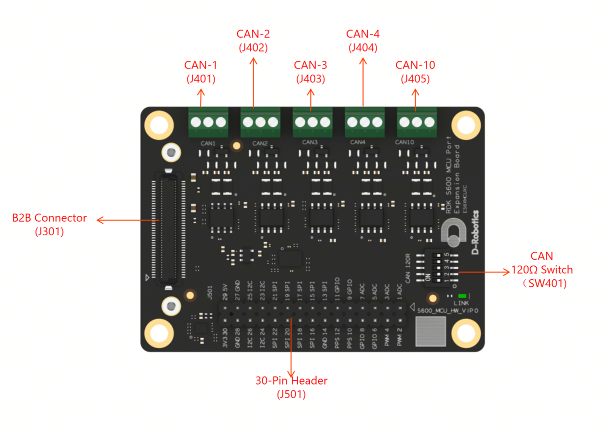

# RDK S600 MCU Port Expansion Board: CAN ownership and pin reference


**Manufacturer reference:** [**D-Robotics RDK S600 MCU Port Expansion Board**](https://d-robotics.github.io/rdk_s_doc/en/Quick_start/hardware_introduction/rdk_s600/rdk_s600_mcu_port_expansion_board/)

**Model:** `ES6XMCUXC` · **Revision:** V1P0 hardware reference; May 2026 Rev. 1.0 brief; S600 5.1.1 software scope · **OpenELAB SKU and product URL:** unverified. This is an unlisted manufacturer reference, not the S100 MCU board or the standalone 40-pin BMI088 module.


## Product overview <a href="#product-overview" id="product-overview"></a>

This S600-only accessory brings **MCU CAN1, CAN2, CAN3, CAN4 and CAN10** to five transceiver-equipped screw terminals, provides a multiplexed 30-pin peripheral header and integrates a BMI088 IMU. The matching FPC connects mainboard J15 to accessory J301. Applications execute on the host's MCU/Linux domains; the expansion board is not a standalone MCU development board. [Hardware manual](https://d-robotics.github.io/rdk_s_doc/en/Quick_start/hardware_introduction/rdk_s600/rdk_s600_mcu_port_expansion_board/), [brief PDF pages 4–6](https://archive.d-robotics.cc/downloads/hardware/rdk_s600/rdk_s600_mcu_port_expansion_board/drobotics_rdk_s600_mcu_port_expansion_board_brief_v1p0_zh.pdf).

Physical connector names, MCU controller numbers, CANHAL virtual targets and Linux network-device names are different namespaces. A terminal labelled CAN1 is not automatically Linux `can1`. This reference begins with passive identity/ownership checks and excludes running the manufacturer's transmit/loopback examples as a first result.



_Official D-Robotics interface figure, visually inspected: J401–J405, J301, J501, SW401 and LINK are identified. The current article labels itself V1P0; its separate product photo URL contains `v0p2`, so do not use that photo as revision proof. Match physical markings, the V1P0 schematic and pin workbook._ [Manual](https://d-robotics.github.io/rdk_s_doc/en/Quick_start/hardware_introduction/rdk_s600/rdk_s600_mcu_port_expansion_board/), [schematic](https://archive.d-robotics.cc/downloads/hardware/rdk_s600/rdk_s600_mcu_port_expansion_board/hardware_reference_design/RDK_S600_MCU_Port_Expansion_Board_V1P0.pdf).

## Applications <a href="#applications" id="applications"></a>

Use the board for integrating CAN/CAN FD devices, acquiring inertial data and developing MCU-domain ADC, SPI, I²C, GPIO, PWM or PPS functions on an S600 system. Each multiplexed pin has one selected function at a time; the header's alternate-function list is not a promise of simultaneous use.

For a real-time application, review the entire path: transceiver and termination → MCU controller and firmware ownership → filters/bit timing → IPC batching/transport → Linux application scheduling and clocks. A CAN frame arriving in Linux does not establish a control deadline, and a GPIO label does not establish a safe actuator output state. [MCU CAN guide](https://d-robotics.github.io/rdk_s_doc/en/Advanced_development/mcu_development/mcu_can/?v=5.1.1\&p=RDK+S600), [IPC guide](https://d-robotics.github.io/rdk_s_doc/en/Advanced_development/mcu_development/mcu_ipc/?v=5.1.1\&p=RDK+S600).

## Specifications <a href="#specifications" id="specifications"></a>

| Item                  | Defined scope                                                                                                                |
| --------------------- | ---------------------------------------------------------------------------------------------------------------------------- |
| Manufacturer model    | ES6XMCUXC                                                                                                                    |
| Supported host        | RDK S600 series only                                                                                                         |
| Host connection       | Matching FPC between S600 J15 and board J301; 80-pin interface                                                               |
| External CAN          | Five CAN FD terminals: MCU CAN1/2/3/4/10                                                                                     |
| CAN headline          | Up to 8 Mbit/s; MCU guide says laboratory verification only up to 5 Mbit/s, so 8 Mbit/s is not a measured system result here |
| Peripheral connector  | J501, 30 pins; actual contact functions below                                                                                |
| IMU                   | Bosch BMI088, SPI13 in the board design                                                                                      |
| Operating temperature | 0–65 °C                                                                                                                      |
| Brief packing list    | Expansion board, matching FPC and accessory pack; verify any actual supplier package separately                              |

[Hardware article](https://d-robotics.github.io/rdk_s_doc/en/Quick_start/hardware_introduction/rdk_s600/rdk_s600_mcu_port_expansion_board/), [brief pages 5–7](https://archive.d-robotics.cc/downloads/hardware/rdk_s600/rdk_s600_mcu_port_expansion_board/drobotics_rdk_s600_mcu_port_expansion_board_brief_v1p0_zh.pdf), [MCU CAN limits](https://d-robotics.github.io/rdk_s_doc/en/Advanced_development/mcu_development/mcu_can/?v=5.1.1\&p=RDK+S600).

### Keep revision and count discrepancies explicit <a href="#keep-revision-and-count-discrepancies-explicit" id="keep-revision-and-count-discrepancies-explicit"></a>

The **May Rev. 1.0 brief** specifies **70 × 50 × 12 mm**; the current web article says **70 × 70 × 17 mm**. Neither is averaged or selected as a guaranteed enclosure envelope. Obtain the matching physical/CAD revision before fabrication. The brief describes four ADC inputs; the web summary says “up to seven,” but the actual **J501 spreadsheet and V1P0 schematic expose four labelled ADC contacts**, pins 1/3/5/7. The host's 80-pin connector exposes additional ADC nets; that does not mean the accessory's 30-pin header exposes all of them. [Brief p5–6](https://archive.d-robotics.cc/downloads/hardware/rdk_s600/rdk_s600_mcu_port_expansion_board/drobotics_rdk_s600_mcu_port_expansion_board_brief_v1p0_zh.pdf), [J501 workbook](https://archive.d-robotics.cc/downloads/hardware/rdk_s600/rdk_s600/rdk_s600_mcu_port_expansion_board/drobotics_rdk_s600_mcu_port_expansion_board_pinlist_v1p0.xlsx), [schematic sheets 3/5](https://archive.d-robotics.cc/downloads/hardware/rdk_s600/rdk_s600_mcu_port_expansion_board/hardware_reference_design/RDK_S600_MCU_Port_Expansion_Board_V1P0.pdf).

The web warning says “following 5 IOs” but lists **six** contacts with boot-sensitive pull states. All six are retained below. A count typo does not remove a pin from the electrical requirement.

## Hardware and connections <a href="#hardware-and-connections" id="hardware-and-connections"></a>

### FPC orientation, rails and boot straps <a href="#fpc-orientation-rails-and-boot-straps" id="fpc-orientation-rails-and-boot-straps"></a>

1. Shut down S600 and remove host DC and all external peripheral supplies. Install/remove only when fully unpowered; do not use an operating-system stop request as proof that rails are off.
2. Use the matching FPC: **`CB` end → mainboard J15; `SUB` end → expansion J301**. Keep connectors parallel, fully engage them and install the specified supports. These are manufacturer end markings, not an inferred generic FPC contact-side rule.
3. Identify the J501 pin-1 marker and the actual board revision before attaching a breakout. Do not treat this connector as Raspberry Pi 40-pin GPIO or use the S100 MCU FPC.
4. Leave external ADC/SPI/I²C/PWM devices and all CAN cables disconnected for the initial passive inventory. Confirm their logic levels, reset states, current needs and ground references before later connection.

[Manufacturer assembly instructions](https://d-robotics.github.io/rdk_s_doc/en/Quick_start/hardware_introduction/rdk_s600/rdk_s600_mcu_port_expansion_board/).

The host supplies MCU peripheral rails through J15/J301. The schematic shows a local **5 V → 3.3 V regulator**, separate MCU logic/reference rails and level translation for selected peripheral signals. **A 3.3 V-labelled digital header does not make its ADC contacts 3.3 V tolerant**. ADC pins are expressly limited to **0–1.8 V** in the schematic. Header power pins are supplies, not GPIO; the reviewed board documents do not establish an independent per-pin current rating for arbitrary external loads. [Schematic sheets 3/5](https://archive.d-robotics.cc/downloads/hardware/rdk_s600/rdk_s600_mcu_port_expansion_board/hardware_reference_design/RDK_S600_MCU_Port_Expansion_Board_V1P0.pdf).

The host guide rates VDD\_MCU\_PERI\_5V and VDD\_MCU\_PERI\_3V3 at **1 A each** on the MCU expansion interface; they remain on in light sleep and turn off in deep sleep. The VDDIO\_MCU\_1V8/3V3 references are limited to **50 mA each** and low-power reference purposes; they also turn off in deep sleep. These shared host budgets are not independent 1 A guarantees at each J501 power contact after board loading. [S600 host rail specification](https://d-robotics.github.io/rdk_s_doc/en/01_Quick_start/01_hardware_introduction/02_rdk_s600/01_rdk_s600_kit?v=5.1.1\&p=RDK+S600).

### Complete J501 pin reference <a href="#complete-j501-pin-reference" id="complete-j501-pin-reference"></a>

The table preserves physical pin number, connector-side voltage, primary signal, alternate-function list and specified pull state from the V1P0 spreadsheet. `/` means the source supplies no ordinary pull/logic value; it is not permission to apply an arbitrary voltage. Alternate functions require the matching MCU pin-mux configuration. [J501 pin workbook](https://archive.d-robotics.cc/downloads/hardware/rdk_s600/rdk_s600/rdk_s600_mcu_port_expansion_board/drobotics_rdk_s600_mcu_port_expansion_board_pinlist_v1p0.xlsx).

| Pin | Signal              | Voltage  | Function 0 / 1 / 2 / 3                                | Pull    |
| --- | ------------------- | -------- | ----------------------------------------------------- | ------- |
| 1   | `MCU_ADC1_IO3`      | 1.8V ADC | `ADC1_IO[3] / / / / / /`                              | /       |
| 2   | `MCU_PWM5_IO_3V3`   | 3.3V     | `PWM5_IO / SPI11_SCLK / USS_PWM18 / GPIO_MCU[53]`     | PD      |
| 3   | `MCU_ADC1_IO2`      | 1.8V ADC | `ADC1_IO[2] / / / / / /`                              | /       |
| 4   | `MCU_PWM4_IO_3V3`   | 3.3V     | `PWM4_IO / SPI11_MISO / USS_PWM17 / GPIO_MCU[52]`     | PD      |
| 5   | `MCU_ADC1_IO1`      | 1.8V ADC | `ADC1_IO[1] / / / / / /`                              | /       |
| 6   | `MCU_GPIO2_3V3`     | 3.3V     | `CAN12_TX / SPI5_MOSI / USS_PWM2 / GPIO_MCU[17]`      | PD      |
| 7   | `MCU_ADC1_IO0`      | 1.8V ADC | `ADC1_IO[0] / / / / / /`                              | /       |
| 8   | `MCU_GPIO3_3V3`     | 3.3V     | `LIN1_TXD / UART9_TXD / SPI10_CSN3 / GPIO_MCU[12]`    | PD      |
| 9   | `MCU_GPIO1_3V3`     | 3.3V     | `CAN15_TX / SPI5_CSN0 / USS_PWM5 / GPIO_MCU[20]`      | PD      |
| 10  | `PPS_INOUT_3V3`     | 3.3V     | `PPS_IN2 / PPS_OUT / UART10_TXD / GPIO_MCU[1]`        | PD      |
| 11  | `MCU_GPIO0_3V3`     | 3.3V     | `CAN14_TX / SPI5_SCLK / USS_PWM4 / GPIO_MCU[19]`      | PD 100K |
| 12  | `PPS_IN0_3V3`       | 3.3V     | `PPS_IN0 / — / UART9_TXD / GPIO_MCU[0]`               | PD      |
| 13  | `MCU_SPI4_CSN1_3V3` | 3.3V     | `SPI4_CSN1 / BPU_JTG_TMS / USS_PWM7 / GPIO_MCU[42]`   | PU 1K   |
| 14  | `GND`               | /        | `GND / — / — / —`                                     | /       |
| 15  | `MCU_SPI4_CSN0_3V3` | 3.3V     | `SPI4_CSN0 / BPU_JTG_TRSTN / USS_PWM6 / GPIO_MCU[41]` | PU 1K   |
| 16  | `MCU_SPI6_CSN0_3V3` | 3.3V     | `SPI6_CSN0 / I2C13_SCL / TRC_DATA6 / GPIO_MCU[29]`    | PD 100K |
| 17  | `MCU_SPI4_SCLK_3V3` | 3.3V     | `SPI4_SCLK / BPU_JTG_TCK / USS_PWM10 / GPIO_MCU[45]`  | PD      |
| 18  | `MCU_SPI6_SCLK_3V3` | 3.3V     | `SPI6_SCLK / I2C14_SDA / TRC_CLK / GPIO_MCU[32]`      | PD      |
| 19  | `MCU_SPI4_MOSI_3V3` | 3.3V     | `SPI4_MOSI / BPU_JTG_TDI / USS_PWM8 / GPIO_MCU[43]`   | PU 1K   |
| 20  | `MCU_SPI6_MOSI_3V3` | 3.3V     | `SPI6_MOSI / I2C13_SDA / TRC_DATA7 / GPIO_MCU[30]`    | PD 100K |
| 21  | `MCU_SPI4_MISO_3V3` | 3.3V     | `SPI4_MISO / BPU_JTG_TDO / USS_PWM9 / GPIO_MCU[44]`   | PD      |
| 22  | `MCU_SPI6_MISO_3V3` | 3.3V     | `SPI6_MISO / I2C14_SCL / TRC_CTL / GPIO_MCU[31]`      | PD      |
| 23  | `MCU_I2C14_SCL_3V3` | 3.3V     | `I2C14_SCL / SPI4_MISO / DEBUG_OUT14 / GPIO_MCU[73]`  | PU 2.2K |
| 24  | `MCU_I2C13_SCL_3V3` | 3.3V     | `I2C13_SCL / SPI4_CSN0 / DEBUG_OUT12 / GPIO_MCU[71]`  | PU 2.2K |
| 25  | `MCU_I2C14_SDA_3V3` | 3.3V     | `I2C14_SDA / SPI4_SCLK / DEBUG_OUT15 / GPIO_MCU[74]`  | PU 2.2K |
| 26  | `MCU_I2C13_SDA_3V3` | 3.3V     | `I2C13_SDA / SPI4_MOSI / DEBUG_OUT13 / GPIO_MCU[72]`  | PU 2.2K |
| 27  | `GND`               | /        | `GND / — / — / —`                                     | /       |
| 28  | `GND`               | /        | `GND / — / — / —`                                     | /       |
| 29  | `VDD_5V`            | /        | `VDD_MCU_PERI_5V / — / — / —`                         | /       |
| 30  | `VDD_3V3`           | /        | `VDD_MCU_PERI_3V3 / — / — / —`                        | /       |

Six contacts need particular attention at boot: **11 (100 kΩ pull-down), 13/15/19 (1 kΩ pull-up), and 16/20 (100 kΩ pull-down)**. Preserve the connected peripheral's compatible power-on state; the manual explicitly says not to add external pull-up/down resistors to these contacts. Pin 13 is included even though the introductory count says five. Do not use another device's default pull to override a boot strap. [Workbook](https://archive.d-robotics.cc/downloads/hardware/rdk_s600/rdk_s600/rdk_s600_mcu_port_expansion_board/drobotics_rdk_s600_mcu_port_expansion_board_pinlist_v1p0.xlsx), [manual warning](https://d-robotics.github.io/rdk_s_doc/en/Quick_start/hardware_introduction/rdk_s600/rdk_s600_mcu_port_expansion_board/).

I²C13/I²C14 on J501 are translated to **3.3 V** with 2.2 kΩ pull-ups in the workbook; the mainboard-side nets are separately named at 1.8 V. SPI4 and SPI6 are distinct buses; the schematic labels SPI4 as master-only and SPI6 as master-only in this accessory context. General MCU SPI capabilities do not override the particular routing/level shifter. Pin 12's prose description calls it an output, while its name/function columns identify `PPS_IN0` as input; retain the workbook's function/direction and resolve the intended mux before connecting a PPS source or sink.

### Host J15 contact reference <a href="#host-j15-contact-reference" id="host-j15-contact-reference"></a>

This complete table is the **host** 80-pin definition, not the FPC's mating-view drawing. The workbook sheet is misleadingly titled “J15 Camera Expansion Connector,” but its content says MCU expansion connector. Use J15's MCU signals and actual connector key, never a camera-board cable. [Host connector workbook](https://archive.d-robotics.cc/downloads/hardware/rdk_s600/rdk_s600/D-Robotics_RDK_S600_Connector_Application_Note_V1P0-20260922_EN.xlsx).

| Pin | Host J15 signal / voltage        | Pin | Host J15 signal / voltage |
| --- | -------------------------------- | --- | ------------------------- |
| 1   | `MCU_I2C14_SCL_1V8 / 1.8V`       | 2   | `MCU_GPIO0_3V3 / 3.3V`    |
| 3   | `MCU_I2C14_SDA_1V8 / 1.8V`       | 4   | `MCU_GPIO1_3V3 / 3.3V`    |
| 5   | `MCU_I2C13_SCL_1V8 / 1.8V`       | 6   | `MCU_GPIO2_3V3 / 3.3V`    |
| 7   | `MCU_I2C13_SDA_1V8 / 1.8V`       | 8   | `MCU_GPIO3_3V3 / 3.3V`    |
| 9   | `GND`                            | 10  | `MCU_GPIO4_3V3 / 3.3V`    |
| 11  | `MCU_SPI6_MISO_3V3 / 3.3V`       | 12  | `MCU_GPIO5_3V3 / 3.3V`    |
| 13  | `MCU_SPI6_MOSI_3V3 / 3.3V`       | 14  | `GND`                     |
| 15  | `MCU_SPI6_SCLK_3V3 / 3.3V`       | 16  | `MCU_ADC1_IO0 / 1.8V`     |
| 17  | `MCU_SPI6_CSN0_3V3 / 3.3V`       | 18  | `MCU_ADC1_IO1 / 1.8V`     |
| 19  | `GND`                            | 20  | `MCU_ADC1_IO2 / 1.8V`     |
| 21  | `MCU_SPI13_MISO_3V3 / 3.3V`      | 22  | `MCU_ADC1_IO3 / 1.8V`     |
| 23  | `MCU_SPI13_MOSI_3V3 / 3.3V`      | 24  | `MCU_ADC1_IO4 / 1.8V`     |
| 25  | `MCU_SPI13_SCLK_3V3 / 3.3V`      | 26  | `MCU_ADC1_IO5 / 1.8V`     |
| 27  | `MCU_SPI13_CSN0_3V3 / 3.3V`      | 28  | `MCU_ADC1_IO6 / 1.8V`     |
| 29  | `MCU_SPI13_CSN1_3V3 / 3.3V`      | 30  | `MCU_ADC1_IO7 / 1.8V`     |
| 31  | `GND`                            | 32  | `GND`                     |
| 33  | `MCU_SPI8_MISO_3V3 / 3.3V`       | 34  | `PPS_IN0_3V3 / 3.3V`      |
| 35  | `MCU_SPI8_MOSI_3V3 / 3.3V`       | 36  | `MCU_PWM0_IO4_1V8 / 1.8V` |
| 37  | `MCU_SPI8_SCLK_3V3 / 3.3V`       | 38  | `MCU_PWM0_IO5_1V8 / 1.8V` |
| 39  | `MCU_SPI8_CSN0_3V3 / 3.3V`       | 40  | `PPS_INOUT_3V3 / 3.3V`    |
| 41  | `GND`                            | 42  | `GND`                     |
| 43  | `MCU_SPI4_MISO_1V8 / 1.8V`       | 44  | `GND`                     |
| 45  | `MCU_SPI4_MOSI_BOOT9_1V8 / 1.8V` | 46  | `GND`                     |
| 47  | `MCU_SPI4_SCLK_1V8 / 1.8V`       | 48  | `GND`                     |
| 49  | `MCU_SPI4_CSN0_BOOT6_1V8 / 1.8V` | 50  | `VDD_MCU_PERI_5V / 5V`    |
| 51  | `MCU_SPI4_CSN1_BOOT7_1V8 / 1.8V` | 52  | `VDD_MCU_PERI_5V / 5V`    |
| 53  | `MCU_CAN1_TX_3V3 / 3.3V`         | 54  | `VDD_MCU_PERI_5V / 5V`    |
| 55  | `MCU_CAN1_RX_3V3 / 3.3V`         | 56  | `VDD_MCU_PERI_5V / 5V`    |
| 57  | `GND`                            | 58  | `GND`                     |
| 59  | `MCU_CAN2_TX_3V3 / 3.3V`         | 60  | `GND`                     |
| 61  | `MCU_CAN2_RX_3V3 / 3.3V`         | 62  | `VDDIO_MCU_1V8 / 1.8V`    |
| 63  | `GND`                            | 64  | `VDDIO_MCU_3V3 / 3.3V`    |
| 65  | `MCU_CAN3_TX_3V3 / 3.3V`         | 66  | `GND`                     |
| 67  | `MCU_CAN3_RX_3V3 / 3.3V`         | 68  | `GND`                     |
| 69  | `GND`                            | 70  | `GND`                     |
| 71  | `MCU_CAN4_TX_3V3 / 3.3V`         | 72  | `GND`                     |
| 73  | `MCU_CAN4_RX_3V3 / 3.3V`         | 74  | `VDD_MCU_PERI_3V3 / 3.3V` |
| 75  | `GND`                            | 76  | `VDD_MCU_PERI_3V3 / 3.3V` |
| 77  | `MCU_CAN10_TX_BOOT22_3V3 / 3.3V` | 78  | `VDD_MCU_PERI_3V3 / 3.3V` |
| 79  | `MCU_CAN10_RX_3V3 / 3.3V`        | 80  | `VDD_MCU_PERI_3V3 / 3.3V` |

Several descriptive cells in that host workbook are copied incorrectly: GND pins have MIPI/12 V descriptions despite their **signal names and schematic grounding**. Preserve signal/rail identity from the actual schematic; do not energize a ground contact based on a stray description. The connector-side 1.8 V/3.3 V distinction is real even where later circuitry translates it.

### CAN terminal and termination map <a href="#can-terminal-and-termination-map" id="can-terminal-and-termination-map"></a>

| Board terminal | MCU controller | SW401 section | Default CAN2IPC route in the MCU guide |
| -------------- | -------------- | ------------- | -------------------------------------- |
| J401           | CAN1           | 1             | Instance 0, channel 1                  |
| J402           | CAN2           | 2             | Instance 0, channel 2                  |
| J403           | CAN3           | 3             | Instance 0, channel 3                  |
| J404           | CAN4           | 4             | Instance 4, channel 4                  |
| J405           | CAN10          | 5             | Instance 4, channel 5                  |

[Board connector map](https://d-robotics.github.io/rdk_s_doc/en/Quick_start/hardware_introduction/rdk_s600/rdk_s600_mcu_port_expansion_board/), [MCU CAN architecture and allocation table](https://d-robotics.github.io/rdk_s_doc/en/Advanced_development/mcu_development/mcu_can/?v=5.1.1\&p=RDK+S600). These are the documented default MCU/CANHAL routes, not Linux network-device assignments and not permission to overwrite an installed custom mapping.

Read **CAN\_H, CAN\_L and GND on the back of the actual board** before wiring. Do not infer left-to-right terminal order from the front photo. SW401 ON inserts the corresponding 120 Ω termination. For a conventional two-end terminated CAN bus, enable termination only at its physical ends; two 120 Ω resistors in parallel give approximately 60 Ω across H/L with the system fully unpowered. That resistance check is an engineering diagnostic, not a live-bus measurement or proof of correct bitrate. The manufacturer's “closed/open-loop” wording should not be read as an instruction to make a ring cable topology. Do not add another pair of terminators to an already terminated network.

The V1P0 reference schematic shows **MCP2542WFD-E/SN on CAN1** and **TCAN1057AV-Q1 on the other four channels**; verify the installed BOM/revision before transferring transceiver-specific behavior. Their 3.3 V TX/RX control side and the external differential CAN\_H/CAN\_L side are different electrical interfaces. No galvanic-isolation rating is established by these sources. Use an appropriate common reference/grounding and external protection design; do not connect a TTL-UART or raw logic signal to a CAN terminal. [CAN circuit, sheet 4](https://archive.d-robotics.cc/downloads/hardware/rdk_s600/rdk_s600_mcu_port_expansion_board/hardware_reference_design/RDK_S600_MCU_Port_Expansion_Board_V1P0.pdf).

### Integrated IMU and LINK indication <a href="#integrated-imu-and-link-indication" id="integrated-imu-and-link-indication"></a>

U301 is BMI088 on SPI13; the schematic separates accelerometer and gyroscope chip-select paths and marks synchronization/data-ready interrupt roles. This is the **onboard MCU-connected sensor**, not the separately sold 40-pin BMI088 module with its X5 Linux-IIO workflow. Do not assume `/sys/bus/iio/devices/iio:device1` belongs to it. Prove the installed MCU driver, scale, units, axis frame, timestamp and transport before using its data for fusion. [Schematic sheet 3](https://archive.d-robotics.cc/downloads/hardware/rdk_s600/rdk_s600_mcu_port_expansion_board/hardware_reference_design/RDK_S600_MCU_Port_Expansion_Board_V1P0.pdf).

LINK green means the host/board connection and 5 V supply are present according to the hardware article. It does not certify a running MCU1, healthy CAN transceivers, valid IMU data or a correctly configured header.

## Software and development resources <a href="#software-and-development-resources" id="software-and-development-resources"></a>

### Choose the CAN ownership path before changing configuration <a href="#choose-the-can-ownership-path-before-changing-configuration" id="choose-the-can-ownership-path-before-changing-configuration"></a>

| Path                             | Owner / software contract                                                                                   | Important separation                                                                                        |
| -------------------------------- | ----------------------------------------------------------------------------------------------------------- | ----------------------------------------------------------------------------------------------------------- |
| MCU-owned CAN → CAN2IPC → CANHAL | MCU firmware owns controller/interrupts; Acore application uses configured virtual target and IPCF          | Board CAN1/2/3/4/10 are interpreted through the matching JSON/MCU route                                     |
| Acore native Main-domain CAN     | Linux FlexCAN/SocketCAN on the mainboard's four Main-domain channels                                        | These are not the accessory's five MCU terminals                                                            |
| Acore takeover of MCU-domain CAN | S600 guide describes Linux taking over up to six MCU-domain controllers after coordinated Acore/MCU changes | MCU-side interrupts, clock ownership and startup must be relinquished; never run two owners of a controller |
| Linux Fastpath                   | Driver shared-memory/mmap path, enabled only by its explicit configuration/opening                          | Not CANHAL-over-IPCF and not an ordinary SocketCAN receive example                                          |

The S600 Linux guide identifies native `canfd0..3` and takeover `canfd4..9`, with different clocks/pin-mux rules. Those device-tree indices are **not a direct terminal map**. In its example, `canfd4` addresses MCU controller 1; read the actual DTS/driver/device identity before assigning any netdev to J401. The takeover guide's six listed nodes do not establish that all five accessory terminals are available through that path; verify CAN3/CAN4/CAN10 against the exact DTS/firmware rather than extrapolating from the CAN1 example. CAN0/1 Main-domain pin mux conflicts with SPI0; Main-domain CAN2/3 share UART-related pins. Do not apply those Main-domain changes to the MCU accessory blindly. [S600 Linux CAN guide](https://d-robotics.github.io/rdk_s_doc/en/Advanced_development/linux_development/driver_development_super/driver_can/?v=5.1.1\&p=RDK+S600).

S600 **5.1.1** release notes add SocketCAN access to MCU-domain CAN and extended/remote-frame support. The shared MCU CAN article still contains a statement that S600 does not support extended frames, and examples retain S100-generated configuration paths. These are version conflicts: use the actual 5.1.1 BSP/MCU pair and supported feature record, not an assumed universal extension of older firmware. No active extended-frame or takeover test was run here. [Release 5.1.1](https://d-robotics.github.io/rdk_s_doc/en/Release_Note/s600/v5_1_1/), [mixed-version MCU article](https://d-robotics.github.io/rdk_s_doc/en/Advanced_development/mcu_development/mcu_can/?v=5.1.1\&p=RDK+S600).

### CANHAL configuration and API facts <a href="#canhal-configuration-and-api-facts" id="canhal-configuration-and-api-facts"></a>

| File / field              | Role and failure check                                                                                              |
| ------------------------- | ------------------------------------------------------------------------------------------------------------------- |
| `nodes.json`              | Virtual targets; `enable`, `mode` (`R`, `W`, `RW`), `target`, `clk_source`, `io_channel.channel_id`, `raw_protocol` |
| `ipcf_channel.json`       | Local ID maps to IPC instance/channel, plugin/library, `/dev/ipcdrv`, FIFO/buffer size and receive timeout          |
| `channels.json`           | Selects the IPC configuration file/path                                                                             |
| Target string             | An exact configured name; tutorial strings such as `can6_ins0ch6` are not a guaranteed S600 J402 route              |
| `raw_protocol`            | Must match the MCU peer; a file that parses as JSON can still use the wrong transport protocol                      |
| Current working directory | Samples search their `config` directory; the correct files elsewhere do not prove correct runtime configuration     |

The guide documents `canInit()` before operations, `canRecvMsgFrame(target, frame, &pack)` for reception, `canSendMsgFrame(...)` for transmission and `canDeInit()` for release. `pack` carries frame count and timestamps; callers must allocate enough frame storage and inspect status rather than treating every returned package as one valid frame. Receive is documented as nonblocking in the example; use bounded retry/time and yield on `-CAN_TRY_AGAIN`. One process/thread must own a given IPC channel. **Initialization is not a passive file read**, and the multi-channel sample creates a transmit thread. Do not run it for a read-only smoke test. [CANHAL sample/configuration/error sections](https://d-robotics.github.io/rdk_s_doc/en/Advanced_development/mcu_development/mcu_can/?v=5.1.1\&p=RDK+S600).

| Diagnostic                        | Source meaning / useful next check                                                           |
| --------------------------------- | -------------------------------------------------------------------------------------------- |
| `-200` target/channel not found   | Compare configured target, `enable` and runtime directory                                    |
| `-303` receive/resource condition | Check peer traffic, IPC ownership and readiness; do not busy-spin indefinitely               |
| `-401` message too large          | Review packet/frame batching; documented IPCF packet ceiling is 4096 bytes                   |
| `-402` invalid protocol data      | Review length/DLC/fragment layout and matched peer protocol                                  |
| `-406` sequence discontinuity     | Possible loss; already parsed frames can still be returned                                   |
| `-407` receive cache too small    | Increase allocated frame capacity to match the packet contract                               |
| `-408` latency threshold          | Guide's default is 28 ms; establish MCU RTC↔Acore PHC synchronization before interpreting it |
| `-409` CRC failure                | Check peer protocol and transport corruption; not a valid application frame                  |

Errors are from the reviewed guide, not observations. Keep the exact installed header/enum version when coding. Merge policy defaults to **one frame / 1000 µs** in the guide; increasing batch count trades IPC overhead for waiting time. It must not be described as a deterministic wire-to-application deadline.

### Controller parameters and MCU development <a href="#controller-parameters-and-mcu-development" id="controller-parameters-and-mcu-development"></a>

The guide's timing model uses `bitrate = clock / (prescaler × total_TQ)` and sample point `(1 + prop_seg + phase_seg1) / total_TQ`. Arbitration and FD data phases have separate settings; SJW, transceiver delay compensation, cable length and peer rate must agree. An 8 Mbit/s headline is not an instruction to use that rate on arbitrary wiring. The source's example bit-timing code points to S100-generated files; use the S600-specific generated configuration and actual clock, not those paths or register values.

Standard IDs use 11 bits, extended IDs 29 bits; frame format and FD/BRS settings belong to the data contract. Filter modes include exact/masked ID, inclusive range and two-ID selection; standard/extended filters are separately configured. Filtering can explain missing frames even when the physical bus works. No filter or controller-write example is executed in this reference. [Timing/filter sections](https://d-robotics.github.io/rdk_s_doc/en/Advanced_development/mcu_development/mcu_can/?v=5.1.1\&p=RDK+S600).

MCU0 manages critical boot/power functions and is not the business-development target. MCU1 is the FreeRTOS application lane. The reviewed quick-start documentation describes its remoteproc lifecycle and GCC/FreeRTOS environment; the installed community build script and S600 SDK release must be inspected before selecting a build target. No S100 compile command or automatic toolchain-download script is recommended as a substitute. IPC buffers, instances/channels and interrupt/core ownership must agree at both ends; MDMA send buffers have documented 16-byte alignment requirements. [MCU quick start](https://d-robotics.github.io/rdk_s_doc/en/Advanced_development/mcu_development/basic_information/?v=5.1.1\&p=RDK+S600), [MCU IPC](https://d-robotics.github.io/rdk_s_doc/en/Advanced_development/mcu_development/mcu_ipc/?v=5.1.1\&p=RDK+S600), [Linux IPC allocation](https://d-robotics.github.io/rdk_s_doc/en/Advanced_development/linux_development/driver_development_super/driver_ipc/?v=5.1.1\&p=RDK+S600).

## Getting started <a href="#getting-started" id="getting-started"></a>

### First result: passive host, MCU and route inventory <a href="#first-result-passive-host-mcu-and-route-inventory" id="first-result-passive-host-mcu-and-route-inventory"></a>

Prerequisites: identified S600 V1P0 and this board/FPC, normal factory image/MCU set, all CAN and external header devices disconnected, and mounting completed while unpowered. Boot the host normally. Inspect rather than start/stop MCU1:

```bash
cat /etc/version
uname -r
tr '\000' '\n' < /proc/device-tree/model
find -L /sys/class/remoteproc -maxdepth 2 -name state -exec sh -c 'printf "%s: " "$1"; cat "$1"' sh {} \;
ip -details -statistics link show type can
find -L /sys/class/net -maxdepth 3 -name uevent -print
ls -l /dev/ipcdrv
find /app/Can -maxdepth 3 -type f -name '*.json' -print
```

1. Record host/image/kernel, board/FPC marking and LINK state. Missing sysfs paths or a permission error are observations to keep.
2. Record already-running remoteproc state and existing CAN netdevices. Do not write `start`/`stop`, change bitrates, enable a controller, run a CAN sample or use an I²C scan to fill missing evidence.
3. Read the installed `nodes.json`, `ipcf_channel.json` and `channels.json` files. Join target → local channel ID → IPC instance/channel → MCU controller → physical terminal, using the installed firmware's mapping rather than the source example's target spelling.
4. For any Linux CAN interface, inspect its actual device/DT association and ownership path. No netdevice does not prove the board is faulty if the intended path is MCU CANHAL.
5. Leave all external devices disconnected until the voltage/pull, transceiver/termination and firmware ownership review is complete.

**Expected result:** an identity and ownership/route record, with uncertainty named. This check deliberately produces no CAN or IMU data and proves no live-bus performance. It is useful because it prevents wiring to the wrong controller namespace. No commands above were executed on an S600 during authoring.

### Separate receive-only development from bus-passive listening <a href="#separate-receive-only-development-from-bus-passive-listening" id="separate-receive-only-development-from-bus-passive-listening"></a>

A receive-only application can still initialize a controller or acknowledge frames on the wire. Do not call it electrically passive without a verified listen-only controller configuration. After an isolated bench bus, termination, rates, frame format and ownership are established, use a bounded receive-only application built against the matched SDK. Preserve frame IDs/flags, DLC versus byte length, sequence and both timestamp clock domains; a timeout is not a valid empty frame. Do not copy the manufacturer's combined send/receive test onto a live actuator network.

Before allowing any PWM/GPIO output, define reset and boot states and check the six sensitive pull contacts. Before ADC sampling, verify input protection and the 0–1.8 V range. Before IMU fusion, establish raw scale, axes and timestamp alignment with an independent stationary check. These are later commissioning tasks, not results observed here.

### Original offline route audit <a href="#original-offline-route-audit" id="original-offline-route-audit"></a>

Copy the installed `nodes.json` and `ipcf_channel.json` to an ordinary computer without modifying them. Save this original script as `audit_s600_can_routes.py` and run `python3 audit_s600_can_routes.py nodes.json ipcf_channel.json`. It joins the two JSON files and detects duplicate/missing routes; it does not load CANHAL or open any device.

```python
"""Original offline JSON audit. Does not import CANHAL, open IPC or configure CAN."""
import json
import sys
from pathlib import Path
nodes = json.loads(Path(sys.argv[1]).read_text())['nodes']
entries = json.loads(Path(sys.argv[2]).read_text())['channels']
ids = [entry['id'] for entry in entries]
if len(ids) != len(set(ids)):
    raise SystemExit('Duplicate local channel IDs')
channels = {entry['id']: entry['channel'] for entry in entries}
default_terminals = {(0, 1): 'J401', (0, 2): 'J402', (0, 3): 'J403',
                     (4, 4): 'J404', (4, 5): 'J405'}
used = set()
for node in nodes:
    if not node.get('enable', False):
        continue
    io = node['io_channel']
    if io['device_type'] != 'ipcf':
        print(node['target'], 'not an IPCF target; inspect separately')
        continue
    local_id = io['channel_id']
    if local_id not in channels:
        raise SystemExit(f'Missing local channel ID: {local_id}')
    route = channels[local_id]
    pair = (route['instance'], route['channel'])
    if pair in used:
        raise SystemExit(f'Shared IPC route needs ownership review: {pair}')
    used.add(pair)
    print(node['target'], 'mode=', node['mode'], 'IPC=', pair,
          'guide_default_terminal=', default_terminals.get(pair, 'unmapped'))
print('Compare with installed MCU routing; no physical mapping was verified')
```

**Expected result:** each enabled IPCF target prints its declared mode and instance/channel pair, plus a **guide-default** terminal where known. That label is a comparison with the published default, not proof of installed firmware/wiring. Duplicate routes or missing IDs stop the audit. Original synthetic JSON fixtures were exercised separately; no upstream sample was run.

## Troubleshooting and FAQs <a href="#troubleshooting-and-faqs" id="troubleshooting-and-faqs"></a>

| Symptom                                      | Ordered diagnosis                                                                                                                                        |
| -------------------------------------------- | -------------------------------------------------------------------------------------------------------------------------------------------------------- |
| LINK off                                     | Power off; inspect CB/SUB ends, seating and host rail. Do not interchange the camera and MCU FPC/connector                                               |
| LINK on but MCU1 absent                      | Record image/firmware and remoteproc state; LED does not establish application firmware readiness                                                        |
| No Linux `can1`                              | Determine MCU CANHAL versus Linux ownership; terminal CAN1 is not a netdev naming rule                                                                   |
| CANHAL init fails                            | Inspect JSON/runtime directory, plugin/device availability, MCU1 and exclusive instance/channel ownership before rewiring                                |
| No received frames                           | Verify actual H/L/GND, end termination, ownership, rates, filters, frame format and target mapping; do not transmit arbitrary actuator frames as a probe |
| Receive loss/latency warnings                | Inspect sequence/status, batching, queue load and clock synchronization independently; mean throughput does not prove tail latency                       |
| Boot changes after attaching SPI/GPIO device | Disconnect with all power off and inspect the six strap/pull contacts and peripheral default states                                                      |
| ADC value saturates                          | Check actual input range/protection; a 3.3 V digital header label is not a 3.3 V ADC rating                                                              |
| Standalone BMI088 IIO instructions fail      | This board's IMU is on MCU SPI13; verify its MCU driver and transport rather than guessing a Linux IIO node                                              |

**Is the board isolated CAN?** No isolation rating is established by the reviewed schematic/brief. A transceiver is not an isolation barrier.

**Can I fit an enclosure from the published dimensions?** The web/brief dimensions conflict; inspect the exact CAD and board revision before machining.

## Downloads and technical documents <a href="#downloads-and-technical-documents" id="downloads-and-technical-documents"></a>

| Resource                                                                                                                                                                                                                                                                                                                                                                                               | Model/revision and access                                                                                    |
| ------------------------------------------------------------------------------------------------------------------------------------------------------------------------------------------------------------------------------------------------------------------------------------------------------------------------------------------------------------------------------------------------------ | ------------------------------------------------------------------------------------------------------------ |
| [Hardware manual](https://d-robotics.github.io/rdk_s_doc/en/Quick_start/hardware_introduction/rdk_s600/rdk_s600_mcu_port_expansion_board/)                                                                                                                                                                                                                                                             | V1P0 board, orientation, CAN/pull warnings; read; historical V0P2/V0P3 not treated as interchangeable        |
| [May 2026 brief](https://archive.d-robotics.cc/downloads/hardware/rdk_s600/rdk_s600_mcu_port_expansion_board/drobotics_rdk_s600_mcu_port_expansion_board_brief_v1p0_zh.pdf)                                                                                                                                                                                                                            | Seven PDF pages read; ES6XMCUXC identity, packing and conflicting mechanical reference                       |
| [J501 pin workbook](https://archive.d-robotics.cc/downloads/hardware/rdk_s600/rdk_s600/rdk_s600_mcu_port_expansion_board/drobotics_rdk_s600_mcu_port_expansion_board_pinlist_v1p0.xlsx)                                                                                                                                                                                                                | All 30 contacts, mux/voltage/pull columns read                                                               |
| [S600 host pin workbook](https://archive.d-robotics.cc/downloads/hardware/rdk_s600/rdk_s600/D-Robotics_RDK_S600_Connector_Application_Note_V1P0-20260922_EN.xlsx)                                                                                                                                                                                                                                      | J15 80-pin definition read; descriptive-cell errors noted                                                    |
| [Five-sheet schematic](https://archive.d-robotics.cc/downloads/hardware/rdk_s600/rdk_s600_mcu_port_expansion_board/hardware_reference_design/RDK_S600_MCU_Port_Expansion_Board_V1P0.pdf)                                                                                                                                                                                                               | V1P0, 2026-04-25; rails, level translation, IMU and CAN circuits reviewed; relevant views visually inspected |
| [Placement drawing](https://archive.d-robotics.cc/downloads/hardware/rdk_s600/rdk_s600_mcu_port_expansion_board/hardware_reference_design/RDK_S600_MCU_Port_Expansion_Board_Reference_Designator_Drawing_V1.0_20260610.pdf)                                                                                                                                                                            | V1.0 2026-06-10, reference-designator placement                                                              |
| [Native design directory](https://archive.d-robotics.cc/downloads/hardware/rdk_s600/rdk_s600_mcu_port_expansion_board/hardware_reference_design/) / [STEP](https://archive.d-robotics.cc/downloads/hardware/rdk_s600/rdk_s600_mcu_port_expansion_board/RDK_S600_MCU_PORT_EXPANSION_BOARD_3D_Model_V1P0_20260420.STEP)                                                                                  | BRD/DSN and mechanical model; listed/linked, not CAD-opened or fit-tested                                    |
| [CAN guide](https://d-robotics.github.io/rdk_s_doc/en/Advanced_development/mcu_development/mcu_can/?v=5.1.1\&p=RDK+S600) / [Linux CAN](https://d-robotics.github.io/rdk_s_doc/en/Advanced_development/linux_development/driver_development_super/driver_can/?v=5.1.1\&p=RDK+S600) / [IPC](https://d-robotics.github.io/rdk_s_doc/en/Advanced_development/mcu_development/mcu_ipc/?v=5.1.1\&p=RDK+S600) | Distinct controller, takeover and IPC contracts; no implementation executed                                  |
| [S600 SDK/firmware resources](https://d-robotics.github.io/rdk_s_doc/en/Quick_start/download/?v=5.1.1\&p=RDK+S600)                                                                                                                                                                                                                                                                                     | Matched MCU/Linux releases; commercial/FTP/NDA materials are not represented as read                         |

## References and validation <a href="#references-and-validation" id="references-and-validation"></a>

Reviewed on 24 November 2026. This original engineering reference incorporates actual board/host pin workbooks, brief/schematic and applicable S600 CAN/IPC/release documentation. Source conflicts are bounded rather than resolved by averaging or borrowing the S100 model. Store matching, dimension reconciliation, complete external AVL, exact installed controller ownership, custom peripheral loading and active data paths remain unverified. No SDK installation, build, upstream example execution, flashing, CAN transmission, controller initialization, PWM output, ADC/IMU acquisition or hardware test was performed.

**Related guides:** [D-Robotics boards, modules and peripherals](./).

* [D-Robotics RDK S600 — V1P0 hardware and RDKOS 5.1.1 development](rdk-s600-manufacturer-engineering-reference.md)
* [D-Robotics RDK S600 Module: MS6 Specifications and Carrier Integration Reference](rdk-s600-module.md)
* [RDK S600 Camera Expansion Board: eight-link GMSL and power reference](rdk-s600-camera-expansion-board-reference.md)
