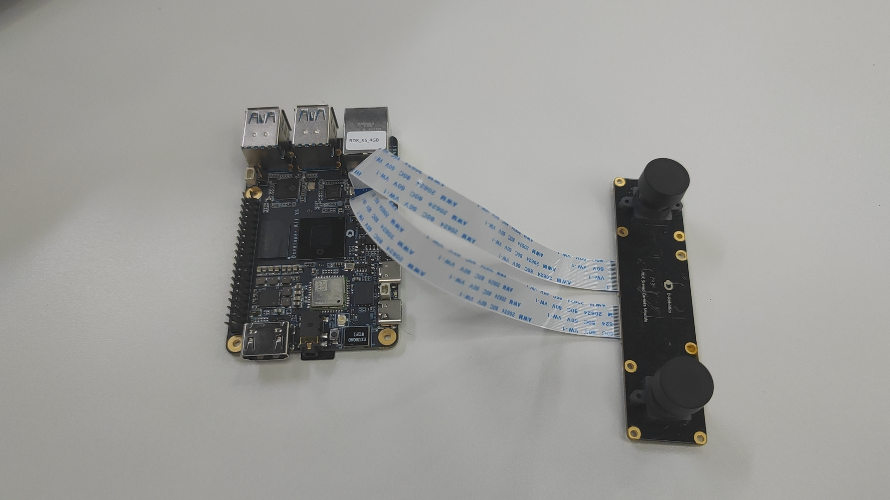
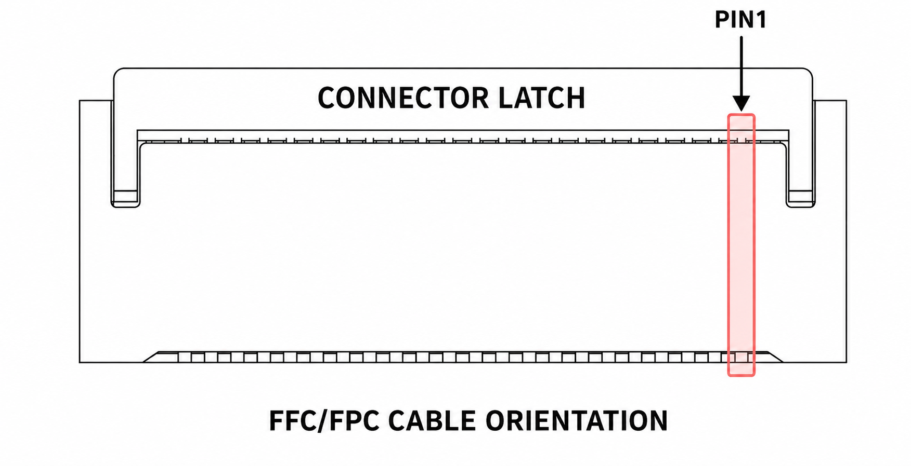
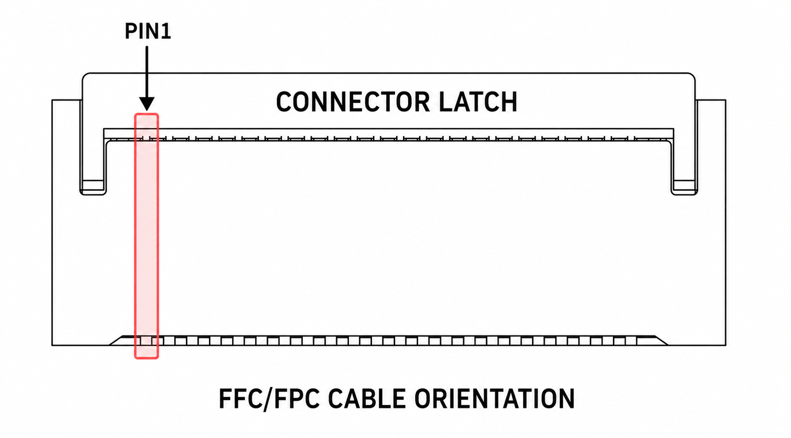

# D-Robotics SC230AI, GS130W and GS130WI Stereo Cameras: Wiring and Capture


**D-Robotics RDK Stereo Cameras SC230AI, GS130W and GS130WI — not yet listed on OpenELAB; SKU/product links pending.**

Manufacturer family reference. These are distinct camera models, not verified options of an OpenELAB listing. SC230AI is also called RDK Stereo Camera Module; the S100 installation table specifies its V3 revision.


SC230AI is a 1920×1080 rolling-shutter stereo module. GS130W and GS130WI use global-shutter SC132GS sensors: W has an 80 mm baseline; WI has a 70 mm baseline and an ICM-42688-P IMU. W/WI camera-end ribbon contact directions are opposite. Identify the exact camera before selecting cables, capture dimensions or calibration.

## Product overview <a href="#product-overview" id="product-overview"></a>

GS130W and GS130WI each use two global-shutter sensors and support synchronized exposure and external triggering. The hardware supplies stereo images; a host algorithm computes disparity/depth. A camera's maximum image rate is not the neural depth algorithm's delivered rate. GS130WI's IMU data travel over its right-side control path, not as an extra image plane. [Family overview](https://d-robotics.github.io/accessories_stereo_camera_doc/en/overview).

| Host                           | GS130W/WI manufacturer support | Required distinction                                                                                   |
| ------------------------------ | ------------------------------ | ------------------------------------------------------------------------------------------------------ |
| RDK X5                         | Both models supported          | Two camera connections, exact ribbon orientation                                                       |
| RDK X5 Module                  | Both supported                 | Official or correctly designed carrier, not a bare-module direct connection                            |
| RDK S100 / S100P               | Both supported                 | **Camera expansion board required**; identify that expansion board and its host-specific ports         |
| RDK S600                       | Both listed as supported       | Accessory quick-start wiring illustrations do not provide a complete S600-specific installation recipe |
| RDK X3                         | Not supported                  | The current product table cites its single MIPI-channel limitation                                     |
| RDK X3 Module                  | Not supported                  | Do not use the single-camera/X3 SDK example as stereo validation                                       |
| Other matching dual-MIPI hosts | Driver adaptation required     | Similar connectors alone do not establish power, pinout, synchronization or driver compatibility       |

[GS130W compatibility](https://d-robotics.github.io/accessories_stereo_camera_doc/en/stereo_camera_gs130w/product_overview), [GS130WI compatibility](https://d-robotics.github.io/accessories_stereo_camera_doc/en/stereo_camera_gs130wi/product_overview).

## Applications <a href="#applications" id="applications"></a>

Use these stereo modules for robot scene geometry and perception research; select global-shutter GS130W/WI when row-dependent motion distortion is a concern. GS130WI additionally supports experiments combining motion and image measurements, but the presence of an IMU does not establish a synchronized, calibrated visual-inertial pipeline.

GS130W/WI global shutters avoid the row-dependent exposure timing of the SC230AI rolling-shutter model; it does not eliminate motion blur or guarantee useful depth on reflective, textureless or occluded surfaces. Preserve left/right pairing, exposure, timing, calibration and mounting geometry with every dataset. Near-infrared enhancement describes sensor sensitivity, not an included projector or a guaranteed active-IR depth mode. [Model capabilities](https://d-robotics.github.io/accessories_stereo_camera_doc/en/overview#product-overview).

## Specifications <a href="#specifications" id="specifications"></a>

### SC230AI versus the newer global-shutter models <a href="#sc230ai-versus-the-newer-global-shutter-models" id="sc230ai-versus-the-newer-global-shutter-models"></a>

The current official X5 accessory list separately names **RDK Stereo Camera Module**, with SmartSens **SC230AI**, a **1/2.8-inch** rolling-shutter CMOS sensor, **2 MP**, **1920×1080**, and nominal FOV **H 150° / V 80° / D 178°**. It is not the SC132GS camera despite using the same host package. An integrated IMU, physical baseline, complete module current limit and factory-calibration interchangeability are **not established by that row**. In particular, neither 70 mm nor 80 mm may be assigned to SC230AI. [Current official product row](https://d-robotics.github.io/rdk_x_doc/en/Quick_start/accessory?v=3.5.0\&p=RDK+X5#stereo-cameras).

The TROS stereo acquisition table explicitly supports SC230AI on **X5/X5 Module and S100/S100P with Ubuntu 22.04/Humble**, and **S600 with Ubuntu 24.04/Jazzy**. It does not establish an X3 stereo lane. Its SC132GS row loosely says 2 MP; the dedicated W/WI model manuals above provide the more specific optical/raster definitions. Do not silently resolve that table discrepancy by changing the physical sensor. [Stereo acquisition and platform table](https://d-robotics.github.io/tros_doc/en/quick_demo/demo_sensor?v=3.5.0\&p=RDK+X5#stereo-mipi-image-capture).

### GS130W and GS130WI optical and mechanical data <a href="#gs130w-and-gs130wi-optical-and-mechanical-data" id="gs130w-and-gs130wi-optical-and-mechanical-data"></a>

| Parameter               | GS130W                                                                         | GS130WI                                                                                           |
| ----------------------- | ------------------------------------------------------------------------------ | ------------------------------------------------------------------------------------------------- |
| Image sensors           | 2× SC132GS global shutter                                                      | 2× SC132GS global shutter                                                                         |
| Integrated IMU          | Not specified as fitted                                                        | ICM-42688-P, six axes                                                                             |
| Baseline                | **80 mm**                                                                      | **70 mm**                                                                                         |
| Nominal per-eye raster  | 1280×1080                                                                      | 1080×1280 in the dedicated model specification                                                    |
| Nominal FOV H / V / D   | 115.6° / 96.8° / 157.2°                                                        | 96.8° / 115.6° / 157.2°                                                                           |
| Maximum sensor output   | Up to 120 fps                                                                  | Up to 120 fps; V1.1 datasheet distinguishes HDRC on (<60 fps) from off (120 fps) at 10-bit        |
| Sensor output formats   | RAW RGB 12/10/8-bit                                                            | RAW RGB 12/10/8-bit; datasheet additionally lists RAW MONO                                        |
| Typical published modes | 1280×1080 at 30/60 fps, 10-bit                                                 | Overview repeats 1280×1080 modes although nominal raster is portrait; verify active driver output |
| MIPI                    | CSI-2, 2-lane connector definition, maximum transfer-rate reference 2.4 Gbit/s | Same stated connector/rate class                                                                  |
| Mounting                | Four M3 fasteners                                                              | Two M2.5 fasteners                                                                                |

The quick-start output requests are **1280×1088 for W** and **1088×1280 for WI**. Do not replace the nominal 1080 with 1088 in an optical specification or assume an undocumented crop/padding rule: inspect actual message dimensions and use calibration for that pipeline. Likewise, the pinned X5 SC132GS file is named `sc132gs_linear_1088x1280_raw10_30fps_1lane.c`, but its actual `SENSOE_FPS` constant is **60**, applied to both receiver and camera fps fields. It configures one RAW10 lane and separately sets LPWM period **33333 µs**, approximately **30 Hz**. The filename, configured sensor rate and trigger period therefore disagree; inspect the active trigger path and measured stream before assigning a delivered rate. Neither field proves a 120 fps ROS stream or changes the connector's two-lane capability. [W specifications](https://d-robotics.github.io/accessories_stereo_camera_doc/en/stereo_camera_gs130w/product_overview#key-specifications), [WI specifications](https://d-robotics.github.io/accessories_stereo_camera_doc/en/stereo_camera_gs130wi/product_overview#key-specifications), [WI V1.1 datasheet](https://archive.d-robotics.cc/downloads/hardware/accessories/gs130wi/2026.04.09_RDK%20Stereo_Camera_GS130WI_en.pdf), [actual X5 sensor profile](https://github.com/D-Robotics/hobot_mipi_cam/blob/9946c8802e015ba509bce2f69873710007268ac1/src/x5/sensor/sc132gs_linear_1088x1280_raw10_30fps_1lane.c).

GS130WI's documented gyro ranges are ±15.625/31.25/62.5/125/250/500/1000/2000 °/s and acceleration ranges ±2/4/8/16 g; noise references are 2.8 mdps/√Hz and 70 µg/√Hz. These are sensor specifications, not measured installed-array noise. Its V1.1 lens table gives 1.75 mm focal length, F/2 and focus 20 cm–∞; **focus distance is not a verified minimum depth range**. The datasheet's component drawing and overview use differing H/V orientation labels, so retain actual image orientation and calibration instead of swapping fields silently.

## Hardware and connections <a href="#hardware-and-connections" id="hardware-and-connections"></a>

### SC230AI V3 installation and electrical boundary <a href="#sc230ai-v3-installation-and-electrical-boundary" id="sc230ai-v3-installation-and-electrical-boundary"></a>

SC230AI uses two camera connections as shown in the separate manufacturer X5/S100 installation figures. On the **standard S100 Camera Expansion Board**, the exact documented **SC230AI Dual Camera (V3)** row requires **J2200 and J2201**, function selector **SW2200 = lpwm**, and level selector **SW2201 = 3.3 V**. These are expansion-board control/logic settings, not permission to apply 3.3 V to every sensor signal or to attach the board's external 12 V supply to the camera. Set switches and seat cables only with host power disconnected. This statement applies to the standard board, not automatically to S100 12L or an S600 expansion board. [Exact V3 host routing and selector table](https://d-robotics.github.io/rdk_s_doc/en/Quick_start/hardware_introduction/rdk_s100/rdk_s100_camera_expansion_board/rdk_s100_camera_expansion_board?v=4.0.5\&p=RDK+S100).



_D-Robotics SC230AI installation photograph, visually reviewed. It identifies the physical module and dual-cable arrangement; it is not a substitute for a numbered connector specification._ [Separate S100 installation photograph](https://rdk-doc.oss-cn-beijing.aliyuncs.com/doc/img/05_Robot_development/02_quick_demo/image/demo_sensor/image-S100-sc230ai-DualCamera.png).

Use the **matched SC230AI revision's supplied cable set and documented host arrangement**. The accessible SC230AI material does not provide a complete camera-end numbered connector map, cable contact-side specification, custom-trigger absolute limits or module-current budget comparable to the newer W/WI hardware chapters. Consequently, the 22-pin map and opposite contact directions below apply **only to GS130W/WI**; do not manufacture an SC230AI replacement cable from them. If the camera revision or cable identity is unknown, stop before powering it and obtain its actual hardware documentation. S600 software support likewise does not establish a generic X5-to-S600 cable transplant.

### GS130W/WI ribbons and model-specific contact direction <a href="#gs130wwi-ribbons-and-model-specific-contact-direction" id="gs130wwi-ribbons-and-model-specific-contact-direction"></a>

Use **two 22-pin, 0.5 mm pitch, same-side-contact FFC/FPC cables**. With all power removed:

1. Identify W versus WI on the actual module and distinguish its left/right connectors. Release each latch without forcing the flexible cable.
2. At **GS130W**, insert the camera-end contacts **away from the camera PCB**. At **GS130WI**, insert the contacts **toward the camera PCB**. This is an explicit model difference; do not copy an installation photograph from the other model.
3. At the **X5 host**, the cable contacts face the Ethernet port. At the **X5 Module's illustrated carrier** or **S100's illustrated camera expansion board**, contacts face the carrier/expansion PCB. Confirm the depicted connector view and pin-1 marker before closing the latch.
4. Fit both ribbons fully and straight, latch them, then secure the module without bending its bracket/housing. Use washers and alternate tightening. A strained mount can change extrinsics even while images still look normal.
5. Keep metal away from exposed electronics. Power up only after checking seating; hot insertion can damage a camera or host.





_Separate D-Robotics connector drawings, visually reviewed. Pin 1 appears on opposite ends in these particular views; these are not interchangeable mirrored pinouts._ [W installation](https://d-robotics.github.io/accessories_stereo_camera_doc/en/stereo_camera_gs130w/installation), [WI installation](https://d-robotics.github.io/accessories_stereo_camera_doc/en/stereo_camera_gs130wi/installation).

### 22-pin signal map and voltage domains <a href="#id-22-pin-signal-map-and-voltage-domains" id="id-22-pin-signal-map-and-voltage-domains"></a>

The GS130W and GS130WI manuals give this numbered MIPI connector map; WI adds the IMU functions on its **right** connection:

| Pin(s)                  | Signal / function                                                                       |
| ----------------------- | --------------------------------------------------------------------------------------- |
| 1, 4, 7, 10, 13, 16, 19 | GND                                                                                     |
| 2 / 3                   | Data lane 0 negative / positive                                                         |
| 5 / 6                   | Data lane 1 negative / positive                                                         |
| 8 / 9                   | MIPI clock negative / positive                                                          |
| 11, 12, 14, 15          | N/A / unconnected in the documented module mapping                                      |
| 17                      | Sensor RESET/XSHUTDN                                                                    |
| 18                      | Camera FSYNC/exposure trigger; WI right path also connects selected IMU INT2/FSYNC role |
| 20 / 21                 | SCL / SDA; WI right path additionally carries IMU configuration/readout                 |
| 22                      | Module supply **3.3 V**                                                                 |

Do not infer that reset, FSYNC or I2C tolerate 3.3 V simply because connector power is 3.3 V. The WI datasheet separately describes sensor internal analog 2.5 V, digital 1.2 V and I/O 1.8 V domains. Use the matched host/cable circuitry; custom GPIO triggering requires the exact board-level level-shifting/limit definition, not bare-sensor absolute maximum ratings. The W hardware page's sentence mentioning IMU transport is inconsistent with the W product specification: it does not establish an IMU fitted to GS130W. [W hardware map](https://d-robotics.github.io/accessories_stereo_camera_doc/en/stereo_camera_gs130w/hardware), [WI map and domain reference](https://d-robotics.github.io/accessories_stereo_camera_doc/en/stereo_camera_gs130wi/hardware).

The W/WI MIPI connectors are identified as **AFC24-S22FIA-00**. WI's external interrupt connector is **5063-3AWB**. Its optional three-wire timestamp harness has pin **1 INT1, 2 INT2, 3 GND**. In **LPWM**, IMU INT2 connects to the right camera FSYNC path and external pin 2 floats; in **EXT**, INT2 routes to external pin 2. This is a routing selection, not proof that an arbitrary GPIO pulse creates synchronized samples. The manual makes external wiring conditional on software requirements; leave it unconnected for the basic image check. [WI external interface](https://d-robotics.github.io/accessories_stereo_camera_doc/en/stereo_camera_gs130wi/hardware#-external-interrupt-interface).

## Software and development resources <a href="#software-and-development-resources" id="software-and-development-resources"></a>

### Pin the camera package and keep host lanes distinct <a href="#pin-the-camera-package-and-keep-host-lanes-distinct" id="pin-the-camera-package-and-keep-host-lanes-distinct"></a>

The accessory quick starts use **TogetheROS.Bot / ROS2 Humble**, package **`mipi_cam`**, repository **`hobot_mipi_cam`**. This reference inspected develop commit **`9946c8802e015ba509bce2f69873710007268ac1`**, including its dual launch, wrapper launch, publisher and ICM driver. Its generic README contains older X3/F37 examples and stale topic-type descriptions; those do not replace the current SC132GS/product-specific instructions. The code is Apache-2.0 licensed. [Pinned repository](https://github.com/D-Robotics/hobot_mipi_cam/tree/9946c8802e015ba509bce2f69873710007268ac1).

Record the installed OS/TROS package versions and actual package prefix. The manual's sample `tros-humble 2.2.0` output dates from 2024; it is illustrative, not a verified current minimum for every listed host. Select the current **X5 v3.5.0** or **S100 v4.0.5** documentation lane rather than performing an indiscriminate system-wide upgrade on a customized image. A source commit is inspectable evidence, not proof that the installed binary was built from it.

| Dual-launch argument                                   | Pinned default / purpose                                                                              |
| ------------------------------------------------------ | ----------------------------------------------------------------------------------------------------- |
| `mipi_image_width`, `mipi_image_height`                | 1920/1080 generic defaults; override with the exact model's requested raster                          |
| `mipi_image_framerate`                                 | 10.0; host pipeline request, not sensor maximum                                                       |
| `mipi_out_format`, `mipi_io_method`                    | `nv12`, `ros`; ROS encoding must match consumers, not sensor RAW10 assumptions                        |
| `device_mode`, `dual_combine`                          | `dual`; 0 separate eyes, 1 separate+combined, 2 combined only; launch default 1                       |
| `mipi_channel`, `mipi_channel2`                        | 2 / 0 in this launch; README says 0 / 2 generically. Resolve actual left/right connections            |
| `mipi_frame_ts_type`                                   | `sensor` or `realtime`, default sensor; choose and verify a common clock domain before fusion         |
| `mipi_lpwm_enable`                                     | False; do not enable without the intended trigger/synchronization arrangement                         |
| `mipi_camera_calibration_file_path`                    | Package configuration `calib_params.yaml` default; must match the actual unit/mode                    |
| `mipi_gdc_bin_file`, `mipi_gdc_enable`                 | Empty file default, True enable; model-specific distortion/rectification path                         |
| `mipi_rotation`, `mipi_cal_rotation`, `mipi_cal_alpha` | 0.0 defaults; image and calibration transforms must agree                                             |
| `mipi_stream_mode`, `mipi_sub_stream_enable`           | 0 / False; optional raw/calibrated/substream behavior is release-specific                             |
| Substream dimensions/rate                              | `mipi_sub_image_width/height`, `mipi_image_subframerate`; use only with the intended secondary stream |
| `sync_awb`, `sync_ccm`, `sync_ae`                      | False defaults for inter-camera ISP synchronization settings                                          |
| `print_isp_log`, `log_level`                           | False / warn; diagnostic controls, not calibration                                                    |

The launch forwards these names to node parameters with shorter names such as `image_width`, `channel` and `gdc_enable`. Do not use a node parameter name as a launch argument without checking `--show-args`. [Actual dual launch](https://github.com/D-Robotics/hobot_mipi_cam/blob/9946c8802e015ba509bce2f69873710007268ac1/launch/mipi_cam_dual_channel.launch.py).

### Topics, WI IMU acquisition and calibration ownership <a href="#topics-wi-imu-acquisition-and-calibration-ownership" id="topics-wi-imu-acquisition-and-calibration-ownership"></a>

The publisher provides `/image_left_raw`, `/image_right_raw` and/or `/image_combine_raw` according to `dual_combine`. The pinned node attaches CameraInfo topics such as **`image_left_raw/camera_info`** and **`image_right_raw/camera_info`**, whereas the README lists older `/camera_left_info` and `/camera_right_info` names. Inspect actual names/types with `ros2 topic list -t` before writing a subscriber. Shared-memory output is a different message path and is not automatically a standard network `sensor_msgs/Image`. [Actual publisher construction](https://github.com/D-Robotics/hobot_mipi_cam/blob/9946c8802e015ba509bce2f69873710007268ac1/src/hobot_mipi_node.cpp).

For WI, the inspected node attempts IMU discovery and publishes **`/imu_data`** only after successful initialization. The manager can discover ICM42688 IIO devices, including split gyro/accel/fsync layouts, or a supported input-event path. The driver reads the matching sysfs scale values; do not apply the separate BMI088 module's conversion or GPIO defaults. Empty `imu_type` permits discovery, so identify the actual device when more than one IMU is present. Neither two image topics nor a detected IMU proves timestamp synchronization.

When factory calibration is available, the node calls its EEPROM loader and can publish **`/imu_extrinsic`** plus a camera-frame-to-`imu_link` transform. Without it the code explicitly reports raw IMU data. Preserve that distinction. A declared `imu_calib_file` parameter is not proof that editing a local YAML overrides the EEPROM path actually called by this release. The split-IIO fallback synthesizes a timestamp from its host clock while buffered paths retain their supplied timestamp; inspect the selected path and units before camera/IMU fusion. [IMU manager](https://github.com/D-Robotics/hobot_mipi_cam/blob/9946c8802e015ba509bce2f69873710007268ac1/src/imu/imu_manager.cpp), [ICM path/scales](https://github.com/D-Robotics/hobot_mipi_cam/blob/9946c8802e015ba509bce2f69873710007268ac1/src/imu/icm42688.cpp).

### Rectification, disparity and metric depth <a href="#rectification-disparity-and-metric-depth" id="rectification-disparity-and-metric-depth"></a>

Keep the delivered intrinsics, distortion coefficients, stereo rotation/translation and EEPROM data with the specific physical unit. Dimensions, image rotation, crop and model orientation must match calibration. Do not overwrite factory calibration with a similarly named `calib_params.yaml` or a GDC binary for **SC230AI** simply to make a viewer launch.

A useful validation sequence is: confirm eye order and timestamps → inspect unrectified images → load the correct factory profile → compare corresponding features after rectification → only then run a compatible stereo model and inspect metric output. After bracket deformation or a changed camera assembly, repeat the geometric check rather than adjusting a display colormap. `Z = fx × baseline / disparity` uses focal length in **pixels**, baseline in **metres** and disparity in **pixels**; zero/negative/invalid disparity is not a measured zero-distance obstacle.

The linked `hobot_stereonet` commit **`9490cd7f38abf4604ffc403bf1799da3a7c2cad2`** separates X5 `.bin` from S100/S600 `.hbm` models and host-specific launches. Its README describes left-aligned depth PNG in **millimetres**, disparity PFM in pixels and PCD output, with model-dependent 15–25 fps claims. These are repository formats/reported performance, not camera benchmark results obtained here. Git LFS pointer text is not a usable model binary. [Actual depth project](https://github.com/D-Robotics/hobot_stereonet/tree/9490cd7f38abf4604ffc403bf1799da3a7c2cad2).

## Getting started <a href="#getting-started" id="getting-started"></a>

### SC230AI first pair, before calibration or depth <a href="#sc230ai-first-pair-before-calibration-or-depth" id="sc230ai-first-pair-before-calibration-or-depth"></a>

1. Identify the camera as SC230AI and record its board revision. Complete its own powered-off host installation. For standard S100 plus **V3**, verify both connectors and the two switch positions above. Keep other camera consumers stopped.
2. On the documented Humble hosts, inspect the installed package and launch arguments before capture:

```bash
source /opt/tros/humble/setup.bash
ros2 pkg prefix mipi_cam
ros2 launch mipi_cam mipi_cam_dual_channel.launch.py --show-args
```

For **S600/Jazzy**, source `/opt/tros/jazzy/setup.bash` instead; do not source both distributions into one terminal. The pinned repository has separate X5, S100 and S600 **SC230AI 1920×1080 RAW10, one-lane, 30 fps sensor profiles**. Each host has its own VIN/ISP/trigger configuration; the launch's output rate may be lower. These are actual driver profiles, not a guarantee of 30 fps end-to-end delivery. [X5 profile](https://github.com/D-Robotics/hobot_mipi_cam/blob/9946c8802e015ba509bce2f69873710007268ac1/src/x5/sensor/sc230ai_linear_1920x1080_raw10_30fps_1lane.c), [S100 profile](https://github.com/D-Robotics/hobot_mipi_cam/blob/9946c8802e015ba509bce2f69873710007268ac1/src/s100/sensor/sc230ai_linear_1920x1080_raw10_30fps_1lane.c), [S600 profile](https://github.com/D-Robotics/hobot_mipi_cam/blob/9946c8802e015ba509bce2f69873710007268ac1/src/s600/sensor/sc230ai_linear_1920x1080_raw10_30fps_1lane.c).

3. For an installed launch matching the inspected arguments, start one unrectified transport check:

```bash
ros2 launch mipi_cam mipi_cam_dual_channel.launch.py mipi_image_width:=1920 mipi_image_height:=1080 mipi_gdc_enable:=False
```

4. In another terminal sourced for the same distribution, inspect `ros2 topic list -t` and `ros2 topic info /image_left_raw --verbose`, then the right topic. Confirm actual dimensions, encoding, physical eye order and advancing timestamps. A driver detection log alone is insufficient. Do not publish a WI IMU success criterion for SC230AI: that fitted sensor has not been established.
5. Stop capture before switching to the websocket wrapper. For the same initial check, use its exact 1920/1080 overrides and correction disabled; open the actual host's port 8000. The wrapper starts its own camera and cannot be layered over the previous owner.

**Expected result:** two live SC230AI views with known left/right identity and raster. Rolling-shutter distortion can remain during movement; no rectification, metric depth or motion-fusion validation is implied. This procedure follows the manufacturer acquisition path with explicit raw-output isolation. [Official SC230AI acquisition workflow](https://d-robotics.github.io/tros_doc/en/quick_demo/demo_sensor?v=3.5.0\&p=RDK+X5#stereo-mipi-image-capture).

Before corrected/depth output, obtain this unit's intrinsics, distortion and stereo extrinsics and confirm the selected image size/crop/rotation. The wrapper's `sc230ai_gdc.bin` filename does **not** prove that it matches every SC230AI revision or physical unit. A file for W/WI is equally unsuitable without evidence. The accessory-list link to the historical StereoNet chapter currently returns a product/version “Page Not Found” response; use the inspected repository for its software contracts, and request the missing revision-specific hardware/calibration package rather than guessing a baseline or copying unrelated example matrices.

### First image pair on the documented Humble/TROS lane <a href="#first-image-pair-on-the-documented-humbletros-lane" id="first-image-pair-on-the-documented-humbletros-lane"></a>

1. Complete the exact model's power-off wiring and boot the matching host. Record OS/TROS/camera package versions and prefix:

```bash
cat /etc/version
uname -r
dpkg-query -W tros-humble tros-humble-mipi-cam
source /opt/tros/humble/setup.bash
ros2 pkg prefix mipi_cam
ros2 launch mipi_cam mipi_cam_dual_channel.launch.py --show-args
```

2. Stop previous camera owners. Use **one** capture launch. For the inspected launch, the following W checkpoint explicitly disables geometric correction so that the first task is raw transport, not accepting an unverified calibration file:

```bash
ros2 launch mipi_cam mipi_cam_dual_channel.launch.py mipi_image_width:=1280 mipi_image_height:=1088 mipi_gdc_enable:=False
```

For **WI**, replace the width/height arguments with **1088 / 1280** as its dedicated quick start specifies. If the installed launch lacks a referenced argument or its mode support differs, stop and reconcile the installed release; do not force an unsupported sensor configuration. [W first capture](https://d-robotics.github.io/accessories_stereo_camera_doc/en/stereo_camera_gs130w/quick_start), [WI first capture](https://d-robotics.github.io/accessories_stereo_camera_doc/en/stereo_camera_gs130wi/quick_start).

3. In a separately sourced terminal, inspect `ros2 topic list -t`, `ros2 topic info /image_left_raw --verbose` and the corresponding right stream. Inspect a message's height/width/encoding/step and timestamp; do not assume an NV12 message is RGB just because an older README calls it that.
4. Show a textured stationary target visible to both eyes. Verify that both live streams update, that left/right labels match the physical view, and that paired timestamps/sequence behavior are plausible. Record the exact configuration and a short dataset before enabling rectification or depth.
5. For WI, additionally inspect `/sys/bus/iio/devices/*/name` and `/imu_data` if present. Record whether raw or EEPROM-calibrated IMU data are reported. Missing external timestamp wiring is not automatically the reason an image stream is absent; diagnose each path separately.

**Expected result:** a coherent pair from the identified camera, with known raster/encoding and no second capture process. The manual's sample startup output includes an “unsupported device/default capture” line; its presence is not by itself proof that the correct module/profile is active. Judge actual images, identity/configuration and errors rather than copying an example log as a pass.

### Web preview is an alternative camera owner <a href="#web-preview-is-an-alternative-camera-owner" id="web-preview-is-an-alternative-camera-owner"></a>

The official guide shows a websocket launch after the raw launch, but the **pinned wrapper itself includes the dual camera launch**. Stop the raw-capture process first. The wrapper also includes JPEG encoding and websocket output, subscribes to `/image_combine_raw`, publishes `/image_combine_jpeg`, sets combined-only output and has generic 1280×640 defaults. Supply the exact model's raster deliberately.

For the same unrectified W checkpoint:

```bash
ros2 launch mipi_cam mipi_cam_dual_channel_websocket.launch.py mipi_image_width:=1280 mipi_image_height:=1088 mipi_gdc_enable:=False
```

WI uses 1088×1280. Open `http://ACTUAL_HOST_IP:8000` and enable the page's preview. The wrapper hardcodes `./sc230ai_gdc.bin`; disabling correction keeps this first step distinct from calibrated viewing. For corrected output, inspect/edit a **private launch copy** to use the unit's actual calibration/GDC resources instead of treating that generic file as a GS130W/WI calibration. [Exact wrapper and included camera owner](https://github.com/D-Robotics/hobot_mipi_cam/blob/9946c8802e015ba509bce2f69873710007268ac1/launch/mipi_cam_dual_channel_websocket.launch.py).

**Expected result:** one camera owner produces a combined preview. A working browser connection with a blank frame calls for checking capture and codec topics, not hot-unplugging the ribbon. Network preview alone does not validate calibration or depth accuracy.

### Original offline unit check for stereo depth <a href="#original-offline-unit-check-for-stereo-depth" id="original-offline-unit-check-for-stereo-depth"></a>

Save this original program as `stereo_units.py` and run `python3 stereo_units.py`. It uses synthetic focal length/disparity, opens no device and validates only arithmetic:

```python
import math

def depth_metres(focal_pixels, baseline_mm, disparity_pixels):
    values = (focal_pixels, baseline_mm, disparity_pixels)
    if not all(math.isfinite(v) and v > 0 for v in values):
        return None
    return focal_pixels * (baseline_mm / 1000.0) / disparity_pixels

assert math.isclose(depth_metres(400.0, 80.0, 20.0), 1.6)
assert math.isclose(depth_metres(400.0, 70.0, 20.0), 1.4)
assert depth_metres(400.0, 70.0, 0.0) is None
print('Synthetic W/WI depths: 1.6 m and 1.4 m; invalid disparity rejected')
```

**Expected result:** the assertions pass and the illustrative depths print. The synthetic 400-pixel focal length is not a calibration for either camera. Substituting W's 80 mm baseline into WI processing would scale this example by 80/70; a plausible-looking depth image can therefore still be metrically wrong.

## Troubleshooting and FAQs <a href="#troubleshooting-and-faqs" id="troubleshooting-and-faqs"></a>

### One eye is absent or images have the wrong orientation <a href="#one-eye-is-absent-or-images-have-the-wrong-orientation" id="one-eye-is-absent-or-images-have-the-wrong-orientation"></a>

Power off before checking both latches, contact sides, cable type and the host's actual ports. Confirm W versus WI and selected raster/rotation. Do not exchange calibration files just to rotate an image; image and calibration transforms must be changed coherently. On S100 verify the installed camera expansion board and its documented routing.

### Why are depth edges black or geometry distorted? <a href="#why-are-depth-edges-black-or-geometry-distorted" id="why-are-depth-edges-black-or-geometry-distorted"></a>

Rectification may leave invalid border pixels; a visual border is not necessarily a damaged sensor. Inspect the correct model/unit calibration, raster and eye order before cropping. Cropping/rotation changes geometry used by downstream projection. Never turn invalid disparity into a valid obstacle range by replacing it with zero.

### The camera works locally but the PC sees no image <a href="#the-camera-works-locally-but-the-pc-sees-no-image" id="the-camera-works-locally-but-the-pc-sees-no-image"></a>

Check raw publishers first, then encoder/websocket state, actual host address, port 8000 and DDS/network settings for ROS clients. Shared-memory output is not an ordinary cross-host Image stream. Avoid launching another complete camera wrapper to diagnose a network-only failure.

### Can GS130W use WI IMU settings or can I drive the trigger from GPIO? <a href="#can-gs130w-use-wi-imu-settings-or-can-i-drive-the-trigger-from-gpio" id="can-gs130w-use-wi-imu-settings-or-can-i-drive-the-trigger-from-gpio"></a>

W has no established fitted IMU in its product specification. WI's INT1/INT2/LPWM routing and host driver must match the intended timestamp scheme. A 3.3 V module supply does not define trigger-pin input tolerance. No custom pulse circuit, maximum GPIO load or universal S100/S600 timestamp wiring is inferred here.

### What are the fault-injection parameters in newer source? <a href="#what-are-the-fault-injection-parameters-in-newer-source" id="what-are-the-fault-injection-parameters-in-newer-source"></a>

The inspected development source has optional publication-layer tests for stalled/stale/future/non-increasing IMU or image data and `/mipi_cam_fault_status`. They are **deliberate test faults**, not normal recovery settings or camera features. Keep `fault_inject` unset during acquisition; do not use a test launch to diagnose real missing hardware. Its presence in current source does not establish that an older installed TROS binary has those options. [Version-scoped test interface](https://github.com/D-Robotics/hobot_mipi_cam/blob/9946c8802e015ba509bce2f69873710007268ac1/README.md#parameters).

## Downloads and technical documents <a href="#downloads-and-technical-documents" id="downloads-and-technical-documents"></a>

| Resource                                                                                                                                                                                                                                                                        | Scope                                                                                                                                                                                         |
| ------------------------------------------------------------------------------------------------------------------------------------------------------------------------------------------------------------------------------------------------------------------------------- | --------------------------------------------------------------------------------------------------------------------------------------------------------------------------------------------- |
| [SC230AI product identity](https://d-robotics.github.io/rdk_x_doc/en/Quick_start/accessory?v=3.5.0\&p=RDK+X5#stereo-cameras) and [actual acquisition instructions](https://d-robotics.github.io/tros_doc/en/quick_demo/demo_sensor?v=3.5.0\&p=RDK+X5#stereo-mipi-image-capture) | Separate rolling-shutter product, supported host/runtime lanes and dual-cable acquisition; complete revision-specific camera connector/calibration package remains unavailable in these pages |
| [GS130W six-chapter manual](https://d-robotics.github.io/accessories_stereo_camera_doc/en/stereo_camera_gs130w/product_overview)                                                                                                                                                | Model, installation, capture, hardware, SDK link and downloads                                                                                                                                |
| [GS130WI six-chapter manual](https://d-robotics.github.io/accessories_stereo_camera_doc/en/stereo_camera_gs130wi/product_overview)                                                                                                                                              | WI IMU, different orientation/baseline, timestamp interface and wiring                                                                                                                        |
| [WI V1.1 April 2026 datasheet](https://archive.d-robotics.cc/downloads/hardware/accessories/gs130wi/2026.04.09_RDK%20Stereo_Camera_GS130WI_en.pdf)                                                                                                                              | 15-page module/chip specification, electrical domains, dimensions, switches and FPC directions                                                                                                |
| [W STEP model](https://archive.d-robotics.cc/downloads/hardware/accessories/gs130w/RDK%20Stereo%20Camera%20GS130W%20Community.STEP)                                                                                                                                             | W mechanical reference, not WI mounting                                                                                                                                                       |
| [WI STEP model](https://archive.d-robotics.cc/downloads/hardware/accessories/gs130wi/RDK%20Stereo%20Camera%20GS130WI%20Community.STEP)                                                                                                                                          | WI housing/mechanical reference                                                                                                                                                               |
| [Pinned camera package](https://github.com/D-Robotics/hobot_mipi_cam/tree/9946c8802e015ba509bce2f69873710007268ac1)                                                                                                                                                             | Launch, topic, calibration and actual ICM implementation                                                                                                                                      |
| [Pinned stereo-depth project](https://github.com/D-Robotics/hobot_stereonet/tree/9490cd7f38abf4604ffc403bf1799da3a7c2cad2)                                                                                                                                                      | Platform-specific models, processing/data contracts and standalone reference; no execution claimed                                                                                            |

No separate camera firmware image or universal custom-trigger wiring package was established in the reviewed accessory pages. Model binaries, CAD and installed host calibration must be selected separately; resource names are not compatibility tests.

## References and validation <a href="#references-and-validation" id="references-and-validation"></a>

Reviewed **24 November 2026**: the GS130 family overview, all six pages for each GS130 model, WI V1.1 datasheet, SC230AI official product/acquisition and S100 V3 installation sections, important connector/installation figures and relevant pinned camera/depth source interfaces. SC230AI's unavailable dedicated revision/pinout/calibration documentation remains a specific limit on custom wiring and calibrated commissioning. Manual logs are manufacturer examples, not results obtained here. The original arithmetic program is an offline synthetic check; no upstream SDK installation/build, camera capture, IMU acquisition, calibration, model inference, ROS launch or hardware test was performed.

Critical scope boundaries remain explicit: W and WI have different baselines/orientations; maximum sensor rate differs from the selected SDK mode; calibration and clock mapping are unit/pipeline-specific; S600 support is not a complete accessory wiring walkthrough; custom trigger levels are not established by the module supply rating.

**Related guides:** [D-Robotics boards, modules and peripherals](./).

* [D-Robotics RDK X5: Setup, BPU Inference, Cameras and I/O](rdk-x5.md)
* [D-Robotics RDK X5 Module: carrier, power, boot and AI development reference](rdk-x5-module.md)
* [D-Robotics RDK X5 Magicbox: Stereo, Voice and Safe Peripheral Setup](rdk-x5-magicbox.md)
* [D-Robotics BMI088 IMU Module: X5 Wiring, C/Python and ROS2 Data](rdk-bmi088-imu-module.md)
* [D-Robotics RDK Audio Kit: 4/6-Mic Wiring, USB/I2S and Eight-Channel Capture](rdk-audio-kit.md)
