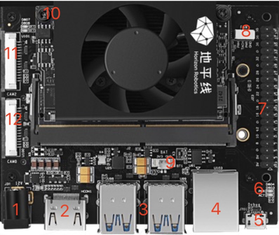
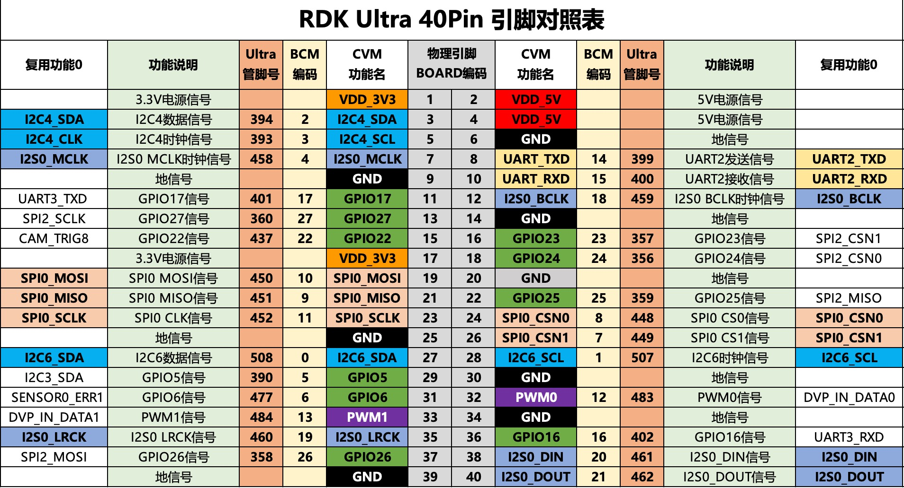
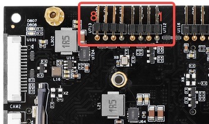

# D-Robotics RDK Ultra: Archived Hardware, Bayes APIs and System Identification


**D-Robotics RDK Ultra — archived-generation manufacturer reference; no verified OpenELAB SKU or product URL.**

**Scope:** RDK Ultra development kit and its distinct RDK Ultra Module, documented in the 2023 product briefs and archived `rdk_doc` hardware/API pages. **Store match and current availability:** unverified. This page's historical scope is not an end-of-life claim.


RDK Ultra is a carrier-based edge-AI system with an eight-core Cortex-A55 CPU, an advertised 96 TOPS BPU, 8 GB LPDDR4 and 64 GB eMMC. Its archived workflow uses an **Ultra-specific Ubuntu 20.04 image**, **Bayes** model target and **12 V/5 A development-kit supply**. These facts do not make it an X3, X5 or S-series substitute. Start by reading the identity and installed versions of an already bootable unit; do not flash or attach external I/O from another model's instructions. [Archived Ultra hardware guide](https://developer.d-robotics.cc/rdk_doc/en/Quick_start/hardware_introduction/rdk_ultra/), [kit/module briefs](https://archive.d-robotics.cc/downloads/hardware/rdk_ultra/RDK_Ultra_Product_Brief.pdf), [archived installation](https://developer.d-robotics.cc/rdk_doc/en/Quick_start/install_os/rdk_ultra/).

## Product overview <a href="#product-overview" id="product-overview"></a>

### What is documented, and what remains current-support information? <a href="#what-is-documented-and-what-remains-current-support-information" id="what-is-documented-and-what-remains-current-support-information"></a>

The archived official hardware chapters and dated product briefs remain readable. The legacy documentation displays a migration notice: it was archived effective **10 June 2026** and directs readers to the new resource center. The retrieved legacy pages also display later update dates, including 28 October 2026. These are different kinds of dates; neither absence from a new navigation list nor an archive banner proves the product has been retired. No current OpenELAB listing, shipment option or availability was verified. [Archived hardware guide](https://developer.d-robotics.cc/rdk_doc/en/Quick_start/hardware_introduction/rdk_ultra/), [archived hardware page](https://developer.d-robotics.cc/rdk_doc/en/Quick_start/hardware_introduction/rdk_ultra/).

This reference preserves the useful engineering information of that **archived hardware/software generation**. The development-kit product brief is **v1.0, 30 August 2023, 15 pages**; the Module brief is **v1.0, 29 August 2023, 12 pages**. The observed image directory is `rdk_os_1.0.0-2024-08-28`. The installed compiler/runtime packages and exact shipped PCB must still be identified on the individual unit. A current SDK installation or upgrade recipe is not established by this reference. [Kit brief](https://archive.d-robotics.cc/downloads/hardware/rdk_ultra/RDK_Ultra_Product_Brief.pdf), [Module brief](https://archive.d-robotics.cc/downloads/hardware/rdk_ultra/RDK_Ultra_Module_Product_Brief.pdf), [image archive](https://archive.d-robotics.cc/downloads/os_images/rdk_ultra/).

### Kit versus module <a href="#kit-versus-module" id="kit-versus-module"></a>

| Scope                     | What the manufacturer describes                                                                                | What it does not establish                                                                  |
| ------------------------- | -------------------------------------------------------------------------------------------------------------- | ------------------------------------------------------------------------------------------- |
| RDK Ultra development kit | Module, carrier, cooling/fan, supply, IMX219 camera, bracket and quick-start guide in the 2023 brief           | Contents of an unverified present-day reseller offer                                        |
| RDK Ultra Module          | 69.6 × 45 mm compute module, 8 GB RAM, 64 GB eMMC, exposed high-speed and low-voltage signals                  | A complete stand-alone board or universal compatibility with every Jetson carrier           |
| Official carrier          | HDMI, four USB3 hosts, Gigabit Ethernet, four CSI connectors, 40-pin header, wireless/SSD sockets and controls | The X3 Module carrier's pinout, fan voltage, USB role switch or voltage-selection procedure |

The archived hardware-document page groups the assembled board as one inventory item, while the kit PDF explicitly separates module, carrier and cooler. Preserve that distinction when identifying a unit. The manufacturer's Orin-interface compatibility statement is a design reference; it is not permission to install Jetson software or assume identical electrical behavior. [Hardware inventory](https://developer.d-robotics.cc/rdk_doc/en/Advanced_development/hardware_development/rdk_ultra/hardware/), [Module brief](https://archive.d-robotics.cc/downloads/hardware/rdk_ultra/RDK_Ultra_Module_Product_Brief.pdf).

## Applications <a href="#applications" id="applications"></a>

Ultra's documented role is multi-camera perception and accelerator-based robotics/AI development. The CPU coordinates software, the media pipeline acquires/processes images and the BPU runs appropriately compiled models. The carrier's PCIe/M.2 resources allow documented wireless/storage expansion, but socket presence is not proof of support for every module or boot device. [Archived Module specification](https://archive.d-robotics.cc/downloads/hardware/rdk_ultra/RDK_Ultra_Module_Product_Brief.pdf), [kit brief](https://archive.d-robotics.cc/downloads/hardware/rdk_ultra/RDK_Ultra_Product_Brief.pdf).

The archived camera example performs capture, object inference and HDMI rendering. The archived TROS codec and VIO pages explicitly list **Ultra on Ubuntu 20.04/Foxy**. Other shared chapters omit Ultra from their support tables; this page does not promote those chapters into supported Ultra courses merely because they are in the same manual. The 96 TOPS headline is not measured camera-to-result throughput or a control deadline. [Ultra camera example](https://developer.d-robotics.cc/rdk_doc/en/Advanced_development/hardware_development/rdk_ultra/camera/), [codec support](https://developer.d-robotics.cc/rdk_doc/en/Robot_development/quick_demo/hobot_codec/), [VIO support](https://developer.d-robotics.cc/rdk_doc/en/Robot_development/boxs/spatial/hobot_vio/).

## Specifications <a href="#specifications" id="specifications"></a>

### Archived-generation numerical specifications <a href="#archived-generation-numerical-specifications" id="archived-generation-numerical-specifications"></a>

| Parameter               | Documented Ultra value                                                                      | Scope and qualification                                                                               |
| ----------------------- | ------------------------------------------------------------------------------------------- | ----------------------------------------------------------------------------------------------------- |
| CPU                     | Eight 64-bit Cortex-A55 cores at 1.2 GHz                                                    | Product/Module brief, not an observed operating frequency                                             |
| BPU                     | Equivalent 96 TOPS                                                                          | Archived compiler expert guide maps Ultra to **Bayes**, distinct from X3 Bernoulli2 and X5 Bayes-e    |
| Memory                  | 8 GB LPDDR4, 3200 MT/s in Module brief                                                      | General Linux free memory will be lower after reserved/system use                                     |
| Storage                 | 64 GB on-module eMMC                                                                        | Archived Ubuntu boot medium; no microSD requirement in that setup                                     |
| Development-kit power   | DC adapter, at least 12 V/5 A recommended                                                   | Use the matched kit supply; do not power from a PC USB port                                           |
| Bare Module main rail   | 12 V ±10% on the brief's VDD\_IN contacts                                                   | A custom-carrier design specification, not permission to connect wires to an unidentified module      |
| Carrier expansion logic | 3.3 V for the documented 40-pin signals                                                     | Bare Module signals include 1.8 V domains; 5 V header supply pins do not imply 5 V-tolerant GPIO      |
| USB                     | Four USB 3.0 Type-A host interfaces                                                         | Archived guide says host-only; do not transfer X3 host/device switching instructions                  |
| Network                 | Gigabit Ethernet; kit wireless module/antenna                                               | Radio hardware/antenna must match the assembled unit                                                  |
| Camera connections      | Two 15-pin/two-lane and two 24-pin/four-lane CSI connectors                                 | Connector-specific power/control voltages and supported sensor modes apply                            |
| HDMI                    | Up to 1920×1080 at 60 fps                                                                   | Archived display API supports 1080p60; not 4K display output                                          |
| Media                   | H.265 and MJPEG support; headline H.265 4K60                                                | Ultra SP codec pages explicitly exclude **H.264 encode/decode**                                       |
| Expansion               | Three ×1 PCIe Gen3 interfaces in Module brief; carrier wireless M.2-E and SSD M.2-M sockets | Verify exact carrier/netlist and driver support                                                       |
| Module low-speed I/O    | 15 GPIO, four UART, two SPI, two I2S, four I2C, two PWM, two LPWM and one CAN               | Module brief p.2 capabilities; pin multiplexing, voltage domains and carrier exposure must be checked |
| Module size             | 69.6 × 45 mm                                                                                | Distinct from carrier and cooling assembly                                                            |
| Carrier outline         | 100 × 79 mm in kit brief p.3                                                                | Outline drawing only; not total enclosure height                                                      |
| Module temperature      | −25°C to +85°C in the 2023 Module brief                                                     | Do not assume the complete carrier, wireless card, camera and enclosure share this rating             |

Sources: [Module brief pp.2–3,7,10](https://archive.d-robotics.cc/downloads/hardware/rdk_ultra/RDK_Ultra_Module_Product_Brief.pdf), [kit brief pp.3–13](https://archive.d-robotics.cc/downloads/hardware/rdk_ultra/RDK_Ultra_Product_Brief.pdf), [archived interfaces](https://developer.d-robotics.cc/rdk_doc/en/Quick_start/hardware_introduction/rdk_ultra/), [Ultra codec API](https://developer.d-robotics.cc/rdk_doc/en/Basic_Application/multi_media_sp_dev_api/RDK_Ultra/cdev_multimedia_api_ultra/encoder_api/), [Bayes target](https://developer.d-robotics.cc/rdk_doc/en/Advanced_development/toolchain_development/expert/user_guide/). The public product page's broad power range is not used instead of the kit-specific 12 V/5 A connection instruction.

### Different numbering systems are not interchangeable <a href="#different-numbering-systems-are-not-interchangeable" id="different-numbering-systems-are-not-interchangeable"></a>

The kit brief and archived web illustration number the Ethernet, debug, status and RTC callouts differently. Use **connector names and silkscreen**, not an isolated callout number copied from another figure. Similarly, the archived 40-pin graphic uses software-facing controller labels that differ from the older PDF's controller names. The physical functions are useful, but a Linux `/dev/i2c-N` or UART path still requires installed-image verification. [Kit brief](https://archive.d-robotics.cc/downloads/hardware/rdk_ultra/RDK_Ultra_Product_Brief.pdf), [archived hardware diagram](https://developer.d-robotics.cc/rdk_doc/en/Quick_start/hardware_introduction/rdk_ultra/).

## Hardware and connections <a href="#hardware-and-connections" id="hardware-and-connections"></a>

### Locate power, debug, cameras and expansion <a href="#locate-power-debug-cameras-and-expansion" id="locate-power-debug-cameras-and-expansion"></a>



_D-Robotics archived Ultra illustration from the_ [_hardware guide_](https://developer.d-robotics.cc/rdk_doc/en/Quick_start/hardware_introduction/rdk_ultra/)_. Callout numbers belong to this illustration, not every PDF revision._

| Interface       | Documented connection                  | Initial check                                                                         |
| --------------- | -------------------------------------- | ------------------------------------------------------------------------------------- |
| DC input        | Matched kit adapter, at least 12 V/5 A | Inspect polarity and carrier marking before power                                     |
| Debug Micro USB | CH340 USB-to-UART console              | 921600 baud, 8 data bits, no parity, 1 stop bit, no flow control                      |
| USB Type-A      | Four host connections                  | Enumerate each attached peripheral; do not expect a SoC USB-device flashing port here |
| Ethernet        | Gigabit data interface                 | Archived default 192.168.1.10 is a starting clue; read the actual IP through console  |
| HDMI            | 1080p60 monitor path                   | Separate desktop output from direct-media rendering                                   |
| CSI             | CAM0/CAM2 15-pin; CAM1/CAM3 24-pin     | Remove power before connecting/reseating any ribbon                                   |
| 40-pin header   | 3.3 V signal domain plus power/ground  | Use Ultra map, not X3/X5 BCM compatibility assumptions                                |
| M.2             | Wireless and SSD expansion             | Power off, verify key, dimensions, supported card and antenna                         |

The CH340 console is the preferred first communication path. It exposes the carrier's conversion circuit; direct contact with bare module UART pins is a different electrical task. Keep adapter power and unrelated I/O disconnected. [Ultra power/debug instructions](https://developer.d-robotics.cc/rdk_doc/en/Quick_start/hardware_introduction/rdk_ultra/), [module low-voltage pin definitions](https://archive.d-robotics.cc/downloads/hardware/rdk_ultra/RDK_Ultra_Module_Product_Brief.pdf).

### Ultra 40-pin physical map <a href="#ultra-40-pin-physical-map" id="ultra-40-pin-physical-map"></a>



_Manufacturer graphic from_ [_archived Ultra hardware_](https://developer.d-robotics.cc/rdk_doc/en/Quick_start/hardware_introduction/rdk_ultra/)_, visually inspected. Controller names below follow this graphic; older kit-PDF names are identified where different._

| Odd physical pin | Archived graphic function | Even physical pin | Archived graphic function |
| ---------------- | ------------------------- | ----------------- | ------------------------- |
| 1                | 3.3 V power               | 2                 | 5 V power                 |
| 3                | I2C4 SDA                  | 4                 | 5 V power                 |
| 5                | I2C4 SCL                  | 6                 | GND                       |
| 7                | I2S0 MCLK                 | 8                 | UART2 TX                  |
| 9                | GND                       | 10                | UART2 RX                  |
| 11               | GPIO17 / UART3 TX         | 12                | I2S0 BCLK                 |
| 13               | GPIO27 / SPI2 clock       | 14                | GND                       |
| 15               | GPIO22 / camera trigger   | 16                | GPIO23 / SPI2 CS1         |
| 17               | 3.3 V power               | 18                | GPIO24 / SPI2 CS0         |
| 19               | SPI0 MOSI                 | 20                | GND                       |
| 21               | SPI0 MISO                 | 22                | GPIO25 / SPI2 MISO        |
| 23               | SPI0 clock                | 24                | SPI0 CS0                  |
| 25               | GND                       | 26                | SPI0 CS1                  |
| 27               | I2C6 SDA                  | 28                | I2C6 SCL                  |
| 29               | GPIO5 / I2C3 SDA          | 30                | GND                       |
| 31               | GPIO6 / sensor function   | 32                | PWM0                      |
| 33               | PWM1                      | 34                | GND                       |
| 35               | I2S0 LRCK                 | 36                | GPIO16 / UART3 RX         |
| 37               | GPIO26 / SPI2 MOSI        | 38                | I2S0 DIN                  |
| 39               | GND                       | 40                | I2S0 DOUT                 |

The v1.0 PDF instead labels the physical 3/5 pair I2C1,8/10 UART1 and several SPI2-labelled graphic functions as SPI1. These can involve SoC-versus-Linux naming and image/revision differences; do not choose a device node or change pinmux from this reference alone. Read the actual board configuration and exact carrier/driver release first. The first-result procedure below deliberately performs **no GPIO, bus scan, loopback or output writes**. [Kit brief pp.6–7](https://archive.d-robotics.cc/downloads/hardware/rdk_ultra/RDK_Ultra_Product_Brief.pdf).

The 2023 Module brief states a planned production lifecycle through at least 2028. That historical statement is not a present-day availability or supply commitment. [Module brief p.2](https://archive.d-robotics.cc/downloads/hardware/rdk_ultra/RDK_Ultra_Module_Product_Brief.pdf).

The 40-pin header's logic and supply pins are distinct. No per-pin drive-current or powered-HAT load budget is established here. A bare-module 1.8 V signal is not made 3.3 V by attaching a cable. Connect external interfaces only after the carrier revision, mux and level-translation path have been identified.

### Control header and recovery boundary <a href="#control-header-and-recovery-boundary" id="control-header-and-recovery-boundary"></a>



_D-Robotics control-header illustration from_ [_Ultra hardware_](https://developer.d-robotics.cc/rdk_doc/en/Quick_start/hardware_introduction/rdk_ultra/)_. Read the actual carrier labels before touching a jumper._

| Archived eight-position view | Name          | Documented purpose   |
| ---------------------------- | ------------- | -------------------- |
| 1 /2                         | WAKE\_UP /GND | Wake control         |
| 3 /4                         | FC\_REC /GND  | Force recovery strap |
| 5 /6                         | SYS\_RST /GND | Reset control        |
| 7 /8                         | PWR\_EN /GND  | Power-enable control |

The kit PDF represents these as two separate four-pin headers, with different voltage domains in its control-signal table. These are not four interchangeable GPIO outputs. Grounding power-enable is not an orderly Linux shutdown. The archived recovery process uses the named FC\_REC/GND pair; leave it unstrapped for normal boot and do not improvise a recovery connection on an unidentified board. [Control definitions](https://developer.d-robotics.cc/rdk_doc/en/Quick_start/hardware_introduction/rdk_ultra/), [kit brief pp.7–8](https://archive.d-robotics.cc/downloads/hardware/rdk_ultra/RDK_Ultra_Product_Brief.pdf).

### Cameras and connector voltage differences <a href="#cameras-and-connector-voltage-differences" id="cameras-and-connector-voltage-differences"></a>

The archived Ultra guide lists F37/JXF37, GC4663, IMX219, IMX477 and OV5647 families. It gives I2C addresses 0x40,0x29,0x10,0x1a and 0x36 respectively. These are sensor addresses, not proof of the capture mode, lens field of view or calibration of an arbitrary module. The historical kit camera is IMX219; the Ultra camera chapter explicitly uses CAM0/CAM2's15-pin connectors and the illustrated blue-side-up FFC orientation. [Hardware camera table](https://developer.d-robotics.cc/rdk_doc/en/Quick_start/hardware_introduction/rdk_ultra/), [Ultra-specific camera procedure](https://developer.d-robotics.cc/rdk_doc/en/Advanced_development/hardware_development/rdk_ultra/camera/).

The kit brief distinguishes the 15-pin cameras'3.3 V power/control bus from1.8V clock/control signals and the 24-pin connectors'1.8 V control interface. Do not transfer a15-pin ribbon pinout onto 24 pins or infer electrical compatibility from a camera brand. Keep the carrier unpowered while opening a latch or changing an adapter. A blank camera image should first be separated into cable/driver/capture/format failures before changing an AI model. [Kit brief pp.8–10](https://archive.d-robotics.cc/downloads/hardware/rdk_ultra/RDK_Ultra_Product_Brief.pdf).

### Storage, wireless, fan, RTC, CAN and mechanics <a href="#storage-wireless-fan-rtc-can-and-mechanics" id="storage-wireless-fan-rtc-can-and-mechanics"></a>

The archived system runs from 64 GB eMMC. The carrier brief documents M.2-M SSD positions for 2230 and2280 formats plus an M.2-E wireless interface. These are expansion resources; no NVMe boot migration, filesystem formatting or universal card compatibility is offered here. Query existing block/PCIe devices before planning a change and preserve the eMMC boot installation. [Kit brief pp.10–13](https://archive.d-robotics.cc/downloads/hardware/rdk_ultra/RDK_Ultra_Product_Brief.pdf), [Ultra install guide](https://developer.d-robotics.cc/rdk_doc/en/Quick_start/install_os/rdk_ultra/).

The kit brief's fan table gives **5 V power**,3.3 V PWM/TACH signals and specific pin ordering. This differs from the X3 Module carrier's 12 V fan header. The RTC table labels the positive signal`3V3` but describes 3.0 V±5% input; verify the exact circuit, battery and connector polarity before attachment rather than resolving that label discrepancy by guessing. No rechargeable-battery function or retention test is claimed. [Kit brief pp.7,13](https://archive.d-robotics.cc/downloads/hardware/rdk_ultra/RDK_Ultra_Product_Brief.pdf).

The PDF's CAN header table names controller-level TX/RX and3.3V/GND, not a verified CAN-H/CAN-L field connector. It also contains reversed transmit/receive prose. Do not attach a CAN bus from that table alone: identify the transceiver topology, pin directions, termination and exact revision first. This is a bounded resource reference, not a CAN wiring recipe. [Kit brief p.7](https://archive.d-robotics.cc/downloads/hardware/rdk_ultra/RDK_Ultra_Product_Brief.pdf).

The module uses a 260-contact edge connector and has numerous 1.8 V GPIO/UART/SPI domains, separate 3.3 V signals and 12 V VDD\_IN. Use the complete module pin tables and carrier reference design for an actual carrier audit; the 40-pin header table is not a module pin map. The original module and carrier drawings remain in the downloads below. Do not retighten an unidentified cooler assembly from a guessed torque: the kit brief specifically warns that inappropriate heatsink screw tightening can deform the board. [Module brief](https://archive.d-robotics.cc/downloads/hardware/rdk_ultra/RDK_Ultra_Module_Product_Brief.pdf), [kit mechanical/safety pages](https://archive.d-robotics.cc/downloads/hardware/rdk_ultra/RDK_Ultra_Product_Brief.pdf).

## Software and development resources <a href="#software-and-development-resources" id="software-and-development-resources"></a>

### Image, BSP and package-generation boundaries <a href="#image-bsp-and-package-generation-boundaries" id="image-bsp-and-package-generation-boundaries"></a>

| Layer            | What was actually established                                                                                | What remains unverified                                                                   |
| ---------------- | ------------------------------------------------------------------------------------------------------------ | ----------------------------------------------------------------------------------------- |
| OS               | Archived Ultra instructions specify Ubuntu 20.04 desktop; image archive contains1.0.0 generation             | Current supported upgrade path or Ubuntu22/24 support                                     |
| Image file       | `ubuntu-preinstalled-desktop-arm64-rdkultra.img.xz` and checksum sidecar are listed in the release directory | Image was not downloaded, booted or compared with an installed board                      |
| Storage/recovery | eMMC; archived`hbupdate` target`RDK_ULTRA`, Ethernet flashing workflow                                       | Tool/image compatibility with a particular existing bootloader must be checked before use |
| AI architecture  | Ultra is **Bayes** in the archived expert guide                                                              | Exact currently supported compiler/runtime bundle release was not established             |
| Media wrapper    | Separate archived Ultra C/Python SP API chapters                                                             | ABI and Python signatures on an unknown installed image                                   |
| Robotics         | Archived codec/VIO tables list Ultra on Ubuntu 20.04/Foxy                                                    | Blanket support for every shared TROS course or current distributions                     |

Sources: [Ultra installation](https://developer.d-robotics.cc/rdk_doc/en/Quick_start/install_os/rdk_ultra/), [actual image directory](https://archive.d-robotics.cc/downloads/os_images/rdk_ultra/rdk_os_1.0.0-2024-08-28/release/), [Bayes expert guide](https://developer.d-robotics.cc/rdk_doc/en/Advanced_development/toolchain_development/expert/user_guide/), [Ultra APIs](https://developer.d-robotics.cc/rdk_doc/en/Basic_Application/multi_media_sp_dev_api/RDK_Ultra/cdev_multimedia_api_ultra/vio_api/), [codec](https://developer.d-robotics.cc/rdk_doc/en/Robot_development/quick_demo/hobot_codec/), [VIO](https://developer.d-robotics.cc/rdk_doc/en/Robot_development/boxs/spatial/hobot_vio/). A filename or shared repository branch is not an SDK compatibility test.

**Do not apply X3 `srpi-config` or `/boot/config.txt` procedures to Ultra.** The archived pages explicitly exclude Ultra. The X3 GPIO-voltage jumper, X3 Ubuntu 3.x boot workflow, X5 overlays and S-series tools therefore cannot fill a missing Ultra instruction. Read-only Linux tools remain useful for inventory, but model-specific configuration must come from the installed Ultra release and its supported documentation. [Configuration-tool exclusion](https://developer.d-robotics.cc/rdk_doc/en/System_configuration/srpi-config/), [configuration-file exclusion](https://developer.d-robotics.cc/rdk_doc/en/System_configuration/config_txt/).

### Archived multimedia architecture and API contracts <a href="#archived-multimedia-architecture-and-api-contracts" id="archived-multimedia-architecture-and-api-contracts"></a>

The Ultra APIs expose camera/VPS, encoder, decoder, display, inference and module binding. Their major operational contracts are summarized here so the resources are usable beyond a list of links:

| API area      | Input/action → output                                                     | Parameters, lifecycle and diagnostic checkpoint                                                                                                                                           |
| ------------- | ------------------------------------------------------------------------- | ----------------------------------------------------------------------------------------------------------------------------------------------------------------------------------------- |
| C VIO         | Initialize handle→open camera/VPS→obtain or supply image frames           | Configure dimensions/channels before retrieval; verify the actual installed header because the archived text contains inherited X3 wording. Close camera/VPS before releasing the object. |
| Python Camera | `libsrcampy.Camera`, `open_cam`, `open_vps`, frame acquisition and`close` | Archived camera host index−1 means auto-detect; indexes0–3 refer to board configuration. The documented signature differs from X3's extended interface; do not paste X3 argument lists.   |
| Encoder       | NV12 image→H.265 or MJPEG stream                                          | Ultra chapter's type2/3 selectors represent H.265/MJPEG; frame dimensions, bitrate and destination buffer must match. Stop/close channel and release resources.                           |
| Decoder       | Encoded H.265/MJPEG→image frames                                          | Python decode returns status plus input-frame count; distinguish end-of-stream/error from a valid frame. Ultra pages explicitly say no H.264 support.                                     |
| Display       | NV12 image→HDMI plus overlay                                              | Archived output is 1920×1080 at 60 Hz. Rectangles use coordinates within frame bounds; color is ARGB8888. A successful decoder does not prove display setup.                              |
| C BPU         | Compiled compatible model→preprocessed input→output tensors               | `sp_init_bpu_module`, tensor allocation, prediction and cleanup are distinct steps. Do not treat any ONNX/training file as a ready Bayes executable.                                      |
| SYS binding   | VIO or decoder→encoder/display                                            | Initialize compatible source/destination modules first. Unbind before closing/releasing them. Binding is not a universal network transport or an excuse to ignore dimensions/formats.     |

Sources: [VIO C API](https://developer.d-robotics.cc/rdk_doc/en/Basic_Application/multi_media_sp_dev_api/RDK_Ultra/cdev_multimedia_api_ultra/vio_api/), [Camera Python API](https://developer.d-robotics.cc/rdk_doc/en/Basic_Application/multi_media_sp_dev_api/RDK_Ultra/pydev_multimedia_api_ultra/object_camera/), [encoder C](https://developer.d-robotics.cc/rdk_doc/en/Basic_Application/multi_media_sp_dev_api/RDK_Ultra/cdev_multimedia_api_ultra/encoder_api/), [encoder Python](https://developer.d-robotics.cc/rdk_doc/en/Basic_Application/multi_media_sp_dev_api/RDK_Ultra/pydev_multimedia_api_ultra/object_encoder/), [decoder C](https://developer.d-robotics.cc/rdk_doc/en/Basic_Application/multi_media_sp_dev_api/RDK_Ultra/cdev_multimedia_api_ultra/decoder_api/), [decoder Python](https://developer.d-robotics.cc/rdk_doc/en/Basic_Application/multi_media_sp_dev_api/RDK_Ultra/pydev_multimedia_api_ultra/object_decoder/), [display C](https://developer.d-robotics.cc/rdk_doc/en/Basic_Application/multi_media_sp_dev_api/RDK_Ultra/cdev_multimedia_api_ultra/display_api/), [display Python](https://developer.d-robotics.cc/rdk_doc/en/Basic_Application/multi_media_sp_dev_api/RDK_Ultra/pydev_multimedia_api_ultra/object_display/), [BPU](https://developer.d-robotics.cc/rdk_doc/en/Basic_Application/multi_media_sp_dev_api/RDK_Ultra/cdev_multimedia_api_ultra/bpu_api/), [SYS binding](https://developer.d-robotics.cc/rdk_doc/en/Basic_Application/multi_media_sp_dev_api/RDK_Ultra/cdev_multimedia_api_ultra/sys_api/).

An original debugging sequence is to prove one boundary at a time: obtain a coherent raw frame, verify pixel format/actual dimensions, encode one supported stream, decode that stream, then add display and inference. With an NV12 image, tightly packed storage is 1.5 bytes per pixel, but an actual API may impose alignment/stride; use its release-specific contract before allocating. Do not transplant X3's concrete VPS alignment or a native borrowed-frame release API into Ultra without Ultra evidence. No full pipeline was executed for this reference.

### Models and compiler/runtime support <a href="#models-and-compilerruntime-support" id="models-and-compilerruntime-support"></a>

The archived expert guide explicitly maps `RDK Ultra` to **`BAYES`** and X3 to **`BERNOULLI2`**. It discusses PyTorch quantization-aware calibration/training, supported operator constraints and optional CPU/BPU heterogeneous execution. Its INT16 discussion is Ultra/Bayes-specific; it is not permission to use all modern X5 or S-series quantization workflows. [Archived expert guide, model-target and calibration sections](https://developer.d-robotics.cc/rdk_doc/en/Advanced_development/toolchain_development/expert/user_guide/).

The practical development contract is: original model and preprocessing→supported export/quantization→Bayes compilation→matching runtime→tensor parsing→known-image comparison. Keep channel order, normalization, resize/crop, dtype, valid/aligned shapes, class labels, quantization scales and post-processing version with the model. An apparently successful model load or plausible output label does not resolve a builder/runtime mismatch.

The exact Ultra compiler/runtime bundle version remains a **named gap** in this reference. Consequently, no turnkey compiler installation, package upgrade, model-download or BPU-load example is asserted to work on an unidentified Ultra. Record installed package/runtime versions first and retain a known-good model before planning changes. The page's original first result reads identity/package metadata without invoking those SDKs.

### ROS/TROS workflows that the archive actually supports <a href="#rostros-workflows-that-the-archive-actually-supports" id="rostros-workflows-that-the-archive-actually-supports"></a>

The archived installation chapter is shared across products and warns about X3 image/TROS generations. Do not apply the X3-specific “1.x→2.x” requirement to Ultra's separately named1.0.0 image. For Ultra, use the **Ubuntu 20.04/Foxy** scope explicitly shown in relevant platform tables and inspect the installed `/opt/tros` packages/environment. [Archived TROS installation](https://developer.d-robotics.cc/rdk_doc/en/Robot_development/quick_start/install_tros/), [Ultra codec table](https://developer.d-robotics.cc/rdk_doc/en/Robot_development/quick_demo/hobot_codec/).

| Topic                | Essential workflow and observable result                                                                                       | Ultra boundary                                                                                                                                                       |
| -------------------- | ------------------------------------------------------------------------------------------------------------------------------ | -------------------------------------------------------------------------------------------------------------------------------------------------------------------- |
| ROS communication    | Two sourced terminals run the minimal publisher/subscriber; numbered text should agree                                         | Only use already installed, matching Foxy packages; no ROS install/launch was executed here                                                                          |
| Camera plus codec    | Supported MIPI capture publishes raw image data; codec converts the declared input format/transport into JPEG for web viewing  | Archived codec table explicitly includes Ultra/Foxy. Choose the installed Ultra sensor and codec config; exclude H.264 assumptions.                                  |
| Web display          | WebSocket subscribes to the actual encoded image topic; browser uses the board address/port declared by its installed launch   | No current web-service version is guaranteed; inspect topics and launch arguments rather than assuming every sample shares a port                                    |
| VIO                  | Calibrated rectified camera frames and synchronized IMU→trajectory path                                                        | Archived table includes Ultra/Foxy. Default example uses RealSense infrared/IMU; the kit's IMX219 alone supplies no IMU.                                             |
| VIO parameters       | `path_config`, `image_topic`, `imu_topic`, `sample_gap`; the example output is`horizon_vio/horizon_vio_path` (`nav_msgs/Path`) | Calibration, frame timestamps and extrinsics must match actual sensors; a nonempty path is not proof of accurate localization                                        |
| CV and zero-copy     | Shared chapters describe filtering, scaling and efficient communication                                                        | Reviewed support tables in those retrieved chapters do not explicitly include Ultra; no blanket support claim is made                                                |
| Navigation/following | Perception or navigation policies can emit base motion commands                                                                | Retrieved Nav2 table omits Ultra, and some archived app routes returned empty bodies. This page does not authorize those launches or attach them to physical motion. |

Sources: [Hello World](https://developer.d-robotics.cc/rdk_doc/en/Robot_development/quick_start/hello_world/), [codec](https://developer.d-robotics.cc/rdk_doc/en/Robot_development/quick_demo/hobot_codec/), [VIO](https://developer.d-robotics.cc/rdk_doc/en/Robot_development/boxs/spatial/hobot_vio/), [CV support tables](https://developer.d-robotics.cc/rdk_doc/en/Robot_development/quick_demo/demo_cv/), [communication support](https://developer.d-robotics.cc/rdk_doc/en/Robot_development/quick_demo/demo_communication/), [Nav2 support table](https://developer.d-robotics.cc/rdk_doc/en/Robot_development/apps/navigation2/). Video links and unavailable routes are retained as source limitations rather than converted into fabricated course instructions.

### Linux diagnostics, networking and maintenance <a href="#linux-diagnostics-networking-and-maintenance" id="linux-diagnostics-networking-and-maintenance"></a>

Read actual network addresses and routes through the console before SSH. The archived hardware guide gives192.168.1.10 as a default; prior user configuration can differ. Verify the PC subnet, cable/link and SSH service separately. Keep factory credentials out of an exposed network and preserve a console before changing networking. A network configuration from X3's newer NetworkManager generation is not an Ultra default. [Archived Ethernet/console guide](https://developer.d-robotics.cc/rdk_doc/en/Quick_start/hardware_introduction/rdk_ultra/).

Record image/kernel, installed package list, mounted eMMC partitions, wireless/PCIe enumeration and temperatures before any update. Use the installed thermal policy rather than copying X3's95/105°C thresholds or overclock controls. Check cooling/fan operation and sustained load before interpreting frequency changes as an SDK defect. Neither the module's temperature rating nor the TOPS figure supplies a complete thermal design for an assembled application. [Module thermal/environmental scope](https://archive.d-robotics.cc/downloads/hardware/rdk_ultra/RDK_Ultra_Module_Product_Brief.pdf).

## Getting started <a href="#getting-started" id="getting-started"></a>

### First result: identify a bootable Ultra without flashing or driving I/O <a href="#first-result-identify-a-bootable-ultra-without-flashing-or-driving-io" id="first-result-identify-a-bootable-ultra-without-flashing-or-driving-io"></a>

Prerequisites: an identified Ultra kit/carrier with its matched 12 V/5 A supply, existing bootable eMMC image and a PC connected to the carrier's CH340 debug port. Leave external HATs, cameras added for experiments, CAN connections and all motion controllers disconnected. This is a read-only inventory procedure, not a firmware or model test.

1. With power removed, inspect the module/carrier labels and cooler mounting. Ensure the named FC\_REC recovery strap is not grounded for normal boot. Do not reseat the module or adjust unknown cooler screws without the exact assembly instructions.
2. Connect the Debug Micro USB data cable. In the PC terminal select the actual CH340 COM/tty device and configure 921600 baud, 8N1, no flow control. Connect HDMI if required, then power through the matched DC adapter. The archived guide reports about 45 seconds for initial configuration; allow the existing image to finish. [Console](https://developer.d-robotics.cc/rdk_doc/en/Quick_start/hardware_introduction/rdk_ultra/), [boot process](https://developer.d-robotics.cc/rdk_doc/en/Quick_start/install_os/rdk_ultra/).
3. Log in using the existing image's established credentials. Run the following original Bash inventory on the Ultra:

```bash
printf '\nImage and Ubuntu release\n'
if [ -r /etc/version ]; then cat /etc/version; else printf 'No /etc/version file\n'; fi
cat /etc/os-release
uname -a
printf '\nMounted root and storage\n'
findmnt -no SOURCE,FSTYPE /
lsblk -o NAME,SIZE,TYPE,FSTYPE,MOUNTPOINT
printf '\nNetwork\n'
ip -br address
ip route
printf '\nInstalled vendor packages\n'
dpkg-query -W -f='${Package}\t${Version}\n' 'hobot-*' 'tros*' 2>/dev/null || true
printf '\nExisting interface nodes\n'
for node in /dev/video* /dev/ttyS* /dev/i2c-* /dev/spidev* /dev/rtc*; do
    [ -e "$node" ] && printf '%s\n' "$node"
done
```

4. **Expected result:** a real OS/kernel report, root-device and block inventory, actual network addresses and installed vendor package versions. The archived generation is Ubuntu 20.04 on eMMC; a different result is a reason to identify that image, not force it into the old procedure. Missing optional nodes do not by themselves prove failed hardware. Record the output with PCB photographs.
5. Preserve the installed system's version record and any known-good application/model before deciding on a change. If the board does not boot, use the diagnostics below; do not select another model's firmware to obtain a console.

### Original offline-friendly identity record <a href="#original-offline-friendly-identity-record" id="original-offline-friendly-identity-record"></a>

Save this standard-library example as`ultra_inventory.py`. By default it reads selected identity files from the current Linux root; `--root` allows testing with a synthetic directory tree. It does not import a vendor SDK, scan buses, open GPIO or modify a file.

```python
import argparse
import json
from pathlib import Path

parser = argparse.ArgumentParser(description='Read an existing system identity')
parser.add_argument('--root', type=Path, default=Path('/'))
args = parser.parse_args()
files = ('etc/version', 'etc/os-release', 'proc/device-tree/model')
result = {}
for relative in files:
    path = args.root / relative
    try:
        result[relative] = path.read_bytes().replace(b'\x00', b'').decode('utf-8').strip()
    except (OSError, UnicodeError) as exc:
        result[relative] = {'unavailable': type(exc).__name__}
print(json.dumps(result, indent=2, ensure_ascii=False))
```

**Expected result:** JSON containing the readable image/OS/model strings or an explicit unavailable status. A device-tree model string is one identity clue and must be checked against the physical label. The script does not determine whether an SDK, firmware or carrier is compatible. It was syntax-checked and run only on synthetic files for this reference.

### Optional next result on an already verified archived image <a href="#optional-next-result-on-an-already-verified-archived-image" id="optional-next-result-on-an-already-verified-archived-image"></a>

The Ultra-specific camera page documents `/app/pydev_demo/03_mipi_camera_sample/mipi_camera.py`, with a supported IMX219 on CAM0/CAM2 and HDMI. If that exact matched sample/model/runtime already exists, first inspect its imports, model target, sensor and display configuration. Its documented result is live camera imagery with object classes/confidence on HDMI. Do not install a modern X3 package solely to recreate the path. The first failed boundary should be investigated separately: sensor acquisition, image format, model compatibility or rendering. [Ultra camera guide](https://developer.d-robotics.cc/rdk_doc/en/Advanced_development/hardware_development/rdk_ultra/camera/).

No camera/inference command is offered as a turnkey result for an unknown installation, because the exact Ultra runtime/compiler bundle is unresolved. The read-only inventory above is the complete first result supported within this reference's bounds.

### Archived recovery procedure: identify the right operation first <a href="#archived-recovery-procedure-identify-the-right-operation-first" id="archived-recovery-procedure-identify-the-right-operation-first"></a>

The archived Ultra image guide uses **Ethernet-based `hbupdate`** and model target **`RDK_ULTRA`**. It describes a PC directly connected by Gigabit Ethernet, a specified PC static network configuration, an Ultra image and the named FC\_REC/GND strap. After flashing, it removes the recovery strap and boots normally. This is different from X3 microSD writing and X3 Module UMS/eMMC procedures. [Archived Ultra installation](https://developer.d-robotics.cc/rdk_doc/en/Quick_start/install_os/rdk_ultra/).

Before considering recovery, identify the actual board and bootloader, back up readable eMMC/user data, preserve the tool/image version and verify the exact recovery instructions. The observed archive contains a specific Ubuntu 20 desktop image and checksum sidecar. This reference does not execute or provide an unverified current flashing sequence, promise a rollback path, or infer that a newer shared tool supports this old generation. A damaged eMMC filesystem, application mismatch and broken low-level boot firmware require different remedies.

## Troubleshooting and FAQs <a href="#troubleshooting-and-faqs" id="troubleshooting-and-faqs"></a>

### No boot, repeated restart or no HDMI <a href="#no-boot-repeated-restart-or-no-hdmi" id="no-boot-repeated-restart-or-no-hdmi"></a>

Check the matched 12 V/5 A supply, cable/connector and peripheral load first. Read the CH340 console at 921600 baud, 8N1. Inspect whether recovery is accidentally strapped. Separate “no boot log” from “Linux runs but HDMI is blank”; the archived display contract is1080p60. Red power indication alone does not prove a working image or adequate transient supply. Do not start with a different model's bootloader. [Power/debug/display](https://developer.d-robotics.cc/rdk_doc/en/Quick_start/hardware_introduction/rdk_ultra/), [Ultra boot guide](https://developer.d-robotics.cc/rdk_doc/en/Quick_start/install_os/rdk_ultra/).

### Why does an X3 sample, GPIO map or configuration menu fail? <a href="#why-does-an-x3-sample-gpio-map-or-configuration-menu-fail" id="why-does-an-x3-sample-gpio-map-or-configuration-menu-fail"></a>

Ultra uses different CPU/BPU, carrier routing, image and low-level APIs. Its bare module includes 1.8 V signals, and its 40-pin controller labels differ from X3. The archived `srpi-config` and`config.txt` pages explicitly exclude Ultra. Inspect the actual Ultra release instead of translating numbers or copying an overlay. [Exclusions](https://developer.d-robotics.cc/rdk_doc/en/System_configuration/srpi-config/), [Ultra map](https://developer.d-robotics.cc/rdk_doc/en/Quick_start/hardware_introduction/rdk_ultra/).

### Why does H.264 fail when a shared page says the RDK supports it? <a href="#why-does-h264-fail-when-a-shared-page-says-the-rdk-supports-it" id="why-does-h264-fail-when-a-shared-page-says-the-rdk-supports-it"></a>

The model-specific Ultra encoder/decoder chapters explicitly exclude H.264. Use the supported H.265/MJPEG path for that archived API and verify the actual encoded input. Do not turn a family-level codec claim into Ultra support. A file extension alone also does not establish the codec. [Ultra encoder](https://developer.d-robotics.cc/rdk_doc/en/Basic_Application/multi_media_sp_dev_api/RDK_Ultra/cdev_multimedia_api_ultra/encoder_api/), [Ultra decoder](https://developer.d-robotics.cc/rdk_doc/en/Basic_Application/multi_media_sp_dev_api/RDK_Ultra/cdev_multimedia_api_ultra/decoder_api/).

### Camera feed works but inference is wrong <a href="#camera-feed-works-but-inference-is-wrong" id="camera-feed-works-but-inference-is-wrong"></a>

Record the model architecture, builder/runtime package versions and tensor metadata. Verify Bayes target, preprocessing color/layout/normalization and model-specific parser/labels using one known image. Do not substitute a Bernoulli2 or Bayes-e model because its Python wrapper has a familiar name. If the matched runtime bundle cannot be identified, keep model deployment blocked. [Ultra target guidance](https://developer.d-robotics.cc/rdk_doc/en/Advanced_development/toolchain_development/expert/user_guide/), [BPU wrapper](https://developer.d-robotics.cc/rdk_doc/en/Basic_Application/multi_media_sp_dev_api/RDK_Ultra/cdev_multimedia_api_ultra/bpu_api/).

### Can I use the fan, RTC or CAN header like the X3 Module carrier? <a href="#can-i-use-the-fan-rtc-or-can-header-like-the-x3-module-carrier" id="can-i-use-the-fan-rtc-or-can-header-like-the-x3-module-carrier"></a>

No cross-carrier wiring is established. The Ultra kit brief specifies a 5 V fan and has a RTC label/voltage ambiguity, while its CAN table exposes controller-style signals with contradictory direction prose. Identify the exact connector circuit before connecting an accessory. No assumed battery type, transceiver topology or header load-current limit is supplied by this reference. [Kit brief](https://archive.d-robotics.cc/downloads/hardware/rdk_ultra/RDK_Ultra_Product_Brief.pdf).

### Is Ultra retired or available globally? <a href="#is-ultra-retired-or-available-globally" id="is-ultra-retired-or-available-globally"></a>

The reviewed evidence does not establish retirement or current availability. The archived English manual carries a historical Mainland-China-only sale notice; the reviewed archive does not verify present-day commercial availability. Current commercial availability and geographic supply must be confirmed independently. There is no verified OpenELAB SKU or product link here. [Archived hardware guide](https://developer.d-robotics.cc/rdk_doc/en/Quick_start/hardware_introduction/rdk_ultra/), [archived notice](https://developer.d-robotics.cc/rdk_doc/en/Quick_start/hardware_introduction/rdk_ultra/).

### Which missing sources limit this reference? <a href="#which-missing-sources-limit-this-reference" id="which-missing-sources-limit-this-reference"></a>

Some archived sensor/inference/app URLs returned HTTP200 with empty article bodies; generic API/toolchain entry URLs returned404 before the exact model-specific routes were located. The Ultra C/Python API chapters, hardware/install pages and dated product briefs were readable. A current exact compiler/runtime bundle and revision-resolved low-level controller mapping remain unverified, so this page excludes turnkey installation, bus-output, custom-carrier and flashing instructions rather than filling them from another RDK model.

## Downloads and technical documents <a href="#downloads-and-technical-documents" id="downloads-and-technical-documents"></a>

| Resource                                                                                                                                                                                                                                                                                                                                                                                                                                                                                                                                                                                                                                                                                                                                                                                                                                                                             | Purpose and actual review scope                                                                      |
| ------------------------------------------------------------------------------------------------------------------------------------------------------------------------------------------------------------------------------------------------------------------------------------------------------------------------------------------------------------------------------------------------------------------------------------------------------------------------------------------------------------------------------------------------------------------------------------------------------------------------------------------------------------------------------------------------------------------------------------------------------------------------------------------------------------------------------------------------------------------------------------ | ---------------------------------------------------------------------------------------------------- |
| [Current official resource center](https://developer.d-robotics.cc/rdk_doc_center/en/)                                                                                                                                                                                                                                                                                                                                                                                                                                                                                                                                                                                                                                                                                                                                                                                               | Current documentation routes; no Ultra store/stock validation                                        |
| [Archived hardware guide](https://developer.d-robotics.cc/rdk_doc/en/Quick_start/hardware_introduction/rdk_ultra/) / [interface chapter](https://developer.d-robotics.cc/rdk_doc/en/Advanced_development/hardware_development/rdk_ultra/interface/)                                                                                                                                                                                                                                                                                                                                                                                                                                                                                                                                                                                                                                  | Connector, camera, control and40-pin diagrams; read and important figures visually inspected         |
| [Ultra development-kit brief PDF](https://archive.d-robotics.cc/downloads/hardware/rdk_ultra/RDK_Ultra_Product_Brief.pdf)                                                                                                                                                                                                                                                                                                                                                                                                                                                                                                                                                                                                                                                                                                                                                            | v1.0,2023-08-30,15 pages; kit, carrier dimensions and detailed signal tables                         |
| [Ultra Module brief PDF](https://archive.d-robotics.cc/downloads/hardware/rdk_ultra/RDK_Ultra_Module_Product_Brief.pdf)                                                                                                                                                                                                                                                                                                                                                                                                                                                                                                                                                                                                                                                                                                                                                              | v1.0,2023-08-29,12 pages; compute,260-contact map, voltage domains and module dimensions             |
| [Hardware-document inventory](https://developer.d-robotics.cc/rdk_doc/en/Advanced_development/hardware_development/rdk_ultra/hardware/)                                                                                                                                                                                                                                                                                                                                                                                                                                                                                                                                                                                                                                                                                                                                              | Original kit inventory and manual/design links                                                       |
| [Reference-design archive](https://archive.d-robotics.cc/downloads/hardware/rdk_ultra/reference_design/Reference_Design.zip)                                                                                                                                                                                                                                                                                                                                                                                                                                                                                                                                                                                                                                                                                                                                                         | Downloaded/inventoried carrier BOM,DXF,Gerber,PCB and schematic resources; not fabrication validated |
| [Ultra OS archive](https://archive.d-robotics.cc/downloads/os_images/rdk_ultra/) / [1.0.0 release directory](https://archive.d-robotics.cc/downloads/os_images/rdk_ultra/rdk_os_1.0.0-2024-08-28/release/)                                                                                                                                                                                                                                                                                                                                                                                                                                                                                                                                                                                                                                                                           | Observed Ubuntu 20 image generation and checksum sidecar                                             |
| [Direct desktop image](https://archive.d-robotics.cc/downloads/os_images/rdk_ultra/rdk_os_1.0.0-2024-08-28/release/ubuntu-preinstalled-desktop-arm64-rdkultra.img.xz) / [MD5 sidecar](https://archive.d-robotics.cc/downloads/os_images/rdk_ultra/rdk_os_1.0.0-2024-08-28/release/ubuntu-preinstalled-desktop-arm64-rdkultra.img.xz.md5sum)                                                                                                                                                                                                                                                                                                                                                                                                                                                                                                                                          | Listed official downloads; full image not downloaded or booted                                       |
| [Archived image/flashing guide](https://developer.d-robotics.cc/rdk_doc/en/Quick_start/install_os/rdk_ultra/)                                                                                                                                                                                                                                                                                                                                                                                                                                                                                                                                                                                                                                                                                                                                                                        | Ultra-specific eMMC/Ethernet`hbupdate` workflow and normal boot                                      |
| [Ultra camera guide](https://developer.d-robotics.cc/rdk_doc/en/Advanced_development/hardware_development/rdk_ultra/camera/)                                                                                                                                                                                                                                                                                                                                                                                                                                                                                                                                                                                                                                                                                                                                                         | Historical IMX219 capture/inference/HDMI sample                                                      |
| [Ultra C VIO](https://developer.d-robotics.cc/rdk_doc/en/Basic_Application/multi_media_sp_dev_api/RDK_Ultra/cdev_multimedia_api_ultra/vio_api/), [encoder](https://developer.d-robotics.cc/rdk_doc/en/Basic_Application/multi_media_sp_dev_api/RDK_Ultra/cdev_multimedia_api_ultra/encoder_api/), [decoder](https://developer.d-robotics.cc/rdk_doc/en/Basic_Application/multi_media_sp_dev_api/RDK_Ultra/cdev_multimedia_api_ultra/decoder_api/), [display](https://developer.d-robotics.cc/rdk_doc/en/Basic_Application/multi_media_sp_dev_api/RDK_Ultra/cdev_multimedia_api_ultra/display_api/), [BPU](https://developer.d-robotics.cc/rdk_doc/en/Basic_Application/multi_media_sp_dev_api/RDK_Ultra/cdev_multimedia_api_ultra/bpu_api/), [SYS](https://developer.d-robotics.cc/rdk_doc/en/Basic_Application/multi_media_sp_dev_api/RDK_Ultra/cdev_multimedia_api_ultra/sys_api/) | Separate model-specific API declarations and lifecycle contracts                                     |
| [Ultra Python Camera](https://developer.d-robotics.cc/rdk_doc/en/Basic_Application/multi_media_sp_dev_api/RDK_Ultra/pydev_multimedia_api_ultra/object_camera/), [encoder](https://developer.d-robotics.cc/rdk_doc/en/Basic_Application/multi_media_sp_dev_api/RDK_Ultra/pydev_multimedia_api_ultra/object_encoder/), [decoder](https://developer.d-robotics.cc/rdk_doc/en/Basic_Application/multi_media_sp_dev_api/RDK_Ultra/pydev_multimedia_api_ultra/object_decoder/), [display/binding](https://developer.d-robotics.cc/rdk_doc/en/Basic_Application/multi_media_sp_dev_api/RDK_Ultra/pydev_multimedia_api_ultra/object_display/)                                                                                                                                                                                                                                                | Archived object methods, parameters, formats and cleanup                                             |
| [Archived expert toolchain guide](https://developer.d-robotics.cc/rdk_doc/en/Advanced_development/toolchain_development/expert/user_guide/)                                                                                                                                                                                                                                                                                                                                                                                                                                                                                                                                                                                                                                                                                                                                          | Ultra Bayes target and quantization concepts; current release bundle not established                 |
| [Archived TROS installation](https://developer.d-robotics.cc/rdk_doc/en/Robot_development/quick_start/install_tros/) / [Hello World](https://developer.d-robotics.cc/rdk_doc/en/Robot_development/quick_start/hello_world/)                                                                                                                                                                                                                                                                                                                                                                                                                                                                                                                                                                                                                                                          | Shared package/environment workflow; match Ultra/Foxy scope                                          |
| [Ultra-listed codec](https://developer.d-robotics.cc/rdk_doc/en/Robot_development/quick_demo/hobot_codec/) / [Ultra-listed VIO](https://developer.d-robotics.cc/rdk_doc/en/Robot_development/boxs/spatial/hobot_vio/)                                                                                                                                                                                                                                                                                                                                                                                                                                                                                                                                                                                                                                                                | Supported platform tables and application inputs/outputs                                             |
| [Configuration-tool exclusion](https://developer.d-robotics.cc/rdk_doc/en/System_configuration/srpi-config/) / [config.txt exclusion](https://developer.d-robotics.cc/rdk_doc/en/System_configuration/config_txt/)                                                                                                                                                                                                                                                                                                                                                                                                                                                                                                                                                                                                                                                                   | Prevents unsupported X3 configuration transfer                                                       |

### Page index for the original briefs <a href="#page-index-for-the-original-briefs" id="page-index-for-the-original-briefs"></a>

| Source pages                                                                                                           | Contents and integration use                                                                              |
| ---------------------------------------------------------------------------------------------------------------------- | --------------------------------------------------------------------------------------------------------- |
| [Kit brief pp.1–3](https://archive.d-robotics.cc/downloads/hardware/rdk_ultra/RDK_Ultra_Product_Brief.pdf)             | Platform features, original kit contents and 100 × 79 mm carrier outline                                  |
| [Kit brief pp.4–7](https://archive.d-robotics.cc/downloads/hardware/rdk_ultra/RDK_Ultra_Product_Brief.pdf)             | Connector overview; DC, HDMI, USB, Ethernet/debug, 40-pin, fan and controller-level CAN tables            |
| [Kit brief pp.8–10](https://archive.d-robotics.cc/downloads/hardware/rdk_ultra/RDK_Ultra_Product_Brief.pdf)            | Control-header domains; 15-pin versus 24-pin camera signal assignments; wireless connector begins on p.10 |
| [Kit brief pp.11–13](https://archive.d-robotics.cc/downloads/hardware/rdk_ultra/RDK_Ultra_Product_Brief.pdf)           | Wireless continuation, 2230/2280 storage connector tables and RTC voltage entry                           |
| [Kit brief pp.14–15](https://archive.d-robotics.cc/downloads/hardware/rdk_ultra/RDK_Ultra_Product_Brief.pdf)           | Electrical/mechanical/environmental precautions and revision record                                       |
| [Module brief pp.1–3](https://archive.d-robotics.cc/downloads/hardware/rdk_ultra/RDK_Ultra_Module_Product_Brief.pdf)   | Features, compute/memory/I/O/environmental specifications and 69.6 × 45 mm outline                        |
| [Module brief pp.4–10](https://archive.d-robotics.cc/downloads/hardware/rdk_ultra/RDK_Ultra_Module_Product_Brief.pdf)  | Complete original 260-contact odd/even pin tables, signal domains and power/control entries               |
| [Module brief pp.11–12](https://archive.d-robotics.cc/downloads/hardware/rdk_ultra/RDK_Ultra_Module_Product_Brief.pdf) | Precautions and revision record                                                                           |

Use the original tables for a revision-specific design review. The brief's pin names and prose contain inconsistencies already identified above; this index is not a release of a new verified carrier design.

## References and validation <a href="#references-and-validation" id="references-and-validation"></a>

Reviewed on **24 November 2026**. This is an **archived-generation manufacturer reference**, with null OpenELAB SKU/URL and unverified current availability. It is locally complete as a bounded reference: identity, hardware resources, documented boot generation, API distinctions and a read-only first result are on-page. It is not clearance for an unidentified unit's electrical modification, current SDK installation, model deployment or firmware recovery.

**Actually checked:** primary source text and important original diagrams; local heading/table/link structure; Bash/Python syntax; synthetic execution of the standard-library identity script. **Not run:** vendor SDK installation/import, compilation, BPU inference, ROS, board boot, camera/audio/display capture, bus/GPIO access, flashing or hardware operation. Archived example results are expected behavior, not tests performed here. The named source gaps and excluded procedures remain visible above.

**Related guides:** [D-Robotics boards, modules and peripherals](./).
