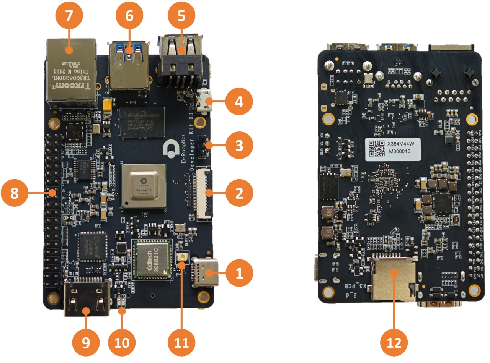
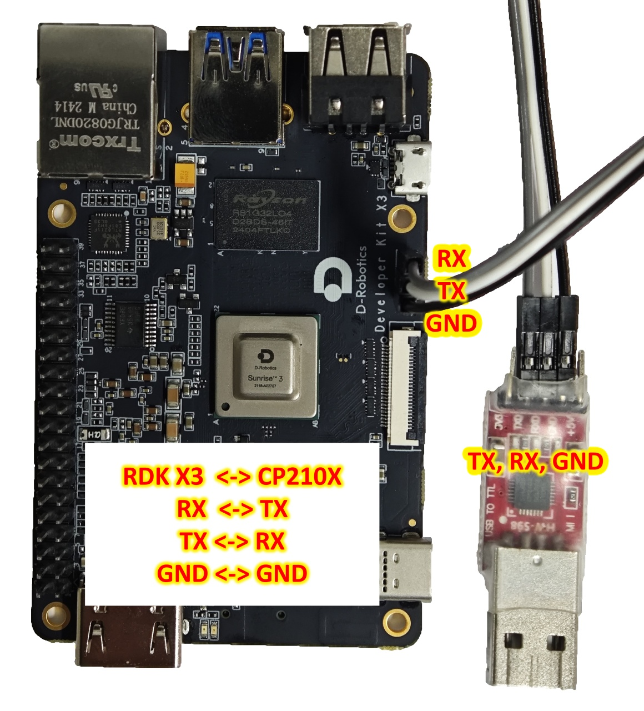
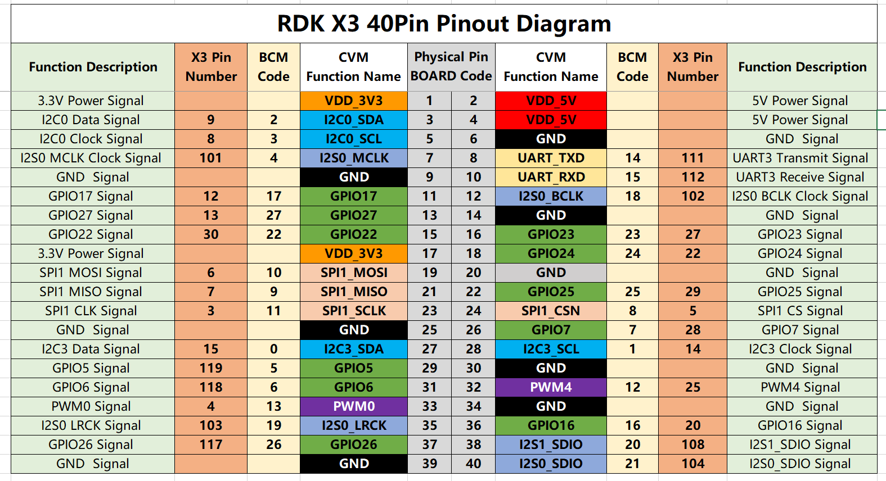

# D-Robotics RDK X3 4GB: Board, Kit Setup and Bernoulli2 Development


[**RDK X3 4 GB Single Board — SKU D-Robotics-28551 on OpenELAB**](https://openelab.io/products/d-robotics-rdk-x3-4gb?variant=45781681111238)

[**RDK X3 4 GB Basic Kit — SKU D-Robotics-29472 on OpenELAB**](https://openelab.io/products/d-robotics-rdk-x3-4gb?variant=45781681144006)

[**RDK X3 4 GB Dev Kit — SKU D-Robotics-31448 on OpenELAB**](https://openelab.io/products/d-robotics-rdk-x3-4gb?variant=45781681176774)

**Model:** D-Robotics RDK X3, 4 GB LPDDR4 · **Options:** the same board with different accessories · **Software scope:** X3 3.x Ubuntu 22.04, with explicit legacy 2.x Ubuntu 20.04 distinctions. Verify the delivered PCB and installed image before changing either.


The RDK X3 is a Linux single-board computer for camera processing, BPU inference and ROS 2 robotics development. These three options use the 4 GB board; the Dev Kit adds an IMX219 camera and adapter. Power the board at **5 V through USB-C** and treat its expansion signals as **3.3 V logic**. The X3 Module uses a different carrier and belongs to its [separate hardware reference](rdk-x3-module-hardware-and-development-reference.md). [Sources: OpenELAB configuration and D-Robotics hardware.](https://openelab.io/products/d-robotics-rdk-x3-4gb)

## Product overview <a href="#product-overview" id="product-overview"></a>

### What the X3 board does <a href="#what-the-x3-board-does" id="what-the-x3-board-does"></a>

Sunrise X3M combines four Arm Cortex-A53 CPU cores with a dual-core Bernoulli BPU, rated at an equivalent 5 TOPS. Linux handles application logic and communication; the image pipeline and codec process camera/video data; compiled X3 models run on the accelerator. CPU preprocessing, tensor transfers, post-processing and visualization still consume time and memory. The 5 TOPS rating is not a promise of camera-to-result frame rate. [Board specifications](https://archive.d-robotics.cc/downloads/en/hardware/rdk_x3/RDK%20X3.pdf), [X3 architecture and runtime](https://developer.d-robotics.cc/oe_x3_doc/en/runtime/source/runtime_dev.html).

The reviewed product brief is **v1.1.0, July 2025**; current documentation was read on **24 November 2026** with the X3 selector at **v3.0.0**. That selector is a documentation baseline, not the latest image filename: the official X3 archive also lists 3.0.1 and 3.0.3. The sold 4 GB option does not establish an exact PCB revision or a preloaded image version. Record these from the actual unit. [Images](https://archive.d-robotics.cc/downloads/os_images/rdk_x3/), [release history](https://d-robotics.github.io/rdk_x_doc/en/Release_Note/release_note?v=3.0.0\&p=RDK+X3).

### Which kit includes what? <a href="#which-kit-includes-what" id="which-kit-includes-what"></a>

The following is the **observed OpenELAB bundle**, not a universal manufacturer kit definition. The listing identifies reseller-style accessories such as RDK-Case-A and IMX219-77. Check the packing list against the received shipment before following a camera or enclosure procedure. [OpenELAB option table and packing lists](https://openelab.io/products/d-robotics-rdk-x3-4gb).

| Item                                          | Single Board, 28551 | Basic Kit, 29472 | Dev Kit, 31448 |
| --------------------------------------------- | ------------------- | ---------------- | -------------- |
| RDK X3 with 4 GB LPDDR4                       | Included            | Included         | Included       |
| RDK-Case-A and mounting accessories           | Not listed          | Included         | Included       |
| UART adapter and 4-pin cable                  | Not listed          | Included         | Included       |
| 64 GB microSD and USB reader                  | Not listed          | Included         | Included       |
| 5 V/3 A USB-C adapter, US/EU/UK plug adapters | Not listed          | Included         | Included       |
| IMX219-77 camera and FFC                      | Not listed          | Not listed       | Included       |
| X3 Pi CSI adapter                             | Not listed          | Not listed       | Included       |

The listing describes the bundled card as preloaded with Ubuntu, but does not identify its image release. A Single Board purchase needs separate boot media and power. A Basic Kit does not acquire a camera simply because camera examples are installed. No kit includes a robot chassis, LiDAR, IMU or audio HAT in this observed BOM.

## Applications <a href="#applications" id="applications"></a>

| Task                    | Useful X3 capability                                    | Integration boundary                                                                                        |
| ----------------------- | ------------------------------------------------------- | ----------------------------------------------------------------------------------------------------------- |
| Camera object detection | MIPI/USB capture, BPU models, HDMI or browser rendering | Match the sensor driver, FFC adapter, model target and decoder                                              |
| Network video analysis  | Hardware decode, video processing and inference         | RTSP codec, stream resolution and decoder resources must agree                                              |
| ROS 2 perception        | TROS camera, codec, inference and visualization nodes   | Match Ubuntu 20.04/Foxy or Ubuntu 22.04/Humble; keep motion consumers disconnected during perception checks |
| Embedded I/O            | 40-pin GPIO, UART, I2C, SPI, I2S and hardware PWM       | Multiplexing and signal voltage must be checked before connecting peripherals                               |
| Model development       | X3 OpenExplorer conversion and board runtime            | Conversion runs on the supported host environment; a training model is not directly a BPU executable        |

These uses follow the [X3 samples](https://d-robotics.github.io/rdk_x_doc/en/Basic_Application/pydev_demo_sample/RDK_X3/overview?v=3.0.0\&p=RDK+X3), [multimedia API scope](https://d-robotics.github.io/rdk_x_doc/en/Basic_Application/multi_media_sp_dev_api/RDK_X3/overview?v=3.0.0\&p=RDK+X3) and [TROS X3 support table](https://d-robotics.github.io/tros_doc/en/tros?v=3.0.0\&p=RDK+X3). They do not establish safety certification of a complete robot or compatibility with every Raspberry Pi accessory.

## Specifications <a href="#specifications" id="specifications"></a>

### Board selection and operating limits <a href="#board-selection-and-operating-limits" id="board-selection-and-operating-limits"></a>

| Parameter               | RDK X3 4 GB board scope                                          | Condition or distinction                                                                                |
| ----------------------- | ---------------------------------------------------------------- | ------------------------------------------------------------------------------------------------------- |
| CPU                     | Quad-core 64-bit Cortex-A53, advertised 1.5 GHz                  | Operating frequency is governed by image, PCB revision, load and thermal policy; read the actual policy |
| AI accelerator          | Dual-core Bernoulli BPU, equivalent 5 TOPS                       | Compiler architecture is `bernoulli2`                                                                   |
| RAM                     | 4 GB LPDDR4 for all three store options                          | Manufacturer family also has 2 GB; do not select a 2 GB bootloader for this product                     |
| OS boot medium          | microSD                                                          | Minimum documented capacity 8 GB; bundled Basic/Dev card is 64 GB                                       |
| Power input             | USB-C, 5 V/3 A adapter                                           | USB-C is power only; the Micro USB port is data/device mode                                             |
| Expansion logic         | 3.3 V on the board's 40-pin header                               | 5 V power pins do not make GPIO 5 V tolerant                                                            |
| USB exposed             | One USB 3.0 Type-A, two USB 2.0 Type-A, one Micro USB 2.0 device | Host and device functions are mutually exclusive                                                        |
| Wired network           | Gigabit Ethernet, 1000BASE-T/100BASE-T                           | RJ45 presence does not establish PoE                                                                    |
| Wireless                | Store option lists dual-band Wi-Fi and Bluetooth 4.2             | Manufacturer brief makes wireless configuration dependent; inspect the supplied board/module            |
| Camera                  | One exposed MIPI CSI connector; USB UVC via Type-A               | Sensor and adapter compatibility are separate checks                                                    |
| Display                 | HDMI, up to 1920×1080 at 60fps                                   | 4K codec capability is not 4K HDMI output                                                               |
| Codec headline          | H.265 up to 4K at 60fps; MJPEG support                           | Capability of the hardware block, not concurrent pipeline throughput                                    |
| Board envelope          | 85 × 56 × 20 mm                                                  | See 2.0 mechanical drawing for hole and connector positions                                             |
| Ambient operating range | −20°C to +60°C in current board brief                            | Cooling must hold the chip within its thermal policy                                                    |

Sources: [v1.1.0 board brief](https://archive.d-robotics.cc/downloads/en/hardware/rdk_x3/RDK%20X3.pdf), [hardware interfaces](https://d-robotics.github.io/rdk_x_doc/en/Quick_start/hardware_introduction/rdk_x3?v=3.0.0\&p=RDK+X3), [X3 image installation](https://d-robotics.github.io/rdk_x_doc/en/Quick_start/install_os/rdk_x3/system_burn?v=3.0.0\&p=RDK+X3), [OpenExplorer target](https://developer.d-robotics.cc/oe_x3_doc/en/oe_mapper/source/faststart/quickstart.html). The brief's final model row contains an apparent “RDK X5 4G” label; the store's exact X3 4 GB identities and the document's X3 title determine this guide's scope. That row is not evidence for an X5 substitution.

### Revision and resource boundaries <a href="#revision-and-resource-boundaries" id="revision-and-resource-boundaries"></a>

The current download summary distinguishes **X3 2.0** schematic/mechanical files from historical **1.0** files. A document marked 2.0 is not proof that every shipped board is exactly that revision. The `rdkos_info` example identifies a **Hobot X3 PI V2.1**, while release notes distinguish older frequency defaults from V2.1 behavior. Photograph PCB markings and retain the version report when diagnosing a board. [Download summary](https://d-robotics.github.io/rdk_x_doc/en/Quick_start/download?v=3.0.0\&p=RDK+X3), [version-report command](https://d-robotics.github.io/rdk_x_doc/en/Appendix/rdk-command-manual/cmd_rdkos_info?v=3.0.0\&p=RDK+X3), [release history](https://d-robotics.github.io/rdk_x_doc/en/Release_Note/release_note?v=3.0.0\&p=RDK+X3).

The current generic 40-pin article states rail-current figures that disagree with the X3 hardware page and even specifies a 25 W adapter condition. Those values must not be merged with the X3's 5 V/3 A supply recommendation. This guide does **not** authorize a header-powered load budget from those conflicting tables. Use a suitably isolated, externally powered peripheral arrangement and obtain revision-specific rail limits for a powered HAT design. [Generic pin article](https://d-robotics.github.io/rdk_x_doc/en/Basic_Application/01_40pin_user_sample/40pin_define?v=3.0.0\&p=RDK+X3), [X3 hardware table](https://d-robotics.github.io/rdk_x_doc/en/Quick_start/hardware_introduction/rdk_x3?v=3.0.0\&p=RDK+X3).

## Hardware and connections <a href="#hardware-and-connections" id="hardware-and-connections"></a>

### Find the correct connector before applying power <a href="#find-the-correct-connector-before-applying-power" id="find-the-correct-connector-before-applying-power"></a>



_Manufacturer diagram, reproduced by remote reference from the_ [_official X3 hardware page_](https://d-robotics.github.io/rdk_x_doc/en/Quick_start/hardware_introduction/rdk_x3?v=3.0.0\&p=RDK+X3)_. It shows the board, not the Basic or Dev accessory bundle._

| Diagram number | Connector or function                | Practical check                                                                   |
| -------------- | ------------------------------------ | --------------------------------------------------------------------------------- |
| 1              | USB-C power                          | Regulated 5 V/3 A; no assumption of USB data or higher-voltage PD input           |
| 2              | MIPI CSI                             | Shut down and remove power before opening the FFC latch                           |
| 3              | Dedicated debug UART                 | Cross TX/RX with a compatible USB–TTL adapter; share ground                       |
| 4              | Micro USB device                     | Used for ADB/fastboot-type workflows; attaching it disables Type-A host operation |
| 5 / 6          | Two USB 2.0 / one USB 3.0 Type-A     | Keyboard, storage and UVC cameras; share the underlying USB resources             |
| 7              | Ethernet                             | Use the actual board IP from the terminal, not a guessed default                  |
| 8              | 40-pin expansion                     | Identify physical pin 1 from silkscreen and the pin diagram                       |
| 9              | HDMI                                 | Full-size display connection; choose a supported mode                             |
| 10 / 11 / 12   | LEDs / antenna / microSD below board | LED state aids boot diagnosis; card is not hot-pluggable                          |

Do not power the X3 through a computer USB port or the UART adapter's VCC wire. Use the USB-C supply independently of the debug data connection. A weak cable can still cause brownouts even when the adapter label says 3 A. This is a diagnostic inference; the documented symptom is repeated shutdown/restart under insufficient supply. [Hardware power requirements](https://d-robotics.github.io/rdk_x_doc/en/Quick_start/hardware_introduction/rdk_x3?v=3.0.0\&p=RDK+X3).

### Debug UART wiring and console settings <a href="#debug-uart-wiring-and-console-settings" id="debug-uart-wiring-and-console-settings"></a>



_D-Robotics wiring photograph from_ [_X3 hardware_](https://d-robotics.github.io/rdk_x_doc/en/Quick_start/hardware_introduction/rdk_x3?v=3.0.0\&p=RDK+X3)_. Identify the printed RX/TX/GND labels rather than relying on wire colors or viewing direction._

| X3 debug header     | USB–TTL adapter                | Setting                                                 |
| ------------------- | ------------------------------ | ------------------------------------------------------- |
| RX                  | TX                             | Compatible TTL logic; never an RS-232 voltage interface |
| TX                  | RX                             | Cross the data lines                                    |
| GND                 | GND                            | Common reference                                        |
| No power connection | Leave adapter VCC disconnected | Board receives USB-C power                              |

Use **921600 baud, 8 data bits, no parity, 1 stop bit, no flow control**. Select the adapter's actual COM or tty device on the PC. The dedicated debug port corresponds to the system console; it is separate from the UART3 signals on physical pins 8 and 10. Do not loop back the system console as an application serial test. [Remote login](https://d-robotics.github.io/rdk_x_doc/en/Quick_start/remote_login?v=3.0.0\&p=RDK+X3), [UART application example](https://d-robotics.github.io/rdk_x_doc/en/Basic_Application/01_40pin_user_sample/uart?v=3.0.0\&p=RDK+X3).

### Physical 40-pin map and numbering <a href="#physical-40-pin-map-and-numbering" id="physical-40-pin-map-and-numbering"></a>



_D-Robotics pin diagram from_ [_X3 hardware_](https://d-robotics.github.io/rdk_x_doc/en/Quick_start/hardware_introduction/rdk_x3?v=3.0.0\&p=RDK+X3)_. BCM labels are compatibility aliases, not Linux GPIO numbers or proof of an enabled peripheral driver._

| Odd physical pin | Signal/function in the official map | Even physical pin | Signal/function in the official map |
| ---------------- | ----------------------------------- | ----------------- | ----------------------------------- |
| 1                | 3.3 V power                         | 2                 | 5 V power                           |
| 3                | I2C0 SDA, BCM2                      | 4                 | 5 V power                           |
| 5                | I2C0 SCL, BCM3                      | 6                 | GND                                 |
| 7                | I2S0 MCLK, BCM4                     | 8                 | UART3 TX, BCM14                     |
| 9                | GND                                 | 10                | UART3 RX, BCM15                     |
| 11               | GPIO17, BCM17                       | 12                | I2S0 BCLK, BCM18                    |
| 13               | GPIO27, BCM27                       | 14                | GND                                 |
| 15               | GPIO22, BCM22                       | 16                | GPIO23, BCM23                       |
| 17               | 3.3 V power                         | 18                | GPIO24, BCM24                       |
| 19               | SPI1 MOSI, BCM10                    | 20                | GND                                 |
| 21               | SPI1 MISO, BCM9                     | 22                | GPIO25, BCM25                       |
| 23               | SPI1 clock, BCM11                   | 24                | SPI1 CS, BCM8                       |
| 25               | GND                                 | 26                | GPIO7, BCM7                         |
| 27               | I2C3 SDA, BCM0                      | 28                | I2C3 SCL, BCM1                      |
| 29               | GPIO5, BCM5                         | 30                | GND                                 |
| 31               | GPIO6, BCM6                         | 32                | PWM4, BCM12                         |
| 33               | PWM0, BCM13                         | 34                | GND                                 |
| 35               | I2S0 LRCK, BCM19                    | 36                | GPIO16, BCM16                       |
| 37               | GPIO26, BCM26                       | 38                | I2S1 SDIO, BCM20                    |
| 39               | GND                                 | 40                | I2S0 SDIO, BCM21                    |

Use physical numbering deliberately, for example `GPIO.setmode(GPIO.BOARD)` before referring to physical pin 37. `Hobot.GPIO` also supports BCM/CVM-style schemes, but switching schemes changes what an integer means. Record the scheme with the wiring. Before GPIO use, disable the dedicated bus occupying those pins through `sudo srpi-config` → **3 Interface Options → I3 Peripheral bus config**, then reboot if requested. An enabled UART/SPI/I2S function can prevent GPIO operation. [GPIO API](https://d-robotics.github.io/rdk_x_doc/en/Basic_Application/01_40pin_user_sample/gpio?v=3.0.0\&p=RDK+X3), [configuration tool](https://d-robotics.github.io/rdk_x_doc/en/System_configuration/srpi-config?v=3.0.0\&p=RDK+X3).

### GPIO, UART, I2C, SPI and PWM development <a href="#gpio-uart-i2c-spi-and-pwm-development" id="gpio-uart-i2c-spi-and-pwm-development"></a>

| Interface         | X3 procedure and expected result                                                                                                                   | Limit or diagnostic                                                                                                                                           |
| ----------------- | -------------------------------------------------------------------------------------------------------------------------------------------------- | ------------------------------------------------------------------------------------------------------------------------------------------------------------- |
| GPIO input/output | Samples live in `/app/40pin_samples/`; the documented button/LED example reads physical 37 and writes 31                                           | Connect only after confirming mux and 3.3 V levels; cleanup pins in `finally`                                                                                 |
| UART3 loopback    | With all external devices disconnected and power off, link physical 8 TX to 10 RX; the sample uses `/dev/ttyS3` and should read back the sent text | Preserve `/dev/ttyS0` for debug; close the serial handle on exit                                                                                              |
| I2C               | First enumerate `/dev/i2c-*` and identify the intended controller and peripheral's 7-bit address                                                   | An address scan is an active bus transaction. The official `test_i2c.py` also writes the byte back, so it is not a passive first-result test                  |
| SPI1 loopback     | With power removed, link physical 19 MOSI to 21 MISO, then use the controller/device actually exposed by the image                                 | A Linux `spidev` index is not necessarily the silkscreen controller number; expected loopback bytes are `0x55 0xAA`                                           |
| Hardware PWM      | Official X3 map exposes PWM0 on 33 and PWM4 on 32; use only a supported hardware-PWM pin                                                           | `Hobot.GPIO` does not emulate software PWM. The shared PWM page's eight-channel X5 table is not an X3 map; its X3 sample uses 48 kHz, not a 50 Hz servo pulse |

Sources: [GPIO](https://d-robotics.github.io/rdk_x_doc/en/Basic_Application/01_40pin_user_sample/gpio?v=3.0.0\&p=RDK+X3), [UART](https://d-robotics.github.io/rdk_x_doc/en/Basic_Application/01_40pin_user_sample/uart?v=3.0.0\&p=RDK+X3), [I2C](https://d-robotics.github.io/rdk_x_doc/en/Basic_Application/01_40pin_user_sample/i2c?v=3.0.0\&p=RDK+X3), [SPI](https://d-robotics.github.io/rdk_x_doc/en/Basic_Application/01_40pin_user_sample/spi?v=3.0.0\&p=RDK+X3), [PWM](https://d-robotics.github.io/rdk_x_doc/en/Basic_Application/01_40pin_user_sample/pwm?v=3.0.0\&p=RDK+X3). Use an oscilloscope/logic analyzer before connecting a timing-sensitive load. No motor or servo should be powered directly from a GPIO.

### Camera connectors, sensor addresses and ISP profiles <a href="#camera-connectors-sensor-addresses-and-isp-profiles" id="camera-connectors-sensor-addresses-and-isp-profiles"></a>

The board exposes a **24-pin CSI connector**; the Dev Kit's Raspberry Pi-style IMX219 uses its included X3 Pi CSI adapter. A matching sensor name alone does not identify FFC pin order, sensor board voltage, lens field of view or ISP tuning. The official direct-camera illustration specifies blue FFC reinforcement facing upward at the illustrated board connector; confirm the contact side independently at both ends of an adapter. Remove power before any CSI cable change. [Hardware camera connection](https://d-robotics.github.io/rdk_x_doc/en/Quick_start/hardware_introduction/rdk_x3?v=3.0.0\&p=RDK+X3), [camera-adapter brief](https://archive.d-robotics.cc/downloads/en/hardware/rdk_x3/RDK%20X3%20Camera%20Adapter.pdf).

| Sensor family in official X3 hardware list | Nominal sensor resolution | 7-bit I2C address | Integration note                                                     |
| ------------------------------------------ | ------------------------- | ----------------- | -------------------------------------------------------------------- |
| JXF37/F37                                  | 2MP                       | `0x40`            | Direct supported module; clock and driver must be active for probing |
| GC4663                                     | 4MP                       | `0x29`            | Use the correct sensor configuration                                 |
| IMX219                                     | 8MP                       | `0x10`            | Dev Kit is IMX219-77; listing gives 79.3° FOV, not every IMX219 lens |
| IMX477                                     | 12MP                      | `0x1a`            | Supported module/adapter and mode required                           |
| OV5647                                     | 5MP                       | `0x36`            | Check adapter and documented capture mode                            |

The addresses come from the [hardware table](https://d-robotics.github.io/rdk_x_doc/en/Quick_start/hardware_introduction/rdk_x3?v=3.0.0\&p=RDK+X3); resolution is sensor class, not a guaranteed capture mode at that resolution. The [accessory list](https://d-robotics.github.io/rdk_x_doc/en/Quick_start/accessory?v=3.0.0\&p=RDK+X3) contains mode tables. `srpi-config` → **Sensor Profiles → IMX219 Switch ISP** selects tuning for particular module/lens families. A poor color/exposure result after basic capture works may be an ISP-profile mismatch. It is not automatically an inference-model fault. [Configuration tool](https://d-robotics.github.io/rdk_x_doc/en/System_configuration/srpi-config?v=3.0.0\&p=RDK+X3).

For USB cameras, enumerate with `v4l2-ctl --list-devices` and inspect the chosen node's formats. `/dev/video8` is a documented example, not a fixed address. USB2 cameras share the USB2 bandwidth budget through the hub. Two cameras demanding maximum isochronous bandwidth may not work together; investigate their alternate settings before changing `uvcvideo` parameters. Driver reloads disrupt other camera clients and are not part of the first-result procedure. [USB camera guide](https://d-robotics.github.io/rdk_x_doc/en/Basic_Application/vision/RDK_X3/usb_camera?v=3.0.0\&p=RDK+X3).

### Display, audio, RTC and cooling <a href="#display-audio-rtc-and-cooling" id="display-audio-rtc-and-cooling"></a>

The board's HDMI modes include 1920×1080,1280×720,1024×600 and 800×480. The single-board X3 does not expose the Module carrier's MIPI DSI connector. Direct framebuffer/display examples may contend with the desktop display manager; save work and use a second SSH/serial terminal before stopping `lightdm`, and restart it after the experiment. [Hardware](https://d-robotics.github.io/rdk_x_doc/en/Quick_start/hardware_introduction/rdk_x3?v=3.0.0\&p=RDK+X3), [MIPI vision example](https://d-robotics.github.io/rdk_x_doc/en/Basic_Application/vision/RDK_X3/mipi_camera?v=3.0.0\&p=RDK+X3).

Audio requires an identified USB sound device or compatible 40-pin audio HAT. The X3 audio pages document **WM8960 Audio HAT** and **Audio Driver HAT REV2**, selected in `srpi-config` → **I5 Audio**, followed by reboot. For Audio Driver HAT REV2, read `/sys/class/socinfo/som_name`: the documented IDs5/6 use all three DIP switches ON, ID8 uses OFF. Do not extend that rule to an unknown board ID. Enumerate `/proc/asound/cards` and `/proc/asound/pcm` after configuration. The current WM8960 and REV2 pages contain contradictory capture/playback device-number examples; determine the actual capture/playback endpoints before recording or playing audio rather than copying `-d` values. REV2 loopback occupies channels 7/8 of an 8-channel recording; the speaker output is stereo. [WM8960 setup](https://d-robotics.github.io/rdk_x_doc/en/Basic_Application/audio/rdk_x3_and_rdk_x3_module/wm8960_audio_hat?v=3.0.0\&p=RDK+X3), [REV2 setup](https://d-robotics.github.io/rdk_x_doc/en/Basic_Application/audio/rdk_x3_and_rdk_x3_module/audio_driver_hat2_rev2?v=3.0.0\&p=RDK+X3).

No RTC battery connector is shown in the reviewed single-board interface map. Do not infer battery-backed timekeeping from a generic Linux RTC entry or from the Module carrier's battery connector. If your PCB differs, use its revision-specific schematic and verify time retention on that hardware. NTP synchronization after network connection is a separate function.

Use ventilation and an appropriate heatsink/enclosure arrangement for sustained work. The X3 thermal chapter reports default chip thresholds of 80°C at boot,95°C throttling and 105°C shutdown; these are **chip-policy thresholds**, not ambient operating ratings. Read the installed `trip_point_*_temp` values; do not raise them to make a workload appear stable. The `config.txt` page's112°C example conflicts with the X3-specific 105°C ceiling and is excluded here. [X3 thermal control](https://d-robotics.github.io/rdk_x_doc/en/System_configuration/frequency_management?v=3.0.0\&p=RDK+X3).

## Software and development resources <a href="#software-and-development-resources" id="software-and-development-resources"></a>

### Keep these version numbers separate <a href="#keep-these-version-numbers-separate" id="keep-these-version-numbers-separate"></a>

| Layer                  | X3 evidence and correct choice                                           | Do not substitute                                                     |
| ---------------------- | ------------------------------------------------------------------------ | --------------------------------------------------------------------- |
| Hardware target        | Sunrise X3M / Bernoulli2                                                 | X5 Bayes-e, Ultra Bayes, S-series Nash                                |
| Documentation          | Current `rdk_x_doc`, X3 selector v3.0.0                                  | Archived `rdk_doc` as an unquestioned current default                 |
| Images                 | X3 3.x → Ubuntu 22.04; X3 2.x → Ubuntu 20.04;1.x is legacy X3-only       | An X5 image or 1.x image on the Module                                |
| Image archive snapshot | 3.0.3 folder dated 8 September2025; server and desktop downloads present | Calling3.0.0 the newest image merely because it is the selector       |
| Model conversion       | OpenExplorer2.6.6, documented for X3 OS3.0.0; x86 host/container         | X5 OpenExplorer1.2.8 or a model compiled for another BPU architecture |
| Board Python inference | `hobot_dnn.pyeasy_dnn`; some X3 Model Zoo demos use `bpu_infer_lib_x3`   | `hbm_runtime` instructions for current X5/S-series                    |
| TROS                   | Ubuntu 22.04 → Humble (`tros-humble`); Ubuntu 20.04 → Foxy (`tros`)      | A single blanket ROS distribution across all images                   |

Sources: [image installation](https://d-robotics.github.io/rdk_x_doc/en/Quick_start/install_os/rdk_x3/system_burn?v=3.0.0\&p=RDK+X3), [actual image directory](https://archive.d-robotics.cc/downloads/os_images/rdk_x3/rdk_os_3.0.3-2025-09-08/), [X3 toolchain page](https://d-robotics.github.io/rdk_x_doc/en/Advanced_development/toolchain_development/rdk_x3/oe_toolchain_v2_6_6?v=3.0.0\&p=RDK+X3), [Model Zoo branch/API table](https://d-robotics.github.io/model_zoo_doc/en/model_zoo_intro?v=3.0.0\&p=RDK+X3), [TROS installation](https://d-robotics.github.io/tros_doc/en/quick_start/install_tros?v=3.0.0\&p=RDK+X3). Kernel, bootloader, driver and runtime package versions must be recorded from the board; historical example logs are not a bill of installed software.

### System configuration, networking and maintenance <a href="#system-configuration-networking-and-maintenance" id="system-configuration-networking-and-maintenance"></a>

`srpi-config` is the supported interface to Wi-Fi, password/hostname, console/desktop login, SSH/VNC, bus mux, sensor profiles and selected memory/performance settings. The desktop **RDK Configuration** entry opens the same tool. SSH is normally enabled; VNC is disabled by default in the documented 2.1 update and can be enabled when a desktop image is installed. Change default credentials before using an exposed network. [Configuration tool](https://d-robotics.github.io/rdk_x_doc/en/System_configuration/srpi-config?v=3.0.0\&p=RDK+X3), [release history](https://d-robotics.github.io/rdk_x_doc/en/Release_Note/release_note?v=3.0.0\&p=RDK+X3).

`/boot/config.txt` is read by U-Boot. Its documented prerequisites are system≥2.1.0 and miniboot no earlier than 26 November 2023. X3 bus parameters include `uart3`, `spi0/1/2`, `i2c0` through `i2c5` and `i2s0/1`; physical routing and mux still determine which are useful. `gpio=` entries use the documented GPIO naming scheme, not automatically physical pin numbers. Model filters distinguish `[rdkv1]`, `[rdkv1.2]`, `[rdkv2]` and `[rdkmd]`. Retain a backup and know how to restore the boot partition before editing. Do not copy X5 ION-region or SPI/CAN overlays onto X3. [Configuration-file reference](https://d-robotics.github.io/rdk_x_doc/en/System_configuration/config_txt?v=3.0.0\&p=RDK+X3).

ION reserves physical memory for video/BPU use; the configuration tool documents a 672 MB default. Increasing it reduces general Linux memory, so 4 GB RAM does not mean 4 GB available to Python. Diagnose allocation failures by recording both the ION setting and free memory before changing it. Frequency policies include ondemand, performance, powersave, conservative and userspace where the kernel provides them. Query `scaling_available_governors` and `scaling_available_frequencies`; do not infer a safe overclock from a sample status report. [Configuration tool](https://d-robotics.github.io/rdk_x_doc/en/System_configuration/srpi-config?v=3.0.0\&p=RDK+X3), [X3 frequency management](https://d-robotics.github.io/rdk_x_doc/en/System_configuration/frequency_management?v=3.0.0\&p=RDK+X3).

| Network topic          | Model/version-aware procedure                                                    | First diagnostic                                                                       |
| ---------------------- | -------------------------------------------------------------------------------- | -------------------------------------------------------------------------------------- |
| Wired address          | Current network guide uses 192.168.127.10; older hardware text says 192.168.1.10 | Read `ip -br address` through serial/HDMI before choosing PC subnet or SSH target      |
| X3 images before 3.0.2 | Guide describes `/etc/network/interfaces`                                        | Read the file and active service before editing                                        |
| X3 images≥3.0.2        | Guide describes NetworkManager's `netplan-eth0.nmconnection`                     | Inspect `nmcli connection show`; use the active profile                                |
| Wi-Fi station          | Desktop menu or `srpi-config`; CLI helper `wifi_connect` with your SSID/password | Inspect detected interfaces and signal before retrying connection                      |
| Soft AP                | Older hostapd/DHCP-server workflow differs from newer NetworkManager workflow    | Select the section matching the installed image; do not configure both at once         |
| DNS                    | Separate address, route and resolver checks                                      | Compare an IP reachability check with a hostname lookup                                |
| Bluetooth              | 3.0.0 documentation says initialized at boot; inspect `bluetoothctl show`        | Confirm an actual wireless module and active controller before starting legacy scripts |

The onboard Bluetooth wiring has limitations for high-bandwidth or synchronous-audio uses; the current guide recommends an appropriate USB Bluetooth device for those tasks. Wireless antenna switching also depends on PCB revision: the tool explicitly lists X3 V2.1. Preserve the current antenna selection rather than running a blind file substitution on an unidentified board. [Network/Bluetooth guide](https://d-robotics.github.io/rdk_x_doc/en/System_configuration/network_bluetooth?v=3.0.0\&p=RDK+X3), [configuration tool](https://d-robotics.github.io/rdk_x_doc/en/System_configuration/srpi-config?v=3.0.0\&p=RDK+X3).

Before package upgrades, record `dpkg-query` output, available disk space, kernel and boot version, and back up boot files and user data. An upgrade can reinstall kernels, device trees or drivers and require reboot. Do not interrupt another active package manager or delete lock files as a first response. For application autostart, prefer a dedicated systemd service with a working directory, user, environment setup and restart policy; verify manual startup first. A ROS node requiring `source` will not automatically inherit an interactive shell's environment under systemd. [System maintenance](https://d-robotics.github.io/rdk_x_doc/en/System_configuration/network_bluetooth?v=3.0.0\&p=RDK+X3), [autostart guide](https://d-robotics.github.io/rdk_x_doc/en/System_configuration/self_start?v=3.0.0\&p=RDK+X3).

### Python examples: input, output and what changes <a href="#python-examples-input-output-and-what-changes" id="python-examples-input-output-and-what-changes"></a>

The installed sample layout differs between releases. The current quick-start page shows a MobileNetV2 directory under `01_classification_sample`; the X3-specific Python chapter documents `01_basic_sample`. Enumerate what exists before selecting a procedure. The following paths are the **X3-specific chapter's** sample set, not a guarantee that every package image contains all of them. [X3 sample overview](https://d-robotics.github.io/rdk_x_doc/en/Basic_Application/pydev_demo_sample/RDK_X3/overview?v=3.0.0\&p=RDK+X3).

| Sample directory under `/app/pydev_demo/` | Input → processing → output                                                              | Development check                                                                               |
| ----------------------------------------- | ---------------------------------------------------------------------------------------- | ----------------------------------------------------------------------------------------------- |
| `01_basic_sample`                         | `zebra_cls.jpg` → ResNet18/MobileNetV1/other classifier → class ID, confidence and label | Run from its directory so relative image/model paths resolve                                    |
| `02_usb_camera_sample`                    | UVC frame → `usb_camera_snap.py` JPEG or FCOS live inference → HDMI/boxes                | Select actual `/dev/videoN`; snapshot and live detector have different resource needs           |
| `03_mipi_camera_sample`                   | Supported CSI sensor → FCOS inference → HDMI overlay/FPS                                 | Confirm sensor and display independently before combining                                       |
| `04_segment_sample`                       | `segmentation.png` →1024×2048 MobileNet-UNet → pixel labels/color overlay                | Use the matching palette and output layout, not detection-box parsing                           |
| `05_web_display_camera_sample`            | MIPI + FCOS + JPEG → WebSocket and web UI                                                | Python sample uses port 8080 plus its nginx setup; do not confuse with TROS port 8000           |
| `06_yolov3_sample`                        | `kite.jpg` →416×416 YOLOv3 → boxes and saved image                                       | Match COCO labels and thresholds to this model                                                  |
| `07_yolov5_sample`                        | `kite.jpg` →672×672 YOLOv5s → boxes                                                      | Pre/postprocessing is not interchangeable with every YOLO export                                |
| `08_decode_rtsp_stream`                   | H.264/H.265 network stream → decode → optional inference/display                         | Inspect installed `--help`; quote a semicolon-separated URL list so the shell does not split it |
| `09_yolov5x_sample`                       | `kite.jpg` →672×672 YOLOv5X → detection rendering                                        | Larger model resources must fit ION and runtime                                                 |
| `11_centernet_sample`                     | `kite.jpg` →512×512 center/size/offset heads → boxes                                     | CenterNet output requires its own parser, not YOLO anchors                                      |
| `12_yolov5s_v6_v7_sample`                 | `kite.jpg` →640×640 v6 orv 7 model → boxes                                               | Use the corresponding script and model together                                                 |

Source pages: [basic classification](https://d-robotics.github.io/rdk_x_doc/en/Basic_Application/pydev_demo_sample/RDK_X3/basic_sample?v=3.0.0\&p=RDK+X3), [USB](https://d-robotics.github.io/rdk_x_doc/en/Basic_Application/pydev_demo_sample/RDK_X3/usb_camera_sample?v=3.0.0\&p=RDK+X3), [MIPI](https://d-robotics.github.io/rdk_x_doc/en/Basic_Application/pydev_demo_sample/RDK_X3/mipi_camera_sample?v=3.0.0\&p=RDK+X3), [segmentation](https://d-robotics.github.io/rdk_x_doc/en/Basic_Application/pydev_demo_sample/RDK_X3/segment_sample?v=3.0.0\&p=RDK+X3), [web](https://d-robotics.github.io/rdk_x_doc/en/Basic_Application/pydev_demo_sample/RDK_X3/web_display_camera_sample?v=3.0.0\&p=RDK+X3), [YOLOv3](https://d-robotics.github.io/rdk_x_doc/en/Basic_Application/pydev_demo_sample/RDK_X3/yolov3_sample?v=3.0.0\&p=RDK+X3), [YOLOv5](https://d-robotics.github.io/rdk_x_doc/en/Basic_Application/pydev_demo_sample/RDK_X3/yolov5_sample?v=3.0.0\&p=RDK+X3), [RTSP](https://d-robotics.github.io/rdk_x_doc/en/Basic_Application/pydev_demo_sample/RDK_X3/decode_rtsp_stream?v=3.0.0\&p=RDK+X3), [YOLOv5X](https://d-robotics.github.io/rdk_x_doc/en/Basic_Application/pydev_demo_sample/RDK_X3/yolov5x_sample?v=3.0.0\&p=RDK+X3), [CenterNet](https://d-robotics.github.io/rdk_x_doc/en/Basic_Application/pydev_demo_sample/RDK_X3/centernet_sample?v=3.0.0\&p=RDK+X3), [v6/v7](https://d-robotics.github.io/rdk_x_doc/en/Basic_Application/pydev_demo_sample/RDK_X3/yolov5s_v6_v7_sample?v=3.0.0\&p=RDK+X3). No sample confidence/FPS shown in those pages is a measurement on your board.

### C/C++ multimedia pipeline and API lifecycle <a href="#cc-multimedia-pipeline-and-api-lifecycle" id="cc-multimedia-pipeline-and-api-lifecycle"></a>

The installed C examples live under `/app/cdev_demo/` and normally build with each directory's Makefile. The current shared C chapter includes X5-looking `bayese` model names in logs; those logs do not establish an X3 binary. Check the installed source, linked libraries and model architecture before using any shared command. [C overview](https://d-robotics.github.io/rdk_x_doc/en/Basic_Application/cdev_demo_sample/overview?v=3.0.0\&p=RDK+X3), [BPU example](https://d-robotics.github.io/rdk_x_doc/en/Basic_Application/cdev_demo_sample/bpu?v=3.0.0\&p=RDK+X3).

| Example          | Pipeline and significant parameters                                                     | Observable result                                                     |
| ---------------- | --------------------------------------------------------------------------------------- | --------------------------------------------------------------------- |
| `bpu`            | Camera/YOLO or decoded H.264/FCOS; `-f` model, `-m` mode, `-i` file, `-w/-h` dimensions | Correct detector overlays; no architectural mismatch warning          |
| `decode2display` | Encoded file → decoder → display; input codec and dimensions must match                 | Repeated decoded video on HDMI                                        |
| `rtsp2display`   | Network RTSP → H.264 decode → VPS scaling → display                                     | Live remote video; diagnose network before decoder tuning             |
| `vio_capture`    | Camera → RAW/YUV files; capture count, width/height and RAW bit depth matter            | Finite frame files that a viewer can decode using the recorded format |
| `vio2display`    | Camera → video input/VPS → display                                                      | Stable preview before adding inference                                |
| `vio2encoder`    | Camera → encoder; input/output dimensions and output filename selected separately       | A playable encoded stream rather than just a nonempty file            |

Detailed workflows: [decode](https://d-robotics.github.io/rdk_x_doc/en/Basic_Application/cdev_demo_sample/decode2display?v=3.0.0\&p=RDK+X3), [RTSP](https://d-robotics.github.io/rdk_x_doc/en/Basic_Application/cdev_demo_sample/rtsp2display?v=3.0.0\&p=RDK+X3), [capture](https://d-robotics.github.io/rdk_x_doc/en/Basic_Application/cdev_demo_sample/vio_capture?v=3.0.0\&p=RDK+X3), [preview](https://d-robotics.github.io/rdk_x_doc/en/Basic_Application/cdev_demo_sample/vio2display?v=3.0.0\&p=RDK+X3), [encode](https://d-robotics.github.io/rdk_x_doc/en/Basic_Application/cdev_demo_sample/vio2encoder?v=3.0.0\&p=RDK+X3). Check the installed binary's help for flags; the letter `-h` can mean height rather than help.

The X3 SP API has four families: VIO, encoder/decoder, display and module binding. `sp_module_bind` can connect VIO→encoder/display and decoder→encoder/display. Binding lets the pipeline forward frames internally; it does not remove the need to initialize compatible modules. Unbind before stopping/releasing modules. Distinguish the SP caller-owned frame-buffer API from native APIs that borrow hardware frames; their ownership and cleanup contracts are different. [X3 API overview](https://d-robotics.github.io/rdk_x_doc/en/Basic_Application/multi_media_sp_dev_api/RDK_X3/overview?v=3.0.0\&p=RDK+X3), [SYS binding API](https://d-robotics.github.io/rdk_x_doc/en/Basic_Application/multi_media_sp_dev_api/RDK_X3/cdev_multimedia_api_x3/sys_api?v=3.0.0\&p=RDK+X3).

The Python wrapper provides `srcampy.Camera`, decoder, encoder and display objects, while `hobot_dnn.pyeasy_dnn` handles inference. The verified Model Zoo code uses `dnn.load(path)` returning a collection, `models[0].inputs[i].properties` for tensor metadata and `models[0].forward(...)` for inference. Do not use an ONNX or RKNN file directly merely because a generic API paragraph mentions it: this workflow requires a model compiled for X3. [Pinned X3 FCOS source](https://github.com/D-Robotics/rdk_model_zoo/blob/0eb344ba8bed76923a6bd696e468fd82489cf46e/demos/detect/FCOS/FCOS.py), [inference-interface reference](https://d-robotics.github.io/model_zoo_doc/en/infer_api_ref?v=3.0.0\&p=RDK+X3).

For **X3 VPS output**, width is rounded up to a multiple of **32 pixels**. The documented request 720×480 therefore produces 736×480. Library binding handles this internally; a manual/nonbinding path must use the actual aligned width consistently for buffer size, row interpretation and display, or it can show distorted images/green lines. This is a **video-frame width** constraint, distinct from a BPU tensor's valid/aligned shape. For an NV12 buffer,736×480×3/2 is 529,920 bytes; allocating from the unaligned 720-pixel request gives only 518,400 bytes. These sizes are calculated from the documented format, not measured. [X3 Camera/VPS alignment contract](https://d-robotics.github.io/rdk_x_doc/en/Basic_Application/multi_media_sp_dev_api/RDK_X3/pydev_multimedia_api_x3/object_camera?v=3.0.0\&p=RDK+X3).

The reviewed **SP C API** `sp_vio_get_frame(obj, frame_buffer, width, height, timeout)` writes NV12 into a **caller-preallocated buffer** for an output resolution configured when opening the module. Its documented size formula is `width × height × 3 / 2` (or `FRAME_BUFFER_SIZE`), the timeout is in milliseconds (typically 2000), and return 0/−1 indicates success/failure. Inspect the actual aligned VPS output before allocating and passing dimensions; do not infer a separate stride from an unrelated SDK. The SP lifecycle is initialize/open → get or set frames → unbind linked modules → `sp_vio_close` → `sp_release_vio_module`. The reviewed SP VIO API does **not** expose a per-frame borrowed-buffer return operation. Native zero-copy APIs can have different ownership/release contracts; apply those only when actually using that native API. [SP VIO buffer and lifecycle reference](https://d-robotics.github.io/rdk_x_doc/en/Basic_Application/multi_media_sp_dev_api/RDK_X3/cdev_multimedia_api_x3/vio_api?v=3.0.0\&p=RDK+X3).

### X3 model conversion and runtime engineering <a href="#x3-model-conversion-and-runtime-engineering" id="x3-model-conversion-and-runtime-engineering"></a>

Use **OpenExplorer2.6.6** for the documented X3 OS3.0.0 pairing. Its recommended conversion environment is an x86 Ubuntu 20.04-based CPU/GPU container; host requirements include at least 16 GB RAM. This is distinct from the board's Ubuntu 22.04 userspace. Native installation dependencies in that release include Python3.8 and specific framework/compiler versions; use the supplied container and package release notes instead of mixing modern arbitrary wheels. No conversion toolkit was installed or run for this guide. [X3 toolchain package](https://d-robotics.github.io/rdk_x_doc/en/Advanced_development/toolchain_development/rdk_x3/oe_toolchain_v2_6_6?v=3.0.0\&p=RDK+X3), [host environment](https://developer.d-robotics.cc/oe_x3_doc/en/oe_mapper/source/env_install/env_deploy.html).

An effective conversion sequence is:

1. Export a supported floating-point model and verify it independently on representative data. Retain its input layout, channel order and normalization.
2. In the matching X3 container, run `hb_mapper checker --model-type onnx --model your_model.onnx --march bernoulli2`. Replace the filename with your actual export. A pass means the checked graph meets the tool's constraints; it is not an accuracy result.
3. Prepare calibration data with the same resize/crop, color and numeric preprocessing used by the application. The conversion YAML separates model, input, calibration and compiler parameters.
4. Set `march: bernoulli2`, runtime input type, training input type, layout, shape and normalization deliberately. For the documented normalization, `data_norm = (data − mean_value) × scale_value`. Do not normalize again in the app if it is already embedded in the model.
5. Use `hb_mapper makertbin --config your_model.yaml --model-type onnx` in that package. Inspect the conversion report and compare floating-point, quantized and board results before claiming acceptable accuracy.
6. Deploy the compiled model together with a compatible X3 BPU SDK/runtime. Query tensor metadata and validate one known image before attaching a live camera.

These are original integration checkpoints based on the [X3 PTQ quick start](https://developer.d-robotics.cc/oe_x3_doc/en/oe_mapper/source/faststart/quickstart.html). Its PTQ workflow emits compiled `.bin` models; QAT has its own export/runtime requirements, so a `.hbm` suffix alone does not identify S-series compatibility. Never rename a model to change its architecture.

At the C API layer, initialize a packed model, obtain model names/handles, query **valid and aligned tensor shapes**, allocate correctly sized buffers, populate input, clean cached input memory before device use, submit inference, wait for completion, invalidate cached output memory before CPU reads, parse the correct output type and release tasks/buffers/model handles. Hardcoded224×224×3 allocations or assuming every output is float can corrupt results. The runtime's sample intentionally omits real input copying in one introductory fragment; it is not a ready-made accuracy test. [X3 runtime manual](https://developer.d-robotics.cc/oe_x3_doc/en/runtime/source/runtime_dev.html).

For multi-model applications, X3 BPU work is not arbitrarily hardware-preemptible. The runtime describes compiler function-call splitting and software scheduling controls; priority alone does not guarantee a deadline. Measure the complete pipeline including decode, queueing and post-processing. `hrt_model_exec` separates model information, inference and performance modes; performance-tool FPS is not necessarily reciprocal end-to-end latency. [Runtime scheduling](https://developer.d-robotics.cc/oe_x3_doc/en/runtime/source/runtime_dev.html), [runtime tools](https://developer.d-robotics.cc/oe_x3_doc/en/runtime/source/tool_introduction/source/index.html).

The official [Model Zoo X3 branch](https://github.com/D-Robotics/rdk_model_zoo/tree/0eb344ba8bed76923a6bd696e468fd82489cf46e) is pinned here at `0eb344ba8bed76923a6bd696e468fd82489cf46e`. Its files include cross-platform examples and some Bayes-e defaults even on that branch. Select an explicitly Bernoulli2/X3 model and X3 parser settings in the target demo; branch membership alone is insufficient. The current Model Zoo documentation also warns that `bpu_infer_lib_x3`/`pyeasy_dnn` have limited feature-map-input support. [Branch/API mapping](https://d-robotics.github.io/model_zoo_doc/en/model_zoo_intro?v=3.0.0\&p=RDK+X3), [pinned FCOS source](https://github.com/D-Robotics/rdk_model_zoo/blob/0eb344ba8bed76923a6bd696e468fd82489cf46e/demos/detect/FCOS/FCOS.py).

### TROS architecture and version-correct workflows <a href="#tros-architecture-and-version-correct-workflows" id="tros-architecture-and-version-correct-workflows"></a>

TogetheROS.Bot extends ROS2 with sensor capture, hardware codec/CV helpers, inference nodes, rendering and efficient communication. For X3, the supported table pairs **Ubuntu 20.04/Foxy** and **Ubuntu 22.04/Humble**. Jazzy entries elsewhere in the shared documentation belong to other hardware/OS combinations. Source the matching environment in **every terminal**; do not source Foxy and Humble into the same shell. [TROS overview](https://d-robotics.github.io/tros_doc/en/tros?v=3.0.0\&p=RDK+X3), [installation](https://d-robotics.github.io/tros_doc/en/quick_start/install_tros?v=3.0.0\&p=RDK+X3).

| Task                   | X3 workflow, input/output and configuration that matter                                                                                                                                                                                                                      |
| ---------------------- | ---------------------------------------------------------------------------------------------------------------------------------------------------------------------------------------------------------------------------------------------------------------------------- |
| Installation/version   | Check installed packages first. Ubuntu 22.04 uses package `tros-humble` and `/opt/tros/humble/setup.bash`;20.04 uses `tros` and `/opt/tros/setup.bash`. Package version and RDK OS version are separate.                                                                     |
| ROS communication      | The minimal publisher/subscriber example sends numbered text; verify both terminals receive the same sequence before debugging a camera graph. Humble examples may require their separate ROS example packages.                                                              |
| USB acquisition        | `hobot_usb_cam.launch.py` accepts `usb_video_device`, pixel format and dimensions; default MJPEG differs from YUYV→RGB conversion. Image and camera-info are separate outputs; a missing calibration file does not prove capture failed.                                     |
| MIPI acquisition       | `mipi_cam.launch.py` uses a supported sensor name and compatible width/height/output/transport. X3 raw/shared-memory images must be encoded before ordinary browser display.                                                                                                 |
| RGBD/other cameras     | The CP3AM RGBD example explicitly supports the X3 board and **excludes X3 Module**. RealSense/Orbbec wrappers have their own model, kernel and calibration prerequisites; neither is in these kits. The current stereo SC230ai/SC132gs examples are not X3 support evidence. |
| Encoding               | `hobot_codec` subscribes to the declared input mode/format/topic and publishes the selected compressed format/topic. Match NV12/shared-memory input to camera output; mismatched transport can look like an idle model.                                                      |
| Web/HDMI/RViz          | WebSocket usually serves TROS visualization at port 8000. Set its image topic to the actual JPEG/MJPEG output; enable image-only mode when no AI messages exist. PC-side RViz/rqt avoids consuming the X3 desktop budget.                                                    |
| CV acceleration        | `hobot_cv` includes crop/resize/rotate/pyramid/color conversion and ToF filtering. The X3 Gaussian-BPU example is int16,320×240,3×3; NEON examples have different dtype/kernel support. Match dtype/stride before comparing timings.                                         |
| Local-image inference  | `dnn_node_example_feedback.launch.py` uses a model JSON and an image path, writes a rendered JPEG, and provides a camera-independent BPU checkpoint. The model JSON determines parser and labels, not merely the filename extension.                                         |
| Zero-copy              | Foxy uses the TROS extension; Humble uses FastDDS loaned messages with the matching XML/environment. Publisher/subscriber must use compatible bounded message types, middleware and QoS; ordinary network clients do not automatically receive loaned memory.                |
| Recorded/replayed data | `hobot_image_publisher` publishes local images/video. Trigger recording stores selected topics around events using its config/protocol; control storage growth and retain timestamps for reproduction.                                                                       |
| Custom inference node  | A DNN node separates model setup, input preprocessing and post-processing; select the parser matching FCOS, SSD, YOLO, classifier or UNet. Build dependencies and package environment must match the chosen TROS distribution.                                               |
| Cross-build/debug      | Use the documented target-specific sysroot/toolchain. Breakpad dumps need matching symbol files; flame graphs locate CPU hotspots and do not measure BPU occupancy directly.                                                                                                 |

Sources beside each workflow: [install](https://d-robotics.github.io/tros_doc/en/quick_start/install_tros?v=3.0.0\&p=RDK+X3), [Hello World](https://d-robotics.github.io/tros_doc/en/quick_start/hello_world?v=3.0.0\&p=RDK+X3), [sensor capture](https://d-robotics.github.io/tros_doc/en/quick_demo/demo_sensor?v=3.0.0\&p=RDK+X3), [codec](https://d-robotics.github.io/tros_doc/en/quick_demo/hobot_codec?v=3.0.0\&p=RDK+X3), [rendering](https://d-robotics.github.io/tros_doc/en/quick_demo/demo_render?v=3.0.0\&p=RDK+X3), [CV](https://d-robotics.github.io/tros_doc/en/quick_demo/demo_cv?v=3.0.0\&p=RDK+X3), [inference](https://d-robotics.github.io/tros_doc/en/quick_demo/ai_predict?v=3.0.0\&p=RDK+X3), [communication](https://d-robotics.github.io/tros_doc/en/quick_demo/demo_communication?v=3.0.0\&p=RDK+X3), [zero-copy development](https://d-robotics.github.io/tros_doc/en/tros_dev/zero_copy?v=3.0.0\&p=RDK+X3), [tools](https://d-robotics.github.io/tros_doc/en/quick_demo/demo_tool?v=3.0.0\&p=RDK+X3), [custom DNN node](https://d-robotics.github.io/tros_doc/en/tros_dev/ai_predict?v=3.0.0\&p=RDK+X3), [cross-build](https://d-robotics.github.io/tros_doc/en/quick_start/cross_compile?v=3.0.0\&p=RDK+X3), [Breakpad](https://d-robotics.github.io/tros_doc/en/tros_dev/breakpad?v=3.0.0\&p=RDK+X3), [flame graph](https://d-robotics.github.io/tros_doc/en/tros_dev/flame_graph?v=3.0.0\&p=RDK+X3).

### Perception courses and robot applications: operational essentials <a href="#perception-courses-and-robot-applications-operational-essentials" id="perception-courses-and-robot-applications-operational-essentials"></a>

The model/package JSON, supported input size, labels and post-processing belong together. A successful box drawn on a browser is a perception checkpoint, not a motion-control validation. [TROS algorithms](https://d-robotics.github.io/tros_doc/en/tros?v=3.0.0\&p=RDK+X3).

| Course / package           | Data flow and concrete configuration                                                             | Expected result and boundary                                                                                                                                                     |
| -------------------------- | ------------------------------------------------------------------------------------------------ | -------------------------------------------------------------------------------------------------------------------------------------------------------------------------------- |
| MobileNetV2 classification | `dnn_node_example`, `mobilenetv2workconfig.json`; local-image feedback or MIPI/USB input         | Class labels/confidence; X3 model table uses 224×224 input; one frame has a whole-image class rather than object boxes                                                           |
| YOLOv2/v3/v5               | Matching `yolov2workconfig.json`/other model config, camera or local feedback                    | Boxes/classes; official X3 support table listsv 2/v3/v5, not every newer YOLO entry shown for X5/S100                                                                            |
| MobileNet-UNet             | `mobilenet_unet` config, local or live image; X3 example 1024×2048                               | Per-pixel classes and rendered segmentation; saving render frames changes throughput                                                                                             |
| Body detection/tracking    | `mono2d_body_detection`; copy its config, choose `CAM_TYPE=mipi`, `usb` or `fb`                  | Body/head/face/hand ROIs, body keypoints and tracked IDs; inspect messages before any following controller subscribes                                                            |
| Hand landmarks             | Body/hand ROI detection feeds `hand_lmk_detection`                                               | Hand keypoints; missing upstream ROI or wrong message topic can leave this node running without useful output                                                                    |
| Gesture recognition        | Hand boxes/keypoints feed `hand_gesture_detection`                                               | Gesture Attribute type `gesture`; Palm=5, Victory=3, ThumbUp=2. Dynamic gestures require the documented supported package/config, not just one still frame                       |
| Face age /106 landmarks    | Body/face detector feeds `face_age_detection` or `face_landmarks_detection`                      | Age estimate or 106 points; these are model outputs, not identity/age verification                                                                                               |
| Multi-algorithm fusion     | `hand_gesture_fusion.launch.py`, matching copied config and `CAM_TYPE`                           | Combined body/face/hand/gesture rendering; current guide requires TROS Humble≥2.3.1                                                                                              |
| VIO                        | `hobot_vio`, calibrated camera/IMU input;`path_config`, `image_topic`, `imu_topic`, `sample_gap` | `nav_msgs/Path` on `horizon_vio/horizon_vio_path`; default example uses rectified infrared image and combined IMU topics from RealSense. A monocular kit camera supplies no IMU. |
| SLAM-Toolbox               | Mapping on RDK; Gazebo/RViz on a matching ROS PC; correct scan/odometry/TF and simulated clock   | Expanding map with consistent frames; save the map and associated parameters. An empty map requires checking scan, transforms and time before tuning the optimizer.              |
| Navigation2                | RDK Nav2 bringup with saved map and `use_sim_time:=True` for the documented PC simulation        | Pose and planned route in RViz; the real robot requires its own map, sensor transforms, odometry, controller and stop strategy                                                   |
| Human following            | Image→body tracking→following policy→`/cmd_vel`                                                  | Simulated robot follows the target. The example also emits commands usable by physical drivers; isolate/disconnect real motion consumers before starting it.                     |
| Parking-space search       | Parking perception/segmentation→regional driving/parking-area decisions→robot policy             | Search results and motion on the documented external platform; requires its base package/calibration and is not a stand-alone board demonstration                                |
| Voice                      | Identified audio board→capture/voice processing→text/command output                              | Current intelligent-voice support table names X3 board, not X3 Module; establish ALSA recording before ASR or any voice-to-motion app                                            |

Sources: [classification](https://d-robotics.github.io/tros_doc/en/boxs/classification/mobilenetv2?v=3.0.0\&p=RDK+X3), [YOLO](https://d-robotics.github.io/tros_doc/en/boxs/detection/yolo?v=3.0.0\&p=RDK+X3), [UNet](https://d-robotics.github.io/tros_doc/en/boxs/segmentation/mobilenet_unet?v=3.0.0\&p=RDK+X3), [body](https://d-robotics.github.io/tros_doc/en/boxs/body/mono2d_body_detection?v=3.0.0\&p=RDK+X3), [hand landmarks](https://d-robotics.github.io/tros_doc/en/boxs/body/hand_lmk_detection?v=3.0.0\&p=RDK+X3), [gesture](https://d-robotics.github.io/tros_doc/en/boxs/body/hand_gesture_detection?v=3.0.0\&p=RDK+X3), [age](https://d-robotics.github.io/tros_doc/en/boxs/body/mono_face_age_detection?v=3.0.0\&p=RDK+X3), [face landmarks](https://d-robotics.github.io/tros_doc/en/boxs/body/mono_face_landmarks_detection?v=3.0.0\&p=RDK+X3), [fusion](https://d-robotics.github.io/tros_doc/en/quick_demo/ai_predict?v=3.0.0\&p=RDK+X3), [VIO](https://d-robotics.github.io/tros_doc/en/boxs/spatial/hobot_vio?v=3.0.0\&p=RDK+X3), [SLAM](https://d-robotics.github.io/tros_doc/en/apps/slam?v=3.0.0\&p=RDK+X3), [Nav2](https://d-robotics.github.io/tros_doc/en/apps/navigation2?v=3.0.0\&p=RDK+X3), [following](https://d-robotics.github.io/tros_doc/en/apps/car_tracking?v=3.0.0\&p=RDK+X3), [parking](https://d-robotics.github.io/tros_doc/en/apps/parking_search?v=3.0.0\&p=RDK+X3), [voice](https://d-robotics.github.io/tros_doc/en/boxs/audio/hobot_audio?v=3.0.0\&p=RDK+X3). These workflows require their own sensors and calibration; no commands here enable actuation.

### BSP, kernel modules and real-time development <a href="#bsp-kernel-modules-and-real-time-development" id="bsp-kernel-modules-and-real-time-development"></a>

The current Linux development chapter points X3 to the **rdk-gen** source project. Preserve its matching board/image configuration, compiler, kernel, device tree, miniboot and BPU driver set as a release unit. A successful application cross-build is not proof that a separately built kernel driver matches the installed kernel ABI. [Linux build guide](https://d-robotics.github.io/rdk_x_doc/en/Advanced_development/linux_development/environment_build?v=3.0.0\&p=RDK+X3).

For driver work, the documented package is `hobot-kernel-headers`; the X3 example header directory is `/usr/src/linux-headers-4.14.87`. Confirm `uname -r`, build configuration and symbol versions before building a module. The documentation states that X3 images before 3.0.1 require `hobot-sign-file`; signing is disabled starting 3.0.1. Do not copy that policy onto a different kernel/image solely from the marketing model name. [Kernel-header guide](https://d-robotics.github.io/rdk_x_doc/en/Advanced_development/linux_development/kernel_headers?v=3.0.0\&p=RDK+X3).

The X3 real-time chapter shows a matched set of RT header, boot and BPU-driver packages and uses `cyclictest` to measure wake-up latency. Those historical pinned package versions must be checked against the actual APT release before migration; this guide does not offer them as a blind downgrade command. Record Min/Avg/Max latency, workload, thermal state and test duration. PREEMPT\_RT alone does not make a complete robot a hard-real-time or safety-rated controller. [X3 RT workflow](https://d-robotics.github.io/rdk_x_doc/en/Advanced_development/linux_development/realtime_kernel?v=3.0.0\&p=RDK+X3).

## Getting started <a href="#getting-started" id="getting-started"></a>

### First result: inventory an already bootable X3 without changing hardware state <a href="#first-result-inventory-an-already-bootable-x3-without-changing-hardware-state" id="first-result-inventory-an-already-bootable-x3-without-changing-hardware-state"></a>

Prerequisites: the exact 4 GB board, a sound 5 V/3 A supply and cable, an existing bootable X3 microSD image, and either HDMI/keyboard or a correctly wired debug console. Leave cameras, HATs and robot/motor controllers disconnected for this checkpoint. The commands below read system files and enumerate devices; they do not flash storage or drive GPIO.

1. With power removed, inspect the PCB label and card. Insert the card fully. Connect HDMI/keyboard or the debug adapter as described above. Leave the Micro USB **device** port disconnected so Type-A keyboard operation remains available.
2. Apply USB-C power. The red LED should illuminate. Official first boot can take about 45 seconds; allow setup to finish. If it has not produced a usable console after about 2 minutes, use the LED/serial diagnostics below before rewriting media. [Boot verification](https://d-robotics.github.io/rdk_x_doc/en/Quick_start/install_os/rdk_x3/boot_system?v=3.0.0\&p=RDK+X3).
3. Log in using the credentials for that image. Current remote-login instructions show `root/root`; desktop/configuration materials also describe `sunrise`. These are image-dependent defaults, not a reason to reset an existing user's account. Change factory credentials through the supported configuration workflow before connecting an untrusted network. [Login](https://d-robotics.github.io/rdk_x_doc/en/Quick_start/remote_login?v=3.0.0\&p=RDK+X3), [configuration](https://d-robotics.github.io/rdk_x_doc/en/System_configuration/srpi-config?v=3.0.0\&p=RDK+X3).
4. Run this original inspection block in a Bash terminal on the **X3**:

```bash
printf '\nRDK image\n'
if [ -r /etc/version ]; then cat /etc/version; else printf 'No /etc/version file\n'; fi
printf '\nUbuntu and kernel\n'
cat /etc/os-release
uname -a
printf '\nRoot filesystem and memory\n'
findmnt -no SOURCE,FSTYPE /
free -h
printf '\nNetwork addresses\n'
ip -br address
printf '\nInstalled interface nodes\n'
for node in /dev/ttyS* /dev/i2c-* /dev/spidev* /dev/video*; do
    [ -e "$node" ] && printf '%s\n' "$node"
done
printf '\nRDK packages\n'
dpkg-query -W -f='${Package}\t${Version}\n' 'hobot-*' 'tros*' 2>/dev/null || true
```

5. Check the following **expected result**: an X3 image version, Ubuntu release,`aarch64` kernel architecture, mounted root device, memory report, actual interface addresses and a list of installed vendor packages. Missing optional nodes are an inventory finding, not automatic hardware failure. Confirm the model using `sudo rdkos_info -b` if that installed version supports it;`rdkos_info` is documented from 2.1 onward. Record the output with the PCB photograph. [Version-report API](https://d-robotics.github.io/rdk_x_doc/en/Appendix/rdk-command-manual/cmd_rdkos_info?v=3.0.0\&p=RDK+X3).
6. Read thermal state without changing thresholds. The original Python example prints Celsius from the kernel's millidegree-Celsius interface and reports missing files explicitly:

```python
from pathlib import Path

zone = Path('/sys/devices/virtual/thermal/thermal_zone0')
for name in ('temp', 'trip_point_0_temp', 'trip_point_1_temp', 'trip_point_2_temp'):
    path = zone / name
    try:
        print(f'{name}: {int(path.read_text().strip()) / 1000:.1f} C')
    except (OSError, ValueError) as exc:
        print(f'{name}: unavailable ({exc})')
```

**Expected result:** numeric chip temperature and available trip thresholds, or an explicit unavailable message. This script's parsing was checked offline with synthetic files; no real temperature was measured for this guide. If the board model/version is unexpected, stop before following X3-specific camera, model or firmware procedures.

### A small BPU checkpoint without a camera <a href="#a-small-bpu-checkpoint-without-a-camera" id="a-small-bpu-checkpoint-without-a-camera"></a>

Once inventory confirms a supported X3 image and installed inference packages, use a local-image example before adding camera capture. Do not treat a sample shown in a different release's directory as already installed.

1. Inspect both documented layouts:

```bash
ls -ld /app/pydev_demo/01_basic_sample /app/pydev_demo/01_classification_sample 2>/dev/null
ls -l /app/pydev_demo/01_basic_sample/test_resnet18.py 2>/dev/null
```

2. If the **X3-specific**`01_basic_sample` layout exists with its models/image, read the script's model path and confirm it is an X3 model. From that directory run the installed vendor example:

```bash
cd /app/pydev_demo/01_basic_sample
python3 test_resnet18.py
```

3. **Expected result:** tensor information followed by a class ID, confidence and label; the provided zebra image should classify as zebra. The exact confidence and runtime versions printed by the documentation are illustrative, not acceptance thresholds. If only the MobileNetV2 layout exists, use its [release-matched quick start](https://d-robotics.github.io/rdk_x_doc/en/Quick_start/classification?v=3.0.0\&p=RDK+X3) after inspecting that installed script. Do not create directories or rename models merely to make the command succeed.
4. If the runtime reports an architecture, builder/runtime or tensor mismatch, preserve the error and package/model versions. Repair the matched SDK/model set before interpreting a plausible label as proof of correctness. [X3 classification](https://d-robotics.github.io/rdk_x_doc/en/Basic_Application/pydev_demo_sample/RDK_X3/basic_sample?v=3.0.0\&p=RDK+X3), [runtime compatibility](https://developer.d-robotics.cc/oe_x3_doc/en/runtime/source/runtime_dev.html).

For your **own already verified X3 compiled model**, this original metadata-only Python program demonstrates the observed API without performing an inference or opening a camera. Save it as `inspect_x3_model.py` and pass the actual `.bin` path. Loading uses the vendor runtime and allocates resources; it is a later SDK check, not the read-only Linux first result.

```python
import argparse
from pathlib import Path
from hobot_dnn import pyeasy_dnn as dnn

parser = argparse.ArgumentParser(description='Inspect a verified X3 BPU model')
parser.add_argument('model', type=Path)
args = parser.parse_args()
if not args.model.is_file() or args.model.suffix != '.bin':
    parser.error('Supply an existing compiled X3 .bin model')
models = dnn.load(str(args.model))
if not models:
    raise SystemExit('Runtime returned no models')
for index, model in enumerate(models):
    print(f'model[{index}]')
    for direction, tensors in (('input', model.inputs), ('output', model.outputs)):
        for tensor_index, tensor in enumerate(tensors):
            props = tensor.properties
            print(direction, tensor_index, tensor.name, props.dtype, props.shape)
```

**Expected result:** the input/output names, dtypes and shapes of the loaded model. It intentionally neither assumes an input layout nor runs `forward`. API basis: [pinned X3 Model Zoo source](https://github.com/D-Robotics/rdk_model_zoo/blob/0eb344ba8bed76923a6bd696e468fd82489cf46e/demos/detect/FCOS/FCOS.py). Python syntax was checked; no vendor import, model load or inference was executed here.

### Optional: observe one USB camera before running a complete vision graph <a href="#optional-observe-one-usb-camera-before-running-a-complete-vision-graph" id="optional-observe-one-usb-camera-before-running-a-complete-vision-graph"></a>

1. Confirm the Micro USB device cable is unplugged, then connect a known UVC camera to Type-A. Run `v4l2-ctl --list-devices` and `v4l2-ctl -d /dev/videoN --list-formats-ext`, replacing `N` with the enumerated device. These query supported capture modes; they do not prove a stream works.
2. In a new terminal, source the **installed** TROS distribution. For Ubuntu 22.04/Humble, if the package is already installed:

```bash
source /opt/tros/humble/setup.bash
ros2 pkg prefix hobot_usb_cam
ros2 launch hobot_usb_cam hobot_usb_cam.launch.py --show-args
```

3. After reviewing the installed launch arguments, start the camera using the actual node, for example `usb_video_device:=/dev/videoN`. The official launch filename is `hobot_usb_cam.launch.py`; replace `N`, do not paste it literally. In another correctly sourced terminal, inspect `ros2 topic list -t` and `ros2 topic info /image --verbose`. Verify image rate with `ros2 topic hz /image` only after matching the published topic and QoS. The expected result is a running capture node and image messages, not necessarily calibrated geometry.
4. For the documented default MJPEG path, launch WebSocket with `websocket_image_topic:=/image websocket_only_show_image:=true`, then open the board's actual address at port 8000. RGB/YUYV paths may need the matching codec node first. Stop with Ctrl+C in each producing terminal. [TROS USB capture and format workflows](https://d-robotics.github.io/tros_doc/en/quick_demo/demo_sensor?v=3.0.0\&p=RDK+X3).

### Reimage only when needed, after preserving the first inventory <a href="#reimage-only-when-needed-after-preserving-the-first-inventory" id="reimage-only-when-needed-after-preserving-the-first-inventory"></a>

For a blank or unrecoverable microSD, use the [official X3 image archive](https://archive.d-robotics.cc/downloads/os_images/rdk_x3/) and the [X3-specific flashing procedure](https://d-robotics.github.io/rdk_x_doc/en/Quick_start/install_os/rdk_x3/system_burn?v=3.0.0\&p=RDK+X3). These steps erase the selected card; they are separate from first communication.

1. Identify the card by capacity/device in the PC reader and copy off needed data. Download an **X3** server or desktop image, record its filename/hash locally, and decompress it. The observed 3.0.3 archive contains Ubuntu 22 desktop and server archives; an archive listing is not proof that this guide downloaded or booted either image.
2. In RDK Studio's supported Windows/macOS card workflow, select the X3 image and the exact card. Alternatively, Windows Rufus uses **Device → correct microSD**, **SELECT → extracted image**, then **START** with the documented defaults. Verify the target again before accepting erasure.
3. Wait for completion, safely eject, insert with board power off and boot using the normal connector arrangement. Repeat the inventory procedure and record the new versions. Server images do not produce a full desktop simply because HDMI is connected.
4. Ordinary image replacement is not NAND/miniboot recovery. The bootloader page documents `hbupdate` and model `RDK_X3_4GB`, distinct from `RDK_X3_MD_4GB`. Do not downgrade working boot firmware, choose a 2 GB target or select an X5/Ultra image. Entering fastboot and writing NAND should follow that exact recovery page only after confirming boot logs and the matching firmware. [X3 NAND recovery](https://d-robotics.github.io/rdk_x_doc/en/Quick_start/install_os/rdk_x3/nand_flash_firmware?v=3.0.0\&p=RDK+X3).

## Troubleshooting and FAQs <a href="#troubleshooting-and-faqs" id="troubleshooting-and-faqs"></a>

### The board resets or never reaches a login prompt <a href="#the-board-resets-or-never-reaches-a-login-prompt" id="the-board-resets-or-never-reaches-a-login-prompt"></a>

Check the 5 V/3 A supply and cable first, then remove external loads. Confirm the microSD is seated and contains an X3 image. Inspect the dedicated UART at 921600 baud, 8N1. Red power LED alone proves neither boot nor adequate transient power. A green LED remaining solid after the normal boot window directs attention to power/media/boot logs; blinking or off with no HDMI points instead toward display configuration. Try a known supported HDMI mode and monitor before reflashing a working card. [Boot indications](https://d-robotics.github.io/rdk_x_doc/en/Quick_start/install_os/rdk_x3/boot_system?v=3.0.0\&p=RDK+X3), [hardware/system FAQ](https://d-robotics.github.io/rdk_x_doc/en/FAQ/hardware_and_system?v=3.0.0\&p=RDK+X3).

### USB ports or camera disappear when a PC is attached <a href="#usb-ports-or-camera-disappear-when-a-pc-is-attached" id="usb-ports-or-camera-disappear-when-a-pc-is-attached"></a>

Disconnect the **Micro USB device** connection, leaving USB-C power intact. Host and device mode are mutually exclusive on this board; a keyboard and UVC camera disappearing together can therefore be expected hardware switching, not two broken drivers. Then inspect `lsusb` and the chosen video node. [USB topology](https://d-robotics.github.io/rdk_x_doc/en/Quick_start/hardware_introduction/rdk_x3?v=3.0.0\&p=RDK+X3).

### SSH cannot connect, or the old default address does not respond <a href="#ssh-cannot-connect-or-the-old-default-address-does-not-respond" id="ssh-cannot-connect-or-the-old-default-address-does-not-respond"></a>

Use serial/HDMI to read `ip -br address` and `ip route`. Confirm the PC is on the actual subnet and there is no duplicate address. Inspect the active network manager before changing a file; X3 before 3.0.2 and≥3.0.2 use different documented workflows. Confirm SSH service state locally. Restarting networking from the only SSH session can disconnect you, so keep a console open. [Network configuration](https://d-robotics.github.io/rdk_x_doc/en/System_configuration/network_bluetooth?v=3.0.0\&p=RDK+X3), [interface FAQ](https://d-robotics.github.io/rdk_x_doc/en/FAQ/interface?v=3.0.0\&p=RDK+X3).

### MIPI capture fails or the image is wrong <a href="#mipi-capture-fails-or-the-image-is-wrong" id="mipi-capture-fails-or-the-image-is-wrong"></a>

Shut down and remove power before inspecting FFC contact direction, adapter and sensor model. Confirm the installed driver/mode and the sensor's correct address. A sensor probe may require an enabled master clock, so absence from a blind scan alone does not prove a failed camera. Once capture works, check ISP tuning, dimensions and pixel format before changing the detector. Do not copy another lens's FOV or calibration. [Hardware](https://d-robotics.github.io/rdk_x_doc/en/Quick_start/hardware_introduction/rdk_x3?v=3.0.0\&p=RDK+X3), [sensor profiles](https://d-robotics.github.io/rdk_x_doc/en/System_configuration/srpi-config?v=3.0.0\&p=RDK+X3), [MIPI example](https://d-robotics.github.io/rdk_x_doc/en/Basic_Application/vision/RDK_X3/mipi_camera?v=3.0.0\&p=RDK+X3).

### Inference runs but boxes or labels are implausible <a href="#inference-runs-but-boxes-or-labels-are-implausible" id="inference-runs-but-boxes-or-labels-are-implausible"></a>

Reproduce a known-image result with the unmodified matched sample first. Compare model architecture, runtime/build versions, RGB/BGR/NV12 conversion, resize versus letterbox, normalization, output dtype/scales, anchors/classes and coordinate reversal. Wrong boxes can come from post-processing even when accelerator execution succeeds. Record input/output tensor metadata and one reproducible image with the model hash. [X3 runtime](https://developer.d-robotics.cc/oe_x3_doc/en/runtime/source/runtime_dev.html), [model troubleshooting](https://d-robotics.github.io/rdk_x_doc/en/FAQ/toolchain?v=3.0.0\&p=RDK+X3).

### Performance falls after several minutes <a href="#performance-falls-after-several-minutes" id="performance-falls-after-several-minutes"></a>

Read chip temperature, trip points, CPU policy and BPU status using `sudo hrut_somstatus`; this is a status tool, not a benchmark. Compare camera rate, inference rate and visualization rate separately. Check ION allocation, repeated frame-buffer ownership and storage writes. Resolve cooling or resource pressure rather than raising thermal limits. [Thermal chapter](https://d-robotics.github.io/rdk_x_doc/en/System_configuration/frequency_management?v=3.0.0\&p=RDK+X3), [status command](https://d-robotics.github.io/rdk_x_doc/en/Appendix/rdk-command-manual/cmd_hrut_somstatus?v=3.0.0\&p=RDK+X3).

### Audio or ROS examples show contradictory device numbers or paths <a href="#audio-or-ros-examples-show-contradictory-device-numbers-or-paths" id="audio-or-ros-examples-show-contradictory-device-numbers-or-paths"></a>

For audio, read `/proc/asound/pcm` and the installed card's configuration; use the actual capture/playback device and supported channels. For ROS, confirm OS release, source the matching setup file in a clean terminal, use `ros2 pkg prefix PACKAGE` and inspect installed launch arguments. Do not copy a printed `/opt/tros/humle` typo or an old `/opt/tros/lib` path over a Humble installation. [Audio setup](https://d-robotics.github.io/rdk_x_doc/en/Basic_Application/audio/rdk_x3_and_rdk_x3_module/wm8960_audio_hat?v=3.0.0\&p=RDK+X3), [TROS troubleshooting](https://d-robotics.github.io/rdk_x_doc/en/FAQ/tros_ros?v=3.0.0\&p=RDK+X3).

### What recovery is appropriate? <a href="#what-recovery-is-appropriate" id="what-recovery-is-appropriate"></a>

Preserve user files and version records first. Application failure calls for a matched package/model/configuration fix; damaged microSD calls for card imaging; unreadable bootloader logs require the model-specific NAND recovery process. The official `rdk-backup` tool is for supported root-filesystem backup workflows, not a substitute for verifying the destination or backing up an external disk. Do not treat every blank screen as a reason to rewrite boot firmware. [Backup reference](https://d-robotics.github.io/rdk_x_doc/en/Appendix/rdk-command-manual/cmd_rdk-backup?v=3.0.0\&p=RDK+X3), [X3 NAND recovery](https://d-robotics.github.io/rdk_x_doc/en/Quick_start/install_os/rdk_x3/nand_flash_firmware?v=3.0.0\&p=RDK+X3).

## Downloads and technical documents <a href="#downloads-and-technical-documents" id="downloads-and-technical-documents"></a>

| Resource                                                                                                                                                                                                                                                                                                    | Model/revision and purpose                                                                                                 |
| ----------------------------------------------------------------------------------------------------------------------------------------------------------------------------------------------------------------------------------------------------------------------------------------------------------- | -------------------------------------------------------------------------------------------------------------------------- |
| [Current X3 hardware guide](https://d-robotics.github.io/rdk_x_doc/en/Quick_start/hardware_introduction/rdk_x3?v=3.0.0\&p=RDK+X3)                                                                                                                                                                           | Board connections, camera interface, UART and 40-pin diagrams                                                              |
| [RDK X3 product brief PDF](https://archive.d-robotics.cc/downloads/en/hardware/rdk_x3/RDK%20X3.pdf)                                                                                                                                                                                                         | v1.1.0,2025-07; physical/environmental/compute specifications                                                              |
| [X3 2.0 I/O schematic](https://archive.d-robotics.cc/downloads/hardware/rdk_x3/RDK_X3_2.0_IO_Schematics.pdf)                                                                                                                                                                                                | Official publicly linked revision-specific circuit file; preserve its original notices                                     |
| [X3 2.0 dimension drawing PDF](https://archive.d-robotics.cc/downloads/hardware/rdk_x3/RDK_X3_2D_2.0.pdf)                                                                                                                                                                                                   | Mechanical hole/connector placement; use the exact revision                                                                |
| [X3 2.0 STEP model](https://archive.d-robotics.cc/downloads/hardware/rdk_x3/RDK_X3_3D_Step_Models.STEP)                                                                                                                                                                                                     | Official direct CAD download; listed, not mechanically tested here                                                         |
| [Camera adapter brief PDF](https://archive.d-robotics.cc/downloads/en/hardware/rdk_x3/RDK%20X3%20Camera%20Adapter.pdf)                                                                                                                                                                                      | Adapter role and connectors; does not certify every reseller FFC bundle                                                    |
| [X3 case brief PDF](https://archive.d-robotics.cc/downloads/en/hardware/rdk_x3/RDK%20X3%20Case.pdf)                                                                                                                                                                                                         | Official case geometry; do not assume identical to the store's RDK-Case-A                                                  |
| [Official supported accessories and camera mode tables](https://d-robotics.github.io/rdk_x_doc/en/Quick_start/accessory?v=3.0.0\&p=RDK+X3)                                                                                                                                                                  | Sensor, adapter, display and supply selection                                                                              |
| [X3 image archive](https://archive.d-robotics.cc/downloads/os_images/rdk_x3/) / [observed 3.0.3 directory](https://archive.d-robotics.cc/downloads/os_images/rdk_x3/rdk_os_3.0.3-2025-09-08/)                                                                                                               | Ubuntu server/desktop images; download size is large, full images not downloaded here                                      |
| [X3 microSD image procedure](https://d-robotics.github.io/rdk_x_doc/en/Quick_start/install_os/rdk_x3/system_burn?v=3.0.0\&p=RDK+X3) / [NAND/miniboot recovery](https://d-robotics.github.io/rdk_x_doc/en/Quick_start/install_os/rdk_x3/nand_flash_firmware?v=3.0.0\&p=RDK+X3)                               | Separate storage and bootloader workflows                                                                                  |
| [X3 OpenExplorer2.6.6 toolkit](https://d-robotics-aitoolchain.oss-cn-beijing.aliyuncs.com/oe_x3/2.6.6/D-Robotics_x3_open_explorer_v2.6.6-py38_20240717.tar.gz)                                                                                                                                              | Exact compiler release referenced by the current X3 guide                                                                  |
| [CPU container archive](https://d-robotics-aitoolchain.oss-cn-beijing.aliyuncs.com/oe_x3/2.6.6/docker_open_explorer_ubuntu_20_xj3_cpu_v2.6.6.tar.gz) / [GPU container archive](https://d-robotics-aitoolchain.oss-cn-beijing.aliyuncs.com/oe_x3/2.6.6/docker_open_explorer_ubuntu_20_xj3_gpu_v2.6.6.tar.gz) | 2.6.6 Ubuntu 20 xj 3 host environments; not executed here                                                                  |
| [X3 algorithm-toolchain manual](https://developer.d-robotics.cc/oe_x3_doc/en/index.html)                                                                                                                                                                                                                    | PTQ/QAT, runtime, API, tools, supported operators and model constraints                                                    |
| [X3 Model Zoo branch](https://github.com/D-Robotics/rdk_model_zoo/tree/0eb344ba8bed76923a6bd696e468fd82489cf46e)                                                                                                                                                                                            | Select an X3/Bernoulli2 example and matching model, not every cross-platform default                                       |
| [TROS manual for X3](https://d-robotics.github.io/tros_doc/en/tros?v=3.0.0\&p=RDK+X3)                                                                                                                                                                                                                       | ROS distribution-specific components, algorithms, examples and development                                                 |
| [Linux/BSP development](https://d-robotics.github.io/rdk_x_doc/en/Advanced_development/linux_development/environment_build?v=3.0.0\&p=RDK+X3)                                                                                                                                                               | X3 source project and release-specific build workflow                                                                      |
| [Download summary and certificates](https://d-robotics.github.io/rdk_x_doc/en/Quick_start/download?v=3.0.0\&p=RDK+X3)                                                                                                                                                                                       | Official hardware/system/tool index and product-specific certification documents; no complete-system certification implied |

## References and validation <a href="#references-and-validation" id="references-and-validation"></a>

This guide was source-reviewed on **24 November 2026** against the live OpenELAB variants, current D-Robotics X3 documentation, published hardware PDFs/diagrams, X3 image archive listings and pinned Model Zoo source. The X3 and Module were reviewed separately. The essential topics above are original explanations and integration procedures, with direct manufacturer resources retained; optional datasets, full OS images, container archives and every model binary were not downloaded or executed.

**Validation performed:** local Markdown structure/evidence checks, Python syntax checks, Bash syntax checks and synthetic checks of the temperature parser. **Not run:** SDK installation/import, compiler/toolchain builds, model inference, ROS nodes, camera/audio capture, boot, flashing, electrical or hardware tests. Expected outputs describe documented behavior or the code's logic, not observed bench results. The conflicting header-current, shared PWM, audio-device, generic API-format and legacy thermal examples are explicitly bounded in their relevant sections.

**Related guides:** [D-Robotics boards, modules and peripherals](./).

* [D-Robotics RDK X3 Module: Carrier, Boot and Development Reference](rdk-x3-module-hardware-and-development-reference.md)
