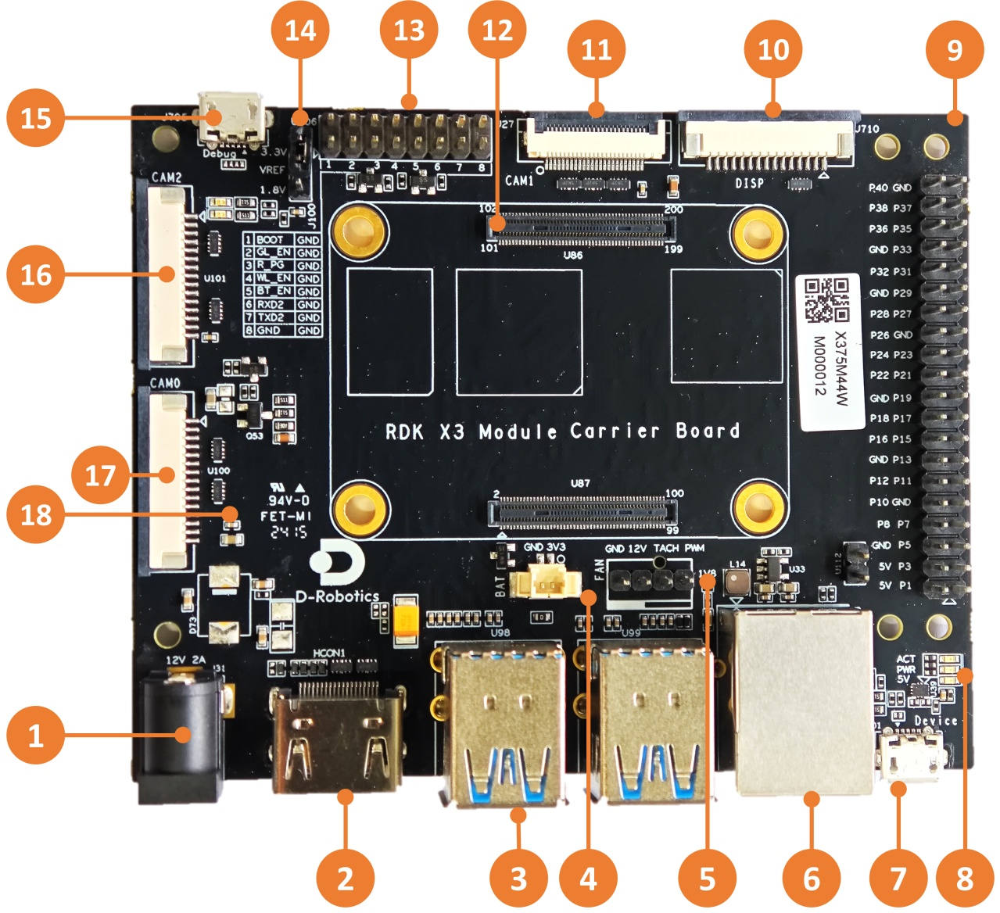
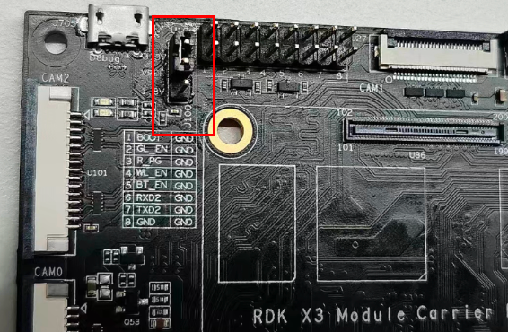

# D-Robotics RDK X3 Module: Carrier, Boot and Development Reference


**D-Robotics RDK X3 Module — manufacturer reference; no verified OpenELAB SKU or product URL.**

**Model:** RDK X3 Module and the official RDK X3 Module Carrier Board · **Options:** RAM, eMMC and wireless configurations must be identified from the module label · **Documentation:** current X3 family documentation with separately dated Module hardware documents. This reference does not establish a store listing, kit contents or current stock.


The RDK X3 Module puts the Sunrise X3 processor, memory and optional eMMC/wireless hardware on a 55×40 mm compute module. It needs a correctly designed carrier: the **official carrier takes 12 V/2 A**, while the **module itself takes nominal 5 V** at its board-to-board power pins. Its configurable 1.8 V/3.3 V expansion domain must agree with firmware and carrier jumpers. It is not the USB-C-powered [RDK X3 single-board product](rdk-x3-4gb-development-guide.md). [Current Module brief](https://archive.d-robotics.cc/downloads/en/hardware/rdk_x3_module/RDK%20X3%20MD.pdf), [official carrier interfaces](https://d-robotics.github.io/rdk_x_doc/en/Advanced_development/hardware_development/rdk_x3_module/interface?v=3.0.0\&p=RDK+X3).

## Product overview <a href="#product-overview" id="product-overview"></a>

### Module, carrier and complete development system <a href="#module-carrier-and-complete-development-system" id="module-carrier-and-complete-development-system"></a>

The module provides a quad-core Cortex-A53 CPU and dual-core Bernoulli BPU with an equivalent 5 TOPS rating. The official carrier exposes Ethernet, HDMI, USB, three camera connections, DSI,40-pin I/O, debug USB-UART, a fan connector and an RTC battery connector. A compute-module ordering code does not automatically include that carrier, power adapter, cooling, card, camera or battery. No OpenELAB order code was verified for this reference. [Module brief v1.1.0,2025-07](https://archive.d-robotics.cc/downloads/en/hardware/rdk_x3_module/RDK%20X3%20MD.pdf), [carrier interface guide](https://d-robotics.github.io/rdk_x_doc/en/Advanced_development/hardware_development/rdk_x3_module/interface?v=3.0.0\&p=RDK+X3).

The manufacturer describes compatibility with the Raspberry Pi CM4 form factor/interface. This is a design starting point, not permission to plug the X3 Module into an arbitrary CM4 carrier or load a Raspberry Pi image. Check power rails, IO voltage, boot straps, NC pins, USB roles, camera/display routing and software support against the **X3** datasheet, pinmux and exact carrier schematic. Older design documents contain conflicting and inherited text; specific conflicts are identified below instead of being converted into wiring instructions. [Module datasheet](https://archive.d-robotics.cc/downloads/en/hardware/rdk_x3_module/RDK_X3_Module_Datasheet.pdf), [design guide](https://archive.d-robotics.cc/downloads/en/hardware/rdk_x3_module/RDK_X3_Module_Design_Guide.pdf).

### Current and older hardware documents <a href="#current-and-older-hardware-documents" id="current-and-older-hardware-documents"></a>

| Document                             | Observed version                      | How to use it                                                                                                          |
| ------------------------------------ | ------------------------------------- | ---------------------------------------------------------------------------------------------------------------------- |
| Current English Module product brief | v1.1.0, July 2025,7 pages             | Product configurations, dimensions, operating-temperature distinction and carrier overview                             |
| Detailed Module datasheet            | v1.0,23 May2023,25 pages              | Signal descriptions,200-pin definition, DC characteristics and power sequencing; retain conflicts for design review    |
| Module design guide                  | v1.0,23 May2023,38 pages              | Carrier design topics, routing, power/boot and interface considerations; not every statement agrees with the datasheet |
| Official carrier brief               | v1.0,23 July 2023,8 pages             | Carrier connectors, camera/DSI/RTC pin tables                                                                          |
| Carrier reference archive            | Named revision `1_b`                  | Schematic, placement files, BOM, STEP and fabrication archive for that carrier revision                                |
| Module PINMUX workbook               | Downloaded from current hardware page | Cross-check SoC multiplexing, connector pins and GPIO domain before assigning interfaces                               |

Sources: [current brief](https://archive.d-robotics.cc/downloads/en/hardware/rdk_x3_module/RDK%20X3%20MD.pdf), [datasheet](https://archive.d-robotics.cc/downloads/en/hardware/rdk_x3_module/RDK_X3_Module_Datasheet.pdf), [design guide](https://archive.d-robotics.cc/downloads/en/hardware/rdk_x3_module/RDK_X3_Module_Design_Guide.pdf), [carrier brief](https://archive.d-robotics.cc/downloads/hardware/rdk_x3_module/RDK_X3_Module_Carrier_Board_Product_Brief.pdf), [reference archive](https://archive.d-robotics.cc/downloads/en/hardware/rdk_x3_module/Reference_Design.zip), [pinmux workbook](https://archive.d-robotics.cc/downloads/en/hardware/rdk_x3_module/RDK_X3_Module_PINMUX.xlsx). A current link to an older document does not make its 2023 electrical assumptions a 2026 PCB revision.

## Applications <a href="#applications" id="applications"></a>

The X3 Module is suitable for a carrier-based camera/AI appliance, compact robotics perception computer or an embedded product needing controlled placement of USB, Ethernet, displays and I/O. It supports the same X3 compiler architecture as the single-board X3, while offering more exposed camera channels and eMMC options. Integration work includes carrier electrical validation, thermal design, storage/recovery strategy and release-matched Linux/BPU software. [Module datasheet](https://archive.d-robotics.cc/downloads/en/hardware/rdk_x3_module/RDK_X3_Module_Datasheet.pdf), [X3 toolchain](https://d-robotics.github.io/rdk_x_doc/en/Advanced_development/toolchain_development/rdk_x3/oe_toolchain_v2_6_6?v=3.0.0\&p=RDK+X3).

Three CSI sockets on the official carrier allow multi-camera development, but simultaneous throughput depends on the sensors, lane allocation, configured ISP/video pipeline, memory bandwidth and models. Do not multiply a single-sensor peak resolution or 5 TOPS by the socket count. The module has one USB3 controller expanded by the official carrier's hub; four Type-A connectors do not create four independent upstream controllers. [Carrier interface guide](https://d-robotics.github.io/rdk_x_doc/en/Advanced_development/hardware_development/rdk_x3_module/interface?v=3.0.0\&p=RDK+X3).

## Specifications <a href="#specifications" id="specifications"></a>

### Compute-module specifications and ordering codes <a href="#compute-module-specifications-and-ordering-codes" id="compute-module-specifications-and-ordering-codes"></a>

| Parameter                 | Module scope                                                  | Integration condition                                                                                                                  |
| ------------------------- | ------------------------------------------------------------- | -------------------------------------------------------------------------------------------------------------------------------------- |
| CPU                       | Four64-bit Cortex-A53 cores, advertised 1.5 GHz               | Read the installed frequency policy and hardware revision; older detailed datasheet distinguishes typical 1.2 GHz from maximum 1.5 GHz |
| BPU                       | Dual-core Bernoulli, equivalent 5 TOPS                        | OpenExplorer compiler target `bernoulli2`                                                                                              |
| RAM                       | 2 GB or 4 GB LPDDR4                                           | Exact ordering code matters for boot firmware                                                                                          |
| Storage                   | Family lists absent/16 GB/32 GB/64 GB eMMC options            | Current enumerated part codes below cover 16/32/64 GB; identify the actual fitted device                                               |
| Wireless                  | With or without dual-band 802.11a/b/g/n/ac and Bluetooth4.2   | Wireless module and antenna must be present for those functions                                                                        |
| Module dimensions         | 55×40 mm                                                      | Detailed datasheet gives 1.2 mm PCB thickness; use drawings for component/connector clearances                                         |
| Module supply             | Nominal5 V; detailed datasheet gives 4.75–5.25 V              | This is not the official carrier's barrel-input voltage                                                                                |
| Module GPIO reference     | Selectable1.8 V or 3.3 V domain                               | Not all module signals share that domain; debug UART0 is separately 1.8 V                                                              |
| Camera                    | One4-lane CSI and two 2-lane CSI interfaces                   | Official carrier exposes CAM1 as 24-pin and CAM0/CAM2 as 15-pin                                                                        |
| Display                   | HDMI and MIPI DSI, up to 1080p60 in current brief             | Treat display selection as alternate output under the reviewed X3 software, not two guaranteed independent displays                    |
| Multimedia                | H.264/H.265 and MJPEG codec support; headline 4K60 capability | Separate codec blocks from display limit and application throughput                                                                    |
| Current brief temperature | 0–65°C; up to 70°C without Wi-Fi module                       | The older detailed datasheet says−20–60°C. Qualify the exact ordering/revision before a deployment outside the overlap                 |

Sources: [current Module brief](https://archive.d-robotics.cc/downloads/en/hardware/rdk_x3_module/RDK%20X3%20MD.pdf), [detailed datasheet pp. 2–3,23–25](https://archive.d-robotics.cc/downloads/en/hardware/rdk_x3_module/RDK_X3_Module_Datasheet.pdf), [carrier interface](https://d-robotics.github.io/rdk_x_doc/en/Advanced_development/hardware_development/rdk_x3_module/interface?v=3.0.0\&p=RDK+X3). The temperature discrepancy is not resolved by choosing the more attractive range; **0–60°C is the overlapping document envelope**, not a newly certified rating. Obtain manufacturer confirmation for the exact module before specifying a different deployment range.

The current brief enumerates these manufacturer part numbers; none is presented as an OpenELAB SKU. [Module brief, p.3](https://archive.d-robotics.cc/downloads/en/hardware/rdk_x3_module/RDK%20X3%20MD.pdf).

| Manufacturer part number | Wireless | RAM  | eMMC  |
| ------------------------ | -------- | ---- | ----- |
| RDK X3 MD 002016         | No       | 2 GB | 16 GB |
| RDK X3 MD 102016         | Yes      | 2 GB | 16 GB |
| RDK X3 MD 002032         | No       | 2 GB | 32 GB |
| RDK X3 MD 102032         | Yes      | 2 GB | 32 GB |
| RDK X3 MD 004032         | No       | 4 GB | 32 GB |
| RDK X3 MD 104032         | Yes      | 4 GB | 32 GB |
| RDK X3 MD 004064         | No       | 4 GB | 64 GB |
| RDK X3 MD 104064         | Yes      | 4 GB | 64 GB |

### Official carrier connections <a href="#official-carrier-connections" id="official-carrier-connections"></a>

| Connection    | Official carrier                                 | Distinction from the X3 single board                               |
| ------------- | ------------------------------------------------ | ------------------------------------------------------------------ |
| Power         | DC input, recommended 12 V/2 A                   | Not5 V USB-C                                                       |
| USB host      | Four USB3 Type-A ports through hub               | Single-board X3 has one USB3 and two USB2 Type-A                   |
| USB device    | Separate Micro USB data/flashing connector       | Attaching device mode disables host operation                      |
| Debug         | Separate Micro USB→CH340 console                 | Do not confuse with the USB device/flashing connector              |
| Camera        | CAM0/CAM2 two-lane 15-pin, CAM1 four-lane 24-pin | Single-board X3 exposes one CSI connector                          |
| Display       | HDMI plus 15-pin DSI                             | Single-board X3 has no exposed DSI connector                       |
| Expansion     | 40-pin; selectable 1.8/3.3 V signal domain       | Single-board X3 expansion is 3.3 V                                 |
| Boot storage  | On-module eMMC or carrier microSD                | Read the mounted root device and selected boot order               |
| Other headers | RTC battery, fan, control IO, VREF selection     | These do not establish included accessories or every pin's voltage |

Source: [official carrier interface guide](https://d-robotics.github.io/rdk_x_doc/en/Advanced_development/hardware_development/rdk_x3_module/interface?v=3.0.0\&p=RDK+X3).

## Hardware and connections <a href="#hardware-and-connections" id="hardware-and-connections"></a>

### Identify the two USB connectors and the power domain <a href="#identify-the-two-usb-connectors-and-the-power-domain" id="identify-the-two-usb-connectors-and-the-power-domain"></a>



_Manufacturer carrier diagram from_ [_official Module interface documentation_](https://d-robotics.github.io/rdk_x_doc/en/Advanced_development/hardware_development/rdk_x3_module/interface?v=3.0.0\&p=RDK+X3)_. The illustrated board is an official reference carrier, not a verified store bundle._

The DC barrel connector is marked 12 V/2 A. The carrier regulates the module's5 V supply and other rails; do not apply 12 V to the module's5 V pins, GPIO header or USB connectors. Use the matched adapter and verify its polarity against the actual carrier marking/schematic before connection. The two Micro USB sockets serve different circuits: **Debug** is the CH340 console, while **Device** connects the SoC USB data/recovery path. Do not use either as a substitute for carrier power. [Interface guide](https://d-robotics.github.io/rdk_x_doc/en/Advanced_development/hardware_development/rdk_x3_module/interface?v=3.0.0\&p=RDK+X3), [carrier reference schematic](https://archive.d-robotics.cc/downloads/en/hardware/rdk_x3_module/Reference_Design.zip).

| Diagram number | Function                                      | Before connecting                                                                            |
| -------------- | --------------------------------------------- | -------------------------------------------------------------------------------------------- |
| 1              | DC power input                                | Matched12 V/2 A supply; confirm carrier revision/polarity                                    |
| 2 /3 /6        | HDMI / four USB3 hosts / Gigabit Ethernet     | Keep the Device cable unplugged when testing USB hosts                                       |
| 4 /5           | RTC battery / fan                             | Check polarity and connector voltage; fan header is labeled GND,12 V,TACH,PWM in the diagram |
| 7 /15          | USB Device / CH340 Debug                      | Console settings 921600,8N1,no flow control on Debug                                         |
| 9 /14          | 40-pin / IO VREF header                       | Determine the selected signal domain before any HAT connection                               |
| 10 /11         | DSI / CAM1                                    | Power off before FFC changes; different connector purposes and pinouts                       |
| 12 /13         | Module mating connector / functional controls | Align the module; do not short arbitrary control pins                                        |
| 16 /17 /18     | CAM2 / CAM0 / microSD on back                 | Check camera routing and selected boot medium                                                |

### Module installation and power sequencing <a href="#module-installation-and-power-sequencing" id="module-installation-and-power-sequencing"></a>

With all supplies disconnected, align the module's chip/DDR/wireless component order to the carrier silkscreen and the four mounting holes. Seat the board-to-board connectors evenly as illustrated by the current carrier instructions; never force an angled engagement based on an inherited assembly paragraph in the older design guide. Inspect for a tilted connector or trapped cable before mounting the thermal solution. Mechanical compatibility does not remove the need to check stack height and screw engagement. The design guide describes a 200-contact,0.4 mm-pitch mating system and recommends retaining screws where a heatsink adds load. [Current installation instructions](https://d-robotics.github.io/rdk_x_doc/en/Quick_start/hardware_introduction/rdk_x3?v=3.0.0\&p=RDK+X3), [design guide ch.4](https://archive.d-robotics.cc/downloads/en/hardware/rdk_x3_module/RDK_X3_Module_Design_Guide.pdf).

The detailed module power table identifies **5 V inputs at module pins 77,79,81,83,85,87**, and generated rails at **MD\_3.3V84/86** and **MD\_1.8V88/90**. Each generated rail is specified as 300mA per pin,600mA aggregate in that table; those are **module rail** figures, not a blanket budget for the carrier's40-pin header. **GPIO\_VREF pin 78 must be tied to the correct generated 1.8 V or 3.3 V rail and must not float or connect to ground.** Do not externally drive the generated rail pins. [Datasheet p.15](https://archive.d-robotics.cc/downloads/en/hardware/rdk_x3_module/RDK_X3_Module_Datasheet.pdf).

For a custom carrier, review these design checkpoints before routing:

1. Keep5 V within the exact module revision's input tolerance and prevent other interfaces from back-powering the module before its rails rise.
2. Preserve the relationship between 5 V, GLOBAL\_EN, generated rails and RUN\_PG. The design guide specifies a monotonic supply and delayed rail/ready sequencing; verify timing with the actual PMIC/carrier rather than treating a single enable pin as a complete power controller.
3. Shut Linux down before removing storage power. Allow rails to discharge before reseating the module; the design guide specifies below 0.6 V before removal.
4. Use level-appropriate buffers and pulls on external IO. A signal that shares the 40-pin's1.8/3.3 V domain is different from fixed 1.8 V debug signals and 5 V-tolerant HDMI sideband signals.
5. Reconcile the datasheet, pinmux and carrier netlist. The older design guide disagrees on some input/NC pins, pull-up resistor values and interface details; do not release a custom PCB solely from one table.

Sources: [datasheet power/DC chapters](https://archive.d-robotics.cc/downloads/en/hardware/rdk_x3_module/RDK_X3_Module_Datasheet.pdf), [design guide power sequencing](https://archive.d-robotics.cc/downloads/en/hardware/rdk_x3_module/RDK_X3_Module_Design_Guide.pdf). These are engineering review checkpoints, not a claim that a custom carrier has been electrically validated.

### Selectable GPIO voltage: hardware and firmware must agree <a href="#selectable-gpio-voltage-hardware-and-firmware-must-agree" id="selectable-gpio-voltage-hardware-and-firmware-must-agree"></a>



_D-Robotics VREF illustration from the_ [_Module interface guide_](https://d-robotics.github.io/rdk_x_doc/en/Advanced_development/hardware_development/rdk_x3_module/interface?v=3.0.0\&p=RDK+X3)_. Read the actual silkscreen; do not infer jumper position from a rotated photograph._

Factory documentation describes 3.3 V as the default. The older interface guide prescribes matching 1.8 V boot firmware **before** changing the powered-off jumper to VREF–1.8 V; the newer configuration-file reference also exposes `[rdkmd] voltage_domain=3.3V`/1.8 V configuration in supported boot firmware. These are parts of a version-dependent boot/voltage contract, not two interchangeable shortcuts. Keep the factory 3.3 V configuration for first boot. For1.8 V integration, verify the exact miniboot support, configuration and jumper together against the installed release; never move a jumper while powered or leaveVREF open. [Interface instructions](https://d-robotics.github.io/rdk_x_doc/en/Advanced_development/hardware_development/rdk_x3_module/interface?v=3.0.0\&p=RDK+X3), [config.txt requirements](https://d-robotics.github.io/rdk_x_doc/en/System_configuration/config_txt?v=3.0.0\&p=RDK+X3).

The selected GPIO domain does not reduce the physical header's5 V/3.3 V supply pins to 1.8 V. Use a level shifter for a peripheral in another signal domain, and verify all I2C pull-ups are tied to the intended domain. A3.3 V HAT can damage or malfunction on 1.8 V signals even when its power connector appears familiar.

### Carrier40-pin map versus 200-pin module map <a href="#carrier40-pin-map-versus-200-pin-module-map" id="carrier40-pin-map-versus-200-pin-module-map"></a>

The following table uses **physical carrier header positions** and the official carrier's default 3.3 V map. The BCM numbers are compatibility aliases; they are not 200-pin module contacts or Linux GPIO indexes. Signal functions depend on mux configuration. [Carrier brief pp. 3–4](https://archive.d-robotics.cc/downloads/hardware/rdk_x3_module/RDK_X3_Module_Carrier_Board_Product_Brief.pdf), [carrier pin diagram](https://d-robotics.github.io/rdk_x_doc/en/Quick_start/hardware_introduction/rdk_x3?v=3.0.0\&p=RDK+X3).

| Odd physical pin | Carrier signal     | Even physical pin | Carrier signal    |
| ---------------- | ------------------ | ----------------- | ----------------- |
| 1                | 3.3 V power        | 2                 | 5 V power         |
| 3                | I2C0 SDA / BCM2    | 4                 | 5 V power         |
| 5                | I2C0 SCL / BCM3    | 6                 | GND               |
| 7                | I2S0 MCLK / BCM4   | 8                 | UART3 TX / BCM14  |
| 9                | GND                | 10                | UART3 RX / BCM15  |
| 11               | GPIO17             | 12                | I2S0 BCLK / BCM18 |
| 13               | GPIO27             | 14                | GND               |
| 15               | GPIO22             | 16                | GPIO23            |
| 17               | 3.3 V power        | 18                | GPIO24            |
| 19               | SPI1 MOSI / BCM10  | 20                | GND               |
| 21               | SPI1 MISO / BCM9   | 22                | GPIO25            |
| 23               | SPI1 clock / BCM11 | 24                | SPI1 CS / BCM8    |
| 25               | GND                | 26                | GPIO7             |
| 27               | I2C3 SDA / BCM0    | 28                | I2C3 SCL / BCM1   |
| 29               | GPIO5              | 30                | GND               |
| 31               | GPIO6              | 32                | PWM4 / BCM12      |
| 33               | PWM0 / BCM13       | 34                | GND               |
| 35               | I2S0 LRCK / BCM19  | 36                | GPIO16            |
| 37               | GPIO26             | 38                | I2S1 data / BCM20 |
| 39               | GND                | 40                | I2S0 data / BCM21 |

Selected **module contacts** useful during a carrier audit are different numbers:

| Module contact(s) | Function/domain                                  | Cross-check                                                                                               |
| ----------------- | ------------------------------------------------ | --------------------------------------------------------------------------------------------------------- |
| 78                | GPIO\_VREF                                       | Tie to generated 1.8 V or 3.3 V, never float                                                              |
| 16 /18            | Debug UART0 RX/TX, fixed 1.8 V                   | Use the official carrier's conversion circuit; do not attach a 3.3 V adapter directly to bare contacts    |
| 51 /55            | UART3 RX/TX, GPIO\_VREF domain                   | These route to carrier physical 10/8                                                                      |
| 64 /68            | UART2 TX/RX, GPIO\_VREF domain                   | Functional-control header; verify net names rather than a duplicated “receive” description                |
| 56 /58            | I2C0 SCL/SDA, GPIO\_VREF                         | Check existing pull-ups before adding more                                                                |
| 80 /82            | Camera/display I2C1 SCL/SDA, fixed 3.3 V domain  | Not automatically the selected GPIO voltage                                                               |
| 38 /39 /40 /44    | SPI1 clock/CS/MISO/MOSI                          | Mapped through multiplexed contacts; retain exact PINMUX/netlist                                          |
| 103 /105          | USB D−/D+                                        | One USB controller, with separate SuperSpeed pairs                                                        |
| 89 /91            | Wireless/Bluetooth disable, fixed 3.3 V signals  | Active low; availability depends on wireless option                                                       |
| 92 /93 /99 /100   | RUN\_PG / boot strap / GLOBAL\_EN / reset output | Control/power signals with different directions and pulls; not ordinary outputs to short indiscriminately |

Sources: [datasheet interface tables](https://archive.d-robotics.cc/downloads/en/hardware/rdk_x3_module/RDK_X3_Module_Datasheet.pdf), [PINMUX workbook](https://archive.d-robotics.cc/downloads/en/hardware/rdk_x3_module/RDK_X3_Module_PINMUX.xlsx). The full 200-contact definitions remain available in the original datasheet and design resources. Some legacy rows reverse UART TX/RX direction text or SPI MOSI/MISO descriptions; use the named SoC signal and carrier schematic, and obtain clarification before a custom-board design relying on a disputed contact.

### Functional-control header <a href="#functional-control-header" id="functional-control-header"></a>

| Header row label | Documented purpose                                 | Operation boundary                                                     |
| ---------------- | -------------------------------------------------- | ---------------------------------------------------------------------- |
| BOOT             | Enter fastboot boot mode when grounded at power-on | Recovery only; do not leave strapped for normal first boot             |
| GL\_EN           | Disable module power when grounded                 | Not a filesystem-safe shutdown command                                 |
| R\_PG            | Power-good/running indication                      | An output/status signal; do not treat it as an arbitrary ground jumper |
| W\_EN /BT\_EN    | Disable Wi-Fi/Bluetooth when grounded              | Restore normal configuration and restart as documented                 |
| RXD2 /TXD2       | UART2 receive/transmit                             | Check selected GPIO voltage and crossing to the external device        |
| GND              | Reference                                          | Use the labeled adjacent ground positions                              |

The official graphic places each named row beside a ground contact. The guide's duplicated “receive” wording for TXD2 is not a new protocol. [Carrier functional controls](https://d-robotics.github.io/rdk_x_doc/en/Advanced_development/hardware_development/rdk_x3_module/interface?v=3.0.0\&p=RDK+X3).

### Cameras, DSI, HDMI, fan and RTC <a href="#cameras-dsi-hdmi-fan-and-rtc" id="cameras-dsi-hdmi-fan-and-rtc"></a>

**CAM0 and CAM2** use 15-pin,two-lane connectors for documented OV5647/IMX219/IMX477-style modules. **CAM1** uses 24pins and four lanes, with F37/GC4663/IMX415 examples in the carrier chapter. Sensor address alone does not establish the lane/connector/mode. The current general table lists F37 `0x40`, GC4663 `0x29`, IMX219 `0x10`, IMX477 `0x1a` and OV5647 `0x36`. Never hot-plug a MIPI camera. [Carrier interfaces](https://d-robotics.github.io/rdk_x_doc/en/Advanced_development/hardware_development/rdk_x3_module/interface?v=3.0.0\&p=RDK+X3), [Module camera workflow](https://d-robotics.github.io/rdk_x_doc/en/Advanced_development/hardware_development/rdk_x3_module/camera?v=3.0.0\&p=RDK+X3).

The older carrier brief identifies CAM0/2's15-pin ground positions 1,4,7,10; clock pair 8/9; data pairs 2/3 and 5/6; control/I2C and 3.3 V supply in the remaining positions. CAM1 instead includes **1.8 V control and clock** signals with its own 3.3 V camera supplies. Do not translate one connector's ribbon orientation or power pins onto another. The same brief contains mislabeled “data/clock” prose in some I2C rows; the schematic/net names and exact camera specification are required for an adapter design. [Carrier brief pp. 5–6](https://archive.d-robotics.cc/downloads/hardware/rdk_x3_module/RDK_X3_Module_Carrier_Board_Product_Brief.pdf).

The15-pin **DSI** connector is a display output, not a camera input. The current Module display example is a 4.3-inch panel using `hobot-x3-cm.dtb` and `video=hobot:cm480p`; default output is HDMI. Before any change, read the current DTB boot arguments and keep an untouched backup on accessible boot media. Do not replace an entire boot-argument string from an old example on a newer image: preserve its other arguments and use the exact installed display-driver instructions. Recovery is restoring the original DTB and rebooting. The older design guide's claim of two simultaneous displays conflicts with the datasheet's time-sharing description and current switching workflow, so this reference does not promise dual-display operation. [Module DSI procedure](https://d-robotics.github.io/rdk_x_doc/en/Advanced_development/hardware_development/rdk_x3_module/display?v=3.0.0\&p=RDK+X3), [datasheet p.5](https://archive.d-robotics.cc/downloads/en/hardware/rdk_x3_module/RDK_X3_Module_Datasheet.pdf), [design guide ch.8](https://archive.d-robotics.cc/downloads/en/hardware/rdk_x3_module/RDK_X3_Module_Design_Guide.pdf).

The RTC connector on the official carrier is labeled **GND /3V3**; the carrier brief identifies battery pin 1 as positive 3 V or 3.3 V and pin 2 as ground. Verify connector orientation/polarity and the exact battery arrangement before attachment; this guide does not establish a rechargeable-cell circuit. The fan connector is labeledGND,12 V,TACH,PWM and requires a compatible fan. An RTC or fan connector being present does not mean either accessory is included. [Carrier brief p.5](https://archive.d-robotics.cc/downloads/hardware/rdk_x3_module/RDK_X3_Module_Carrier_Board_Product_Brief.pdf), [carrier photograph](https://d-robotics.github.io/rdk_x_doc/en/Advanced_development/hardware_development/rdk_x3_module/interface?v=3.0.0\&p=RDK+X3).

### Custom-carrier design topics and bounded conflicts <a href="#custom-carrier-design-topics-and-bounded-conflicts" id="custom-carrier-design-topics-and-bounded-conflicts"></a>

The38-page design guide covers power/boot, connector/mechanics, USB, Ethernet, display, CSI, audio, I2C, SPI, UART and debug. These are the practical review tasks for each topic, with the original detailed routing drawings retained in the download table:

| Design topic | Essential design work                                                                                                              | Source/version boundary                                                                                                          |
| ------------ | ---------------------------------------------------------------------------------------------------------------------------------- | -------------------------------------------------------------------------------------------------------------------------------- |
| Power/boot   | Monotonic5 V, no back-power, correctVREF, delayed peripheral enable, orderly shutdown and recoverable boot strap                   | Datasheet and design guide disagree on certain additional 5 V/NC pins and pull-up values; reconcile exact revision before layout |
| Mechanical   | Match both board-to-board connectors, hole positions, stack height and thermal-solution support                                    | Use carrier reference STEP/DXF and actual mating-connector AVL; no guessed screw engagement                                      |
| USB          | Route USB2 and SuperSpeed pairs with controlled impedance and continuous return plane; preserve role selection and recovery wiring | Guide specifies 90Ω±10% for USB3 differential routing; one controller/role switch remains                                        |
| Ethernet     | Module includes PHY; carrier supplies magnetics/MagJack, connector protection and LED circuitry                                    | Use the documented RTL8211F-related carrier design and verify magnetics/routing against exact revision                           |
| HDMI         | Review DDC/HPD/CEC voltage domains, ESD, AC coupling, differential routing and connector layout                                    | Guide ch.8 contains detailed pad/via/connector-void figures; a 1080p screen test is not signal-integrity qualification           |
| DSI/CSI      | Map each lane/clock/polarity, control bus, sensor power and return plane                                                           | Old guide lists inconsistent lane rates/counts across tables; do not infer a guaranteed maximum custom-camera link from it       |
| I2S audio    | Use the stated master clock/bit clock/frame sync/data direction and GPIO\_VREF; codec requires its own clocking/configuration      | The guide notes at least one of the two related clock/frame pins should remain input if both repurposed as GPIO                  |
| I2C          | Address uniqueness, correct 7-bit notation, voltage-appropriate pull-ups and capacitance                                           | Datasheet and guide give differingI2C0 pull-up values; measure/check fitted module, do not parallel arbitrary resistors          |
| SPI          | Match mux, clock mode, chip select, direction, load and return plane                                                               | 48 MHz is a module interface capability in the older docs, not permission to drive a long jumper cable at 48 MHz                 |
| UART/JTAG    | Keep bare debug UART0 at 1.8 V and protect boot-strapping signals; select other UART domain correctly                              | Official carrier CH340 interface is preferred for first communication; JTAG and expansion functions share pins                   |

Sources: [Module design guide ch.3–11](https://archive.d-robotics.cc/downloads/en/hardware/rdk_x3_module/RDK_X3_Module_Design_Guide.pdf), [datasheet](https://archive.d-robotics.cc/downloads/en/hardware/rdk_x3_module/RDK_X3_Module_Datasheet.pdf), [carrier reference archive](https://archive.d-robotics.cc/downloads/en/hardware/rdk_x3_module/Reference_Design.zip). These conflicts restrict custom-carrier fabrication and high-speed-limit claims; they do not prevent the documented default-voltage, read-only first result on an identified official carrier.

## Software and development resources <a href="#software-and-development-resources" id="software-and-development-resources"></a>

### Boot media and software version contract <a href="#boot-media-and-software-version-contract" id="boot-media-and-software-version-contract"></a>

X3 Module uses on-module **QSPI/NAND boot firmware** to initialize hardware and select the OS on eMMC or microSD. The OS root medium and bootloader are separate: writing a card does not necessarily repair NAND, while updating boot firmware is not a normal application installation. Current X3 installation docs support 2.x Ubuntu 20.04 and 3.x Ubuntu 22.04 on both X3 board and Module;1.x images are legacy single-board X3 only. [Module image installation](https://d-robotics.github.io/rdk_x_doc/en/Quick_start/install_os/rdk_x3_module/system_burn?v=3.0.0\&p=RDK+X3), [boot firmware](https://d-robotics.github.io/rdk_x_doc/en/Quick_start/install_os/rdk_x3_module/nand_flash_firmware?v=3.0.0\&p=RDK+X3).

| Component          | Correct Module scope                                                     | Check before change                                                          |
| ------------------ | ------------------------------------------------------------------------ | ---------------------------------------------------------------------------- |
| OS image           | X3 family image; current observed archive includes 3.0.3 desktop/server  | Record actual `/etc/version`, Ubuntu release, image filename and root device |
| eMMC /SD selection | `srpi-config` Advanced Options → Boot Order on supported Module firmware | Do not assume Linux `mmcblk` numbering from another boot session             |
| Miniboot           | Module 2 GB/4 GB and IO-voltage-compatible firmware                      | Model targets `RDK_X3_MD_2GB`/`RDK_X3_MD_4GB`, not single-board `RDK_X3_4GB` |
| Accelerator        | Bernoulli2; X3 OpenExplorer2.6.6 documented with system 3.0.0            | Not X5 Bayes-e, Ultra Bayes or S-series Nash                                 |
| Python inference   | `hobot_dnn.pyeasy_dnn` or target-demo `bpu_infer_lib_x3`                 | Use a compiled X3 model and matching preprocessing/postprocessing            |
| ROS2/TROS          | Ubuntu 20.04/Foxy or Ubuntu 22.04/Humble                                 | Package `tros` vs `tros-humble`, distinct environment paths                  |

Sources: [X3 toolchain page](https://d-robotics.github.io/rdk_x_doc/en/Advanced_development/toolchain_development/rdk_x3/oe_toolchain_v2_6_6?v=3.0.0\&p=RDK+X3), [Model Zoo mapping](https://d-robotics.github.io/model_zoo_doc/en/model_zoo_intro?v=3.0.0\&p=RDK+X3), [TROS supported platforms](https://d-robotics.github.io/tros_doc/en/tros?v=3.0.0\&p=RDK+X3), [configuration tool](https://d-robotics.github.io/rdk_x_doc/en/System_configuration/srpi-config?v=3.0.0\&p=RDK+X3). Documentation selector v3.0.0, OS3.0.3, compiler 2.6.6 and TROS package version are independent identifiers.

### Linux configuration, networking, GPIO and maintenance <a href="#linux-configuration-networking-gpio-and-maintenance" id="linux-configuration-networking-gpio-and-maintenance"></a>

Use `sudo srpi-config` in a full-screen terminal for network/login, SSH/VNC, peripheral-bus mux, sensor profiles, ION size and Module boot order. Finish/reboot when requested. GPIO access with `Hobot.GPIO` requires a deliberate numbering scheme and a mux released from its dedicated peripheral. The same hardware-PWM restriction as X3 applies: no software PWM emulation and no assumption that a shared X5 channel table is a Module pin map. [Configuration tool](https://d-robotics.github.io/rdk_x_doc/en/System_configuration/srpi-config?v=3.0.0\&p=RDK+X3), [GPIO](https://d-robotics.github.io/rdk_x_doc/en/Basic_Application/01_40pin_user_sample/gpio?v=3.0.0\&p=RDK+X3), [PWM](https://d-robotics.github.io/rdk_x_doc/en/Basic_Application/01_40pin_user_sample/pwm?v=3.0.0\&p=RDK+X3).

`/boot/config.txt` requires system≥2.1.0 and compatible miniboot no earlier than 26 November 2023 in the documented workflow. Module-specific settings belong under `[rdkmd]`; a generic `voltage_domain` setting must agree with the VREF jumper and boot firmware. Save the original boot file before edits. ION allocation reserves physical memory for video/BPU and reduces general Linux RAM; insufficient ION and ordinary heap exhaustion are different failures. [Configuration-file reference](https://d-robotics.github.io/rdk_x_doc/en/System_configuration/config_txt?v=3.0.0\&p=RDK+X3).

Use a console to read the actual IP before SSH. The current network page uses 192.168.127.10, whereas older hardware text uses 192.168.1.10. It separates X3 before 3.0.2 (`/etc/network/interfaces`) from≥3.0.2 NetworkManager profiles. Configure only the manager active on the installed image and keep a console when restarting networking. Wi-Fi/BT also depend on the fitted wireless option and W\_EN/BT\_EN straps; no amount of software configuration adds a missing radio module. [Network/Bluetooth](https://d-robotics.github.io/rdk_x_doc/en/System_configuration/network_bluetooth?v=3.0.0\&p=RDK+X3), [functional controls](https://d-robotics.github.io/rdk_x_doc/en/Advanced_development/hardware_development/rdk_x3_module/interface?v=3.0.0\&p=RDK+X3).

For long-running services, prove a manual start and then specify the correct working directory, user and environment in systemd. Keep a record of kernel, bootloader, BPU drivers, TROS and model hashes before an upgrade, and preserve boot configuration. Kernel modules must match the installed ABI; the X3 header guide describes kernel 4.14.87 and signing differences before/after image 3.0.1. Historical RT-package versions are not a blanket current downgrade recipe. [Autostart](https://d-robotics.github.io/rdk_x_doc/en/System_configuration/self_start?v=3.0.0\&p=RDK+X3), [kernel headers](https://d-robotics.github.io/rdk_x_doc/en/Advanced_development/linux_development/kernel_headers?v=3.0.0\&p=RDK+X3), [RT development](https://d-robotics.github.io/rdk_x_doc/en/Advanced_development/linux_development/realtime_kernel?v=3.0.0\&p=RDK+X3).

### Camera, display, codec and inference APIs <a href="#camera-display-codec-and-inference-apis" id="camera-display-codec-and-inference-apis"></a>

The X3 SP API combines capture/VPS, codec, display and explicit module binding. A pipeline such as camera→encoder or decoder→display must match dimensions, pixel format, buffers and hardware-channel allocation. `sp_module_bind` transfers internally between supported module pairs; unbind before module teardown. The SP interface uses caller-owned image buffers; do not assume a native borrowed-frame return operation exists in this wrapper. [X3 API overview](https://d-robotics.github.io/rdk_x_doc/en/Basic_Application/multi_media_sp_dev_api/RDK_X3/overview?v=3.0.0\&p=RDK+X3), [binding API](https://d-robotics.github.io/rdk_x_doc/en/Basic_Application/multi_media_sp_dev_api/RDK_X3/cdev_multimedia_api_x3/sys_api?v=3.0.0\&p=RDK+X3).

The installed `/app/cdev_demo/` set covers BPU, decode-to-display, RTSP-to-display, raw/YUV capture, camera-to-display and camera-to-encoder examples. Each example's Makefile builds against installed libraries. Inspect the installed source/model before running a shared example: current documentation logs sometimes name `bayese` models, which are not Module Bernoulli2 binaries. Capture-to-file should show a correctly sized raw/YUV file; encoder output should be a decodable stream; display examples should show the expected scene. These are different checkpoints, not interchangeable proof of a functioning full pipeline. [C examples](https://d-robotics.github.io/rdk_x_doc/en/Basic_Application/cdev_demo_sample/overview?v=3.0.0\&p=RDK+X3), [BPU sample](https://d-robotics.github.io/rdk_x_doc/en/Basic_Application/cdev_demo_sample/bpu?v=3.0.0\&p=RDK+X3), [capture](https://d-robotics.github.io/rdk_x_doc/en/Basic_Application/cdev_demo_sample/vio_capture?v=3.0.0\&p=RDK+X3), [encoder](https://d-robotics.github.io/rdk_x_doc/en/Basic_Application/cdev_demo_sample/vio2encoder?v=3.0.0\&p=RDK+X3).

The Python sample family includes local classification, static YOLO/CenterNet detection, MobileNet-UNet segmentation, USB snapshot/live detection, MIPI detection, RTSP decode and WebSocket display. Most use `hobot_dnn.pyeasy_dnn`: load the compiled model collection, select a model, inspect `tensor.properties`, preprocess to its actual format, run `forward`, then use the matching parser. The generic API page's ONNX/RKNN references are not support evidence for loading training graphs into X3 directly. [X3 Python sample set](https://d-robotics.github.io/rdk_x_doc/en/Basic_Application/pydev_demo_sample/RDK_X3/overview?v=3.0.0\&p=RDK+X3), [pinned X3 code](https://github.com/D-Robotics/rdk_model_zoo/blob/0eb344ba8bed76923a6bd696e468fd82489cf46e/demos/detect/FCOS/FCOS.py), [Model Zoo interface reference](https://d-robotics.github.io/model_zoo_doc/en/infer_api_ref?v=3.0.0\&p=RDK+X3).

For **X3 VPS output**, width is rounded up to a multiple of **32 pixels**. The documented request 720×480 therefore produces 736×480. Library binding handles this internally; a manual/nonbinding path must use the actual aligned width consistently for buffer size, row interpretation and display, or it can show distorted images/green lines. This is a **video-frame width** constraint, distinct from a BPU tensor's valid/aligned shape. For an NV12 buffer,736×480×3/2 is 529,920 bytes; allocating from the unaligned 720-pixel request gives only 518,400 bytes. These sizes are calculated from the documented format, not measured. [X3 Camera/VPS alignment contract](https://d-robotics.github.io/rdk_x_doc/en/Basic_Application/multi_media_sp_dev_api/RDK_X3/pydev_multimedia_api_x3/object_camera?v=3.0.0\&p=RDK+X3).

The reviewed **SP C API** `sp_vio_get_frame(obj, frame_buffer, width, height, timeout)` writes NV12 into a **caller-preallocated buffer** for an output resolution configured when opening the module. Its documented size formula is `width × height × 3 / 2` (or `FRAME_BUFFER_SIZE`), the timeout is in milliseconds (typically 2000), and return 0/−1 indicates success/failure. Inspect the actual aligned VPS output before allocating and passing dimensions; do not infer a separate stride from an unrelated SDK. The SP lifecycle is initialize/open → get or set frames → unbind linked modules → `sp_vio_close` → `sp_release_vio_module`. The reviewed SP VIO API does **not** expose a per-frame borrowed-buffer return operation. Native zero-copy APIs can have different ownership/release contracts; apply those only when actually using that native API. [SP VIO buffer and lifecycle reference](https://d-robotics.github.io/rdk_x_doc/en/Basic_Application/multi_media_sp_dev_api/RDK_X3/cdev_multimedia_api_x3/vio_api?v=3.0.0\&p=RDK+X3).

### Model conversion, compiler and runtime <a href="#model-conversion-compiler-and-runtime" id="model-conversion-compiler-and-runtime"></a>

X3 Module targets **`bernoulli2`**. The documented compiler package is OpenExplorer2.6.6 with an Ubuntu 20.04-based host container and Python3.8 tool environment. It does not require the board's Ubuntu release to equal the conversion container's release. The host converts a supported floating-point export into a hardware model; the board executes the compiled result with a compatible BPU SDK. [Toolchain package/version](https://d-robotics.github.io/rdk_x_doc/en/Advanced_development/toolchain_development/rdk_x3/oe_toolchain_v2_6_6?v=3.0.0\&p=RDK+X3), [host environment](https://developer.d-robotics.cc/oe_x3_doc/en/oe_mapper/source/env_install/env_deploy.html).

1. Preserve the original training input specification and a representative evaluation set. Verify the floating-point result before blaming quantization.
2. Check the export with `hb_mapper checker --model-type onnx --model your_model.onnx --march bernoulli2` inside the matching X3 environment. Replace the filename with the real export.
3. Configure YAML model/input/calibration/compiler groups. Runtime input type, training color/layout and `(data − mean) × scale` normalization must match the application. Representative calibration data should reproduce the actual preprocessing.
4. Convert with the matching package's `hb_mapper makertbin` workflow, inspect reports and compare floating-point versus quantized output. Do not rename a Bayes/S-series model to make it look like X3.
5. On the Module, inspect model tensor names/dtypes/valid/aligned shapes, validate a known image and only then add live capture. Retain model and package hashes with the result.

Source: [X3 PTQ quick start](https://developer.d-robotics.cc/oe_x3_doc/en/oe_mapper/source/faststart/quickstart.html). In C, query input/output properties rather than using an introductory sample's hardcoded shape; clean input cache before device access and invalidate output cache before CPU parsing. Release inference tasks, buffers and models in the correct order. Multi-model scheduling is constrained by X3 function-call granularity and resource contention, so priority alone does not prove a control deadline. [X3 runtime manual](https://developer.d-robotics.cc/oe_x3_doc/en/runtime/source/runtime_dev.html).

The current X3 Model Zoo branch is pinned for this review at `0eb344ba8bed76923a6bd696e468fd82489cf46e`. Some cross-platform defaults remain in the tree; select the target demo's explicit X3 model and parser. Its inference wrappers have limited feature-map-input support. Nothing in this reference authorizes substituting current X5 `hbm_runtime` samples or S-series `.hbm` files for an X3 Module model. [Branch/API table](https://d-robotics.github.io/model_zoo_doc/en/model_zoo_intro?v=3.0.0\&p=RDK+X3), [pinned code](https://github.com/D-Robotics/rdk_model_zoo/blob/0eb344ba8bed76923a6bd696e468fd82489cf46e/demos/detect/FCOS/FCOS.py).

### TROS/ROS2 essential course workflows <a href="#trosros2-essential-course-workflows" id="trosros2-essential-course-workflows"></a>

TROS uses sensor inputs, codec/CV components and inference nodes to produce standard/custom ROS messages and rendered results. Use **Foxy on Ubuntu 20.04** and **Humble on Ubuntu 22.04** as documented for X3 Module. In every terminal source `/opt/tros/setup.bash` for Foxy or `/opt/tros/humble/setup.bash` for Humble. A generic page containing Jazzy examples does not add X3 Module support. [TROS support table](https://d-robotics.github.io/tros_doc/en/tros?v=3.0.0\&p=RDK+X3), [installation](https://d-robotics.github.io/tros_doc/en/quick_start/install_tros?v=3.0.0\&p=RDK+X3).

| Topic                       | On-page engineering workflow                                                                                                                                                  | Module-specific check                                                                                                                                      |
| --------------------------- | ----------------------------------------------------------------------------------------------------------------------------------------------------------------------------- | ---------------------------------------------------------------------------------------------------------------------------------------------------------- |
| First ROS communication     | Run the installed minimal subscriber/publisher in separately sourced terminals; compare received numbered messages                                                            | No camera or motor needed; Humble example packages can be separate dependencies                                                                            |
| USB capture                 | Enumerate the actualUVC node, inspect formats, set `usb_video_device`, pixel format and dimensions in `hobot_usb_cam`                                                         | Device-mode cable must be unplugged to retain host ports; camera calibration is a separate result from capture                                             |
| MIPI capture                | Use `mipi_cam` with the correct sensor, capture size and output transport; inspect the installed launch arguments                                                             | Choose CAM0/1/2, lane count and adapter before applying a single-board example                                                                             |
| RGBD/third-party wrappers   | Confirm each support table, kernel, USB transport and calibration contract                                                                                                    | CP3AM example explicitly excludes X3 Module; stereo SC230ai/SC132gs pages do not establish X3 support                                                      |
| Codec/rendering             | Match `codec_in_mode`, input/output format and topics; encode raw camera output before browser visualization                                                                  | TROS web display is generally port 8000; Python camera sample's8080 is a separate server                                                                   |
| CV acceleration             | Check format, dimensions, stride and supported kernel for crop/resize/rotate/pyramid/color conversion/ToF filtering                                                           | X3 Gaussian-BPU example is int16,320×240,3×3; NEON constraints differ                                                                                      |
| Local-image inference       | Copy the package's config to an isolated working directory; feedback launch uses model JSON and image path                                                                    | Expected rendered JPEG lets you validate inference without a camera or carrier motion outputs                                                              |
| YOLO/classification/UNet    | Pair model JSON, labels, input shape and parser; distinguish boxes, whole-image classes and pixel labels                                                                      | X3 TROS table listsv 2/v3/v5; do not transfer all newer X5 model claims                                                                                    |
| Body/hand/gesture           | Chain ROI detection→hand landmarks→gesture classifier with matching smart-message topics                                                                                      | A running downstream node with no upstream ROIs is not proof of detection failure                                                                          |
| Face/age/fusion             | Face ROIs feed age/106-landmark nodes; fusion combines outputs with image rendering                                                                                           | Multi-algorithm fusion requires the documented Humble≥2.3.1 support; outputs are estimates                                                                 |
| VIO                         | Calibrated rectified image and synchronized IMU→`hobot_vio`→`nav_msgs/Path`; set `path_config`, `image_topic`, `imu_topic`, `sample_gap`                                      | No IMU is implied by buying a Module; the RealSense example's sensor/calibration is external                                                               |
| SLAM/Nav2                   | Run mapping/navigation on RDK and Gazebo/RViz on matchingROS PC; align frames, scan/odom and clock                                                                            | Use `use_sim_time` only with simulation clock; real motion needs its own base, transforms and stop system                                                  |
| Following/parking apps      | Perception output feeds strategy and `/cmd_vel`/base control                                                                                                                  | Keep physical motion consumers disconnected during simulation or graph checks; never start on the carrier alone expecting a complete robot                 |
| Audio/voice                 | Prove ALSA capture/playback on an identified audio interface before ASR                                                                                                       | Current intelligent-voice support table names X3 board but does not confirm X3 Module; do not infer full voice-app support from a shared audio-HAT section |
| Zero-copy                   | Foxy extension differs from Humble FastDDS loaned-message/XML setup; match message type, middleware and QoS                                                                   | Same-host shared memory is not automatic cross-network transport; inspect subscriber compatibility                                                         |
| Recording/development/debug | Use local-image/video publisher for repeatable input; trigger recording stores selected data; custom DNN node separates preprocessing/parser; Breakpad needs matching symbols | Retain package/config/model versions; flame graphs locate CPU work, not accelerator occupancy by themselves                                                |

Sources: [sensor acquisition](https://d-robotics.github.io/tros_doc/en/quick_demo/demo_sensor?v=3.0.0\&p=RDK+X3), [codec](https://d-robotics.github.io/tros_doc/en/quick_demo/hobot_codec?v=3.0.0\&p=RDK+X3), [rendering](https://d-robotics.github.io/tros_doc/en/quick_demo/demo_render?v=3.0.0\&p=RDK+X3), [CV](https://d-robotics.github.io/tros_doc/en/quick_demo/demo_cv?v=3.0.0\&p=RDK+X3), [inference/fusion](https://d-robotics.github.io/tros_doc/en/quick_demo/ai_predict?v=3.0.0\&p=RDK+X3), [algorithms](https://d-robotics.github.io/tros_doc/en/tros?v=3.0.0\&p=RDK+X3), [VIO](https://d-robotics.github.io/tros_doc/en/boxs/spatial/hobot_vio?v=3.0.0\&p=RDK+X3), [SLAM](https://d-robotics.github.io/tros_doc/en/apps/slam?v=3.0.0\&p=RDK+X3), [Nav2](https://d-robotics.github.io/tros_doc/en/apps/navigation2?v=3.0.0\&p=RDK+X3), [following](https://d-robotics.github.io/tros_doc/en/apps/car_tracking?v=3.0.0\&p=RDK+X3), [parking](https://d-robotics.github.io/tros_doc/en/apps/parking_search?v=3.0.0\&p=RDK+X3), [voice support](https://d-robotics.github.io/tros_doc/en/boxs/audio/hobot_audio?v=3.0.0\&p=RDK+X3), [zero-copy](https://d-robotics.github.io/tros_doc/en/tros_dev/zero_copy?v=3.0.0\&p=RDK+X3), [recording/tools](https://d-robotics.github.io/tros_doc/en/quick_demo/demo_tool?v=3.0.0\&p=RDK+X3), [custom DNN development](https://d-robotics.github.io/tros_doc/en/tros_dev/ai_predict?v=3.0.0\&p=RDK+X3), [debugging](https://d-robotics.github.io/tros_doc/en/tros_dev/breakpad?v=3.0.0\&p=RDK+X3). The more detailed shared X3 sample table in the [board-family guide](rdk-x3-4gb-development-guide.md) complements these Module-specific boundaries.

## Getting started <a href="#getting-started" id="getting-started"></a>

### First result: read identity, boot medium and interfaces on an existing system <a href="#first-result-read-identity-boot-medium-and-interfaces-on-an-existing-system" id="first-result-read-identity-boot-medium-and-interfaces-on-an-existing-system"></a>

Prerequisites: an identified X3 Module seated on the **official carrier**, a matched 12 V/2 A supply, default 3.3 V VREF/firmware, a bootable installed X3 system and a PC serial terminal. Keep camera/DSI/HAT connections and all motion controllers disconnected. This procedure does not flash storage, switch boot order, move jumpers while powered or drive GPIO.

1. With DC power removed, check the module label for RAM/eMMC/wireless code. Inspect seating,VREF3.3 V jumper and absence of aBOOT-to-ground recovery strap. Confirm you are using the official carrier described above rather than an unverified third-party board.
2. Connect the carrier **Debug** Micro USB port to the PC. Select the actual CH340 serial device and configure 921600 baud,8N1,no flow control. Leave the **Device** Micro USB port unplugged. Connect HDMI if desired, then apply carrier 12 V power. [Console and carrier power](https://d-robotics.github.io/rdk_x_doc/en/Advanced_development/hardware_development/rdk_x3_module/interface?v=3.0.0\&p=RDK+X3).
3. Let the existing system boot and log in with the credentials established for that image. A factory test image may be installed; inventory it before deciding to replace it. Run this original read-only Bash block on the Module:

```bash
printf '\nImage and OS\n'
if [ -r /etc/version ]; then cat /etc/version; fi
cat /etc/os-release
uname -a
printf '\nMounted root source\n'
findmnt -no SOURCE,FSTYPE /
printf '\nBlock devices (read only)\n'
lsblk -o NAME,SIZE,TYPE,FSTYPE,MOUNTPOINT
printf '\nNetwork addresses\n'
ip -br address
printf '\nBoot configuration, if present\n'
if [ -r /boot/config.txt ]; then cat /boot/config.txt; fi
printf '\nInstalled vendor packages\n'
dpkg-query -W -f='${Package}\t${Version}\n' 'hobot-*' 'tros*' 2>/dev/null || true
```

4. **Expected result:** an X3-family image/OS/kernel report, actual mounted root device, block-device inventory and interface addresses. Use the label and `sudo rdkos_info -b` where available to confirm Module identity. An `mmcblk` name alone does not establish which physical device is eMMC; correlate capacity, partitions and boot selection. No observed output is claimed here. [Version-report command](https://d-robotics.github.io/rdk_x_doc/en/Appendix/rdk-command-manual/cmd_rdkos_info?v=3.0.0\&p=RDK+X3), [Module boot media](https://d-robotics.github.io/rdk_x_doc/en/Quick_start/install_os/rdk_x3_module/system_burn?v=3.0.0\&p=RDK+X3).
5. Read the relevant current state rather than editing it:

```bash
for file in /sys/class/socinfo/som_name /sys/devices/virtual/thermal/thermal_zone0/temp; do
    if [ -r "$file" ]; then printf '\n%s\n' "$file"; cat "$file"; fi
done
for node in /dev/ttyS* /dev/i2c-* /dev/spidev* /dev/video* /dev/rtc*; do
    [ -e "$node" ] && printf '%s\n' "$node"
done
```

6. **Expected result:** available SoC identity/temperature and device nodes, with absent optional hardware simply absent. Preserve the output and a carrier/jumper photograph. Stop before any peripheral connection if the board identity, GPIO voltage or firmware contract is unclear.

### Optional camera-independent SDK check <a href="#optional-camera-independent-sdk-check" id="optional-camera-independent-sdk-check"></a>

After inventory identifies a supported X3 image with installed inference packages, inspect the existing `/app/pydev_demo/` layout. If the X3-specific `01_basic_sample` directory and its model/image exist, run the matched ResNet18 sample from that directory. Expected result is a class/score for the supplied zebra image. Do not use an X5-looking model from a copied package merely because the script path exists. [X3 basic sample](https://d-robotics.github.io/rdk_x_doc/en/Basic_Application/pydev_demo_sample/RDK_X3/basic_sample?v=3.0.0\&p=RDK+X3).

An original next step is a **manifest of an identified compiled model**, without inference. Save the following as `model_record.py` and supply the path of your already verified Bernoulli2 model. It uses only Python's standard library and does not import the SDK:

```python
import argparse
import hashlib
import json
from pathlib import Path

parser = argparse.ArgumentParser(description='Record an identified X3 model file')
parser.add_argument('model', type=Path)
args = parser.parse_args()
if not args.model.is_file():
    parser.error('The supplied model file does not exist')
digest = hashlib.sha256()
with args.model.open('rb') as stream:
    for chunk in iter(lambda: stream.read(1024 * 1024), b''):
        digest.update(chunk)
print(json.dumps({
    'path': str(args.model.resolve()),
    'bytes': args.model.stat().st_size,
    'sha256': digest.hexdigest(),
    'architecture_verified_by_this_script': False
}, indent=2))
```

**Expected result:** path, size andSHA256 of exactly that file. The script explicitly does not determine model architecture or compatibility; retain a separate compiler/runtime record. It was checked offline on synthetic bytes, not a hardware model. The [board-family guide](rdk-x3-4gb-development-guide.md) includes the next runtime metadata-only API example using `pyeasy_dnn` once compatibility is established.

### Reimaging SD, selecting boot order and recovering eMMC <a href="#reimaging-sd-selecting-boot-order-and-recovering-emmc" id="reimaging-sd-selecting-boot-order-and-recovering-emmc"></a>

These are separate maintenance procedures after backup, not first-result requirements. The manufacturer currently documents an X3-family image shared by board/Module for 2.x/3.x;1.x is excluded for Module. [Module image guide](https://d-robotics.github.io/rdk_x_doc/en/Quick_start/install_os/rdk_x3_module/system_burn?v=3.0.0\&p=RDK+X3).

1. Back up the actual mounted root and user files, record versions and identify the target medium. Use a PC reader and the documented RDK Studio/Rufus workflow to write a known X3 image to microSD. Verify the exact removable card before accepting erasure.
2. Install the card only with carrier power off. On supported firmware,`srpi-config` → Advanced Options → Boot Order selects SD/eMMC. Record the prior setting and confirm the mounted root after reboot; having a card inserted is not proof that it was used.
3. For eMMC maintenance, the documented recovery workflow uses the **Debug** console and the separate **Device** USB data cable. The guide exposes eMMC to a PC through U-Boot UMS before writing an image. This makes internal storage look like a removable disk; selecting it erases eMMC. Do not choose a disk from a generic `mmc` number copied from another session.
4. If boot firmware itself is damaged, use the exact Module NAND procedure and matching 2 GB/4 GB target, IO voltage and firmware archive. Keep the default 3.3 V arrangement unless the full 1.8 V contract has been verified. A BOOT strap or flashing tool setting is not a substitute for identifying the module's RAM and carrier.
5. Remove recovery connections/straps as instructed, reboot normally and repeat the read-only inventory. Keep the old backup until the replacement system has passed application checks.

Sources: [Module full-image workflow](https://d-robotics.github.io/rdk_x_doc/en/Quick_start/install_os/rdk_x3_module/system_burn?v=3.0.0\&p=RDK+X3), [Module bootloader workflow](https://d-robotics.github.io/rdk_x_doc/en/Quick_start/install_os/rdk_x3_module/nand_flash_firmware?v=3.0.0\&p=RDK+X3), [boot order/configuration](https://d-robotics.github.io/rdk_x_doc/en/System_configuration/srpi-config?v=3.0.0\&p=RDK+X3). No recovery command was executed for this reference.

## Troubleshooting and FAQs <a href="#troubleshooting-and-faqs" id="troubleshooting-and-faqs"></a>

### The official carrier has power but the Module does not boot <a href="#the-official-carrier-has-power-but-the-module-does-not-boot" id="the-official-carrier-has-power-but-the-module-does-not-boot"></a>

Remove peripheral loads, verify 12 V adapter/polarity and carrier revision, inspect module seating and the VREF jumper, then read the **Debug** console at 921600 baud, 8N1. An unconnectedVREF can prevent startup. Ensure BOOT is not unintentionally grounded and identify the selected storage medium. Do not rewrite NAND before separating supply, boot-order and OS-media faults. [Carrier interface guide](https://d-robotics.github.io/rdk_x_doc/en/Advanced_development/hardware_development/rdk_x3_module/interface?v=3.0.0\&p=RDK+X3), [Module boot FAQ](https://d-robotics.github.io/rdk_x_doc/en/Quick_start/install_os/rdk_x3_module/FAQ?v=3.0.0\&p=RDK+X3).

### Four USB host ports stop when a PC is connected <a href="#four-usb-host-ports-stop-when-a-pc-is-connected" id="four-usb-host-ports-stop-when-a-pc-is-connected"></a>

Check which Micro USB socket is in use. The **Device** socket switches the single upstream controller into device mode and disables host operation. Use the independent **Debug/CH340** socket for a console while testing Type-A peripherals. [USB role switching](https://d-robotics.github.io/rdk_x_doc/en/Advanced_development/hardware_development/rdk_x3_module/interface?v=3.0.0\&p=RDK+X3).

### Why does a 3.3 V HAT fail on the familiar 40-pin header? <a href="#why-does-a-33-v-hat-fail-on-the-familiar-40-pin-header" id="why-does-a-33-v-hat-fail-on-the-familiar-40-pin-header"></a>

Read the actualVREF jumper and boot/configuration contract; the Module header can be 1.8 V even though its layout resembles the X3 board. Verify the peripheral's pulls, IO levels and mux with power removed. Do not fix a logic-level mismatch by forcing GPIO high or changing software alone. [Voltage-domain instructions](https://d-robotics.github.io/rdk_x_doc/en/Advanced_development/hardware_development/rdk_x3_module/interface?v=3.0.0\&p=RDK+X3), [config.txt](https://d-robotics.github.io/rdk_x_doc/en/System_configuration/config_txt?v=3.0.0\&p=RDK+X3).

### Can I use any CM4 carrier, camera, DSI panel or Raspberry Pi image? <a href="#can-i-use-any-cm4-carrier-camera-dsi-panel-or-raspberry-pi-image" id="can-i-use-any-cm4-carrier-camera-dsi-panel-or-raspberry-pi-image"></a>

No universal compatibility is established. Compare every required signal, power/strap and boot path to the X3 module pinmux and carrier schematic. The official DSI example targets one panel/DTB configuration; it does not guarantee arbitrary panels. Use a supported X3 image. The Module's extra camera connectors do not remove sensor-mode or calibration requirements. [Datasheet](https://archive.d-robotics.cc/downloads/en/hardware/rdk_x3_module/RDK_X3_Module_Datasheet.pdf), [display workflow](https://d-robotics.github.io/rdk_x_doc/en/Advanced_development/hardware_development/rdk_x3_module/display?v=3.0.0\&p=RDK+X3).

### Why is the root filesystem still on eMMC after inserting a new card? <a href="#why-is-the-root-filesystem-still-on-emmc-after-inserting-a-new-card" id="why-is-the-root-filesystem-still-on-emmc-after-inserting-a-new-card"></a>

Read `findmnt`/`lsblk` and the configured boot order. The bootloader can select a different medium; an inserted card is only one prerequisite. Back up and document the current selection before changing it with the supported configuration tool. Do not infer physical storage from a device name alone. [Module image guide](https://d-robotics.github.io/rdk_x_doc/en/Quick_start/install_os/rdk_x3_module/system_burn?v=3.0.0\&p=RDK+X3), [configuration tool](https://d-robotics.github.io/rdk_x_doc/en/System_configuration/srpi-config?v=3.0.0\&p=RDK+X3).

### Does the RTC battery connector mean time is retained? <a href="#does-the-rtc-battery-connector-mean-time-is-retained" id="does-the-rtc-battery-connector-mean-time-is-retained"></a>

It establishes a hardware connection, not a tested battery or driver. Inspect the documented battery polarity/voltage, check the actual RTC device and installed driver, and validate retention on the assembled hardware. Network time after boot is not evidence of battery-backed retention. No battery was connected or tested for this reference. [Carrier brief](https://archive.d-robotics.cc/downloads/hardware/rdk_x3_module/RDK_X3_Module_Carrier_Board_Product_Brief.pdf).

### The image looks right but inference is wrong or stalls <a href="#the-image-looks-right-but-inference-is-wrong-or-stalls" id="the-image-looks-right-but-inference-is-wrong-or-stalls"></a>

Separate camera acquisition, color/layout conversion, model loading, inference and parser/rendering. Use a known local image first. Confirm Bernoulli2 model architecture and matched compiler/runtime, then tensor dtype/valid/aligned shapes, cache ownership, output scales and labels. Check ION and thermal state before raising thread counts. [Runtime manual](https://developer.d-robotics.cc/oe_x3_doc/en/runtime/source/runtime_dev.html), [Model Zoo mapping](https://d-robotics.github.io/model_zoo_doc/en/model_zoo_intro?v=3.0.0\&p=RDK+X3).

### Which document wins when electrical details disagree? <a href="#which-document-wins-when-electrical-details-disagree" id="which-document-wins-when-electrical-details-disagree"></a>

Retain the exact revision and ask for a clarified manufacturer drawing before releasing a custom carrier or expanding a disputed limit. In the reviewed set, the current Module brief and older datasheet differ on temperature; design guide/datasheet differ on some supply/NC rows, pull-ups, lane rates/counts and display simultaneity. This guide therefore uses the documented official carrier/default 3.3 V workflow and excludes a guessed custom high-speed or powered-HAT design. It does not silently merge those values.

## Downloads and technical documents <a href="#downloads-and-technical-documents" id="downloads-and-technical-documents"></a>

| Resource                                                                                                                                                                                                                                                                                                                                                                                                                                        | What it supplies and review scope                                                                        |
| ----------------------------------------------------------------------------------------------------------------------------------------------------------------------------------------------------------------------------------------------------------------------------------------------------------------------------------------------------------------------------------------------------------------------------------------------- | -------------------------------------------------------------------------------------------------------- |
| [Current Module brief PDF](https://archive.d-robotics.cc/downloads/en/hardware/rdk_x3_module/RDK%20X3%20MD.pdf)                                                                                                                                                                                                                                                                                                                                 | v1.1.0,2025-07; module configurations and official carrier overview; read                                |
| [Module datasheet PDF](https://archive.d-robotics.cc/downloads/en/hardware/rdk_x3_module/RDK_X3_Module_Datasheet.pdf)                                                                                                                                                                                                                                                                                                                           | v1.0,2023-05-23;25 pages, electrical/signal/mechanical definition; relevant tables reviewed              |
| [Module design guide PDF](https://archive.d-robotics.cc/downloads/en/hardware/rdk_x3_module/RDK_X3_Module_Design_Guide.pdf)                                                                                                                                                                                                                                                                                                                     | v1.0,2023-05-23;38 pages, carrier power/boot/routing/interfaces; conflicts bounded above                 |
| [Carrier brief PDF](https://archive.d-robotics.cc/downloads/hardware/rdk_x3_module/RDK_X3_Module_Carrier_Board_Product_Brief.pdf)                                                                                                                                                                                                                                                                                                               | v1.0,2023-07-23;8 pages, carrier signal tables including camera, DSI and RTC                             |
| [PINMUX workbook](https://archive.d-robotics.cc/downloads/en/hardware/rdk_x3_module/RDK_X3_Module_PINMUX.xlsx)                                                                                                                                                                                                                                                                                                                                  | Actual module/SoC mux reference; use with the exact netlist                                              |
| [Official carrier Reference\_Design.zip](https://archive.d-robotics.cc/downloads/en/hardware/rdk_x3_module/Reference_Design.zip)                                                                                                                                                                                                                                                                                                                | Carrier1\_b schematic, BOM, placement, STEP and fabrication materials; archive retrieved and inventoried |
| [Original reference-design directory](https://archive.d-robotics.cc/downloads/hardware/rdk_x3_module/reference_design/)                                                                                                                                                                                                                                                                                                                         | Alternative archive listing retained for provenance; not proof that two archives have identical content  |
| [Current carrier interface guide](https://d-robotics.github.io/rdk_x_doc/en/Advanced_development/hardware_development/rdk_x3_module/interface?v=3.0.0\&p=RDK+X3)                                                                                                                                                                                                                                                                                | Power, jumpers, control header, camera and USB role instructions                                         |
| [Module camera guide](https://d-robotics.github.io/rdk_x_doc/en/Advanced_development/hardware_development/rdk_x3_module/camera?v=3.0.0\&p=RDK+X3) / [DSI display guide](https://d-robotics.github.io/rdk_x_doc/en/Advanced_development/hardware_development/rdk_x3_module/display?v=3.0.0\&p=RDK+X3)                                                                                                                                            | Sensor/connector and specific display configuration workflows                                            |
| [Module SD/eMMC image guide](https://d-robotics.github.io/rdk_x_doc/en/Quick_start/install_os/rdk_x3_module/system_burn?v=3.0.0\&p=RDK+X3) / [NAND firmware guide](https://d-robotics.github.io/rdk_x_doc/en/Quick_start/install_os/rdk_x3_module/nand_flash_firmware?v=3.0.0\&p=RDK+X3)                                                                                                                                                        | Different storage/bootloader operations and model targets                                                |
| [X3 image archive](https://archive.d-robotics.cc/downloads/os_images/rdk_x3/) / [observed 3.0.3 images](https://archive.d-robotics.cc/downloads/os_images/rdk_x3/rdk_os_3.0.3-2025-09-08/)                                                                                                                                                                                                                                                      | X3-family OS resources; full images were not downloaded or booted                                        |
| [OpenExplorer2.6.6 package](https://d-robotics-aitoolchain.oss-cn-beijing.aliyuncs.com/oe_x3/2.6.6/D-Robotics_x3_open_explorer_v2.6.6-py38_20240717.tar.gz) / [CPU](https://d-robotics-aitoolchain.oss-cn-beijing.aliyuncs.com/oe_x3/2.6.6/docker_open_explorer_ubuntu_20_xj3_cpu_v2.6.6.tar.gz) / [GPU container](https://d-robotics-aitoolchain.oss-cn-beijing.aliyuncs.com/oe_x3/2.6.6/docker_open_explorer_ubuntu_20_xj3_gpu_v2.6.6.tar.gz) | Exact X3 host-tool release linked by current documentation; not installed                                |
| [X3 compiler/runtime manual](https://developer.d-robotics.cc/oe_x3_doc/en/index.html)                                                                                                                                                                                                                                                                                                                                                           | Model conversion, API lifecycle, tools and operator constraints                                          |
| [Pinned X3 Model Zoo](https://github.com/D-Robotics/rdk_model_zoo/tree/0eb344ba8bed76923a6bd696e468fd82489cf46e)                                                                                                                                                                                                                                                                                                                                | Model examples; verify explicit Bernoulli2 target within a cross-platform tree                           |
| [TROS X3 manual](https://d-robotics.github.io/tros_doc/en/tros?v=3.0.0\&p=RDK+X3) / [BSP development](https://d-robotics.github.io/rdk_x_doc/en/Advanced_development/linux_development/environment_build?v=3.0.0\&p=RDK+X3)                                                                                                                                                                                                                     | OS/distribution-specific robotics and Linux development resources                                        |
| [Official download/certificate summary](https://d-robotics.github.io/rdk_x_doc/en/Quick_start/download?v=3.0.0\&p=RDK+X3)                                                                                                                                                                                                                                                                                                                       | Separate module/carrier certification files; not a complete product certification claim                  |

## References and validation <a href="#references-and-validation" id="references-and-validation"></a>

Source review date: **24 November 2026**. This is an authorized **manufacturer reference with no verified OpenELAB listing**, distinct from the three listed 4 GB X3 board options. The official current documentation, dated hardware PDFs, carrier images, pinmux workbook and reference archive are preserved as direct resources. The practical scope is an identified official carrier at its documented default voltage; disputed custom-carrier limits require clarification before fabrication.

**Validation performed:** local structure/evidence review, Python/Bash syntax checks and a synthetic SHA256-file example check. **Not run:** SDK/toolchain installation or compilation, vendor imports, inference, ROS, boot, camera/audio/display tests, jumper changes, voltage measurements, flashing or hardware operation. Expected results describe the procedure and source evidence, not a tested Module. No EOL, availability or store-match claim follows from this page's existence.

**Related guides:** [D-Robotics boards, modules and peripherals](./).

* [D-Robotics RDK X3 4GB: Board, Kit Setup and Bernoulli2 Development](rdk-x3-4gb-development-guide.md)
