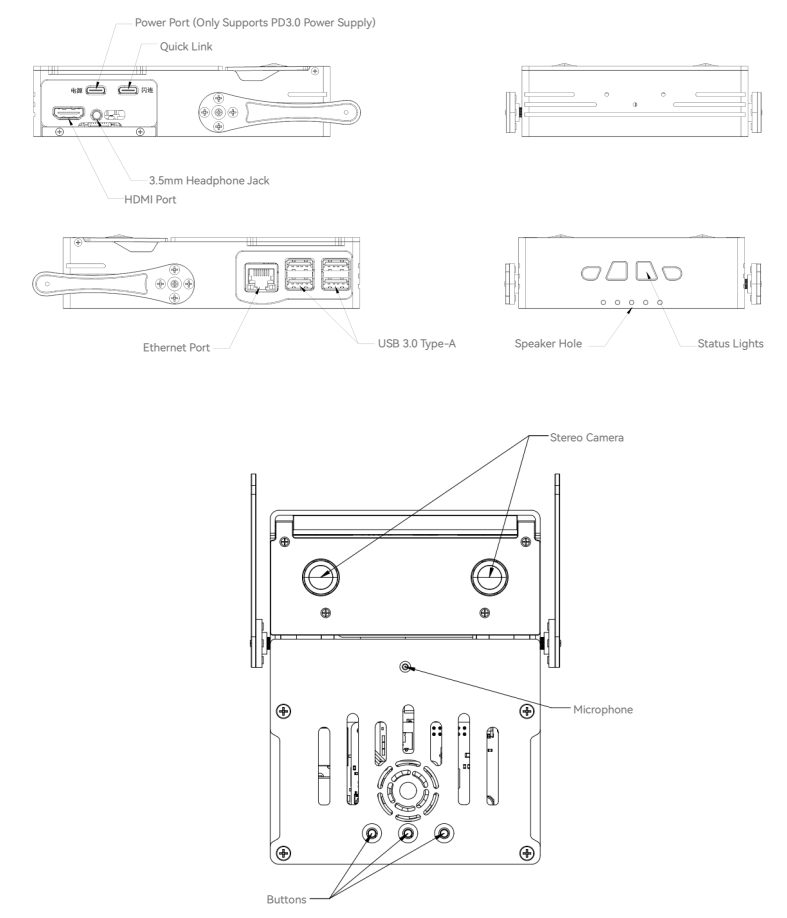

# D-Robotics RDK X5 Magicbox: Stereo, Voice and Safe Peripheral Setup


**D-Robotics RDK X5 Magicbox — not yet listed on OpenELAB; SKU/product link pending.**

Manufacturer reference for the integrated X5 8 GB / GS130WI platform. No OpenELAB SKU, kit option or current stock status has been verified.


RDK X5 Magicbox combines stereo vision, speech, programmable lights and two servo-driven supports in a folding desktop device. Begin with its factory image and depth viewer; gesture and voice function-call programs can move the supports during initialization. Its dedicated image, internal adapter and built-in audio path must not be treated as a generic X5 board or the separate RDK Audio Kit.

## Product overview <a href="#product-overview" id="product-overview"></a>

Magicbox uses an **RDK X5 8 GB** host and a **GS130WI** global-shutter stereo camera with a 70 mm baseline and ICM-42688-P IMU. The preinstalled demonstrations provide stereo depth, gesture-controlled movements and local voice conversation. Four WS2812B lights and three front buttons select or indicate application state. A web resource monitor exposes host utilization separately from the image viewer. [Manufacturer overview](https://d-robotics.github.io/magicbox_doc/en/magicbox/).

The user-facing ports include a dedicated **Power** USB-C connector and a separate **Quick Link / Flash Link** data connector. They have different jobs even though their plugs look alike. The standard package described by the manual includes a preinstalled 32 GB TF card, USB-A–C and USB-C–C cables, and a nylon/EVA carrying case; a cable in the box is not evidence that every PC port supplies the required power. [Package and startup instructions](https://d-robotics.github.io/magicbox_doc/en/quickstart/).

## Applications <a href="#applications" id="applications"></a>

Use Magicbox for desktop stereo-perception experiments, gesture-to-action interfaces, Mandarin keyword wake-up, local ASR/LLM/TTS pipelines and monitoring the cost of simultaneous workloads. Separate a recognition result from the actuator action that consumes it: proving that a gesture was recognized does not establish a safe support position.

Its voice application is a **turn-taking** pipeline. During an LLM answer and synthesized playback, microphone acquisition is disabled; it resumes after completion. It is not evidence of continuous barge-in, acoustic echo cancellation or the separate eight-channel Audio Kit's duplex behavior. Likewise, the Qwen2.5-1.5B application is a text language-model path, not proof of a vision-language model merely because some inherited node parameters mention images. [Voice behavior](https://d-robotics.github.io/magicbox_doc/en/quickstart/#voice-interaction), [actual Qwen project](https://github.com/D-Robotics/magicbox_qwen_llm/tree/2106a84999bea29dd1eda700203c111512582a52).

## Specifications <a href="#specifications" id="specifications"></a>

| Assembly             | Documented specification                                                                              | Interpretation                                                                                           |
| -------------------- | ----------------------------------------------------------------------------------------------------- | -------------------------------------------------------------------------------------------------------- |
| Host                 | RDK X5 8 GB; 8× Cortex-A55 at 1.5 GHz                                                                 | Exact integrated host, not an S100/S600 option                                                           |
| Accelerators         | 10 TOPS INT8 Bayers BPU; 32 GFLOPS GPU                                                                | Manufacturer peak capabilities, not measured application throughput                                      |
| Memory/storage       | 8 GB LPDDR4; 1 Gbit NAND; UHS-I microSD slot, supplied 32 GB TF                                       | 1 Gbit is not 1 GB; preserve the factory system and application data                                     |
| USB/display          | Four USB 3.0 Type-A host ports; USB 2.0 Type-C device path; HDMI up to 1080p60                        | Power and data ports are separately labeled                                                              |
| Networking           | 10/100/1000 Ethernet; 2.4/5 GHz Wi-Fi 6; Bluetooth 5.4                                                | First access below uses the documented wired links                                                       |
| Audio/UI             | One microphone, one speaker, 3.5 mm stereo input/output, three buttons, four 24-bit WS2812B LEDs      | No six-microphone array or direction-of-arrival specification established                                |
| Camera               | GS130WI; two SC132GS global-shutter sensors; ICM-42688-P                                              | Not GS130W or SC230AI                                                                                    |
| Camera geometry      | 70 mm baseline; nominal H/V/D FOV 96.8° / 115.6° / 157.2°, stated tolerance ±3°                       | Use actual unit calibration and image orientation                                                        |
| Camera maximum       | Specification table: 1080×1280 at up to 120 fps                                                       | Introductory prose also says 1280×1080; this is not the delivered depth-model frame rate                 |
| Camera folding limit | Maximum tilt 110°                                                                                     | Mechanical camera limit, not servo angle range                                                           |
| Servos               | PTK 7465 MG-D; stated ±180°; no-load 0.11–0.070 s/60°; stall 3.8–5.8 kg·cm                            | Voltage/thermal conditions for these ranges are not supplied; stall torque is not continuous usable load |
| Power                | Host reference 5 V / 5 A; assembled unit requires a compatible PD3.0 supply at its labeled Power port | Do not inject voltage into GPIO or Quick Link                                                            |
| Bare assembly        | 162×129×36.4 mm, 517 g                                                                                | Manufacturer dimensions/mass, not independently measured                                                 |

[Exact assembly specification tables](https://d-robotics.github.io/magicbox_doc/en/magicbox/#hardware-specifications). Camera capture geometry, sensor output and network preview can have different dimensions. Record the actual stream rather than substituting a nominal table value into calibration.

The Magicbox changelog identifies a dedicated **RDK OS 1.0.0, 5 March 2026** initial release. This is a Magicbox image version, not the general X5 documentation lane's OS 3.5.0. A newer generic X5 image does not establish that `/userdata/magicbox`, its models, boot integration and internal peripheral setup will be present. [Magicbox release history](https://d-robotics.github.io/magicbox_doc/en/changelog/).

## Hardware and connections <a href="#hardware-and-connections" id="hardware-and-connections"></a>

### Power, clearance and connector identity <a href="#power-clearance-and-connector-identity" id="power-clearance-and-connector-identity"></a>

Place the device on a flat, dry, nonconductive surface with room for both supports to sweep and lift the housing. Keep hands, cables and loose parts away from the moving supports. Begin with them parallel to the housing as instructed by the manufacturer; do not force a powered or obstructed servo. Keep the folding camera within its 110° mechanical limit. Insert the TF card into its real slot rather than the gap beside the protective cover. [Physical precautions](https://d-robotics.github.io/magicbox_doc/en/quickstart/#precautions).



_D-Robotics official interface drawing, visually inspected. The labeled Power and Quick Link connectors are separate._

Use the matched **PD3.0 power source** and a suitable cable at **Power**; use the data cable from **Flash Link** to the PC for Quick Link networking. Power off before changing internal camera cables, adapters or servo wiring. The public drawings do not establish spare connector current budgets, GPIO tolerance or safe support travel for a modified mechanism.

### Internal adapter and two different IMU identities <a href="#internal-adapter-and-two-different-imu-identities" id="internal-adapter-and-two-different-imu-identities"></a>

The downloadable adapter schematic, labeled revision 1.0 internally, shows a **CH224K PD negotiation stage**, a **12 V-to-5 V converter** feeding a `5V5A` rail, a separate 5 V LED supply, and the USB device/Flash Link path. Its external filename is dated 10 February 2026, but the sheet title blocks carry May 2025 dates. Therefore the drawing is a circuit reference for the depicted board, not proof that an arbitrary 12 V source belongs on the external Power port or on an X5 GPIO pin. Use the assembled unit's prescribed PD connection. [Adapter schematic, sheets 1–2](https://archive.d-robotics.cc/downloads/hardware/rdk_x5/rdk_x5_magicbox/schematic_rdk-x5_adapter_board_2026-02-10.pdf).

The same schematic shows **U6 ICM-20948** on a 1.8 V domain and an **RS0102** level translator to the host's 3.3 V I2C side. This is distinct from the camera's **ICM-42688-P**. The basic-peripheral manual says its `imu.py` accesses an IMU through `smbus2`, but does not expose the installed script or identify that script's selected chip/register map. Inspect the actual script and board revision before interpreting its data. Neither this adapter drawing nor the standalone **BMI088** SDK establishes the other sensor's scale, clock, calibration or Python API.

The LED schematic shows four cascaded WS2812B devices on 5 V with a series input resistor; the adapter shows an **NS4168** digital speaker amplifier with differential outputs. The public circuit nets are not a tested replacement-harness recipe. Never tie a speaker's negative amplifier output to ground or connect the LED rail to a 3.3 V signal input. The basic LED example uses SPI, whereas the strip itself is a serial WS2812B chain; SPI is the software waveform-generation mechanism, not a claim that these LEDs have a conventional SPI register protocol. [LED schematic](https://archive.d-robotics.cc/downloads/hardware/rdk_x5/rdk_x5_magicbox/schematic_led_board_2026-02-10.pdf), [basic-peripheral implementation descriptions](https://d-robotics.github.io/magicbox_doc/en/basic-peripherals/).

### Button orientation and startup state <a href="#button-orientation-and-startup-state" id="button-orientation-and-startup-state"></a>

Face the **light strip** and count buttons from left to right. After power-on, white LEDs illuminate sequentially; the manual expects roughly **50 seconds**, then blinking white lights with a sound indicating readiness. Button behavior belongs to the factory launcher:

| Button    | Factory application | Indicator / observable result                                                       |
| --------- | ------------------- | ----------------------------------------------------------------------------------- |
| 1, left   | Stereo depth        | Red; image viewer on port 8000                                                      |
| 2, middle | Gesture interaction | Green; recognition can initiate physical support movement                           |
| 3, right  | Voice interaction   | Blue; selects the LLM interaction path; audio initialization already begins at boot |

Do not use these color meanings to diagnose an independently running `ws2812b.py` program; a second light owner can replace the factory state. [Factory controls](https://d-robotics.github.io/magicbox_doc/en/quickstart/).

## Software and development resources <a href="#software-and-development-resources" id="software-and-development-resources"></a>

### Filesystem and one owner per device <a href="#filesystem-and-one-owner-per-device" id="filesystem-and-one-owner-per-device"></a>

| Factory path                             | Role and useful check                                                                        |
| ---------------------------------------- | -------------------------------------------------------------------------------------------- |
| `/userdata/magicbox/app/ros_ws`          | Application ROS workspace; inspect the installed overlay before sourcing it                  |
| `/userdata/magicbox/basic_function_demo` | `button.py`, `imu.py`, `servo.py`, `ws2812b.py` examples                                     |
| `/userdata/magicbox/config`              | Application configuration and model assets; back up before changes                           |
| `/userdata/magicbox/dep`                 | llama.cpp, sherpa-onnx and TTS dependencies; installed paths must match launch configuration |
| `/userdata/magicbox/launch`              | `start.py`, `start.sh` and boot-light helper                                                 |
| `/userdata/magicbox/log`                 | Application diagnostics; preserve logs before reboot/reflash                                 |
| `/userdata/magicbox/voice`               | Factory audio such as `robot.mp3` and `wakeup.mp3`                                           |

[Official filesystem inventory](https://d-robotics.github.io/magicbox_doc/en/basic-peripherals/). Do not run basic PWM, SPI, GPIO or ALSA examples concurrently with their application owners. Inspect the boot service first; disabling its next-boot state does not stop the current process tree or prove that a servo has been de-energized.

### Source targets, build boundaries and speech parameters <a href="#source-targets-build-boundaries-and-speech-parameters" id="source-targets-build-boundaries-and-speech-parameters"></a>

The inspected application repositories target **RDK X5 / Ubuntu 22.04**. Audio uses ROS2 Humble dependencies; the Qwen README specifies GCC 11.4.0 and a llama.cpp **b8990** dependency. An example log containing an older compiler or llama.cpp build is not the build requirement. These targets do not establish a Magicbox application port to S100/S600.

| Repository / pinned revision                                                                                                               | Actual package and development boundary                                                                                                      |
| ------------------------------------------------------------------------------------------------------------------------------------------ | -------------------------------------------------------------------------------------------------------------------------------------------- |
| [magicbox\_audio\_io](https://github.com/D-Robotics/magicbox_audio_io/tree/ccbc39e3c4c61c8cb391190c4ab379a19e7fe6e6)                       | `audio_io`; SenseVoice ASR plus sherpa-onnx KWS/TTS; README requires `libfst-dev`, `ros-humble-std-srvs` and matched model/dependency assets |
| [magicbox\_qwen\_llm](https://github.com/D-Robotics/magicbox_qwen_llm/tree/2106a84999bea29dd1eda700203c111512582a52)                       | `qwen_llm`; Qwen2.5-1.5B GGUF text inference; dependency build/version must agree with its headers/libraries                                 |
| [magicbox\_gesture\_interaction](https://github.com/D-Robotics/magicbox_gesture_interaction/tree/96a1331c32acbe4d63590aa2fc7c6ef17c365b4f) | `gesture_interaction`; detector launch plus physical action consumer; constructor initializes supports                                       |

For a prepared **private source workspace**, the documented package build targets are `colcon build --packages-select audio_io`, `colcon build --cmake-args -DPLATFORM_X5=ON --packages-select qwen_llm`, and `colcon build --packages-select gesture_interaction`. Audio optionally accepts `-DUSE_LIGHT_CONTROL=OFF` when built without the strip. These are build targets, not an instruction to replace a working factory overlay or install unpinned dependencies. Preserve the original image and source the selected workspace's `install/local_setup.bash` only after its build/dependencies have been reconciled. No build was performed for this reference.

The pinned audio launch explicitly sets **`RMW_IMPLEMENTATION=rmw_cyclonedds_cpp`** and forwards these arguments:

| Audio launch argument  | Pinned value / meaning                                                                                                   |
| ---------------------- | ------------------------------------------------------------------------------------------------------------------------ |
| `micphone_name`        | `plughw:0,0`; spelling is intentional in the API; verify actual ALSA card numbering                                      |
| `asr_pub_topic_name`   | `/prompt_text`, `std_msgs/msg/String`; recognized text supplied to the LLM                                               |
| `asr_model_path`       | `/userdata/magicbox/config/sense-voice-small-fp16.gguf`                                                                  |
| `tts_config_path`      | `/userdata/magicbox/dep/sherpa-onnx/matcha-icefall-zh-baker`                                                             |
| `kws_config_path`      | `/userdata/magicbox/dep/sherpa-onnx/sherpa-onnx-kws-zipformer-wenetspeech-3.3M-2024-01-01`                               |
| `continuous_wake_mode` | **False** in this revision; the manual describes continuous conversation as the default, so inspect the installed launch |
| `wait_for_llm`         | True; standalone audio must deliberately disable the handshake                                                           |

The audio README also describes `/tts_text` (`std_msgs/msg/String`) as the synthesized-text input and a node parameter `tts_sub_topic_name`; the inspected launch does **not** declare/forward that parameter. Check `--show-args` before passing it as a launch argument. The manual's “SensorVoice” name is a typo relative to the linked repository's **SenseVoice** implementation. [Actual audio launch](https://github.com/D-Robotics/magicbox_audio_io/blob/ccbc39e3c4c61c8cb391190c4ab379a19e7fe6e6/launch/audio_io.launch.py).

The pinned Qwen launch uses `llm_model_path=/userdata/magicbox/config/qwen2.5-1.5b-instruct-q5_k_m.gguf`, `wait_for_audio=True`, and **`enable_function_call=False`**. The README's `/dev/shm` example is not that launch's default. The system-prompt files are installed under package `config`; distinguish `system_prompt_file_` (including its trailing underscore) from `system_prompt_function_call_file`. If function calling is enabled, the launch additionally starts **`gesture_interaction/function_call_control`**, a physical actuator consumer. [Actual Qwen launch](https://github.com/D-Robotics/magicbox_qwen_llm/blob/2106a84999bea29dd1eda700203c111512582a52/launch/qwen_llm.launch.py).

### Gesture, depth and motion API boundaries <a href="#gesture-depth-and-motion-api-boundaries" id="gesture-depth-and-motion-api-boundaries"></a>

The gesture launch includes `hand_gesture_detection/hand_gesture_fusion.launch.py` and an action node with `need_exchange=True`. The physical-device controller initializes the supports in its constructor, before any recognized gesture arrives. Its published interaction mapping is:

| Gesture                | Factory physical/light response         |
| ---------------------- | --------------------------------------- |
| ThumbUp                | Supports/“ears” wiggle                  |
| Victory                | Supports lift the device                |
| ThumbLeft / ThumbRight | Corresponding left/right support raises |
| Okay                   | Lights flash                            |

[Gesture application](https://d-robotics.github.io/magicbox_doc/en/quickstart/#gesture-interaction), [actual initialization/action source](https://github.com/D-Robotics/magicbox_gesture_interaction/blob/96a1331c32acbe4d63590aa2fc7c6ef17c365b4f/src/gesture_control_node.cpp). The source initializes PWM at 50 Hz with application-specific duty values; neither these constants nor the servo's ±180° headline establishes a safe modified-mechanism travel range.

The function-call controller subscribes to relative topic **`fc_text`**, type `std_msgs/msg/String`, with reliable QoS/depth 5. Its parser expects a brace-delimited outer message and bracketed function/integer pairs; it recognizes `left_control` and `right_control`. The inspected conversion uses an angle-to-duty formula around 30, with opposite signs for the two supports, **without an explicit angle clamp or a guarded `stoi` conversion**. Keep function calling disabled for the initial voice result. Do not expose this topic as an unrestricted motion API or assume malformed/large input is safely rejected. [Actual parser and actuator dispatch](https://github.com/D-Robotics/magicbox_gesture_interaction/blob/96a1331c32acbe4d63590aa2fc7c6ef17c365b4f/src/fc_call_node.cpp).

The stereo application computes left-view disparity and depth using an IGEV-inspired GRU architecture. It consumes camera images; its model rate, calibration, output dimensions and metric depth validity are separate from the GS130WI's 120 fps sensor capability. Keep the unit's calibration with its image orientation and bracket geometry. Black invalid regions introduced by rectification must remain masked; cropping or colormap changes do not establish metric accuracy. [Depth application](https://d-robotics.github.io/magicbox_doc/en/algorithm-development/stereo-depth/), [depth repository](https://github.com/D-Robotics/hobot_stereonet/tree/9490cd7f38abf4604ffc403bf1799da3a7c2cad2).

## Getting started <a href="#getting-started" id="getting-started"></a>

### First result: boot and depth viewer <a href="#first-result-boot-and-depth-viewer" id="first-result-boot-and-depth-viewer"></a>

1. Place Magicbox with support clearance, check the card/hinge, connect the matched PD3.0 supply at **Power**, and wait for the factory white-light/sound readiness sequence. Do not launch a servo test while it boots.
2. Choose **one** direct PC network path. In the PC adapter's IPv4 settings, use the appropriate manufacturer example below and the supplied data/Ethernet connection. Preserve the PC's original settings for later restoration.

| Path                        | PC example     | Mask          | Device address | Viewer                       |
| --------------------------- | -------------- | ------------- | -------------- | ---------------------------- |
| USB Flash Link / Quick Link | 192.168.128.99 | 255.255.255.0 | 192.168.128.10 | `http://192.168.128.10:8000` |
| Direct Ethernet             | 192.168.127.99 | 255.255.255.0 | 192.168.127.10 | `http://192.168.127.10:8000` |

The actual official Windows screenshots show gateway `.1` on the selected subnet. A gateway at that address is **not** proof of an Internet router on a direct cable; do not replace an unrelated PC interface's working default route unnecessarily. Avoid duplicate IP addresses. These are factory examples, not guaranteed addresses after a network customization. [USB settings screenshot](http://rdk-doc.oss-cn-beijing.aliyuncs.com/doc/img/magicbox/en/Network-Parameter-Settings.png), [Ethernet screenshot](http://rdk-doc.oss-cn-beijing.aliyuncs.com/doc/img/magicbox/en/Network-Parameter-Settings-ethernet.png).

3. Press **button 1**, wait for red application indication, open the matching viewer address and enable its image display. Use a stationary textured scene visible to both eyes.
4. Confirm that both camera/depth displays update. Record the image dimensions and note invalid edge/textureless regions. Do not treat a colorized depth image as a calibrated distance measurement without checking its model, units and geometric configuration.
5. Open the same device address at **port 7999** for the resource monitor. Compare idle and active application utilization. This gives a host/application checkpoint independent of a browser camera frame.

**Expected result:** factory readiness, red depth mode, changing scene output and a reachable resource monitor. If networking works but the image does not, inspect the application/camera logs before changing the PC subnet or powering down the camera abruptly. [Official depth and monitoring workflow](https://d-robotics.github.io/magicbox_doc/en/quickstart/).

### Read-only software inspection before isolated examples <a href="#read-only-software-inspection-before-isolated-examples" id="read-only-software-inspection-before-isolated-examples"></a>

With an already authenticated terminal on the device, record its state before starting another process:

```bash
cat /etc/version
uname -r
systemctl status magicbox-start --no-pager
systemctl cat magicbox-start
ls -l /userdata/magicbox/basic_function_demo
ls -l /userdata/magicbox/app/ros_ws/install/local_setup.bash
arecord -l
aplay -l
```

Read the installed `start.sh`/service unit to identify the real owner and its children. If an isolated example requires it stopped, first shut down its applications using their normal controls, then stop the **verified** service with `sudo systemctl stop magicbox-start`; confirm its process tree has exited. Do not assume `systemctl disable magicbox-start` stopped it: the manual's enable/disable commands change subsequent boot behavior. Keep clearance even during shutdown because a final actuator action is possible.

For the least invasive basic check, inspect then run the factory button script, with the launcher and other GPIO consumers stopped:

```bash
sed -n '1,220p' /userdata/magicbox/basic_function_demo/button.py
python3 /userdata/magicbox/basic_function_demo/button.py
```

**Expected result:** a press prints `button1 OK`, `button2 OK` or `button3 OK`, as documented. This GPIO test is distinct from starting a depth/gesture/voice application. Stop it with Ctrl-C before returning control to the launcher. [Factory peripheral checks](https://d-robotics.github.io/magicbox_doc/en/basic-peripherals/).

For IMU or lights, first inspect the corresponding `imu.py` or `ws2812b.py`, stop the existing bus owner, and confirm its chip/path configuration. The documented entry points are `python3 /userdata/magicbox/basic_function_demo/imu.py` and `python3 /userdata/magicbox/basic_function_demo/ws2812b.py`; expect printed motion data or changing lights, respectively. No raw count-to-SI conversion is asserted without reading the installed IMU implementation. **`servo.py` lowers the supports and lifts the device**; execute it only after inspecting that script, verifying actuator ownership and clearing the full movement envelope. It is not a read-only presence test.

### Voice first result, with physical function calling disabled <a href="#voice-first-result-with-physical-function-calling-disabled" id="voice-first-result-with-physical-function-calling-disabled"></a>

1. Use the factory launcher and button 3 first. The audio node initializes at boot; allow model loading to complete. Say **“你好地瓜”** to wake the voice application, ask a short question, wait for playback to finish, then speak again. **“结束对话”** is the documented sleep phrase. Blue breathing/steady light states distinguish conversation/sleep in the factory workflow.
2. If running a private ROS overlay instead, stop competing factory audio/LLM owners and source the actual Humble setup plus the verified application overlay. Inspect both `--show-args` outputs before launching. The following pair matches the inspected sources; start each in its own sourced terminal:

```bash
ros2 launch audio_io audio_io.launch.py continuous_wake_mode:=False wait_for_llm:=True
```

```bash
ros2 launch qwen_llm qwen_llm.launch.py enable_function_call:=False wait_for_audio:=True
```

3. Check `ros2 topic list -t`, then observe `/prompt_text` and `/tts_text` with `ros2 topic echo`. Keep diagnostic terminals on the same ROS domain and RMW implementation as these CycloneDDS launches. A lone node waiting for its counterpart is not automatically a deadlock or bad model file.
4. Verify that ASR text appears after speech, that the LLM supplies response text, and that playback completes before microphone acquisition resumes. A text result without speech isolates the failure toward TTS/ALSA; no recognized text points earlier toward wake/model/microphone capture.

**Expected result:** one short wake → recognized text → generated answer → audible playback cycle, without a function-call actuator node. Do not enable physical function calling merely to debug missing audio. [Voice configuration](https://d-robotics.github.io/magicbox_doc/en/algorithm-development/voice-interaction/), [pinned launches](https://github.com/D-Robotics/magicbox_qwen_llm/blob/2106a84999bea29dd1eda700203c111512582a52/launch/qwen_llm.launch.py).

## Troubleshooting and FAQs <a href="#troubleshooting-and-faqs" id="troubleshooting-and-faqs"></a>

### Device freezes and a support keeps moving <a href="#device-freezes-and-a-support-keeps-moving" id="device-freezes-and-a-support-keeps-moving"></a>

Clear the movement area and remove power if the assembly cannot be stopped normally. Check the matched **PD3.0** supply and cable before retrying; the manufacturer specifically associates this symptom with an unsuitable supply. Repeatedly restarting an obstructed servo risks further heating or damage. Do not interpret the 5 V / 5 A host rail label as proof that an ordinary USB charger negotiates the assembled unit's required input. [Official FAQ](https://d-robotics.github.io/magicbox_doc/en/faq/).

### Why does speech stop listening while the answer plays? <a href="#why-does-speech-stop-listening-while-the-answer-plays" id="why-does-speech-stop-listening-while-the-answer-plays"></a>

That is the documented turn-taking behavior. Wait for TTS completion. If it never resumes, inspect model/playback completion and both node logs; raising microphone gain cannot fix an unfinished LLM/TTS state. Check the installed `continuous_wake_mode` value because the current launch's False default differs from the prose default.

### Why are there black image borders or implausible distances? <a href="#why-are-there-black-image-borders-or-implausible-distances" id="why-are-there-black-image-borders-or-implausible-distances"></a>

The known-issues page identifies black rectification borders. Treat them as invalid support, not measured black objects. Verify the GS130WI profile, actual image raster, calibration and eye order. After mechanical changes, check corresponding features and metric reference distances rather than hiding an error with cropping. [Known issues](https://d-robotics.github.io/magicbox_doc/en/known_issues/).

### The viewer is reachable but no demo starts <a href="#the-viewer-is-reachable-but-no-demo-starts" id="the-viewer-is-reachable-but-no-demo-starts"></a>

Check that startup completed, the intended application/button has control, and port 8000 belongs to that application. Port 7999 monitoring can confirm that the host remains responsive. Preserve `/userdata/magicbox/log` and `journalctl -u magicbox-start -b --no-pager` output before rebooting. If only one link fails, inspect that PC adapter and subnet rather than replacing the TF image immediately.

### How should the factory system be recovered? <a href="#how-should-the-factory-system-be-recovered" id="how-should-the-factory-system-be-recovered"></a>

Back up configuration, models, calibration, logs and the current card before replacement. Obtain the **Magicbox-specific image** from its official directory, record its actual filename/version/checksum when supplied, and use the manufacturer-linked RDK Studio or Rufus workflow. Select the removable TF card by capacity/device identity and verify it before writing; the process erases that target. No image filename, checksum, universal login credential or generic X5 flashing command is invented here. After recovery, repeat the no-motion boot/network/depth checkpoints before gesture or voice control. [Magicbox downloads](https://d-robotics.github.io/magicbox_doc/en/resource-download/).

## Downloads and technical documents <a href="#downloads-and-technical-documents" id="downloads-and-technical-documents"></a>

| Resource                                                                                                                                   | Scope                                                                                                                               |
| ------------------------------------------------------------------------------------------------------------------------------------------ | ----------------------------------------------------------------------------------------------------------------------------------- |
| [Magicbox manual](https://d-robotics.github.io/magicbox_doc/en/magicbox/)                                                                  | Exact assembly, controls, power and specification                                                                                   |
| [Magicbox system-image directory](https://archive.d-robotics.cc/downloads/rdk_x5_magicbox/images/)                                         | Factory-image source; select the actual released artifact, not a generic X5 image                                                   |
| [Adapter schematic](https://archive.d-robotics.cc/downloads/hardware/rdk_x5/rdk_x5_magicbox/schematic_rdk-x5_adapter_board_2026-02-10.pdf) | Two pages; PD/rail/data path, ICM-20948 and level shifting, speaker/servo/button nets; internal revision/date differs from filename |
| [LED schematic](https://archive.d-robotics.cc/downloads/hardware/rdk_x5/rdk_x5_magicbox/schematic_led_board_2026-02-10.pdf)                | One page; four-LED chain and connector reference; internal June 2025 date                                                           |
| [RDK Studio](https://developer.d-robotics.cc/en/rdkstudio), [Rufus](https://rufus.ie/en/)                                                  | Tools linked by Magicbox resources; actual device/image workflow must match                                                         |
| [Algorithm-development index](https://d-robotics.github.io/magicbox_doc/en/algorithm-development/)                                         | Stereo-depth, gesture and voice topic chapters                                                                                      |
| [Technical support](https://d-robotics.github.io/magicbox_doc/en/technical-support/)                                                       | Manufacturer support route for missing image assets, actual internal revision and repair questions                                  |

The application repositories above contain the actual launch/source interfaces; no separate documented servo firmware, complete mechanical travel calibration or public source for the preinstalled basic Python scripts was established. The supplied schematics are useful engineering references, not authorization to infer a new power or harness configuration.

## References and validation <a href="#references-and-validation" id="references-and-validation"></a>

Reviewed **24 November 2026**: all twelve accessible Magicbox manual pages, the two official schematics, interface/network figures, and relevant README, launch, gesture-initialization and function-call source files at the pinned revisions. This page paraphrases manufacturer facts and adds an original sequence that separates boot, networking, capture, speech and physical command ownership.

No upstream SDK installation/build, ROS launch, model loading, flashing, servo motion, camera/IMU/audio acquisition or hardware calibration was performed. Shell examples were checked for syntax only. Manufacturer boot timings, rates and sample behavior are expected observations from its documentation, not results measured here. Internal-revision, installed-script and mechanical-limit gaps remain explicitly bounded; they do not justify substituting BMI088, Audio Kit or GS130W procedures.

**Related guides:** [D-Robotics boards, modules and peripherals](./).

* [D-Robotics RDK X5: Setup, BPU Inference, Cameras and I/O](rdk-x5.md)
* [D-Robotics RDK X5 Module: carrier, power, boot and AI development reference](rdk-x5-module.md)
* [D-Robotics SC230AI, GS130W and GS130WI Stereo Cameras: Wiring and Capture](rdk-stereo-camera.md)
* [D-Robotics BMI088 IMU Module: X5 Wiring, C/Python and ROS2 Data](rdk-bmi088-imu-module.md)
* [D-Robotics RDK Audio Kit: 4/6-Mic Wiring, USB/I2S and Eight-Channel Capture](rdk-audio-kit.md)
