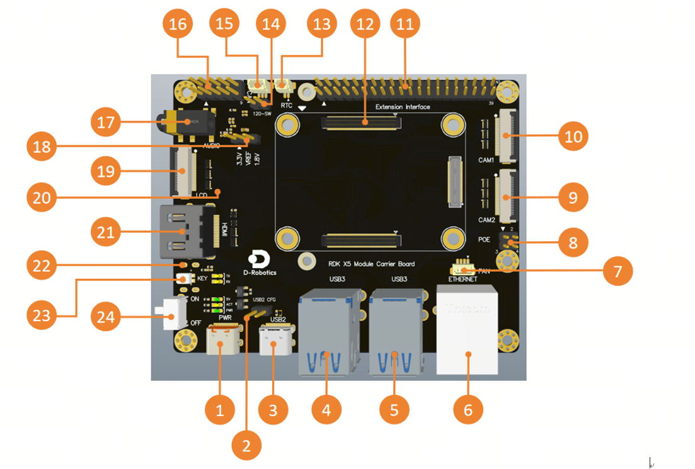

# D-Robotics RDK X5 Module: carrier, power, boot and AI development reference


**Unlisted manufacturer reference —** [**D-Robotics RDK X5 Module**](https://d-robotics.github.io/rdk_x_doc/en/RDK?v=3.5.0\&p=RDK+X5+Module)

**Manufacturer model:** RDK X5 Module · **OpenELAB SKU:** none verified · **OpenELAB product URL:** none verified. Manufacturer part numbers below identify module configurations, not store listings. **Scope:** Module hardware references V1.1/V1.2 and RDK OS 3.5.0; official carrier instructions are separately identified.


## Product overview <a href="#product-overview" id="product-overview"></a>

The **RDK X5 Module** puts Sunrise 5 compute, PMIC, memory, optional eMMC and optional wireless on a55×40 mm core module. It requires a compatible carrier and power design. USB sockets, HDMI connector, four-port USB hub, audio codec, CAN transceiver and a40-pin header belong to the **official carrier**, not to the bare module. This reference explains module selection, carrier integration and a first Ubuntu/BPU checkpoint, while keeping custom-carrier electrical design separate from software bringup. [Module datasheet V1.2.0](https://archive.d-robotics.cc/downloads/en/hardware/rdk_x5_module/drobotics_rdk_x5_module_en_v1_2.pdf), [model-scoped hardware introduction](https://d-robotics.github.io/rdk_x_doc/en/Quick_start/hardware_introduction/rdk_x5?v=3.5.0\&p=RDK+X5+Module).

The official web overview says “300-pin,” but the November 2025 Hardware Design Guide specifies **260 pinouts**, and the corresponding V1.1 pinout workbook defines positions1–260. The connector list contains two 100-position and one 60-position connector. Use those exact revisioned design resources, not the overview's pin-count wording, for a carrier. The published module PDF also has repeated “X3 Module” footers; its cover, part-number table and technical content identify X5 Module. These editorial defects do not establish X3 electrical compatibility. [Design guide §1.6](https://archive.d-robotics.cc/downloads/hardware/rdk_x5_module/RDK%20X5%20Module%20Hardware%20Design%20Guide%20V1P1.pdf), [260-position pinout workbook](https://archive.d-robotics.cc/downloads/hardware/rdk_x5_module/RDK%20X5%20Module%20Pinout%20Description%20and%20Application%20Note%20V1P1.xlsx).

## Applications <a href="#applications" id="applications"></a>

* **Custom edge-compute carrier:** retain X5 inference capability while designing only the interfaces, connectors and mounting required by an application.
* **Robot perception:** connect synchronized camera and inertial devices through a reviewed carrier; bring up capture, calibration and inference independently before a control loop.
* **eMMC-based deployment:** choose an eMMC-equipped manufacturer variant and the appropriate Ubuntu or Buildroot delivery. A no-eMMC module cannot acquire storage capacity by changing a boot option.
* **Thermal/power engineering:** evaluate a specific memory/wireless configuration and workload. A typical module-only power measurement is not the carrier input-current requirement.
* **Product prototyping on the official carrier:** use its USB, CAN, audio, Ethernet and expansion hardware as a reference implementation before designing a different carrier. [Product variants](https://archive.d-robotics.cc/downloads/en/hardware/rdk_x5_module/drobotics_rdk_x5_module_en_v1_2.pdf), [design resources](https://d-robotics.github.io/rdk_x_doc/en/Quick_start/download?v=3.5.0\&p=RDK+X5).

## Specifications <a href="#specifications" id="specifications"></a>

### Compute, storage and environmental scope <a href="#compute-storage-and-environmental-scope" id="compute-storage-and-environmental-scope"></a>

| Item                 | Bare RDK X5 Module                                                                                                      |
| -------------------- | ----------------------------------------------------------------------------------------------------------------------- |
| Processor            | Sunrise 5, eight 64-bit Cortex-A55 cores, nominal1.5 GHz                                                                |
| AI / GPU             | 10 TOPS BPU;32 GFLOPS GPU manufacturer ratings                                                                          |
| RAM                  | 2 GB,4 GB or 8 GB LPDDR4 manufacturer options                                                                           |
| eMMC                 | None,16 GB,32 GB or 64 GB; identify the actual part number                                                              |
| Wireless             | With or without dual-band Wi-Fi 6/Bluetooth5.4 module                                                                   |
| Dimensions           | 55×40 mm, fourM2.5 mounting holes; use revision-specific drawings for stack-up                                          |
| Power                | 5 V DC module input; detailed design range4.75–5.25 V, minimum recommended3A module supply capability                   |
| CSI                  | Two 4-lane interfaces, with documented four 2-lane mode; physical routing and driver support remain required            |
| Display signals      | HDMI up to 1080p60; one 4-lane DSI interface                                                                            |
| Connectivity signals | Ethernet PHY, USB3/USB2 PHY, SDIO and multiplexed serial/control signals, not ready-made sockets                        |
| GPIO                 | Datasheet reports 49 GPIO; the design guide identifies31 voltage-reference-configurable GPIOs plus fixed-domain signals |
| Temperature          | Datasheet module range−20°C to 80°C, up to 85°C **without wireless**; carrier/system range requires its own assessment  |
| Lifecycle            | Manufacturer datasheet states production maintained at least until 2031; verify supply commitments for a project        |

These module figures must not be replaced by the X5 board's4/8 GB-only range,85×56 mm outline,3.3 V-only header or−20°C to 60°C board recommendation. A software query identifying X5M/X5H is separate from a memory/eMMC part number; it must precede any chip-specific boost decision. [Module datasheet, pp2–4](https://archive.d-robotics.cc/downloads/en/hardware/rdk_x5_module/drobotics_rdk_x5_module_en_v1_2.pdf), [module input design](https://archive.d-robotics.cc/downloads/hardware/rdk_x5_module/RDK%20X5%20Module%20Hardware%20Design%20Guide%20V1P1.pdf), [current thermal/software guidance](https://d-robotics.github.io/rdk_x_doc/en/System_configuration/frequency_management?v=3.5.0\&p=RDK+X5).

### All currently documented manufacturer configurations <a href="#all-currently-documented-manufacturer-configurations" id="all-currently-documented-manufacturer-configurations"></a>

The following24 part numbers are transcribed from the V1.2 module specification. “None” means no onboard eMMC, not a preinstalled operating-system drive. No row is a verified OpenELAB SKU. [Part-number table, PDFp 4](https://archive.d-robotics.cc/downloads/en/hardware/rdk_x5_module/drobotics_rdk_x5_module_en_v1_2.pdf).

| RAM  | eMMC  | Without wireless | With wireless   |
| ---- | ----- | ---------------- | --------------- |
| 2 GB | None  | `RDKX5MD002000`  | `RDKX5MD102000` |
| 2 GB | 16 GB | `RDKX5MD002016`  | `RDKX5MD102016` |
| 2 GB | 32 GB | `RDKX5MD002032`  | `RDKX5MD102032` |
| 2 GB | 64 GB | `RDKX5MD002064`  | `RDKX5MD102064` |
| 4 GB | None  | `RDKX5MD004000`  | `RDKX5MD104000` |
| 4 GB | 16 GB | `RDKX5MD004016`  | `RDKX5MD104016` |
| 4 GB | 32 GB | `RDKX5MD004032`  | `RDKX5MD104032` |
| 4 GB | 64 GB | `RDKX5MD004064`  | `RDKX5MD104064` |
| 8 GB | None  | `RDKX5MD008000`  | `RDKX5MD108000` |
| 8 GB | 16 GB | `RDKX5MD008016`  | `RDKX5MD108016` |
| 8 GB | 32 GB | `RDKX5MD008032`  | `RDKX5MD108032` |
| 8 GB | 64 GB | `RDKX5MD008064`  | `RDKX5MD108064` |

### Typical consumption is not supply sizing <a href="#typical-consumption-is-not-supply-sizing" id="typical-consumption-is-not-supply-sizing"></a>

The official V1.0 power workbook reports **5.7 W at 5 V** for **104032**, the 4 GB/32 GB configuration. Its stated condition is85°C junction temperature, eightCPUs at 1.5 GHz/80%utilization, BPU at 1 GHz/80%, LPDDR4 at 4266 MHz/full bandwidth, and two 1920×1080/30 fps camera inputs. This is a stated scenario, not a measured value for every module, an idle figure, or the budget for a carrier's USB/camera loads. Keep that condition with any quoted5.7 W figure. [Actual power workbook](https://archive.d-robotics.cc/downloads/en/hardware/rdk_x5_module/RDK%20X5%20Module%20Typical%20Scenario%20Power%20Consumption%20V1P0-EN.xlsx).

## Hardware and connections <a href="#hardware-and-connections" id="hardware-and-connections"></a>

### Bare-module power and voltage domains <a href="#bare-module-power-and-voltage-domains" id="bare-module-power-and-voltage-domains"></a>

Use the **November 2025 design guide and pinout workbook together**. The main input is4.75–5.25 V; the guide recommends at least 3 A at 5 V, with eleven `VDD_5V_IN` contacts and a300mA-per-contact input maximum. Distribute power through all specified contacts and appropriate planes; one wire/contact is not the whole supply path. The official carrier instead recommends a **5 V/5 A Type-C supply** to cover the assembled system. The module's3A recommendation must not down-rate that carrier supply. [Design guide §2.1, PDFp 10](https://archive.d-robotics.cc/downloads/hardware/rdk_x5_module/RDK%20X5%20Module%20Hardware%20Design%20Guide%20V1P1.pdf), [carrier power instructions](https://d-robotics.github.io/rdk_x_doc/en/Quick_start/hardware_introduction/rdk_x5?v=3.5.0\&p=RDK+X5+Module).

`GPIO_VREF` is module pin 78. Select the supported rail: `MD_3.3V` at 84/86 or `MD_1.8V` at 88/90. It must not float or be grounded. This applies to the VREF-configurable signals; other `_1V8` signals remain1.8 V. The always-on `VDDIO18_DSP_UART` reference is not a peripheral load supply. `MD_3.3V`/`MD_1.8V` turn off in sleep and should not be treated as unrestricted accessory rails. Sequence peripheral supplies after module power and prevent I/O back-powering. [Power/VREF design, PDFpp10–12](https://archive.d-robotics.cc/downloads/hardware/rdk_x5_module/RDK%20X5%20Module%20Hardware%20Design%20Guide%20V1P1.pdf).

On the **official carrier**, the voltage-selection jumper affects the 40-pin and camera interfaces. The camera introduction calls for 3.3 V for its supported modules. Change voltage only with all power removed and all attached devices reviewed; changing a Linux pinmux setting cannot make an electrically incompatible1.8 V/3.3 V connection safe. The software configuration document's old `[rdkmd]` example identifies X3 Module, so it is not an X5 Module-specific boot-setting recipe. [Carrier jumper instructions](https://d-robotics.github.io/rdk_x_doc/en/Quick_start/hardware_introduction/rdk_x5?v=3.5.0\&p=RDK+X5+Module), [boot-file model filters](https://d-robotics.github.io/rdk_x_doc/en/System_configuration/config_txt?v=3.5.0\&p=RDK+X5).

### System-control signals and sleep behavior <a href="#system-control-signals-and-sleep-behavior" id="system-control-signals-and-sleep-behavior"></a>

| Module pin | Signal                                        | Integration meaning                                                                                    |
| ---------- | --------------------------------------------- | ------------------------------------------------------------------------------------------------------ |
| 64 /68     | `DEBUG_UART0_TXD_1V8` / `DEBUG_UART0_RXD_1V8` | Fixed1.8 V debug UART; use a compatible level/USB interface on a custom carrier                        |
| 78         | `GPIO_VREF`                                   | Review the selected rail and every attached configurable signal                                        |
| 92         | `SYS_HW_RESET_N_1V8`                          | Active-low hardware reset input; leave unused input as the design guide specifies                      |
| 93         | `AON_FLASH_SLEEP_RESUME_N_1V8`                | Startup download selection and runtime sleep/resume roles; timing/state matters                        |
| 99         | `GLOBAL_EN`                                   | Low powers the module off; not equivalent to a clean filesystem shutdown                               |
| 100        | `RESETN_OUT_3V3`                              | Module reset output; reset/sleep can change carrier peripheral state                                   |
| 160        | `EMMC_BOOT`                                   | Design guide specifies a4.7kΩ pull-down for eMMC; floating selects NAND; **not a direct ground short** |
| 76         | `VRTC`                                        | RTC backup input, separate from system power                                                           |
| 216        | `ADC_VINS7_RSVD`                              | Reserved carrier identification input; do not reuse as a general measurement channel                   |

This is a control-signal orientation table, not a replacement260-pin netlist. Verify the workbook's electrical level, internal pull and function for every connected pin. LED status signals are switch-control outputs, not direct LED current drivers. In sleep, AON/DSP/DDR domains remain while normal Ethernet/HDMI/USB/camera paths stop; wire wake sources to supported always-on GPIOs rather than a rail that disappears. [Control and sleep design, PDFpp12–15](https://archive.d-robotics.cc/downloads/hardware/rdk_x5_module/RDK%20X5%20Module%20Hardware%20Design%20Guide%20V1P1.pdf), [full workbook](https://archive.d-robotics.cc/downloads/hardware/rdk_x5_module/RDK%20X5%20Module%20Pinout%20Description%20and%20Application%20Note%20V1P1.xlsx).

For RTC backup, the design calls for 2–3.3 V and greater than 2.5 µA discharge capability. A rechargeable cell must accept at least 3.3 V charge voltage and 1 mA; the guide requires blocking unintended charging of a non-rechargeable cell. RTC-only power maintains time and does not provide a normal Ubuntu wake/boot power source. [RTC design](https://archive.d-robotics.cc/downloads/hardware/rdk_x5_module/RDK%20X5%20Module%20Hardware%20Design%20Guide%20V1P1.pdf).

### Carrier connectors are separate components <a href="#carrier-connectors-are-separate-components" id="carrier-connectors-are-separate-components"></a>

The official carrier exposes Type-C power, a separate USB2 device port, four USB3 host ports through a hub, Ethernet, HDMI, camera, DSI, audio and CAN. Its external CAN implementation uses TCAN4550 over SPI; audio uses ES8326B; USB expansion uses GL3510. These parts and sockets must be designed onto a custom carrier if needed. The core's USB PHY count does not mean four independent native USB3 links. [Carrier hardware introduction](https://d-robotics.github.io/rdk_x_doc/en/Quick_start/hardware_introduction/rdk_x5?v=3.5.0\&p=RDK+X5+Module), [carrier V1P1 schematics](https://archive.d-robotics.cc/downloads/hardware/rdk_x5_module/RDK%20X5%20Module%20Carrier%20Board%20V1P1.pdf).

| Official carrier control/connector | Relevant distinction                                                                                 |
| ---------------------------------- | ---------------------------------------------------------------------------------------------------- |
| Power1 / USB-device3               | Separate supply and data/recovery paths                                                              |
| Debug22                            | USB-to-serial on the rear; documented **921600/8N1/no flow control**                                 |
| Camera9/10                         | 22-pin four-lane CSI connectors; use carrier CAM1/CAM2 labels                                        |
| Header11 / voltage18               | Physical 40-pin header and voltage selector; not the bare module's connector numbers                 |
| CAN15 / termination14              | Connector and termination switch; terminate the two physical bus ends, not every intermediate node   |
| RTC13 / function header16          | Backup/control functions, with separate voltage/boot semantics                                       |
| DSI19 / HDMI21                     | Display connectors; not proof of simultaneous desktop outputs                                        |
| MicroSD20                          | The PDF figure identifies20; web prose inconsistently calls it19/22—use the actual silkscreen/figure |
| Sleep23 / power24                  | Download/sleep button and supply switching are distinct operations                                   |

[Carrier figure and numbering, module datasheet PDFp 6](https://archive.d-robotics.cc/downloads/en/hardware/rdk_x5_module/drobotics_rdk_x5_module_en_v1_2.pdf). The carrier schematic is the authority for net connections; a differently laid-out third-party carrier needs its own manual. Assemble the module with power removed, correct connector orientation and aligned mounting holes. Support the carrier, seat evenly, and use the mechanical revision's specified spacers rather than flexing the module against a heatsink. [Mounting instructions](https://d-robotics.github.io/rdk_x_doc/en/Quick_start/hardware_introduction/rdk_x5?v=3.5.0\&p=RDK+X5+Module), [structural resources](https://d-robotics.github.io/rdk_x_doc/en/Quick_start/download?v=3.5.0\&p=RDK+X5).



_D-Robotics official carrier figure; it depicts the carrier, not a bare module. Compare its board revision and connector numbering with the V1.2 datasheet before wiring._ [_Source_](https://d-robotics.github.io/rdk_x_doc/en/Quick_start/hardware_introduction/rdk_x5?v=3.5.0\&p=RDK+X5+Module)_._

### High-speed, camera, expansion and thermal design <a href="#high-speed-camera-expansion-and-thermal-design" id="high-speed-camera-expansion-and-thermal-design"></a>

The pinout workbook includes **signal voltage, I/O supply, alternate functions, trace-delay data and camera2/4-lane application sheets**. Preserve pair polarity, lane grouping and reference planes. PHY signals need the correct magnetics/connectors, ESD and routing; they are not general-purpose GPIO. Review connector stack-up and package trace delays with the carrier, rather than copying an X5 development-board connector footprint. [Workbook](https://archive.d-robotics.cc/downloads/hardware/rdk_x5_module/RDK%20X5%20Module%20Pinout%20Description%20and%20Application%20Note%20V1P1.xlsx), [carrier reference](https://archive.d-robotics.cc/downloads/hardware/rdk_x5_module/RDK%20X5%20Module%20Carrier%20Board%20V1P1.pdf).

The module supports two 4-lane or four 2-lane CSI arrangements at the signal level; the official carrier provides two camera connectors. More logical camera inputs require the correct split-lane routing, sensor drivers, clocks/triggering and bandwidth budget. DSI, USB, Ethernet, HDMI and SDIO each need their own board implementation. Keep MCLK/LPWM camera timing separate from a user PWM output. A no-wireless module does not acquire radio capability through an antenna setting; wireless variants need the appropriate antenna path. [Module specifications](https://archive.d-robotics.cc/downloads/en/hardware/rdk_x5_module/drobotics_rdk_x5_module_en_v1_2.pdf), [camera application notes](https://archive.d-robotics.cc/downloads/hardware/rdk_x5_module/RDK%20X5%20Module%20Pinout%20Description%20and%20Application%20Note%20V1P1.xlsx).

For 40-pin accessories on the official carrier, verify its voltage selector, physical numbering and pinmux. `Hobot.GPIO` numbering modes, SPI/I2C/PWM alternate functions and any HAT's pins must agree. The manufacturer's public40-pin figure explicitly labeled **X5 MD** belongs to this carrier family, while the standalone-board schematic is a different hardware reference. The general documentation has a disputed PWM3/physical 24 mapping; do not use that disputed output without revision-specific confirmation. [GPIO/pinmux](https://d-robotics.github.io/rdk_x_doc/en/Basic_Application/01_40pin_user_sample/40pin_define?v=3.5.0\&p=RDK+X5), [PWM source](https://d-robotics.github.io/rdk_x_doc/en/Basic_Application/01_40pin_user_sample/pwm?v=3.5.0\&p=RDK+X5).

Thermal design is a **system** decision: module, heat spreader/TIM, heatsink, enclosure, airflow and ambient all matter. The module temperature rating is not a guarantee that a closed fanless carrier can sustain every workload. Use the V1.0 Thermal Design Guide's mechanical/contact/airflow discussion and the revisioned mechanical models before designing pressure on the package. Monitor DDR/BPU/CPU sensor values under steady load and startup peaks; BPU temperature can disappear when its domain powers down. [Thermal design PDF](https://archive.d-robotics.cc/downloads/hardware/rdk_x5_module/RDK%20X5%20Module%20Thermal%20Design%20Guide%20V1P0.pdf), [OS thermal monitoring](https://d-robotics.github.io/rdk_x_doc/en/System_configuration/frequency_management?v=3.5.0\&p=RDK+X5).

### Interpret the thermal reference results with their conditions <a href="#interpret-the-thermal-reference-results-with-their-conditions" id="interpret-the-thermal-reference-results-with-their-conditions"></a>

| Official thermal-guide case | Stated condition                                                                         | Reported result                                      |
| --------------------------- | ---------------------------------------------------------------------------------------- | ---------------------------------------------------- |
| Passive simulation          | 25°C ambient; natural convection; 55×40×10 mm reference heatsink                         | X5M junction84.4°C                                   |
| Passive physical test       | 38°C ambient; full CPU/BPU/DDR stress, dual1080p30 camera/ISP/VSE/codec, GPU/DSP enabled | X5M junction88.5°C; DRAM case83.5°C; eMMC case84.4°C |
| Fan-assisted physical test  | 65°C ambient; listed5V PWM fan at 100%; same stress family                               | X5M junction84.4°C; DRAM case73.6°C; eMMC case72.2°C |

These are **manufacturer reference results**, not measurements on a user's module. The active-test page also calls its condition “natural convection, no forced airflow” despite specifying a fan; retain that inconsistency rather than using it to certify a cooling solution. The guide recommends active cooling above40°C ambient or in restricted enclosures. Contact pressure, TIM, component coverage and actual enclosure airflow still require system assessment. Its chip absolute/thermal-model limits are not replacement OS shutdown settings. [Thermal Design Guide §§3–4 and appendix, PDFpp8–14](https://archive.d-robotics.cc/downloads/hardware/rdk_x5_module/RDK%20X5%20Module%20Thermal%20Design%20Guide%20V1P0.pdf).

## Software and development resources <a href="#software-and-development-resources" id="software-and-development-resources"></a>

### Select an operating-system delivery <a href="#select-an-operating-system-delivery" id="select-an-operating-system-delivery"></a>

| Lane                   | Appropriate interpretation                                                                                                                                 |
| ---------------------- | ---------------------------------------------------------------------------------------------------------------------------------------------------------- |
| RDK Ubuntu             | X5 Module supports Ubuntu images **3.2.0 and later**; this guide's working lane is3.5.0/Ubuntu 22.04, using the correct carrier and boot medium            |
| eMMC Ubuntu            | Only eMMC-fitted modules; current flashing instructions distinguish eMMC from inserted microSD media                                                       |
| Module Buildroot SDK   | The resource index lists **`LNX6.1.83_PL5.1_V1.1.2`**, source/BSP, secure/non-secure eMMC firmware and its own manual; a separate delivery from RDK Ubuntu |
| Online chip SDK manual | The moving `versions/latest` page currently identifies2.0.0 and includes EVB boards; those EVB power switches/pinouts are not Module-carrier instructions  |
| X5 algorithm tools     | OE1.2.8 is explicitly paired with RDK X5 OS 3.5.0; custom Buildroot runtimes require their own SDK/compiler pairing                                        |
| TROS/Model Zoo         | For the Ubuntu lane, use X5 `rdk_x5` Model Zoo and TROS Humble. The store SKU/brand name does not select a Buildroot package environment                   |

The factory test image does not establish a production software baseline. Record boot medium, image filename, kernel/BSP packages, runtime and model/compiler version before upgrades. A microSD Ubuntu reflash, eMMC system reflash and NAND miniboot update change different storage contents. Secure/non-secure firmware must match the actual provisioned device; this reference does not prescribe a security-state conversion. [Module boot/image scope](https://d-robotics.github.io/rdk_x_doc/en/Quick_start/system-burn/burn-sd-card?v=3.5.0\&p=RDK+X5+Module), [versioned SDK destinations](https://d-robotics.github.io/rdk_x_doc/en/Quick_start/download?v=3.5.0\&p=RDK+X5), [algorithm pairing](https://d-robotics.github.io/rdk_x_doc/en/Advanced_development/toolchain_development/rdk_x5/oe_toolchain_v1_2_8?v=3.5.0\&p=RDK+X5).

### Ubuntu inference APIs and input semantics <a href="#ubuntu-inference-apis-and-input-semantics" id="ubuntu-inference-apis-and-input-semantics"></a>

Current X5 Python code uses `hbm_runtime.HB_HBMRuntime` supplied with the X5 stack, based on `libdnn` and compiled **`.bin`** files. S-series examples may use the same class name with `libhbucp` and `.hbm`; that is not binary/model compatibility. Select a model name, inspect `input_names`, `input_shapes` and `output_names`, then provide the exact nested input dictionary expected by `run()`. Common X5 vision examples use **packed NV12**, while featuremap models use their declared tensor types/layouts. [X5 runtime comparison](https://d-robotics.github.io/model_zoo_doc/en/infer_api_ref?v=3.5.0\&p=RDK+X5), [Python API](https://d-robotics.github.io/rdk_x_doc/en/Basic_Application/multi_media_sp_dev_api/RDK_X5/pydev_multimedia_api_x5/ai-python-api?v=3.5.0\&p=RDK+X5).

Keep the following together: sensor mode/calibration, crop/resize or letterbox transform, RGB/BGR order, normalization, model compile parameters, output quantization and postprocessing. Wrong boxes after a successful inference can be an inverse-coordinate or label problem. A loaded model is not yet an accuracy test. The current Model Zoo branch tip reviewed here is `4f378d74fcf3507ba1336a14f5bf66bfecab2990`; its per-model README specifies conversion, runtime, evaluation and resource licenses. [X5 guide](https://d-robotics.github.io/model_zoo_doc/en/rdk_x5_guide?v=3.5.0\&p=RDK+X5).

For direct C/C++ integration, `hbDNNInitializeFromFiles`/model enumeration leads to tensor-property queries, aligned memory allocation, input cache clean, `hbDNNInfer`, task wait, output cache invalidation and task/model/memory release. `hbDNNWaitTaskDone` timeout is milliseconds; nonpositive values block until completion. A custom carrier's successful Linux boot does not validate a modified multimedia/BPU memory map. [Runtime lifecycle](https://developer.d-robotics.cc/oe_x5_doc/en/runtime/source/runtime_dev.html), [API reference](https://developer.d-robotics.cc/oe_x5_doc/en/runtime/source/bpu_sdk_api/bpu_sdk_api.html).

### Multimedia, camera and audio integration <a href="#multimedia-camera-and-audio-integration" id="multimedia-camera-and-audio-integration"></a>

On the matching Ubuntu package set, the C `sp_*` wrappers cover VIO, encode/decode, display, pipeline binding and BPU tensors; Python `libsrcampy` objects expose camera/VPS, encoder, decoder and display. Distinguish **RAW capture**, **ISP-processed NV12**, **scaled/cropped VSE frames** and **compressed H.264/H.265/MJPEG data**. Buffers from one stage are not interchangeable without their declared format/stride/size. Unbind and stop the producer before releasing pipeline objects. [V4L2/HBN stages](https://d-robotics.github.io/rdk_x_doc/en/Advanced_development/hardware_development/rdk_x5/V4l2?v=3.5.0\&p=RDK+X5), [C VIO](https://d-robotics.github.io/rdk_x_doc/en/Basic_Application/multi_media_sp_dev_api/RDK_X5/cdev_multimedia_api_x5/vio_api?v=3.5.0\&p=RDK+X5), [Python camera](https://d-robotics.github.io/rdk_x_doc/en/Basic_Application/multi_media_sp_dev_api/RDK_X5/pydev_multimedia_api_x5/object_camera?v=3.5.0\&p=RDK+X5).

For the official carrier, choose its actual sensor and ISP profile and review the IO jumper before connecting a camera. The standard board's GPIO353/I2C6 camera-reset example is **not a verified custom-carrier recipe**. `/etc/board_config.json`, selected sensor and running driver are the board-specific source of the pipeline host number. V4L2 and HBN examples require the selected acquisition mode, not merely a similar `/dev/video*` filename. [Carrier camera instructions](https://d-robotics.github.io/rdk_x_doc/en/Quick_start/hardware_introduction/rdk_x5?v=3.5.0\&p=RDK+X5+Module), [V4L2 mode selection](https://d-robotics.github.io/rdk_x_doc/en/Advanced_development/hardware_development/rdk_x5/V4l2?v=3.5.0\&p=RDK+X5).

The official carrier includes an audio codec and a headset connector. Enumerate sound cards and capture/playback formats after driver selection; a third-party carrier can expose another codec or no analog audio at all. Audio HATs share expansion pins and need their own supported overlay. CAN likewise requires the carrier's external controller/transceiver and correct SPI/interrupt/reset wiring. Do not enable SPI5 spidev when that resource belongs to CAN. [Onboard audio workflow](https://d-robotics.github.io/rdk_x_doc/en/Basic_Application/audio/rdk_x5/in_board_es8326?v=3.5.0\&p=RDK+X5), [CAN driver/resource](https://d-robotics.github.io/rdk_x_doc/en/Advanced_development/hardware_development/rdk_x5/can?v=3.5.0\&p=RDK+X5), [carrier schematic](https://archive.d-robotics.cc/downloads/hardware/rdk_x5_module/RDK%20X5%20Module%20Carrier%20Board%20V1P1.pdf).

### Model conversion and custom SDK development <a href="#model-conversion-and-custom-sdk-development" id="model-conversion-and-custom-sdk-development"></a>

Use the supported x86 environment for X5 OE1.2.8 conversion, target **`bayes-e`**, and the paired target runtime. The basic workflow is export → `hb_mapper checker` → representative calibration → reviewed YAML → `hb_mapper makertbin` → accuracy/performance evaluation → target deployment. Input runtime/training color format, normalization and calibration data must reflect the real application. PTQ and QAT are distinct workflows; replacing operators or training with a quantization plugin requires its documented environment. [Conversion parameters](https://developer.d-robotics.cc/oe_x5_doc/en/oe_mapper/source/faststart/quickstart.html), [PTQ](https://developer.d-robotics.cc/oe_x5_doc/en/oe_mapper/source/ptq/ptq_workflow.html), [QAT](https://developer.d-robotics.cc/oe_x5_doc/en/plugin/source/quick_start/quick_start.html).

For Buildroot/custom carriers, start from the **actual SDK release manifest and board configuration**, not an Ubuntu tutorial's package paths. Keep the bootloader, DDR-detection image, device trees, kernel, root filesystem and multimedia libraries together. The public resource index's1.1.2 archive and current2.0.0 online manual are different versions; no cross-version flashing/build recipe is asserted here. Those large archives were not installed, compiled or executed in this research. Use the matching manual/release notes before extending that lane beyond the explicitly described Ubuntu procedure. [Exact SDK resources](https://d-robotics.github.io/rdk_x_doc/en/Quick_start/download?v=3.5.0\&p=RDK+X5).

## Getting started <a href="#getting-started" id="getting-started"></a>

### First result on the official carrier: module identity, Ubuntu and a static BPU image <a href="#first-result-on-the-official-carrier-module-identity-ubuntu-and-a-static-bpu-image" id="first-result-on-the-official-carrier-module-identity-ubuntu-and-a-static-bpu-image"></a>

1. Read the **manufacturer part number**, RAM/eMMC option and hardware revisions before assembly. With power removed, seat the module evenly on a compatible official carrier and confirm voltage selection, boot configuration and cooling. A bare module cannot be powered through a nonexistent USB socket.
2. Select **RDK X5 Module / RDK OS 3.5.0 Ubuntu 22.04**. Keep the supplier's existing image as a backup. For a no-eMMC module, prepare a microSD of at least 16 GB using a PC card reader and the manufacturer image directory. Desktop supplies a GUI; Server supplies a headless system.
3. For a card-reader installation, identify the actual removable drive in Rufus/RDK Studio, select the matching downloaded image, review the destructive target and finish the write before ejecting. Insert the card only with carrier power off. The current image archive names are `rdk-x5-ubuntu22-preinstalled-desktop-3.5.0-arm64.img.xz` and the corresponding `server` image, with checksum sidecars in the version directory.
4. On the **official carrier**, connect debug USB at **921600 baud,8N1,no flow control** and the dedicated Type-C supply meeting the carrier's5V/5 A recommendation. Do not attach a3.3 V USB-UART signal directly to the bare module's fixed1.8 V debug pins. Maintain the proper interface/level translation on a custom carrier.
5. Power on and wait for the first-boot setup. A serial login or desktop is the checkpoint; after more than 2 minutes without output, inspect serial/power/storage rather than cycling power repeatedly. Use credentials supplied with the actual image; vendor examples include `root`/`root` and `sunrise`/`sunrise` for their respective access paths.
6. Record the actual state before modifying boot settings:

```bash
cat /etc/version
cat /etc/os-release
uname -a
rdkos_info
cat /sys/class/socinfo/soc_name
lsblk -o NAME,SIZE,TYPE,MOUNTPOINTS
ip -brief address
```

**Expected result:** the intended Ubuntu 22.04/AArch64 image boots from the deliberately selected medium and reports usable storage/network interfaces. A module part number with no eMMC cannot produce an eMMC boot device. No module was booted for this guide. [Model-specific boot media and minimum image version](https://d-robotics.github.io/rdk_x_doc/en/Quick_start/system-burn/burn-sd-card?v=3.5.0\&p=RDK+X5+Module), [carrier console](https://d-robotics.github.io/rdk_x_doc/en/Quick_start/hardware_introduction/rdk_x5?v=3.5.0\&p=RDK+X5+Module).

### Network and first static-image inference <a href="#network-and-first-static-image-inference" id="network-and-first-static-image-inference"></a>

1. Keep serial access while configuring the network. The documented Ethernet default is192.168.127.10/24; inspect the actual address before connecting. For a direct PC link, use another address in that subnet. OS 3.5.0 uses the X5≥3.3.0 NetworkManager lane. Wi-Fi exists only on wireless-fitted modules with a suitable antenna path.
2. Inspect `nmcli device status` and the active connection. Select DHCP or set the correct local address/gateway/DNS, then verify local routing and DNS separately. A screen showing an old static address is not proof of the current network. SSH uses the actual configured account/address.
3. Confirm the current hbm\_runtime MobileNetV2 files are installed, then run the supplied static-image example:

```bash
cd /app/pydev_demo/01_classification_sample/02_mobilenetv2
ls -l mobilenetv2.py zebra_cls.jpg imagenet1000_clsidx_to_labels.txt
python3 mobilenetv2.py \
  --model-path /opt/hobot/model/x5/basic/mobilenetv2_224x224_nv12.bin \
  --test-img zebra_cls.jpg \
  --label-file imagenet1000_clsidx_to_labels.txt \
  --priority 0 --bpu-cores 0
```

4. Compare the leading labels with the saved zebra image; preserve model/runtime warnings and package versions. Do not use the printed source scores as a hardware-test claim. After that checkpoint, add one camera producer and compare a saved real frame before a closed-loop application.

**Expected result:** the installed X5 model loads, inference completes and zebra is a plausible leading class. The vendor's example log contains a builder/HBRT version warning; resolve or evaluate the actual pairing before accepting accuracy. These commands were source-reviewed, not run on a module. [Current sample API/options](https://d-robotics.github.io/rdk_x_doc/en/Basic_Application/pydev_demo_sample/RDK_X5/classification_sample?v=3.5.0\&p=RDK+X5), [network configuration](https://d-robotics.github.io/rdk_x_doc/en/System_configuration/network_bluetooth?v=3.5.0\&p=RDK+X5).

### Original offline check of a module/carrier inventory <a href="#original-offline-check-of-a-modulecarrier-inventory" id="original-offline-check-of-a-modulecarrier-inventory"></a>

The following standard-library example decodes the **documented manufacturer part-number pattern** and catches a missing storage or wireless assumption. It uses only a string, no device access. The valid set is restricted to the 24 documented part numbers.

```python
import argparse
import re

parser = argparse.ArgumentParser()
parser.add_argument('part')
args = parser.parse_args()
match = re.fullmatch(r'RDKX5MD([01])(02|04|08)(000|016|032|064)', args.part)
if not match:
    parser.error('Part is outside the documented X5 Module configuration set')
wireless, ram, emmc = match.groups()
print('RAM GB option:', int(ram))
print('eMMC GB option:', int(emmc), '(0 means none)')
print('Wireless option:', 'present' if wireless == '1' else 'absent')
print('Carrier revision and actual fitted parts still need physical inspection')
```

Save as `identify_x5_module.py`; run `python3 identify_x5_module.py RDKX5MD104032`. \*\*Expected result:\*\*4 GB RAM option,32 GB eMMC option and wireless present. This interprets the manufacturer's naming scheme and does not read a serial number, validate manufacturing authenticity or create an OpenELAB SKU. The decoder was tested only with synthetic strings from the documented configuration set. [Manufacturer configuration table](https://archive.d-robotics.cc/downloads/en/hardware/rdk_x5_module/drobotics_rdk_x5_module_en_v1_2.pdf).

### TROS without a camera or a robot base <a href="#tros-without-a-camera-or-a-robot-base" id="tros-without-a-camera-or-a-robot-base"></a>

On the reviewed Ubuntu/Humble lane, install the supported `tros-humble` package only if absent and the RDK repository matches the image. Source `/opt/tros/humble/setup.bash`; inspect `ROS_DISTRO`, `TROS_DISTRO` and `ros2 pkg prefix dnn_node_example`. Use a new workspace directory, copy the supplied example config and launch static-image feedback:

```bash
source /opt/tros/humble/setup.bash
mkdir -p ~/module-feedback-check
cd ~/module-feedback-check
cp -r /opt/tros/humble/lib/dnn_node_example/config/ .
ros2 launch dnn_node_example dnn_node_example_feedback.launch.py \
  dnn_example_config_file:=config/fcosworkconfig.json \
  dnn_example_image:=config/target.jpg
```

**Expected result:** parsed targets and a rendered feedback JPEG, checked against the actual input image. This requires no carrier camera or moving robot. Inspect configuration before a repeat copy into an existing directory. Only then add `hobot_sensor`, codecs/CV and visualization, followed by task-specific Boxs/Apps. Same-host shared-memory transport, network ROS discovery and camera calibration are separate integration tasks. [TROS installation](https://d-robotics.github.io/tros_doc/en/quick_start/install_tros?v=3.5.0\&p=RDK+X5), [feedback result](https://d-robotics.github.io/tros_doc/en/quick_demo/ai_predict?v=3.5.0\&p=RDK+X5), [zero-copy](https://d-robotics.github.io/tros_doc/en/tros_dev/zero_copy?v=3.5.0\&p=RDK+X5).

## Troubleshooting and FAQs <a href="#troubleshooting-and-faqs" id="troubleshooting-and-faqs"></a>

### What changes when using another carrier? <a href="#what-changes-when-using-another-carrier" id="what-changes-when-using-another-carrier"></a>

The module's electrical interface remains revision-specific, but connector numbers, power protection, USB hub/codec/CAN hardware, boot switch positions, camera reset lines, GPIO routing, voltage selection and device-tree choices can change. Begin with that carrier's schematic and supported BSP. A photograph of the official carrier is not a custom-carrier pinout. Confirm the fixed1.8 V signals and selected VREF rail before applying power. [Module pinout](https://archive.d-robotics.cc/downloads/hardware/rdk_x5_module/RDK%20X5%20Module%20Pinout%20Description%20and%20Application%20Note%20V1P1.xlsx), [official reference design](https://archive.d-robotics.cc/downloads/hardware/rdk_x5_module/RDK%20X5%20Module%20Carrier%20Board%20V1P1.pdf).

### The module never boots or eMMC is absent <a href="#the-module-never-boots-or-emmc-is-absent" id="the-module-never-boots-or-emmc-is-absent"></a>

1. Check the exact part number and actual carrier5V supply/voltage domain. For a custom carrier, inspect all main power contacts, enable/reset states, boot strap and level-translated debug UART.
2. Use921600 only for the documented carrier console; a raw custom serial connection needs its specified electrical interface too.
3. Confirm boot media and image support: Module requires3.2.0 or later; this guide uses3.5.0. Check eMMC presence from the part number and do not confuse a NAND bootloader with an Ubuntu root filesystem.
4. For an eMMC-equipped module, back up its contents before selecting an eMMC flash. Maintain a working bootloader/recovery route. A secure/non-secure SDK image mismatch is not a reason to experiment with security-state changes. [Boot guide](https://d-robotics.github.io/rdk_x_doc/en/Quick_start/system-burn/burn-sd-card?v=3.5.0\&p=RDK+X5+Module), [power/control definitions](https://archive.d-robotics.cc/downloads/hardware/rdk_x5_module/RDK%20X5%20Module%20Hardware%20Design%20Guide%20V1P1.pdf).

### How is eMMC flashing different from microSD flashing? <a href="#how-is-emmc-flashing-different-from-microsd-flashing" id="how-is-emmc-flashing-different-from-microsd-flashing"></a>

The current official procedure maps the selected medium through USB: insert the microSD for in-board card flashing; **remove the microSD for eMMC flashing** on an eMMC-equipped module. Connect the **USB device data port**, hold the carrier Sleep button while applying its independent power, and release once the intended medium enumerates. In Rufus, verify the mapped drive's capacity/identity before writing; an ambiguous target is a stop condition. The similarly shaped PWR port is not the data connection. [Module-selected flashing article](https://d-robotics.github.io/rdk_x_doc/en/Quick_start/system-burn/burn-sd-card?v=3.5.0\&p=RDK+X5+Module).

XBurn also supports eMMC. The article names product type **X5**, storage **eMMC** for the no-SD eMMC path, while miniboot flashing uses **NAND** and its specific boot firmware. Select the actual extracted image directory, connection mode and 921600 carrier serial setting, then follow the tool's power-cycle prompts. Never use a no-eMMC part as this target or mix the Ubuntu image directory with a raw Buildroot firmware bundle. [XBurn roles](https://d-robotics.github.io/rdk_x_doc/en/Quick_start/system-burn/upgrade-miniboot?v=3.5.0\&p=RDK+X5+Module).

### Can I downgrade miniboot or apply the standalone-board image procedure blindly? <a href="#can-i-downgrade-miniboot-or-apply-the-standalone-board-image-procedure-blindly" id="can-i-downgrade-miniboot-or-apply-the-standalone-board-image-procedure-blindly"></a>

No. The current miniboot chapter explicitly prohibits downgrading the hardware-matched factory firmware. Start with the read-only `rdk-miniboot-update -l` candidate query when Linux runs. For recovery, maintain both the serial console and USB-device path; USB-only Fastboot requires functional U-Boot, whereas Serial+USB can guide startup through Xmodem. Verify module/carrier/image/security state before an upgrade. The standard board's115200console and microSD-only assumption do not describe every Module configuration. [Miniboot guidance](https://d-robotics.github.io/rdk_x_doc/en/Quick_start/system-burn/upgrade-miniboot?v=3.5.0\&p=RDK+X5+Module), [utility options](https://d-robotics.github.io/rdk_x_doc/en/Appendix/rdk-command-manual/cmd_rdk-miniboot-update?v=3.5.0\&p=RDK+X5).

### Why does a device disappear after sleep or a voltage/pinmux change? <a href="#why-does-a-device-disappear-after-sleep-or-a-voltagepinmux-change" id="why-does-a-device-disappear-after-sleep-or-a-voltagepinmux-change"></a>

Many peripheral domains and the MD reference rails turn off in sleep. An always-on wake design must use supported AON/DSP resources and power sequencing; normal USB/Ethernet/camera traffic does not remain available automatically. GPIO voltage jumpers change electrical domains; pinmux changes alternate-function ownership. Confirm both independently, then inspect the carrier's actual device tree and drivers after reboot. [Sleep design](https://archive.d-robotics.cc/downloads/hardware/rdk_x5_module/RDK%20X5%20Module%20Hardware%20Design%20Guide%20V1P1.pdf), [carrier voltage selector](https://d-robotics.github.io/rdk_x_doc/en/Quick_start/hardware_introduction/rdk_x5?v=3.5.0\&p=RDK+X5+Module).

### What do thermal readings and runtime errors mean? <a href="#what-do-thermal-readings-and-runtime-errors-mean" id="what-do-thermal-readings-and-runtime-errors-mean"></a>

Use the image's DDR/BPU/CPU temperature channels and actual trip points. The generic board operating range does not replace the module datasheet's wireless-dependent range, and the datasheet maximum does not justify raising shutdown thresholds. Runtime model-builder warnings, wrong tensor shapes, bad NV12 layout and insufficient accelerator memory are different faults. Keep the original working package/model/configuration set while changing one layer at a time. [Thermal guide](https://archive.d-robotics.cc/downloads/hardware/rdk_x5_module/RDK%20X5%20Module%20Thermal%20Design%20Guide%20V1P0.pdf), [runtime API](https://d-robotics.github.io/rdk_x_doc/en/Basic_Application/multi_media_sp_dev_api/RDK_X5/pydev_multimedia_api_x5/ai-python-api?v=3.5.0\&p=RDK+X5), [image/compiler pairing](https://d-robotics.github.io/rdk_x_doc/en/Advanced_development/toolchain_development/rdk_x5/oe_toolchain_v1_2_8?v=3.5.0\&p=RDK+X5).

## Downloads and technical documents <a href="#downloads-and-technical-documents" id="downloads-and-technical-documents"></a>

| Resource                                                                                                                                                                               | Purpose / exact revision                                                                        |
| -------------------------------------------------------------------------------------------------------------------------------------------------------------------------------------- | ----------------------------------------------------------------------------------------------- |
| [Module specification](https://archive.d-robotics.cc/downloads/en/hardware/rdk_x5_module/drobotics_rdk_x5_module_en_v1_2.pdf)                                                          | V1.2.0, December 2025; all 24 manufacturer configurations and carrier figure                    |
| [Hardware Design Guide](https://archive.d-robotics.cc/downloads/hardware/rdk_x5_module/RDK%20X5%20Module%20Hardware%20Design%20Guide%20V1P1.pdf)                                       | V1.1, November 2025; power, control, voltage domains, high-speed interfaces, mechanical design  |
| [Pinout and Application Note workbook](https://archive.d-robotics.cc/downloads/hardware/rdk_x5_module/RDK%20X5%20Module%20Pinout%20Description%20and%20Application%20Note%20V1P1.xlsx) | V1.1;260 positions, voltage/IO/mux fields, delay and camera-application sheets                  |
| [Official Carrier Board schematic](https://archive.d-robotics.cc/downloads/hardware/rdk_x5_module/RDK%20X5%20Module%20Carrier%20Board%20V1P1.pdf)                                      | V1P1; thirteen-page reference implementation, not a bare-module feature list                    |
| [Module Typical Scenario Power](https://archive.d-robotics.cc/downloads/en/hardware/rdk_x5_module/RDK%20X5%20Module%20Typical%20Scenario%20Power%20Consumption%20V1P0-EN.xlsx)         | V1P0; configuration104032, stated workload and temperature                                      |
| [Thermal Design Guide](https://archive.d-robotics.cc/downloads/hardware/rdk_x5_module/RDK%20X5%20Module%20Thermal%20Design%20Guide%20V1P0.pdf)                                         | V1P0; module-to-system cooling design                                                           |
| [Hardware Design Checklist](https://archive.d-robotics.cc/downloads/hardware/rdk_x5_module/RDK%20X5%20Module%20Hardware%20Design%20Checklist%20V1P0.xlsx)                              | V1P0; design-review checklist rather than proof of a passed design                              |
| [Complete hardware/resource index](https://d-robotics.github.io/rdk_x_doc/en/Quick_start/download?v=3.5.0\&p=RDK+X5)                                                                   | Revisioned DXF/STEP drawings, carrier documents, SDK sources/firmware and certifications        |
| [X5 Ubuntu image directory](https://archive.d-robotics.cc/downloads/os_images/rdk_x5/)                                                                                                 | Use Module-supported image≥3.2.0; this reference selects3.5.0                                   |
| [Model-scoped hardware/boot guide](https://d-robotics.github.io/rdk_x_doc/en/Quick_start/hardware_introduction/rdk_x5?v=3.5.0\&p=RDK+X5+Module)                                        | Select RDK X5 Module/3.5.0, not the adjacent RDK X5 paragraphs                                  |
| [Toolchain1.2.8](https://d-robotics.github.io/rdk_x_doc/en/Advanced_development/toolchain_development/rdk_x5/oe_toolchain_v1_2_8?v=3.5.0\&p=RDK+X5)                                    | Paired RDK Ubuntu 3.5.0 conversion environment, not a blanket Buildroot SDK compatibility claim |
| [X5 inference and Model Zoo](https://d-robotics.github.io/model_zoo_doc/en/rdk_x5_guide?v=3.5.0\&p=RDK+X5)                                                                             | `.bin`/`libdnn`/`hbm_runtime` lane and sample-specific licenses                                 |
| [TROS documentation](https://d-robotics.github.io/tros_doc/en/tros?v=3.5.0\&p=RDK+X5)                                                                                                  | X5/Humble components; model-specific sensor and algorithm prerequisites                         |

The resource index's Buildroot delivery is `LNX6.1.83_PL5.1_V1.1.2`: its [source/BSP archive](https://archive.d-robotics.cc/downloads/sdk/LNX6.1.83_PL5.1_V1.1.2/board_support_package/platform_source_code.tar.gz), [non-secure firmware](https://archive.d-robotics.cc/downloads/sdk/LNX6.1.83_PL5.1_V1.1.2/board_support_package/firmwares/product_ddr_auto_detect_non-secure_release.zip), [secure firmware](https://archive.d-robotics.cc/downloads/sdk/LNX6.1.83_PL5.1_V1.1.2/board_support_package/firmwares/product_ddr_auto_detect_secure_release.zip) and [matching manual archive](https://archive.d-robotics.cc/downloads/sdk/LNX6.1.83_PL5.1_V1.1.2/user_manual/user_manual_v1.1.2.zip) are distinct artifacts. Their listings were read; these large archives were not unpacked or executed. Consequently this page supplies no unverified Buildroot image-write or BSP build command. The [moving chip-SDK manual](https://developer.d-robotics.cc/sdk_doc/versions/latest/en/index.html) currently identifies2.0.0 and is useful for broader chip development, with its release and EVB scope retained.

## References and validation <a href="#references-and-validation" id="references-and-validation"></a>

Reviewed 24 November 2026 against the current resource center, model/version-tagged X5 Module documentation, actual module/adapter/carrier PDFs and pinout/power/checklist workbooks. The important module/carrier and bare-module power diagrams were inspected. The technical documents retain their vendor rights; some public design PDFs carry proprietary/confidential footers. They are linked at their public official destinations, not republished as a complete public document copy here.

This is an **unlisted manufacturer reference**: no OpenELAB SKU/product URL has been invented, and none of the 24 manufacturer configurations is claimed in stock. No module assembly, voltage measurement, Ubuntu/Buildroot boot, compiler/SDK installation, inference, ROS, flashing or hardware test was executed. Only the original offline part-number decoder and syntax checks used local synthetic data. Source discrepancies about260/300 pins, repeated X3footers, carrier microSD numbers and optional PWM mapping are explicitly bounded. Custom-carrier design and the uninspected Buildroot archive lane require their exact release documents and engineering validation beyond this Ubuntu first-result procedure.

**Related guides:** [D-Robotics boards, modules and peripherals](./).

* [D-Robotics RDK X5: Setup, BPU Inference, Cameras and I/O](rdk-x5.md)
* [D-Robotics RDK X5 Magicbox: Stereo, Voice and Safe Peripheral Setup](rdk-x5-magicbox.md)
* [D-Robotics SC230AI, GS130W and GS130WI Stereo Cameras: Wiring and Capture](rdk-stereo-camera.md)
* [D-Robotics BMI088 IMU Module: X5 Wiring, C/Python and ROS2 Data](rdk-bmi088-imu-module.md)
* [D-Robotics RDK Audio Kit: 4/6-Mic Wiring, USB/I2S and Eight-Channel Capture](rdk-audio-kit.md)
