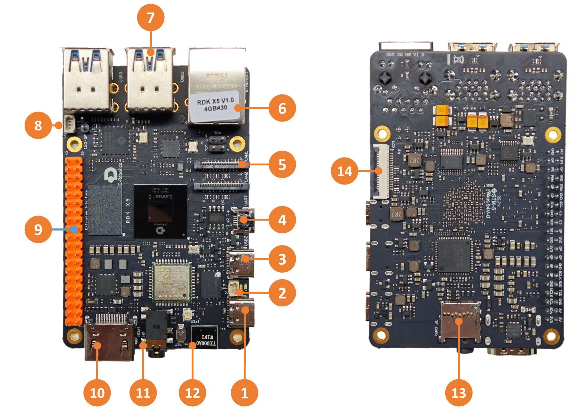

# D-Robotics RDK X5: Setup, BPU Inference, Cameras and I/O


[**View D-Robotics RDK X5 boards and Basic Kits on OpenELAB**](https://openelab.io/products/d-robotics-rdk-x5-development)

**Model:** RDK X5 development board · **SKUs:** `D-Robotics-28741`, `D-Robotics-28742`, `D-Robotics-29118`, `D-Robotics-29119` · **Software scope:** RDK OS 3.5.0 / Ubuntu 22.04; X5 Algorithm Toolchain 1.2.8.


## Product overview <a href="#product-overview" id="product-overview"></a>

RDK X5 combines a Sunrise 5 processor, eight Cortex-A55 CPU cores and a 10 TOPS INT8 BPU with Linux, camera, display and control interfaces. This guide takes the **complete development board** from power and Ubuntu boot to a static-image inference result, then explains its camera, multimedia, CAN and ROS 2 development paths. The separate **X5 Module** is a core module requiring a carrier; its power distribution, debug baud rate, connectors and voltage selection must not be inferred from this board. [Board specification](https://archive.d-robotics.cc/downloads/en/hardware/rdk_x5/d_robotics_rdk_x5_en_v1_1.pdf), [current manual](https://d-robotics.github.io/rdk_x_doc/en/RDK?v=3.5.0\&p=RDK+X5).

### Choose the exact memory and package <a href="#choose-the-exact-memory-and-package" id="choose-the-exact-memory-and-package"></a>

| OpenELAB SKU       | Verified option                                                                                        | RAM  | Package                    |
| ------------------ | ------------------------------------------------------------------------------------------------------ | ---- | -------------------------- |
| `D-Robotics-28741` | [4 GB Single Board](https://openelab.io/products/d-robotics-rdk-x5-development?variant=45781297529030) | 4 GB | Board                      |
| `D-Robotics-28742` | [8 GB Single Board](https://openelab.io/products/d-robotics-rdk-x5-development?variant=45781297561798) | 8 GB | Board                      |
| `D-Robotics-29118` | [4 GB Basic Kit](https://openelab.io/products/d-robotics-rdk-x5-development?variant=45781297594566)    | 4 GB | Board plus equipment below |
| `D-Robotics-29119` | [8 GB Basic Kit](https://openelab.io/products/d-robotics-rdk-x5-development?variant=45781297627334)    | 8 GB | Board plus equipment below |

The **OpenELAB listing**, rather than the generic board manual, lists the Basic Kit's 64 GB microSD card with a preloaded RDK image, heatsink, USB card reader, Type-A-to-Type-C cable and a “27 W PD” adapter with US/EU/UK plug adapters. A camera and PoE module are **not included in that packing list**. A preloaded card does not establish its installed image version: inspect `/etc/version` before selecting examples. More RAM provides application headroom; it does not increase the specified BPU TOPS. [Current store packing list](https://openelab.io/products/d-robotics-rdk-x5-development).



_D-Robotics interface photograph, reproduced by direct official link; connector numbers below use this X5 board view, not the Module carrier._ [_Image context_](https://d-robotics.github.io/rdk_x_doc/en/Quick_start/hardware_introduction/rdk_x5?v=3.5.0\&p=RDK+X5)_._

## Applications <a href="#applications" id="applications"></a>

* **Vision inference:** establish a repeatable static image, then add a supported CSI or USB camera. Match sensor, lens/ISP profile, input format and model preprocessing before comparing detections.
* **Robotics perception:** TROS provides acquisition, BPU inference, codecs, accelerated vision and visualization on ROS 2. An X5 board does not include a mobile base, motor controller or calibrated navigation system.
* **Video pipelines:** combine capture, ISP/scaling, encoding, inference and display. A codec's maximum resolution is separate from HDMI resolution and complete application throughput.
* **Embedded control integration:** use the 3.3 V expansion header or SocketCAN after confirming pinmux, grounding and electrical compatibility. Linux user-space GPIO timing is not a hard real-time motion guarantee.
* **Deployment research:** convert an owned model with the paired X5 toolchain, evaluate accuracy and latency, then package the verified preprocessing, quantization and postprocessing together. Model names alone do not establish compatibility. [Model Zoo](https://d-robotics.github.io/model_zoo_doc/en/model_zoo_intro?v=3.5.0\&p=RDK+X5), [TROS overview](https://d-robotics.github.io/tros_doc/en/tros?v=3.5.0\&p=RDK+X5), [runtime development](https://developer.d-robotics.cc/oe_x5_doc/en/runtime/source/runtime_dev.html).

## Specifications <a href="#specifications" id="specifications"></a>

| Item             | RDK X5 development-board scope                                                                                                   |
| ---------------- | -------------------------------------------------------------------------------------------------------------------------------- |
| Processor        | Sunrise 5; 8 × 64-bit Cortex-A55, nominal specification 1.5 GHz                                                                  |
| CPU boost        | The system documents up to 1.8 GHz **only for X5H**, with thermal/stability conditions; X5M does not support that overclock path |
| AI / graphics    | 10 TOPS INT8 BPU; 32 GFLOPS GPU; neither is measured application performance here                                                |
| Memory           | 4 GB or 8 GB LPDDR4 in the manufacturer specification; the store describes LPDDR4x                                               |
| Storage          | 1Gbit onboard NAND and UHS-I microSD slot; NAND is not a large application eMMC drive                                            |
| Camera           | Two 4-lane CSI connectors; sensor, cable, driver and ISP compatibility required                                                  |
| Display          | HDMI Type-A up to 1920 × 1080 at 60 fps; one 4-lane DSI interface                                                                |
| USB              | Four USB 3.0 Type-A host ports through a hub; separate USB 2.0 Type-C device connector; Micro-B debug serial                     |
| Networking       | 10/100/1000 Ethernet; dual-band Wi-Fi 6; Bluetooth 5.4; optional external antenna                                                |
| Other interfaces | CAN FD, 40-pin expansion, 3.5 mm headset audio, RTC backup connector                                                             |
| Power            | Dedicated Type-C input; manufacturer recommends a 5 V/5 A supply                                                                 |
| Mechanics        | 85 × 56 × 20 mm; the dimension drawing gives PCB outline tolerances and hole locations                                           |
| Environment      | Manufacturer recommended ambient −20°C to +60°C, with effective cooling                                                          |

The May 2025 **board specification V1.1** supplies the nominal figures; the live software manual supplies chip-dependent boost behavior. Query `cat /sys/class/socinfo/soc_name` before interpreting the storefront's “up to 1.8 GHz.” An `X5U` result is an unidentified/early chip, not evidence of validated boost support. [Board PDF](https://archive.d-robotics.cc/downloads/en/hardware/rdk_x5/d_robotics_rdk_x5_en_v1_1.pdf), [frequency and thermal management](https://d-robotics.github.io/rdk_x_doc/en/System_configuration/frequency_management?v=3.5.0\&p=RDK+X5).

The hardware introduction lists per-interface maxima of 500 mA at 3.3 V for CAN/DSI, 1 A at 5 V for a USB interface, and 1 A on each 40-pin power rail, with reductions under simultaneous loading. The generic, unscoped 40-pin chapter instead gives **800 mA at 3.3 V and 500 mA at 5 V**, and requires an input adapter with **at least 25 W capacity** at those stated maximum currents. That paragraph does not resolve the conflict with the model-scoped X5 table. **Selecting the lower figures does not establish a verified header-load budget.** Before powering a header peripheral, confirm usable rail current for the actual board revision and the complete simultaneous-load design, or use a separately reviewed peripheral supply with its ground, signal levels and backfeed protection verified. The CAN three-wire connector has H/L/GND only; a current figure in the table does not add an accessory-power pin. Do not sum every listed maximum into a permitted simultaneous load. [Hardware load table](https://d-robotics.github.io/rdk_x_doc/en/Quick_start/hardware_introduction/rdk_x5?v=3.5.0\&p=RDK+X5), [header electrical guidance](https://d-robotics.github.io/rdk_x_doc/en/Basic_Application/01_40pin_user_sample/40pin_define?v=3.5.0\&p=RDK+X5).

## Hardware and connections <a href="#hardware-and-connections" id="hardware-and-connections"></a>

### Power, cooling and the three USB roles <a href="#power-cooling-and-the-three-usb-roles" id="power-cooling-and-the-three-usb-roles"></a>

Connect the power adapter to **connector 1, marked PWR**. Connector 3/QuickLink is the USB **device** path for data and recovery; connector 4/Micro-B is the USB-to-serial debug path. A USB cable that enumerates a device does not establish adequate power. The manufacturer advises against powering this board from an ordinary computer USB port. [Exact connector view](https://d-robotics.github.io/rdk_x_doc/en/Quick_start/hardware_introduction/rdk_x5?v=3.5.0\&p=RDK+X5).

The supplied kit is described by a 27 W PD label. That wattage alone does not prove a 5 A low-voltage profile. The separately published **official X5 adapter V1.1** lists **5.1 V/5 A, 9 V/3 A, 12 V/2.25 A and 15 V/1.8 A**, with an approximately 1.2m 18AWG Type-C lead. Check the actual received adapter's label and matching cable against the board's input recommendation. The adapter's other profiles do not establish a different supported board input; no alternate-voltage commissioning is specified here. [Adapter specification, p2](https://archive.d-robotics.cc/downloads/en/hardware/rdk_x5/RDX%20X5%20Power%20Adapter.pdf), [board power requirement](https://d-robotics.github.io/rdk_x_doc/en/Quick_start/hardware_introduction/rdk_x5?v=3.5.0\&p=RDK+X5).

Fit cooling without shorting components, keep the board on nonconductive supports and leave airflow around the heatsink. Monitor actual temperature under the intended workload. The current X5 thermal chapter identifies DDR/BPU/CPU as `hwmon0/temp1_input`, `temp2_input` and `temp3_input`, in millidegrees Celsius. BPU temperature may be unavailable while its power domain is off. The documented thermal zones use 95°C throttling and 105°C shutdown settings; read the installed trip points before relying on them. A low idle temperature says little about sustained camera plus BPU load. [Thermal controls](https://d-robotics.github.io/rdk_x_doc/en/System_configuration/frequency_management?v=3.5.0\&p=RDK+X5).

### 40-pin header: physical numbering and alternate functions <a href="#id-40-pin-header-physical-numbering-and-alternate-functions" id="id-40-pin-header-physical-numbering-and-alternate-functions"></a>

Use **BOARD/physical pin numbers** when wiring the following table. It is transcribed from the actual **RDK X5 IO connector schematic V1.1**, not from an X3 or Module picture. Locate pin 1 from the board marking and manufacturer view before connecting a ribbon cable. Signals are 3.3 V logic; the GPIO chapter's maximum withstand figure is 3.46 V, not permission to use a 5 V signal. [Connector schematic](https://archive.d-robotics.cc/downloads/hardware/rdk_x5/RDK_X5_IO_CONN_PUBLIC_V1.1.pdf), [GPIO electrical instructions](https://d-robotics.github.io/rdk_x_doc/en/Basic_Application/01_40pin_user_sample/40pin_define?v=3.5.0\&p=RDK+X5).

| Odd physical pin | X5 signal / function | Even physical pin | X5 signal / function |
| ---------------- | -------------------- | ----------------- | -------------------- |
| 1                | 3.3 V                | 2                 | 5 V                  |
| 3                | I2C5 SDA / UART3 TX  | 4                 | 5 V                  |
| 5                | I2C5 SCL / UART3 RX  | 6                 | GND                  |
| 7                | I2S1 MCLK            | 8                 | UART1 TX             |
| 9                | GND                  | 10                | UART1 RX             |
| 11               | UART7 TX / GPIO      | 12                | I2S1 SCLK            |
| 13               | UART7 RX / GPIO      | 14                | GND                  |
| 15               | UART2 TX / GPIO      | 16                | UART6 TX / GPIO      |
| 17               | 3.3 V                | 18                | SPI2 MOSI / PWM3     |
| 19               | SPI1 MOSI            | 20                | GND                  |
| 21               | SPI1 MISO            | 22                | UART2 RX / GPIO      |
| 23               | SPI1 SCLK            | 24                | SPI1 CS1             |
| 25               | GND                  | 26                | SPI1 CS0             |
| 27               | I2C0 SDA / PWM5      | 28                | I2C0 SCL / PWM4      |
| 29               | SPI2 SCLK / PWM0     | 30                | GND                  |
| 31               | SPI2 CS / PWM1       | 32                | PWM6 / I2C1 SCL      |
| 33               | PWM7 / I2C1 SDA      | 34                | GND                  |
| 35               | I2S1 WS              | 36                | UART6 RX / GPIO      |
| 37               | SPI2 MISO / PWM2     | 38                | I2S1 DI              |
| 39               | GND                  | 40                | I2S1 DO              |

The physical net identifies a possible function, not its enabled state. In a full-screen terminal, `sudo srpi-config` → **3 Interface Options → I3 Peripheral bus config** changes the bus status, then reboot is required. `uart3/i2c5`, `i2c0/pwm2`, `spi2/pwm0`, `spi2/pwm1` and `i2c1/pwm3` are documented mutually exclusive groups. Disable competing functions before GPIO use. BCM numbers, SoC GPIO indices, CVM signal names and BOARD numbers are different identifiers. [Pinmux procedure](https://d-robotics.github.io/rdk_x_doc/en/Basic_Application/01_40pin_user_sample/40pin_define?v=3.5.0\&p=RDK+X5), [configuration tool](https://d-robotics.github.io/rdk_x_doc/en/System_configuration/srpi-config?v=3.5.0\&p=RDK+X5).

For `Hobot.GPIO`, set one explicit numbering mode, configure direction, perform the operation and call `GPIO.cleanup()` in `finally`. `GPIO.input()`, `GPIO.output()`, `GPIO.wait_for_edge()`, event registration and `remove_event_detect()` cover polling and edge detection. Do not suppress warnings to hide a pin owned by another peripheral. The library provides **hardware PWM only**; groups 0/2/3 map to physical pairs 29/31, 28/27 and 32/33. Group 1 includes physical 37, but its other output has a source conflict described in Troubleshooting and is not a verified wiring recommendation. Group 3 is enabled by default in the documented image. The PWM chapter specifies 0.05Hz–1 MHz for X5, subject to actual controller configuration. This does not authorize connecting a motor or servo load directly. [GPIO API](https://d-robotics.github.io/rdk_x_doc/en/Basic_Application/01_40pin_user_sample/gpio?v=3.5.0\&p=RDK+X5), [PWM mapping](https://d-robotics.github.io/rdk_x_doc/en/Basic_Application/01_40pin_user_sample/pwm?v=3.5.0\&p=RDK+X5).

### I2C, SPI and UART commissioning <a href="#i2c-spi-and-uart-commissioning" id="i2c-spi-and-uart-commissioning"></a>

1. Identify the peripheral voltage and bus, then power down and wire ground plus the intended signals. I2C needs suitable pull-ups to the correct logic rail; SPI needs the correct chip select and mode. UART crosses host TX to peripheral RX and host RX to peripheral TX.
2. Enable the exact alternate function and reboot. Inventory `/dev/i2c-*`, `/dev/spidev*` or `/dev/ttyS*`; a filename from a screenshot is not a fixed assignment.
3. For I2C, read the sensor's identity register using its documented address/register/transfer format. The generic vendor demonstration scans and writes a read byte back; that is not a universally safe identification method.
4. For an isolated SPI loopback, disconnect the real slave and join MOSI to MISO on the selected bus; send a short pattern at a supported clock and compare every byte. For isolated UART loopback join that UART's TX/RX, set equal baud/8N1/no flow control and compare an exact finite message. Remove the jumper before attaching the real peripheral.

**Expected result:** the correct device node exists after reboot and the isolated loopback returns the original bytes. A loopback proves the selected transmit/receive path, not a sensor register map, electrical isolation or compatibility of another pinmux. [I2C](https://d-robotics.github.io/rdk_x_doc/en/Basic_Application/01_40pin_user_sample/i2c?v=3.5.0\&p=RDK+X5), [SPI](https://d-robotics.github.io/rdk_x_doc/en/Basic_Application/01_40pin_user_sample/spi?v=3.5.0\&p=RDK+X5), [UART](https://d-robotics.github.io/rdk_x_doc/en/Basic_Application/01_40pin_user_sample/uart?v=3.5.0\&p=RDK+X5).

### CAN FD wiring and ownership <a href="#can-fd-wiring-and-ownership" id="can-fd-wiring-and-ownership"></a>

The X5 design uses the TCAN4x5x driver under `drivers/net/can/m_can`; its controller attaches through SPI5. Enabling `dtoverlay_spi5_spidev` takes that SPI resource away from CAN. Keep CAN enabled when using `can0`. The three-wire connector carries **CANH, CANL and GND**, not TTL UART. The connector schematic also shows a 120Ω termination element: inspect the fitted board and the two physical bus ends instead of adding a resistor at every node. Connect H-to-H, L-to-L and a suitable common reference, using an isolated low-energy test bus before involving an actuator. [CAN driver/test chapter](https://d-robotics.github.io/rdk_x_doc/en/Advanced_development/hardware_development/rdk_x5/can?v=3.5.0\&p=RDK+X5), [exact schematic](https://archive.d-robotics.cc/downloads/hardware/rdk_x5/RDK_X5_IO_CONN_PUBLIC_V1.1.pdf), [SPI5 conflict](https://d-robotics.github.io/rdk_x_doc/en/System_configuration/config_txt?v=3.5.0\&p=RDK+X5).

On an isolated bench bus, nominal bitrate must match all nodes; CAN FD additionally needs compatible data bitrate and FD support. A classic CAN controller cannot accept arbitrary FD traffic. Hardware/internal loopback does not validate cable termination or a second node's acknowledgements. The Getting started section gives a finite loopback procedure; replay and random traffic generation are deliberately separate operational tools, not read-only diagnostics.

### Camera and display connectors <a href="#camera-and-display-connectors" id="camera-and-display-connectors"></a>

CSI connectors J14/J15 use **22-pin same-side-contact FFCs**; the board introduction describes metal contacts facing away from the black latch. Power off before opening a latch or moving a cable. Choose the cable by the actual connector contact orientation, not by blue stiffener color. The board chapter lists IMX219, OV5647 and IMX477; module optics still require the matching ISP profile. A camera is not supplied with these Basic Kits. [Camera connector instructions](https://d-robotics.github.io/rdk_x_doc/en/Quick_start/hardware_introduction/rdk_x5?v=3.5.0\&p=RDK+X5), [V4L2 camera guide](https://d-robotics.github.io/rdk_x_doc/en/Advanced_development/hardware_development/rdk_x5/V4l2?v=3.5.0\&p=RDK+X5).

The board-specific reset/I2C paths are `mipi_host0` near Ethernet with GPIO353/I2C6 and `mipi_host2` farther away with GPIO351/I2C4. These are **board** examples, not Module carrier mappings. The documented IMX219 address is `0x10`. Read `/etc/board_config.json` and the installed sensor selection first; the vendor's reset-toggle/I2C scan sequence is a bus operation and must not be run while a camera driver owns the pipeline. Never infer a camera's supported mode from its megapixel count alone. [Board camera probing](https://d-robotics.github.io/rdk_x_doc/en/Quick_start/hardware_introduction/rdk_x5?v=3.5.0\&p=RDK+X5), [MIPI pipeline](https://d-robotics.github.io/rdk_x_doc/en/Basic_Application/vision/RDK_X5/mipi_camera?v=3.5.0\&p=RDK+X5).

HDMI and DSI are **alternative outputs**, not simultaneous desktop displays. HDMI defaults to up to 1080p60. DSI uses the separate 22-pin J16 connector and a matching display cable. In `srpi-config`, use **Display Options → Display Chose DSI or HDMI**, then select the supported panel configuration. The current display chapter lists these overlays:

| Display    | `dtoverlay` value                       |
| ---------- | --------------------------------------- |
| 2.8-inch   | `dsi-waveshare-panel-overlay-2_8_inch`  |
| 3.4-inch C | `dsi-waveshare-panel-overlay-3_4_inch`  |
| 4.3-inch   | `dsi-waveshare-panel-overlay-4_3_inch`  |
| 7-inch C   | `dsi-waveshare-panel-overlay-7_0_inchC` |
| 7.9-inch   | `dsi-waveshare-panel-overlay-7_9_inch`  |
| 8-inch     | `dsi-waveshare-panel-overlay-8_0_inch`  |
| 10.1-inch  | `dsi-waveshare-panel-overlay-10_1_inch` |

These names identify supported documented configurations, not every screen of the same diagonal. Back up `/boot/config.txt` before changing it, use a single panel entry and verify display plus touch independently after reboot. The manual's legacy X11 ignore-file method is an alternative configuration mechanism; do not combine it blindly with a current tool-managed selection. [Display setup and panel table](https://d-robotics.github.io/rdk_x_doc/en/Quick_start/display_use/display_rdkx5?v=3.5.0\&p=RDK+X5).

### Headset, PoE and RTC <a href="#headset-poe-and-rtc" id="headset-poe-and-rtc"></a>

The onboard ES8326 audio path uses a **4-pole 3.5 mm headset** for microphone and playback; a 3-pole headphone does not provide a microphone. Enumerate `cat /proc/asound/cards`, `arecord -l` and `aplay -l` before choosing a card number. For the documented onboard card, the source records two channels at 48kHz using `S24_LE`; enumerate again after adding a HAT because indices can change. Optional audio HATs need their own `srpi-config` selection, reboot and pin-sharing review. [Onboard audio](https://d-robotics.github.io/rdk_x_doc/en/Basic_Application/audio/rdk_x5/in_board_es8326?v=3.5.0\&p=RDK+X5), [WM8960 setup](https://d-robotics.github.io/rdk_x_doc/en/Basic_Application/audio/rdk_x5/wm8960_audio_hat?v=3.5.0\&p=RDK+X5).

PoE requires the matching optional expansion module and source equipment; the Ethernet connector alone is not a complete PoE power solution. No PoE module is in the listed kit BOM. RTC backup is also separate: the hardware chapter specifies a 2–3.3 V backup source and describes charging behavior, so check rechargeable-cell suitability/protection before connecting a cell. RTC backup does not power Ubuntu. [PoE integration](https://d-robotics.github.io/rdk_x_doc/en/Advanced_development/hardware_development/rdk_x5/POE?v=3.5.0\&p=RDK+X5), [RTC requirements](https://d-robotics.github.io/rdk_x_doc/en/Quick_start/hardware_introduction/rdk_x5?v=3.5.0\&p=RDK+X5).

## Software and development resources <a href="#software-and-development-resources" id="software-and-development-resources"></a>

### Keep image, BSP, runtime and compiler together <a href="#keep-image-bsp-runtime-and-compiler-together" id="keep-image-bsp-runtime-and-compiler-together"></a>

| Layer               | X5 lane and its purpose                                                                                                      |
| ------------------- | ---------------------------------------------------------------------------------------------------------------------------- |
| Operating system    | RDK OS 3.5.0, Ubuntu 22.04 AArch64; Desktop or Server image for **RDK X5**                                                   |
| Board support       | Image-matched kernel, device trees, camera sensor/ISP files and `hobot-spdev`; retain package versions when upgrading        |
| Python inference    | Current `hbm_runtime.HB_HBMRuntime`, supplied through the X5 `hobot-spdev`/BSP stack; Python 3.10 is the documented baseline |
| Model Zoo           | `D-Robotics/rdk_model_zoo`, **`rdk_x5`** branch for OS ≥3.5.0; sample-specific conversion/runtime/evaluation directories     |
| X5 algorithm tools  | OpenExplorer **1.2.8**, explicitly paired with RDK X5 software 3.5.0; target processor architecture **`bayes-e`**            |
| Robot middleware    | TROS **Humble** on this Ubuntu 22.04 lane; `/opt/tros/humble/setup.bash`                                                     |
| Historical examples | `rdk_x5_legacy`, `bpu_infer_lib_x5` and `hobot_dnn.pyeasy_dnn`; not the default for new featuremap-input work                |

The S-series also calls its Python interface `hbm_runtime`, but uses **`libhbucp` and `.hbm`**, while X5 uses **`libdnn` and `.bin`**. X5 common vision inputs pack Y and UV together; S-series examples may use two separate tensors. Identical Python class names do not make models, wheels or buffers interchangeable. [Interface comparison](https://d-robotics.github.io/model_zoo_doc/en/infer_api_ref?v=3.5.0\&p=RDK+X5), [X5 Model Zoo](https://d-robotics.github.io/model_zoo_doc/en/rdk_x5_guide?v=3.5.0\&p=RDK+X5), [explicit 1.2.8 pairing](https://d-robotics.github.io/rdk_x_doc/en/Advanced_development/toolchain_development/rdk_x5/oe_toolchain_v1_2_8?v=3.5.0\&p=RDK+X5).

Before an upgrade, capture `rdkos_info`, `/etc/version`, `/etc/os-release`, `uname -a`, package versions, custom boot configuration and model checksums. Review the release-specific changes and back up user data. An `apt upgrade` changes a running environment; treat it as a planned migration followed by regression checks, not as the first response to a wiring fault. The manual contains older release instructions, including StereoNet package transitions, that apply only to their stated starting versions. [Release history](https://d-robotics.github.io/rdk_x_doc/en/Release_Note/release_note?v=3.5.0\&p=RDK+X5), [download matrix](https://d-robotics.github.io/rdk_x_doc/en/Quick_start/download?v=3.5.0\&p=RDK+X5).

### Reproducible delivery identifiers <a href="#reproducible-delivery-identifiers" id="reproducible-delivery-identifiers"></a>

The observed image release directory is **`rdk_os_3.5.0-2026-4-9`**. Its exact archives are `rdk-x5-ubuntu22-preinstalled-desktop-3.5.0-arm64.img.xz` and `rdk-x5-ubuntu22-preinstalled-server-3.5.0-arm64.img.xz`, each with a published `.md5sum` sidecar. Download the matching sidecar and check the compressed file before extraction; a local SHA-256 is additionally useful for project provenance. The multi-gigabyte images were not downloaded or booted during this review. Record the image, installed BSP/package versions and model together. [Exact release directory](https://archive.d-robotics.cc/downloads/os_images/rdk_x5/rdk_os_3.5.0-2026-4-9/).

The observed `rdk_x5` Model Zoo branch tip on 24 November 2026 was **`4f378d74fcf3507ba1336a14f5bf66bfecab2990`**. Use that [source snapshot](https://github.com/D-Robotics/rdk_model_zoo/tree/4f378d74fcf3507ba1336a14f5bf66bfecab2990) when reproducing this guide, or deliberately record and validate a newer one. This source snapshot is separate from the OS image and compiler release; it does not replace either.

### Current Python inference contract <a href="#current-python-inference-contract" id="current-python-inference-contract"></a>

`HB_HBMRuntime(path)` loads a compiled model package; inspect `model_names`, then select input/output names and shapes **for that model name**. `set_scheduling_params()` accepts model-keyed priority/core settings. The Model Zoo examples use core 0; do not copy a generic four-core example as an X5 hardware claim. `run()` accepts a nested mapping `model name → input name → NumPy array` and returns model-keyed output mappings. Arrays still need the model's exact dtype, layout, size and color/normalization contract. [X5 Python API](https://d-robotics.github.io/rdk_x_doc/en/Basic_Application/multi_media_sp_dev_api/RDK_X5/pydev_multimedia_api_x5/ai-python-api?v=3.5.0\&p=RDK+X5), [common call flow](https://d-robotics.github.io/model_zoo_doc/en/infer_api_ref?v=3.5.0\&p=RDK+X5).

An original metadata inspection script for the **installed X5 environment** is:

```python
from pathlib import Path
import sys
import hbm_runtime

model_path = Path(sys.argv[1])
if model_path.suffix != '.bin' or not model_path.is_file():
    raise SystemExit('Select an existing X5-compiled .bin model')
runtime = hbm_runtime.HB_HBMRuntime(str(model_path))
for name in runtime.model_names:
    print('model:', name)
    print('inputs:', runtime.input_names[name])
    print('input shapes:', runtime.input_shapes[name])
    print('outputs:', runtime.output_names[name])
```

Save as `inspect_x5_model.py` and supply the known X5 model path. **Expected result:** model and tensor identifiers can be read before inference. A loader/version error must be fixed before preparing inputs; a successful load alone does not establish correct calibration or output decoding. This script was syntax-checked, not run against the BPU.

For packed NV12 with even width W and height H, the unpadded image payload is **W × H × 3/2 bytes**: all Y samples followed by interleaved UV at half vertical resolution. That arithmetic is not a substitute for an API's stride/aligned-shape requirements. Preserve resize versus letterbox, padding, BGR/RGB order and the inverse coordinate transform used to restore bounding boxes. Featuremap models need their declared tensor format, not NV12 just because they run on X5. Quantized outputs require their scale/shift and dtype; a raw integer tensor is not automatically a probability. [Preprocessing and tensor API](https://d-robotics.github.io/rdk_x_doc/en/Basic_Application/multi_media_sp_dev_api/RDK_X5/pydev_multimedia_api_x5/ai-python-api?v=3.5.0\&p=RDK+X5), [Model Zoo utilities](https://d-robotics.github.io/model_zoo_doc/en/rdk_x5_guide?v=3.5.0\&p=RDK+X5).

### Model conversion, calibration and performance <a href="#model-conversion-calibration-and-performance" id="model-conversion-calibration-and-performance"></a>

Perform conversion on the supported **x86 development workstation/container**, not by installing an S-series compiler on X5. The 1.2.8 delivery includes the OE archive and CPU/GPU Docker archives; the versioned downloads are listed below. Read the selected image's environment requirements and record the container image/version with the model. A GPU compiler image does not mean the target inference automatically uses the board GPU. [Environment preparation](https://developer.d-robotics.cc/oe_x5_doc/en/oe_mapper/source/env_install/env_deploy.html), [paired downloads](https://d-robotics.github.io/rdk_x_doc/en/Advanced_development/toolchain_development/rdk_x5/oe_toolchain_v1_2_8?v=3.5.0\&p=RDK+X5).

1. Export a supported ONNX or Caffe model with fixed, understood input/output semantics. Check it before calibration. For an owned ONNX file named `model.onnx`, the X5 verification shape is:

```bash
hb_mapper checker --model-type onnx --model model.onnx --march bayes-e
```

2. Read the checker log for unsupported operators and placement decisions. CPU fallback may preserve functionality while changing latency. Do not interpret “checker succeeded” as a measured accuracy result.
3. Prepare representative calibration data matching real lighting, viewpoint and classes. Separate it from held-out evaluation data. Record resize/crop, channel order, normalization and the training tensor layout.
4. In the reviewed sample YAML, set model path/`march`, `input_type_rt`, `input_type_train`, input layout/shape and calibration directory; review `norm_type`, `mean_value` and `scale_value` so normalization is applied once. Use `hb_mapper makertbin --config model_config.yaml --model-type onnx` only after that actual configuration is complete.
5. Retain the generated float/quantized intermediates, logs, `.bin`, compiler version and accuracy comparison. `hb_perf model.bin` estimates static model performance; actual board profiling additionally includes runtime scheduling and transfer effects.
6. Compare floating-point and quantized outputs on held-out samples, then compare actual board results against those references. If accuracy drops, localize preprocessing, output interpretation, problematic layers and calibration coverage before attempting QAT. QAT is a separate training/plugin path requiring its own supported framework environment.

**Expected result:** the conversion reports a supported X5 target and produces the model plus reproducible logs; evaluation explains acceptable error on the chosen dataset. No compiler, training, simulator or BPU inference was executed to write this guide. [PTQ workflow](https://developer.d-robotics.cc/oe_x5_doc/en/oe_mapper/source/ptq/ptq_workflow.html), [quick-start parameters](https://developer.d-robotics.cc/oe_x5_doc/en/oe_mapper/source/faststart/quickstart.html), [QAT guide](https://developer.d-robotics.cc/oe_x5_doc/en/plugin/source/quick_start/quick_start.html).

### C/C++ runtime ownership <a href="#cc-runtime-ownership" id="cc-runtime-ownership"></a>

The direct `hb_dnn` API is useful when building a controlled pipeline rather than a demo wrapper. An original implementation should follow these responsibilities:

| Stage         | APIs / required handling                                                                                                          |
| ------------- | --------------------------------------------------------------------------------------------------------------------------------- |
| Load          | `hbDNNInitializeFromFiles`, enumerate names, `hbDNNGetModelHandle`; check every return code                                       |
| Describe      | Query input/output counts and `hbDNNTensorProperties`; allocate from **alignedByteSize**, not just visible W×H                    |
| Allocate/fill | `hbSysAllocCachedMem`; fill the correct memory planes/layout; keep buffers alive through inference                                |
| Submit        | Clean cached input using `hbSysFlushMem(..., HB_SYS_MEM_CACHE_CLEAN)`; initialize inference-control parameters; call `hbDNNInfer` |
| Wait          | `hbDNNWaitTaskDone(task, timeout)` uses milliseconds; **timeout ≤0 waits until completion**, not a nonblocking poll               |
| Consume       | Invalidate output caches before CPU reads; apply correct layout/quantization/postprocessing                                       |
| Release       | Release task handles, allocated memory and packed-model handle on both success and failure paths                                  |

Task completion is distinct from model load. Reusing an input buffer before its task finishes or reading a cached output before invalidation can produce data-dependent failures. Keep a bounded application-level deadline and diagnose queue pressure before raising concurrency. [Runtime lifecycle](https://developer.d-robotics.cc/oe_x5_doc/en/runtime/source/runtime_dev.html), [API signatures and wait semantics](https://developer.d-robotics.cc/oe_x5_doc/en/runtime/source/bpu_sdk_api/bpu_sdk_api.html).

### Camera, codec, display and multimedia APIs <a href="#camera-codec-display-and-multimedia-apis" id="camera-codec-display-and-multimedia-apis"></a>

The `sp_*` C wrapper and Python `libsrcampy` objects expose a smaller multimedia interface on the image's matching libraries. Keep headers, library and example revision together. The following reference summarizes **actual operations**, not an instruction to paste another image's binary:

| Module           | Operations                                                                                                                                          | Important contract                                                                                                               |
| ---------------- | --------------------------------------------------------------------------------------------------------------------------------------------------- | -------------------------------------------------------------------------------------------------------------------------------- |
| C VIO            | `sp_init_vio_module`, `sp_open_camera[_v2]`, `sp_open_vps`, `sp_vio_get_frame/raw/yuv`, `sp_vio_set_frame`, `sp_vio_close`, `sp_release_vio_module` | Camera input and VPS processing have different ownership; output frames need correct size/format and timely handling             |
| C codec          | Initialize/release encoder or decoder, start/stop stream, submit/retrieve frames                                                                    | Distinguish compressed bitstream bytes from NV12 image planes                                                                    |
| C display/system | Initialize/start display, submit image/overlay, bind/unbind modules, stop/release                                                                   | Binding establishes a pipeline connection; unbind and stop before freeing upstream objects                                       |
| C BPU wrapper    | `sp_init_bpu_module`, `sp_init_bpu_tensors`, `sp_bpu_start_predict`, tensor cleanup and module release                                              | Allocate the tensors for the actual loaded model                                                                                 |
| Python Camera    | `open_cam`, `open_vps`, `get_img`, `set_img`, `close_cam`                                                                                           | `pipe_id` is a pipeline index; `video_index` selects a camera host, including −1 autodetection; consult `/etc/board_config.json` |
| Python Encoder   | `encode`, `send_frame`/`encode_file`, `get_frame`, `close`                                                                                          | `encode_type` 1/2/3 means H.264/H.265/MJPEG; documented channel0–31, bitrate default8000 **kbps**                                |
| Python Decoder   | `decode`, `set_img`, `get_img`, `close`                                                                                                             | File-based decoding and externally supplied compressed input are different modes                                                 |
| Python Display   | `display`, `set_img`, rectangle/text overlays, `get_display_res`, `close`                                                                           | Video layer0 and graphics layer2; HDMI image dimensions do not exceed1920×1080 in the documented wrapper                         |

The camera API's `raw_height`/`raw_width` prose swaps width/height labels in one table; verify the signature and sensor mode rather than perpetuating that description. The C encoder page labels its bitrate examples in Mbps, while the Python page uses kbps; do not transfer a numeric bitrate between APIs without checking the installed implementation. The encoder overview also misdescribes retrieval methods as closing a camera; the detailed method sections identify encoded/image retrieval. An allocated object is not an open stream. Always check returns, stop producers, then close/release in the reverse order of construction. [C VIO](https://d-robotics.github.io/rdk_x_doc/en/Basic_Application/multi_media_sp_dev_api/RDK_X5/cdev_multimedia_api_x5/vio_api?v=3.5.0\&p=RDK+X5), [C codec](https://d-robotics.github.io/rdk_x_doc/en/Basic_Application/multi_media_sp_dev_api/RDK_X5/cdev_multimedia_api_x5/encoder_api?v=3.5.0\&p=RDK+X5), [C display](https://d-robotics.github.io/rdk_x_doc/en/Basic_Application/multi_media_sp_dev_api/RDK_X5/cdev_multimedia_api_x5/display_api?v=3.5.0\&p=RDK+X5), [C BPU](https://d-robotics.github.io/rdk_x_doc/en/Basic_Application/multi_media_sp_dev_api/RDK_X5/cdev_multimedia_api_x5/bpu_api?v=3.5.0\&p=RDK+X5), [Python camera](https://d-robotics.github.io/rdk_x_doc/en/Basic_Application/multi_media_sp_dev_api/RDK_X5/pydev_multimedia_api_x5/object_camera?v=3.5.0\&p=RDK+X5), [encoder](https://d-robotics.github.io/rdk_x_doc/en/Basic_Application/multi_media_sp_dev_api/RDK_X5/pydev_multimedia_api_x5/object_encoder?v=3.5.0\&p=RDK+X5), [decoder](https://d-robotics.github.io/rdk_x_doc/en/Basic_Application/multi_media_sp_dev_api/RDK_X5/pydev_multimedia_api_x5/object_decoder?v=3.5.0\&p=RDK+X5), [display](https://d-robotics.github.io/rdk_x_doc/en/Basic_Application/multi_media_sp_dev_api/RDK_X5/pydev_multimedia_api_x5/object_display?v=3.5.0\&p=RDK+X5).

### TROS Humble setup and component selection <a href="#tros-humble-setup-and-component-selection" id="tros-humble-setup-and-component-selection"></a>

For RDK X5 OS 3.5.0, use the Ubuntu 22.04/**Humble** instructions. The general TROS pages mention Foxy/Humble/Jazzy across platforms; that is not permission to mix their binary packages or overlays. On the board, first inspect `/opt/tros/humble` and installed packages. If TROS is absent and the configured RDK package repository is correct, the documented installation is:

```bash
sudo apt update
sudo apt install tros-humble
source /opt/tros/humble/setup.bash
printenv ROS_DISTRO TROS_DISTRO
ros2 pkg prefix dnn_node_example
```

**Expected result:** the selected environment and package prefix belong to the intended Humble installation. The manual's old `apt show` version output is illustrative; record the version actually installed. Review proposed package changes before confirming them. [TROS installation](https://d-robotics.github.io/tros_doc/en/quick_start/install_tros?v=3.5.0\&p=RDK+X5), [environment](https://d-robotics.github.io/tros_doc/en/quick_start/preparation?v=3.5.0\&p=RDK+X5).

| Component                | What to establish before integration                                                                                                                                                 |
| ------------------------ | ------------------------------------------------------------------------------------------------------------------------------------------------------------------------------------ |
| `hobot_sensor`           | Actual camera/IMU topic type, calibration, frame and timestamp; USB MJPEG/YUYV modes require different conversion paths                                                              |
| `hobot_dnn` / `dnn_node` | Model file, config and input encoding; parsed targets are separate from image messages                                                                                               |
| `hobot_codec`            | Compressed format, input/output topic and pixel format; avoid an unnecessary encode/decode round trip within one inference chain                                                     |
| `hobot_cv`               | Supported resize/crop/rotate/pyramid operation and source/target dimensions; accelerated processing does not supply camera calibration                                               |
| `hobot_shm` / zero-copy  | Matching shared-memory messages, same-host transport/configuration and buffer lifetime; ordinary network subscribers are not automatically zero-copy                                 |
| `hobot_render`           | HDMI and Web visualization are separate consumers; inspect raw topics as well as the rendered page                                                                                   |
| Image publisher          | Use a saved image first to separate inference errors from camera failures                                                                                                            |
| Boxs/Apps                | Models for detection, segmentation, body/hand/face, stereo, speech and combined examples need their specific sensors and configuration; SLAM/Nav2 require an actual calibrated robot |

Start one producer and one consumer, confirm rates/types, then add visualization. If visualization is blank but inference publishes targets, investigate rendering/network/encoding before replacing the model. If a ROS graph works locally but not across computers, compare domain ID, middleware, subnet/firewall and timestamps; shared-memory transport alone does not extend across a network. [Sensor acquisition](https://d-robotics.github.io/tros_doc/en/quick_demo/demo_sensor?v=3.5.0\&p=RDK+X5), [codec](https://d-robotics.github.io/tros_doc/en/quick_demo/hobot_codec?v=3.5.0\&p=RDK+X5), [CV](https://d-robotics.github.io/tros_doc/en/quick_demo/demo_cv?v=3.5.0\&p=RDK+X5), [zero-copy](https://d-robotics.github.io/tros_doc/en/tros_dev/zero_copy?v=3.5.0\&p=RDK+X5), [rendering](https://d-robotics.github.io/tros_doc/en/quick_demo/demo_render?v=3.5.0\&p=RDK+X5).

### BSP and custom hardware development <a href="#bsp-and-custom-hardware-development" id="bsp-and-custom-hardware-development"></a>

The advanced chapters cover U-Boot/kernel configuration, GPIO/pinctrl, I2C, SPI, UART, PWM, LCD, voltage domains, thermal management, low-power operation and reserved memory. Keep the **source tree, device-tree blobs/overlays, root filesystem packages and miniboot generation** for the same board/image release. A successful driver build with the wrong running kernel configuration is not a deployment result. Back up the working boot files and maintain debug serial recovery before testing an overlay. [Linux development index](https://d-robotics.github.io/rdk_x_doc/en/linux_development?v=3.5.0\&p=RDK+X5).

`/boot/config.txt` is consumed during **U-Boot**, so changes normally need a reboot. `dtdebug` controls boot configuration logging; `dtparam` enables documented buses; `dtoverlay` loads an actual available overlay. For X5, separate ION reserved/carveout/CMA pools have independent settings. The generic configuration page's 320M/320M/128M example and a configuration-tool “672MB” statement are not a universal measured default: read the running kernel's reservation logs. Increasing reserved accelerator memory reduces memory available elsewhere. Do not transfer X3's `ion_resize` example or Module voltage-domain selector to this board. [Boot settings](https://d-robotics.github.io/rdk_x_doc/en/System_configuration/config_txt?v=3.5.0\&p=RDK+X5), [memory guidance](https://d-robotics.github.io/rdk_x_doc/en/Advanced_development/linux_development/driver_development_x5/memory?v=3.5.0\&p=RDK+X5).

For persistent services, use a dedicated unit with an explicit working directory/environment, restart policy and bounded cleanup rather than appending an infinite command to a login shell. Preserve the known-good service while testing a new one. Use the real-time kernel only through the current X5 release's supported procedure, followed by interface and latency regression checks; a PREEMPT\_RT kernel does not make a complete robot's I/O deadline guaranteed. [Autostart](https://d-robotics.github.io/rdk_x_doc/en/System_configuration/self_start?v=3.5.0\&p=RDK+X5), [real-time kernel](https://d-robotics.github.io/rdk_x_doc/en/Advanced_development/linux_development/realtime_kernel?v=3.5.0\&p=RDK+X5).

## Getting started <a href="#getting-started" id="getting-started"></a>

### 1. Inventory, boot and read the installed system <a href="#id-1-inventory-boot-and-read-the-installed-system" id="id-1-inventory-boot-and-read-the-installed-system"></a>

1. Check the board label and RAM option against the four-SKU table. Inspect the kit's adapter profile and cable, heatsink and microSD. Leave optional cameras, GPIO loads and CAN nodes disconnected for the first boot.
2. If the kit's card is already bootable, preserve its contents before replacing it. For a new installation, download the **RDK X5 3.5.0 Ubuntu 22.04** Desktop or Server image from the official image directory. Use a microSD card of at least 16 GB and an independent card reader. The board has a microSD operating-system image, not the Module's eMMC Buildroot firmware.
3. In Rufus on a Windows PC, identify the actual removable card in **Device**, select the downloaded image, review the destructive target, click **START** and wait for completion. RDK Studio offers model selection/import and a similar card-reader workflow. XBurn uses the extracted `.img`; the other tools' accepted archive formats differ. Eject the card and insert it with board power off.
4. Connect HDMI and keyboard for Desktop, or connector 4/Micro-B to a PC serial terminal. For this **X5 board**, choose **115200 baud, 8 data bits, no parity, 1 stop bit, no flow control**. The generic remote-login page's 921600 example must not override the board-specific setting; 921600 applies to the documented Module carrier.
5. Apply the matching supply through PWR. Allow the first-boot configuration to finish; the manual gives approximately 45 seconds. A desktop or serial login prompt is the primary success checkpoint. If there is no output for more than 2 minutes, capture serial startup rather than repeatedly interrupting power. The manual describes green power and orange system LEDs, but their boot/configuration state can vary.
6. Log in with the credentials supplied with the actual image. The official serial examples use `root`/`root`; SSH/Desktop examples also document `sunrise`/`sunrise`. An already configured kit may differ. Record the actual environment with these read-only checks:

```bash
cat /etc/version
cat /etc/os-release
uname -a
rdkos_info
cat /sys/class/socinfo/soc_name
free -h
df -h
ip -brief address
```

**Expected result:** an AArch64 RDK X5 Ubuntu 22.04 system, the intended image version, usable storage and observable network interfaces. RAM reported by Linux is reduced by reservations; it need not equal the nominal4/8 GB label. No board was booted for this guide. [Boot media/tool procedure](https://d-robotics.github.io/rdk_x_doc/en/Quick_start/system-burn/burn-sd-card?v=3.5.0\&p=RDK+X5), [board serial settings](https://d-robotics.github.io/rdk_x_doc/en/Quick_start/hardware_introduction/rdk_x5?v=3.5.0\&p=RDK+X5), [login methods](https://d-robotics.github.io/rdk_x_doc/en/Quick_start/remote_login?v=3.5.0\&p=RDK+X5).

### 2. Connect Ethernet or Wi-Fi without losing access <a href="#id-2-connect-ethernet-or-wi-fi-without-losing-access" id="id-2-connect-ethernet-or-wi-fi-without-losing-access"></a>

Keep serial access while changing a network configuration. The documented Ethernet default is `192.168.127.10/24`; for a direct isolated PC connection use a different address in that subnet, such as `192.168.127.100/24`. Confirm the actual board address before SSH. A router's DHCP network is a different configuration. OS 3.5.0 uses the **NetworkManager** lane introduced for X5≥3.3.0, not the older netplan-only procedure. [Current network guide](https://d-robotics.github.io/rdk_x_doc/en/System_configuration/network_bluetooth?v=3.5.0\&p=RDK+X5).

1. Inspect `nmcli connection show` and `nmcli device status`; identify the active Ethernet profile rather than assuming its name. Back up its configuration before changing it.
2. For DHCP, use NetworkManager's IPv4 **Automatic/DHCP** setting on the intended profile. For a static connection, set address/prefix, gateway and DNS for the actual network. Apply from serial/local desktop because changing the active profile can end SSH.
3. For Wi-Fi, scan through `nmcli device wifi list`, select the actual SSID in `srpi-config` or the desktop network tool, enter its credentials and verify the assigned wireless address. Keep credentials out of shared diagnostic logs.
4. Confirm a local route, then DNS and internet reachability independently. A reply from a numeric address does not prove name resolution. Connect using `ssh sunrise@192.168.127.10` only when that is the verified current address/account.
5. Bluetooth uses the actual adapter shown by the installed tools. Verify controller availability, power/pair state and the peripheral's profile separately; a paired device is not automatically a microphone or serial-port service. Soft AP setup is a separate NetworkManager/hostapd choice with its own IP/routing settings; avoid enabling two managers for the same interface.

**Expected result:** the intended interface has an address and route, SSH reaches the known board and the system retains serial fallback. VNC applies to Desktop; enable it explicitly through the current configuration tool and verify its service, then use the board address. Server images do not become full desktops simply by opening a VNC client. [Network/Bluetooth modes](https://d-robotics.github.io/rdk_x_doc/en/System_configuration/network_bluetooth?v=3.5.0\&p=RDK+X5), [SSH/VNC](https://d-robotics.github.io/rdk_x_doc/en/Quick_start/remote_login?v=3.5.0\&p=RDK+X5).

### 3. First BPU result using a supplied static image <a href="#id-3-first-bpu-result-using-a-supplied-static-image" id="id-3-first-bpu-result-using-a-supplied-static-image"></a>

Use the image's installed **current hbm\_runtime classification example** before adding a camera or downloading a large detector. The documented MobileNetV2 sample lives in `/app/pydev_demo/01_classification_sample/02_mobilenetv2`, with a bundled zebra image, label file and X5 model. [Actual current sample](https://d-robotics.github.io/rdk_x_doc/en/Basic_Application/pydev_demo_sample/RDK_X5/classification_sample?v=3.5.0\&p=RDK+X5).

1. Check that the directory and model are present. Inspect the script's help and installed runtime rather than copying an old `/app/pydev_demo/01_basic_sample` path.
2. From the sample directory run its supported Python entry point:

```bash
cd /app/pydev_demo/01_classification_sample/02_mobilenetv2
ls -l mobilenetv2.py zebra_cls.jpg imagenet1000_clsidx_to_labels.txt
python3 mobilenetv2.py --help
python3 mobilenetv2.py \
  --model-path /opt/hobot/model/x5/basic/mobilenetv2_224x224_nv12.bin \
  --test-img zebra_cls.jpg \
  --label-file imagenet1000_clsidx_to_labels.txt \
  --priority 0 --bpu-cores 0
```

3. Compare the top labels with the actual zebra image. The source expects **zebra** among the leading results; its precise scores and timings are illustrative, not an acceptance threshold for every release.
4. Save the image/model checksums and environment with the result. If the runtime warns that model-builder/HBRT versions differ, retain that warning and check the package pairing before declaring accuracy validated.

**Expected result:** the X5 model loads, inference completes and a plausible top-five classification is printed. A model-loading failure is distinct from a correct inference with wrong preprocessing or labels. No inference was executed here. The source includes a runtime/model version warning in its own sample log; this guide does not treat that warning as proof of compatibility. [Sample options, model path and expected class](https://d-robotics.github.io/rdk_x_doc/en/Basic_Application/pydev_demo_sample/RDK_X5/classification_sample?v=3.5.0\&p=RDK+X5).

For a new Model Zoo project, use its `rdk_x5` branch and the **individual sample README**, not a default branch left over from an older clone. The standard layout separates `conversion`, `model`, `runtime/python`, `runtime/cpp`, `evaluator` and `test_data`. Start with the required model and one test image; inspect a supplied `run.sh` before using it because it can download/install/build in addition to running inference. Record the actual commit and licenses of both model and source. [Current branch/structure](https://d-robotics.github.io/model_zoo_doc/en/rdk_x5_guide?v=3.5.0\&p=RDK+X5).

### 4. An original offline check for packed NV12 captures <a href="#id-4-an-original-offline-check-for-packed-nv12-captures" id="id-4-an-original-offline-check-for-packed-nv12-captures"></a>

This standard-library example checks an **already saved** tightly packed NV12 file; it opens no camera, BPU or device node. It detects a common pipeline error: interpreting an RGB-sized or truncated buffer as NV12.

```python
from pathlib import Path
import argparse

parser = argparse.ArgumentParser()
parser.add_argument('capture', type=Path)
parser.add_argument('--width', type=int, required=True)
parser.add_argument('--height', type=int, required=True)
args = parser.parse_args()
if args.width <= 0 or args.height <= 0 or args.width % 2 or args.height % 2:
    parser.error('Packed NV12 requires positive even dimensions')
size = args.capture.stat().st_size
luma = args.width * args.height
expected = luma + luma // 2
if size != expected:
    raise SystemExit(f'Unexpected size: {size}; expected {expected} bytes')
print(f'NV12 byte-count match: Y={luma}, UV={luma // 2}')
print('This checks size only, not stride, pixel order, color or image quality')
```

Save as `check_nv12_capture.py`; for a documented tightly packed640×480 frame, run `python3 check_nv12_capture.py capture.nv12 --width 640 --height 480`. \*\*Expected result:\*\*307200Y bytes and 153600UV bytes, total460800. Padded/strided hardware buffers require their own layout handling before this check. Only synthetic files were used for local validation. [NV12 input/output semantics](https://d-robotics.github.io/model_zoo_doc/en/infer_api_ref?v=3.5.0\&p=RDK+X5), [camera frame handling](https://d-robotics.github.io/rdk_x_doc/en/Basic_Application/multi_media_sp_dev_api/RDK_X5/pydev_multimedia_api_x5/object_camera?v=3.5.0\&p=RDK+X5).

### 5. Add one camera pipeline, then codec or display <a href="#id-5-add-one-camera-pipeline-then-codec-or-display" id="id-5-add-one-camera-pipeline-then-codec-or-display"></a>

1. With power off, install a supported sensor and the correct FFC. Select its driver/ISP profile and record the actual host. Power on and confirm the sensor can be initialized before running a detector.
2. Choose **one** camera mode. The current tool's **I7 V4L2** offers HBN standard mode, V4L2 `sif-isp-vse` and V4L2 VSE-alone modes. In the full V4L2 mode, VIN captures sensor RAW, ISP supplies processed NV12, and VSE crops/scales through separate nodes. Reboot after changing mode and inspect the loaded sensor drivers and media topology. VSE supports five downscale channels and one upscale channel; their size limits differ.
3. For the documented Python HBN examples, start from `/app/pydev_demo/08_mipi_camera_sample`. The source separates `02_mipi_camera_dump.py`, scaling, crop/scale, streaming and `01_mipi_camera_yolov5s.py`. Inspect that script's help and select a single task. A V4L2 mode selection does not make every HBN example interchangeable with `/dev/video0`.
4. First save/inspect one frame, then check resize/crop and camera timestamp consistency, then enable the matched model. A successful static zebra test isolates many runtime failures from sensor/ISP problems.
5. Add encoding or display only after frame format/size are confirmed. If a framebuffer display sample needs exclusive ownership, the source stops `lightdm`; do this only from a maintained serial/SSH session, and restore the service after the sample exits.

**Expected result:** a saved image matches the scene and requested mode; adding inference yields coherent results without a second owner opening the same camera. A bright preview does not prove metric calibration. [V4L2/HBN topology](https://d-robotics.github.io/rdk_x_doc/en/Advanced_development/hardware_development/rdk_x5/V4l2?v=3.5.0\&p=RDK+X5), [camera examples](https://d-robotics.github.io/rdk_x_doc/en/Basic_Application/vision/RDK_X5/mipi_camera?v=3.5.0\&p=RDK+X5), [USB capture alternatives](https://d-robotics.github.io/rdk_x_doc/en/Basic_Application/vision/RDK_X5/usb_camera?v=3.5.0\&p=RDK+X5).

### 6. CAN loopback before external traffic <a href="#id-6-can-loopback-before-external-traffic" id="id-6-can-loopback-before-external-traffic"></a>

With external CAN nodes disconnected and the interface not owned by an application:

```bash
ip -details -statistics link show can0
sudo ip link set can0 down
sudo ip link set can0 type can bitrate 125000 loopback on
sudo ip link set can0 up
```

Open a receiving terminal with `candump can0`; in another terminal send a single test frame using `cansend can0 123#10203040`. **Expected result:** the receiver shows standard ID0x123 and the same four payload bytes. Finish with `sudo ip link set can0 down`, then restore the intended bitrate and **loopback off** before an external two-node test. [Source loopback semantics](https://d-robotics.github.io/rdk_x_doc/en/Advanced_development/hardware_development/rdk_x5/can?v=3.5.0\&p=RDK+X5).

For a deliberately isolated FD test, the manual uses 500kbit/s arbitration and 2Mbit/s data with FD enabled. Its `cansend` FD syntax uses `##` followed by a flag nibble and data; do not confuse flags with a payload byte. The documented example's flag3 includes BRS and ESI, so it is not a neutral payload-only example. Use appropriate flags for the installed `can-utils` and intended test. Keep traffic generation, log replay and actuator commands out of an initial passive observation session. Read error counters and bus-off state before retrying writes. [CAN FD and tools](https://d-robotics.github.io/rdk_x_doc/en/Advanced_development/hardware_development/rdk_x5/can?v=3.5.0\&p=RDK+X5).

### 7. First ROS 2 inference result without a camera <a href="#id-7-first-ros-2-inference-result-without-a-camera" id="id-7-first-ros-2-inference-result-without-a-camera"></a>

After the documented TROS Humble installation, start from a new empty working directory so copied configuration does not overwrite a project:

```bash
source /opt/tros/humble/setup.bash
mkdir -p ~/x5-feedback-check
cd ~/x5-feedback-check
cp -r /opt/tros/humble/lib/dnn_node_example/config/ .
ros2 launch dnn_node_example dnn_node_example_feedback.launch.py \
  dnn_example_config_file:=config/fcosworkconfig.json \
  dnn_example_image:=config/target.jpg
```

Inspect the copied JSON's model and image paths before launching. **Expected result:** the node reports detected targets and writes a rendered feedback image; the source illustrates `render_feedback_0_0.jpeg`. Verify the file and its boxes against the input image before adding a live camera. A ROS node's startup log is not an inference result. Use a fresh directory or deliberate backup on repeat runs, since `cp -r` can overwrite an existing `config`. [Feedback launch and expected artifact](https://d-robotics.github.io/tros_doc/en/quick_demo/ai_predict?v=3.5.0\&p=RDK+X5).

## Troubleshooting and FAQs <a href="#troubleshooting-and-faqs" id="troubleshooting-and-faqs"></a>

### The board reboots, stalls or never reaches a login prompt <a href="#the-board-reboots-stalls-or-never-reaches-a-login-prompt" id="the-board-reboots-stalls-or-never-reaches-a-login-prompt"></a>

1. Check the exact PWR connector, low-voltage5A supply profile and cable. Remove peripheral loads. A PD adapter's total wattage and a PC USB connection are insufficient evidence of this requirement.
2. Read debug serial at 115200/8N1/no flow control for the X5 board. The generic921600 remote-login screenshot is for a different lane.
3. Check image/model, microSD seating, filesystem and download integrity. Reflash a spare card rather than destroying the only working configuration.
4. If no bootloader output is available, use the matched miniboot/XBurn recovery workflow below. If bootloader works but Linux fails, preserve the last boot log and investigate image, device tree and storage before reflashing NAND. [Power/serial](https://d-robotics.github.io/rdk_x_doc/en/Quick_start/hardware_introduction/rdk_x5?v=3.5.0\&p=RDK+X5), [boot diagnostics](https://d-robotics.github.io/rdk_x_doc/en/Quick_start/system-burn/burn-sd-card?v=3.5.0\&p=RDK+X5).

### GPIO, PWM or CAN vanished after a configuration change <a href="#gpio-pwm-or-can-vanished-after-a-configuration-change" id="gpio-pwm-or-can-vanished-after-a-configuration-change"></a>

Compare `/boot/config.txt`, active overlays and the current peripheral-bus selection with the backup. Reboot after a pinmux change and inspect the actual device nodes. SPI5 spidev conflicts with CAN. PWM and I2C/SPI pins can be shared; a pin can have a valid schematic net and still be assigned to another function in the running image.

The PWM chapter's table places `LSIO_PWM_OUT3` at physical 24, whereas the X5 connector schematic labels PWM3 on physical 18 and SPI1CS1 on 24. That is an unresolved **specific optional-channel mapping conflict**. Do not wire that output from the table alone. Use an independently confirmed channel such as the documented PWM7 example on physical 33, or obtain a board-revision-specific pinmux confirmation before using the disputed output. [PWM table](https://d-robotics.github.io/rdk_x_doc/en/Basic_Application/01_40pin_user_sample/pwm?v=3.5.0\&p=RDK+X5), [actual header schematic](https://archive.d-robotics.cc/downloads/hardware/rdk_x5/RDK_X5_IO_CONN_PUBLIC_V1.1.pdf).

### Camera preview works but inference is wrong <a href="#camera-preview-works-but-inference-is-wrong" id="camera-preview-works-but-inference-is-wrong"></a>

Compare the saved image, model input size, packed NV12 versus featuremap layout, RGB/BGR order, normalization, label file and output quantization. Correct image-space boxes may require reversing letterbox padding/scale. If the camera is absent entirely, distinguish cable contact orientation, sensor reset/I2C, selected mode, driver load and competing pipeline owners. Select an ISP profile for the actual lens/module; IMX219 alone is not a complete optical calibration. [Camera pipeline](https://d-robotics.github.io/rdk_x_doc/en/Advanced_development/hardware_development/rdk_x5/V4l2?v=3.5.0\&p=RDK+X5), [model input contract](https://d-robotics.github.io/rdk_x_doc/en/Basic_Application/multi_media_sp_dev_api/RDK_X5/pydev_multimedia_api_x5/ai-python-api?v=3.5.0\&p=RDK+X5).

### Model load emits a builder/HBRT warning <a href="#model-load-emits-a-builderhbrt-warning" id="model-load-emits-a-builderhbrt-warning"></a>

The official current classification example itself shows a model-built/runtime-version difference. Preserve the full warning, package versions and model hash. The 1.2.8↔OS 3.5.0 pairing identifies a delivery lane; it does not certify every manually replaced model/library combination. Restore the matching package set or recompile/evaluate with the chosen supported environment. Never solve a version warning by copying an S100 library into X5. [Source sample log](https://d-robotics.github.io/rdk_x_doc/en/Basic_Application/pydev_demo_sample/RDK_X5/classification_sample?v=3.5.0\&p=RDK+X5), [paired tools](https://d-robotics.github.io/rdk_x_doc/en/Advanced_development/toolchain_development/rdk_x5/oe_toolchain_v1_2_8?v=3.5.0\&p=RDK+X5).

### Audio is silent or the microphone does not record <a href="#audio-is-silent-or-the-microphone-does-not-record" id="audio-is-silent-or-the-microphone-does-not-record"></a>

Confirm full insertion and a four-contact headset, enumerate current capture/playback cards, then select the actual hardware device. On the documented onboard card, a short recording may use `arecord -D hw:0,0 -c 2 -r 48000 -f S24_LE -t wav -d 5 ~/x5-audio-check.wav`, replacing the card/device if enumeration differs. Play that file with the corresponding output. Check mixer routing/levels before changing HAT drivers. A successful WAV header with silent samples is not microphone success. [Exact onboard audio mode](https://d-robotics.github.io/rdk_x_doc/en/Basic_Application/audio/rdk_x5/in_board_es8326?v=3.5.0\&p=RDK+X5).

### Performance drops after several minutes <a href="#performance-drops-after-several-minutes" id="performance-drops-after-several-minutes"></a>

Read actual thermal inputs/trip points, CPU governor, RAM pressure, ION allocation and pipeline backlog. The X5 thermal text includes typographical variants such as `/sys/class/male`; use the actual `/sys/class/thermal` paths shown in its commands. Sensor values are in millidegrees, not necessarily0.001°C measurement accuracy. Improve cooling or workload budgeting before raising shutdown thresholds or enabling boost. The configuration file's112°C example is not an appropriate new X5 operating target against the current105°C shutdown guidance. [X5 thermal chapter](https://d-robotics.github.io/rdk_x_doc/en/System_configuration/frequency_management?v=3.5.0\&p=RDK+X5), [boot-file examples](https://d-robotics.github.io/rdk_x_doc/en/System_configuration/config_txt?v=3.5.0\&p=RDK+X5).

### Recovering boot media or miniboot <a href="#recovering-boot-media-or-miniboot" id="recovering-boot-media-or-miniboot"></a>

1. Back up maps, calibration, model/config files, network credentials and custom services. The `rdk-backup` tool can build a system image using `sudo rdk-backup [working-directory]`; its manual says it downloads/install dependencies, so it is a networked operation that needs free storage. Check the resulting image and a spare-card restore before treating it as recovery insurance.
2. For a bad Ubuntu card, use the separate card-reader flashing procedure and a matching X5 image. Never select a PC system drive as the target.
3. For miniboot inspection, `rdk-miniboot-update -l` reports the candidate file without invoking the default update. Verify its exact board/release before any write. The current recovery chapter expressly prohibits downgrading the preinstalled matched miniboot. A filename from an X3 example is not an X5 recovery image.
4. If Linux runs and a matched bootloader update is required, the official utility supports its default selected image or `-f` for an explicit file. Maintain stable power and recovery access; this changes boot firmware.
5. If Linux does not boot, XBurn's **Serial+USB** path uses the Micro-B debug port plus QuickLink USB device port. Choose RDK X5,115200 and the exact image directory, then the documented Xmodem/Fastboot mode. USB-only Fastboot requires working U-Boot; the source enters it by interrupting boot with Space and issuing `fastboot 0`. Review the actual tool's target/model and logs before flashing.

**Expected result:** recovery produces a valid boot log and then the original Ubuntu/BPU checks succeed on the restored environment. XBurn/model selection is not verified merely by seeing a USB device. No image, miniboot or recovery write was performed for this guide. [Backup command](https://d-robotics.github.io/rdk_x_doc/en/Appendix/rdk-command-manual/cmd_rdk-backup?v=3.5.0\&p=RDK+X5), [miniboot utility](https://d-robotics.github.io/rdk_x_doc/en/Appendix/rdk-command-manual/cmd_rdk-miniboot-update?v=3.5.0\&p=RDK+X5), [XBurn recovery roles](https://d-robotics.github.io/rdk_x_doc/en/Quick_start/system-burn/upgrade-miniboot?v=3.5.0\&p=RDK+X5).

## Downloads and technical documents <a href="#downloads-and-technical-documents" id="downloads-and-technical-documents"></a>

| Resource                                                                                                                                                         | Scope and use                                                                                                        |
| ---------------------------------------------------------------------------------------------------------------------------------------------------------------- | -------------------------------------------------------------------------------------------------------------------- |
| [Current X5 manual](https://d-robotics.github.io/rdk_x_doc/en/RDK?v=3.5.0\&p=RDK+X5)                                                                             | Select **RDK X5 /3.5.0**; X3, Module and older releases are separate contexts                                        |
| [Board product specification V1.1, May2025](https://archive.d-robotics.cc/downloads/en/hardware/rdk_x5/d_robotics_rdk_x5_en_v1_1.pdf)                            | Electrical/interface overview and dimensioned outline                                                                |
| [X5 IO connector schematic V1.1](https://archive.d-robotics.cc/downloads/hardware/rdk_x5/RDK_X5_IO_CONN_PUBLIC_V1.1.pdf)                                         | Actual USB, CSI/DSI, header, CAN, RTC and Ethernet connector nets                                                    |
| [Hardware download index](https://d-robotics.github.io/rdk_x_doc/en/Quick_start/download?v=3.5.0\&p=RDK+X5)                                                      | Observed top/bottom DXF, 3D model and certification destinations; verify mechanical revision before enclosure design |
| [Official X5 power adapter V1.1](https://archive.d-robotics.cc/downloads/en/hardware/rdk_x5/RDX%20X5%20Power%20Adapter.pdf)                                      | Low-voltage5.1 V/5 A profile and other PD profiles; not proof of a received adapter's identity                       |
| [X5 Ubuntu image directory](https://archive.d-robotics.cc/downloads/os_images/rdk_x5/)                                                                           | Choose actual3.5.0 image, Desktop/Server and board target; record downloaded filename/hash                           |
| [Flashing and miniboot guide](https://d-robotics.github.io/rdk_x_doc/en/Quick_start/system-burn/upgrade-miniboot?v=3.5.0\&p=RDK+X5)                              | Recovery tool roles, required ports and board-specific baud                                                          |
| [X5 Model Zoo](https://d-robotics.github.io/model_zoo_doc/en/rdk_x5_guide?v=3.5.0\&p=RDK+X5)                                                                     | Current `rdk_x5` branch; model-specific README, weights, conversions, evaluations and licenses                       |
| [TROS Humble documentation](https://d-robotics.github.io/tros_doc/en/tros?v=3.5.0\&p=RDK+X5)                                                                     | Select X5/3.5.0; acquisition, inference, codec/CV/transport and applications                                         |
| [OpenExplorer1.2.8 resources](https://d-robotics.github.io/rdk_x_doc/en/Advanced_development/toolchain_development/rdk_x5/oe_toolchain_v1_2_8?v=3.5.0\&p=RDK+X5) | OE package plus CPU/GPU container downloads explicitly paired with OS 3.5.0                                          |
| [X5 compiler manual](https://developer.d-robotics.cc/oe_x5_doc/en/index.html)                                                                                    | PTQ/QAT, unsupported operators, tuning, deployment and runtime API                                                   |
| [X5 hardware/Linux guide](https://d-robotics.github.io/rdk_x_doc/en/linux_development?v=3.5.0\&p=RDK+X5)                                                         | Driver/pinctrl/low-power/kernel customization; use the matching BSP                                                  |

The hardware index links public material including schematics, drawings and vendor-certified documents. These retain D-Robotics' rights; no modified electrical drawing is supplied here. A listed archive or certification document is not evidence that every file was executed, fabricated, tested or applicable to a completed product. Module carrier designs and eMMC Buildroot images are outside the board's flashing procedure.

## References and validation <a href="#references-and-validation" id="references-and-validation"></a>

Sources were reviewed on 24 November 2026. This guide follows the **new `rdk_x_doc`, Model Zoo and TROS documentation**; old `rdk_doc` URLs and historical X3 instructions are not the software authority for this board. Web pages can change; retain the downloaded source hashes, installed package versions, model hash and configuration with a reproducible project.

The store match, actual manufacturer text, selected model/version scopes, important board/connector figures and original code syntax were reviewed locally. The offline NV12 check was exercised only with synthetic data. **OS installation, SDK/compiler execution, ROS applications, camera/audio/CAN hardware, BPU inference, flashing and physical tests were not run.** Optional PWM\_OUT3 mapping and header-current discrepancies are bounded where they affect wiring; no disputed high-current/PWM procedure is presented as verified. Public navigation, canonical page identity and GitBook rendering are handled separately during integration.

**Related guides:** [D-Robotics boards, modules and peripherals](./).

* [D-Robotics RDK X5 Module: carrier, power, boot and AI development reference](rdk-x5-module.md)
* [D-Robotics RDK X5 Magicbox: Stereo, Voice and Safe Peripheral Setup](rdk-x5-magicbox.md)
* [D-Robotics SC230AI, GS130W and GS130WI Stereo Cameras: Wiring and Capture](rdk-stereo-camera.md)
* [D-Robotics BMI088 IMU Module: X5 Wiring, C/Python and ROS2 Data](rdk-bmi088-imu-module.md)
* [D-Robotics RDK Audio Kit: 4/6-Mic Wiring, USB/I2S and Eight-Channel Capture](rdk-audio-kit.md)
