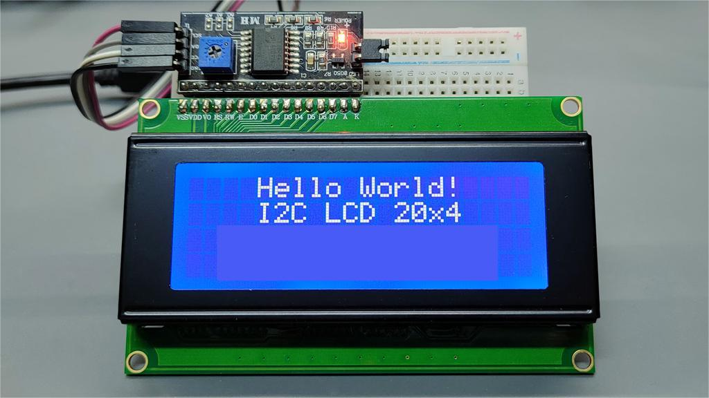

---
layout:
  width: default
  title:
    visible: false
  description:
    visible: false
  tableOfContents:
    visible: true
  outline:
    visible: true
  pagination:
    visible: true
  metadata:
    visible: true
  tags:
    visible: true
  actions:
    visible: true
  anchors:
    visible: true
---

# HD44780 2004 LCD Display Bundle 4x20 characters

### HD44780 2004 LCD Display Bundle 4x20 characters

***

### Product Link



### Introduction

#### LCD1602

LCD1602 liquid crystal display is a widely used character type liquid crystal display module. It is composed of a character-type liquid crystal display (LCD), a control driver main circuit HD44780, etc., and is mainly used to display character-type data.

<figure><figcaption></figcaption></figure>

#### HD44780&#x20;

在HD44780内部含有DDRAM、CGROM以及CGRAM；

| 名称             | 功能                    |
| -------------- | --------------------- |
| DDRAM（显示数据RAM） | 用来寄存待显示的字符代码          |
| CGROM（字符产生ROM） | LCD内部固化字模存储器，内部含有常用字符 |
| CGRAM（字符产生RAM） | 用户自定义的字符产生存储器         |

### Pinout

#### LCD

| 序号   | 符号      | 功能说明           |
| ---- | ------- | -------------- |
| 1    | GND     | 电源地            |
| 2    | VCC     | 电源             |
| 3    | VO      | 对比调整电压（液晶显示偏压） |
| 4    | RS      | 指令/数据选择        |
| 5    | RW      | 读/写选择          |
| 6    | E       | 使能信号           |
| 7-14 | DB0-DB7 | 数据总线           |
| 15   | BG VCC  | 背光电源正极         |
| 16   | BG GND  | 背光电源负极         |

#### HD44780

<figure><figcaption></figcaption></figure>

SCL is the serial clock line for the I2C LCD interface.

SDA is the serial data line for the I2C LCD interface.

VCC is the LCD’s power supply input pin (connects to +5v).

GND is the ground pin.

### specifications

| Dimensions                | 98 mm x 60 mm x 14 mm                             |
| ------------------------- | ------------------------------------------------- |
| Resolution                | 20 characters x 4 lines                           |
| LCD type                  | STN, positive, transflective, blue                |
| Backlight                 | Blue                                              |
| Modes                     | Parallel (8-bit and 4-bit)                        |
| I2C adapter / I2C address | 0x27; Address can be selected - area 0x20 to 0x27 |
| Operating voltage         | 5V                                                |
| Operating temperature     | From -20 ° C to +70 ° C                           |

### How to Use

#### **Wiring LCD 20×4 I2C With Arduino** <a href="#wiring-lcd-20x4-i2c-with-arduino" id="wiring-lcd-20x4-i2c-with-arduino"></a>

Here is the wiring diagram for the LCD 20×4 I2C display with Arduino that we’ll be using in the examples hereafter in this tutorial.

<figure><figcaption></figcaption></figure>

And here is a summary table for different Arduino Boards -> I2C LCD connections.

|                                 | **SDA** | **SCL** |
| ------------------------------- | ------- | ------- |
| **Arduino UNO, Nano, Pro Mini** | A4      | A5      |
| **Arduino Mega**                | 20      | 21      |
| **Arduino Leonardo, Micro**     | 2       | 3       |

#### **Contrast Adjustment For I2C LCD** <a href="#contrast-adjustment-for-i2c-lcd" id="contrast-adjustment-for-i2c-lcd"></a>

After connecting the I2C LCD module, you’ll be able to control the LCD contrast by using the PCF8574 module’s on-board potentiometer. Turn it to the right and to the left until you feel satisfied with the current contrast level.

#### **Get The I2C LCD Address** <a href="#get-the-i2c-lcd-address" id="get-the-i2c-lcd-address"></a>

If you’re not quite sure about the I2C LCD’s device address, you can use the code example below and run it on your Arduino board after connecting the I2C LCD display to your Arduino. It’ll automatically detect and print out the I2C device address for the LCD over the serial monitor.

```
/*
* LAB Name: Arduino I2C Scanner
* Author: Khaled Magdy
* For More Info Visit: www.DeepBlueMbedded.com
*/
#include <Wire.h>
 
void setup()
{
  Serial.begin(9600);
  Wire.begin();
}
void loop()
{
  byte error, address;
  int nDevices;
  Serial.println("Scanning...");
  nDevices = 0;
  for(address = 1; address < 127; address++ )
  {
    Wire.beginTransmission(address);
    error = Wire.endTransmission();
    if (error == 0)
    {
      Serial.print("I2C device found at address 0x");
      if (address<16)
      { Serial.print("0"); }
      Serial.print(address,HEX);
      Serial.println("  !");
      nDevices++;
    }
    else if (error==4)
    {
      Serial.print("Unknown error at address 0x");
      if (address<16)
      { Serial.print("0"); }
      Serial.println(address,HEX);
    }    
  }
  if (nDevices == 0)
  { Serial.println("No I2C devices found\n"); }
  else
  { Serial.println("done\n"); }
  delay(5000);           // wait 5 seconds for next scan
}
```

And here is the result after running this code example on my Arduino UNO board.

<figure><figcaption></figcaption></figure>

### **Arduino I2C LCD Library Installation** <a href="#arduino-i2c-lcd-library-installation" id="arduino-i2c-lcd-library-installation"></a>

You can download and install the Arduino I2C LCD library manually from GitHub, or alternatively, install it within the Arduino IDE itself. Just open the library manager. **Tools** > **Manage Libraries** > Search for LiquidCrystal I2C. Then, click Install and let it finish the installation.

<figure><figcaption></figcaption></figure>

Now, you can easily use the Arduino LiquidCrystal I2C LCD library and check the built-in examples for the library to help you get started.

We’ll move now to the practical code examples to test the Arduino I2C LCD display.

### **Arduino LCD 20×4 I2C Example** <a href="#arduino-lcd-20x4-i2c-example" id="arduino-lcd-20x4-i2c-example"></a>

Now, let’s test what we’ve learned so far about the Arduino LCD 20×4 I2C and create our first project to display text messages on 4 separate lines of the LCD using the .print() function.

The .print() function can also accept a lot of variable data types (strings, integers, float, double, etc). So luckily, we won’t need to do string manipulations and data type conversion.

**Wiring**

This wiring of Arduino with LCD 20×4 I2C is the same as shown before in the previous section.

**Example Code**

Here is the full code listing for this example.

```
/*
* LAB Name: Arduino I2C LCD 20x4 Example
* Author: Khaled Magdy
* For More Info Visit: www.DeepBlueMbedded.com
*/
#include <Wire.h>
#include <LiquidCrystal_I2C.h>
 
LiquidCrystal_I2C MyLCD(0x27, 20, 4); // Creates I2C LCD Object With (Address=0x27, Cols=20, Rows=4)
 
void setup()
{
  MyLCD.init();
  MyLCD.backlight();
  MyLCD.setCursor(0, 0);
  MyLCD.print("    Hello World!");
  MyLCD.setCursor(0, 1);
  MyLCD.print("    I2C LCD 20x4");
}
 
void loop()
{
}
```

**Code Explanation**

First of all, we need to include the Arduino Wire.h library to use the I2C communication module, then the LiquidCrystal\_I2C.h library which we’ll be using to control the I2C LCD module (PCF8574).

```
#include <Wire.h>
#include <LiquidCrystal.h>
```

Next, we’ll create an object of the LiquidCrystal\_I2C class and define its parameters. The parameters for the LiquidCrystal\_I2C object are the I2C device address (0x27), the number of LCD columns, and the number of LCD rows. Those are (20, 4) for 20×4 LCDs.

```
LiquidCrystal_I2C MyLCD(0x27, 20, 4); // Creates I2C LCD Object With (Address=0x27, Cols=20, Rows=4)
```

**setup()**

in the setup() function, we initialize the I2C LCD object ( MyLCD) using the .init() function. We also activate the LCD’s backlight by using the .backlight() function.

```
MyLCD.init();
MyLCD.backlight();
```

Then, we set the LCD cursor position to point to the first line, the first character cell. Any write operation to the LCD will start from the current cursor position value, that’s why it’s important to set it manually before attempting any write operation. To make sure that the text will be displayed exactly where we want it to be.

```
MyLCD.setCursor(0, 0); // (CharIndex, LineIndex)
```

Next, we’ll print the first text message "Hello World!" to the LCD starting from the current cursor position (0, 0). Using the .print() function.

```
MyLCD.print("    Hello World!");
```

and we’ll do the same for the other 3 messages to display them on the subsequent lines on the LCD.

**loop()**

Nothing to be done in the loop() function.

**Testing Results**

Here is the result of testing this project code example on my Arduino UNO board.

<figure><figcaption></figcaption></figure>
