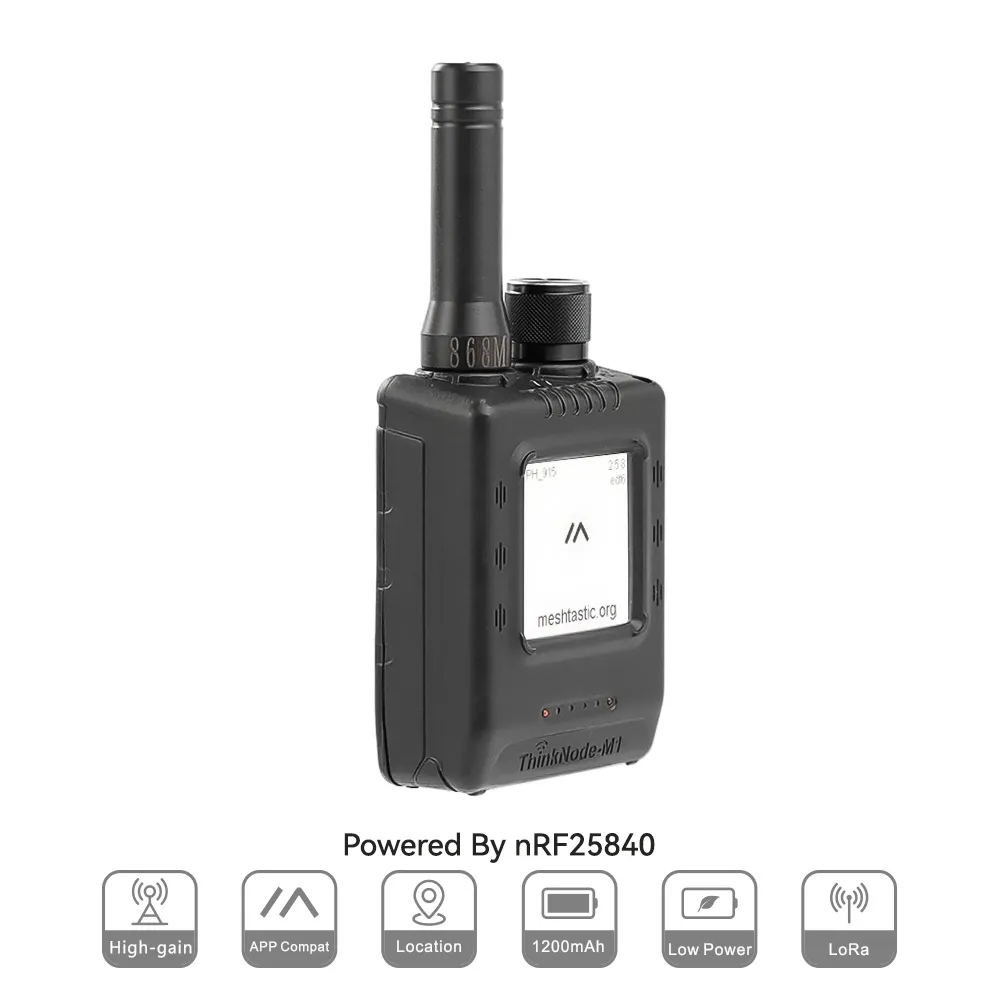

# Elecrow ThinkNode M1 Development Guide


[**View Elecrow ThinkNode M1 LoRa Meshtastic Transceiver With 1.54" EPD Screen on OpenELAB**](https://openelab.io/products/elecrow-thinknode-m1-lora-transceiver)

**Model / option:** 868 MHz With Case · **SKU:** `ELECROW-CIL12901M-1-868`


## Product overview <a href="#product-and-applications" id="product-and-applications"></a>

ThinkNode M1 is an assembled **868 MHz, with-case Meshtastic text/position endpoint**. It uses nRF52840, SX1262 and a front-lit e-paper screen. Begin with the supplied application and a second Meshtastic radio; the first useful result is a received message and reply, followed by a fresh GNSS fix.

The M1 nRF52840 UF2 and another ThinkNode model's firmware are not interchangeable. The user-manual cover says “LoRaWAN Series,” but its actual firmware procedure and current hardware support identify **Meshtastic**. That cover wording does not establish a LoRaWAN application or a multi-channel gateway. [Elecrow model guide](https://elecrow.com/wiki/ThinkNode-M1_Transceiver_Device\(Meshtastic\)_Power_By_nRF52840.html), [exact firmware support](https://meshtastic.org/docs/hardware/devices/elecrow/thinknode/).

## Applications <a href="#updating-firmware-and-developing-applications" id="updating-firmware-and-developing-applications"></a>

Use the M1 for portable text/location experiments, repeated packet-delivery trials and comparing GNSS/front-light duty cycles. Establish a direct two-node baseline before evaluating relays. Measure battery trends at a fixed workload; do not equate battery capacity with guaranteed runtime or emergency-service availability.

## Specifications

| Parameter                    | M1 scope                                                                              |
| ---------------------------- | ------------------------------------------------------------------------------------- |
| CPU                          | nRF52840 Cortex-M4F, 64 MHz                                                           |
| Memory                       | 256 KB RAM; 1 MB internal flash plus 2 MB external, not 3 MB internal flash           |
| Display                      | 1.54-inch front-lit e-paper, 200 × 200; manual full refresh around 2 s                |
| Radio                        | SX1262, purchased 868 MHz; external RP-SMA antenna                                    |
| GNSS                         | L76K in reviewed variant; GPS/GLONASS/BeiDou/QZSS positioning scope                   |
| Battery / input              | 1200 mAh; USB-C 5 V/1 A                                                               |
| Manufacturer current figures | 85 mA maximum working, 5.6 µA low-power; application conditions affect actual current |
| Operating / storage          | −10 to +50 °C / −20 to +60 °C                                                         |
| Enclosed size / mass         | 82 × 51.6 × 26.3 mm / 81 g                                                            |

The manual labels Bluetooth 5.4, but that capability was not established by this review. Use the documented BLE configuration path; optional Bluetooth 5.4 features are not assumed. Battery capacity or the manual's maximum runtime is not a measured duty-cycle guarantee.

Sources: [model manual](https://www.elecrow.com/download/product/CIL12901M/ThinkNode-M1_User_Manual.pdf), [reviewed firmware variant](https://raw.githubusercontent.com/meshtastic/firmware/d0f4096788545fb3c5e22d2a7e52ac6c268caac1/variants/nrf52840/ELECROW-ThinkNode-M1/variant.h) and [display/build configuration](https://raw.githubusercontent.com/meshtastic/firmware/d0f4096788545fb3c5e22d2a7e52ac6c268caac1/variants/nrf52840/ELECROW-ThinkNode-M1/platformio.ini).

**M1 document differences:** the 21-page V1.0 datasheet dated 16 April 2025 reports different environmental, dimensional, current and refresh figures from the current user manual. Keep the narrower user-manual −10 to +50 °C operating range for this guide; neither operating range establishes battery charging-temperature limits. The 85 mA figure is not a whole-device supply ceiling: datasheet p. 20 lists 118.5 mA with GPS/buzzer/front light and 300 mA with all functions at 4.2 V. Use the documented 5 V/1 A USB source and test actual workload; no autonomy figure is guaranteed. Datasheet p. 19 reverses the expected full/partial refresh timing, so no timing-based acceptance limit is asserted. [V1.0 datasheet](https://raw.githubusercontent.com/Elecrow-RD/ThinkNode-M1-LoRa-Meshtastic-Transceiver-With-1.54-EPD-Screen-GPS-function-nRF52840/ca8624b0aac765381909b77f2bb76e585ad17ba5/Datasheet/ThinkNode%20M1_LoRa_Meshtastic_Transceiver_DataSheet.pdf).

## Hardware and connections <a href="#hardware-and-firmware-scope" id="hardware-and-firmware-scope"></a>

### External connections and controls

Use the matching 868 MHz antenna and a 5 V/1 A USB-C source/data cable. The antenna connector is RP-SMA; inspect the center contact as well as thread fit. Do not transfer USB 5 V to internal signal pins or connect another supply at the battery connector. This assembled device's first test needs no internal wiring.

The current manual's control diagram identifies the knob, physical GPS switch, previous/next keys and reset. Clockwise turns on/adjusts the front light; counter-clockwise switches off. The manual assigns previous/next single presses to page movement, 1 s holds to preset/confirmation and a 5 s next-key hold to sleep. The older wiki assigns different multi-click functions; **application version determines button behavior**, so verify on-screen response after updates rather than treating one timing table as universal. [Manual, device-parts and button pages](https://www.elecrow.com/download/product/CIL12901M/ThinkNode-M1_User_Manual.pdf).

### Firmware pin reference for custom work

| Internal role                 | nRF52840 native signal                           |
| ----------------------------- | ------------------------------------------------ |
| Radio SPI SCK/MISO/MOSI       | P0.19 /P0.23 /P0.22                              |
| Radio CS/DIO1/reset/busy      | P0.24 /P0.20 /P0.25 /P0.17                       |
| Radio / peripheral power      | P0.21 /P0.12; DIO2 RF-switch; TCXO 3.3 V setting |
| E-paper CS/busy/DC/reset      | P0.30 /P0.03 /P0.28 /P0.02                       |
| E-paper SCLK/MOSI/front light | P0.31 /P0.29 /P1.11                              |
| I²C SDA/SCL                   | P0.26 /P0.27                                     |
| GNSS host TX/RX               | P1.08 /P1.09 at 9600 baud                        |
| GNSS reset/standby/switch     | P1.05 /P1.02 /P1.01                              |
| Buzzer / buttons              | P0.06 /P1.10, P1.07                              |

Nordic port names are not arbitrary Arduino GPIO numbers: an implementation can encode P1.08 as 40, but the PCB signal remains P1.08. The variant reserves a separate e-paper SPI interface and external QSPI flash. Do not reuse those pins for expansion.

These are **occupied internal nets**, not an exposed sensor-port pinout. The TCXO value is a radio driver setting, not a voltage to inject into a host GPIO. [Exact pinned variant](https://raw.githubusercontent.com/meshtastic/firmware/d0f4096788545fb3c5e22d2a7e52ac6c268caac1/variants/nrf52840/ELECROW-ThinkNode-M1/variant.h).

The M1 datasheet p. 16 ambiguously labels host P0.21 as DIO3/RF-switch; the actual firmware defines it as radio power enable and lets the radio supply its TCXO. Do not externally drive a presumed TCXO line from that table. SWDIO/SWCLK/GND/3V3 are identified for debugging, but bootloader replacement requires a matching image and received-board pad orientation. The published mechanical dimensions also use different antenna/enclosure boundaries; verify fit against the CAD and actual assembly.

## Software and development resources

The supported source environment is **`thinknode_m1`** at Meshtastic commit `d0f4096788545fb3c5e22d2a7e52ac6c268caac1`. Its configuration selects ThinkNode-M1 and the nRF52840 base plus the 200 × 200 e-paper driver. An `-inkhud` environment also exists; it is an alternate UI, not a second hardware SKU. Build unchanged source first and keep the dependency revisions. [Environment](https://raw.githubusercontent.com/meshtastic/firmware/d0f4096788545fb3c5e22d2a7e52ac6c268caac1/variants/nrf52840/ELECROW-ThinkNode-M1/platformio.ini).

Use the official Meshtastic Android/iOS, web or Python client. The radio target must remain **ThinkNode M1**. Flashing the host does not add a different network stack, and the firmware's GPS/power code must remain paired with this board. Meshtastic distribution follows GPL-3.0; included libraries retain their own licenses.

For read-only host inspection, install the [official CLI](https://meshtastic.org/docs/software/python/cli/) in a virtual environment. Commands below do not set a region or send a packet; radio configuration remains a deliberate client step.

## Getting started <a href="#getting-started-send-a-message-between-two-nodes" id="getting-started-send-a-message-between-two-nodes"></a>

### Original controlled message and position test

Prepare this M1, its antenna, two clients and a second compatible Meshtastic radio. Keep the known-good supplied application for the first pass.

1. Charge, turn on with the knob and identify the actual device in the client. Read the hardware/firmware name and use its displayed/configured BLE PIN. Record node IDs for both physical radios.
2. Set the permitted region, wait for restart, and match modem preset, frequency slot and channel name/key at both ends. The older wiki's frequency-override screenshots are not a requirement to override the normal regional plan.
3. Send `M1-OUT-01` and confirm it appears at the other radio. Return `M1-BACK-01` and confirm reception at the M1. Record each receive time and available RSSI/SNR.
4. Repeat five numbered pairs at one fixed location. Separate missing replies from duplicate packets. A successful local send animation or Bluetooth link is not a received radio frame.
5. Turn the physical GPS switch on and enable device GPS in the installed firmware. Move outdoors; inspect current fix state/time and compare with the intended position. A cached peer marker or phone-provided location is a different source.
6. Remove USB and repeat one reply. Compare behavior with USB attached before attributing a failure to RF range; GNSS/front-light/radio settings all affect load.

**Expected result:** live device identity, received text in both directions, and a separate fresh GNSS fix when enabled. If text works but GPS fails, keep the radio configuration fixed and inspect GPS power/switch/revision. [Manufacturer setup](https://elecrow.com/wiki/ThinkNode-M1_Transceiver_Device\(Meshtastic\)_Power_By_nRF52840.html).

### Read-only host record

Replace `YOUR_PORT` with the observed serial device; close other serial clients first. This records the installed configuration and known nodes before any update.

```sh
python3 -m venv .venv-m1
. .venv-m1/bin/activate
python -m pip install meshtastic
meshtastic --port YOUR_PORT --info > m1-identity.txt
meshtastic --port YOUR_PORT --nodes > m1-nodes.txt
```

**Expected result:** readable files identifying the local device and known peers. An empty peer position means no position is stored, not necessarily a receiver fault. On Windows, activate the environment's `Scripts/activate` entry. Use the CLI's installed help if a current release changes options. Keep channel keys in the private configuration record. [Command reference](https://meshtastic.org/docs/software/python/cli/).

### Build and restore in separate stages

```sh
git clone --recursive https://github.com/meshtastic/firmware.git
cd firmware
git checkout d0f4096788545fb3c5e22d2a7e52ac6c268caac1
git submodule update --init --recursive
python3 -m venv .venv
. .venv/bin/activate
python -m pip install platformio
pio run -e thinknode_m1
```

Expected source-build output is a target-specific artifact under `.pio/build/thinknode_m1/`; no successful build is claimed here. Compile unchanged source before modifying a peripheral driver. Keep the existing binary/configuration and restore the exact released target through the official flasher if needed.

For M1 recovery, connect USB and double-click Reset to enter DFU. Select **ThinkNode M1** in the flasher, download its UF2 and copy it to the observed **ELECROWBOOT** drive. Wait for completion/restart, reconnect, restore region/channel configuration and repeat the reply test. A mounted boot drive establishes bootloader operation, not a working application. Never copy an ESP32 M5 binary to it. [Model recovery manual](https://www.elecrow.com/download/product/CIL12901M/ThinkNode-M1_User_Manual.pdf).

## Troubleshooting and FAQs <a href="#troubleshooting-and-faq" id="troubleshooting-and-faq"></a>

| Symptom                                  | Checks and recovery                                                                                                       |
| ---------------------------------------- | ------------------------------------------------------------------------------------------------------------------------- |
| Image remains after switch-off           | E-paper can retain pixels without power; verify live USB/BLE or a new message                                             |
| Front light dark, display still readable | Knob/light setting versus display update; these are separate power paths                                                  |
| No fresh GPS                             | Physical GPS switch, current firmware GPS setting, open sky and host UART P1.08/P1.09; do not alter working LoRa settings |
| UF2 drive absent                         | Data cable, USB power and model-specific double-reset; do not substitute generic nRF bootloader packages                  |
| Buttons changed after update             | Read installed release/control mapping; older wiki and current manual describe different behavior                         |
| Why not install M5 firmware?             | M1 is nRF52840 with UF2; M5 is ESP32-S3 with binary/update workflow                                                       |

## Downloads and technical documents <a href="#technical-documents-and-software" id="technical-documents-and-software"></a>

| Resource                                                                                                                                                                          | Model/revision and purpose                                                         |
| --------------------------------------------------------------------------------------------------------------------------------------------------------------------------------- | ---------------------------------------------------------------------------------- |
| [Official usage wiki](https://elecrow.com/wiki/ThinkNode-M1_Transceiver_Device\(Meshtastic\)_Power_By_nRF52840.html)                                                              | App pairing, channels, diagrams, update entry points                               |
| [User manual PDF](https://www.elecrow.com/download/product/CIL12901M/ThinkNode-M1_User_Manual.pdf)                                                                                | Complete 14-page model document, controls, power, recovery and regulatory appendix |
| [Pinned variant](https://raw.githubusercontent.com/meshtastic/firmware/d0f4096788545fb3c5e22d2a7e52ac6c268caac1/variants/nrf52840/ELECROW-ThinkNode-M1/variant.h)                 | Internal nets, radio TCXO, power and GNSS assignments                              |
| [Pinned build environments](https://raw.githubusercontent.com/meshtastic/firmware/d0f4096788545fb3c5e22d2a7e52ac6c268caac1/variants/nrf52840/ELECROW-ThinkNode-M1/platformio.ini) | Standard/InkHUD choices and dependency versions                                    |
| [Meshtastic hardware family reference](https://meshtastic.org/docs/hardware/devices/elecrow/thinknode/)                                                                           | Exact device support; other ThinkNodes are separate hardware                       |
| [Meshtastic source](https://github.com/meshtastic/firmware) /[flasher](https://flasher.meshtastic.org/)                                                                           | Firmware builds and exact-model released recovery                                  |

| Additional M1 resource                                                                                                                                                                                                                                                   | Scope                                                                                                                                |
| ------------------------------------------------------------------------------------------------------------------------------------------------------------------------------------------------------------------------------------------------------------------------ | ------------------------------------------------------------------------------------------------------------------------------------ |
| [V1.0 datasheet, 21 pages](https://raw.githubusercontent.com/Elecrow-RD/ThinkNode-M1-LoRa-Meshtastic-Transceiver-With-1.54-EPD-Screen-GPS-function-nRF52840/ca8624b0aac765381909b77f2bb76e585ad17ba5/Datasheet/ThinkNode%20M1_LoRa_Meshtastic_Transceiver_DataSheet.pdf) | Hardware architecture, radio/EPD/GNSS/SWD pins, electrical test conditions and 16 April 2025 revision history; apply conflicts above |
| [Exact STEP enclosure/model](https://github.com/Elecrow-RD/ThinkNode-M1-LoRa-Meshtastic-Transceiver-With-1.54-EPD-Screen-GPS-function-nRF52840/blob/ca8624b0aac765381909b77f2bb76e585ad17ba5/3D%20file/thinknode-m1-20250221.stp)                                        | Manufacturer mechanical file, 21 February 2025 name; listed in the inspected repository, not CAD-fit tested                          |

The repository also lists Home Assistant/Meshtastic automation YAML. Those are optional application projects: inspect endpoints, entity IDs and physical outputs before importing them; they are unnecessary for the isolated radio test.

### Retained illustrations



_Manufacturer illustration: Elecrow;_ [_original image source_](https://elecrow.com/wiki/assets/images/ThinkNode-M1_Transceiver_Device\(Meshtastic\)_Power_By_nRF52840/ThinkNode-M1-A.webp)_. The source image is retained for product identification, not as a pinout, display-type or power-rating authority; use the model-specific manual and firmware evidence above._

## References and validation

The exact model wiki, current user-manual pages and pinned Meshtastic variant/environment were read. The device-parts illustration was visually inspected. This guide adds a controlled numbered-message test, private host record, explicit pin namespaces and staged recovery; manufacturer performance figures remain attributed.

[Manufacturer guides](./). Reviewed 24 November 2026. **Firmware/SDK installation, compilation, flashing, radio/serial operation and hardware tests not run.** Examples and expected results are source-reviewed procedures, not observed bench results.
