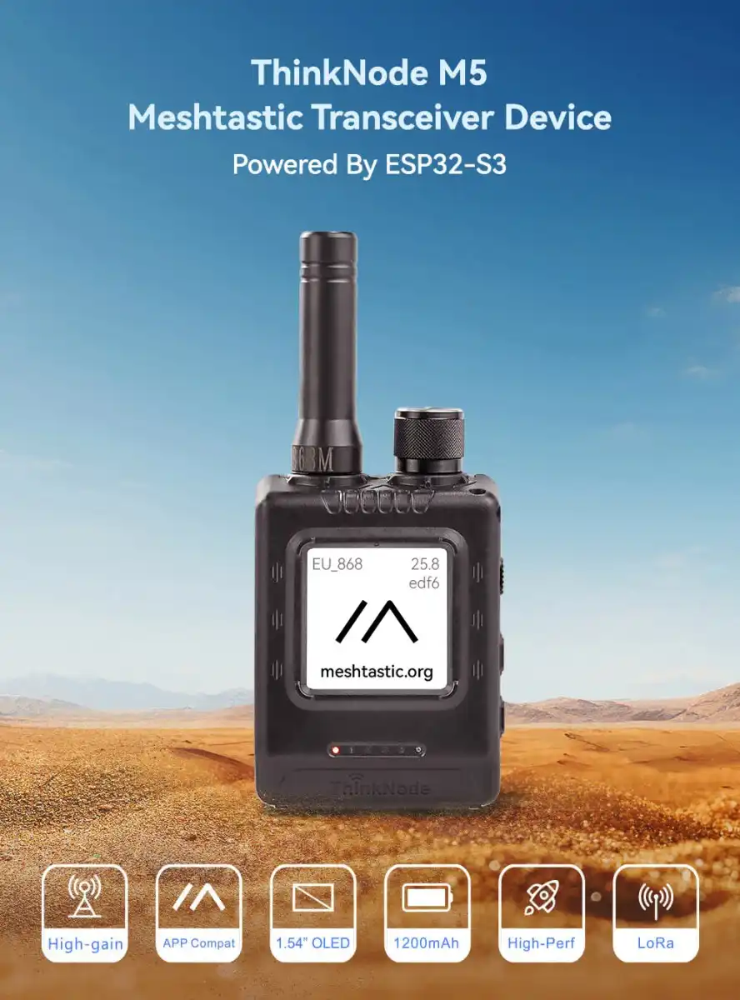

# Elecrow ThinkNode M5 Development Guide


[**View Elecrow ThinkNode M5 Walkie-Talkie Pro on OpenELAB**](https://openelab.io/products/elecrow-thinknode-m5-walkie-talkie-pro)

**Model / option:** 868 MHz With Case · **SKU:** `ELECROW-ILM13205D-868`


## Product overview <a href="#product-and-applications" id="product-and-applications"></a>

ThinkNode M5 is an assembled **868 MHz, with-case Meshtastic text/position endpoint**. It uses ESP32-S3, SX1262 and a front-lit e-paper screen. Begin with the supplied application and a second Meshtastic radio; the first useful result is a received message and reply, followed by a fresh GNSS fix.

The M5 ESP32 binary and another ThinkNode model's firmware are not interchangeable. The user-manual cover says “LoRaWAN Series,” but its actual firmware procedure and current hardware support identify **Meshtastic**. That cover wording does not establish a LoRaWAN application or a multi-channel gateway. [Elecrow model guide](https://elecrow.com/wiki/ThinkNode_M5_Meshtastic_LoRa_Signal_Transceiver_ESP32-S3.html), [exact firmware support](https://meshtastic.org/docs/hardware/devices/elecrow/thinknode/).

## Applications <a href="#updating-firmware-and-developing-applications" id="updating-firmware-and-developing-applications"></a>

Use the M5 for portable text/location experiments, repeated packet-delivery trials and comparing GNSS/front-light duty cycles. Establish a direct two-node baseline before evaluating relays. Measure battery trends at a fixed workload; do not equate battery capacity with guaranteed runtime or emergency-service availability.

## Specifications

| Parameter                    | M5 scope                                                                                                      |
| ---------------------------- | ------------------------------------------------------------------------------------------------------------- |
| Main CPU                     | ESP32-S3, dual-core LX7 up to 240 MHz                                                                         |
| Memory reported by manual    | 4 MB flash, 8 MB PSRAM; preserve the actual target configuration rather than selecting a generic PSRAM layout |
| Display                      | 1.54-inch front-lit e-paper, 200 × 200; full refresh around 2 s in manual                                     |
| Radio                        | SX1262, purchased 868 MHz; external RP-SMA antenna                                                            |
| GNSS                         | L76K on hardware v1; AG3352 on v2, auto-detected by reviewed variant                                          |
| Battery / input              | 1200 mAh; USB-C 5 V/1 A                                                                                       |
| Manufacturer current figures | 340 mA maximum working, 34 µA low-power; operating-mode figures, not measured here                            |
| Operating / storage          | −10 to +50 °C / −20 to +60 °C                                                                                 |
| Enclosed size / mass         | 82 × 51.6 × 26.3 mm / 81 g                                                                                    |

The old feature picture says OLED; the current manual and actual target select e-paper/GxEPD2\_154\_D67. For custom display work follow the received revision and source, not that label. ESP32-S3 connectivity here is 2.4 GHz Wi-Fi and BLE; the manual's 802.11a label does not establish 5 GHz support.

Sources: [model manual](https://www.elecrow.com/download/product/ILM13205D/ThinkNode_M5_User_Manual.pdf), [reviewed firmware variant](https://raw.githubusercontent.com/meshtastic/firmware/d0f4096788545fb3c5e22d2a7e52ac6c268caac1/variants/esp32s3/ELECROW-ThinkNode-M5/variant.h) and [display/build configuration](https://raw.githubusercontent.com/meshtastic/firmware/d0f4096788545fb3c5e22d2a7e52ac6c268caac1/variants/esp32s3/ELECROW-ThinkNode-M5/platformio.ini).

## Hardware and connections <a href="#hardware-and-firmware-scope" id="hardware-and-firmware-scope"></a>

### External connections and controls

Use the matching 868 MHz antenna and a 5 V/1 A USB-C source/data cable. The antenna connector is RP-SMA; inspect the center contact as well as thread fit. Do not transfer USB 5 V to internal signal pins or connect another supply at the battery connector. This assembled device's first test needs no internal wiring.

The current manual's control diagram identifies the knob, physical GPS switch, previous/next keys and reset. Clockwise turns on/adjusts the front light; counter-clockwise switches off. The manual assigns previous/next single presses to page movement, 1 s holds to preset/confirmation and a 5 s next-key hold to sleep. The older wiki assigns different multi-click functions; **application version determines button behavior**, so verify on-screen response after updates rather than treating one timing table as universal. [Manual, device-parts and button pages](https://www.elecrow.com/download/product/ILM13205D/ThinkNode_M5_User_Manual.pdf).

### Firmware pin reference for custom work

| Internal role                  | ESP32-S3 GPIO / control                                          |
| ------------------------------ | ---------------------------------------------------------------- |
| Radio SPI SCK/MISO/MOSI        | 16 /7 /15                                                        |
| Radio CS/DIO1/reset/busy       | 17 /4 /6 /5                                                      |
| Radio power                    | GPIO46; DIO2 RF-switch; TCXO 3.3 V setting                       |
| E-paper CS/busy/DC/reset       | 39 /42 /40 /41                                                   |
| E-paper SCLK/MOSI              | 38 /45; separate from radio SPI                                  |
| I²C SDA/SCL                    | 2 /1; PCF8563 RTC 0x51                                           |
| Buttons / buzzer / battery ADC | 21, 14 /9 /8                                                     |
| Peripheral power / front light | PCA9557 bits 4 /5; these are expander offsets, not ESP32 GPIO4/5 |

**M5 GNSS revision matters.** The firmware reads expander bit 7. v1 L76K host TX20/RX19 uses GPIO13 reset, GPIO11 standby and GPIO10 switch input. v2 AG3352 swaps host TX19/RX20, uses GPIO10 for its 0.8 V rail enable, GPIO18 for switch and a different reset polarity. Do not hard-drive these nets from a generic M5 sketch before revision detection.

These are **occupied internal nets**, not an exposed sensor-port pinout. The TCXO value is a radio driver setting, not a voltage to inject into a host GPIO. [Exact pinned variant](https://raw.githubusercontent.com/meshtastic/firmware/d0f4096788545fb3c5e22d2a7e52ac6c268caac1/variants/esp32s3/ELECROW-ThinkNode-M5/variant.h).

## Software and development resources

The supported source environment is **`thinknode_m5`** at Meshtastic commit `d0f4096788545fb3c5e22d2a7e52ac6c268caac1`. Its configuration selects ESP32-S3-WROOM-1-N4 and the M5 PCA9557 implementation plus the 200 × 200 e-paper driver. An `-inkhud` environment also exists; it is an alternate UI, not a second hardware SKU. Build unchanged source first and keep the dependency revisions. [Environment](https://raw.githubusercontent.com/meshtastic/firmware/d0f4096788545fb3c5e22d2a7e52ac6c268caac1/variants/esp32s3/ELECROW-ThinkNode-M5/platformio.ini).

Use the official Meshtastic Android/iOS, web or Python client. The radio target must remain **ThinkNode M5**. Flashing the host does not add a different network stack, and the firmware's GPS/power code must remain paired with this board. Meshtastic distribution follows GPL-3.0; included libraries retain their own licenses.

For read-only host inspection, install the [official CLI](https://meshtastic.org/docs/software/python/cli/) in a virtual environment. Commands below do not set a region or send a packet; radio configuration remains a deliberate client step.

## Getting started <a href="#getting-started-send-a-message-between-two-nodes" id="getting-started-send-a-message-between-two-nodes"></a>

### Original controlled message and position test

Prepare this M5, its antenna, two clients and a second compatible Meshtastic radio. Keep the known-good supplied application for the first pass.

1. Charge, turn on with the knob and identify the actual device in the client. Read the hardware/firmware name and use its displayed/configured BLE PIN. Record node IDs for both physical radios.
2. Set the permitted region, wait for restart, and match modem preset, frequency slot and channel name/key at both ends. The older wiki's frequency-override screenshots are not a requirement to override the normal regional plan.
3. Send `M5-OUT-01` and confirm it appears at the other radio. Return `M5-BACK-01` and confirm reception at the M5. Record each receive time and available RSSI/SNR.
4. Repeat five numbered pairs at one fixed location. Separate missing replies from duplicate packets. A successful local send animation or Bluetooth link is not a received radio frame.
5. Turn the physical GPS switch on and enable device GPS in the installed firmware. Move outdoors; inspect current fix state/time and compare with the intended position. A cached peer marker or phone-provided location is a different source.
6. Remove USB and repeat one reply. Compare behavior with USB attached before attributing a failure to RF range; GNSS/front-light/radio settings all affect load.

**Expected result:** live device identity, received text in both directions, and a separate fresh GNSS fix when enabled. If text works but GPS fails, keep the radio configuration fixed and inspect GPS power/switch/revision. [Manufacturer setup](https://elecrow.com/wiki/ThinkNode_M5_Meshtastic_LoRa_Signal_Transceiver_ESP32-S3.html).

### Read-only host record

Replace `YOUR_PORT` with the observed serial device; close other serial clients first. This records the installed configuration and known nodes before any update.

```sh
python3 -m venv .venv-m5
. .venv-m5/bin/activate
python -m pip install meshtastic
meshtastic --port YOUR_PORT --info > m5-identity.txt
meshtastic --port YOUR_PORT --nodes > m5-nodes.txt
```

**Expected result:** readable files identifying the local device and known peers. An empty peer position means no position is stored, not necessarily a receiver fault. On Windows, activate the environment's `Scripts/activate` entry. Use the CLI's installed help if a current release changes options. Keep channel keys in the private configuration record. [Command reference](https://meshtastic.org/docs/software/python/cli/).

### Build and restore in separate stages

```sh
git clone --recursive https://github.com/meshtastic/firmware.git
cd firmware
git checkout d0f4096788545fb3c5e22d2a7e52ac6c268caac1
git submodule update --init --recursive
python3 -m venv .venv
. .venv/bin/activate
python -m pip install platformio
pio run -e thinknode_m5
```

Expected source-build output is a target-specific artifact under `.pio/build/thinknode_m5/`; no successful build is claimed here. Compile unchanged source before modifying a peripheral driver. Keep the existing binary/configuration and restore the exact released target through the official flasher if needed.

For M5 USB recovery, its manual specifies **ThinkNode M5 → chosen released firmware → Flash/Continue → 1200 bps Reset → observed serial port → Update**. A changed USB port requires re-selection. Do not use M1's double-reset UF2 drive-copy operation as an M5 recovery recipe. A `.bin` downloaded for another flash layout must not be written at a guessed address. [Model recovery manual](https://www.elecrow.com/download/product/ILM13205D/ThinkNode_M5_User_Manual.pdf).

## Troubleshooting and FAQs <a href="#troubleshooting-and-faq" id="troubleshooting-and-faq"></a>

| Symptom                              | Checks and recovery                                                                                     |
| ------------------------------------ | ------------------------------------------------------------------------------------------------------- |
| GPS breaks after a custom build      | Restore M5 revision detection; GPIO10 has different roles and host UART direction changes between v1/v2 |
| Screen described as OLED             | Use the actual e-paper target/manual; the retained feature image's label is inconsistent                |
| Radio or display intermittently dead | PCA9557 peripheral enable/front-light offsets versus MCU pins; restore stock power sequencing           |
| No serial update                     | Known data cable, correct M5 target and 1200 bps transition; refresh the port after reset               |
| App visible, no text                 | Full region/preset/channel key match, antennas, actual receiver and a numbered two-way test             |
| Can it transmit voice?               | The documented application is text/position; “walkie-talkie” wording does not establish voice streaming |

## Downloads and technical documents <a href="#technical-documents-and-software" id="technical-documents-and-software"></a>

| Resource                                                                                                                                                                         | Model/revision and purpose                                                         |
| -------------------------------------------------------------------------------------------------------------------------------------------------------------------------------- | ---------------------------------------------------------------------------------- |
| [Official usage wiki](https://elecrow.com/wiki/ThinkNode_M5_Meshtastic_LoRa_Signal_Transceiver_ESP32-S3.html)                                                                    | App pairing, channels, diagrams, update entry points                               |
| [User manual PDF](https://www.elecrow.com/download/product/ILM13205D/ThinkNode_M5_User_Manual.pdf)                                                                               | Complete 14-page model document, controls, power, recovery and regulatory appendix |
| [Pinned variant](https://raw.githubusercontent.com/meshtastic/firmware/d0f4096788545fb3c5e22d2a7e52ac6c268caac1/variants/esp32s3/ELECROW-ThinkNode-M5/variant.h)                 | Internal nets, radio TCXO, power and GNSS assignments                              |
| [Pinned build environments](https://raw.githubusercontent.com/meshtastic/firmware/d0f4096788545fb3c5e22d2a7e52ac6c268caac1/variants/esp32s3/ELECROW-ThinkNode-M5/platformio.ini) | Standard/InkHUD choices and dependency versions                                    |
| [Meshtastic hardware family reference](https://meshtastic.org/docs/hardware/devices/elecrow/thinknode/)                                                                          | Exact device support; other ThinkNodes are separate hardware                       |
| [Meshtastic source](https://github.com/meshtastic/firmware) /[flasher](https://flasher.meshtastic.org/)                                                                          | Firmware builds and exact-model released recovery                                  |

The [manufacturer resource list](https://www.elecrow.com/thinknode-m5-meshtastic-lora-signal-transceiver-esp32-s3-1-54-screen-gps-function.html) additionally links CE/FCC/IC/UL reports. These are certification resources, not a complete PCB schematic or a claim about an altered antenna/firmware configuration.

### Retained illustrations



_Manufacturer illustration: Elecrow;_ [_original image source_](https://elecrow.com/wiki/assets/images/ThinkNode_M5_Meshtastic_LoRa_Signal_Transceiver_ESP32-S3/feature_of_Thinknode_M5_1.webp)_. The source image is retained for product identification, not as a pinout, display-type or power-rating authority; use the model-specific manual and firmware evidence above._

## References and validation

The exact model wiki, current user-manual pages and pinned Meshtastic variant/environment were read. The device-parts illustration was visually inspected. This guide adds a controlled numbered-message test, private host record, explicit pin namespaces and staged recovery; manufacturer performance figures remain attributed.

[Manufacturer guides](./). Reviewed 24 November 2026. **Firmware/SDK installation, compilation, flashing, radio/serial operation and hardware tests not run.** Examples and expected results are source-reviewed procedures, not observed bench results.
