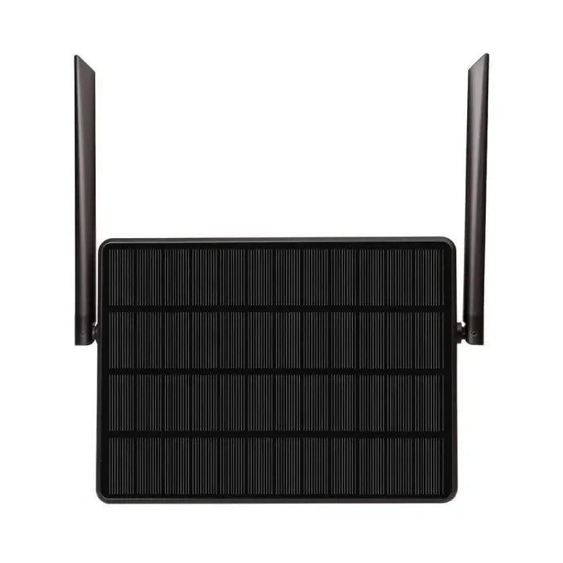

# Elecrow ThinkNode M6 Development Guide

_Product image: OpenELAB._ [_Image source_](https://cdn.shopify.com/s/files/1/0621/0050/4774/files/thinknode_m6_1_1_1.webp?v=1770871902)_._

[Product at OpenELAB](https://openelab.io/products/elecrow-thinknode-m6-outdoor-solar) · [Manufacturer wiki hub](./)

### Product and applications

**Elecrow ThinkNode M6, LMM14106D**, is an outdoor solar-powered LoRa node for fixed mesh coverage, remote-site messaging and experimental sensor telemetry. This first-run workflow uses its documented **Meshtastic** configuration. MeshCore is a separate firmware/network path; confirm exact M6 support and application role in its current flasher before changing ecosystems.

### Hardware specifications and power

| Item           | M6 reference configuration                             |
| -------------- | ------------------------------------------------------ |
| MCU            | Nordic nRF52840, Arm Cortex-M4, 64 MHz                 |
| MCU memory     | 256 KB RAM; 1 MB internal flash                        |
| Radio          | Semtech SX1262; EU868/US915 antenna/hardware selection |
| Positioning    | L76K GNSS with external antenna connection             |
| Charging       | 6 W rated solar panel, MPPT; USB-C charge/data         |
| Battery system | Two 18650 cells; 7000 mAh reference configuration      |
| Expansion      | Two SP11 connectors for I²C and UART                   |
| Enclosure      | IP65 reference rating; −20 to +60 °C operating range   |

Sources: [manufacturer specifications](https://www.elecrow.com/thinknode-m6-outdoor-solar-power-for-meshtastic-powered-by-nrf52840-supports-gps.html), [usage wiki](https://www.elecrow.com/wiki/ThinkNode_M6_Outdoor_Solar_Power_for_Meshtastic_Powered_By_nRF52840_Supports_GPS.html) and the manual below. Battery capacity and panel rating do not guarantee continuous service at every season, location or transmit/GNSS duty cycle. Keep seals/connectors correctly assembled to maintain weather protection; IP65 is not an immersion rating.

### Controls and external interfaces

The documented **PWR** button powers the device on/off with a long press; double-click updates location and triple-click toggles GPS. A single **Reset** restarts the node. With USB connected, two reset presses within about **250 ms** enter its programming/DFU path.

The I²C SP11 port is the one near the antenna; the UART port is lower. Before attaching a sensor, verify **the actual connector pinout, signal voltage, available rail/current and firmware driver support** from revision-specific documentation. A sensor's physical plug fitting does not prove electrical or software compatibility. The reviewed wiki gives usage examples but does not establish every external sensor's power/driver requirements.

The power indicator is deliberately not a permanent activity light in normal battery operation. Use application telemetry and fresh messages to verify the node; a dark LED alone is not proof that it has powered off.

### Getting started: verify before outdoor mounting

Prepare the M6, correct LoRa and GNSS antennas, a USB data cable, Meshtastic phone app and a second compatible Meshtastic node. Perform this test on the bench before closing/mounting the enclosure.

1. Install matching antennas, charge sufficiently and power on. Pair the app with the intended physical M6. The reviewed manufacturer instructions list **123456** as the default Bluetooth code; use the device's actual configured code when changed.
2. Set the permitted region and a matching modem/channel configuration on both nodes. Match private-channel keys where used. Do not substitute raw frequency changes for a complete compatible region/preset configuration.
3. Send a unique message from the other node to the M6, verify its arrival in the app, then reply from the M6. Record both node IDs and timestamps.
4. Enable GNSS and test outdoors with sky visibility. Check for a current fix and location timestamp independently of message reception.
5. Check charging behavior in usable sunlight and log battery voltage over the expected operating cycle. Re-test communications after mounting and enclosure closure.

Expected result: fresh messages in both directions, a separately confirmed outdoor GNSS fix and observable charging behavior. This is a functional acceptance sequence, not a measured maximum range or annual solar energy guarantee.

### Firmware update and development

Back up configuration and record the installed release. From the [Meshtastic flasher](https://flasher.meshtastic.org/), select **ThinkNode M6** and the matching released target. Use the manufacturer's double-reset/USB procedure. If directed to a download, follow its UF2 drive-copy workflow with the exact M6 file and wait for completion/restart. Do not use an ESP32 ThinkNode's `.bin` image on this nRF52840 device.

For custom development, start from the M6 board definition in the [Meshtastic firmware source](https://github.com/meshtastic/firmware), retaining its release/commit and known-good configuration. Confirm messaging before adding sensor modules, GNSS changes or power-management modifications. The USB/DFU recovery path should remain available throughout testing.

For a MeshCore deployment, select the exact M6 hardware and intended role in the official ecosystem's flasher and repeat the message/energy test with compatible peers. A Meshtastic node and a MeshCore client/repeater do not form one interoperable network merely by using the same band.

### Deployment, troubleshooting and FAQ

| Symptom or question                          | Check and next step                                                                                                               |
| -------------------------------------------- | --------------------------------------------------------------------------------------------------------------------------------- |
| Bluetooth pairs but no radio messages        | Same firmware ecosystem, region/preset, channel/key, antennas and close-range two-node test.                                      |
| Node appears off after a few seconds         | Low-power indicator behavior; check fresh app telemetry, messages and battery state.                                              |
| Battery falls overnight or in winter         | Solar exposure/shading, weather, battery condition and GPS/radio/sensor load; log voltage and energy demand.                      |
| Sensor data absent                           | Connector pinout, voltage, power budget, I²C address/UART settings and enabled firmware driver.                                   |
| USB update fails                             | Data cable, double-reset timing, exact M6 target and the model's UF2 recovery instructions.                                       |
| Can solar power guarantee continuous uptime? | Size and validate for local worst-case energy conditions; the rated panel and battery capacities alone do not establish autonomy. |

For integration support include hardware/firmware revision, node role, region/preset, antenna and mounting arrangement, battery/charging log and the minimal reproducible failure. Obtain a matching complete schematic or mechanical CAD package before designing custom wiring/enclosures when the supplied documentation is insufficient.

### Technical documents and software

| Resource                                                                                                                                     | Use                                                  |
| -------------------------------------------------------------------------------------------------------------------------------------------- | ---------------------------------------------------- |
| [Manufacturer specifications](https://www.elecrow.com/thinknode-m6-outdoor-solar-power-for-meshtastic-powered-by-nrf52840-supports-gps.html) | Electrical/platform specifications and configuration |
| [Usage wiki](https://www.elecrow.com/wiki/ThinkNode_M6_Outdoor_Solar_Power_for_Meshtastic_Powered_By_nRF52840_Supports_GPS.html)             | Controls, flashing and application setup             |
| [User manual](https://www.elecrow.com/download/product/LMM14106D/ThinkNode_M6_Outdoor_Solar_Power_for_Meshtastic_User_Manual.pdf)            | Model-specific operation and hardware illustrations  |
| [Meshtastic hardware reference](https://meshtastic.org/docs/hardware/devices/elecrow/thinknode/)                                             | Exact supported target                               |
| [Meshtastic firmware](https://github.com/meshtastic/firmware)                                                                                | Board definitions and development sources            |
| [MeshCore flasher](https://flasher.meshcore.co.uk/)                                                                                          | Confirm exact device/role for an alternate ecosystem |

**Review date:** 17 November 2026. **Validation:** official documentation and the cited software interfaces reviewed. Commands and examples have not been compiled or run on physical hardware by OpenELAB for this guide. Record your hardware revision, firmware, software versions and actual results when reproducing it.
