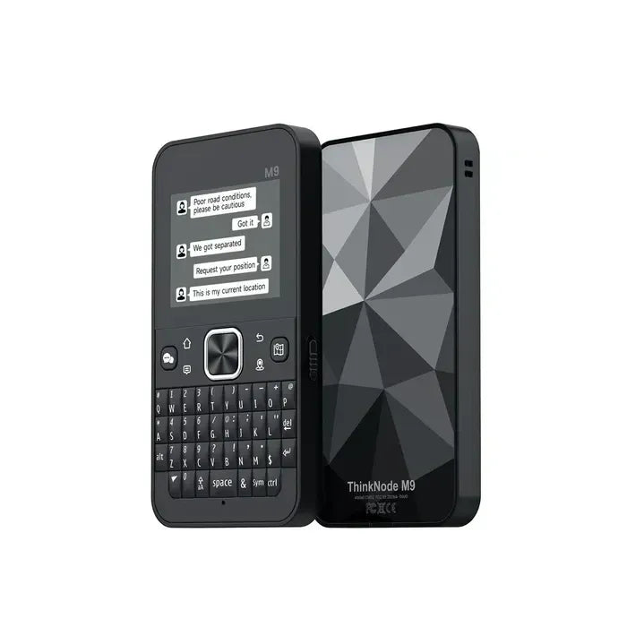

# Elecrow ThinkNode M9 MeshCore Development Guide

_Product image: OpenELAB._ [_Image source_](https://cdn.shopify.com/s/files/1/0621/0050/4774/files/global-elecrow-lmm16509d-01-thinknode-m9-white.webp?v=1786354648)_._

[Product at OpenELAB](https://openelab.io/products/elecrow-thinknode-m9-meshcore-with-2-4inch-lcd-keyboard) · [Manufacturer wiki hub](./)

### Product and firmware scope

**Elecrow ThinkNode M9, LMM16509D**, is a handheld LoRa terminal with a physical keyboard and screen. This page covers the **MeshCore/Ripple** configuration sold as EU868 or US915 with case. Elecrow's reviewed guide is for **M9 V1.0, Ripple v12.0**, document version 13 August 2026. Check the installed firmware: M9 also has a separate Meshtastic guide, and the two ecosystems do not exchange messages simply because both use LoRa.

Use it for standalone text communication, contact/channel management, location sharing and mesh diagnostics. In its default client/standalone role it can use a compatible repeater, but it does not automatically forward traffic as a repeater.

### Hardware and developer interfaces

| Item                | M9 reference configuration                                      |
| ------------------- | --------------------------------------------------------------- |
| Main/keyboard MCU   | ESP32-S3-R8 / separate ESP32-S2 keyboard controller             |
| Radio               | Semtech LR1110; match 868/915 MHz hardware and antenna          |
| Display             | 2.4-inch, 320 × 240 color LCD                                   |
| Storage             | microSD/TF; marketed 16 GB is storage, not MCU RAM              |
| Positioning/sensors | GNSS, PCF8563 RTC, QMC6309 magnetic and QMI8658B motion sensors |
| Power/host          | 2300 mAh battery; USB-C charge/data; CH340K USB-UART            |

Source: [Elecrow's model guide](https://www.elecrow.com/wiki/ThinkNode_M9_MeshCore_Communication_Terminal_with_Full_Keyboard.html). Its complete pin tables are the primary electrical reference. The LCD, radio and microSD **share SPI**, so custom firmware must keep non-target chip selects inactive.

| Shared SPI connection                 | Main ESP32-S3 GPIO |
| ------------------------------------- | ------------------ |
| SCK / MOSI / MISO                     | 40 / 47 / 38       |
| LR1110 NSS / BUSY / interrupt / reset | 39 / 41 / 42 / 45  |
| LCD CS / reset / DC                   | 16 / 14 / 15       |
| microSD CS                            | 48                 |

Keyboard matrix pins belong to the ESP32-S2; do not treat them as the main controller's GPIOs. Follow the full guide for peripheral rails, GNSS UART and coprocessor wake lines before custom firmware work.

### Getting started: a two-terminal message exchange

Prepare two compatible MeshCore nodes with adequate charge and matching-band antennas. Start with the installed application when it already boots correctly.

1. Confirm the installed application identifies itself as **MeshCore Ripple**. Complete its built-in selection/menu tutorial. Direction keys move focus, center confirms, Home returns and Menu opens page actions.
2. On first setup select **New Network → MeshCore**, then a complete preset appropriate to the operating region and local network. Give the profile a recognizable name. The profile name does not substitute for matching radio settings.
3. Confirm both nodes agree on **frequency, bandwidth, spreading factor, coding rate**, channel key and any required scope. Use the complete community preset; changing only frequency is insufficient.
4. Use **Discover → Send ID Local / Scan Local** to confirm each device can discover the other, then reverse the roles. Confirm live information from the intended physical nodes.
5. Open **Public**, type a unique test message and send it. Check its arrival at the other terminal, then send a different reply. Continue with a private channel only after its key matches on both devices.

Expected result: fresh messages received in both directions. A message in the sending terminal's history, an enabled Wi-Fi icon or a detected contact alone does not prove delivery. Record application version, selected preset, node identities and results.

### GNSS, maps and service dependencies

Test GNSS outdoors with sky visibility and check **GPS Info** for a current fix/time. A stored map position is not a fresh fix. The reviewed guide recommends a reliable **FAT32 microSD**; map directories and tile formats depend on firmware. Validate map browsing separately from GNSS.

Wi-Fi features and automatic map downloading in the reviewed Ripple application can require an **official paid unlock**. Check the installed release and its licensing before depending on those functions. Hardware Wi-Fi availability alone does not establish that the application feature is enabled. Do not place credentials or private channel keys in public logs.

### Firmware, recovery and development

Back up profile/channel settings and keys before an update. Follow the model guide's maintenance section and the [MeshCore flasher](https://meshcore.io/flasher), selecting firmware that explicitly names **ThinkNode M9** and the intended application. Preserve the currently working binary/version and any provided checksum. An ESP32-S3 image for another ThinkNode is not a safe substitute.

The [MeshCore repository](https://github.com/meshcore-dev/MeshCore) supplies protocol/device firmware references, but do not assume its license, UI or binary reproduces Ripple's complete standalone application and unlocked features. Start custom work from the intended M9 target and separately verify keyboard, SPI chip selects and peripheral power management.

The official wiki provides architecture and detailed pin tables. A complete revision-specific schematic/CAD download was not identified in the reviewed resources; request it from Elecrow before a PCB or enclosure redesign.

### Troubleshooting and FAQ

| Symptom                            | Check and next step                                                                                                                            |
| ---------------------------------- | ---------------------------------------------------------------------------------------------------------------------------------------------- |
| Discovery or messages fail         | Exact ecosystem, radio preset, band/antenna, channel key, scope and a close two-node test.                                                     |
| Contact visible but no delivery    | Actual recipient online, contact route/repeater and channel versus private-chat settings.                                                      |
| Wi-Fi icon but no Internet         | Official feature unlock, connected SSID, 2.4 GHz, address and router access; an icon is not a connectivity test.                               |
| Blank map                          | Card format, release-specific tile paths, coverage and zoom; check independently of GPS fix.                                                   |
| Custom firmware breaks radio or SD | Shared SPI chip selects and peripheral rail sequencing; return to an exact M9 stock build.                                                     |
| Can it serve as a repeater?        | The default standalone/client role does not forward other clients' traffic; use explicitly supported repeater firmware/hardware for that role. |

### Technical documents and software

| Resource                                                                                                                      | Use                                                |
| ----------------------------------------------------------------------------------------------------------------------------- | -------------------------------------------------- |
| [Elecrow M9 MeshCore wiki](https://www.elecrow.com/wiki/ThinkNode_M9_MeshCore_Communication_Terminal_with_Full_Keyboard.html) | Controls, pin maps, firmware scope and maintenance |
| [MeshCore flasher](https://meshcore.io/flasher)                                                                               | Exact model/application firmware selection         |
| [MeshCore source](https://github.com/meshcore-dev/MeshCore)                                                                   | Protocol and supported device implementations      |

**Review date:** 17 November 2026. **Validation:** official documentation and the cited software interfaces reviewed. Commands and examples have not been compiled or run on physical hardware by OpenELAB for this guide. Record your hardware revision, firmware, software versions and actual results when reproducing it.
