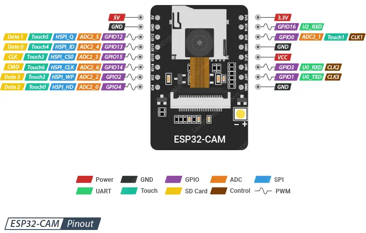
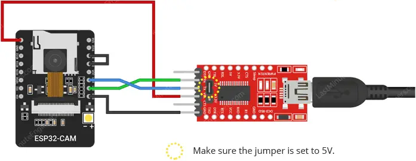

---
layout:
  width: default
  title:
    visible: false
  description:
    visible: false
  tableOfContents:
    visible: true
  outline:
    visible: true
  pagination:
    visible: true
  metadata:
    visible: true
  tags:
    visible: true
  actions:
    visible: true
  anchors:
    visible: true
---

# ESP32-CAM Camera Module

### ESP32-CAM Camera Module

***

### Product Link <a href="#esp32cam-hardware-overview" id="esp32cam-hardware-overview"></a>



### Overview <a href="#esp32cam-hardware-overview" id="esp32cam-hardware-overview"></a>

The heart of the ESP32-CAM is an ESP32-S System-on-Chip (SoC) from Ai-Thinker. Being an SoC, the ESP32-S chip contains an entire computer—the microprocessor, RAM, storage, and peripherals—on a single chip. While the chip’s capabilities are quite impressive, the ESP32-CAM development board adds even more features to the mix. Let’s take a look at each component one by one.

#### Processor <a href="#the-esp32s-processor" id="the-esp32s-processor"></a>

The ESP32-CAM equips the ESP32-S surface-mount printed circuit board module from Ai-Thinker. It is equivalent to Espressif’s ESP-WROOM-32 module (same form factor and general specifications).

<figure><figcaption></figcaption></figure>

The ESP32-S contains a Tensilica Xtensa® LX6 microprocessor with two 32-bit cores operating at a staggering 240 MHz! This is what makes the ESP32-S suitable for intensive tasks like video processing, facial recognition, and even artificial intelligence.

#### The Memory <a href="#the-memory" id="the-memory"></a>

Memory is paramount for complex tasks, so the ESP32-S has a full 520 kilobytes of internal RAM, which resides on the same die as the rest of the chip’s components.

<figure><figcaption></figcaption></figure>

It may be inadequate for RAM-intensive tasks, so ESP32-CAM includes 4 MB of external PSRAM (Pseudo-Static RAM) to expand the memory capacity. This is plenty of RAM, especially for intensive audio or graphics processing.

All these features amount to nothing if you don’t have enough storage for your programs and data. The ESP32-S chip shines here as well, as it contains 4 MB of on-chip flash memory.

#### The Camera <a href="#the-camera" id="the-camera"></a>

The OV2640 camera sensor on the ESP32-CAM is what sets it apart from other ESP32 development boards and makes it ideal for use in video projects like a video doorbell or nanny cam.

<figure><figcaption></figcaption></figure>

The OV2640 camera has a resolution of 2 megapixels, which translates to a maximum of 1600×1200 pixels, which is sufficient for many surveillance applications.

The ESP32-CAM is compatible with a wide variety of camera sensors, as listed on [github](https://github.com/espressif/esp32-camera#supported-sensor).

#### The Storage <a href="#the-storage" id="the-storage"></a>

The addition of a microSD card slot on the ESP32-CAM is a nice bonus. This allows for limitless expansion, making it a great little board for data loggers or image capture.

<figure><figcaption></figcaption></figure>

#### The Antenna <a href="#the-antenna" id="the-antenna"></a>

The ESP32-CAM comes with an on-board PCB trace antenna as well as a u.FL connector for connecting an external antenna. An Antenna Selection jumper (zero-ohm resistor) allows you to choose between the two options.

<figure><figcaption></figcaption></figure>

If you want to switch from the onboard antenna, refer to [connecting an external antenna to ESP32-CAM](https://lastminuteengineers.com/getting-started-with-esp32-cam/#connecting-an-external-antenna-to-esp32cam).

#### LEDs <a href="#leds" id="leds"></a>

The ESP32-CAM has a white square LED. It is intended to be used as a camera flash, but it can also be used for general illumination.

<figure><figcaption></figcaption></figure>

There is a small red LED on the back that can be used as a status indicator. It is user-programmable and connected to GPIO33.

#### Technical Specifications <a href="#technical-specifications" id="technical-specifications"></a>

To summarize, the ESP32-CAM has the following specifications.

* Processors:
  * CPU: Xtensa dual-core 32-bit LX6 microprocessor, operating at 240 MHz and performing at up to 600 DMIPS
  * Ultra low power (ULP) co-processor
* Memory:
  * 520 KB SRAM
  * 4MB External PSRAM
  * 4MB internal flash memory
* Wireless connectivity:
  * Wi-Fi: 802.11 b/g/n
  * Bluetooth: v4.2 BR/EDR and BLE (shares the radio with Wi-Fi)
* Camera:
  * 2 Megapixel OV2640 sensor
  * Array size UXGA 1622×1200
  * Output formats include YUV422, YUV420, RGB565, RGB555 and 8-bit compressed data
  * Image transfer rate of 15 to 60 fps
  * Built-in flash LED
  * Support many camera sensors
* Supports microSD card
* Security:
  * IEEE 802.11 standard security features all supported, including WFA, WPA/WPA2 and WAPI
  * Secure boot
  * Flash encryption
  * 1024-bit OTP, up to 768-bit for customers
  * Cryptographic hardware acceleration: AES, SHA-2, RSA, elliptic curve cryptography (ECC), random number generator (RNG)
* Power management:
  * Internal low-dropout regulator
  * Individual power domain for RTC
  * 5μA deep sleep current
  * Wake up from GPIO interrupt, timer, ADC measurements, capacitive touch sensor interrupt

#### Schematic and Datasheets

For more information on ESP32-CAM, please refer to:

[ESP32-CAM schematic diagram](https://docs.ai-thinker.com/_media/esp32/docs/esp32_cam_sch.pdf)

[OV2640 Camera Datasheet](https://docs.ai-thinker.com/_media/esp32/docs/ov2640_ds_1.8_.pdf)

### ESP32-CAM Power Consumption <a href="#esp32cam-power-consumption" id="esp32cam-power-consumption"></a>

The power consumption of the ESP32-CAM varies depending on what you’re using it for.

It ranges from 80 mAh when not streaming video to around 100\~160 mAh when streaming video; with the flash on, it can reach 270 mAh.

| Operation mode          | Power Consumption |
| ----------------------- | ----------------- |
| Stand by                | 80 mAh            |
| In streaming            | 100\~160 mAh      |
| In streaming with flash | 270 mAh           |

### ESP32-CAM Pinout <a href="#esp32cam-pinout" id="esp32cam-pinout"></a>

The ESP32-CAM has 16 pins in total. For convenience, pins with similar functionality are grouped together. The pinout is as follows:

<figure><figcaption></figcaption></figure>

Power Pins There are two power pins: 5V and 3V3. The ESP32-CAM can be powered via the 3.3V or 5V pins. Since many users have reported problems when powering the device with 3.3V, it is advised that the ESP32-CAM always be powered via the 5V pin. The VCC pin normally outputs 3.3V from the on-board voltage regulator. It can, however, be configured to output 5V by using the Zero-ohm link near the VCC pin.

GND is the ground pin.

GPIO Pins The ESP32-S chip has 32 GPIO pins in total, but because many of them are used internally for the camera and the PSRAM, the ESP32-CAM only has 10 GPIO pins available. These pins can be assigned a variety of peripheral duties, such as UART, SPI, ADC, and Touch.

UART Pins The ESP32-S chip actually has two UART interfaces, UART0 and UART2. However, only the RX pin (GPIO 16) of UART2 is broken out, making UART0 the only usable UART on the ESP32-CAM (GPIO 1 and GPIO 3). Also, because the ESP32-CAM lacks a USB port, these pins must be used for flashing as well as connecting to UART-devices such as GPS, fingerprint sensors, distance sensors, and so on.

MicroSD Card Pins are used for interfacing the microSD card. If you aren’t using a microSD card, you can use these pins as regular inputs and outputs.

ADC Pins On the ESP32-CAM, only ADC2 pins are broken out. However, because ADC2 pins are used internally by the WiFi driver, they cannot be used when Wi-Fi is enabled.

Touch Pins The ESP32-CAM has 7 capacitive touch-sensing GPIOs. When a capacitive load (such as a human finger) is in close proximity to the GPIO, the ESP32 detects the change in capacitance.

SPI Pins The ESP32-CAM features only one SPI (VSPI) in slave and master modes.

PWM Pins The ESP32-CAM has 10 channels (all GPIO pins) of PWM pins controlled by a PWM controller. The PWM output can be used for driving digital motors and LEDs.

For more information, refer to our comprehensive ESP32-CAM pinout reference guide. This guide also explains which ESP32-CAM GPIO pins are safe to use and which pins should be used with caution.

### Programming the ESP32-CAM <a href="#programming-the-esp32cam" id="programming-the-esp32cam"></a>

Programming the ESP32-CAM can be a bit of a pain as it lacks a built-in USB port. Because of that design decision, users require additional hardware in order to upload programs from the Arduino IDE. None of that is terribly complex, but it is inconvenient.

To program this device, you’ll need either a USB-to-serial adapter (an FTDI adapter) or an ESP32-CAM-MB programmer adapter.

#### Using the FTDI Adapter <a href="#using-the-ftdi-adapter" id="using-the-ftdi-adapter"></a>

If you’ve decided to use the FTDI adapter, here’s how you connect it to the ESP32-CAM module.

<figure><figcaption></figcaption></figure>

Many FTDI programmers have a jumper that lets you choose between 3.3V and 5V. As we are powering the ESP32-CAM with 5V, make sure the jumper is set to 5V.

Please note that the GPIO 0 pin is connected to Ground. This connection is only necessary while programming the ESP32-CAM. Once you have finished programming the module, you must disconnect this connection.

Remember! You’ll have to make this connection every time you want to upload a new sketch.

#### Using the ESP32-CAM-MB Adapter (Recommended) <a href="#using-the-esp32cammb-adapter-recommended" id="using-the-esp32cammb-adapter-recommended"></a>

Using the FTDI Adapter to program the ESP32-CAM is a bit of a hassle. This is why many vendors now sell the ESP32-CAM board along with a small add-on daughterboard called the ESP32-CAM-MB.

You stack the ESP32-CAM on the daughterboard, attach a micro USB cable, and click the Upload button to program your board. It’s that simple.

<figure><figcaption></figcaption></figure>

The highlight of this board is the CH340G USB-to-Serial converter. That’s what translates data between your computer and the ESP32-CAM. There’s also a RESET button, a BOOT button, a power indicator LED, and a voltage regulator to supply the ESP32-CAM with plenty of power.

### Setting Up the Arduino IDE <a href="#setting-up-the-arduino-ide" id="setting-up-the-arduino-ide"></a>

#### Installing the ESP32 Board <a href="#installing-the-esp32-board" id="installing-the-esp32-board"></a>

To use the ESP32-CAM, or any ESP32, with the Arduino IDE, you must first install the ESP32 board (also known as the ESP32 Arduino Core) via the Arduino Board Manager.

If you haven’t already, follow this tutorial to install the ESP32 board:

<figure><figcaption></figcaption></figure>

[Installing ESP32 Board in the Arduino IDEThere are several development platforms available for programming the ESP32. You can go with: Arduino IDE – intended for those who are familiar with ArduinoEspruino...](https://lastminuteengineers.com/esp32-arduino-ide-tutorial/)

#### Selecting the Board and Port <a href="#selecting-the-board-and-port" id="selecting-the-board-and-port"></a>

After installing the ESP32 Arduino Core, restart your Arduino IDE and navigate to Tools > Board > ESP32 Arduino and select AI-Thinker ESP32-CAM.

<figure><figcaption></figcaption></figure>

Now connect the ESP32-CAM to your computer using a USB cable. Then, navigate to Tools > Port and choose the COM port to which the ESP32-CAM is connected.

<figure><figcaption></figcaption></figure>

That’s it; the Arduino IDE is now set up for the ESP32-CAM!

### ESP32-CAM Example 1 : Blink <a href="#esp32cam-example-1-blink" id="esp32cam-example-1-blink"></a>

Once you’ve finished the preceding steps, you are ready to test your first program with your ESP32-CAM! Launch the Arduino IDE. If you disconnected your board, plug it back in.

Let’s upload the most basic sketch of all – Blink!

This sketch uses the on-board Camera Flash LED. This LED is connected to GPIO 4.

```
int flashPin = 4;

void setup() {
    pinMode(flashPin, OUTPUT);
}

void loop() {
    digitalWrite(flashPin, HIGH);
    delay(1000);
    digitalWrite(flashPin, LOW);
    delay(1000);
}
```

Now, press the upload button. If you are using the FTDI adapter, disconnect GPIO 0 from GND after uploading the code. To execute the sketch, you may need to press the Reset button on your ESP32-CAM.

If everything worked, the on-board Flash LED on your ESP32-CAM should now be blinking!

Congratulations! You have just programmed your first ESP32-CAM!

### More ESP32-CAM Examples <a href="#more-esp32cam-examples" id="more-esp32cam-examples"></a>

The ESP32 Arduino core includes several examples that demonstrate everything from scanning for nearby networks to building a web server. To access the example sketches, navigate to File > Examples > ESP32.

You will see a selection of example sketches. You can choose any of them to load the sketch into your IDE and start experimenting with it.

<figure><figcaption></figcaption></figure>

### ESP32-CAM Example 2 : Live Video Streaming Server <a href="#esp32cam-example-2-live-video-streaming-server" id="esp32cam-example-2-live-video-streaming-server"></a>

Let’s try running the CameraWebServer sketch. This sketch transforms the ESP32-CAM into a full-featured webcam, complete with features like face detection and a ton of customization options. This is a very impressive example of what the ESP32-CAM can do!

You can find this example under File > Examples > ESP32 > Camera > CameraWebServer.

<figure><figcaption></figcaption></figure>

We’ll need to make a few changes to get this to work with your ESP32-CAM.

You must choose the appropriate camera model. Because we’re using the AI-THINKER model here, uncomment it and comment all the other models.

```
// ===================
// Select camera model
// ===================
//#define CAMERA_MODEL_WROVER_KIT // Has PSRAM
//#define CAMERA_MODEL_ESP_EYE // Has PSRAM
//#define CAMERA_MODEL_ESP32S3_EYE // Has PSRAM
//#define CAMERA_MODEL_M5STACK_PSRAM // Has PSRAM
//#define CAMERA_MODEL_M5STACK_V2_PSRAM // M5Camera version B Has PSRAM
//#define CAMERA_MODEL_M5STACK_WIDE // Has PSRAM
//#define CAMERA_MODEL_M5STACK_ESP32CAM // No PSRAM
//#define CAMERA_MODEL_M5STACK_UNITCAM // No PSRAM
#define CAMERA_MODEL_AI_THINKER // Has PSRAM
//#define CAMERA_MODEL_TTGO_T_JOURNAL // No PSRAM
// ** Espressif Internal Boards **
//#define CAMERA_MODEL_ESP32_CAM_BOARD
//#define CAMERA_MODEL_ESP32S2_CAM_BOARD
//#define CAMERA_MODEL_ESP32S3_CAM_LCD
```

Next, you need to tell the ESP32-CAM about your wireless network. Fill in the following variables with your network credentials:

```
const char* ssid = "REPLACE_WITH_YOUR_SSID";
const char* password = "REPLACE_WITH_YOUR_PASSWORD";
```

The code that needs to be modified is highlighted in yellow.

<figure><figcaption></figcaption></figure>

The code is now ready to be uploaded to the ESP32-CAM.

#### Accessing the Video Streaming Server <a href="#accessing-the-video-streaming-server" id="accessing-the-video-streaming-server"></a>

Once you have uploaded the sketch, open the serial monitor at baud rate 115200 and press the Reset button on the ESP32-CAM. You should see the IP address in the Serial Monitor.

<figure><figcaption></figcaption></figure>

Launch a browser and enter the IP address shown on the serial monitor. Ensure that the web browser is on the same network that the ESP32-CAM is connected to.

The ESP32-CAM should display a web page. To begin video streaming, press the Start Stream button.

<figure><figcaption></figcaption></figure>

You can play around with various camera settings in the left pane. For instance, you can alter the video’s resolution and frame rate, as well as its brightness, contrast, saturation, and the like.

<figure><figcaption></figcaption></figure>

Simply hit the Get Still button to take a picture. Note that images are downloaded to the computer rather than being saved to the microSD card.

### Connecting an External Antenna to ESP32-CAM <a href="#connecting-an-external-antenna-to-esp32cam" id="connecting-an-external-antenna-to-esp32cam"></a>

The ESP32-CAM comes with an on-board PCB trace antenna as well as a u.FL connector for connecting an external antenna. An Antenna Selection jumper (zero-ohm resistor) allows you to choose between the two options.

The PCB antenna is an excellent way to begin experimenting with the ESP32-CAM. It works well if you are close to your router (AI-Thinker claims the PCB antenna has a gain of 2.1dBi).

If you are too far away from your router, you may experience slow video streaming and other connectivity issues, in which case you should use a 2.4GHz external antenna with an IPX connector. For this, you need to change the antenna jumpers around to enable the u.FL connector.

<figure><figcaption></figcaption></figure>

A trio of solder pads are located next to the u.FL connector and between the on-board antenna and the ESP32-S’s metal case. A zero-ohm resistor connects the top two pads. Simply remove this resistor and place it between the bottom pads.
