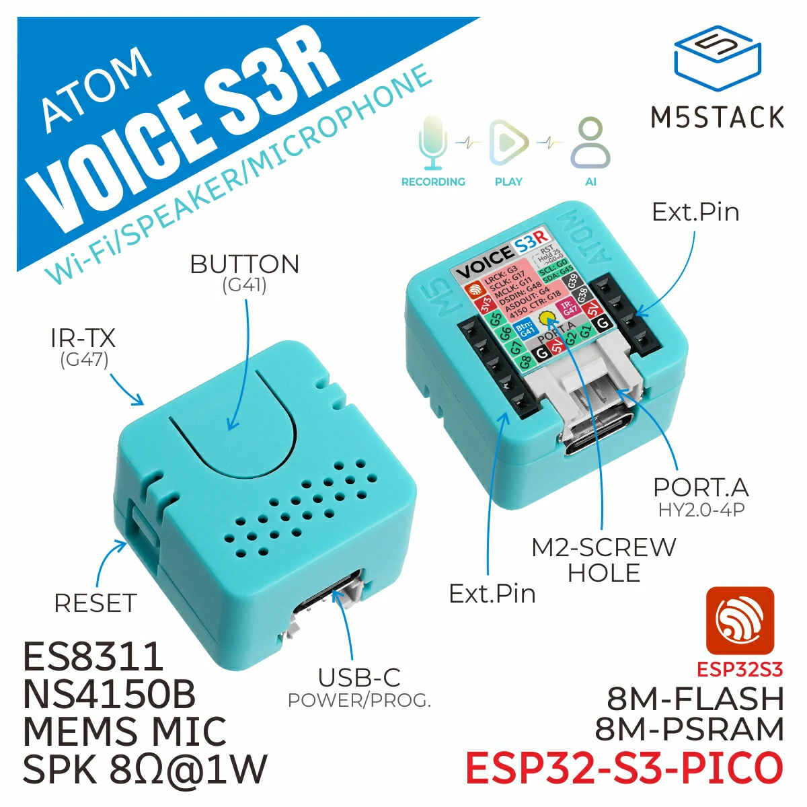

# M5Stack Atom VoiceS3R Development Guide


[**View M5Stack Atom VoiceS3R on OpenELAB**](https://openelab.io/products/m5stack-atom-echos3r-smart-speaker)

**Product model/family:** M5Stack Atom VoiceS3R · **OpenELAB SKU:** `M5-C126-Echo`




_Manufacturer image: M5Stack._ [_Image source_](https://m5stack-doc.oss-cn-shenzhen.aliyuncs.com/1182/Atom_EchoS3R_01.webp)_._

[Product at OpenELAB](https://openelab.io/products/m5stack-atom-echos3r-smart-speaker) · [Manufacturer wiki hub](./)

## Product identity and applications

**M5Stack Atom VoiceS3R, C126-ECHO**, is a compact ESP32-S3 audio controller for voice-interface prototypes, audio playback and smart-home voice endpoints. It is also referenced by the older **Atom EchoS3R** name in tutorial paths and source assets. It is different from the original ESP32-based ATOM Echo/Atom Voice and needs the S3R board/memory/audio configuration.

## Hardware specifications and pin map

| Item           | Atom VoiceS3R                                 |
| -------------- | --------------------------------------------- |
| MCU            | ESP32-S3-PICO-1-N8R8, dual-core up to 240 MHz |
| Memory         | 8 MB flash; 8 MB octal PSRAM                  |
| Codec          | ES8311, 24-bit I²S audio                      |
| Microphone     | MEMS microphone, documented 65 dB SNR         |
| Output         | NS4150B amplifier; 8 Ω / 1 W cavity speaker   |
| Connectivity   | 2.4 GHz Wi-Fi, USB-C and expansion pins       |
| Supply/size    | DC 5 V; 24.0 × 24.0 × 16.8 mm                 |
| Additional I/O | User button and infrared transmitter          |

Source: [manufacturer hardware reference](https://docs.m5stack.com/en/core/Atom_VoiceS3R).

| Function                                  | ESP32-S3 GPIO             |
| ----------------------------------------- | ------------------------- |
| Codec I²C SDA / SCL                       | 45 / 0                    |
| Codec DOUT / DIN / WS / BCLK / MCLK       | 48 / 4 / 3 / 17 / 11      |
| Amplifier control                         | 18                        |
| User button / IR transmitter              | 41 / 47                   |
| CUSTOM port: black / red / yellow / white | GND / 5 V / GPIO2 / GPIO1 |

Use the codec signal names from the schematic when relating device DIN/DOUT to MCU receive/transmit directions. The port's 5 V supply is separate from logic-level tolerance; do not assume GPIO1/2 accept 5 V.

## Development environment and firmware choices

The [official Arduino quick-start](https://docs.m5stack.com/en/arduino/atom_echos3r/program) selects **M5AtomS3R** from the M5Stack board package and uses **M5Unified** and **M5GFX**. Retain the model preset's octal-PSRAM configuration, install prompted dependencies and record their versions. The M5Unified API was reviewed at commit **96576a14247ddc935149145aa6b51943464120f1**.

UiFlow2, factory USB-audio firmware, XiaoZhi and Home Assistant voice integrations are separate firmware/workflow choices. A cloud voice application can require its own account, network, backend and credentials; microphone/speaker hardware alone does not provide a speech model or service. Keep the offline audio test as the first checkpoint.

## Getting started: one offline audio event

Prepare USB-C data/power, Arduino IDE and the exact board preset. Save any needed factory configuration before flashing.

1. Connect USB-C. Follow the model's download sequence: hold the side reset button for about three seconds until the internal green LED signals download mode, then release and select the actual port.
2. Select **M5AtomS3R**, confirm M5Unified/M5GFX dependencies and create a new sketch.
3. Build and upload this short test, which uses the documented M5Unified speaker interface:

```cpp
#include <M5Unified.h>

void setup() {
    auto cfg = M5.config();
    M5.begin(cfg);
    M5.Speaker.setVolume(40);
    M5.Speaker.tone(1000, 150);
}

void loop() {
    M5.update();
    delay(20);
}
```

4. Restart into the application. Listen for one short tone at moderate level; restart again to repeat the check. Keep the device away from your ear during testing.

Expected result: one short tone per application start without a Wi-Fi account. It verifies upload, audio initialization and output, not microphone capture or speech recognition. This adapted example remains uncompiled and untested on physical hardware for this guide.

## Microphone, voice software and recovery

After playback works, use the model's microphone example to check actual input data before adding recognition. Check sample rate, buffer sizes, codec configuration and speaker/microphone sequencing in the chosen firmware. Hearing a tone does not validate microphone wiring or acoustic echo cancellation.

For Home Assistant or XiaoZhi follow the exact model tutorial linked from the hardware page, including its selected firmware and service requirements. Do not reuse the original ATOM Echo image. For the factory USB-audio behavior, use the manufacturer's **Atom VoiceS3R Factory UAC** restoration path and confirm the host enumerates an audio device. Flashing an Arduino sketch replaces that application; it is not expected to retain the factory USB-audio function automatically.

The hardware reference links a **mainboard** and **audio baseboard** schematic; use both to trace a complete audio path. Some asset filenames retain EchoS3R/AtomS3R naming. Check the fitted board and drawing revision before designing extensions.

## Troubleshooting and FAQ

| Symptom                              | Check and next step                                                                                                |
| ------------------------------------ | ------------------------------------------------------------------------------------------------------------------ |
| Upload fails                         | USB data cable, side-button download mode, actual port and M5AtomS3R board package.                                |
| Firmware starts but no tone          | Exact S3R model, compatible M5Unified, codec/amplifier initialization and output volume; try official quick-start. |
| PSRAM or buffers fail                | Exact 8 MB octal-PSRAM preset and library/framework compatibility.                                                 |
| Playback works but no captured audio | Separate microphone test, codec input path, rate/buffer configuration and capture/playback sequencing.             |
| PC no longer sees USB audio          | Restore the exact factory UAC application; an Arduino sketch may not implement USB audio.                          |
| Voice service cannot connect         | Network/backend/account and application firmware version after local audio is verified.                            |

## Technical documents and software

| Resource                                                                                                                      | Use                                                                 |
| ----------------------------------------------------------------------------------------------------------------------------- | ------------------------------------------------------------------- |
| [Hardware and firmware options](https://docs.m5stack.com/en/core/Atom_VoiceS3R)                                               | Specifications, complete pin map, factory and integration tutorials |
| [Arduino quick-start](https://docs.m5stack.com/en/arduino/atom_echos3r/program)                                               | Model preset, download mode and speaker example                     |
| [Mainboard schematic](https://m5stack-doc.oss-cn-shenzhen.aliyuncs.com/1182/Sch_M5_AtomS3R_v0.4.1.pdf)                        | Core board electrical reference                                     |
| [Audio baseboard schematic](https://m5stack-doc.oss-cn-shenzhen.aliyuncs.com/1182/Sch_M5_AtomEchoS3R_Audio_v1.0_20250716.pdf) | Codec, microphone, speaker and amplifier                            |
| [Structure/CAD](https://github.com/m5stack/M5_Hardware/tree/master/Products/C126-ECHO_Atom_VoiceS3R/Structures)               | Mechanical integration                                              |
| [M5Unified reviewed revision](https://github.com/m5stack/M5Unified/tree/96576a14247ddc935149145aa6b51943464120f1)             | Audio/device API source                                             |

**Review date:** 17 November 2026. **Validation:** official documentation and the cited software interfaces reviewed. Commands and examples have not been compiled or run on physical hardware by OpenELAB for this guide. Record your hardware revision, firmware, software versions and actual results when reproducing it.
