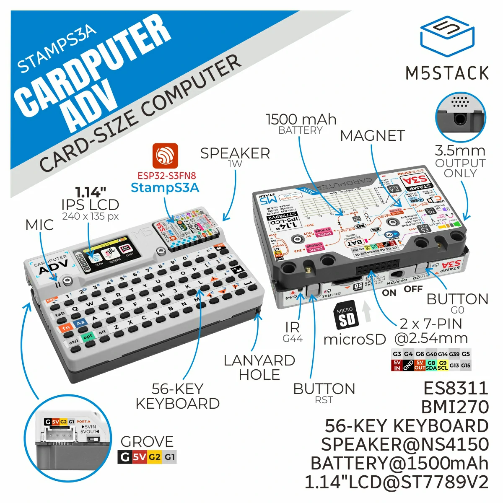
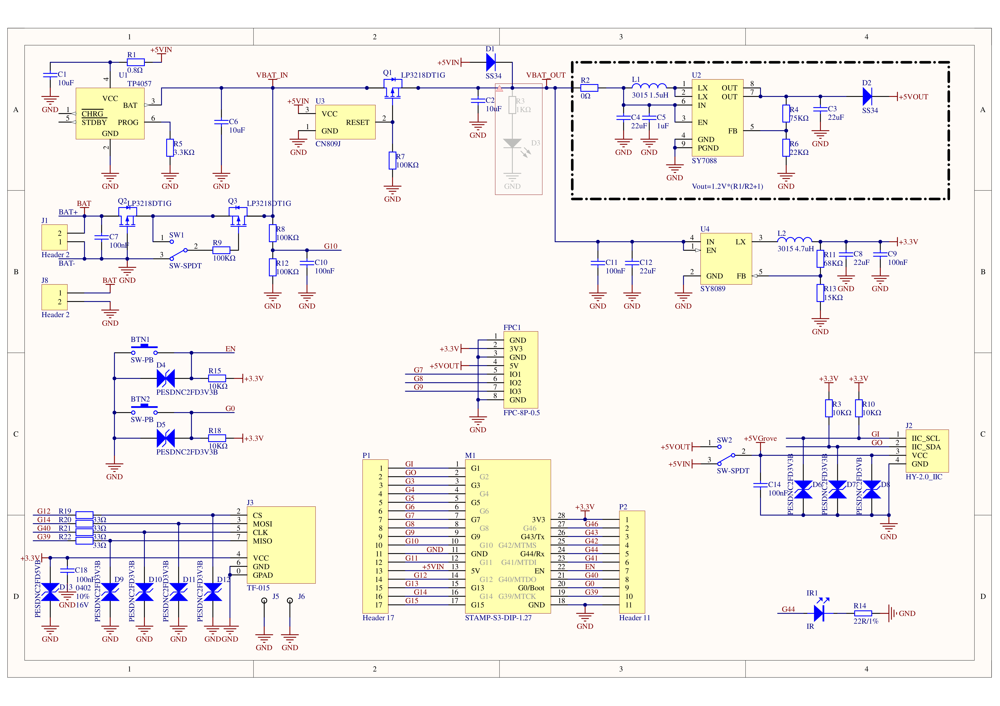

# M5Stack Cardputer-Adv K132-Adv Development Guide


[**View M5Stack Cardputer-Adv K132-Adv on OpenELAB**](https://openelab.io/products/m5stack-cardputer-adv-esp32-s3a)

**Model:** Cardputer-Adv K132-Adv · **SKU:** `M5-K132-Adv`


## Product overview



_Manufacturer image: M5Stack._ [_Image source_](https://m5stack-doc.oss-cn-shenzhen.aliyuncs.com/1178/Cardputer-Adv_01.webp)_._

[Product at OpenELAB](https://openelab.io/products/m5stack-cardputer-adv-esp32-s3a) · [Manufacturer wiki hub](./)

### Product identity and applications

**Cardputer-Adv K132-Adv** is an ESP32-S3 handheld computer with a keyboard, small color LCD, audio and expansion. Use it for a portable test console, a sensor interface, a keyboard-driven terminal or a self-contained embedded UI. It uses Stamp-S3A and differs from the original Cardputer in audio, sensing and hardware details.

## Applications

Use Cardputer-Adv K132-Adv for a keyboard-driven serial console, field data-entry terminal or compact sensor dashboard. The bare Adv does not include a LoRa cap.

## Specifications

### Key specifications

| Item           | Cardputer-Adv                                            |
| -------------- | -------------------------------------------------------- |
| Core           | Stamp-S3A / ESP32-S3FN8, 8 MB flash                      |
| Display        | 1.14-inch ST7789V2 LCD, 240 × 135                        |
| Keyboard       | 56 keys, 4 × 14 layout                                   |
| Audio          | ES8311 codec, MEMS mic, 1 W speaker and 3.5 mm output    |
| Motion/storage | BMI270 IMU; microSD                                      |
| Expansion      | HY2.0-4P Grove and 2.54 mm rear bus                      |
| Power          | USB-C/battery; current manufacturer table lists 1500 mAh |
| Envelope       | 84 × 54 × 19.6 mm                                        |

Source: [current Cardputer-Adv hardware reference](https://docs.m5stack.com/en/core/Cardputer-Adv). Check the actual battery label and board revision when working with older documentation. Cardputer Mesh Kit adds radio/GNSS hardware; the bare Adv should not be assumed to include that kit's LoRa module.

## Hardware and connections

### Interfaces and further development

Use the Adv pin map for Grove, rear bus, microphone, speaker and microSD connections. Check supply versus GPIO signal voltage and shared functions before attaching peripherals. Start with one module and confirm the base keyboard/display still works before adding another.

For audio, use the Adv-capable ES8311 example rather than a sketch written for the original Cardputer's audio path. For a wireless application, test the network stack separately from display rendering and storage. Add buffers and error handling only after each subsystem has an observable working result.

### Adv host routing and shared buses

| Function                  | Cardputer-Adv connection                                       |
| ------------------------- | -------------------------------------------------------------- |
| System I2C                | SDA8 / SCL9; codec, BMI270 and TCA8418 keyboard expander       |
| Keyboard interrupt        | GPIO11;56 keys in4×14 layout                                   |
| LCD                       | Backlight38, reset33, DC34, MOSI35, clock36, CS37              |
| microSD                   | CS12, MOSI14, clock40, MISO39                                  |
| Audio                     | SDA8, SCL9, BCLK41, codec output46, LRCK43, codec input42      |
| IR / battery measurement  | TX44 / ADC10                                                   |
| Host Grove                | GND /5V /GPIO2 /GPIO1, distinct from the cap's I2C port        |
| EXT SPI and radio control | clock40, MOSI14, MISO39; CS5, IRQ4, BUSY6, reset3 for LoRa cap |

The rear cap and microSD share SPI signals, so deselect inactive devices and use the driver transaction settings; a common SPI bus does not permit both chip selects low. GPIO38 also gates Stamp-S3A RGB power, so an RGB test must enable that supply. Set the side switch **ON for charging**. The current battery specification is1500mAh, following the13July2026 change; earlier1750mAh references do not identify the fitted battery. [Adv hardware](https://docs.m5stack.com/en/core/Cardputer-Adv), [K152 hardware](https://docs.m5stack.com/en/core/Cardputer_Mesh_Kit).



_M5Stack official technical illustration:_ [_original_](https://m5stack-doc.oss-cn-shenzhen.aliyuncs.com/1178/Sch_M5CardputerAdv_v1.0_2025_06_20_17_19_58_page_01.png)_. Verify drawing and physical revision together._

## Software and development resources

### SDK and development setup

Use the **M5Cardputer** Arduino library and its supported M5Unified/M5GFX dependencies. The [official quick-start](https://docs.m5stack.com/en/arduino/m5cardputer/program) explicitly covers both Cardputer and Cardputer-Adv and selects the **M5Cardputer** board preset in the M5Stack package.

For lower-level work, use the Adv schematic and its **CardputerADV** factory-firmware branch. Avoid copying a raw pin map or audio driver from the original device merely because the SDK entry point is shared.

## Getting started

### Getting started: display, then keyboard

Prepare Cardputer-Adv, a USB-C data cable, a computer and Arduino IDE. Save required settings from the current application before replacing it.

1. Install the M5Stack board package through the [official board-manager setup](https://docs.m5stack.com/en/arduino/arduino_board). Choose **M5Cardputer** and the connected device's port.
2. Install **M5Cardputer** and all prompted dependencies. Record versions; the library must include support for the Adv hardware.
3. Open **Basic → display** from the M5Cardputer examples, as selected in the manufacturer quick-start. Build and upload it unchanged before adding application code.
4. If the device does not enter download mode automatically, use its documented G0/USB boot procedure. Do not assume another M5 product's power-button sequence is identical.
5. Confirm the stock display example renders on the 240 × 135 panel. Next open the SDK's keyboard example and enter a short test string, including a modifier and a navigation key.
6. Compare the actual characters/keys with the intended input. A lit LCD alone does not prove the keyboard scanning works; test audio and microSD separately after those first two checks.

Expected result: a correct display example, then recognized keyboard input using the supported SDK example. Preserve those working examples before building a terminal or radio client.

### Original keyboard event logger

With **M5Cardputer** selected and its Adv-capable library installed, upload this original sketch. It counts changed key states and reports printable characters plus the Enter/modifier state; it does not send USB keyboard input to the computer.

```cpp
#include <M5Cardputer.h>
unsigned events = 0;
void setup() {
  auto cfg = M5.config();
  M5Cardputer.begin(cfg, true);
  Serial.begin(115200);
  M5Cardputer.Display.fillScreen(TFT_BLACK);
  M5Cardputer.Display.setTextSize(2);
  M5Cardputer.Display.setCursor(4, 4);
  M5Cardputer.Display.println("Type ABC / Enter");
}
void loop() {
  M5Cardputer.update();
  if (M5Cardputer.Keyboard.isChange() && M5Cardputer.Keyboard.isPressed()) {
    auto keys = M5Cardputer.Keyboard.keysState();
    Serial.printf("event=%u,shift=%d,enter=%d,text=", ++events, keys.shift, keys.enter);
    for (char c : keys.word) Serial.write(c);
    Serial.println();
  }
  delay(5);
}
```

Type `abc`, then Shift+A and Enter. Expected output contains event lines with lowercase text, an uppercase character for the modified key, and `enter=1` for Enter. This is a state-change logger, not a complete text editor or a typematic repeat engine. Compare [keyboard state API](https://github.com/m5stack/M5Cardputer/blob/master/src/utility/Keyboard/Keyboard.h) and [controller API](https://github.com/m5stack/M5Cardputer/blob/master/src/M5Cardputer.h) if a future library changes types.

### Add storage, audio, IR and an expansion independently

Use a known readable microSD card with the Adv-supported SD example, confirm `cardType()`/capacity and read a small text file before creating logs. Close/flush each test file before switching power. Test the ES8311 speaker at low volume before microphone capture; inserting the3.5mm plug changes the output path, so distinguish headphone and speaker behavior. The IR function is a transmitter on44, not a learning receiver. For an external I2C Unit, connect the **host** Grove2/1, verify the Unit's supply/pull-ups and scan its documented address before adding the driver. A rear cap's Grove8/9 belongs to a different route.

UiFlow2 must use the **Cardputer-Adv** image and controller selection; the original Cardputer image is not established compatible merely because Arduino uses a shared board name. Run a display/text block once, then use Run Always and restart to confirm persistence. Keep the access code private. The Adv factory source branch is `CardputerADV`; record the exact branch/commit with the build.

## Troubleshooting and FAQs

### Recovery and FAQ

| Problem                               | Check                                                                                                       |
| ------------------------------------- | ----------------------------------------------------------------------------------------------------------- |
| Upload port missing                   | Data cable, power, G0/boot procedure and actual enumerated port.                                            |
| Display works, keyboard does not      | Current Adv-capable M5Cardputer library, correct preset and use of the SDK update/input loop.               |
| Original Cardputer audio sketch fails | Adv uses a different audio path; select the Adv-supported driver/example.                                   |
| LoRa/GNSS missing                     | Those require the relevant expansion/mesh kit; they are not established by the bare K132-Adv specification. |
| Need factory application              | Use the Adv-specific firmware/restoration instructions and branch, retaining settings first.                |

## Downloads and technical documents

### Technical documents and software

| Resource                                                                                                               | Use                                          |
| ---------------------------------------------------------------------------------------------------------------------- | -------------------------------------------- |
| [Adv hardware reference](https://docs.m5stack.com/en/core/Cardputer-Adv)                                               | Pin map, connectors and revisions            |
| [Arduino quick-start](https://docs.m5stack.com/en/arduino/m5cardputer/program)                                         | M5Cardputer preset and first display example |
| [Arduino SDK](https://github.com/m5stack/M5Cardputer)                                                                  | Device library and examples                  |
| [Adv schematic](https://m5stack-doc.oss-cn-shenzhen.aliyuncs.com/1178/Sch_M5CardputerAdv_v1.0_2025_06_20_17_19_58.pdf) | Main board electrical reference              |
| [Dimension drawing](https://m5stack-doc.oss-cn-shenzhen.aliyuncs.com/1178/K132-Adv-cardputer-ADV.pdf)                  | Mechanical dimensions                        |
| [CAD/structure files](https://github.com/m5stack/M5_Hardware/tree/master/Products/K132-Adv_Cardputer-Adv/Structures)   | Enclosure integration                        |
| [Adv factory source](https://github.com/m5stack/M5Cardputer-UserDemo/tree/CardputerADV)                                | Adv-specific factory application             |

**Review date:** 17 November 2026. **Validation:** official documentation and the cited software interfaces reviewed. Commands and examples have not been compiled or run on physical hardware by OpenELAB for this guide. Record your hardware revision, firmware, software versions and actual results when reproducing it.

### Official documentation and development resources

Use [Cardputer-Adv](https://docs.m5stack.com/en/core/Cardputer-Adv) for the manufacturer's complete model reference, diagrams and maintained examples. The official product code is **`K132-Adv`**; match the board/Unit label before choosing a firmware or host example. The references below complement this guide's local instructions.

| Development need             | Model-specific reference                                                                                                                       |
| ---------------------------- | ---------------------------------------------------------------------------------------------------------------------------------------------- |
| Arduino development tutorial | [Read arduino development tutorial](https://docs.m5stack.com/en/arduino/m5cardputer/program)                                                   |
| Electrical schematic         | [Read electrical schematic](https://m5stack-doc.oss-cn-shenzhen.aliyuncs.com/1178/Sch_M5CardputerAdv_v1.0_2025_06_20_17_19_58.pdf)             |
| Electrical schematic         | [Read electrical schematic](https://m5stack-doc.oss-cn-shenzhen.aliyuncs.com/1150/Sch_StampS3_v0.3.3.pdf)                                      |
| Mechanical / CAD files       | [Read mechanical / cad files](https://github.com/m5stack/M5_Hardware/tree/master/Products/K132-Adv_Cardputer-Adv/Structures)                   |
| Mechanical / CAD files       | [Read mechanical / cad files](https://github.com/m5stack/M5_Hardware/blob/master/Products/K132-Adv_Cardputer-Adv/Structures/Cardputer-Adv.stl) |
| Official source: M5Cardputer | [Read official source: m5cardputer](https://github.com/m5stack/M5Cardputer)                                                                    |

Keep the example's host model, interface pins and dependency versions together when reproducing a result. A schematic or SDK link does not establish that another revision uses the same wiring. Official model pages and accessible tutorial links reviewed **23 November 2026**. Other downloads above are manufacturer-listed resources; listing a file is not a test of its contents. Compilation, firmware flashing and hardware operation were **not performed** in this review.

| Official file or repository                                                                                                           | Use                                                                                          |
| ------------------------------------------------------------------------------------------------------------------------------------- | -------------------------------------------------------------------------------------------- |
| [Cardputer-Adv Schematics PDF](https://m5stack-doc.oss-cn-shenzhen.aliyuncs.com/1178/Sch_M5CardputerAdv_v1.0_2025_06_20_17_19_58.pdf) | Manufacturer-listed exact model document / maintained source; use the scope described above. |
| [Stamp-S3A Schematics PDF](https://m5stack-doc.oss-cn-shenzhen.aliyuncs.com/1150/Sch_StampS3_v0.3.3.pdf)                              | Manufacturer-listed exact model document / maintained source; use the scope described above. |
| [Cardputer-Adv Model Size PDF](https://m5stack-doc.oss-cn-shenzhen.aliyuncs.com/1178/K132-Adv-cardputer-ADV.pdf)                      | Manufacturer-listed exact model document / maintained source; use the scope described above. |
| [Cardputer-Adv Structure Files](https://github.com/m5stack/M5_Hardware/tree/master/Products/K132-Adv_Cardputer-Adv/Structures)        | Manufacturer-listed exact model document / maintained source; use the scope described above. |
| [Cardputer-Adv Arduino Driver Library](https://github.com/m5stack/M5Cardputer)                                                        | Manufacturer-listed exact model document / maintained source; use the scope described above. |
| [Cardputer-Adv UiFlow2 Docs](https://uiflow-micropython.readthedocs.io/en/latest/controllers/cardputer-adv.html)                      | Manufacturer-listed exact model document / maintained source; use the scope described above. |
| [Cardputer-Adv Factory Firmware Source Code](https://github.com/m5stack/M5Cardputer-UserDemo/tree/CardputerADV)                       | Manufacturer-listed exact model document / maintained source; use the scope described above. |
| [download](https://m5stack-doc.oss-cn-shenzhen.aliyuncs.com/1178/Easy_Loader_for_Cardputer-Adv.exe)                                   | Manufacturer-listed exact model document / maintained source; use the scope described above. |

## References and validation

Exact-model [manufacturer hardware reference](https://docs.m5stack.com/en/core/Cardputer-Adv) and model-specific software links in the procedures establish this guide's hardware scope. Electrical values are manufacturer-reported; external-project behavior and diagnostic order are original engineering guidance.

**Review:** 24 November 2026. Manufacturer documentation and the linked SDK interfaces were reviewed. **Compilation, firmware flashing and hardware operation: not run.** Expected results above are commissioning checkpoints, not observed bench measurements.
