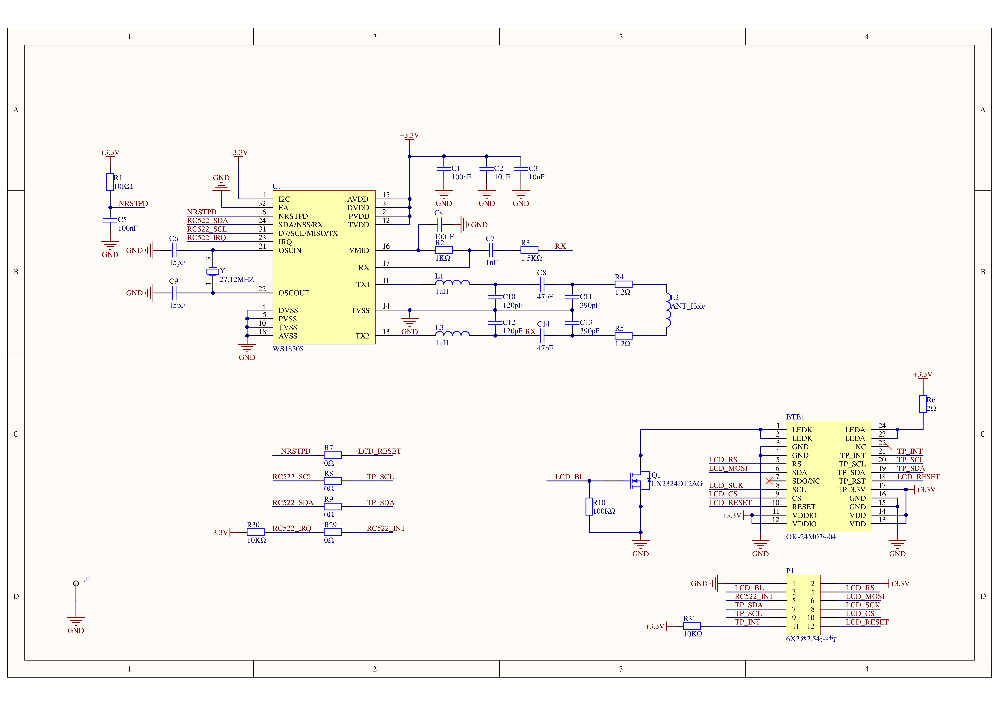

# M5Stack Dial v1.1 Development Guide


[**View M5Stack Dial v1.1 K130-V11 on OpenELAB**](https://openelab.io/products/m5stack-dial-v1-1)

**Model:** Dial v1.1 K130-V11 · **SKU:** `M5-K130-V11`


## Product overview


_Manufacturer image: M5Stack._ [_Image source_](https://m5stack-doc.oss-cn-shenzhen.aliyuncs.com/1126/K130_v11_01.webp)_._

[Product at OpenELAB](https://openelab.io/products/m5stack-dial-v1-1) · [Manufacturer wiki hub](./)

### Product and applications

**M5Stack Dial v1.1, K130-V11**, is a rotary/touch control terminal for embedded dashboards, menu navigation, access-control prototypes and smart-home interfaces. It uses **Stamp-S3A** rather than the original Dial's StampS3. Match that revision when selecting enclosure files, firmware and power expectations.

## Applications

Use Dial v1.1 K130-V11 for a rotary menu, setpoint editor or smart-home front panel. Keep raw encoder counts separate from calibrated engineering units.

## Specifications

### Hardware specifications and expansion

| Item         | Dial v1.1                                                                  |
| ------------ | -------------------------------------------------------------------------- |
| MCU/memory   | ESP32-S3FN8, dual-core up to 240 MHz; 8 MB flash                           |
| Display      | 1.28-inch 240 × 240 round TFT; GC9A01                                      |
| Touch        | FT3267                                                                     |
| Rotary input | 16 positions; 64 pulses per revolution                                     |
| RFID         | WS1850S, 13.56 MHz, ISO/IEC 14443 Type A/B                                 |
| Other        | RTC, buzzer and under-screen button                                        |
| Power        | USB-C 5 V; separate 6–36 V DC input and lithium-battery charging interface |
| Size         | 51.0 × 51.0 × 32.3 mm                                                      |

Source: [manufacturer model reference](https://docs.m5stack.com/en/core/Dial_v1.1). The 6–36 V range belongs to its **DC input**, not USB, battery, Grove power or GPIO. Confirm connector polarity and battery compatibility before using an alternative supply.

| HY2.0-4P port | Black | Red | Yellow | White  |
| ------------- | ----- | --- | ------ | ------ |
| PORT.A        | GND   | 5 V | GPIO13 | GPIO15 |
| PORT.B        | GND   | 5 V | GPIO2  | GPIO1  |

The red wire's 5 V supply does not establish 5 V GPIO tolerance. Use the pin map and schematic for signal functions and logic-level compatibility. The internal encoder uses GPIO41/A and GPIO40/B; let the model driver handle it for first-run tests.

## Hardware and connections

Battery-only startup needs **HOLD GPIO46 high** during initialization; WAKE or the RTC wakes the unit, while HOLD low releases battery power. USB keeps a separate supply path, so an apparent successful USB sleep is not a battery shutdown test. The Stamp-S3A RGB supply gate is38. RFID and touch share internal SDA11/SCL12, while the buzzer uses3. The reviewed schematic is the one linked by the v1.1 manufacturer page; verify its drawing revision before building a battery/power adapter. [v1.1 power notes](https://docs.m5stack.com/en/core/Dial_v1.1).



_M5Stack official technical illustration:_ [_original_](https://m5stack-doc.oss-cn-shenzhen.aliyuncs.com/499/Sch_M5Dial_sch_01.png)_. Verify drawing and physical revision together._

## Software and development resources

### Development environment

Install Arduino IDE and the [M5Stack board package](https://docs.m5stack.com/en/arduino/arduino_board). The [official Arduino route](https://docs.m5stack.com/en/arduino/m5dial/program) selects **M5Dial** and installs the **M5Dial** library plus its M5Unified/M5GFX dependencies. Record their installed versions. UiFlow2 and the ESP-IDF BSP are alternative development paths with separate dependencies.

## Getting started

### Getting started: display and rotary count

Prepare a USB-C data cable and computer. Save needed factory configuration before replacing its application.

1. Hold the Stamp module's rear **G0** button while connecting USB-C, then release it to enter download mode.
2. Select **M5Dial** and the actual USB port. Begin with **M5Dial → Basic → display** to verify the model preset, upload and display path.
3. Open **M5Dial → Basic → encoder**. The official example initializes `M5Dial.begin(cfg, true, false)`, enabling the encoder while leaving RFID disabled, then calls `M5Dial.update()` and reads `M5Dial.Encoder.read()`.
4. Upload, restart the application and turn the ring in both directions. Check that its displayed/serial count changes consistently. Press the front button and verify the example's reset behavior.

Expected result: a working screen followed by an encoder count that changes with rotation. A count is an encoder event value, not automatically a calibrated physical angle or application setpoint. Debounce/scaling, allowed ranges and persistence belong in your application.

The reviewed [encoder source](https://github.com/m5stack/M5Dial/blob/735eb55beefe6577c646ebf164a19793a01375d4/examples/Basic/encoder/encoder.ino) also contains a long-press behavior that writes a count of 100. Keep the example's behavior separate from a final control application.

### Add touch, RFID, RTC and networking

Test each peripheral with its dedicated Basic example before combining features. Confirm touch coordinates/rotation, a known RFID tag, RTC operation and any external Grove module separately. A read RFID UID is useful for identification demonstrations but does not alone create a secure access-control system.

For a network dashboard or Home Assistant integration, use the selected firmware's current installation and service requirements. First establish a local display/encoder baseline; network/backend failures should not be mistaken for defective input hardware. For battery applications, measure the selected firmware's real sleep current and wake behavior rather than applying a datasheet's battery-only figure to a USB-powered test.

### Original bounded setpoint editor

Use **M5Dial** plus its dependencies. This sketch enables encoder input, keeps RFID disabled and bounds the local setpoint; it sends no actuator/network commands.

```cpp
#include <M5Dial.h>
long lastCount = 0;
int setpoint = 20;
void paint() {
  M5Dial.Display.fillScreen(TFT_BLACK);
  M5Dial.Display.setTextColor(TFT_WHITE);
  M5Dial.Display.setTextSize(3);
  M5Dial.Display.setCursor(55, 100);
  M5Dial.Display.printf("%d", setpoint);
}
void setup() {
  auto cfg = M5.config();
  M5Dial.begin(cfg, true, false);
  Serial.begin(115200);
  lastCount = M5Dial.Encoder.read();
  paint();
}
void loop() {
  M5Dial.update();
  long count = M5Dial.Encoder.read();
  if (count != lastCount) {
    long candidate = setpoint + (count - lastCount);
    setpoint = candidate < 0 ? 0 : (candidate > 100 ? 100 : candidate);
    lastCount = count;
    paint();
    Serial.printf("count=%ld,setpoint=%d\n", count, setpoint);
  }
  if (M5Dial.BtnA.wasPressed()) { setpoint = 20; paint(); }
  delay(5);
}
```

Expected result: rotation changes a0–100 value; pressing the front button returns it to20. The number is deliberately unitless; convert encoder events to physical units only after defining detent scaling and application limits. Source interfaces: [M5Dial header](https://github.com/m5stack/M5Dial/blob/master/src/M5Dial.h). For RFID first tests, prefer a bank-card-sized compatible tag as M5Stack recommends; a smaller tag can couple poorly through the Dial structure. A read UID is an identifier, not a secure credential by itself.

## Troubleshooting and FAQs

### Recovery and troubleshooting

| Symptom                    | Check and next step                                                                                           |
| -------------------------- | ------------------------------------------------------------------------------------------------------------- |
| No upload port             | Known data cable, rear G0 download sequence, actual port and model board package.                             |
| Blank display after upload | Exact M5Dial preset, driver dependencies and normal application restart; try stock display example.           |
| Encoder count unchanged    | Encoder enabled in begin arguments, update called in loop and official encoder example.                       |
| RFID not detected          | RFID-enabled initialization, compatible tag/protocol, physical placement and stock RFID example.              |
| Grove module fails         | Correct port/pins, power and logic levels, address/protocol and independent module example.                   |
| Need factory behavior      | Use the exact Dial v1.1 factory/M5Burner application referenced by the manufacturer; preserve settings first. |

Provide model/revision, board-package and library versions, minimal sketch, compiler output and the observed count/serial log when reporting a problem.

## Downloads and technical documents

### Technical documents and software

| Resource                                                                                                        | Use                                                                    |
| --------------------------------------------------------------------------------------------------------------- | ---------------------------------------------------------------------- |
| [Hardware/pin map](https://docs.m5stack.com/en/core/Dial_v1.1)                                                  | Exact revision, power and connectors                                   |
| [Arduino quick-start](https://docs.m5stack.com/en/arduino/m5dial/program)                                       | Board selection, download and stock example                            |
| [M5Dial driver](https://github.com/m5stack/M5Dial/tree/735eb55beefe6577c646ebf164a19793a01375d4)                | Reviewed API/example revision                                          |
| [Official schematic link](https://m5stack-doc.oss-cn-shenzhen.aliyuncs.com/499/Sch_M5Dial.pdf)                  | Electrical reference linked by the v1.1 page; confirm drawing revision |
| [v1.1 structure/CAD](https://github.com/m5stack/M5_Hardware/tree/master/Products/K130-V11_Dial_v1.1/Structures) | Revision-specific mechanical integration                               |
| [Factory demo source](https://github.com/m5stack/M5Dial-UserDemo)                                               | Manufacturer application reference                                     |

**Review date:** 17 November 2026. **Validation:** official documentation and the cited software interfaces reviewed. Commands and examples have not been compiled or run on physical hardware by OpenELAB for this guide. Record your hardware revision, firmware, software versions and actual results when reproducing it.

### Official documentation and development resources

Use [Dial v1.1](https://docs.m5stack.com/en/core/Dial_v1.1) for the manufacturer's complete model reference, diagrams and maintained examples. The official product code is **`K130-V11`**; match the board/Unit label before choosing a firmware or host example. The references below complement this guide's local instructions.

| Development need                 | Model-specific reference                                                                                                               |
| -------------------------------- | -------------------------------------------------------------------------------------------------------------------------------------- |
| Arduino development tutorial     | [Read arduino development tutorial](https://docs.m5stack.com/en/arduino/m5dial/program)                                                |
| Electrical schematic             | [Read electrical schematic](https://m5stack-doc.oss-cn-shenzhen.aliyuncs.com/499/Sch_M5Dial.pdf)                                       |
| Mechanical / CAD files           | [Read mechanical / cad files](https://github.com/m5stack/M5_Hardware/tree/master/Products/K130-V11_Dial_v1.1/Structures)               |
| Mechanical / CAD files           | [Read mechanical / cad files](https://github.com/m5stack/M5_Hardware/blob/master/Products/K130-V11_Dial_v1.1/Structures/Dial_v1.1.stl) |
| Official source: M5Dial          | [Read official source: m5dial](https://github.com/m5stack/M5Dial)                                                                      |
| Official source: M5Dial-UserDemo | [Read official source: m5dial-userdemo](https://github.com/m5stack/M5Dial-UserDemo)                                                    |

Keep the example's host model, interface pins and dependency versions together when reproducing a result. A schematic or SDK link does not establish that another revision uses the same wiring. Official model pages and accessible tutorial links reviewed **23 November 2026**. Other downloads above are manufacturer-listed resources; listing a file is not a test of its contents. Compilation, firmware flashing and hardware operation were **not performed** in this review.

| Official file or repository                                                                                                                                        | Use                                                                                          |
| ------------------------------------------------------------------------------------------------------------------------------------------------------------------ | -------------------------------------------------------------------------------------------- |
| [Dial v1.1 Schematics PDF](https://m5stack-doc.oss-cn-shenzhen.aliyuncs.com/499/Sch_M5Dial.pdf)                                                                    | Manufacturer-listed exact model document / maintained source; use the scope described above. |
| [Dial v1.1 Structure Files](https://github.com/m5stack/M5_Hardware/tree/master/Products/K130-V11_Dial_v1.1/Structures)                                             | Manufacturer-listed exact model document / maintained source; use the scope described above. |
| [BM8563](https://m5stack.oss-cn-shenzhen.aliyuncs.com/resource/docs/datasheet/core/BM8563_V1.1_cn.pdf)                                                             | Manufacturer-listed exact model document / maintained source; use the scope described above. |
| [WS1850S](https://m5stack.oss-cn-shenzhen.aliyuncs.com/resource/docs/products/core/M5Dial/WS1850S.PDF)                                                             | Manufacturer-listed exact model document / maintained source; use the scope described above. |
| [DC Power Terminal Specifications](https://m5stack.oss-cn-shenzhen.aliyuncs.com/resource/docs/products/core/M5Dial/DB2EK-2.54-2P-GN-S%202.54mm%202Pin%20Green.pdf) | Manufacturer-listed exact model document / maintained source; use the scope described above. |
| [Lithium Battery Connector](https://m5stack.oss-cn-shenzhen.aliyuncs.com/resource/docs/products/core/M5Dial/1.25WT-2P.pdf)                                         | Manufacturer-listed exact model document / maintained source; use the scope described above. |
| [Dial v1.1 Arduino Driver Library](https://github.com/m5stack/M5Dial)                                                                                              | Manufacturer-listed exact model document / maintained source; use the scope described above. |
| [download](https://m5stack.oss-cn-shenzhen.aliyuncs.com/resource/docs/products/core/M5Dial/M5dial%20Factory%20Demo.exe)                                            | Manufacturer-listed exact model document / maintained source; use the scope described above. |
| [download](https://m5stack.oss-cn-shenzhen.aliyuncs.com/resource/docs/products/core/M5Dial/M5dial%20Smart%20Home%20GUI.exe)                                        | Manufacturer-listed exact model document / maintained source; use the scope described above. |
| [Espressif's Board Support Packages - M5Dial](https://github.com/espressif/esp-bsp/tree/master/bsp/m5dial)                                                         | Manufacturer-listed exact model document / maintained source; use the scope described above. |
| [Dial v1.1 User Demo](https://github.com/m5stack/M5Dial-UserDemo)                                                                                                  | Manufacturer-listed exact model document / maintained source; use the scope described above. |
| [Dial v1.1 Knob Panel Demo](https://github.com/Gitshaoxiang/M5Dial-Gui-Demo)                                                                                       | Manufacturer-listed exact model document / maintained source; use the scope described above. |

## References and validation

Exact-model [manufacturer hardware reference](https://docs.m5stack.com/en/core/Dial_v1.1) and model-specific software links in the procedures establish this guide's hardware scope. Electrical values are manufacturer-reported; external-project behavior and diagnostic order are original engineering guidance.

**Review:** 24 November 2026. Manufacturer documentation and the linked SDK interfaces were reviewed. **Compilation, firmware flashing and hardware operation: not run.** Expected results above are commissioning checkpoints, not observed bench measurements.
