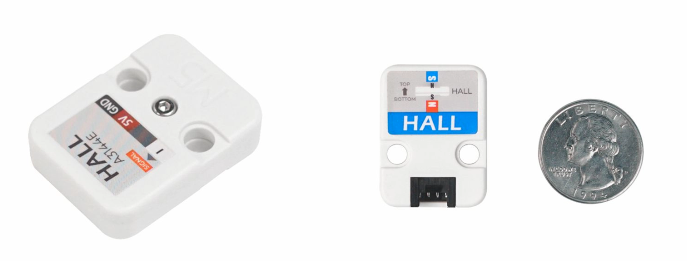

---
layout:
  width: default
  title:
    visible: false
  description:
    visible: false
  tableOfContents:
    visible: true
  outline:
    visible: true
  pagination:
    visible: true
  metadata:
    visible: true
  tags:
    visible: true
  actions:
    visible: true
  anchors:
    visible: true
---

# Hall Effect Unit


[**View M5Stack Hall Effect Unit (A3144E Hall Sensor) on OpenELAB**](https://openelab.io/products/hall-effect-unit)

**Store SKU / option:** `M5-U084`. Match the purchased model and revision to the official reference below.


### Hall Effect Unit (A3144E Hall Sensor)

***

### Product Link



### Description 

**Hall effect Unit** integrated with three A3144E Hall sensor switches which are processed by 74HC series gate integrated circuits.

Low-level signal can be generated when the magnet S pole is close to the top of the sensor or the N pole is close to the back, and the internal LED indicator will light up.

It is widely used in applications such as door sensor alarms, proximity sensors, rotation speed measurement and so on. The front side is the North pole, and the low level is output when the south pole signal of the magnetic field is sensed.

### Feature 

* Unipolar Hall switch sensor
* Fast response and high sensitivity
* Status indicator
* Low-level output
* Lego compatible

### Application 

* Door sensor alarm
* Magnetic field proximity sensing
* Speed measurement

### Specification 

| Specification     | Parameter     |
| ----------------- | ------------- |
| Hall sensor       | A3144E \* 3   |
| Logic IC          | 74HC08D       |
| Status indication | RED LED       |
| Output Level      | Active Low    |
| Net weight        | 4g            |
| Gross weight      | 17g           |
| Product Size      | 24\*32\*8mm   |
| Package Size      | 136\*92\*11mm |

<figure><figcaption></figcaption></figure>

### EasyLoader 

EasyLoader is a concise and fast program writer, which has a built-in case program related to the product. It can be burned to the main control by simple steps to perform a series of function verification.

[Download Windows Version Easyloader](https://m5stack.oss-cn-shenzhen.aliyuncs.com/EasyLoader/Windows/UNIT/For%20M5Core/EasyLoader_HALL_UNIT_With_M5Core.exe) [Download MacOS Version Easyloader](https://m5stack.oss-cn-shenzhen.aliyuncs.com/EasyLoader/MacOS/UNIT/EasyLoader_HALL_UNIT_With_M5Core.dmg)



**Description:**\
The screen displays the state of magnetic induction, low-level effective

### PinMap 

| M5Core (PORT B)  | GPIO26 | GPIO36 | 5V | GND |
| ---------------- | ------ | ------ | -- | --- |
| Hall effect Unit |        | INPUT  | 5V | GND |

### Schematic 

<figure><figcaption></figcaption></figure>

### Related Links 

* **Datasheet**
  * [A3144E](https://m5stack.oss-cn-shenzhen.aliyuncs.com/resource/docs/datasheet/unit/3141Thru3144E_HALL.PDF)

## Official documentation and development resources

Use [Unit Hall](https://docs.m5stack.com/en/unit/Unit_Hall) for the manufacturer's complete model reference, diagrams and maintained examples. The official product code is **`U084`**; match the board/Unit label before choosing a firmware or host example. The references below complement this guide's local instructions.

| Development need        | Model-specific reference                                                                                                           |
| ----------------------- | ---------------------------------------------------------------------------------------------------------------------------------- |
| Mechanical / CAD files  | [Read mechanical / cad files](https://github.com/m5stack/M5_Hardware/tree/master/Products/U084_Unit_Hall/Structures)               |
| Mechanical / CAD files  | [Read mechanical / cad files](https://github.com/m5stack/M5_Hardware/blob/master/Products/U084_Unit_Hall/Structures/Unit_Hall.stl) |
| Example source: M5Stack | [Read example source: m5stack](https://github.com/m5stack/M5Stack/tree/master/examples/Unit/HALL)                                  |

Keep the example's host model, interface pins and dependency versions together when reproducing a result. A schematic or SDK link does not establish that another revision uses the same wiring. Official model pages and accessible tutorial links reviewed **23 November 2026**. Other downloads above are manufacturer-listed resources; listing a file is not a test of its contents. Compilation, firmware flashing and hardware operation were **not performed** in this review.
