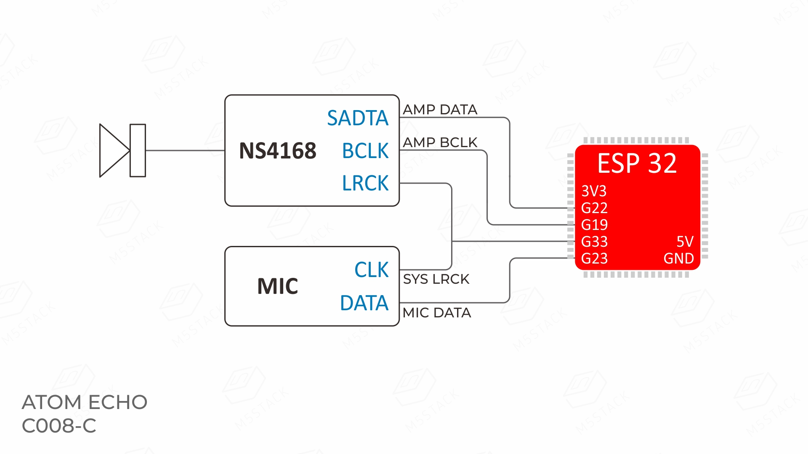

# M5Stack ATOM Voice C008-C Audio and Development Guide


[**View M5Stack ATOM Voice / Echo C008-C on OpenELAB**](https://openelab.io/products/m5stackatomecho)

**Model:** ATOM Voice / Echo C008-C · **SKU:** `M5-C008-C`


## Product overview <a href="#introduction" id="introduction"></a>

### Exact hardware identity <a href="#m5stack-atom-echo-smart-speaker-development-ki" id="m5stack-atom-echo-smart-speaker-development-ki"></a>

**ATOM Voice C008-C**, previously named ATOM Echo, is the original ESP32-PICO-D4 speaker/microphone controller. Its existing store and wiki URLs retain Echo naming. It is not Atom VoiceS3R C126-ECHO: firmware, audio clocks, memory and Bluetooth support differ. This guide establishes a local button/RGB result, then bounded audio playback and capture before a voice service. [Current manufacturer identity](https://docs.m5stack.com/en/atom/Atom_Voice).

The original C008-C supports Bluetooth Classic A2DP through the factory speaker firmware; an ESP32-S3 replacement is not a drop-in A2DP target. The device has no display, so use serial and the single RGB pixel as independent diagnostics.

### OpenELAB listing and option <a href="#product-link" id="product-link"></a>

Use [View M5Stack ATOM Voice / Echo C008-C on OpenELAB](https://openelab.io/products/m5stackatomecho) and match `M5-C008-C` before selecting regional firmware or adding accessories.

## Applications <a href="#features" id="features"></a>

Use C008-C for a compact audio prompt, button-operated recording prototype, Bluetooth music endpoint or configured Home Assistant voice satellite. Speech recognition, text-to-speech and streaming playback depend on application software and, often, a reachable backend. Begin with local input/output so an account or network issue is distinguishable from an audio failure.

## Specifications <a href="#specification" id="specification"></a>

| Parameter          | ATOM Voice C008-C                                   |
| ------------------ | --------------------------------------------------- |
| Processor / memory | ESP32-PICO-D4, dual-core240MHz;4MB flash            |
| Speaker            | NS4168 I2S amplifier,0.8W                           |
| Microphone         | SPM1423 PDM                                         |
| Local interface    | One SK6812 RGB pixel, user button and reset         |
| Supply             | 5V input via USB-C;3.3V GPIO domain                 |
| Expansion          | Grove and underside pins; audio occupies19/22/23/33 |
| Envelope / mass    | 24×24×16.8mm;9.0g                                   |

[Exact hardware specification](https://docs.m5stack.com/en/atom/Atom_Voice). Power input and logic level are separate; an exposed pin is not necessarily available to an accessory.

## Hardware and connections <a href="#pinout" id="pinout"></a>

### Audio and expansion pin ownership

| Function                           | ESP32 pin                                                                       |
| ---------------------------------- | ------------------------------------------------------------------------------- |
| Speaker data / BCLK / LRCK         | 22 /19 /33                                                                      |
| PDM microphone clock / data        | 33 /23                                                                          |
| RGB / button                       | 27 /39 active-low                                                               |
| Grove black / red / yellow / white | GND /5V /26 /32                                                                 |
| Underside expansion                | 21/25 and other pads shown in the exact diagram;19/22/23/33 already serve audio |

Do not repurpose speaker/microphone pins while the audio driver owns them. GPIO39 is input-only on this ESP32 generation; keep its button pull-up circuit rather than configuring it as an output. GPIO26/32 are the Grove route, distinct from the underside I2C route used by some ATOM bases. For third-party sensors verify their supply, pull-ups, common ground and3.3V signal compatibility. Connect a base or Grove cable with power off. [Pin-usage and playback notes](https://docs.m5stack.com/en/atom/Atom_Voice).

The speaker and microphone share the33 clock and the same I2S controller in the official record/play implementation. Stop/end the existing direction before changing between capture and playback. A streaming decoder also needs time to service buffers; doing long blocking work in its audio loop causes gaps rather than proving a damaged amplifier.



_M5Stack official technical illustration:_ [_original_](https://static-cdn.m5stack.com/resource/docs/products/atom/atomecho/atomecho_sch_01.webp)_. Verify drawing and physical revision together._

## Software and development resources <a href="#driver-installation" id="driver-installation"></a>

### Choose the correct audio stack

| Path                          | Exact target and dependency                                                                          |
| ----------------------------- | ---------------------------------------------------------------------------------------------------- |
| Arduino baseline              | M5Stack **M5Atom** board, M5Atom library for original C008-C input/RGB examples                      |
| Arduino current audio API     | ESP32 Arduino core3.x `ESP_I2S.h`; use the C008-C pin map and explicit I2S direction                 |
| Maintained vendor record/play | M5Atom `examples/Echo/RecordPlay`; source selects new I2S API for ESP-IDF≥5 and legacy I2S otherwise |
| Factory Bluetooth speaker     | C008-C ESP-IDF A2DP application; phone calls are not supported by that firmware                      |
| Voice integration             | Exact original ATOM Echo/Voice image and service setup; not an S3R image                             |

Use the [M5Stack board-manager URL](https://static-cdn.m5stack.com/resource/arduino/package_m5stack_index.json) in Arduino preferences, install M5Stack and choose M5Atom. If USB powers the unit but no serial port appears, identify its FTDI VCP device and install the matching [official FTDI driver](https://ftdichip.com/drivers/vcp-drivers/). Do not replace it with an S3 native-USB driver. Record board package, M5Atom and I2S API versions together. [Current quick-start](https://docs.m5stack.com/en/arduino/m5atomecho/program), [actual record/play source](https://github.com/m5stack/M5Atom/blob/master/examples/Echo/RecordPlay/RecordPlay.ino).

## Getting started <a href="#how-to-use" id="how-to-use"></a>

### First local result: button and one pixel

1. Disconnect external wiring; connect C008-C by a known USB data cable and choose its FTDI serial port.
2. Select **M5Atom**, install M5Atom and its prompted dependencies, then upload this original sketch.
3. Open a115200-baud serial monitor and press the front button several times.
4. Confirm that each press toggles the pixel and emits the same new state; restart to verify a clean initial state.

```cpp
#include <M5Atom.h>
bool on = false;
void setup() {
  M5.begin(true, false, true);
  Serial.begin(115200);
  M5.dis.drawpix(0, CRGB(0,0,0));
}
void loop() {
  M5.update();
  if (M5.Btn.wasPressed()) {
    on = !on;
    M5.dis.drawpix(0, on ? CRGB(0,16,0) : CRGB(0,0,0));
    Serial.printf("VOICE_BUTTON,pixel=%d\n", on);
  }
  delay(5);
}
```

Expected result is a dim green toggle and a serial event per press. The program tests no speaker or microphone. M5Atom's `M5.dis`/`M5.Btn` API is different from M5Unified's `M5.Display`/`M5.BtnA`; use one API generation deliberately.

### Original finite audio playback for Arduino core3.x

With the **same M5Atom target** and a3.x ESP32 core exposing `ESP_I2S.h`, this separate sketch generates a low-amplitude500Hz square wave for about one quarter second. It configures the documented right I2S slot and stops after one finite buffer. Keep the speaker away from your ear.

```cpp
#include <Arduino.h>
#include <ESP_I2S.h>
I2SClass audio;
int16_t pcm[4000];
void setup() {
  Serial.begin(115200);
  audio.setPins(19, 33, 22, -1, -1);
  if (!audio.begin(I2S_MODE_STD, 16000, I2S_DATA_BIT_WIDTH_16BIT,
                   I2S_SLOT_MODE_MONO, I2S_STD_SLOT_RIGHT)) {
    Serial.println("I2S_INIT_FAILED");
    return;
  }
  for (unsigned i=0; i<4000; ++i) pcm[i] = (i % 32 < 16) ? 700 : -700;
  size_t sent = audio.write(reinterpret_cast<const uint8_t*>(pcm), sizeof(pcm));
  Serial.printf("pcm_bytes=%u\n", unsigned(sent));
  delay(100);
  audio.end();
}
void loop() {}
```

Expected result: one quiet tone and a byte count, with no cloud dependency. A serial count alone does not prove acoustic output. Source API/pins/slot: [maintained C008-C RecordPlay implementation](https://raw.githubusercontent.com/m5stack/M5Atom/master/examples/Echo/RecordPlay/RecordPlay.ino). This original buffer generator has not been compiled or run.

### Capture, playback and service integration <a href="#bt-speaker" id="bt-speaker"></a>

Run the maintained **Echo/RecordPlay** example next. Hold the button to record, release to play back. Its reviewed source limits a buffer to70×1024bytes at16kHz,16-bit mono: about2.24seconds by calculation, before driver overhead. Test a brief phrase and silence separately; listen for clipping and confirm the release event changes I2S direction. If it stops early, inspect bytes read and the100ms read timeout before assuming the microphone is broken.

For Bluetooth music, restore the exact C008-C factory application, pair from a phone and select it as a media output. The documented indicator changes red when disconnected to green when connected. This A2DP application does not implement telephone calls. For a voice satellite, flash the original Echo/Voice model image, configure its backend and Wi-Fi, then test microphone capture, server response and playback separately. Do not present the manufacturer's historical cloud STT description as a guaranteed currently provisioned service.

## Troubleshooting and FAQs

| Symptom                     | Ordered check / recovery                                                                                                          |
| --------------------------- | --------------------------------------------------------------------------------------------------------------------------------- |
| No serial port              | Known data cable → direct computer port → FTDI enumeration → signed driver matching OS/CPU.                                       |
| Only pixel works            | Audio is a separate test; verify19/22/33 and the exact I2S slot/rate.                                                             |
| Microphone silent           | Use PDM clock33/data23, end speaker direction first and inspect returned byte counts.                                             |
| Grove sensor disturbs sound | Check that no base/peripheral drives19/22/23/33; isolate on26/32.                                                                 |
| `ESP_I2S.h` missing         | The finite-tone sketch requires the new Arduino3.x API. Use matching maintained RecordPlay branch for older cores.                |
| Paired but no media         | Select media output/A2DP on the phone; the factory image does not support calls.                                                  |
| Need factory recovery       | Back up required application settings; use exact Atom Voice C008-C M5Burner/Easyloader firmware. Do not reuse S3R offsets/images. |

## Downloads and technical documents

The manufacturer links [C008-C RecordPlay](https://github.com/m5stack/M5Atom/tree/master/examples/Echo/RecordPlay), [PlayMusic](https://github.com/m5stack/M5Atom/tree/master/examples/Echo/PlayMusic), [factory Bluetooth source](https://github.com/m5stack/M5-ProductExampleCodes/tree/master/Core/Atom/AtomEcho/Factory_BT_SPEAKER_Firmware) and [Bluetooth playback guide](https://docs.m5stack.com/en/guide/atom_voice/audio_playback). Easyloader files below are Windows installers, not portable sketches; they overwrite the current application.

| Official file or repository                                                                                                                        | Use                                                                                          |
| -------------------------------------------------------------------------------------------------------------------------------------------------- | -------------------------------------------------------------------------------------------- |
| [Atom Voice Structure Files](https://github.com/m5stack/M5_Hardware/tree/master/Products/C008-C_Atom_Voice/Structures)                             | Manufacturer-listed exact model document / maintained source; use the scope described above. |
| [ESP32-PICO-D4](https://m5stack-doc.oss-cn-shenzhen.aliyuncs.com/669/esp32-pico_series_datasheet_en.pdf)                                           | Manufacturer-listed exact model document / maintained source; use the scope described above. |
| [SPM1423](https://m5stack.oss-cn-shenzhen.aliyuncs.com/resource/docs/datasheet/core/SPM1423HM4H-B_datasheet_en.pdf)                                | Manufacturer-listed exact model document / maintained source; use the scope described above. |
| [NS4168](https://m5stack.oss-cn-shenzhen.aliyuncs.com/resource/docs/datasheet/core/NS4168_CN_datasheet.pdf)                                        | Manufacturer-listed exact model document / maintained source; use the scope described above. |
| [Atom Voice Record & Play Example](https://github.com/m5stack/M5Atom/tree/master/examples/Echo/RecordPlay)                                         | Manufacturer-listed exact model document / maintained source; use the scope described above. |
| [Atom Voice Play Music Example](https://github.com/m5stack/M5Atom/tree/master/examples/Echo/PlayMusic)                                             | Manufacturer-listed exact model document / maintained source; use the scope described above. |
| [Atom Voice EchoSTT Example](https://github.com/m5stack/M5Atom/tree/master/examples/Echo/EchoRest)                                                 | Manufacturer-listed exact model document / maintained source; use the scope described above. |
| [Factory Bluetooth Speaker Firmware](https://github.com/m5stack/M5-ProductExampleCodes/tree/master/Core/Atom/AtomEcho/Factory_BT_SPEAKER_Firmware) | Manufacturer-listed exact model document / maintained source; use the scope described above. |
| [download](https://m5stack.oss-cn-shenzhen.aliyuncs.com/resource/docs/products/atom/atomecho/Atom%20Echo%20RecordPlay.exe)                         | Manufacturer-listed exact model document / maintained source; use the scope described above. |
| [download](https://m5stack.oss-cn-shenzhen.aliyuncs.com/EasyLoader/Windows/ATOM_BASE/EasyLoader_ECHO_Bluetooth_Speaker.exe)                        | Manufacturer-listed exact model document / maintained source; use the scope described above. |

### Model illustrations

.png>)

.png>)

_Retained manufacturer illustrations. Use the revision-specific connector and circuit references above for wiring._

### Additional model references

* [ESP32](https://shop.m5stack.com/)
* [Read mechanical / cad files](https://github.com/m5stack/M5_Hardware/blob/master/Products/C008-C_Atom_Voice/Structures/Atom_Voice.stl)

## References and validation <a href="#official-documentation-and-development-resources" id="official-documentation-and-development-resources"></a>

This guide uses the exact sold SKU and the [manufacturer reference](https://docs.m5stack.com/en/atom/Atom_Voice). Specifications are manufacturer-reported; diagnostic order and first-result programs are original engineering work. The original C008-C audio diagram and maintained RecordPlay source were reviewed, including new/legacy I2S selection and bounded capture behavior. Firmware services and PC Bluetooth operation were not exercised.

**Review:** 24 November 2026. Manufacturer documentation and the linked SDK interfaces were reviewed. **Compilation, firmware flashing and hardware operation: not run.** Expected results above are commissioning checkpoints, not observed bench measurements.
