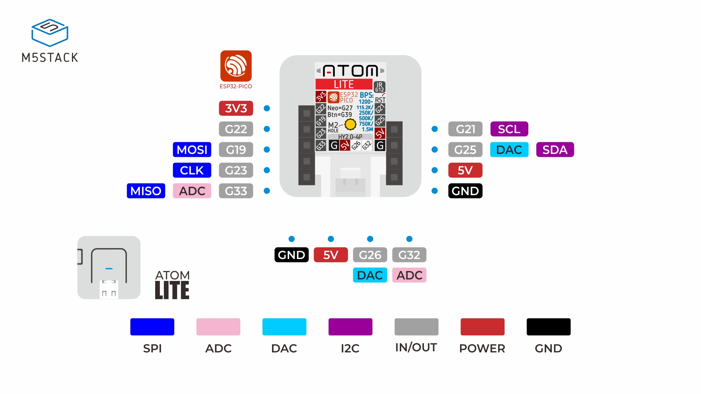
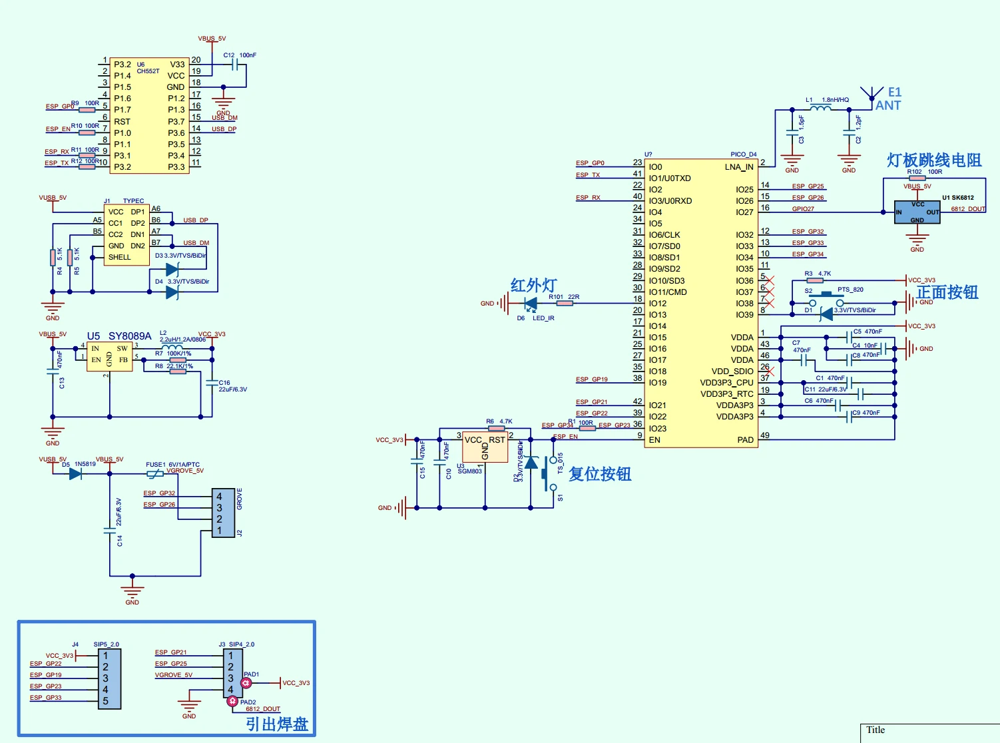
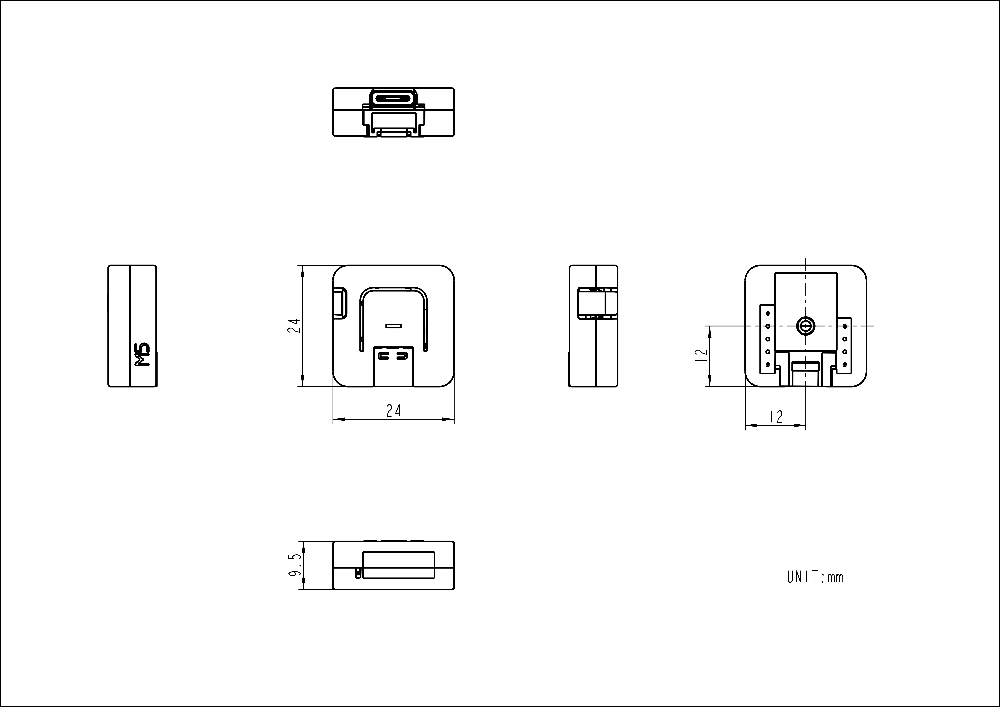

# M5Stack ATOM Lite C008 Engineering Guide


[**View M5Stack ATOM Lite on OpenELAB**](https://openelab.io/products/m5stackatomliteesp32)

**Model:** ATOM Lite / C008 · **SKU:** `M5-C008` · ESP32-PICO-D4 controller. This is the one-pixel Lite, not ATOM Matrix, ATOM S3 or ATOM Echo.


## Product overview

ATOM Lite is a compact ESP32 controller with a front button, one addressable RGB LED, an infrared transmitter, a Grove connector and underside expansion pins. This guide covers its hardware, Arduino, both UIFlow generations, PlatformIO and an ESPHome/Home Assistant path, with complete first-result examples and explicit pin ownership.



_M5Stack_ [_original C008 pin map_](https://m5stack-doc.oss-cn-shenzhen.aliyuncs.com/673/C008_PinMap_01.jpg)_. Grove and underside header signals are different connections._

### Description

The [official C008 product page](https://docs.m5stack.com/en/core/Atom-Lite) identifies the original ESP32-PICO-D4 hardware. Its shared Lite/Matrix tutorials can contain Matrix defaults: a 25-pixel example must be changed to **one pixel** for Lite. Lite does not acquire Matrix's display/IMU hardware because the two use the same Arduino target.

## Applications

Build a compact sensor node, a button-driven interface, an infrared remote prototype or a Home Assistant indicator. For an enclosed project, preserve access to USB and the button, provide strain relief for the Grove cable and keep the antenna clear of conductive mounting hardware. A successful RGB test is a useful board baseline before attaching a sensor.

For a development agent, keep a configuration record containing model C008, framework/library releases, GPIO assignments, supply and expected result. Do not attach a heater, motor or other load directly to GPIO; use a suitable powered driver and defined control state.

## Specification

### Features

| Parameter             | ATOM Lite C008                                     |
| --------------------- | -------------------------------------------------- |
| MCU                   | ESP32-PICO-D4; dual-core Xtensa LX6, up to 240 MHz |
| Memory                | 520 KB SRAM; 4 MB SPI flash                        |
| Radio                 | 2.4 GHz Wi-Fi; onboard 3D antenna                  |
| Input supply          | Manufacturer specifies 5 V / 500 mA                |
| Onboard functions     | SK6812 RGB ×1, user button, IR transmitter         |
| Connections           | USB-C; one HY2.0-4P Grove port; expansion pads     |
| Operating temperature | 0–40 °C                                            |
| Enclosure / mounting  | PC+ABS; M2 fixing feature                          |
| Size / mass           | 24 × 24 × 9.5 mm; 5.5 g                            |
| Package / contents    | 81 × 65 × 13 mm, 10.9 g gross; one ATOM Lite       |

Board values: [manufacturer specifications](https://docs.m5stack.com/en/core/Atom-Lite). Chip details: [ESP32-PICO data sheet](https://m5stack-doc.oss-cn-shenzhen.aliyuncs.com/669/esp32-pico_series_datasheet_en.pdf). The supply rating is not GPIO output current or a guaranteed budget for every accessory. Budget external loads separately.

## Hardware and connections

### Pin mapping and power

| Signal                        | ESP32 GPIO / connection | Practical rule                                              |
| ----------------------------- | ----------------------- | ----------------------------------------------------------- |
| RGB data                      | 27                      | One addressable SK6812, not a direct digital LED            |
| Button                        | 39, active-low          | Input-only ESP32 pin; preserve external circuit/pull-up     |
| IR transmitter                | 12                      | Infrared output; the board has no corresponding IR receiver |
| Grove yellow / white          | 26 / 32                 | Common sensor example: SDA26, SCL32                         |
| Grove black / red             | GND / 5 V               | Supply is not proof of 5 V GPIO tolerance                   |
| Header I2C in product pin map | SDA25, SCL21            | Separate route from Grove26/32                              |
| Other exposed header signals  | 19, 21, 22, 23, 25, 33  | Allocate against the actual attached base/peripheral        |

Exact routes: [C008 pin map](https://m5stack-doc.oss-cn-shenzhen.aliyuncs.com/673/C008_PinMap_01.jpg), [official schematic](https://static-cdn.m5stack.com/resource/docs/products/core/ATOM%20Lite/img-2e58eac3-d9ef-4be4-b486-d4dd9a8324fa.webp). GPIO39 is input-only on this original ESP32; that rule should not be transferred to another ESP32 family.



_M5Stack_ [_original schematic_](https://static-cdn.m5stack.com/resource/docs/products/core/ATOM%20Lite/img-2e58eac3-d9ef-4be4-b486-d4dd9a8324fa.webp)_. Use it for connector, USB-serial, button and power-routing checks; do not infer connections from enclosure color._

Start with a USB data cable. Power off before fitting an expansion base or Grove Unit. The controller's GPIO domain is 3.3 V. For a third-party peripheral, inspect supply, pull-up voltage, common ground and output levels before connecting it. Grove is a connector format; it does not assign an automatic protocol to GPIO26/32.



_M5Stack_ [_dimension drawing_](https://m5stack.oss-cn-shenzhen.aliyuncs.com/resource/docs/products/core/ATOM%20Lite/model%20size.jpg)_, mm._ [_Structure/STL files_](https://github.com/m5stack/M5_Hardware/tree/master/Products/C008_Atom-Lite/Structures) _support enclosure design. Check screw engagement on the actual assembly rather than tightening against the PCB._

## Software and development resources

| Route           | Target / dependencies                                      | First checkpoint                                    |
| --------------- | ---------------------------------------------------------- | --------------------------------------------------- |
| Current Arduino | M5Stack board manager, **M5Atom**; M5Unified / M5GFX       | `LogOutput`, button event and single-pixel response |
| Earlier Arduino | M5Atom library and its own examples                        | Keep `M5.dis`/legacy APIs separate from M5Unified   |
| UIFlow 1        | C008-compatible UIFlow firmware, API KEY / Internet Mode   | RGB block runs from the web editor                  |
| UIFlow 2        | ATOM Lite firmware, USB or Access Code                     | WebTerminal connection and run/download result      |
| PlatformIO      | `m5stack-atom` with the recorded platform/library versions | Same model-specific Arduino example                 |
| ESPHome         | `m5stack-atom`, GPIO39 button, GPIO27 SK6812, GPIO12 IR    | Button/light entities and local control             |

Current [button](https://docs.m5stack.com/en/arduino/m5atom/button) and [IR](https://docs.m5stack.com/en/arduino/m5atom/ir_nec) examples specify M5Stack board manager **≥3.2.6**, M5Atom target and M5Unified **≥0.2.13**. The [RGB tutorial](https://docs.m5stack.com/en/arduino/m5atom/rgb) specifies M5Unified ≥0.2.8, M5GFX ≥0.2.11 and Adafruit NeoPixel ≥1.15.1. Choose a consistent set meeting the examples you use; record actual installed releases rather than assuming future versions are identical.

### USB driver and port

ATOM Lite uses an FTDI virtual serial connection. If a data cable gives power but no port, compare the unplugged/plugged device list, then use the [official FTDI VCP driver](https://ftdichip.com/drivers/vcp-drivers/) for the host OS/architecture. M5Stack also links [Windows x64](https://m5stack.oss-cn-shenzhen.aliyuncs.com/resource/drivers/FTDI_Windows_Desktop_x64_2.12.36.20.zip), [Windows x86](https://m5stack.oss-cn-shenzhen.aliyuncs.com/resource/drivers/FTDI_Windows_Desktop_x86_32_2.12.36.20.zip), [Windows ARM](https://m5stack.oss-cn-shenzhen.aliyuncs.com/resource/drivers/FTDI_Windows_Desktop_ARM_2.12.36.20A.zip), [macOS Intel](https://m5stack.oss-cn-shenzhen.aliyuncs.com/resource/drivers/FTDI_MacOS_Intel_1.6.0.zip) and [macOS ARM64](https://m5stack.oss-cn-shenzhen.aliyuncs.com/resource/drivers/FTDI_MacOS_ARM64_1.6.0.zip) packages. Follow the OS's current signed-driver installation process. No global security setting change is needed for this guide.

## Getting started

### USB, firmware and prerequisites

1. Prepare ATOM Lite C008, a known USB **data** cable, a computer and Arduino IDE. Disconnect all external wiring.
2. Install the M5Stack board package and select **M5Atom**, then install M5Unified, M5GFX, Adafruit NeoPixel and required dependencies.
3. Select the newly enumerated FTDI serial port. Use the smallest baseline below before adding a Grove Unit or expansion base.

The manufacturer's [Arduino compile/upload workflow](https://docs.m5stack.com/en/arduino/m5atom/program) starts with **M5Unified → LogOutput**, Core Debug Level **Info**, upload and a 115200-baud monitor. Confirm periodic output and button activity. A port existing does not prove that the selected board or uploaded firmware is correct.

### Arduino: button plus one RGB pixel

This original sketch combines the source-supported button and pixel APIs, limits brightness and avoids the shared Matrix example's 25-pixel default. Keep `M5.update()` frequent; button events can be missed during long blocking operations.

```cpp
#include <M5Unified.h>
#include <Adafruit_NeoPixel.h>

Adafruit_NeoPixel statusPixel(1, 27, NEO_GRB + NEO_KHZ800);
bool enabled = false;

void setup() {
  M5.begin();
  Serial.begin(115200);
  statusPixel.begin();
  statusPixel.setBrightness(16);
  statusPixel.clear();
  statusPixel.show();
  Serial.println("ATOM_LITE_READY");
}

void loop() {
  M5.update();
  if (M5.BtnA.wasPressed()) {
    enabled = !enabled;
    statusPixel.setPixelColor(0, enabled ? statusPixel.Color(0, 255, 0) : 0);
    statusPixel.show();
    Serial.printf("button_pressed,indicator=%d\n", enabled);
  }
  delay(2);
}
```

**Expected result:** `ATOM_LITE_READY` appears at 115200 baud; each press toggles a dim green pixel and prints the state. These are expected observations; this new sketch has not been compiled or run on a board. Source APIs: [button](https://docs.m5stack.com/en/arduino/m5atom/button), [RGB](https://docs.m5stack.com/en/arduino/m5atom/rgb). For single click, double click and hold events, use `wasSingleClicked()`, `wasDoubleClicked()` and `wasHold()` in the same frequently updated loop; keep press and classified-click actions separate to avoid triggering two application actions for one gesture.

### Add one sensor after the host works

#### Grove versus header I2C

For a Grove sensor documented for SDA26/SCL32, disconnect power, connect the correct cable and initialize that route. This complete original scan runs without assuming a sensor driver:

```cpp
#include <Arduino.h>
#include <Wire.h>
void setup() {
  Serial.begin(115200);
  delay(500);
  Wire.begin(26, 32, 100000);
  for (uint8_t a = 8; a < 120; ++a) {
    Wire.beginTransmission(a);
    if (Wire.endTransmission() == 0) Serial.printf("I2C_ACK=0x%02X\n", a);
  }
}
void loop() {}
```

Expected result is the attached Unit's documented address, not a fixed address for ATOM Lite itself. A header device wired to SDA25/SCL21 will not answer on Grove26/32. The [ENV-III guide](m5stack-env-iii-unit-with-temperature-humidity-air-pressure-sensor.md) supplies a complete ATOM Lite sensor logger and explains its Unit's electrical boundary and two addresses. Do not move a 5 V-powered Unit onto arbitrary pins before checking pull-up levels.

### Infrared transmission with explicit user action

The official [NEC example](https://docs.m5stack.com/en/arduino/m5atom/ir_nec) uses GPIO12 and IRremote ≥4.5.0. Verify a frame with a compatible receiver before assigning a real appliance command. This original example sends only on a button press, rather than continuously changing address/command values:

```cpp
#include <M5Unified.h>
#include <IRremote.hpp>
void setup() {
  M5.begin();
  Serial.begin(115200);
  pinMode(12, OUTPUT);
  IrSender.begin(DISABLE_LED_FEEDBACK);
  IrSender.setSendPin(12);
}
void loop() {
  M5.update();
  if (M5.BtnA.wasPressed()) {
    IrSender.sendNEC(0x0000, 0x55, 0);
    Serial.println("NEC_TEST_SENT");
  }
  delay(2);
}
```

The address/command are test values, not a promised code for any appliance. Expected result is one receiver-decoded NEC frame per press. A console message proves the send routine ran, not successful optical reception. The transmitter cannot learn a remote without additional receiver hardware.

### UIFlow 1: firmware, API KEY and first block

Use M5Burner to select **ATOM Lite** firmware for UIFlow 1; choose the correct port, enter the intended Wi-Fi credentials and burn. After restart, use Configure → Load to inspect the device configuration. For the network editor, select **Internet Mode**, enter that device's **API KEY** in the editor's settings, and wait for connection. Place **Hardware → RGB → Set RGB Bar color** under setup and run it. Expected result is one changed LED color. [Official UIFlow 1 workflow](https://docs.m5stack.com/en/uiflow/m5atom_lite/program).

If flashing times out, close competing serial tools, verify the data cable and reduce the baud rate. The manufacturer lists **1500000, 750000, 500000, 250000 and 115200** as supported choices in this workflow. Keep the API key private; a saved editor project is not proof of a successful device download. Power-cycle after a saved download to establish standalone behavior.

### UIFlow2: establish a real device connection

Flash the **ATOM Lite UIFlow 2** image through M5Burner. Configure port, server, Wi-Fi, SNTP/timezone and the intended boot behavior. Boot choices distinguish running `main.py` directly, network/startup setup and network-only setup. Reconfigure through M5Burner after restarting if necessary. [Official UIFlow 2 procedure](https://docs.m5stack.com/en/uiflow2/atomlite/program).

Open [UIFlow 2](https://uiflow2.m5stack.com/), select ATOM Lite and choose one connection route:

| Route    | Actions and checkpoint                                                                                                                                         |
| -------- | -------------------------------------------------------------------------------------------------------------------------------------------------------------- |
| USB      | WebTerminal → observed serial port → Connect; confirm the serial connection before sending code                                                                |
| Wireless | Read the current Access Code and network state through WebTerminal, soft-reset if necessary, then Connect Device with that code and a recognizable device name |

Build a setup block that sets the single RGB color; add a button event only after that works. **Run Once** is a temporary test; **Run Always** downloads the program. Restart to check that the intended downloaded program runs with the chosen boot option. Access Code, UIFlow 1 API KEY and Wi-Fi password have different roles; they are not interchangeable.

### PlatformIO

The product wiki's example pins the platform to `espressif32@6.7.0`. A minimal project based on that documented baseline is:

```ini
[env:m5stack-atom]
platform = espressif32@6.7.0
board = m5stack-atom
framework = arduino
upload_speed = 1500000
monitor_speed = 115200
lib_deps =
  m5stack/M5Unified
  m5stack/M5GFX
  adafruit/Adafruit NeoPixel
```

Put the button/pixel sketch in `src/main.cpp`, build, upload to the observed port and open the 115200 monitor. Record resolved library versions. If a newly resolved library requires a newer core, reconcile the dependency set deliberately; do not claim that the historical platform pin validates arbitrary future libraries. [Manufacturer PlatformIO reference](https://docs.m5stack.com/en/core/Atom-Lite).

### Home Assistant / ESPHome

The [manufacturer integration](https://docs.m5stack.com/en/homeassistant/devices/atom_lite) maps a GPIO39 active-low button, GPIO12 IR transmitter and a one-pixel GPIO27 SK6812. Create an ESPHome node for `m5stack-atom`; configure your own Wi-Fi and encrypted API/OTA credentials through the installed ESPHome version. Add the following model-specific components to that generated base configuration:

```yaml
binary_sensor:
  - platform: gpio
    name: "Desk button"
    pin:
      number: GPIO39
      mode: INPUT
      inverted: true
    filters:
      - delayed_on: 50ms
      - delayed_off: 50ms
light:
  - platform: esp32_rmt_led_strip
    name: "Desk indicator"
    pin: GPIO27
    num_leds: 1
    chipset: SK6812
    rgb_order: GRB
    restore_mode: RESTORE_DEFAULT_OFF
remote_transmitter:
  pin: GPIO12
  carrier_duty_percent: 50%
```

Validate with the installed ESPHome release, flash initially through USB, then add the discovered node to Home Assistant. Expected checkpoints are a button entity that changes on press, a controllable RGB light and—only after configuring a known receiver/code—IR reception. The IR component declaration alone does not transmit a command. Keep the entity names and automations meaningful to the installation; avoid exposing the node outside the intended network. This recipe is not an executed ESPHome validation report.

## Troubleshooting and FAQs

| Symptom                              | Ordered checks                                                                                                                |
| ------------------------------------ | ----------------------------------------------------------------------------------------------------------------------------- |
| Power but no USB port                | Known data cable → direct port → FTDI enumeration → matching signed VCP driver                                                |
| Port busy / burn timeout             | Close Arduino monitor, WebTerminal and other serial clients; choose observed port; lower supported burn speed                 |
| RGB example assumes 25 LEDs          | Confirm Lite C008; use one pixel on27; Matrix examples are not its hardware description                                       |
| Button never changes                 | Call `M5.update()` frequently; confirm GPIO39 active-low circuit; remove long delays; do not configure39 as output            |
| Grove sensor absent                  | Correct supply/logic →26/32 wiring → scan → exact Unit driver; header25/21 is a different route                               |
| UIFlow wireless cannot connect       | Confirm firmware generation, network reachability and the correct API KEY or Access Code; inspect actual device state via USB |
| Runs once but not after reset        | Download the project and select the intended boot behavior; test after a power cycle                                          |
| IR message but no appliance response | Verify receiver, protocol, address, command and line of sight; sending a log message is not reception                         |
| IMU/display example fails            | Confirm that it is not an ATOM Matrix or Echo example requiring absent hardware                                               |

## Downloads and technical documents

| Resource                                                                                                                                                                                                                                                | Purpose                                                                                                       |
| ------------------------------------------------------------------------------------------------------------------------------------------------------------------------------------------------------------------------------------------------------- | ------------------------------------------------------------------------------------------------------------- |
| [C008 product / comparison](https://docs.m5stack.com/en/core/Atom-Lite)                                                                                                                                                                                 | Specifications, galleries, platform baseline and ATOM family selector                                         |
| [Schematic](https://static-cdn.m5stack.com/resource/docs/products/core/ATOM%20Lite/img-2e58eac3-d9ef-4be4-b486-d4dd9a8324fa.webp) / [pin map](https://m5stack-doc.oss-cn-shenzhen.aliyuncs.com/673/C008_PinMap_01.jpg)                                  | Exact connections                                                                                             |
| [Dimension drawing](https://m5stack.oss-cn-shenzhen.aliyuncs.com/resource/docs/products/core/ATOM%20Lite/model%20size.jpg) / [CAD](https://github.com/m5stack/M5_Hardware/tree/master/Products/C008_Atom-Lite/Structures)                               | Mechanical integration                                                                                        |
| [ESP32-PICO data sheet](https://m5stack-doc.oss-cn-shenzhen.aliyuncs.com/669/esp32-pico_series_datasheet_en.pdf)                                                                                                                                        | Chip electrical/peripheral reference                                                                          |
| [Arduino setup](https://docs.m5stack.com/en/arduino/m5atom/program) / [button](https://docs.m5stack.com/en/arduino/m5atom/button) / [RGB](https://docs.m5stack.com/en/arduino/m5atom/rgb) / [IR NEC](https://docs.m5stack.com/en/arduino/m5atom/ir_nec) | Source-supported targets, versions and APIs                                                                   |
| [M5Atom library](https://github.com/m5stack/M5Atom) / [M5Unified](https://github.com/m5stack/M5Unified)                                                                                                                                                 | Distinct API generations; inspect examples before combining                                                   |
| [Factory example sources](https://github.com/m5stack/M5-ProductExampleCodes/tree/master/Core/Atom/Atom%20Lite)                                                                                                                                          | Manufacturer test programs                                                                                    |
| [UIFlow 1](https://docs.m5stack.com/en/uiflow/m5atom_lite/program) / [UIFlow 2](https://docs.m5stack.com/en/uiflow2/atomlite/program)                                                                                                                   | Full editor screenshots and firmware workflows                                                                |
| [ESPHome integration](https://docs.m5stack.com/en/homeassistant/devices/atom_lite)                                                                                                                                                                      | Component mapping and Home Assistant illustrations                                                            |
| [Windows factory Easyloader](https://m5stack.oss-cn-shenzhen.aliyuncs.com/resource/docs/products/core/ATOM%20Lite/Atom%20Lite%20RGB%20Demo.exe)                                                                                                         | Manufacturer RGB/button test firmware installer; overwrites current application; not executed for this review |
| [Official demonstration video](https://m5stack.oss-cn-shenzhen.aliyuncs.com/video/Product_example_video/Core/ATOM_LITE.mp4) / [UIFlow 2 video](https://www.youtube.com/watch?v=Qlt43xG6QhI)                                                             | Visual expected behavior and editor workflow                                                                  |

### Existing illustrations

<figure><figcaption></figcaption></figure>

<figure><figcaption></figcaption></figure>

## Official documentation and development resources

The indexed resources above identify exact-model hardware, software and original manufacturer figures. Record the selected release and observed results when reproducing a procedure.

## References and validation

Official C008 hardware, Arduino peripheral pages, UIFlow workflows and the ESPHome integration were reviewed **23 November 2026**. This guide adds original button/pixel, scan and deliberate IR examples, distinguishes one-pixel Lite from Matrix, and separates Grove from header wiring. Manufacturer figures are attributed in their captions.

**Compilation, flashing, Home Assistant integration and hardware tests were not run.** Record the actual board, SDK/library releases, supply, connected Unit and observed output before reporting a tested system. General ESP-IDF/PlatformIO support does not establish compatibility of an unreviewed library or expansion base.
