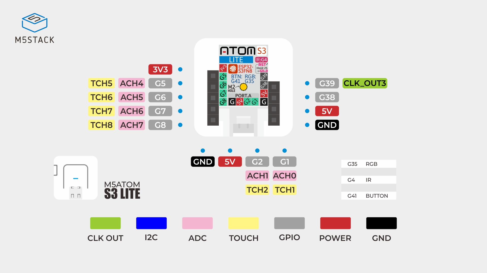

# M5Stack AtomS3-Lite C124 GPIO and Firmware Guide


[**View M5Stack AtomS3-Lite C124 on OpenELAB**](https://openelab.io/products/m5stack-atoms3-lite)

**Model:** AtomS3-Lite C124 · **SKU:** `M5-C124`


## Product overview <a href="#introduction" id="introduction"></a>

### Exact hardware identity <a href="#m5stack-atoms3-lite-esp32s3-dev-kit" id="m5stack-atoms3-lite-esp32s3-dev-kit"></a>

**AtomS3-Lite C124** is the screenless ESP32-S3FN8 member of the ATOM family, with one addressable RGB LED, a button, IR transmitter, USB-C and Grove/underside expansion. It has8MB flash; the reviewed specification does not establish the8MB PSRAM or display fitted to AtomS3R. The original ESP32 ATOM Lite C008 is also a different target and pin map.

Use this guide to upload a button/pixel program, identify the actual expansion route and recover the S3 native-USB bootloader. A display example from the shared AtomS3 library does not establish that Lite contains a screen.

### OpenELAB listing and option <a href="#product-link" id="product-link"></a>

Use [View M5Stack AtomS3-Lite C124 on OpenELAB](https://openelab.io/products/m5stack-atoms3-lite) and match `M5-C124` before selecting regional firmware or adding accessories.

## Applications <a href="#features" id="features"></a>

Use C124 as a small sensor gateway, USB-connected status indicator, IR transmitter or button interface. Keep a known input/pixel sketch as a baseline before attaching an ATOM base. A connector fitting mechanically does not establish that a base's GPIO allocation is compatible.

## Specifications <a href="#specification" id="specification"></a>

| Parameter             | AtomS3-Lite C124                                        |
| --------------------- | ------------------------------------------------------- |
| MCU                   | ESP32-S3FN8, dual-core LX7 up to240MHz                  |
| Flash                 | 8MB; no PSRAM claimed in this exact-model table         |
| Indicator / regulator | WS2812C-2020 RGB, SY8089 DC-DC                          |
| Power                 | 5V input via USB-C;3.3V signal/output domain            |
| Underside GPIO        | 5/6/7/8/38/39; supply and ground pads separately marked |
| Grove signals         | 2/1                                                     |
| Temperature           | 0–40°C manufacturer range                               |
| Envelope / mass       | 24×24×9.5mm;5.3g                                        |

[Manufacturer specification and exact pin illustration](https://docs.m5stack.com/en/core/AtomS3-Lite). A supply/output voltage listing is not a per-pin output-current allowance.

## Hardware and connections <a href="#pinout" id="pinout"></a>

| Function                     | C124 GPIO / connection                      |
| ---------------------------- | ------------------------------------------- |
| RGB data                     | 35; one WS2812-compatible addressable pixel |
| IR transmitter               | 4                                           |
| User button                  | 41                                          |
| Grove black/red/yellow/white | GND/5V/2/1                                  |
| Header GPIO                  | 5/6/7/8/38/39;39 also labeled CLK\_OUT3     |

The exact C124 map was visually reviewed. Do not reuse C008's RGB27/button39 or C126's display pins. Power off before fitting a base; compare the entire underside map, power direction and GPIO ownership. Grove5V is a supply, not5V tolerance of GPIO1/2. Use3.3V-compatible pull-ups and a common ground for external signals. This board has an IR transmitter; reception needs an external receiver. [Official pin map](https://m5stack-doc.oss-cn-shenzhen.aliyuncs.com/471/C124_PinMap_01.jpg).



_M5Stack official technical illustration:_ [_original_](https://m5stack-doc.oss-cn-shenzhen.aliyuncs.com/471/C124_PinMap_01.jpg)_. Verify drawing and physical revision together._

## Software and development resources <a href="#download-control-board" id="download-control-board"></a>

Use the M5Stack board package and **M5AtomS3** preset from the [shared AtomS3/Lite Arduino tutorial](https://docs.m5stack.com/en/arduino/m5atoms3/program). Install M5AtomS3 and its declared dependencies for vendor examples; the independent GPIO/pixel sketch below uses **Adafruit NeoPixel** with the exact C124 pins, so it does not depend on a display API.

The manufacturer also documents a generic `esp32-s3-devkitc-1` PlatformIO Arduino route with native-USB CDC enabled. Retain an8MB-flash configuration and a recorded platform/library set; do not enable a nonexistent PSRAM device to fix an unrelated allocation failure. Current M5Unified releases have their own M5GFX dependency minimum. Record actual resolved releases.

UiFlow2 requires the **AtomS3-Lite** firmware, not the display model's image. Use the model-linked setup page from the [C124 reference](https://docs.m5stack.com/en/core/AtomS3-Lite); an Access Code and a serial connection are different transport choices.

## Getting started <a href="#how-to-use" id="how-to-use"></a>

### USB and programming preparation <a href="#preparations" id="preparations"></a>

Disconnect external peripherals for the first upload. Use a USB data cable, the exact board preset and the dependencies specified above; keep the factory-recovery route available before replacing firmware.

### Select the serial port <a href="#port-selection" id="port-selection"></a>

Compare the computer’s port list before and after connecting the board. Select the newly enumerated device, close other serial clients and reselect the port if download mode creates a different device. Use the model-specific recovery procedure below when normal application USB is unavailable.

### Original button/pixel first program <a href="#program-compilation-burning" id="program-compilation-burning"></a>

1. Disconnect external wiring and connect USB-C with a data cable.
2. Select **M5AtomS3**, install Adafruit NeoPixel and upload the sketch below.
3. If the port is absent, hold the side reset/power control until the internal green LED lights, release it and choose the newly enumerated bootloader port.
4. After upload restart the application, open a115200-baud monitor and press the front button. Compare pixel and serial state.

```cpp
#include <Arduino.h>
#include <Adafruit_NeoPixel.h>
Adafruit_NeoPixel pixel(1, 35, NEO_GRB + NEO_KHZ800);
bool on=false, stable=HIGH, lastRaw=HIGH;
uint32_t changed=0;
void setup() {
  Serial.begin(115200);
  pinMode(41, INPUT_PULLUP);
  pixel.begin(); pixel.setBrightness(16);
  pixel.clear(); pixel.show();
}
void loop() {
  bool raw=digitalRead(41);
  if (raw!=lastRaw) { lastRaw=raw; changed=millis(); }
  if (raw!=stable && millis()-changed>=30) {
    stable=raw;
    if (stable==LOW) {
      on=!on;
      pixel.setPixelColor(0, on ? pixel.Color(0,0,255) : 0);
      pixel.show();
      Serial.printf("C124_BUTTON,blue=%d\n",on);
    }
  }
  delay(2);
}
```

Expected result: one dim blue toggle per press after30ms of stable input. This original debounce example deliberately avoids C008 GPIO defaults and any screen operation. A blank face is expected because C124 is screenless.

### Grove communication before a sensor driver

With a verified compatible Unit connected to Grove2/1, this separate original probe prints responding I2C addresses. It configures no outputs other than the bus and never assumes a particular attached sensor.

```cpp
#include <Arduino.h>
#include <Wire.h>
void setup() {
  Serial.begin(115200);
  delay(700);
  Wire.begin(2,1,100000);
  for (uint8_t a=8;a<120;++a) {
    Wire.beginTransmission(a);
    if (Wire.endTransmission()==0) Serial.printf("ACK=0x%02X\n",a);
  }
}
void loop() {}
```

Expected result is the attached Unit's documented address. No ACK with nothing attached is normal. An address establishes transport response, not a correct sensor reading; install the exact Unit driver and check its units and initialization next. Stop if another base owns GPIO1/2 or uses a conflicting power direction.

### IR, UIFlow and factory recovery <a href="#download-mode" id="download-mode"></a>

For IR, start with the exact model-supported sender example onGPIO4, send one deliberate known protocol frame to a compatible receiver and compare decoded address/command. A serial send message is not optical reception. Do not use original ATOM Lite GPIO12 here.

For UIFlow2, flash the C124 image through M5Burner, select AtomS3-Lite, open WebTerminal on its actual port and run a single RGB block. Run Once is temporary; Run Always downloads. Restart to verify stored behavior. If using the wireless editor, retrieve the current Access Code over USB and keep it private.

To restore the manufacturer test firmware, save your sketch/configuration first, use the exact **AtomS3-Lite Factory Firmware** entry/download and the green-LED download sequence. Do not use AtomS3R's PSRAM/display firmware. A full flash erase is unnecessary for most cable/port failures; diagnose enumeration and the target first.

## Troubleshooting and FAQs

| Symptom                  | Checks                                                                                          |
| ------------------------ | ----------------------------------------------------------------------------------------------- |
| RGB or button wrong      | Confirm C124; pixel35/button41; remove C008 or C126 pin assumptions.                            |
| No upload port           | Data cable → direct USB → documented hold/release boot mode → reselect port after enumeration.  |
| PSRAM error              | C124 does not claim fitted PSRAM; use Lite memory/flash settings and bounded allocations.       |
| Sensor absent            | Grove2/1 versus underside signals, supply/pull-ups, documented address and correct Unit driver. |
| UIFlow runs only once    | Use Run Always and intended boot option; restart to prove persistence.                          |
| IR receiver sees nothing | Exact pin4, protocol/carrier and line of sight; board has no onboard IR receiver.               |

## Downloads and technical documents <a href="#install-library-files" id="install-library-files"></a>

The official C124 pin map and schematic are the primary expansion references. Firmware installer links below overwrite the application; source libraries and structural CAD have different purposes and licenses.

| Official file or repository                                                                                            | Use                                                                                          |
| ---------------------------------------------------------------------------------------------------------------------- | -------------------------------------------------------------------------------------------- |
| [AtomS3-Lite Schematics PDF](https://m5stack-doc.oss-cn-shenzhen.aliyuncs.com/471/Sch_M5_AtomS3_v1.0.pdf)              | Manufacturer-listed exact model document / maintained source; use the scope described above. |
| [AtomS3-Lite Structure Files](https://github.com/m5stack/M5_Hardware/tree/master/Products/C124_AtomS3-Lite/Structures) | Manufacturer-listed exact model document / maintained source; use the scope described above. |
| [ESP32-S3](https://m5stack-doc.oss-cn-shenzhen.aliyuncs.com/472/esp32-s3_datasheet_en.pdf)                             | Manufacturer-listed exact model document / maintained source; use the scope described above. |
| [SY8089](https://m5stack.oss-cn-shenzhen.aliyuncs.com/resource/docs/datasheet/atombase/ATOMS3/sy8089.pdf)              | Manufacturer-listed exact model document / maintained source; use the scope described above. |
| [AtomS3-Lite Arduino Library](https://github.com/m5stack/M5AtomS3)                                                     | Manufacturer-listed exact model document / maintained source; use the scope described above. |
| [AtomS3-Lite UiFlow2 Docs](https://uiflow-micropython.readthedocs.io/en/latest/controllers/atoms3-lite.html)           | Manufacturer-listed exact model document / maintained source; use the scope described above. |
| [download](https://m5stack-doc.oss-cn-shenzhen.aliyuncs.com/471/AtomS3-Lite-Factory-Firmware.exe)                      | Manufacturer-listed exact model document / maintained source; use the scope described above. |

### Model illustrations <a href="#dimensions" id="dimensions"></a>

.png>)

.png>)

.png>)

.png>)

.png>)

.png>)

.png>)

.png>)

.png>)

.png>)

_Retained manufacturer illustrations. Use the revision-specific connector and circuit references above for wiring._

### Additional model references

* [ESP32 S3](https://shop.m5stack.com/products/m5stamp-esp32s3-module)
* [Arduino IDE Installation Guide](https://docs.m5stack.com/en/arduino/arduino_ide)
* [Basic Environment Setup Guide](https://docs.m5stack.com/en/arduino/arduino_board)
* [Library Management Installation Guide](https://docs.m5stack.com/en/arduino/arduino_library)
* [Read mechanical / cad files](https://github.com/m5stack/M5_Hardware/blob/master/Products/C124_AtomS3-Lite/Structures/AtomS3-Lite.stl)

## References and validation <a href="#official-documentation-and-development-resources" id="official-documentation-and-development-resources"></a>

This guide uses the exact sold SKU and the [manufacturer reference](https://docs.m5stack.com/en/core/AtomS3-Lite). Specifications are manufacturer-reported; diagnostic order and first-result programs are original engineering work. C124 GPIO35/4/41 and Grove2/1 were checked against the official diagram. The standalone programs use original debounce and transport-probe logic; GPIO and Arduino APIs were reviewed without compilation or hardware execution.

**Review:** 24 November 2026. Manufacturer documentation and the linked SDK interfaces were reviewed. **Compilation, firmware flashing and hardware operation: not run.** Expected results above are commissioning checkpoints, not observed bench measurements.
