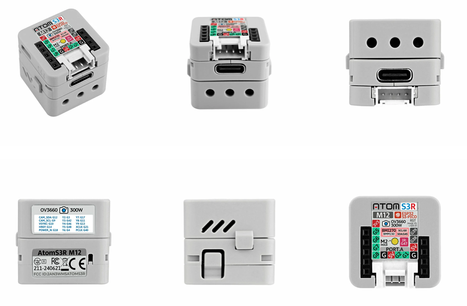
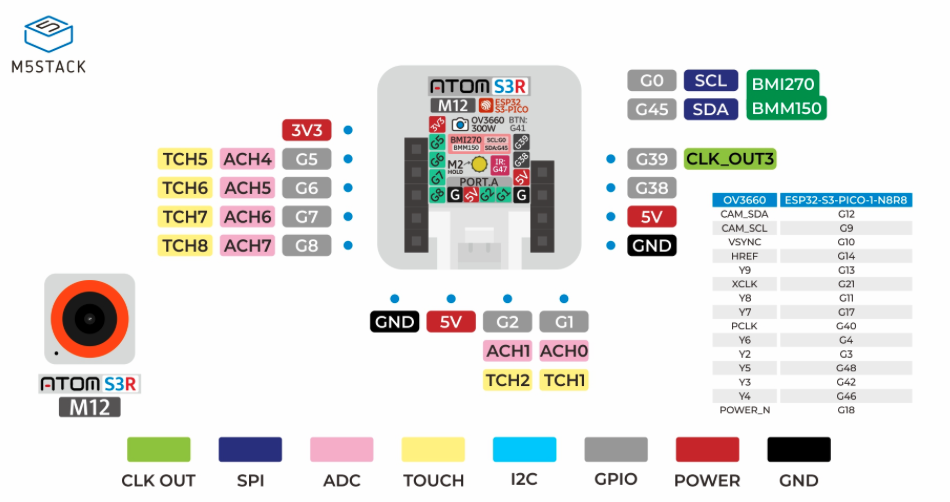

---
layout:
  width: default
  title:
    visible: false
  description:
    visible: false
  tableOfContents:
    visible: true
  outline:
    visible: true
  pagination:
    visible: true
  metadata:
    visible: true
  tags:
    visible: true
  actions:
    visible: true
  anchors:
    visible: true
---

# M5Stack ATOMS3R Camera (OV3660)


**Manufacturer reference.** A matching current OpenELAB global-store listing has not been verified for this model/revision. Use the hardware label and the exact official reference below; do not select firmware or wiring from a similar store product.


### M5Stack ATOMS3R Camera Kit M12 Version (OV3660)

***

### Product Link

No matching current OpenELAB.io listing was found for the product version documented here.

### Description 

**AtomS3R M12** is an IoT programmable controller integrated with an **M12 camera**, featuring a 3-megapixel **OV3660** **Wide Angle** camera that supports high-resolution image capture. It uses the **ESP32-S3-PICO-1-N8R8** as the main controller, with built-in WiFi functionality, 8MB onboard **FLASH**, and 8MB **PSRAM**. It includes a power management circuit that converts 5V to 3.3V and has an embedded three-axis **BMM150** geomagnetic sensor and a six-axis **BMI270** motion sensor. The product comes with **UVC** (USB Video Class) firmware, allowing it to be used as a plug-and-play USB camera without the need for driver installation, and it also has infrared emission control.

Compared to previous ATOM series host products, the **AtomS3R M12** features an enhanced **3D antenna**, providing better performance and stability. The product includes a **Type-C** interface for power supply and firmware downloads, along with an **HY2.0-4P** expansion port. The bottom design features six **GPIO** and power pins for easy expansion. Measuring only **24x24x22.1mm**, it is suitable for applications such as IoT device monitoring, educational development tools, and various embedded scenarios.

### Product Features 

* Integrated ESP32-S3-PICO-1-N8R8 main controller
* 3-megapixel(3MP) OV3660 camera
* Nine-axis sensor system (BMI270 six-axis + BMM150 three-axis geomagnetic sensor)
* 8MB Flash and 8MB PSRAM
* Supports infrared emission control
* Expandable pins and interfaces
* Development platforms: Arduino, UIFlow, MicroPython

### Applications 

* Plug-and-play USB camera
* Motion detection and directional awareness
* Wearable devices
* Smart device control
* IoT applications

### Specifications 

<table><thead><tr><th width="275">Specification</th><th>Parameter</th></tr></thead><tbody><tr><td>SoC</td><td>ESP32-S3-PICO-1-N8R8 @ Dual-core Xtensa LX7 processor, up to 240MHz @ USB-OTG</td></tr><tr><td>PSRAM</td><td>8M PSRAM</td></tr><tr><td>FLASH</td><td>8M FLASH</td></tr><tr><td>Six-axis Motion Sensor (BMI270)</td><td>Accuracy: 0.05% (acceleration), 0.05°/s (angular velocity) I2C address: 0x68</td></tr><tr><td>Three-axis Geomagnetic Sensor (BMM150)</td><td>Accuracy: 0.3 μT Mounted on BMI270, obtaining magnetometer data via BMI270</td></tr><tr><td>Camera</td><td>Sensor chip: OV3660 Maximum frame rate: 30 frames/second Output formats: RAW RGB, RGB565/555/444, CCIR656, YCbCr422, and compression Aperture: F2.4 Resolution: 3MP (3 million pixels) Focal length: 1.8±5% mm Field of view: FOV 120°</td></tr><tr><td>Infrared IR</td><td>IR emission distance at ∠180°: 12.46m IR emission distance at ∠90°: 1.45m IR emission distance at ∠45°: 3.88m</td></tr><tr><td>Sleep Current</td><td>GPIO-5V power supply: DC5V@11.63 uA Grove-5V power supply: DC5V@10.75 uA USB-5V power supply: DC5V@92.50 uA (including PD resistor loss)</td></tr><tr><td>Reserved GPIO</td><td>G5/G6/G7/G8/G38/G39</td></tr><tr><td>Operating Temperature</td><td>0°C ~ 40°C</td></tr><tr><td>Product Dimensions</td><td>24*24*22.1mm</td></tr><tr><td>Package Dimensions</td><td>47*46*27mm</td></tr><tr><td>Product Weight</td><td>54g</td></tr><tr><td>Package Weight</td><td>85.5g</td></tr></tbody></table>

<figure><figcaption></figcaption></figure>

### Related links 

* [ESP32-S3-PICO-1-N8R8](https://m5stack.oss-cn-shenzhen.aliyuncs.com/resource/docs/products/core/AtomS3R/esp32-s3-pico-1_datasheet_en.pdf)
* [OV3660](https://m5stack.oss-cn-shenzhen.aliyuncs.com/resource/docs/datasheet/unit/OV3660_CSP3_DS_1.3_sida.pdf)
* [BMI270](https://m5stack.oss-cn-shenzhen.aliyuncs.com/resource/docs/datasheet/core/K128%20CoreS3/BMI270.PDF)
* [BMM150](https://m5stack.oss-cn-shenzhen.aliyuncs.com/resource/docs/datasheet/core/K128%20CoreS3/BMM150.PDF)

### Schematic 

<figure><figcaption></figcaption></figure>

<figure><figcaption></figcaption></figure>

<figure><figcaption></figcaption></figure>

### PinMap 

BMM150 & BMI270 & IR

| ESP32-S3-PICO-1-N8R8 | G0       | G45      | BMI270\_ASDx | BMI270\_ASCx | G47          |
| -------------------- | -------- | -------- | ------------ | ------------ | ------------ |
| BMI270               | SYS\_SCL | SYS\_SDA |              |              |              |
| BMM150               |          |          | A\_SDA       | A\_SCL       |              |
| IR                   |          |          |              |              | IR\_LED\_DRV |

OV3360(M12)

| OV3360(M12) | ESP32-S3-PICO-1-N8R8 |
| ----------- | -------------------- |
| CAM\_SDA    | G12                  |
| CAM\_SCL    | G9                   |
| VSYNC       | G10                  |
| HREF        | G14                  |
| Y9          | G13                  |
| XCLK        | G21                  |
| Y8          | G11                  |
| Y7          | G17                  |
| PCLK        | G40                  |
| Y6          | G4                   |
| Y2          | G3                   |
| Y5          | G48                  |
| Y3          | G42                  |
| Y4          | G46                  |
| POWER\_N    | G18                  |

### Module Size 

<figure><figcaption></figcaption></figure>

### Example 

* [AtomS3R M12 Firmware](https://m5stack.oss-cn-shenzhen.aliyuncs.com/resource/docs/products/core/AtomS3R-M12/ATOMS3R-CAM-M12-UserDemo-M5Stack-20240927.zip)

## Official documentation and development resources

Use [AtomS3R-CAM](https://docs.m5stack.com/en/core/AtomS3R-CAM) for the manufacturer's complete model reference, diagrams and maintained examples. The official product code is **`C126-CAM`**; match the board/Unit label before choosing a firmware or host example. The references below complement this guide's local instructions.

| Development need             | Model-specific reference                                                                                                                   |
| ---------------------------- | ------------------------------------------------------------------------------------------------------------------------------------------ |
| Arduino development tutorial | [Read arduino development tutorial](https://docs.m5stack.com/en/arduino/m5atoms3r-cam/program)                                             |
| Electrical schematic         | [Read electrical schematic](https://m5stack-doc.oss-cn-shenzhen.aliyuncs.com/681/main_board_schematic.pdf)                                 |
| Electrical schematic         | [Read electrical schematic](https://m5stack-doc.oss-cn-shenzhen.aliyuncs.com/681/ext_board_schematic.pdf)                                  |
| Mechanical / CAD files       | [Read mechanical / cad files](https://github.com/m5stack/M5_Hardware/tree/master/Products/C126-CAM_AtomS3R-CAM/Structures)                 |
| Mechanical / CAD files       | [Read mechanical / cad files](https://github.com/m5stack/M5_Hardware/blob/master/Products/C126-CAM_AtomS3R-CAM/Structures/AtomS3R-CAM.stl) |
| Example source: camera.ino   | [Read example source: camera.ino](https://github.com/m5stack/M5AtomS3/blob/main/examples/Basics/camera/camera.ino)                         |

Keep the example's host model, interface pins and dependency versions together when reproducing a result. A schematic or SDK link does not establish that another revision uses the same wiring. Official model pages and accessible tutorial links reviewed **23 November 2026**. Other downloads above are manufacturer-listed resources; listing a file is not a test of its contents. Compilation, firmware flashing and hardware operation were **not performed** in this review.
