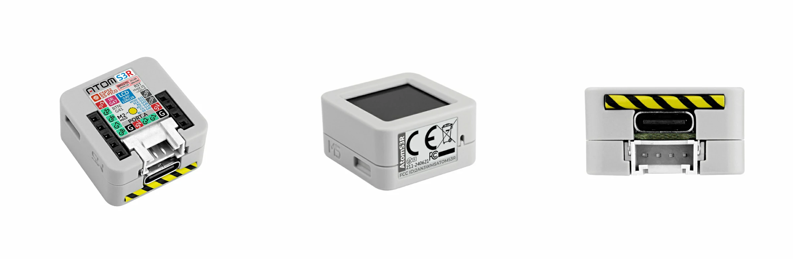

---
layout:
  width: default
  title:
    visible: false
  description:
    visible: false
  tableOfContents:
    visible: true
  outline:
    visible: true
  pagination:
    visible: true
  metadata:
    visible: true
  tags:
    visible: true
  actions:
    visible: true
  anchors:
    visible: true
---

# M5Stack ATOMS3R Development Kit


[**View M5Stack ATOMS3R Development Kit on OpenELAB**](https://openelab.io/products/m5stack-atoms3r-development-kit)

**Model/option:** M5Stack ATOMS3R Development Kit · **OpenELAB SKU:** `M5-C126` · Scope: AtomS3R standalone, not the separate AtomS3R-CAM camera kit.


## M5Stack ATOMS3R Development Kit

***

## Description 

**AtomS3R** is a highly integrated programmable controller based on the ESP32-S3 main controller. It features the **ESP32-S3-PICO-1-N8R8** main controller with built-in WiFi, 8MB onboard **FLASH**, and 8MB **PSRAM**. It comes with a 0.85-inch color **IPS screen**, with a programmable button beneath the screen. The device includes a 5V to 3.3V power circuit, a built-in three-axis **BMM150** geomagnetic sensor, and a six-axis **BMI270** attitude sensor. It also has a **Type-C interface** for power supply and firmware downloads, along with a **HY2.0-4P** expansion port. Six **GPIO** and power pins are reserved at the bottom for easy expansion. Compared to previous products, the **3D antenna** of the **AtomS3R** has been enhanced, offering better performance and greater stability. The product measures only **24x24x12.9mm**, making it suitable for various embedded smart device applications.

Download Mode press and hold the reset button (about 2 seconds) until the internal green LED lights up, then release the firmware. At this time, the device has entered download mode, waiting for burning.`When controlling the LCD backlight, the PWM frequency is recommended to use 500Hz.`

## Product Features 

* Integrated ESP32-S3-PICO-1-N8R8 main controller
* Nine-axis sensor system (six-axis BMI270 + three-axis BMM150 geomagnetic sensor)
* 8MB Flash and 8MB PSRAM
* Supports infrared control functionality
* Programmable button
* 0.85-inch LCD screen
* Expandable pins and interfaces
* Development platforms: Arduino, UIFlow, Micropython

## Applications 

* Motion detection and direction sensing
* Wearable devices
* Smart device control
* IoT applications

## Specifications 

| Specification                          | Details                                                                                                   |
| -------------------------------------- | --------------------------------------------------------------------------------------------------------- |
| SoC                                    | ESP32-S3-PICO-1-N8R8 @Dual-core Xtensa LX7 processor, up to 240MHz @USB-OTG                               |
| PSRAM                                  | 8MB PSRAM                                                                                                 |
| FLASH                                  | 8MB FLASH                                                                                                 |
| TFT Driver                             | GC9107                                                                                                    |
| Color IPS Resolution                   | 128 x 128                                                                                                 |
| Six-axis sensor (BMI270)               | 
Accuracy: 0.05% (acceleration), 0.05°/s (angular velocity) I2C address: 0x68
                    |
| Three-axis geomagnetic sensor (BMM150) | 
Accuracy: 0.3 μT Mounted on BMI270, magnetometer data accessed via BMI270
                       |
| IR                                     | Infrared transmission range: 12.46m @ ∠180°, 1.45m @ ∠90°, 3.88m @ ∠45°                                   |
| Sleep current                          | 
GPIO-5V power: DC5V @ 11.63 μA Grove-5V power: DC5V @ 10.75 μA USB-5V power: DC5V @ 92.50 μA
 |
| Bottom reserved GPIO pins              | G5/G6/G7/G8/G38/G39                                                                                       |
| Operating temperature                  | 0°C \~ 40°C                                                                                               |
| Product dimensions                     | 24\*24\*12.9mm                                                                                            |
| Packaging dimensions                   | 85\*65.5\*13mm                                                                                            |
| Product weight                         | 6.7g                                                                                                      |
| Packaging weight                       | 13.4g                                                                                                     |

<figure><figcaption></figcaption></figure>

<figure><figcaption></figcaption></figure>

## Related Links 

* [ESP32-S3-PICO-1-N8R8](https://m5stack.oss-cn-shenzhen.aliyuncs.com/resource/docs/products/core/AtomS3R/esp32-s3-pico-1_datasheet_en.pdf)
* [BMI270](https://m5stack.oss-cn-shenzhen.aliyuncs.com/resource/docs/datasheet/core/K128%20CoreS3/BMI270.PDF)
* [BMM150](https://m5stack.oss-cn-shenzhen.aliyuncs.com/resource/docs/datasheet/core/K128%20CoreS3/BMM150.PDF)

## Schematics 

<figure><figcaption></figcaption></figure>

## PinMap 

<figure><figcaption></figcaption></figure>

RGB & BMM150 & BMI270 IR & BUTTON

| ESP32-S3-PICO-1-N8R8 | G0       | G45      | G47          | G41       | BMI270\_ASDx | BMI270\_ASCx |
| -------------------- | -------- | -------- | ------------ | --------- | ------------ | ------------ |
| LP5562 (RGB control) | SYS\_SCL | SYS\_SDA |              |           |              |              |
| BMI270               | SYS\_SCL | SYS\_SDA |              |           |              |              |
| BMM150               |          |          |              |           | A\_SDA       | A\_SCL       |
| IR                   |          |          | IR\_LED\_DRV |           |              |              |
| BUTTON               |          |          |              | USER\_BUT |              |              |

SCREEN

| ESP32S3-PICO Chip | LP5562\_W | G48       | G42      | G21       | G15      | G14      |
| ----------------- | --------- | --------- | -------- | --------- | -------- | -------- |
| 0.85-Inch IPS     | LCD\_BL   | DISP\_RST | DISP\_RS | SPI\_MOSI | SPI\_SCK | DISP\_CS |

## Module Size 

<figure><figcaption></figcaption></figure>
