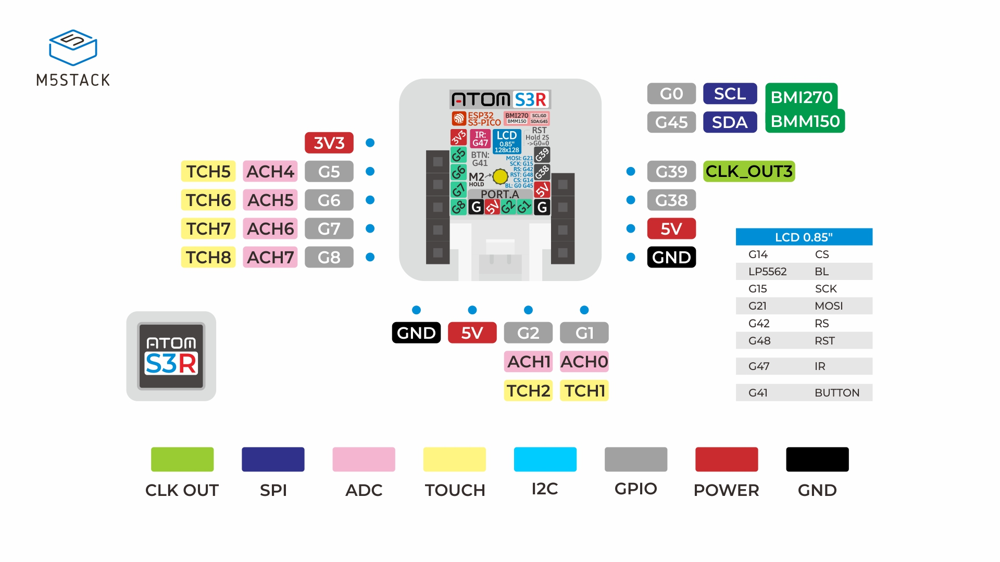
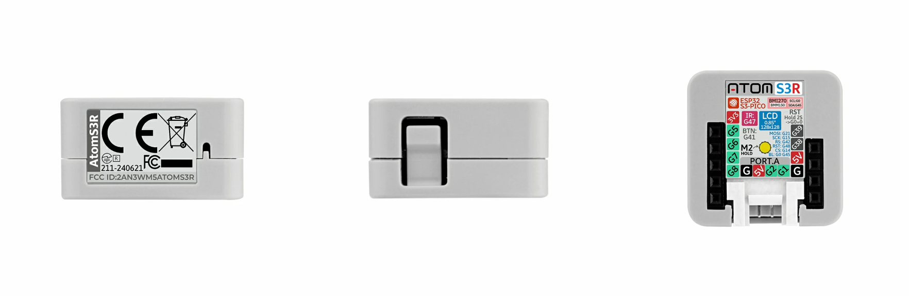

# M5Stack AtomS3R C126 Display and Sensor Development Guide


[**View M5Stack AtomS3R C126 on OpenELAB**](https://openelab.io/products/m5stack-atoms3r-development-kit)

**Model:** AtomS3R C126 · **SKU:** `M5-C126`


## Product overview <a href="#description" id="description"></a>

### Exact hardware identity <a href="#m5stack-atoms3r-development-kit" id="m5stack-atoms3r-development-kit"></a>

**AtomS3R C126** is the ESP32-S3-PICO-1-N8R8 ATOM controller with a0.85-inch128×128 display,8MB octal PSRAM, BMI270/BMM150 motion sensing, button, IR transmitter and expansion. It differs from screenless AtomS3-Lite C124 and audio-oriented Atom VoiceS3R C126-ECHO; their shared enclosure family does not establish compatible firmware or peripheral pins.

The current official history changes the display driver from **GC9107 to ST7735 on14May2026**. Preserve the actual fitted revision when selecting firmware and diagnosing a blank panel. This guide starts with display/button output, then a bounded stationary IMU check. [Exact C126 model reference](https://docs.m5stack.com/en/core/AtomS3R).

## Applications

### Features and application scope <a href="#product-features" id="product-features"></a>

Use AtomS3R for a compact instrument display, gesture/motion UI, IR remote or sensor gateway. Use the screen/button baseline to separate an upload/display failure from a later sensor or network fault. A magnetometer direction estimate requires magnetic calibration and a suitable mounting environment, not just readable raw axes.

## Specifications

| Parameter       | AtomS3R C126                                                                   |
| --------------- | ------------------------------------------------------------------------------ |
| Processor       | ESP32-S3-PICO-1-N8R8; dual-core LX7 up to240MHz                                |
| Memory          | 8MB flash;8MB octal PSRAM                                                      |
| Display         | 0.85-inch128×128 IPS; current ST7735, earlier GC9107                           |
| Motion          | BMI2706-axis IMU plus BMM150 magnetometer through BMI270 auxiliary sensor hub  |
| USB / radio     | USB OTG/Serial-JTAG;2.4GHz Wi-Fi                                               |
| Expansion       | Grove2/1; underside5/6/7/8/38/39;3.3V signal domain                            |
| Input power     | 5V through documented USB/Grove/header path; keep source directions compatible |
| Envelope / mass | 24×24×12.9mm;6.8g                                                              |
| Operating range | 0–40°C                                                                         |

[Current manufacturer specification and history](https://docs.m5stack.com/en/core/AtomS3R). The manufacturer lists different sleep-current observations for each supply route; none is a measured standby result for your firmware.

## Hardware and connections

### Exact C126 peripheral map <a href="#pinmap" id="pinmap"></a>

| Function                     | Connection                                                              |
| ---------------------------- | ----------------------------------------------------------------------- |
| Internal sensor/control I2C  | SDA45/SCL0; BMI2700x68                                                  |
| BMM150                       | BMI270 auxiliary SDA/SCL; not an ordinary external0x10 device on Grove  |
| Display SPI                  | MOSI21, clock15, CS14, DC42, reset48                                    |
| Backlight                    | LP5562 white channel; vendor PWM recommendation500Hz for custom control |
| User button / IR             | 41 /47                                                                  |
| Grove black/red/yellow/white | GND/5V/2/1                                                              |
| Underside GPIO               | 5/6/7/8/38/39;39 also CLK\_OUT3                                         |

Use M5GFX's display/backlight driver for the first test. Do not drive a C124 RGB pixel on35 and expect the C126 screen to respond. BMM150 reads pass through BMI270's sensor hub; scanning only the external Grove2/1 bus does not test either internal sensor. [Reviewed exact pin map](https://m5stack-doc.oss-cn-shenzhen.aliyuncs.com/680/C126_PinMap_01.jpg), [sensor-hub description](https://docs.m5stack.com/en/core/AtomS3R#pinmap).

Keep magnetic fasteners, speakers and steel structures away from a magnetometer calibration. M5Stack notes that built-in magnets in companion hardware can disturb BMM150 readings; identify and address that environment before treating a heading offset as a firmware bug. Use the official axis illustration for coordinate frames. Power off before fitting a base, verify underside pin ownership and keep5V supply separate from3.3V GPIO/pull-up limits.



_M5Stack official technical illustration:_ [_original_](https://m5stack-doc.oss-cn-shenzhen.aliyuncs.com/680/C126_PinMap_01.jpg)_. Verify drawing and physical revision together._

## Software and development resources

Select **M5AtomS3R** in the M5Stack board package. The [current Arduino guide](https://docs.m5stack.com/en/arduino/m5atoms3r/program) installs **M5Unified/M5GFX** and recommends at least M5Unified0.2.17/M5GFX0.2.22; use a matching current pair with support for the fitted ST7735 or older GC9107 panel. A later library's own dependency requirements take precedence over treating those historical minima as a complete package lock.

Retain the preset's8MB flash and **qio\_opi/octet PSRAM** configuration. The manufacturer PlatformIO reference pins espressif32@6.7.0 and `esp32-s3-devkitc-1` with qio\_opi and native USB flags; record resolved libraries and reconcile any newer API/core requirement deliberately. AtomS3-Lite has no established PSRAM in its specification and is not a drop-in memory profile.

UiFlow2 uses AtomS3R firmware/controller. The factory ESP-IDF source branch is [M5AtomS3-UserDemo `atoms3r`](https://github.com/m5stack/M5AtomS3-UserDemo/tree/atoms3r). Use those exact model resources when restoring a panel-compatible application; the Atom VoiceS3R UAC image targets different hardware.

## Getting started

### Original display/button counter

1. Remove external wiring; connect C126 with a USB-C data cable and choose M5AtomS3R.
2. Install compatible M5Unified/M5GFX and preserve octal-PSRAM settings. Compile the vendor's small display example first.
3. Upload the original program below. If automatic bootloader entry fails, hold the side reset/power control until green lights, release and reselect the new port.
4. Restart and press the front screen/button. Compare the on-screen number with the115200-baud log.

```cpp
#include <M5Unified.h>
unsigned presses=0;
void paint() {
  M5.Display.fillScreen(TFT_BLACK);
  M5.Display.setTextColor(TFT_WHITE,TFT_BLACK);
  M5.Display.setTextSize(2);
  M5.Display.setCursor(8,16);
  M5.Display.println("C126");
  M5.Display.printf("Count %u",presses);
}
void setup() {
  M5.begin();
  Serial.begin(115200);
  M5.Display.setBrightness(64);
  paint();
}
void loop() {
  M5.update();
  if (M5.BtnA.wasPressed()) {
    ++presses;
    paint();
    Serial.printf("C126_PRESS=%u\n",presses);
  }
  delay(5);
}
```

Expected result is a stable128×128 display and a single increment per button press. A green boot indicator is not proof that the application display driver supports the fitted panel. Compare the factory firmware and current library support if the serial log changes but the screen remains blank.

### Original stationary accelerometer test

This separate program uses M5Unified's BMI270 abstraction. It deliberately does not claim that a direct I2C0x10 transaction reads the magnetometer.

```cpp
#include <M5Unified.h>
void setup() { M5.begin(); Serial.begin(115200); }
void loop() {
  M5.update();
  float ax=0,ay=0,az=0;
  if (M5.Imu.getAccel(&ax,&ay,&az))
    Serial.printf("g=%.3f,%.3f,%.3f\n",ax,ay,az);
  else Serial.println("BMI270_READ_FAILED");
  delay(250);
}
```

Expected result is approximately one-g acceleration magnitude at rest, changing axis/sign with orientation. Use the official C126 axis drawing when mapping to an application frame. Gravity, axis bias and sensor bandwidth are separate from dynamic motion. For magnetometer work, use the model's BMM150/sensor-hub example, check updates while rotating the unit away from magnets, then perform the selected calibration before interpreting heading.

### Expansion, IR and stored firmware

Connect a compatible Grove Unit on2/1 only after the base display/button works. Check its documented I2C address and driver units; internal0/45 and external2/1 are separate buses. Power off before fitting an ATOM base and verify its routes against the underside pin map.

For IR use the transmitter on47 with a known protocol and one deliberate user-triggered test frame. Verify it with a compatible external receiver; C126 is not documented as having an onboard IR receiver. The manufacturer range/FOV figures depend on unobstructed test conditions and are not a guarantee through an enclosure.

For UIFlow2 flash the C126 image, select AtomS3R, establish USB WebTerminal or the current Access Code, run one display block, then Run Always and restart. For factory recovery save required source/configuration, enter the documented green-LED download mode and use the exact AtomS3R image for the fitted panel revision. Avoid full erase until a matched replacement image and needed configuration are available. [Current software routes](https://docs.m5stack.com/en/core/AtomS3R).

## Troubleshooting and FAQs

| Symptom                       | Checks / recovery                                                                                       |
| ----------------------------- | ------------------------------------------------------------------------------------------------------- |
| Serial counts, blank screen   | C126 rather than C124/C126-ECHO → GC9107/ST7735 revision → matching M5GFX/library/image → normal reset. |
| PSRAM fails                   | M5AtomS3R,8MB octal/qio\_opi, actual package dependencies and bounded buffer size.                      |
| Brightness adjustment erratic | Use the LP5562-aware driver; custom PWM should respect the vendor500Hz recommendation.                  |
| No magnetometer on Grove scan | BMM150 is behind BMI270 auxiliary hub, not on external2/1.                                              |
| Heading distorted             | Magnetic mounting environment, official axis convention, calibration and fresh sensor-hub data.         |
| External sensor absent        | Exact Grove2/1 versus internal45/0, supply/pull-ups and address; isolate any conflicting base.          |

## Downloads and technical documents <a href="#schematics" id="schematics"></a>

The exact C126 pin map, schematic, structure files and axis illustration are linked below. Some historic gallery filenames still identify the older display generation; use the version-history table and current firmware support when selecting a panel driver.

| Official file or repository                                                                                                               | Use                                                                                          |
| ----------------------------------------------------------------------------------------------------------------------------------------- | -------------------------------------------------------------------------------------------- |
| [AtomS3R Schematics PDF](https://m5stack-doc.oss-cn-shenzhen.aliyuncs.com/680/Sch_M5_AtomS3R_v0.4.1.pdf)                                  | Manufacturer-listed exact model document / maintained source; use the scope described above. |
| [AtomS3R Structure Files](https://github.com/m5stack/M5_Hardware/tree/master/Products/C126_AtomS3R/Structures)                            | Manufacturer-listed exact model document / maintained source; use the scope described above. |
| [ESP32-S3-PICO-1-N8R8](https://m5stack.oss-cn-shenzhen.aliyuncs.com/resource/docs/products/core/AtomS3R/esp32-s3-pico-1_datasheet_en.pdf) | Manufacturer-listed exact model document / maintained source; use the scope described above. |
| [BMI270](https://m5stack.oss-cn-shenzhen.aliyuncs.com/resource/docs/datasheet/core/K128%20CoreS3/BMI270.PDF)                              | Manufacturer-listed exact model document / maintained source; use the scope described above. |
| [BMM150](https://m5stack.oss-cn-shenzhen.aliyuncs.com/resource/docs/datasheet/core/K128%20CoreS3/BMM150.PDF)                              | Manufacturer-listed exact model document / maintained source; use the scope described above. |
| [AtomS3R Arduino Library](https://github.com/m5stack/M5AtomS3)                                                                            | Manufacturer-listed exact model document / maintained source; use the scope described above. |
| [AtomS3R Factory Firmware](https://github.com/m5stack/M5AtomS3-UserDemo/tree/atoms3r)                                                     | Manufacturer-listed exact model document / maintained source; use the scope described above. |
| [download](https://m5stack.oss-cn-shenzhen.aliyuncs.com/resource/docs/products/core/AtomS3R/AtomS3R-UserDemo-V0.1.exe)                    | Manufacturer-listed exact model document / maintained source; use the scope described above. |

### Model illustrations <a href="#module-size" id="module-size"></a>




.png>)

.png>)

.png>)

_Retained manufacturer illustrations. Use the revision-specific connector and circuit references above for wiring._

### Additional model references <a href="#related-links" id="related-links"></a>

* [Read mechanical / cad files](https://github.com/m5stack/M5_Hardware/blob/master/Products/C126_AtomS3R/Structures/AtomS3R.stl)

## References and validation <a href="#official-documentation-and-development-resources" id="official-documentation-and-development-resources"></a>

This guide uses the exact sold SKU and the [manufacturer reference](https://docs.m5stack.com/en/core/AtomS3R). Specifications are manufacturer-reported; diagnostic order and first-result programs are original engineering work. The full pin-map image was inspected, including internal45/0, external2/1 and display connections. The14May2026 ST7735 change, sensor-hub topology and current Arduino minimums were reviewed. No panel, IMU calibration, USB upload or IR range test was run.

**Review:** 24 November 2026. Manufacturer documentation and the linked SDK interfaces were reviewed. **Compilation, firmware flashing and hardware operation: not run.** Expected results above are commissioning checkpoints, not observed bench measurements.
