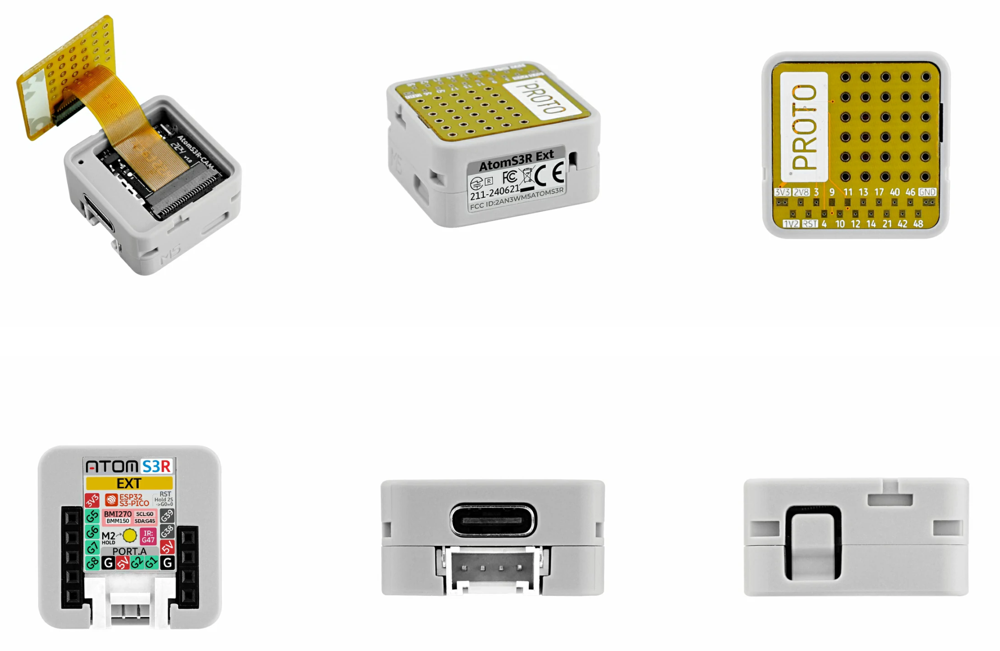

# M5Stack ATOMS3R Proto Kit

### Product Link 



### Description 

**AtomS3R Ext** is a **prototype development expansion** programmable controller based on the ESP32-S3 main controller, designed specifically for prototype validation and expansion development. It features a **Universal expansion plate** on top, allowing users to connect and debug multiple **IO** ports, making it suitable for various peripheral module expansions and function validation. The device integrates the **ESP32-S3-PICO-1-N8R8** main controller, supports WiFi functionality, and includes 8MB onboard **FLASH** and 8MB **PSRAM**, along with a power circuit that converts 5V to **3.3V/2.8V/1.2V**. It also has a built-in three-axis **BMM150** geomagnetic sensor and a six-axis **BMI270** motion sensor. The controller is equipped with a **Type-C** interface for power supply and firmware downloads, as well as an **HY2.0-4P** expansion port, six **GPIO**, and power pins for easy functionality expansion. Compared to previous ATOM series host products, the **AtomS3R Ext** features an enhanced **3D antenna**, providing better signal performance and stability. Measuring only **24x24x12mm**, it is highly suitable for prototype development and validation applications in embedded smart devices.

Download Mode To flash the firmware, press and hold the reset button (for about 2 seconds) until the internal green LED lights up, then release the button. The device will enter download mode and is ready for flashing.

### Product Features 

* Integrated ESP32-S3-PICO-1-N8R8 main controller
* Nine-axis sensor system (BMI270 six-axis + BMM150 three-axis geomagnetic sensor)
* 8MB Flash and 8MB PSRAM
* Supports infrared emission control
* Expandable pins and interfaces
* Breadboard
* Development platforms: Arduino, UIFlow, MicroPython

### Applications 

* Motion detection and directional awareness
* Wearable devices
* Smart device control
* IoT applications

### Specifications 

| Specification                          | Parameter                                                                                                                                               |
| -------------------------------------- | ------------------------------------------------------------------------------------------------------------------------------------------------------- |
| SoC                                    | ESP32-S3-PICO-1-N8R8 @ Dual-core Xtensa LX7 processor, up to 240MHz @ USB-OTG                                                                           |
| PSRAM                                  | 8M PSRAM                                                                                                                                                |
| FLASH                                  | 8M FLASH                                                                                                                                                |
| Six-axis Motion Sensor (BMI270)        | 
Accuracy: 0.05% (acceleration), 0.05°/s (angular velocity)  I2C address: 0x68
                                                                 |
| Three-axis Geomagnetic Sensor (BMM150) | 
Accuracy: 0.3 μT  Mounted on BMI270, obtaining magnetometer data via BMI270
                                                                   |
| Infrared IR                            | 
IR emission distance at ∠180°: 12.46m  IR emission distance at ∠90°: 1.45m  IR emission distance at ∠45°: 3.88m
                            |
| Sleep Current                          | 
GPIO-5V power supply: DC5V@11.63 uA  Grove-5V power supply: DC5V@10.75 uA  USB-5V power supply: DC5V@92.50 uA (including PD resistor loss)
 |
| Universal Expansion Board Size         | 5\*6@2.54mm                                                                                                                                             |
| Reserved GPIO                          | G5/G6/G7/G8/G38/G39                                                                                                                                     |
| Breadboard Reserved GPIO               | G3/G4/G9/G10/G11/G12/G13/G14/G17/G21/G40/G42/G46/G48                                                                                                    |
| Operating Temperature                  | 0°C \~ 40°C                                                                                                                                             |
| Product Dimensions                     | 24\*24\*12.9mm                                                                                                                                          |
| Package Dimensions                     | 85\*65.5\*13mm                                                                                                                                          |
| Product Weight                         | 34.5g                                                                                                                                                   |
| Package Weight                         | 68.5g                                                                                                                                                   |

<figure><figcaption></figcaption></figure>

### Related links 

* [ESP32-S3-PICO-1-N8R8](https://m5stack.oss-cn-shenzhen.aliyuncs.com/resource/docs/products/core/AtomS3R/esp32-s3-pico-1_datasheet_en.pdf)
* [BMI270](https://m5stack.oss-cn-shenzhen.aliyuncs.com/resource/docs/datasheet/core/K128%20CoreS3/BMI270.PDF)
* [BMM150](https://m5stack.oss-cn-shenzhen.aliyuncs.com/resource/docs/datasheet/core/K128%20CoreS3/BMM150.PDF)

### Schematic 

<figure><figcaption></figcaption></figure>

<figure><figcaption></figcaption></figure>

### PinMap 

<figure><figcaption></figcaption></figure>

BMM150 & BMI270 & IR

| ESP32-S3-PICO-1-N8R8 | G0       | G45      | BMI270\_ASDx | BMI270\_ASCx | G47          |
| -------------------- | -------- | -------- | ------------ | ------------ | ------------ |
| BMI270               | SYS\_SCL | SYS\_SDA |              |              |              |
| BMM150               |          |          | A\_SDA       | A\_SCL       |              |
| IR                   |          |          |              |              | IR\_LED\_DRV |

Proto Pin

| Proto Board | ESP32-S3-PICO-1-N8R8 |
| ----------- | -------------------- |
| 1           | 3.3V                 |
| 2           | 1.2V                 |
| 3           | 2.8V                 |
| 4           | RST                  |
| 5           | G3                   |
| 6           | G4                   |
| 7           | G9                   |
| 8           | G10                  |
| 9           | G11                  |
| 10          | G12                  |
| 11          | G13                  |
| 12          | G17                  |
| 13          | G21                  |
| 14          | G40                  |
| 15          | G42                  |
| 16          | G46                  |
| 17          | G48                  |
| 18          | GND                  |
| 19          | GND                  |

### Module Size 

<figure><figcaption></figcaption></figure>
