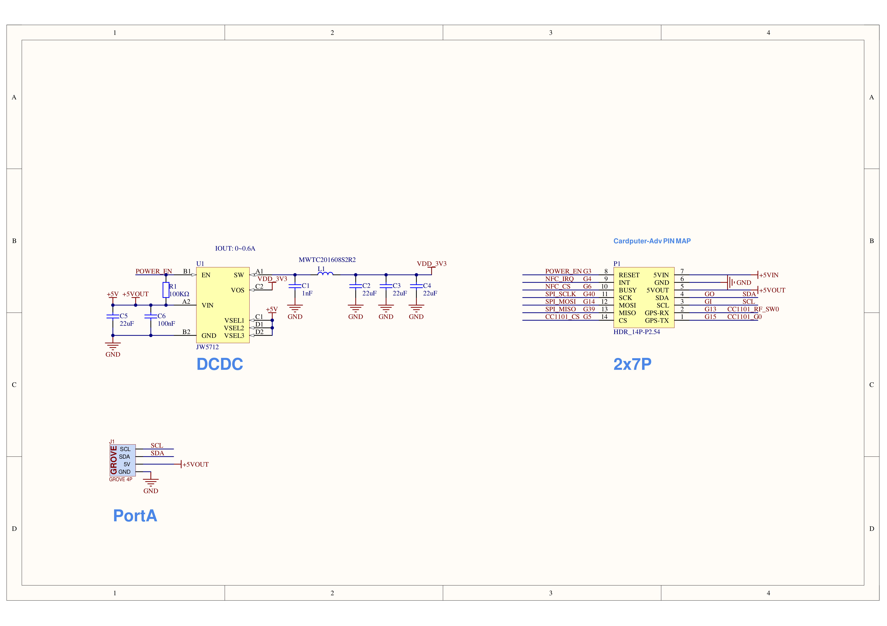

# M5Stack Cap CC1101 U219 RF and NFC Development Guide


[**View M5Stack Cap CC1101 & NFC U219 on OpenELAB**](https://openelab.io/products/m5stack-cap-cc1101-nfc-for-cardputer-adv)

**Model:** Cap CC1101 & NFC U219 · **SKU:** `M5-U219`


## Product overview <a href="#product-and-interfaces" id="product-and-interfaces"></a>

**Cap CC1101 & NFC U219** is a Cardputer-Adv/CardputerZero expansion combining a sub-GHz CC1101 radio with an ST25R3916 NFC frontend. Both use SPI but have separate chip selects and different protocol roles. It is not the U214 SX1262/GNSS cap: CC1101 does not become a LoRa modem, and U219 has no GNSS receiver established by its specification.

This guide uses the explicit **Cardputer-Adv** pin map. It starts with a read-only NFC identity test, then describes matching raw-radio settings and RF switch states before an authorized two-node experiment. [Exact U219 model reference](https://docs.m5stack.com/en/cap/Cap_CC1101).

## Applications

Use U219 for owned-tag NFC development, experimental sub-GHz telemetry with a compatible peer or a portable RF/NFC engineering terminal. A reader UID is not a secure access credential by itself. Raw CC1101 FSK traffic is not LoRa/Meshtastic traffic, and reading a tag does not establish support for a protected application or payment transaction.

## Specifications

| Parameter               | Cap CC1101 & NFC U219                                                                                     |
| ----------------------- | --------------------------------------------------------------------------------------------------------- |
| Sub-GHz radio           | CC1101;315/433/868/915MHz band paths                                                                      |
| RF figures              | Maximum+10dBm; receiver sensitivity up to−99.5dBm, configuration-dependent                                |
| NFC                     | ST25R3916,13.56MHz                                                                                        |
| Reader/writer protocols | NFC-A/B, NFC-F, NFC-V                                                                                     |
| Card emulation          | NFC-A / NFC-F; supported library emulation is protocol-specific                                           |
| Host interface          | SPI; RF and NFC require separate selects/modes                                                            |
| Power observations      | 5V140.87µA sleep with both chips asleep;5V96mA maximum continuous RF TX plus NFC reading vendor condition |
| Envelope / mass         | 84×24×19.7mm;14.9g                                                                                        |
| Included antennas       | Separate315MHz,433MHz and868MHz RP-SMA whips;868 whip also specified for915MHz                            |

[Manufacturer specification and contents](https://docs.m5stack.com/en/cap/Cap_CC1101). Range figures depend on modem and environment; use actual packet delivery rather than treating headline distance as a guaranteed deployment radius.

## Hardware and connections

Power off before fitting the cap. Align the14-pin connector with the Cardputer-Adv EXT socket and seat it without an offset. Fit the antenna matching the selected sub-GHz band before any RF transmit test. The NFC antenna is a separate onboard sensing area; its13.56MHz operation does not use the RP-SMA sub-GHz whip.

| Function           | Cardputer-Adv GPIO / route                                          |
| ------------------ | ------------------------------------------------------------------- |
| Shared SPI         | SCK40, MOSI14, MISO39                                               |
| CC1101 CS / GDO0   | 5 /15                                                               |
| RF\_SW0            | 13, directly driven by the host                                     |
| RF\_SW1            | CC1101 GDO2, controlled through the radio configuration             |
| NFC CS / interrupt | 6 /4                                                                |
| Cap power enable   | Cap-Bus POWER\_EN on host3; use the supported driver initialization |
| Cap Grove          | GND/5V/SDA8/SCL9; host's front Grove is2/1                          |

| Band       | RF\_SW0 | RF\_SW1 |
| ---------- | ------- | ------- |
| 315MHz     | LOW     | HIGH    |
| 433MHz     | HIGH    | LOW     |
| 868/915MHz | HIGH    | HIGH    |

The official code maps GDO2 to hardware-low with inversion as needed using `setDIOMapping(2, ...)`; RF\_SW1 is not another free host GPIO. Reassert the band state after radio operations as the tutorial does because driver operations may alter GDO configuration. Keep the other device's CS inactive. NFC uses **SPI mode1 at10MHz** in the current example; CC1101 uses its own RadioLib transaction settings. Sharing wires does not permit sharing a single unchanging SPI mode. [Pin/switch table](https://docs.m5stack.com/en/cap/Cap_CC1101), [exact initialization code](https://docs.m5stack.com/en/arduino/projects/cap/cap_cc1101).

5V powers the cap through its intended bus; host GPIO signals remain a3.3V domain. Do not connect the RP-SMA antenna to a Grove or signal pin, and do not supply unknown voltages through an expansion connector.



_M5Stack official technical illustration:_ [_original_](https://m5stack-doc.oss-cn-shenzhen.aliyuncs.com/1250/SCH_Cap_CC1101_SCH_V0.3_20260528_page_01.png)_. Verify drawing and physical revision together._

## Software and development resources <a href="#development-resources" id="development-resources"></a>

For a Cardputer-Adv host select **M5Cardputer** and install **M5Cardputer**, M5Unified/M5GFX, **RadioLib** and **M5Unit-NFC** with M5UnitUnified/M5Utility/M5HAL dependencies. The reviewed M5Unit-NFC **0.1.2** metadata explicitly supports U216 and U219. Its public header is `M5UnitUnifiedNFC.h`, not the older-looking but nonexistent `M5UnitNFC.h` path.

Use `m5::unit::CapCC1101NFC` for this **SPI cap**. `m5::unit::UnitNFC` is the separate I2C U216 Unit. The NFC-A protocol layer can operate with either frontend, but their transport initialization differs. The current [U219 tutorial](https://docs.m5stack.com/en/arduino/projects/cap/cap_cc1101) includes RF TX/RX, full tag read, NDEF and emulation examples. Source is MIT-licensed; retain upstream notices if redistributing its implementation rather than using the original minimal procedure here.

The cap is controlled by the host application and has no separate user firmware to flash. Changing a Cardputer image replaces that host application. For UiFlow2 use the exact Cap CC1101/NFC API linked by the [product page](https://docs.m5stack.com/en/cap/Cap_CC1101), not the SX1262 cap class.

## Getting started <a href="#getting-started-nfc-tag-detection" id="getting-started-nfc-tag-detection"></a>

### Original read-only NFC identity logger

1. Establish the Cardputer-Adv display/keyboard baseline, power off and attach U219.
2. Select M5Cardputer and install the libraries above. Create this sketch; it initializes only the NFC path and keeps RF chip-select inactive.
3. Enter the host's G0 download mode if needed, select its port, upload and restart.
4. Present an owned NFC-A test tag to the cap's marked NFC sensing area. Compare its printed UID/type, remove it and re-present it. No memory is written by this program.

```cpp
#include <M5Cardputer.h>
#include <M5UnitUnified.h>
#include <M5UnitUnifiedNFC.h>
#include <wiring/m5_unit_unified_wiring.hpp>
using namespace m5::nfc::a;
m5::unit::UnitUnified units;
m5::unit::CapCC1101NFC frontend;
m5::nfc::NFCLayerA reader(frontend);
bool ready=false;
uint32_t lastScan=0;
void setup() {
  auto cfg=M5.config();
  M5Cardputer.begin(cfg,true);
  Serial.begin(115200);
  pinMode(5,OUTPUT); digitalWrite(5,HIGH);
  ready=m5::unit::wiring::addSPI(units,frontend,10000000,1) && units.begin();
  Serial.println(ready ? "U219_NFC_READY" : "U219_NFC_INIT_FAILED");
}
void loop() {
  M5Cardputer.update();
  if (!ready) { delay(100); return; }
  units.update();
  if (millis()-lastScan<1000) return;
  lastScan=millis();
  PICC tag{};
  if (reader.detect(tag)) {
    if (reader.identify(tag))
      Serial.printf("UID=%s,TYPE=%s\n",tag.uidAsString().c_str(),tag.typeAsString().c_str());
    else Serial.println("TAG_DETECTED_IDENTIFY_FAILED");
    reader.deactivate();
  }
}
```

Expected result: `U219_NFC_READY`, then the presented tag's UID/type at no more than the scan cadence. No output with no tag is normal. A successful NFC result says nothing about the CC1101 RF path. APIs/transport: [official U219 example](https://docs.m5stack.com/en/arduino/projects/cap/cap_cc1101), [M5Unit-NFC0.1.2 metadata](https://raw.githubusercontent.com/m5stack/M5Unit-NFC/main/library.properties).

### CC1101 two-node commissioning

Use the current tutorial's receiver/transmitter on two known compatible radios. Start with receiver initialization and stop on a nonzero RadioLib error. The documented constructor is `Module(5,15,RADIOLIB_NC,RADIOLIB_NC)` for CC1101; SPI routes40/14/39 belong to the Cardputer-Adv target. The source's sample settings are915MHz,2.4kbps,25.4kHz deviation,58kHz receive bandwidth,16bit preamble and+10dBm. Choose a permitted band/power for the actual installation and fit its matching antenna; all peer modem settings must agree.

Set RF\_SW0 and GDO2-derived RF\_SW1 using the table above. In particular, selecting868/915MHz in RadioLib alone does not choose the corresponding RF switch path. Send a short original sequence such as `U219:0001`, verify exact payload/CRC at the peer, then reverse roles. Inspect RSSI/LQI as diagnostic values, not authenticated delivery. The source's100ms transmit wait is application control logic, not a guaranteed airtime for every future modem setting; retain completion/error checks rather than assuming that a delay proves transmission.

### NDEF and emulation after identity works

Use a spare owned tag for NDEF experiments. First identify protocol, user-memory size and lock state; read and save its data. The upstream NDEF example uses a short Tab action to read and a hold of roughly600ms to write. Keep those actions distinct in a project UI. Formatting an unformatted Ultralight tag or altering lock/configuration pages can be irreversible; select an explicit sacrificial test tag and verify the exact target pages before enabling that operation.

For card emulation, use a supported NFC-A or NFC-F example and a separately controlled reader. The emulated UID, memory image, NDEF length and chip mode must agree; a phone recognizing a tag does not mean every ISO14443 application is supported. Do not combine RF bursts, NFC writes and SD transfers until each subsystem has a separate passing baseline. [Protocol examples and limitations](https://docs.m5stack.com/en/arduino/projects/cap/cap_cc1101).

## Troubleshooting and FAQs <a href="#faqs-and-recovery" id="faqs-and-recovery"></a>

| Symptom                              | Diagnosis                                                                                                      |
| ------------------------------------ | -------------------------------------------------------------------------------------------------------------- |
| NFC init fails                       | Exact CapCC1101NFC class, M5Cardputer host, mode1/10MHz, library dependencies and power/seat check.            |
| NFC works, RF silent                 | Antenna/band, switch truth table, GDO2 configuration, peer modem parameters and RadioLib error code.           |
| LoRa peer sees nothing               | CC1101 is not an SX1262 LoRa radio; use a compatible raw modem/protocol peer.                                  |
| SD or NFC corrupted during radio     | Independent CS, transaction-specific SPI mode/clock, serialize first tests on40/14/39.                         |
| Tag detected but memory inaccessible | Identify protocol and authorization/keys; UID detection does not unlock protected pages.                       |
| Restoring operation                  | Power off/reseat cap, restore known Cardputer-Adv sketch/image; preserve host configuration before reflashing. |

## Downloads and technical documents <a href="#official-documentation-and-development-resources" id="official-documentation-and-development-resources"></a>

The exact cap schematic and mechanical PDF below distinguish RF matching, NFC antenna and power-enable routing. U219 includes three band-specific whip antennas; the technical guide does not substitute one antenna for every band.

| Official file or repository                                                                                            | Use                                                                                          |
| ---------------------------------------------------------------------------------------------------------------------- | -------------------------------------------------------------------------------------------- |
| [Cap CC1101 Schematic PDF](https://m5stack-doc.oss-cn-shenzhen.aliyuncs.com/1250/SCH_Cap_CC1101_SCH_V0.3_20260528.pdf) | Manufacturer-listed exact model document / maintained source; use the scope described above. |
| [Cap CC1101 Model Size PDF](https://m5stack-doc.oss-cn-shenzhen.aliyuncs.com/1250/U219_Cap_CC1101_model_size.pdf)      | Manufacturer-listed exact model document / maintained source; use the scope described above. |
| [CC1101](https://m5stack-doc.oss-cn-shenzhen.aliyuncs.com/1188/CC1101_Datasheet.pdf)                                   | Manufacturer-listed exact model document / maintained source; use the scope described above. |
| [ST25R3916](https://m5stack-doc.oss-cn-shenzhen.aliyuncs.com/1229/st25r3916_datasheet.pdf)                             | Manufacturer-listed exact model document / maintained source; use the scope described above. |
| [Cap CC1101 Arduino CC1101 Driver Library](https://github.com/jgromes/RadioLib)                                        | Manufacturer-listed exact model document / maintained source; use the scope described above. |
| [Cap CC1101 Arduino NFC Driver Library](https://github.com/m5stack/M5Unit-NFC)                                         | Manufacturer-listed exact model document / maintained source; use the scope described above. |
| [Cap CC1101 UiFlow2 Documentation](https://uiflow-micropython.readthedocs.io/en/latest/cap/cc1101.html)                | Manufacturer-listed exact model document / maintained source; use the scope described above. |

## References and validation <a href="#sources-and-validation" id="sources-and-validation"></a>

This guide uses the exact sold SKU and the [manufacturer reference](https://docs.m5stack.com/en/cap/Cap_CC1101). Specifications are manufacturer-reported; diagnostic order and first-result programs are original engineering work. The official U219 NFC/RadioLib initialization, switch truth table and M5Unit-NFC0.1.2 model support were reviewed. No RF transmission, NFC memory write or emulation test was performed.

**Review:** 24 November 2026. Manufacturer documentation and the linked SDK interfaces were reviewed. **Compilation, firmware flashing and hardware operation: not run.** Expected results above are commissioning checkpoints, not observed bench measurements.
