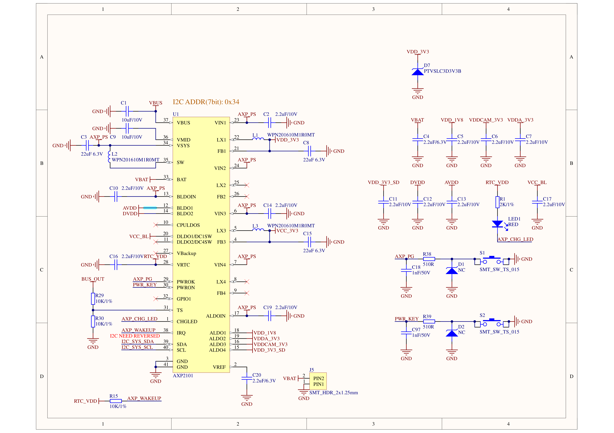

# M5Stack CoreS3 K128 Camera and Development Guide


[**View M5Stack CoreS3 K128 on OpenELAB**](https://openelab.io/products/m5stack-cores3-esp32s3)

**Model:** CoreS3 K128 · **SKU:** `M5-K128`


## Product overview <a href="#description" id="description"></a>

### Exact hardware identity <a href="#m5stack-cores3-esp32s3-lot-development-kit" id="m5stack-cores3-esp32s3-lot-development-kit"></a>

**CoreS3 K128** is the full ESP32-S3 Core development kit with a2-inch touch display, GC0308 camera, proximity/light sensor, dual microphones/speaker,9-axis sensing, RTC, microSD and DinBase. The DinBase adds a500mAh battery and a9–24V DC input; those are kit/base capabilities, not voltage limits of the MCU GPIO or Grove port.

This guide starts with local touch output, then independently brings up camera, motion, audio, storage and power. [CoreS3-SE](m5stack-cores3-se-development-guide.md) omits the camera/proximity/IMU/magnetometer and its assigned listing has no battery bottom; do not infer full K128 hardware from their shared M5CoreS3 Arduino target. [Exact K128 reference](https://docs.m5stack.com/en/core/CoreS3).

### OpenELAB listing and option <a href="#product-link" id="product-link"></a>

Use [View M5Stack CoreS3 K128 on OpenELAB](https://openelab.io/products/m5stack-cores3-esp32s3) and match `M5-K128` before selecting regional firmware or adding accessories.

## Applications

### Features and application scope <a href="#features" id="features"></a>

Use CoreS3 for a touch-operated instrument, camera/sensor gateway, audio interface or an embedded control panel mounted with DinBase. Build an independent first checkpoint for each peripheral before a network/voice application. Camera streaming, speech services and magnetic heading depend on software/configuration beyond the physical hardware.

## Specifications

| Parameter           | CoreS3 K128                                                                 |
| ------------------- | --------------------------------------------------------------------------- |
| Processor / memory  | ESP32-S3 dual-core LX7 up to240MHz;16MB flash;8MB Quad PSRAM                |
| Display / touch     | 2-inch320×240 ILI9342C or later ILI9342E; FT6336U                           |
| Camera / proximity  | GC0308 VGA640×480; LTR-553ALS-WA                                            |
| Motion              | BMI270 accelerometer/gyro plus BMM150 magnetometer via auxiliary sensor hub |
| Audio               | ES7210 dual-microphone ADC; AW88298 I2S amplifier,1W speaker                |
| Power / time        | AXP2101, AW9523B IO expander, BM8563 RTC                                    |
| DinBase supply      | DC9–24V,5521 plug5.5×2.1mm, center-positive;500mAh battery                  |
| Storage / expansion | microSD, manufacturer maximum16GB; Grove/M5-Bus; USB-C OTG/CDC              |
| Body / kit size     | 54×54×15.5mm main unit;69×54×31.5mm with DinBase                            |
| LCD change          | 7August2026 ILI9342C→ILI9342E; M5GFX≥0.2.27 for the new panel               |

[Current K128 table/version history](https://docs.m5stack.com/en/core/CoreS3). Battery capacity is not an application-runtime guarantee; use the mechanical drawing for mounting tolerances.

## Hardware and connections <a href="#pinmap" id="pinmap"></a>

### Power management and expansion <a href="#power-management" id="power-management"></a>

The main supply, internal power-management paths and exposed GPIO are separate electrical domains. Retain the documented PMIC/expander configuration and verify the connected module’s rail and signal levels before enabling a load.

### Supply and connector roles <a href="#i2c-address" id="i2c-address"></a>

Use USB-C5V for the first upload. For DinBase external power, use its dedicated center-positive5521 DC input within9–24V. Never apply that voltage to USB, Grove5V,3V3, BAT or a signal pin. Disconnect sources before stacking modules and compare power roles; AXP2101/AW9523B `BUS_OUT_EN` and `USB_OTG_EN` determine the actual power direction. A USB-host/OTG configuration can require a different output state from a USB-device programming session. [Power reference](https://docs.m5stack.com/en/core/CoreS3), [power API](https://docs.m5stack.com/en/arduino/m5cores3/power).

| Subsystem                | CoreS3 connection                                                                  |
| ------------------------ | ---------------------------------------------------------------------------------- |
| Internal I2C             | SDA12/SCL11                                                                        |
| System addresses         | AXP21010x34; AW882980x36; touch0x38; ES72100x40; RTC0x51; expander0x58; BMI2700x69 |
| Camera / light addresses | GC03080x21; LTR-5530x23 on internal12/11                                           |
| Magnetometer             | BMM1500x10 behind BMI270 auxiliary hub, not a direct Grove device                  |
| LCD SPI                  | MOSI37, clock36, CS3, DC35; expander P1\_1 reset                                   |
| microSD                  | MISO35, MOSI37, clock36, CS4                                                       |
| Audio                    | BCLK34/LRCK33; playback data13/capture data14; MCLK0                               |
| Camera sync / data       | PCLK45, VSYNC46, HREF38; D0–D7=39/40/41/42/15/16/48/47                             |
| Camera clock / reset     | Product uses no routed external XCLK (`-1`); camera reset via expander P1\_0       |
| Grove PORT.A             | GND/5V/GPIO2/GPIO1                                                                 |
| DinBase PORT.B / PORT.C  | GND/5V/9/8 and GND/5V/17/18 respectively                                           |

Keep module-side and MCU-side directions explicit: PORT.C commonly uses host TX17/RX18. LCD/microSD share SPI but distinct selects; coordinate transactions instead of independently bit-banging37/36/35. Camera SCCB initialization also uses the internal I2C pins; the raw camera example releases M5Unified's internal I2C owner before `esp_camera_init`. Do not combine that isolated example with other internal-bus polling without reconciling driver ownership. [Exact pin map](https://docs.m5stack.com/en/core/CoreS3#pinmap), [camera initialization](https://docs.m5stack.com/en/arduino/m5cores3/camera).

Core-series M5-Bus pin functions differ by generation. Compare every signal and power contact before attaching a Core2-era module. For magnetic heading keep DinBase/mounting magnets and nearby steel away from BMM150 calibration; read magnetometer data through the BMI270 hub. Use the official axis drawing rather than assuming enclosure axes.



_M5Stack official technical illustration:_ [_original_](https://m5stack-doc.oss-cn-shenzhen.aliyuncs.com/490/Sch_M5_CoreS3_v1.0_page_01.png)_. Verify drawing and physical revision together._

## Software and development resources

Install the [M5Stack board package](https://docs.m5stack.com/en/arduino/arduino_board), select **M5CoreS3** and install M5Unified/M5GFX with dependencies. Retain16MB flash and8MB **Quad** PSRAM; do not use qio\_opi from an octal-memory model. The new ILI9342E panel needs M5GFX≥0.2.27. The current camera guide specifies board manager≥3.2.2 and M5Unified≥0.2.11; choose a consistent recorded library/core set that also supports the fitted panel.

| Route             | Exact software scope                                                                                                 |
| ----------------- | -------------------------------------------------------------------------------------------------------------------- |
| Arduino           | M5CoreS3 + M5Unified/M5GFX; M5CoreS3 legacy library is a separate API entry point                                    |
| ESP-IDF BSP       | Manufacturer tutorial: **v5.4.1**, registry `espressif/m5stack_core_s3^3.0.0`, target `esp32s3`                      |
| PlatformIO        | Manufacturer historical baseline espressif32@6.7.0, S3 target, PSRAM and native-USB flags; record resolved libraries |
| UiFlow2           | CoreS3 firmware/controller; USB WebTerminal or Access Code                                                           |
| Voice/HA/ESP-Claw | Separate application image plus its backend/network setup; local audio is the prerequisite                           |

The [ESP-IDF BSP tutorial](https://docs.m5stack.com/en/esp_idf/m5cores3/bsp) requires disabling the backward-compatible I2C Driver option under **Component config→Audio Codec Device Configuration** and enabling the selected LVGL demo in menuconfig. This version/configuration pairing is materially different from Tab5's P4/v5.4.2 route.

## Getting started

### Original touch first result

1. Remove external modules and connect USB-C with a data cable. Start without external DinBase DC power.
2. Select M5CoreS3 and matching M5Unified/M5GFX with support for the actual panel. Compile the vendor's small display example first.
3. If required, hold the bottom reset key until green lights, release and select the newly enumerated port. Upload, then restart the normal application.
4. Upload this original coordinate sketch. Compare visible-corner/center touches with the115200-baud log and green markers.

```cpp
#include <M5Unified.h>
uint32_t lastLog=0;
void setup() {
  M5.begin();
  Serial.begin(115200);
  M5.Display.setRotation(1);
  M5.Display.fillScreen(TFT_BLACK);
  M5.Display.setTextSize(2);
  M5.Display.setTextColor(TFT_WHITE,TFT_BLACK);
  M5.Display.setCursor(8,8);
  M5.Display.println("Touch each corner");
}
void loop() {
  M5.update();
  int32_t x=0,y=0;
  if (M5.Display.getTouch(&x,&y) && millis()-lastLog>=100) {
    lastLog=millis();
    M5.Display.fillCircle(x,y,3,TFT_GREEN);
    Serial.printf("touch=%ld,%ld,bounds=%d,%d\n",long(x),long(y),
                  M5.Display.width(),M5.Display.height());
  }
  delay(5);
}
```

Expected result is stable rendering and touch coordinates tracking the visible screen. It does not test the camera, microphone, magnetometer or DinBase supply/battery.

### Original guarded camera frame check

Run the camera in a **separate sketch** first. The official camera sample prints a success message even after an initialization failure and then accesses its sensor pointer; the original procedure below stops on failure, validates frame shape/format and always returns an acquired buffer. It uses a single QVGA RGB565 PSRAM buffer for a bounded initial experiment rather than claiming VGA throughput.

```cpp
#include <M5Unified.h>
#include <esp_camera.h>
bool cameraReady=false;
uint32_t frameCount=0;
void setup() {
  M5.begin();
  Serial.begin(115200);
  M5.Display.setRotation(1);
  M5.In_I2C.release();
  camera_config_t c{};
  c.pin_pwdn=-1; c.pin_reset=-1; c.pin_xclk=-1;
  c.pin_sscb_sda=12; c.pin_sscb_scl=11;
  c.pin_d0=39; c.pin_d1=40; c.pin_d2=41; c.pin_d3=42;
  c.pin_d4=15; c.pin_d5=16; c.pin_d6=48; c.pin_d7=47;
  c.pin_vsync=46; c.pin_href=38; c.pin_pclk=45;
  c.xclk_freq_hz=20000000;
  c.ledc_timer=LEDC_TIMER_0; c.ledc_channel=LEDC_CHANNEL_0;
  c.pixel_format=PIXFORMAT_RGB565; c.frame_size=FRAMESIZE_QVGA;
  c.jpeg_quality=0; c.fb_count=1;
  c.fb_location=CAMERA_FB_IN_PSRAM;
  c.grab_mode=CAMERA_GRAB_WHEN_EMPTY;
  c.sccb_i2c_port=-1;
  esp_err_t err=esp_camera_init(&c);
  cameraReady=(err==ESP_OK);
  Serial.printf("CAMERA_INIT=0x%x\n",unsigned(err));
}
void loop() {
  if (!cameraReady) { delay(1000); return; }
  camera_fb_t* frame=esp_camera_fb_get();
  if (!frame) { Serial.println("NO_FRAME"); delay(100); return; }
  bool shape=(frame->width==320 && frame->height==240 &&
              frame->format==PIXFORMAT_RGB565 && frame->len>=320U*240U*2U);
  if (shape) {
    M5.Display.pushImage(0,0,320,240,reinterpret_cast<uint16_t*>(frame->buf));
    Serial.printf("FRAME=%lu,bytes=%u\n",(unsigned long)++frameCount,unsigned(frame->len));
  } else Serial.println("UNEXPECTED_FRAME_FORMAT");
  esp_camera_fb_return(frame);
  delay(200);
}
```

Expected result is `CAMERA_INIT=0x0`, then frame numbers/lengths and an updating320×240 image. A repeated nonzero initialization code must be diagnosed before any sensor-pointer use. `pin_sscb_*` matches the reviewed source spelling; a newer camera header may expose the corrected `pin_sccb_*` spelling as the preferred API. Reconcile header/core versions rather than changing GPIOs to fix a field-name compile error. This isolated program avoids `M5.update()` after transferring internal-I2C ownership; touch and other internal peripherals need an intentional shared-driver design in a combined application. [Exact camera pins/API generation](https://docs.m5stack.com/en/arduino/m5cores3/camera).

### Motion, light/proximity, storage and audio

Read stationary acceleration and rotate about each official axis before adding orientation fusion. BMM150 is accessed through the BMI270 sensor hub; a direct external-bus scan is not a magnetometer test. Remove magnetic interference before calibration and keep raw sensor axes separate from a transformed application frame.

For LTR-553, establish internal address0x23 and use the exact driver; compare covered/uncovered proximity and two illumination conditions. Raw counts are not automatically calibrated distance or lux unless the driver/configuration performs the documented conversion. The camera/light sensors share one ribbon assembly, so a common failure should first prompt a powered-off connector/power check.

For microSD, use the model example on clock36/MISO35/MOSI37/CS4; its source uses25MHz initialization. Begin with a known compatible card within the manufacturer16GB support statement, read a small file, then create/flush/close one log. Separate SPI selection problems from filesystem problems. For audio, test a short moderate AW88298 speaker tone, then stop playback and run ES7210 microphone capture. Check sample count/level and buffer allocation before any voice/backend integration. Hardware presence does not establish calibrated acoustics or working AEC.

For BM8563 set/read time and verify a single alarm wake before a scheduled logger. For power tests record USB/DC/battery source, charge state, enabled rails and actual firmware; a displayed battery percentage is not a measured remaining runtime. Do not change charge current simply to match another controller example.

### ESP-IDF, UiFlow2 and application recovery

With ESP-IDFv5.4.1 installed/activated, create a dedicated project and add the documented BSP:

```bash
idf.py create-project cores3_local
cd cores3_local
idf.py add-dependency "espressif/m5stack_core_s3^3.0.0"
idf.py set-target esp32s3
idf.py menuconfig
```

Disable the audio-codec backward-compatible I2C option and enable the intended LVGL demo as described above. Use the BSP tutorial's entry point, build with `idf.py build`, enter green-LED download mode, then flash/monitor using the actual observed port. Expected first result is its local LVGL widget screen, not a voice-service connection. Save the resolved component lock and compiler output. [BSP setup/configuration](https://docs.m5stack.com/en/esp_idf/m5cores3/bsp).

For UiFlow2 select CoreS3, flash its image, establish USB WebTerminal or the current Access Code, Run Once, then Run Always and restart. For factory recovery use [CoreS3 restore](https://docs.m5stack.com/en/guide/cores3/restore_factory) and a panel-compatible image. Home Assistant, XiaoZhi/OpenAI/Xiaoling and ESP-Claw are separate applications; configure their accounts/backends after local audio/network checks. Preserve needed configuration before replacing an image, and never put service credentials in a shared sketch or log.

## Troubleshooting and FAQs

| Symptom                       | Diagnosis / recovery                                                                                                                                |
| ----------------------------- | --------------------------------------------------------------------------------------------------------------------------------------------------- |
| New panel blank               | ILI9342E revision → M5GFX≥0.2.27 or current dependency pair → M5CoreS3 preset → compatible factory image.                                           |
| Camera initialization fails   | Exact K128 camera hardware, camera reset/power, Quad PSRAM, SCCB ownership and actual esp\_camera error; do not dereference a missing sensor/frame. |
| Wrong frame colors/dimensions | QVGA/RGB565 selection, frame metadata, byte-order handling and actual source driver; do not cast a JPEG buffer as pixels.                           |
| Sensor missing on scan        | Internal12/11 versus Grove2/1; BMM150 is behind BMI270 auxiliary hub.                                                                               |
| DinBase resets under load     | Input9–24V/polarity, supply budget, battery/rail state and cable drop; USB enumeration alone does not verify loaded power.                          |
| SD/display interfere          | Shared37/36/35, CS3 versus4 and transaction settings; isolate one device before combining.                                                          |
| USB host/device confusion     | Check USB\_OTG\_EN/BUS\_OUT\_EN and selected stack role; disconnect conflicting power sources before retrying.                                      |
| Voice service fails           | Establish local speaker/capture and Wi-Fi first, then exact application firmware/backend/account setup.                                             |

## Downloads and technical documents

The downloads distinguish the CoreS3 host circuit, DinBase power circuit, M5-Bus footprint and mechanical structures. The manufacturer-listed CoreS3 schematic predates some LCD changes; combine it with current revision notes rather than assuming every old component label is still fitted. The camera procedure above is an original guarded program using the reviewed public driver configuration.

| Official file or repository                                                                                                            | Use                                                                                          |
| -------------------------------------------------------------------------------------------------------------------------------------- | -------------------------------------------------------------------------------------------- |
| [CoreS3 Schematics PDF](https://m5stack-doc.oss-cn-shenzhen.aliyuncs.com/490/Sch_M5_CoreS3_v1.0.pdf)                                   | Manufacturer-listed exact model document / maintained source; use the scope described above. |
| [Base DIN Schematics PDF](https://m5stack-doc.oss-cn-shenzhen.aliyuncs.com/559/SCH_DinBase_V1.1.pdf)                                   | Manufacturer-listed exact model document / maintained source; use the scope described above. |
| [Cores3 Model Size DXF](https://m5stack.oss-cn-shenzhen.aliyuncs.com/resource/docs/products/core/CoreS3/cores3.dxf)                    | Manufacturer-listed exact model document / maintained source; use the scope described above. |
| [Cores3 PcbDoc](https://github.com/m5stack/M5_Hardware/blob/master/Common/Module_Type_A/Footprints/Module_Type_A_CoreS3_M5_Bus.PcbDoc) | Manufacturer-listed exact model document / maintained source; use the scope described above. |
| [CoreS3 Structure Files](https://github.com/m5stack/M5_Hardware/tree/master/Products/K128_CoreS3/Structures)                           | Manufacturer-listed exact model document / maintained source; use the scope described above. |
| [ESP32-S3](https://m5stack-doc.oss-cn-shenzhen.aliyuncs.com/490/esp32-s3_technical_reference_manual_en.pdf)                            | Manufacturer-listed exact model document / maintained source; use the scope described above. |
| [LTR-553ALS-WA](https://m5stack.oss-cn-shenzhen.aliyuncs.com/resource/docs/datasheet/core/K128%20CoreS3/LTR-553ALS-WA.PDF)             | Manufacturer-listed exact model document / maintained source; use the scope described above. |
| [GC0308](https://m5stack.oss-cn-shenzhen.aliyuncs.com/resource/docs/datasheet/core/K128%20CoreS3/GC0308.PDF)                           | Manufacturer-listed exact model document / maintained source; use the scope described above. |
| [ES7210](https://m5stack.oss-cn-shenzhen.aliyuncs.com/resource/docs/datasheet/core/K128%20CoreS3/ES7210.PDF)                           | Manufacturer-listed exact model document / maintained source; use the scope described above. |
| [BMM150](https://m5stack.oss-cn-shenzhen.aliyuncs.com/resource/docs/datasheet/core/K128%20CoreS3/BMM150.PDF)                           | Manufacturer-listed exact model document / maintained source; use the scope described above. |
| [BMI270](https://m5stack.oss-cn-shenzhen.aliyuncs.com/resource/docs/datasheet/core/K128%20CoreS3/BMI270.PDF)                           | Manufacturer-listed exact model document / maintained source; use the scope described above. |
| [BM8563](https://m5stack.oss-cn-shenzhen.aliyuncs.com/resource/docs/datasheet/core/K128%20CoreS3/BM8563.PDF)                           | Manufacturer-listed exact model document / maintained source; use the scope described above. |
| [AXP2101](https://m5stack.oss-cn-shenzhen.aliyuncs.com/resource/docs/datasheet/core/K128%20CoreS3/AXP2101_Datasheet_V1.0_en.pdf)       | Manufacturer-listed exact model document / maintained source; use the scope described above. |
| [AW88298](https://m5stack.oss-cn-shenzhen.aliyuncs.com/resource/docs/datasheet/core/K128%20CoreS3/AW88298.PDF)                         | Manufacturer-listed exact model document / maintained source; use the scope described above. |
| [AW9523B](https://m5stack.oss-cn-shenzhen.aliyuncs.com/resource/docs/products/core/CoreS3/AW9523B-EN.pdf)                              | Manufacturer-listed exact model document / maintained source; use the scope described above. |
| [ILI9342E](https://m5stack-doc.oss-cn-shenzhen.aliyuncs.com/644/ILI9342E.pdf)                                                          | Manufacturer-listed exact model document / maintained source; use the scope described above. |
| [CoreS3 Arduino Library](https://github.com/m5stack/M5CoreS3)                                                                          | Manufacturer-listed exact model document / maintained source; use the scope described above. |
| [CoreS3 Arduino M5Unified Library](https://github.com/m5stack/M5Unified)                                                               | Manufacturer-listed exact model document / maintained source; use the scope described above. |
| [CoreS3 Arduino M5GFX Library](https://github.com/m5stack/M5GFX)                                                                       | Manufacturer-listed exact model document / maintained source; use the scope described above. |
| [CoreS3 UiFlow2 Docs](https://uiflow-micropython.readthedocs.io/en/latest/controllers/cores3.html)                                     | Manufacturer-listed exact model document / maintained source; use the scope described above. |
| [CoreS3 Factory Firmware](https://github.com/m5stack/CoreS3-UserDemo/tree/main/firmware)                                               | Manufacturer-listed exact model document / maintained source; use the scope described above. |
| [Espressif's Board Support Packages – CoreS3](https://github.com/espressif/esp-bsp/tree/master/bsp/m5stack_core_s3)                    | Manufacturer-listed exact model document / maintained source; use the scope described above. |
| [download](https://m5stack.oss-cn-shenzhen.aliyuncs.com/EasyLoader/M5Core/K128%20CoreS3/CoreS3.exe)                                    | Manufacturer-listed exact model document / maintained source; use the scope described above. |

### M-Bus drawing <a href="#m5cores3-m-bus-schematic-diagram" id="m5cores3-m-bus-schematic-diagram"></a>

Use the retained manufacturer M-Bus circuit and connector illustrations below to check pin orientation and shared signals before mating an expansion module.

### Electrical drawings <a href="#schematics" id="schematics"></a>

Use the linked manufacturer schematics with the installed board revision. A module or silicon datasheet alone does not establish the complete system’s power routing.

### Model illustrations <a href="#model-size" id="model-size"></a>

.png>)

_Retained manufacturer illustrations. Use the revision-specific connector and circuit references above for wiring._

### Additional model references <a href="#related-link" id="related-link"></a>

* [Complete schematic pdf](https://m5stack.oss-cn-shenzhen.aliyuncs.com/resource/docs/datasheet/core/K128%20CoreS3/Sch_M5_CoreS3_v1.0.pdf)
* [Read arduino development tutorial](https://docs.m5stack.com/en/arduino/m5cores3/program)
* [Read mechanical / cad files](https://github.com/m5stack/M5_Hardware/blob/master/Products/K128_CoreS3/Structures/CoreS3.stl)

## References and validation <a href="#official-documentation-and-development-resources" id="official-documentation-and-development-resources"></a>

This guide uses the exact sold SKU and the [manufacturer reference](https://docs.m5stack.com/en/core/CoreS3). Specifications are manufacturer-reported; diagnostic order and first-result programs are original engineering work. The exact K128/DinBase scope, camera configuration, SPI/I2C routing,7August2026 LCD change and ESP-IDFv5.4.1/BSP3.0.0 tutorial were reviewed. The source camera example failure path was corrected in the original procedure. Compilation, camera capture, magnetic calibration, audio and electrical measurements remain unexecuted.

**Review:** 24 November 2026. Manufacturer documentation and the linked SDK interfaces were reviewed. **Compilation, firmware flashing and hardware operation: not run.** Expected results above are commissioning checkpoints, not observed bench measurements.
