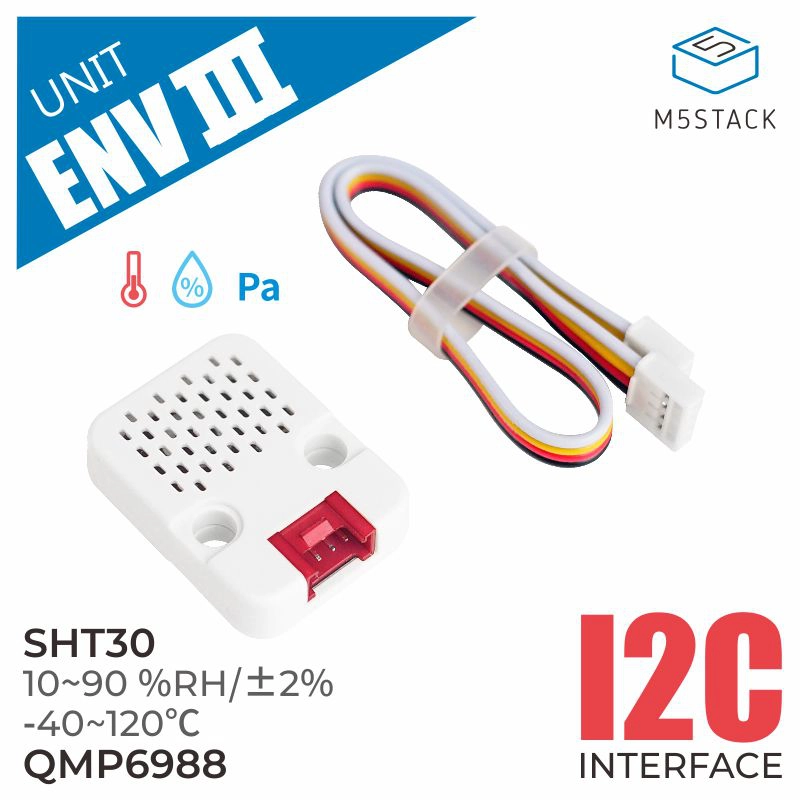
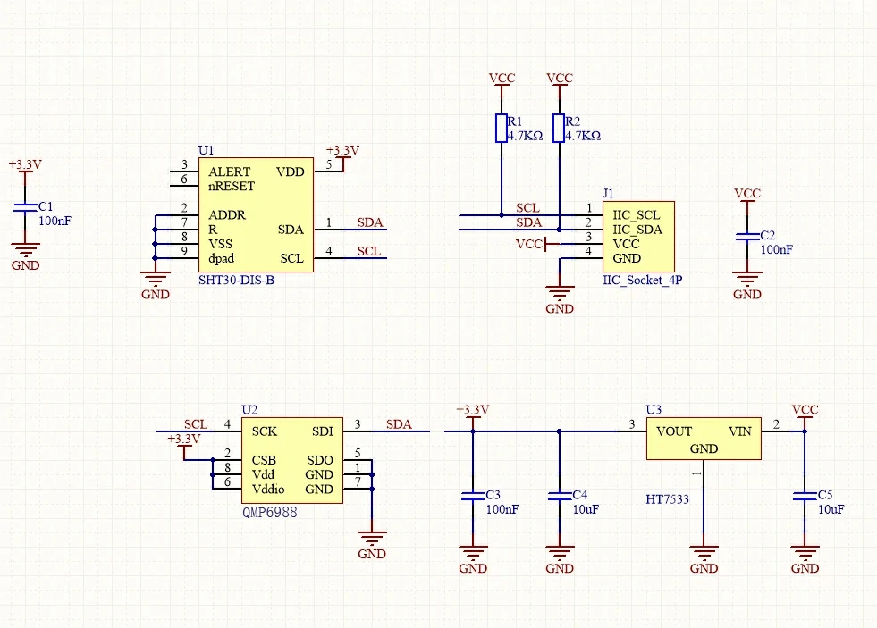
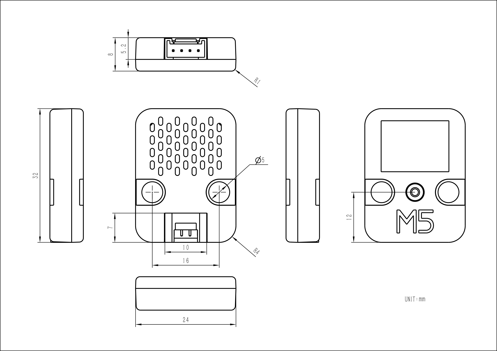

# M5Stack ENV III Unit with Temperature Humidity Air Pressure Sensor


[**View M5Stack ENV-III on OpenELAB**](https://openelab.io/products/env-iii-unit)

**Model:** Unit ENV-III / U001-C · **OpenELAB SKU:** `M5-U001-C` · **Sensors:** SHT30 + QMP6988 · External Grove I2C Unit; a compatible host is required.


## Product overview

### Description

ENV-III measures ambient temperature, relative humidity and atmospheric pressure. This guide covers wiring, the two sensor addresses, Arduino on seven M5Stack hosts, UIFlow 1 and UIFlow 2, measurement interpretation and fault isolation. Start with **Getting started** for a complete serial logger; use **Hardware and connections** when designing a carrier.



_Official M5Stack product illustration, retained with attribution._ [_Original image_](https://static-cdn.m5stack.com/resource/docs/products/unit/envIII/envIII_01.webp)_;_ [_product documentation_](https://docs.m5stack.com/en/unit/Unit_ENV-III)_. The graphic's sensor ranges are not whole-module operating limits._

### Which ENV generation is this?

| Unit        | Temperature / humidity IC                        | Pressure IC | Expected 7-bit I2C addresses |
| ----------- | ------------------------------------------------ | ----------- | ---------------------------- |
| ENV         | DHT12                                            | BMP280      | `0x5C`, `0x76`               |
| ENV-II      | SHT30                                            | BMP280      | `0x44`, `0x76`               |
| **ENV-III** | **SHT30**                                        | **QMP6988** | **`0x44`, `0x70`**           |
| ENV-IV      | SHT40                                            | BMP280      | `0x44`, `0x76`               |
| ENV Pro     | BME688 provides environmental / gas measurements | Integrated  | `0x77`                       |

The [manufacturer's generation comparison](https://docs.m5stack.com/en/unit/Unit_ENV-III) identifies these IC combinations. An ACK at `0x44` alone does not identify ENV-III. Check the housing label and the pressure sensor too. ENV-IV heater/mode controls in shared UIFlow documentation are not ENV-III functions.

## Applications

Use ENV-III for room-condition logging, cabinet trends, classroom weather experiments and pressure-based relative-height demonstrations. Place its vents in representative airflow, away from a warm processor, sunlight, wet surfaces and the exhaust of an enclosure fan. Log sensor temperature and installation conditions before interpreting a systematic temperature offset.

For a development agent, a useful sample record is `time_ms,temperature_C,humidity_pct,pressure_Pa,pressure_hPa,status`. Keep pressure in a single storage unit and convert only at the display boundary. Do not silently replace a failed read with the last sample; retain its timestamp and validity. These are integration recommendations, not claims of a certified weather or safety instrument.

## Specifications

### Features

| Item                            | ENV-III value / interpretation                                                                                                                                                 |
| ------------------------------- | ------------------------------------------------------------------------------------------------------------------------------------------------------------------------------ |
| Host connection                 | HY2.0-4P Grove I2C; module supply connection is 5 V                                                                                                                            |
| SHT30 address                   | `0x44` on this module                                                                                                                                                          |
| QMP6988 address                 | `0x70` on this module                                                                                                                                                          |
| Advertised climate measurements | Product table: -40–120 °C temperature, ±0.2 °C quoted over 0–60 °C; 10–90 %RH humidity, ±2 %RH. These are sensor measurement specifications, not whole-module operating limits |
| Module operating temperature    | Current product table: 0–60 °C; an older OpenELAB source stated 0–40 °C. Confirm the supplied revision before expanding an installation beyond the older limit                 |
| Module size / mass              | 32 × 24 × 8 mm; 6.2 g                                                                                                                                                          |
| Package size / mass             | 138 × 93 × 9 mm; 14.8 g                                                                                                                                                        |
| Included                        | One ENV-III and one 20 cm HY2.0-4P cable                                                                                                                                       |
| Mounting                        | PC enclosure with two LEGO-compatible holes; do not obstruct the vents                                                                                                         |

Module values: [M5Stack ENV-III specifications](https://docs.m5stack.com/en/unit/Unit_ENV-III). Mechanical geometry: [official dimension drawing](https://m5stack.oss-cn-shenzhen.aliyuncs.com/resource/docs/products/unit/envIII/%E5%B0%BA%E5%AF%B8%E5%9B%BE.jpg).

### Range, resolution and accuracy mean different things

The [SHT3x-DIS data sheet, version 6, February 2019, pp. 2–3](https://m5stack.oss-cn-shenzhen.aliyuncs.com/resource/docs/datasheet/unit/SHT3x_Datasheet_digital.pdf) describes the **SHT30 IC**, including typical ±2 %RH humidity accuracy and typical ±0.2 °C temperature accuracy over 0–65 °C. Its wider -40–125 °C and 0–100 %RH measurement ranges do not expand the assembled Unit's operating envelope. Maximum-error curves and environmental conditions matter when choosing a specification for a design.

The [QMP6988 data sheet, revision C, pp. 4–5](https://m5stack.oss-cn-shenzhen.aliyuncs.com/resource/docs/datasheet/unit/enviii/QMP6988%20Datasheet.pdf) distinguishes a 300–1100 hPa range, **0.06 Pa resolution**, typical **±3.9 Pa relative accuracy** in the stated high-accuracy condition, and **±100 Pa absolute accuracy** over its specified pressure/temperature window. Resolution is a quantization characteristic; it is not guaranteed absolute accuracy. Higher oversampling trades conversion time and energy for lower noise.

M5Stack's summary and generation-comparison tables use different temperature/humidity ranges and pressure-error figures. For example, ±3.9 Pa and ±0.12 hPa are not the same number or necessarily the same test. Use the IC data-sheet conditions and the actual driver configuration; do not advertise the most favorable number as an unconditional module guarantee. Preserve the source/revision alongside requirements.

## Hardware and connections

### Grove wiring and electrical boundary

Disconnect host power, seat the supplied cable in **PORT.A / I2C**, then reconnect power.

| Cable conductor | ENV-III function | Connection check               |
| --------------- | ---------------- | ------------------------------ |
| Black           | GND              | Common ground with the host    |
| Red             | Supply, 5 V      | Compatible host's Grove supply |
| Yellow          | SDA              | Host's PORT.A SDA              |
| White           | SCL              | Host's PORT.A SCL              |

Use the keyed connector and the host's documentation rather than a guessed left-to-right orientation. [M5Stack pin map](https://docs.m5stack.com/en/unit/Unit_ENV-III).



_M5Stack_ [_original schematic_](https://static-cdn.m5stack.com/resource/docs/products/unit/envIII/envIII_sch_01.webp)_. The regulator powers the ICs from a 3.3 V rail; the pictured bus pull-ups go to connector VCC. A 5 V module supply does not prove that a generic 3.3 V host can accept its bus levels._

For non-M5 hosts, check the exact Unit revision's schematic, pull-up voltage, host input tolerance and any level translation **before** joining SDA/SCL. Do not connect this 5 V Grove module directly to arbitrary 3.3 V-only pins based only on an I2C label. The SHT30/QMP6988 IC voltage limits also do not define the finished module's connector voltage. A level translator and compatible pull-ups may be required.



_M5Stack_ [_dimension drawing_](https://m5stack.oss-cn-shenzhen.aliyuncs.com/resource/docs/products/unit/envIII/%E5%B0%BA%E5%AF%B8%E5%9B%BE.jpg)_, dimensions in mm. Use the linked CAD for an enclosure; the illustration is not a drilling template._

### Host pin matrix for the legacy Arduino examples

| Host                     | SDA | SCL | Exact official ENV-III example                                                                                                   |
| ------------------------ | --- | --- | -------------------------------------------------------------------------------------------------------------------------------- |
| ATOM Lite / C008 example | 26  | 32  | [M5Atom](https://github.com/m5stack/M5Unit-ENV/blob/master/examples/Unit_ENVIII_M5Atom/Unit_ENVIII_M5Atom.ino)                   |
| ATOM S3                  | 2   | 1   | [M5AtomS3](https://github.com/m5stack/M5Unit-ENV/blob/master/examples/Unit_ENVIII_M5AtomS3/Unit_ENVIII_M5AtomS3.ino)             |
| ATOM S3 Lite             | 2   | 1   | [M5AtomS3Lite](https://github.com/m5stack/M5Unit-ENV/blob/master/examples/Unit_ENVIII_M5AtomS3Lite/Unit_ENVIII_M5AtomS3Lite.ino) |
| Basic / Core             | 21  | 22  | [M5Core](https://github.com/m5stack/M5Unit-ENV/blob/master/examples/Unit_ENVIII_M5Core/Unit_ENVIII_M5Core.ino)                   |
| Core2                    | 32  | 33  | [M5Core2](https://github.com/m5stack/M5Unit-ENV/blob/master/examples/Unit_ENVIII_M5Core2/Unit_ENVIII_M5Core2.ino)                |
| M5StickC                 | 32  | 33  | [M5StickC](https://github.com/m5stack/M5Unit-ENV/blob/master/examples/Unit_ENVIII_M5StickC/Unit_ENVIII_M5StickC.ino)             |
| M5StickC Plus            | 32  | 33  | [M5StickCPlus](https://github.com/m5stack/M5Unit-ENV/blob/master/examples/Unit_ENVIII_M5StickCPlus/Unit_ENVIII_M5StickCPlus.ino) |

These source files identify M5Stack board-manager v2.1.0 as their example baseline. They establish the pictured host's pins, not universal values for every M5 board. For CoreS3 with the newer unified driver, obtain PORT.A pins through `M5.getPin` as shown below. Board initialization may also enable a host's peripheral power, so keep `M5.begin()` where the host example requires it.

## Software and development resources

| Environment                    | Driver model                                                             | What to keep consistent                                                                                                                   |
| ------------------------------ | ------------------------------------------------------------------------ | ----------------------------------------------------------------------------------------------------------------------------------------- |
| Current Arduino unified driver | `M5Unified`, `M5UnitUnified`, `M5UnitUnifiedENV.h`; `m5::unit::UnitENV3` | Install dependencies prompted by Library Manager, including M5HAL / M5Utility; select ENV3 rather than the shared tutorial's ENV4 default |
| Earlier Arduino driver         | `M5UnitENV.h`, `SHT3X`, `QMP6988`                                        | Pair this API with its exact host example; it is not interchangeable with the unified object API                                          |
| UIFlow 1                       | Unit blocks and `unit` objects                                           | Choose ENV-III and the actual I2C port in the editor                                                                                      |
| UIFlow 2                       | `ENVUnit(i2c=..., type=3)`                                               | Use UIFlow 2 firmware and its `hardware` / `unit` modules                                                                                 |

The [current Arduino tutorial](https://docs.m5stack.com/en/arduino/projects/unit/unit_env) uses CoreS3 and defaults to ENV-IV. If adapting it, enable only `USING_ENV3`; disable `USING_ENV4`. Install M5Unified, M5GFX, M5UnitUnified and M5Unit-ENV with their dependencies. Record the exact installed releases; the older example's board-manager version is not a release guarantee for the current driver.

## Getting started

### 1. Prepare and identify the bus

1. Prepare one ENV-III, the supplied cable, a supported M5 host, a USB data cable, Arduino IDE and the host's board package.
2. With power off, connect the Unit to PORT.A. Start with no other external I2C devices.
3. Select the exact host and port. Initialize its documented pins, identify both addresses, then run the matching logger below.

On a host using the legacy ESP32 `Wire` interface, this short diagnostic can be added after host initialization. Replace the pins with the matrix values:

```cpp
// Diagnostic fragment after M5.begin(), where required by the host.
Wire.begin(26, 32, 100000);  // ATOM Lite example only
for (uint8_t address = 8; address < 120; ++address) {
  Wire.beginTransmission(address);
  if (Wire.endTransmission() == 0) Serial.printf("ACK 0x%02X\n", address);
}
```

Expected external Unit addresses are **0x44 and 0x70**. Other host-internal devices may also appear. A scan checks acknowledgement, not sensor identity, calibration or successful conversion. If only one Unit address appears, fix wiring/model selection before writing a data logger. Do not execute a scan while another task is actively using the same bus without coordination.

### Atom-Lite route

Install **M5Unit-ENV**. Select the ATOM Lite board profile and its port. This original logger follows the API verified in the [ATOM ENV-III source](https://github.com/m5stack/M5Unit-ENV/blob/master/examples/Unit_ENVIII_M5Atom/Unit_ENVIII_M5Atom.ino), adds explicit units and reports failed reads. It deliberately uses the earlier API; use the next recipe for the unified API.

```cpp
#include <Arduino.h>
#include <Wire.h>
#include "M5UnitENV.h"

SHT3X climate;
QMP6988 barometer;
constexpr int SDA_PIN = 26;
constexpr int SCL_PIN = 32;

void setup() {
  Serial.begin(115200);
  delay(500);
  bool pressureReady = barometer.begin(
      &Wire, QMP6988_SLAVE_ADDRESS_L, SDA_PIN, SCL_PIN, 400000U);
  bool climateReady = climate.begin(
      &Wire, SHT3X_I2C_ADDR, SDA_PIN, SCL_PIN, 400000U);
  if (!pressureReady || !climateReady) {
    Serial.printf("INIT_FAIL sht30=%d qmp6988=%d; check PORT.A and model\n",
                  climateReady, pressureReady);
    while (true) delay(1000);
  }
  Serial.println("time_ms,temperature_C,humidity_pct,pressure_Pa,pressure_hPa");
}

void loop() {
  bool climateOK = climate.update();
  bool pressureOK = barometer.update();
  if (climateOK && pressureOK) {
    Serial.printf("%lu,%.2f,%.2f,%.2f,%.2f\n", millis(), climate.cTemp,
                  climate.humidity, barometer.pressure, barometer.pressure / 100.0f);
  } else {
    Serial.printf("READ_FAIL,time_ms=%lu,sht30=%d,qmp6988=%d\n",
                  millis(), climateOK, pressureOK);
  }
  delay(1000);
}
```

Open Serial Monitor at **115200 baud**. Expected behavior is a header followed by approximately one record per second, or a clear initialization/read error. Values such as `101325 Pa` and `1013.25 hPa` represent the same pressure; they are illustrative, not a promised local reading. Validate the actual sensor against ambient conditions and record the raw log.

To move this recipe to Core/Core2/StickC, use that host's official example initialization and pins. Changing the board menu alone does not change hardcoded SDA/SCL constants.

### CoreS3: select ENV-III explicitly

This separate original recipe uses the current [M5Stack unified tutorial's ENV3 API](https://docs.m5stack.com/en/arduino/projects/unit/unit_env). It prints each channel only after a fresh update and avoids presenting asynchronously sampled values as a simultaneous measurement.

```cpp
#include <M5Unified.h>
#include <M5UnitUnified.h>
#include <M5UnitUnifiedENV.h>

m5::unit::UnitUnified devices;
m5::unit::UnitENV3 environment;

void setup() {
  M5.begin();
  Serial.begin(115200);
  auto sda = M5.getPin(m5::pin_name_t::port_a_sda);
  auto scl = M5.getPin(m5::pin_name_t::port_a_scl);
  Wire.begin(sda, scl, 400000U);
  if (!devices.add(environment, Wire) || !devices.begin()) {
    Serial.println("ENV3_INIT_FAIL");
    while (true) delay(1000);
  }
}

void loop() {
  M5.update();
  devices.update();
  if (environment.sht30.updated()) {
    Serial.printf("SHT30,%lu,%.2f_C,%.2f_pctRH\n", millis(),
                  environment.sht30.temperature(), environment.sht30.humidity());
  }
  if (environment.qmp6988.updated()) {
    float pascals = environment.qmp6988.pressure();
    Serial.printf("QMP6988,%lu,%.2f_C,%.2f_Pa,%.2f_hPa\n", millis(),
                  environment.qmp6988.temperature(), pascals, pascals * 0.01f);
  }
  delay(10);
}
```

Compile, select the CoreS3 port and upload. If its port is unavailable, the current tutorial describes holding the CoreS3 reset button for about two seconds until its green LED lights, then releasing it into download mode. This is a **CoreS3** recovery procedure; use the other host's procedure on other models. Expected output contains both `SHT30` and `QMP6988` records. Record any build error and installed library versions before trying a different API generation.

### 4. UIFlow 1: blocks and values

In UIFlow 1, choose the connected host, add **ENV-III** on **PORT.A**, then create a loop that reads temperature, humidity and pressure, displays or prints all three, and waits about one second. Use the generated Unit identifier in the Python view.

The [shared UIFlow 1 ENV API](https://docs.m5stack.com/en/uiflow/blockly/unit/env) documents `.temperature` in °C, `.humidity` in %RH and `.pressure` in **Pa**. Its sample initializes a generic `unit.ENV`; do not paste that initializer over the editor's ENV-III selection. The same page's `set_mode`/`get_mode` heater options apply only to ENV-IV. [Official block illustration](https://m5stack.oss-cn-shenzhen.aliyuncs.com/resource/docs/static/assets/img/uiflow/blockly/unit/env/uiflow_block_example.svg).

Expected result is three changing values rather than an exception or permanently unchanged labels. If UIFlow cannot find the Unit, compare its selected generation, firmware, port and the two addresses before modifying read blocks.

### 5. UIFlow 2 / MicroPython: a separate complete recipe

On **CoreS3 with UIFlow 2 firmware**, this original program uses the [documented ENVUnit type-3 API](https://uiflow-micropython.readthedocs.io/en/latest/unit/env.html). UIFlow 2 `read_pressure()` returns **hPa**, unlike the earlier Arduino and UIFlow 1 APIs. Keep that distinction in every downstream log.

```python
import time
import M5
from hardware import I2C, Pin
from unit import ENVUnit

M5.begin()
bus = I2C(0, scl=Pin(1), sda=Pin(2), freq=100000)  # CoreS3 PORT.A
sensor = ENVUnit(i2c=bus, type=3)
print("time_ms,temperature_C,humidity_pct,pressure_hPa")
while True:
    M5.update()
    try:
        print("{},{:.2f},{:.2f},{:.2f}".format(
            time.ticks_ms(), sensor.read_temperature(),
            sensor.read_humidity(), sensor.read_pressure()))
    except OSError as error:
        print("READ_FAIL", error)
    time.sleep_ms(1000)
```

For Tough, the official UIFlow 2 example uses SDA32/SCL33. Recheck other hosts instead of copying the CoreS3 pins. This program requires UIFlow 2 modules; a generic MicroPython interpreter or UIFlow 1 image may not provide them. Expected result is one CSV line per second with pressure on the hPa scale. Do not divide it by 100 again.

### 6. Pressure, altitude and a useful deployment check

For an approximate barometric height, use `h_m = 44330 × (1 − (p_hPa / p0_hPa)^0.1903)`. `p0_hPa` is the reference sea-level pressure for the location/time; 1013.25 hPa is a standard-atmosphere assumption, not automatic calibration. The current [Arduino tutorial](https://docs.m5stack.com/en/arduino/projects/unit/unit_env) applies this relation after converting Pa to hPa.

Keep the raw pressure, chosen reference and derived height together. At a stationary site, changing weather can change the estimate without physical movement. For engineering evaluation, first log a stationary baseline, then move the sensor a known vertical distance, and compare repeatability after thermal settling. Do not interpret the QMP6988 die temperature as a second calibrated room thermometer.

## Troubleshooting and FAQs

| Symptom                            | Ordered checks / next action                                                                                                                                  |
| ---------------------------------- | ------------------------------------------------------------------------------------------------------------------------------------------------------------- |
| Neither address responds           | Disconnect power; reseat both cable ends; confirm PORT.A and host power; check SDA/SCL against the exact host; scan with only this Unit attached              |
| `0x44` responds, `0x70` does not   | Confirm ENV-III label; rule out ENV-II/IV at `0x76`; inspect the cable and QMP initialization; do not declare success from one ACK                            |
| Arduino cannot find a class/header | Decide between legacy `M5UnitENV.h` and unified `M5UnitUnifiedENV.h`; install that example's dependencies; capture versions and first build error             |
| Humidity works, pressure does not  | Verify QMP6988 address and selected ENV3 instance; ensure no other device shares `0x70`; do not use a BMP280 driver                                           |
| Pressure differs by ×100           | Inspect API generation and units: Arduino/legacy UIFlow 1 Pa; documented UIFlow 2 hPa; fix one conversion boundary                                            |
| Measurements freeze                | Check update return values / `.updated()`; distinguish a stale record from a fresh one; retain errors and timestamps                                          |
| Temperature is consistently high   | Move the Unit away from heat sources, keep vents open and allow settling; compare a reference under the same conditions before assigning an offset            |
| Height drifts while stationary     | Compare raw pressure and weather; check `p0`; do not confuse pressure-derived height with a direct distance sensor                                            |
| Two ENV-III Units are needed       | Both normally share the same addresses. Use an appropriate I2C multiplexer or separate supported bus; a parallel cable splitter does not assign new addresses |

The table combines source-defined identities/APIs with original diagnostic advice. It describes checks to perform, not reported hardware test results.

## Downloads and technical documents

| Resource                                                                                                                                                               | Use                                                                          |
| ---------------------------------------------------------------------------------------------------------------------------------------------------------------------- | ---------------------------------------------------------------------------- |
| [ENV-III documentation](https://docs.m5stack.com/en/unit/Unit_ENV-III)                                                                                                 | Product, generation comparison, wiring, galleries and hardware resources     |
| [SHT3x-DIS data sheet](https://m5stack.oss-cn-shenzhen.aliyuncs.com/resource/docs/datasheet/unit/SHT3x_Datasheet_digital.pdf)                                          | IC accuracy curves, electrical limits and measurement behavior               |
| [QMP6988 data sheet](https://m5stack.oss-cn-shenzhen.aliyuncs.com/resource/docs/datasheet/unit/enviii/QMP6988%20Datasheet.pdf)                                         | Absolute/relative pressure specifications, conversion modes and compensation |
| [Schematic image](https://static-cdn.m5stack.com/resource/docs/products/unit/envIII/envIII_sch_01.webp)                                                                | Regulator, bus pull-ups, IC connections and connector                        |
| [Dimension drawing](https://m5stack.oss-cn-shenzhen.aliyuncs.com/resource/docs/products/unit/envIII/%E5%B0%BA%E5%AF%B8%E5%9B%BE.jpg)                                   | Mechanical integration                                                       |
| [CAD / structure files](https://github.com/m5stack/M5_Hardware/tree/master/Products/U001-C_Unit_ENV-III/Structures)                                                    | Manufacturer structure models, including Unit\_ENV-III.stl                   |
| [M5Unit-ENV repository and examples](https://github.com/m5stack/M5Unit-ENV)                                                                                            | Current and legacy APIs; preserve version and example identity               |
| [Unified Arduino tutorial](https://docs.m5stack.com/en/arduino/projects/unit/unit_env)                                                                                 | Library setup, ENV3 selection, CoreS3 upload and display example             |
| [UIFlow 1 ENV blocks](https://docs.m5stack.com/en/uiflow/blockly/unit/env) / [UIFlow 2 ENVUnit API](https://uiflow-micropython.readthedocs.io/en/latest/unit/env.html) | Separate runtime APIs and pressure units                                     |
| [Official package illustration](https://m5stack-doc.oss-cn-shenzhen.aliyuncs.com/723/U001-C-package.jpg)                                                               | Package reference; confirm the received contents                             |

### Existing illustrations

<figure><figcaption><p>Existing OpenELAB image retained. Use the exact-model schematic and host matrix above for wiring.</p></figcaption></figure>

## References and validation

Sources, linked examples, schematics and IC data sheets were reviewed **23 November 2026**. This guide consolidates the ENV-III product wiki, all seven linked host examples and the applicable Arduino/UIFlow workflows in original explanatory form. Manufacturer figures are attributed at their captions. ENV-IV-only heater functions are deliberately excluded from ENV-III instructions.

**Validation boundary:** source and code review only. These new examples have **not been compiled, flashed or tested on hardware**. Record the host model, board revision, board package, library releases, power arrangement, units and actual observations when reproducing them. Consult the cited exact-revision sources before using the module beyond an unresolved specification boundary.
