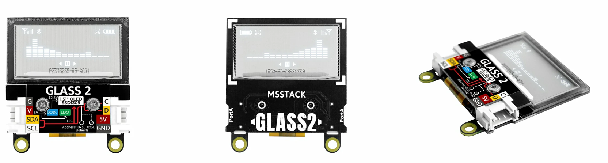
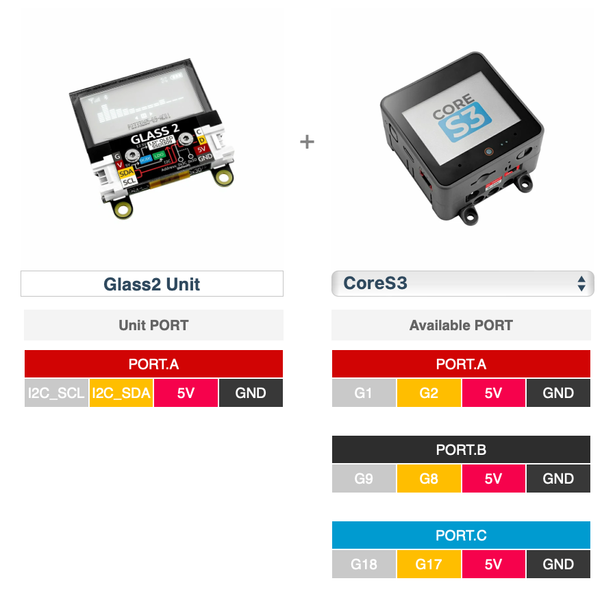

---
layout:
  width: default
  title:
    visible: false
  description:
    visible: false
  tableOfContents:
    visible: true
  outline:
    visible: true
  pagination:
    visible: true
  metadata:
    visible: true
  tags:
    visible: true
  actions:
    visible: true
  anchors:
    visible: true
---

# M5Stack Glass 2 Unit


[**View M5Stack Glass 2 Unit w/ 1.51inch Transparent OLED on OpenELAB**](https://openelab.io/products/glass-2-unit-w)

**Store SKU / option:** `M5-U158-B`. Match the purchased model and revision to the official reference below.


### M5Stack Glass 2 Unit w/ 1.51inch Transparent OLED

***

### Product Link 



### Description 

**Glass2 Unit** is a 1.51-inch transparent OLED display unit that adopts the SSD1309 driver solution. It supports the I2C communication interface (default address 0x3C) and has a built-in solder pad that allows changing the communication address to 0x3D. It is suitable for home products and control devices, and can be used for information display, status indicators, or user interfaces, embedded into various home products or control devices to achieve interaction with users.

Glass2 Unit has a glass area of 42x27.16mm, with a display area of 35.5x18mm and a resolution of 128x64 pixels. It features 256-level brightness control, allowing users to see the display content clearly with rich details and sharp images. The excellent brightness and contrast ensure clear and readable display effects in various lighting environments.

Glass2 Unit is compatible with M5Stack's development platform and rich product ecosystem, allowing users to unleash their creativity and develop various applications and functions. Whether it's developing small games, creating personalized information display interfaces, or connecting with other M5Stack devices, the Glass2 Unit provides strong support and endless possibilities.

Compared to Glass Unit, the Glass2 Unit does not include an STM32 MCU. By changing the I2C address through the onboard solder pad, it can only control two Glass2 Units simultaneously. If you need to control multiple Glass Units simultaneously in a project, you will need to connect them using the PaHUB2 Unit. Additionally, by eliminating the intermediate processing step of the STM32 MCU, the Glass2 Unit improves refresh efficiency, enabling faster content updates or response to input signals, as well as providing smoother and more fluid image or animation displays.

| Glass Unit                                                                                                                                              | Glass2 Unit                                                                                                                                                                                                                                          |
| ------------------------------------------------------------------------------------------------------------------------------------------------------- | ---------------------------------------------------------------------------------------------------------------------------------------------------------------------------------------------------------------------------------------------------- |
| Built-in STM32 control scheme, can simultaneously control dozens or even more via I2C bus [Glass Unit ](https://docs.m5stack.com/en/unit/Glass%20Unit). | The I2C address can be changed through the onboard pad, so only two Glass2 units can be controlled simultaneously through the I2C bus. To control multiple Glass2 units in the project, please use [PaHUB2](https://docs.m5stack.com/en/unit/pahub2) |

### Features 

* 128x64 total pixels
* Display area 35.5 x 18mm
* Glass area 42mm x 27.16mm
* 1-bit color depth
* I2C Addresses: 0x3D
* support for programming platforms：Arduino、UIFlow

### Applications 

* Embedded display
* DIY toys

### Specification 

| Resources             | Parameters                                                                      |
| --------------------- | ------------------------------------------------------------------------------- |
| Screen                | 1.51 inch transparent OLED                                                      |
| resolution            | 128\*64                                                                         |
| Display color         | blue                                                                            |
| Display area          | 35.05\*18（mm）                                                                   |
| Panel size            | 42.04\*27.16\*1.25（mm）                                                          |
| Perspective direction | Full view                                                                       |
| Operating temperature | 0-40°C                                                                          |
| Logic voltage         | 3.3V                                                                            |
| I2C address           | default:0x3C（You can switch the communication address to 0x3D with bonding pad） |
| Product Size          | 53\*42\*6mm                                                                     |
| Package Size          | 136\*92\*13mm                                                                   |
| Product Weight        | 9.1g                                                                            |
| Package Weight        | 13.9g                                                                           |

<figure><figcaption></figcaption></figure>

<figure><figcaption></figcaption></figure>

### Related Link 

* [SSD1309 Driver](https://m5stack.oss-cn-shenzhen.aliyuncs.com/resource/docs/products/unit/U158%20unit%20glass/SSD1309.pdf)
* [12864 Transparent OLED](https://m5stack.oss-cn-shenzhen.aliyuncs.com/resource/docs/products/unit/U158%20unit%20glass/ZJY-2856KLBAG01.pdf)

### Schematic 

<figure><figcaption></figcaption></figure>

### PinMap 

<figure><figcaption></figcaption></figure>

### Module Size 

<figure><figcaption></figcaption></figure>

### Examples 

#### Arduino 

* [Glass2 Unit Arduino driver library file](https://github.com/m5stack/M5GFX)

#### UIFlow 

[UIFlow1.0 Blockly glass2 Instructions for use](https://docs.m5stack.com/en/uiflow/blockly/unit/glass2)[UIFlow1.0 Blockly glass2 Instructions for use](https://docs.m5stack.com/en/uiflow/blockly/unit/glass2)How to use Blockly glass2 on the UIFlow 1.0 graphical programming platform and related API instructions

### Video 

* Showcase video

{% embed url="https://m5stack.oss-cn-shenzhen.aliyuncs.com/resource/docs/products/unit/Glass2%20Unit/GLASS2%20UNIT%20%E8%A7%86%E9%A2%91.mp4" %}

### COMPATIBLE 

<figure><figcaption></figcaption></figure>

### FAQ 

<strong>Unit RFID(U031),Unit RFID2(U031-B) program is compatible?</strong>

Unit RFID(U031),Unit RFID2(U031-B) program is totally compatible

<strong>What are the voltage levels of the RS485 network?</strong>

Generally, the voltage difference between A and B is around -7 to 13V. The high and low logic levels on the AB lines in the RS-485 standard are as follows:

1. High: A - B ≥ 200mV;
2. Low: A - B ≤ -200mV.

Pulling A up to 3.3V and pulling B down to GND provides an initial state for the bus, which is a High level.

<strong>RoverC, JoyC battery charge</strong>

RoverC, JoyC, 's battery is in parallel connection with the M5StickC controller, you can connect the USB cable to the M5StickC to charge the battery of RoverC, JoyC. Also, When charging the M5StickC and RoverC, JoyC power switch can be turned off.

## Official documentation and development resources

Use [Unit Glass2](https://docs.m5stack.com/en/unit/Unit_Glass2) for the manufacturer's complete model reference, diagrams and maintained examples. The official product code is **`U158-B`**; match the board/Unit label before choosing a firmware or host example. The references below complement this guide's local instructions.

| Development need             | Model-specific reference                                                                              |
| ---------------------------- | ----------------------------------------------------------------------------------------------------- |
| Electrical schematic         | [Read electrical schematic](https://m5stack-doc.oss-cn-shenzhen.aliyuncs.com/613/SCH_UNIT_GLASS2.pdf) |
| Arduino development tutorial | [Read arduino development tutorial](https://docs.m5stack.com/en/arduino/projects/unit/unit_glass2)    |
| UIFlow1 workflow             | [Read uiflow1 workflow](https://docs.m5stack.com/en/uiflow/blockly/unit/glass2)                       |

Keep the example's host model, interface pins and dependency versions together when reproducing a result. A schematic or SDK link does not establish that another revision uses the same wiring. Official model pages and accessible tutorial links reviewed **23 November 2026**. Other downloads above are manufacturer-listed resources; listing a file is not a test of its contents. Compilation, firmware flashing and hardware operation were **not performed** in this review.
