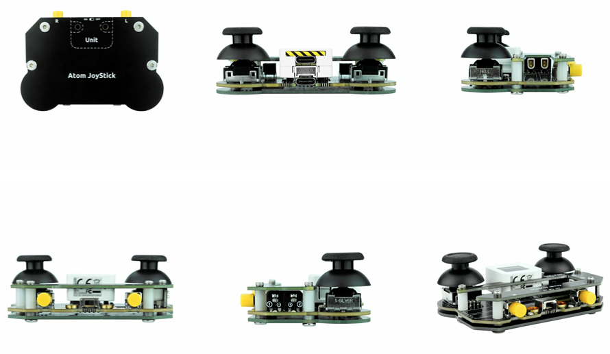

---
layout:
  width: default
  title:
    visible: false
  description:
    visible: false
  tableOfContents:
    visible: true
  outline:
    visible: true
  pagination:
    visible: true
  metadata:
    visible: true
  tags:
    visible: true
  actions:
    visible: true
  anchors:
    visible: true
---

# M5Stack M5Atom Joystick with M5AtomS3

### M5Stack M5Atom Joystick with M5AtomS3

***

### Product Link 



### Description 

**M5Atom Joystick** is a versatile programmable dual-joystick remote controller featuring the **AtomS3** as the main controller, with an STM32 handling co-processing functions. It is equipped with two 5-way joysticks with hall sensors, two function buttons, and built-in RGB LEDs for human-machine interaction and status indication. The device includes two high-voltage battery charging circuits. It comes pre-loaded with the Stamp Fly control firmware and communicates with Stamp Fly via the ESP-NOW protocol. The firmware source code is **open-source**. This product is suitable for drone control, robot control, smart cars, and various DIY projects.

### Features 

* STM32F030F4P6
* Equipped with M5AtomS3
* Compatible with Atom Lite, Atom Matrix, AtomS3 Lite, AtomS3
* Dual joysticks, dual buttons, toggle switch
* WS2812 RGB LEDs
* Dual high-voltage lithium battery charging circuits
* Battery detection

### Applications 

* Drone control
* Robot control
* Smart cars
* DIY projects

### Specifications 

| Specification                    | Parameter                    |
| -------------------------------- | ---------------------------- |
| MCU                              | STM32F030F4P6                |
| RGB                              | WS2812C                      |
| Charging IC                      | TP4067@4.35V                 |
| Battery                          | 300mAh                       |
| Charging Current                 | DC5V/430mA                   |
| Battery charge time(Input:5V/1A) | About 55 Mins                |
| Battery output voltage           | 4.35V                        |
| Button                           | Left/Right Button            |
| Buzzer                           | Built-in Passive Buzzer@5020 |
| operating temperature            | 0-40°C                       |
| Product Size                     | 84\*60\*31.5mm               |
| Packaging Size                   | 162\*99\*36mm                |
| Product Weight                   | 63.5g                        |
| Packaging Weight                 | 96.7g                        |

<figure><figcaption></figcaption></figure>

### EasyLoader 

EasyLoader is a simple and fast program burner that comes with a product-related example program. By following a few easy steps, you can burn the program to the main controller and perform a series of functional verifications.

[Download Windows Version EasyLoader](https://m5stack.oss-cn-shenzhen.aliyuncs.com/resource/docs/products/app/Atom%20JoyStick/Atom%20JoyStick%20Firmware.exe)

### Related Links 

* [TP4067 (Battery Charge Chip)](https://m5stack.oss-cn-shenzhen.aliyuncs.com/resource/docs/products/app/Atom%20JoyStick/TP4067.PDF)

### Schematic Diagram 

<figure><figcaption></figcaption></figure>

[Download Full Schematic Diagram](https://m5stack.oss-cn-shenzhen.aliyuncs.com/resource/docs/products/app/Atom%20JoyStick/Sch_AtomJoystick_v0.3.pdf)

### PinMap 

#### Buzzer and RGB LEDs 

| Atom JoyStick (AtomS3) | G5   | G6  |
| ---------------------- | ---- | --- |
| BEEP                   | BEEP |     |
| WS2812C                |      | RGB |

#### Joysticks 

| STM32F030F4P6   | PA1       | PA2       | PA3       | PA6        | PA5        | PA7        |
| --------------- | --------- | --------- | --------- | ---------- | ---------- | ---------- |
| JoyStick\_LEFT  | LEFT-SW-X | LEFT-SW-Y | LEFT-SW-B |            |            |            |
| JoyStick\_RIGHT |           |           |           | RIGHT-SW-X | RIGHT-SW-Y | RIGHT-SW-B |

#### Buttons and Battery Detection 

| STM32F030F4P6 | PF0      | PF1       | PA0      | PA1      |
| ------------- | -------- | --------- | -------- | -------- |
| Button\_LEFT  | LEFT-BTN |           |          |          |
| Button\_RIGHT |          | RIGHT-BTN |          |          |
| BAT1-Detect   |          |           | BAT-ADC1 |          |
| BAT2-Detect   |          |           |          | BAT-ADC2 |

### Module Size 

<figure><figcaption></figcaption></figure>
