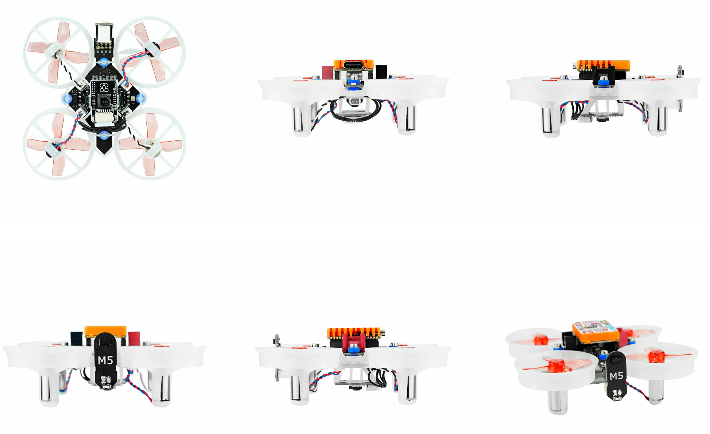
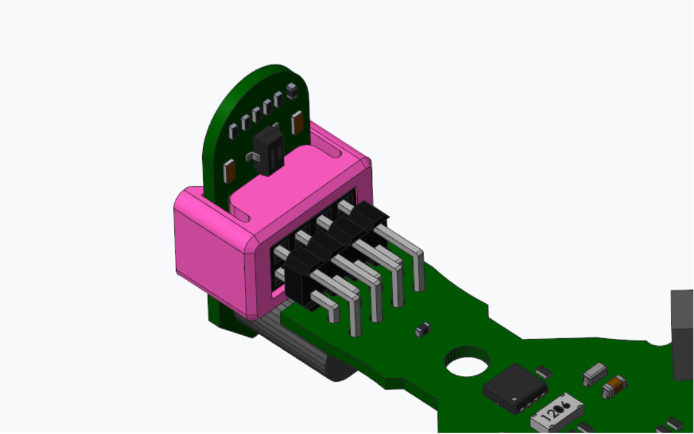
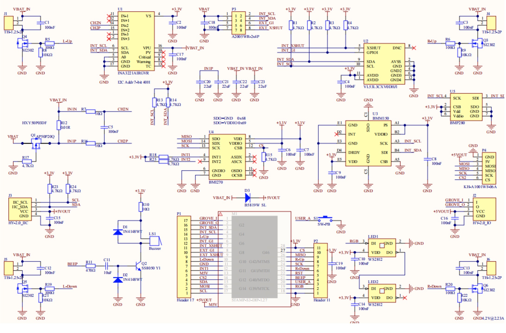

---
layout:
  width: default
  title:
    visible: false
  description:
    visible: false
  tableOfContents:
    visible: true
  outline:
    visible: true
  pagination:
    visible: true
  metadata:
    visible: true
  tags:
    visible: true
  actions:
    visible: true
  anchors:
    visible: true
---

# M5Stack M5Stamp Fly with M5StampS3

### M5Stack M5Stamp Fly with M5StampS3

***

### Product Link



### Description 

**M5Stamp Fly** is a programmable open-source quadcopter kit, featuring the **StampS3** as the main controller. It integrates a **BMI270** 6-axis gyroscope and a **BMM150** 3-axis magnetometer for attitude and direction detection. The BMP280 barometric pressure sensor and two VL53L3 distance sensors enable precise altitude hold and obstacle avoidance. The PMW3901MB-TXQT optical flow sensor provides displacement detection. The kit includes a buzzer, a reset button, and **WS2812** RGB LEDs for interaction and status indication. It is equipped with a 300mAh high-voltage battery and four high-speed coreless motors. The PCB features an **INA3221AIRGVR** for real-time current/voltage monitoring and has two Grove connectors for additional sensors and peripherals. Preloaded with debugging firmware, the Stamp Fly can be controlled using an Atom Joystick via the **ESP-NOW** protocol. Users can choose between automatic and manual modes, allowing for easy implementation of functions like precise hovering and flips. The firmware source code is **open-source**, making the product suitable for education, research, and various drone development projects.

### Features 

* M5StampS3 as the main controller
* BMP280 for barometric pressure detection
* VL53L3 distance sensors for altitude hold and obstacle avoidance
* 6-axis attitude sensor
* 3-axis magnetometer for direction detection
* Optical flow detection for hovering and displacement detection
* Buzzer
* 300mAh high-voltage battery
* Current and voltage detection
* Grove connector expansion

### Applications 

* Education
* Research
* Drone development
* DIY projects

### Specifications 

| Specification             | Parameter                                            |
| ------------------------- | ---------------------------------------------------- |
| M5StampS3                 | ESP32-S3@Xtensa LX7, 8M-FLASH, WiFi, OTG\CDC support |
| Motor                     | 716-17600kv                                          |
| Distance Sensor           | VL53L3CXV0DH/1 (0x52) @ max 3m                       |
| Optical Flow Sensor       | PMW3901MB-TXQT                                       |
| Barometric Sensor         | BMP280 (0x76) @ 300-1100hPa                          |
| 3-axis Magnetometer       | BMM150 (0x10)                                        |
| 6-axis IMU Sensor         | BMI270                                               |
| Grove                     | I2C+UART                                             |
| Battery                   | 300mAh 1S high-voltage lithium battery               |
| Battery output voltage    | 4.35V                                                |
| Battery life              | 约4分钟                                                 |
| Current/Voltage Detection | INA3221AIRGVR (0x40)                                 |
| Buzzer                    | Built-in Passive Buzzer @ 5020                       |
| operating temperature     | 0-40°C                                               |
| Product Size              | 81.5\*81.5\*31mm                                     |
| Packaging Size            | 162\*99\*36mm                                        |
| Product Weight            | 36.8g                                                |
| Packaging Weight          | 70.7g                                                |

<figure><figcaption></figcaption></figure>

### EasyLoader 

EasyLoader is a simple and fast program burner that comes with a product-related example program. By following a few easy steps, you can burn the program to the main controller and perform a series of functional verifications.

[Download Windows Version EasyLoader](https://m5stack.oss-cn-shenzhen.aliyuncs.com/resource/docs/products/app/Stamp%20Fly/Stamp%20Fly%20Firmware.exe)

### Related Links 

* [VL53L3 (ToF)](https://m5stack.oss-cn-shenzhen.aliyuncs.com/resource/docs/products/app/Stamp%20Fly/VL53L3.PDF)
* [PMW3901MB-TXQT (Optical Flow Sensor Chip)](https://m5stack.oss-cn-shenzhen.aliyuncs.com/resource/docs/products/app/Stamp%20Fly/PMW3901MB-TXQT.PDF)
* [BMP280 (Pressure Sensor Chip)](https://m5stack.oss-cn-shenzhen.aliyuncs.com/resource/docs/products/app/Stamp%20Fly/BMP280.PDF)
* [BMM150 (3D Magnetometer Compass)](https://m5stack.oss-cn-shenzhen.aliyuncs.com/resource/docs/products/app/Stamp%20Fly/BMM150.PDF)
* [BMI270 (6-axis Inertial Measurement Unit (IMU) Sensor)](https://m5stack.oss-cn-shenzhen.aliyuncs.com/resource/docs/products/app/Stamp%20Fly/BMI270.PDF)
* [Battery anti-dork STL structure file](https://github.com/m5stack/M5_Hardware/blob/master/Structure/Stamp-Fly-Battery-Protect-Component.stl)

<figure><figcaption></figcaption></figure>

### &#x20;

### Schematic Diagram 

<figure><figcaption></figcaption></figure>

[Download Full Schematic Diagram StampS3\_Fly\_Hat](https://m5stack.oss-cn-shenzhen.aliyuncs.com/resource/docs/products/app/Stamp%20Fly/StampS3_Fly_Hat.pdf)

[Download Full Schematic Diagram Stamp\_Fly](https://m5stack.oss-cn-shenzhen.aliyuncs.com/resource/docs/products/app/Stamp%20Fly/Stamp_Fly_v1.0.pdf)

[Download Full Schematic Diagram PMW3901MB](https://m5stack.oss-cn-shenzhen.aliyuncs.com/resource/docs/products/app/Stamp%20Fly/Sch_PMW3901MB_SPI.pdf)

### PinMap 

#### I2C Interface 

| Stamp Fly (StampS3) | G3       | G4       |
| ------------------- | -------- | -------- |
| INA3221AIRGVG       | INA\_SDA | INA\_SCL |
| BMM150              | INA\_SDA | INA\_SCL |
| BMP280              | INA\_SDA | INA\_SCL |
| VL53L3              | INA\_SDA | INA\_SCL |

#### SPI Interface 

| Stamp Fly (StampS3) | G14  | G44 | G43  | G46 | G12 |
| ------------------- | ---- | --- | ---- | --- | --- |
| BMI270              | MOSI | SCK | MISO | CS  |     |
| PMW3901MB-TXQT      | MOSI | SCK | MISO |     | CS2 |

#### Grove Interface 

| Stamp Fly (StampS3) | G13 | G15 | G1      | G2      |
| ------------------- | --- | --- | ------- | ------- |
| Grove (RED)         | SDA | SCL |         |         |
| Grove (BLACK)       |     |     | GROVE I | GROVE O |

#### Buzzer and RGB LEDs 

| Stamp Fly (StampS3) | G12  | G14 |
| ------------------- | ---- | --- |
| BEEP                | BEEP |     |
| WS2812              |      | RGB |

### Module Size 

<figure><figcaption></figcaption></figure>
