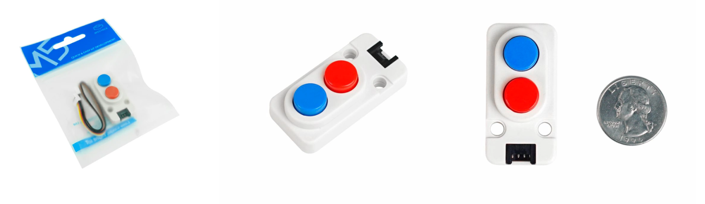

---
layout:
  width: default
  title:
    visible: false
  description:
    visible: false
  tableOfContents:
    visible: true
  outline:
    visible: true
  pagination:
    visible: true
  metadata:
    visible: true
  tags:
    visible: true
  actions:
    visible: true
  anchors:
    visible: true
---

# M5Stack Mini Dual


[**View M5Stack Mini Dual Button Unit on OpenELAB**](https://openelab.io/products/mini-dual-button-unit)

**Store SKU / option:** `M5-U025`. Match the purchased model and revision to the official reference below.


### M5Stack Mini Dual Button Unit

***

### Product Link



### Description 

**Dual Button** as the name states, has two buttons with different color. If the Button unit is not enough for your application needs, how about double it up to a pair? They share the exact same mechanism, button status can be detected by the input pin status by simply capturing the high/low electrical level.

This unit communicates with M5Core through GROVE B port.

### Features 

* GROVE interface, support [UIFlow ](http://flow.m5stack.com/)and [Arduino](http://www.arduino.cc/)
* Two Lego-compatible holes

### Applications 

* Game Controller
* Remote control switch

### Specification 

| Resources    | Parameter     |
| ------------ | ------------- |
| Net weight   | 8g            |
| Gross weight | 22g           |
| Product Size | 48\*24\*8mm   |
| Package Size | 136\*92\*10mm |

<figure><figcaption></figcaption></figure>

### EasyLoader 

[download EasyLoader](https://m5stack.oss-cn-shenzhen.aliyuncs.com/EasyLoader/Unit/EasyLoader_Dual_Button.exe)

What is EasyLoader?

1.EasyLoader is a simple and fast program burner. Every product page in EasyLoader provides a product-related case program. It can be burned to the master through simple steps, and a series of function verification can be performed. .

2. After downloading the software, double-click to run the application, connect the M5 device to the computer through the data cable, select the port parameters, click **"Burn"** to start burning. (**For M5StickC burning, please Set the baud rate to 750000 or 115200**)

### PinMap 

| M5Core (GROVE B)  | GPIO36          | GPIO26         | 5V | GND |
| ----------------- | --------------- | -------------- | -- | --- |
| DUAL\_BUTTON Unit | Blue Button Pin | Red Button Pin | 5V | GND |

### Schematic 

<figure><figcaption></figcaption></figure>

## Official documentation and development resources

Use [Unit Dual Button](https://docs.m5stack.com/en/unit/Unit_Dual_Button) for the manufacturer's complete model reference, diagrams and maintained examples. The official product code is **`U025`**; match the board/Unit label before choosing a firmware or host example. The references below complement this guide's local instructions.

| Development need        | Model-specific reference                                                                                                                         |
| ----------------------- | ------------------------------------------------------------------------------------------------------------------------------------------------ |
| Electrical schematic    | [Read electrical schematic](https://m5stack-doc.oss-cn-shenzhen.aliyuncs.com/578/Sch_UNIT_DualButton_v1.1.pdf)                                   |
| Mechanical / CAD files  | [Read mechanical / cad files](https://github.com/m5stack/M5_Hardware/tree/master/Products/U025_Unit_Dual_Button/Structures)                      |
| Mechanical / CAD files  | [Read mechanical / cad files](https://github.com/m5stack/M5_Hardware/blob/master/Products/U025_Unit_Dual_Button/Structures/Unit_Dual_Button.stl) |
| Example source: M5Stack | [Read example source: m5stack](https://github.com/m5stack/M5Stack/tree/master/examples/Unit/DUAL_BUTTON)                                         |

Keep the example's host model, interface pins and dependency versions together when reproducing a result. A schematic or SDK link does not establish that another revision uses the same wiring. Official model pages and accessible tutorial links reviewed **23 November 2026**. Other downloads above are manufacturer-listed resources; listing a file is not a test of its contents. Compilation, firmware flashing and hardware operation were **not performed** in this review.
