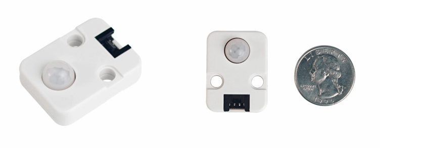

---
layout:
  width: default
  title:
    visible: false
  description:
    visible: false
  tableOfContents:
    visible: true
  outline:
    visible: true
  pagination:
    visible: true
  metadata:
    visible: true
  tags:
    visible: true
  actions:
    visible: true
  anchors:
    visible: true
---

# M5Stack PIR Motion Sensor

### M5Stack PIR Motion Sensor

***

### Product Link



### Description 

**PIR** is a human body infrared unit. It belongs to the "passive pyroelectric infrared detector". It detects the infrared radiation emitted and reflected by the human body or object. When infrared is detected, the output level is high and it takes a while. Delay (high during the period and allow repeated triggers) until the trigger signal disappears (restores low).

This Unit communicates with the M5Core via the GROVE B.

\*Notice: This Unit has 2s delay time.\*

### Features 

* Detects the distance: 500cm
* latency time: 2s
* Sensing range: < 100°
* Quiescent current: < 60uA
* Operating temperature: -20 - 80 °C
* GROVE interface, support UIFlow and Arduino
* Two Lego installation holes

### Applications 

* Human body Induction Lamp
* Security Product
* Automatic Induction Appliance Settings

### Specification 

| Resources      | Parameters    |
| -------------- | ------------- |
| Product Size   | 32\*24\*12mm  |
| Package Size   | 136\*92\*13mm |
| Product Weight | 5g            |
| Package Weight | 20g           |

<figure><figcaption></figcaption></figure>

### Schematic 

<figure><figcaption></figcaption></figure>

### EasyLoader 

* **Windows**
  * [EasyLoader\_PIR\_UNIT\_With\_M5Core](https://static-cdn.m5stack.com/resource/docs/products/unit/PIR/ezLoader-a38c38d2-c621-4dc0-8401-48b53d12f16a.exe)

### PinMap 

<figure><figcaption></figcaption></figure>

### Module Size 

<figure><figcaption></figcaption></figure>
