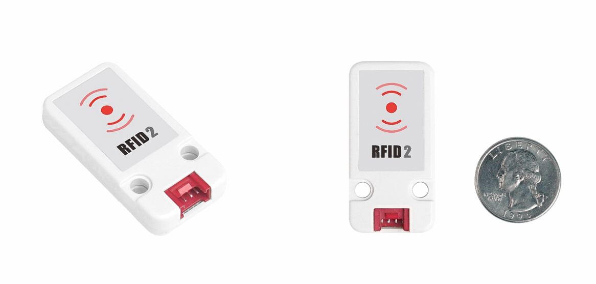
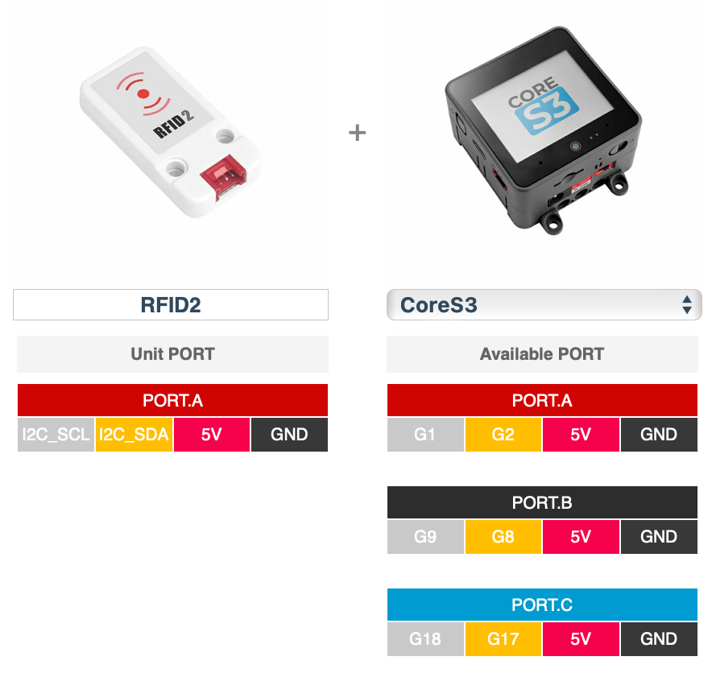

---
layout:
  width: default
  title:
    visible: false
  description:
    visible: false
  tableOfContents:
    visible: true
  outline:
    visible: true
  pagination:
    visible: true
  metadata:
    visible: true
  tags:
    visible: true
  actions:
    visible: true
  anchors:
    visible: true
---

# M5Stack RFID 2 Unit


[**View M5Stack RFID 2 Unit (WS1850S) on OpenELAB**](https://openelab.io/products/m5stack-rfid2-unit)

**Store SKU / option:** `M5-U031-B`. Match the purchased model and revision to the official reference below.


### M5Stack RFID 2 Unit (WS1850S)

***

### Product Link



### Description 

**RFID2** is a radio frequency identification unit. Built-in **WS1850S** chip, working frequency is 13.56MHz. Supports `reading card`, `writing card`, `recognition`, `recording`, and encoding RF card Multiple functions such as authorization and authorization. Use magnetic field induction technology to realize non-contact two-way information interaction, read and verify the information of proximity cards. It can be used in access control systems, check-in systems, warehouse goods entry and storage, and community vehicle entry and exit registration needs Application scenarios for information verification.

### Features 

* Operating frequency: 13.56 MHz
* I2C data rate: Fast mode: up to 400 Kbit/s; High-speed mode: up to 3400 Kbit/s
* Transceiver buffer: 64 bytes
* Supported protocols: ISO14443A, MIFARE and NTAG
* Working temperature: -20℃-85℃
* Data storage:> 10 years
* Reading distance: <20 mm
* Development platform: Arduino, UIFlow(Blockly, Python)
* 2x LEGO compatible holes

### Applications 

* Smart home access control system
* Vehicle management
* Smart transportation
* Smart bookshelf

### Specifications 

| Resources              | Parameter                            |
| ---------------------- | ------------------------------------ |
| Read and Write IC      | WS1850S                              |
| Operating frequency    | 13.56MHz                             |
| Communication protocol | I2C: 0x28                            |
| Support protocol       | ISO/IEC 14443 Type A/Type B protocol |
| Net weight             | 6g                                   |
| Gross weight           | 21g                                  |
| Product size           | 48 \* 24 \* 8mm                      |
| Packing size           | 136\*92\*8mm                         |

<figure><figcaption></figcaption></figure>

### EasyLoader 

[Click to download EasyLoader](https://m5stack.oss-cn-shenzhen.aliyuncs.com/EasyLoader/Unit/EasyLoader_RFID.exe)

What is EasyLoader?1.EasyLoader is a simple and fast program burner. The EasyLoader in each product page provides a product-related case program, which can be burned to the main control through simple steps, and a series of functional verifications can be carried out .

2. After downloading the software, double-click to run the application, connect the M5 device to the computer through the data cable, select the port parameters, and click **"Burn"** to start burning. (**When burning for M5StickC, please Set the baud rate to 750,000 or 115200**)
3. At present, EasyLoader is only applicable to Windows operating system, compatible with M5 system and uses ESP32 as the control core host. You need to install the CP210X driver before burning for M5Core (if you use M5StickC as the controller, you don’t need to install it) \[click here to view Driver installation tutorial]\(/en/uiflow/uiflow\_web#Install the serial port driver)

#### Pin mapping 

| M5Core(PORT A) | GPIO22 | GPIO21 | 5V | GND |
| -------------- | ------ | ------ | -- | --- |
| RFID Unit      | SCL    | SDA    | 5V | GND |

### Related Link 

* Datasheet [**WS1850S**](https://m5stack.oss-cn-shenzhen.aliyuncs.com/resource/docs/datasheet/unit/rfid2/WS1850S%20QFN-32.PDF)
* Datasheet [**MFRC522**](https://m5stack.oss-cn-shenzhen.aliyuncs.com/resource/docs/datasheet/module/MFRC522_en.pdf)

### Module Size 

<figure><figcaption></figcaption></figure>

### Example 

#### Arduino 

[Please click here to download the Arduino example](https://github.com/m5stack/M5Stack/tree/master/examples/Unit/RFID_RC522)

After burning the routine RFID.ino, when the device is running. Use an IC card or mobile phone NFC to place it on the RFID Unit. The ID information will be printed out on the M5Core screen.

<figure><figcaption></figcaption></figure>

#### UIFlow 

**Function Description**

* **read string from addr** Read data from address
* **write to addr** Write data to address
* **card near** RFID card close to return 1
* **card uid** Return the UID of the RFID card

**Usage example**

[Please click here to download UIFlow](https://github.com/m5stack/M5-ProductExampleCodes/tree/master/Unit/RFID/UIFlow)

Use [UIFlow ](http://flow.m5stack.com/)to download the case program to M5Core and place the proximity card on the RFID Unit. The M5Core screen will display and print its corresponding ID information.

<figure><figcaption></figcaption></figure>

### COMPATIBLE 

<figure><figcaption></figcaption></figure>

RFID2+CoreS3Core2 v1.1CORE2 FOR AWSTOUGHM5DialCardputerBASIC-V27M5CapsuleM5StickC PLUSM5StickCM5StickC PLUS2ATOM LiteATOM MatrixAtomS3AtomS3 LiteAtomS3RAtomS3R CamPORT.AI2C\_SCLI2C\_SDA5VGNDPORT.AG1G25VGNDPORT.BG9G85VGNDPORT.CG18G175VGND"RFID2" & "CoreS3" Grove Port Connection Note:Please modify the example program according to the actual PIN number when using.Available Ports: PORT.A PORT.B PORT.C .

### FAQ 

<strong>Unit RFID(U031),Unit RFID2(U031-B) program is compatible?</strong>

Unit RFID(U031),Unit RFID2(U031-B) program is totally compatible

<strong>What are the voltage levels of the RS485 network?</strong>

Generally, the voltage difference between A and B is around -7 to 13V. The high and low logic levels on the AB lines in the RS-485 standard are as follows:

1. High: A - B ≥ 200mV;
2. Low: A - B ≤ -200mV.

Pulling A up to 3.3V and pulling B down to GND provides an initial state for the bus, which is a High level.

<strong>RoverC, JoyC battery charge</strong>

RoverC, JoyC, 's battery is in parallel connection with the M5StickC controller, you can connect the USB cable to the M5StickC to charge the battery of RoverC, JoyC. Also, When charging the M5StickC and RoverC, JoyC power switch can be turned off.

## Official documentation and development resources

Use [Unit RFID2](https://docs.m5stack.com/en/unit/Unit_RFID2) for the manufacturer's complete model reference, diagrams and maintained examples. The official product code is **`U031-B`**; match the board/Unit label before choosing a firmware or host example. The references below complement this guide's local instructions.

| Development need             | Model-specific reference                                                                                                                            |
| ---------------------------- | --------------------------------------------------------------------------------------------------------------------------------------------------- |
| Mechanical / CAD files       | [Read mechanical / cad files](https://github.com/m5stack/M5_Hardware/tree/master/Products/U031-B_Unit_RFID2/Structures)                             |
| Mechanical / CAD files       | [Read mechanical / cad files](https://github.com/m5stack/M5_Hardware/blob/master/Products/U031-B_Unit_RFID2/Structures/Unit_RFID2_Bottom_Shell.stl) |
| Mechanical / CAD files       | [Read mechanical / cad files](https://github.com/m5stack/M5_Hardware/blob/master/Products/U031-B_Unit_RFID2/Structures/Unit_RFID2_Face_Shell.stl)   |
| Arduino development tutorial | [Read arduino development tutorial](https://docs.m5stack.com/en/arduino/projects/unit/unit_rfid)                                                    |

Keep the example's host model, interface pins and dependency versions together when reproducing a result. A schematic or SDK link does not establish that another revision uses the same wiring. Official model pages and accessible tutorial links reviewed **23 November 2026**. Other downloads above are manufacturer-listed resources; listing a file is not a test of its contents. Compilation, firmware flashing and hardware operation were **not performed** in this review.
