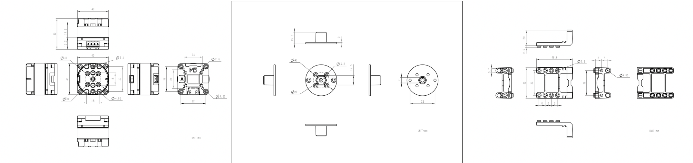

---
layout:
  width: default
  title:
    visible: false
  description:
    visible: false
  tableOfContents:
    visible: true
  outline:
    visible: true
  pagination:
    visible: true
  metadata:
    visible: true
  tags:
    visible: true
  actions:
    visible: true
  anchors:
    visible: true
---

# M5Stack Roller485 Lite Unit

### M5Stack Roller485 Lite Unit

***

### Description 

**Roller485 Unit** is an integrated brushless DC motor motion control kit designed for efficient motion control. It supports 6-16V DC power input (via PWR485 interface) or 5V input (via Grove interface) and can automatically adjust power coefficients to ensure optimal performance. It features a built-in **FOC** closed-loop drive system, utilizing a 3504 200KV brushless motor. Without forced cooling, it can operate with a maximum continuous phase current of 0.5A and a short-term current of 1A. The driver uses a magnetic encoder for feedback and supports current, speed, and position control, ensuring precise control.\
Additionally, the device is equipped with a 0.66-inch **OLED** display on the back to display the device's status in real-time. It also includes an RGB indicator light and function button for easy human-computer interaction. The product's base is designed with LEGO-compatible mounting holes and M3 screw holes, making it easy to assemble and integrate. Roller485 Unit’s hardware and software are fully open-source, supporting motion control and parameter adjustment through **RS485** or **I2C** buses. It also offers SWD and SWO debugging interfaces, providing developers with greater flexibility. This product is widely used in robotic joints, motion control, industrial automation, and visual demonstration projects.

[Unit Roller485 Lite](https://docs.m5stack.com/en/guide/motor_ctl/roller485/roller485)[Unit Roller485 Lite](https://docs.m5stack.com/en/guide/motor_ctl/roller485/roller485)

This tutorial will introduce you the usage of Unit Roller485 LiteThe main difference between Unit-Roller485 Lite and Unit-Roller485 is that the Unit-Roller485 Lite does not include the slip ring extended Grove interface or the top LEGO expansion interface.

### Features 

* Brushless DC motor control
* RS-485/I2C communication control
* Integrated OLED display
* RGB indicator light
* FOC closed-loop drive system

### Included 

* 1x Roller485 Lite Unit
* 1x HT3.96R-4P plug
* 1x HY2.0-4P Grove cable (5cm)
* 6x Friction pins
* 1x Flange
* 1x Bracket
* 1x Hex key(2.5mm)
* 1x Hex key(2mm)
* 6x M3 nuts
* 2x Hex socket cup head screws M3x14mm
* 4x Hex socket countersunk head screws M3x14mm
* 2x Hex socket countersunk head screws M3x12mm
* 4x Hex socket countersunk head screws M3x5mm
* 1x Single-ended terminal wire 5P debugging wire

### Applications 

* Robotic joint control
* Smart manufacturing equipment
* Visual demonstrations

### Specifications 

| Specification           | Parameter                                                                                                                                                                                                                   |
| ----------------------- | --------------------------------------------------------------------------------------------------------------------------------------------------------------------------------------------------------------------------- |
| MCU                     | STM32G431CBU6@Cortex-M4, 128KB-Flash, 32KB-SRAM, 170MHz                                                                                                                                                                     |
| Motor Type              | D3504 200KV Brushless Motor@Diameter: 41mm                                                                                                                                                                                  |
| Driver Chip             | DRV8311HRRWR                                                                                                                                                                                                                |
| Angle Sensor            | TLI5012BE1000                                                                                                                                                                                                               |
| Communication Interface | 
PWR-485 (HT3.96-4P interface) I2C (0x64)
                                                                                                                                                                          |
| Display                 | 0.66-inch OLED display, resolution: 64\*48, SPI communication                                                                                                                                                               |
| RGB LEDs                | 2x WS2812-2020                                                                                                                                                                                                              |
| Motor Power Supply      | 
RS-485 (VH3.96-4P interface) power supply@6-16V Grove port DC 5V power supply
                                                                                                                                     |
| Load                    | 
Load: 50g Motor Speed: 2100rpm Current: DC16V/225mA Load: 200g Motor Speed: 1400rpm Current: DC16V/601mA Load: 500g(<code>maximum load</code>) Motor Speed: 560rpm Current: DC16V/918mA No load: DC16V/78mA
 |
| Standby Current         | 
Grove port DC 5V power supply@70mA RS-485 (VH3.96-4P interface) power supply DC16V@32mA
                                                                                                                           |
| Noise Level             | 48dB                                                                                                                                                                                                                        |
| Output Torque           | 
Grove port DC 5V power supply: 0.021N.m/0.2kgf.cm@current 350mA RS485 (VH3.96-4P interface) power supply: 0.065N.m/0.66kgf.cm@current 927mA
                                                                       |
| Operating Temperature   | 0-40°C                                                                                                                                                                                                                      |
| Product Dimensions      | 40\*40\*30mm                                                                                                                                                                                                                |
| Packaging Dimensions    | 170\*75\*52mm                                                                                                                                                                                                               |
| Product Weight          | 70.0g                                                                                                                                                                                                                       |
| Packaging Weight        | 146.9g                                                                                                                                                                                                                      |

<figure><figcaption></figcaption></figure>

### Related Links 

* [Angle Sensor TLI5012BE1000](https://m5stack.oss-cn-shenzhen.aliyuncs.com/resource/docs/products/unit/Unit-Roller485/TLI5012BE1000.pdf)
* [Motor Driver DRV8311HRRWR](https://m5stack.oss-cn-shenzhen.aliyuncs.com/resource/docs/products/unit/Unit-Roller485/DRV8311HRRWR.pdf)

### Schematic 

<figure><figcaption></figcaption></figure>

### PinMap 

* PORT A Interface

| PORT A                  | SCL | SDA | VCC | GND |
| ----------------------- | --- | --- | --- | --- |
| Core (Basic)            | G22 | G21 | 5V  | GND |
| Core2                   | G33 | G32 | 5V  | GND |
| CoreS3                  | G1  | G2  | 5V  | GND |
| Atom Lite / Atom Matrix | G21 | G25 | 5V  | GND |
| AtomS3 / AtomS3 Lite    | G39 | G38 | 5V  | GND |
| StickC PLUS / PLUS2     | G33 | G32 | 5V  | GND |

* I2C\PWR485\RGB\BUTTON

| STM32G431CBU6 | PA15          | PB7           | PC11      | PC10      | PB4        | PB5      | PC6     |
| ------------- | ------------- | ------------- | --------- | --------- | ---------- | -------- | ------- |
| I2C           | SYS\_I2C\_SCL | SYS\_I2C\_SDA |           |           |            |          |         |
| PWR-485       |               |               | RS485\_RX | RS485\_TX | RS485\_DIR |          |         |
| WS2812C       |               |               |           |           |            | LED\_DAT |         |
| Button A      |               |               |           |           |            |          | SYS\_SW |

* OLED

| STM32G431CBU6 | PB15       | PB13      | PB14     | PB10      | PB12     |
| ------------- | ---------- | --------- | -------- | --------- | -------- |
| OLED          | OLED\_MOSI | OLED\_SCK | OLED\_DC | OLED\_RST | OLED\_CS |

### Module Size 

<figure><figcaption></figcaption></figure>

