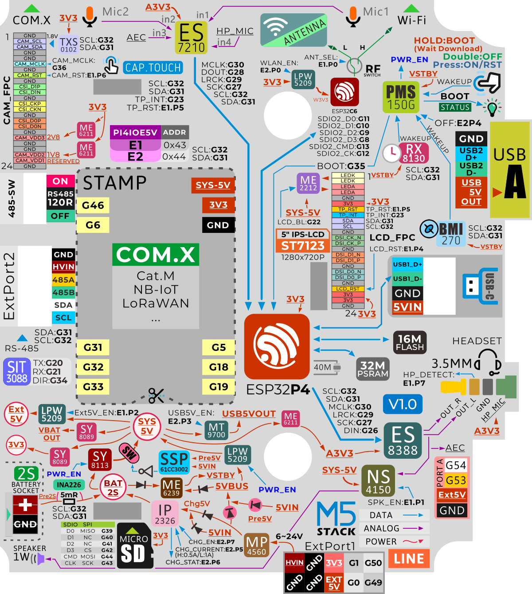
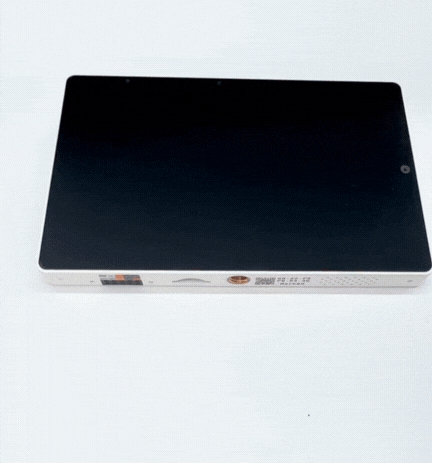
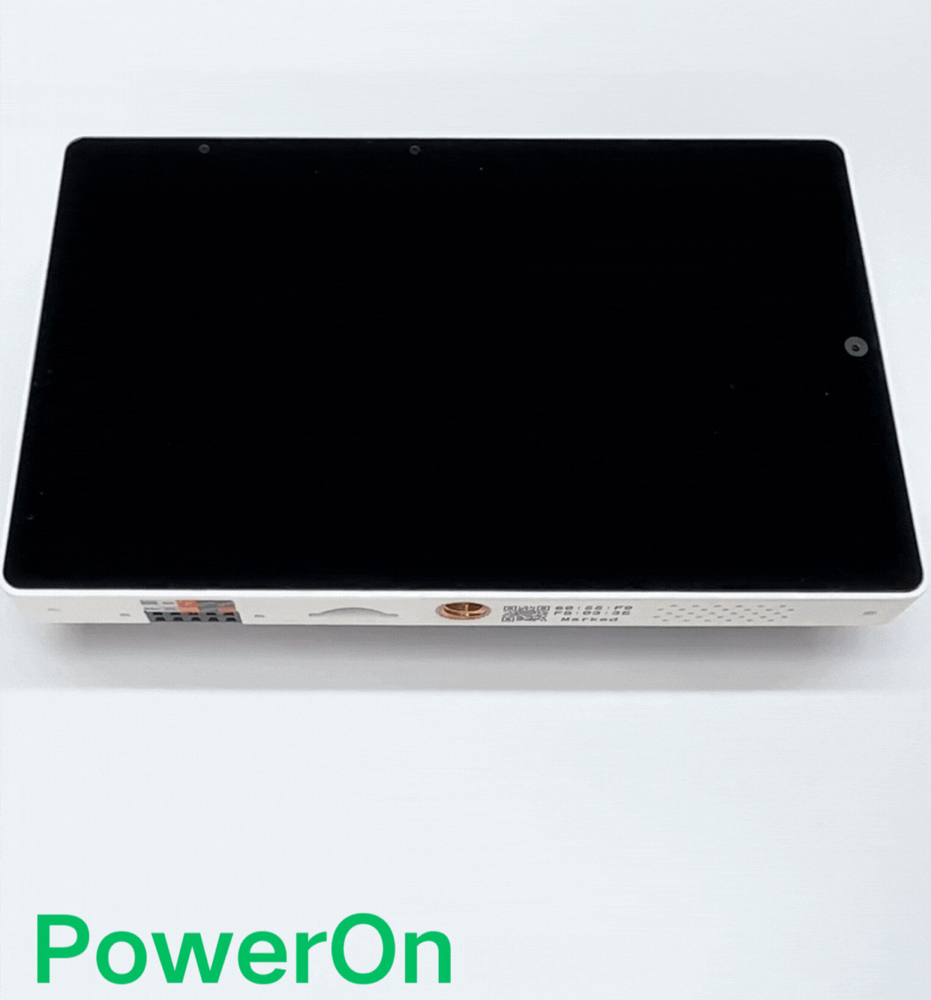
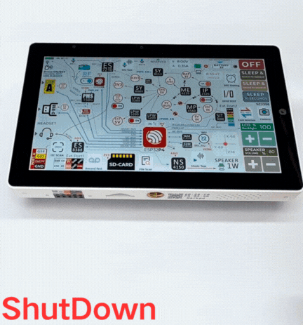

# M5Stack Tab5 K145 Power, Firmware and Development Guide


[**View M5Stack Tab5 Kit K145 on OpenELAB**](https://openelab.io/products/m5stack-tab5-iot-development-kit)

**Model:** Tab5 Kit K145 · **SKU:** `M5-K145`


## Product overview <a href="#description" id="description"></a>

### Exact hardware identity <a href="#m5stack-tab5-iot-development-kit-esp32-p4" id="m5stack-tab5-iot-development-kit-esp32-p4"></a>

**Tab5 Kit K145** is an ESP32-P4 tablet-style development terminal with a separate ESP32-C6 wireless coprocessor, a5-inch touch panel, MIPI camera, audio, storage and industrial/USB expansion. OpenELAB `M5-K145` is the kit with the removable NP-F550 battery; the manufacturer also sells a batteryless C145. The P4 is the application processor and the C6 provides wireless connectivity: an ESP32-S3 build or an independently erased C6 is not an interchangeable configuration.

This guide starts with a local touch-coordinate display, then separates factory firmware building, network-module recovery, camera/audio and expansion checks. Preserve the fitted panel revision and both processor firmware versions with your project.

### OpenELAB listing and option <a href="#product-link" id="product-link"></a>

Use [View M5Stack Tab5 Kit K145 on OpenELAB](https://openelab.io/products/m5stack-tab5-iot-development-kit) and match `M5-K145` before selecting regional firmware or adding accessories.

## Applications <a href="#features" id="features"></a>

Use Tab5 for an instrument front panel, portable data acquisition UI, camera/vision prototype or RS485 diagnostic terminal. A responsive local interface is the first checkpoint; radio, camera frame rate and full GUI performance depend on the selected firmware and workload. It is an MCU terminal rather than a Linux desktop, despite its tablet form.

## Specifications

| Parameter            | Tab5 / K145 scope                                                                                   |
| -------------------- | --------------------------------------------------------------------------------------------------- |
| Main processor       | ESP32-P4NRW32; dual-core RISC-V360MHz plus LP core40MHz                                             |
| Wireless coprocessor | ESP32-C6-MINI-1U;2.4GHz Wi-Fi6; Thread/Zigbee are hardware capabilities requiring suitable firmware |
| Memory               | 16MB flash;32MB octal PSRAM                                                                         |
| Panel                | 5-inch IPS1280×720; fitted driver revision matters                                                  |
| Camera               | SC2356,1600×1200, MIPI CSI                                                                          |
| Audio                | ES8388 output codec, ES7210 microphone front end, dual mic;1W8Ω speaker;3.5mm jack                  |
| Storage / ports      | microSD; USB-A host; USB-C device/power; Grove; M5-Bus; Ext.Port; RS485                             |
| Kit battery          | Removable NP-F5507.4V2000mAh,14.8Wh; batteryless C145 differs                                       |
| RS485 power domain   | 6–24V dedicated input; SIT3088 transceiver, switchable120Ω termination                              |
| Body / kit envelope  | 128×80×12mm without battery;128×80×26.7mm kit                                                       |
| Ambient range        | 0–40°C                                                                                              |

[Manufacturer specifications](https://docs.m5stack.com/en/core/Tab5). The manufacturer's approximately six-hour battery example uses50% brightness, Wi-Fi on, background tasks and8.23V-to6.0V discharge; it is not a runtime prediction for this sketch.

## Hardware and connections

### Power, battery and panel revisions

Start with the **USB-C data/power port**, not the USB-A host port. Shut down before removing the battery or replacing an expansion module. Single-click the power key to start and double-click to shut down. If power was removed abruptly, wait at least5seconds before reconnecting; M5Stack documents possible IMU initialization trouble during a rapid power return. Charging requires the system powered on **and initialized**. A protected battery below6V needs the manufacturer's remove/reset/reinstall recovery before USB-C trickle charging; allow several minutes rather than repeatedly resetting it. [Power and charging notes](https://docs.m5stack.com/en/core/Tab5).

| Fitted panel generation | Firmware implication                      |
| ----------------------- | ----------------------------------------- |
| Initial2025 hardware    | Separate ILI9881C LCD and GT911 touch0x14 |
| From14October2025       | ST7123 combined display/touch; touch0x55  |
| From28April2026         | ST7121 combined display/touch; touch0x55  |

For full compatibility the current Arduino guide recommends **M5Unified≥0.2.23 and M5GFX≥0.2.30**. Do not diagnose a blank new display using an older factory image alone. [Version history](https://docs.m5stack.com/en/core/Tab5), [Arduino compatibility](https://docs.m5stack.com/en/arduino/m5tab5/program).

### Bus allocation <a href="#pinmap" id="pinmap"></a>

| Subsystem       | P4 pins / bus ownership                                                         |
| --------------- | ------------------------------------------------------------------------------- |
| Internal I2C    | SDA31/SCL32: touch, codecs, BMI2700x68, RTC0x32, INA2260x41, expanders0x43/0x44 |
| Camera          | SCCB31/32, MCLK36; dedicated CSI differential lanes                             |
| Display         | Dedicated DSI lanes; backlight22; expander LCD reset                            |
| ES8388 playback | MCLK30, BCLK27, data26, LRCK29; address0x10                                     |
| ES7210 capture  | MCLK30, BCLK27, data28, LRCK29; address0x40                                     |
| C6 hosted link  | SDIO data11/10/9/8, CMD13, clock12, reset15, IO2 route14                        |
| microSD SDIO    | DAT0–3=39/40/41/42, clock43, CMD44                                              |
| RS485           | RX21, TX20, direction34; different from GPIO UART levels                        |
| Grove           | Black GND, red5V, yellow53, white54                                             |
| M5-Bus SPI      | Clock5, MOSI18, MISO19; not the internal SD card route                          |

The0x43 expander controls antenna selection, speaker enable, external5V, LCD/touch/camera resets and headphone detection. Its P0 low selects the internal Wi-Fi antenna; high selects the external path. The0x44 expander controls C6 power, USB-A5V, shutdown and charging. A dead peripheral can therefore be a disabled rail/reset or wrong firmware pairing. The board overview shows one physical revision and is not a substitute for reading the later panel change table. [Exact Tab5 pin map and schematic](https://docs.m5stack.com/en/core/Tab5#pinmap).

A mating M5-Bus shape does not establish pin compatibility with Core2/CoreS3. Compare each module's power direction, HVIN/BAT usage and SPI/I2C allocation before plugging it in. Use proper differential wiring and common/reference-ground design for RS485; never connect A/B directly to TTL GPIO. Enable120Ω termination only at the intended bus endpoints; keep the6–24V RS485 power input away from USB, Grove5V and GPIO.



_M5Stack official technical illustration:_ [_original_](https://m5stack-doc.oss-cn-shenzhen.aliyuncs.com/1132/C145_Pinmap_Overview.png)_. Verify drawing and physical revision together._

## Software and development resources <a href="#softwares" id="softwares"></a>

### Supported development routes

| Route                | Target / dependency                                                                                                                            |
| -------------------- | ---------------------------------------------------------------------------------------------------------------------------------------------- |
| Arduino              | M5Stack **M5Tab5**, M5Unified/M5GFX with the panel support above                                                                               |
| ESP-IDF factory demo | **ESP-IDF v5.4.2**, `M5Tab5-UserDemo/platforms/tab5`, repository component-fetch step                                                          |
| ESP-IDF BSP          | Espressif component `m5stack_tab5`1.0.0 as linked by the manufacturer                                                                          |
| PlatformIO           | Manufacturer baseline uses pioarduino `platform-espressif32#54.03.21`, `esp32-p4-evboard`, MCU `esp32p4`; an S3 platform profile is unsuitable |
| UiFlow2              | Tab5 image and controller, USB WebTerminal or Access Code                                                                                      |

Install the [M5Stack board package](https://docs.m5stack.com/en/arduino/arduino_board), select M5Tab5 and retain its flash/PSRAM defaults. Record board-manager and resolved library versions, because a current M5Unified release may require a matching newer M5GFX. The reviewed library metadata is M5Unified0.3.0 with M5GFX≥0.3.0; this is an observed source snapshot, not a guarantee for every older package. [Arduino quick-start](https://docs.m5stack.com/en/arduino/m5tab5/program), [factory build guide](https://docs.m5stack.com/en/esp_idf/m5tab5/userdemo).

## Getting started

### Local display and touch checkpoint

1. Fit the kit battery only while powered off, or begin with USB-C power alone. Remove external modules and use a USB-C data cable.
2. Install/select **M5Tab5** and compatible M5Unified/M5GFX. First compile the stock display example referenced by the Arduino guide.
3. If needed, hold Reset/Boot until the green LED flashes rapidly, release it and choose the newly enumerated port; upload and restart.
4. Upload this original coordinate logger. Touch the center and four visible corners, then compare coordinates after a deliberate display rotation change.

```cpp
#include <M5Unified.h>
uint32_t lastReport=0;
void setup() {
  M5.begin();
  Serial.begin(115200);
  M5.Display.setRotation(1);
  M5.Display.fillScreen(TFT_BLACK);
  M5.Display.setTextColor(TFT_WHITE, TFT_BLACK);
  M5.Display.setTextSize(3);
  M5.Display.setCursor(20,20);
  M5.Display.printf("Tab5 touch %d x %d", M5.Display.width(), M5.Display.height());
}
void loop() {
  M5.update();
  int32_t x=0,y=0;
  if (M5.Display.getTouch(&x,&y) && millis()-lastReport>=100) {
    lastReport=millis();
    Serial.printf("touch=%ld,%ld\n",long(x),long(y));
    M5.Display.fillCircle(x,y,5,TFT_GREEN);
  }
  delay(5);
}
```

Expected result is a stable screen with green marks following touch position and coordinate lines at115200baud. `width()`/`height()` are the actual rotated logical bounds; do not hard-code an old touchscreen's coordinates. A display result does not validate C6 networking, the camera or a USB peripheral.

### Reproduce the factory ESP-IDF build

The manufacturer uses Ubuntu and **v5.4.2**. The sequence below separates source acquisition, dependency retrieval, build and flashing. `TAB5_PORT` must be changed to the device observed on your computer. Preserve needed configuration before writing firmware. Review downloaded scripts before executing them; these commands were not executed for this guide.

```bash
git clone -b v5.4.2 --recursive https://github.com/espressif/esp-idf.git
cd esp-idf
./install.sh
. ./export.sh
cd ..
git clone https://github.com/m5stack/M5Tab5-UserDemo.git
cd M5Tab5-UserDemo
python ./fetch_repos.py
cd platforms/tab5
. ../../../esp-idf/export.sh
idf.py build
```

After a successful build, enter the documented Reset/Boot download mode, select the actual port and flash:

```bash
TAB5_PORT=/dev/ttyACM0
idf.py -p "$TAB5_PORT" flash monitor
```

Expected result is a successful write followed by the factory launcher. Test its screen areas one at a time; record the actual compiler output, commit and resolved component versions. A successful desktop SDL build of the project tests its desktop UI path and does not validate the physical P4/DSI/audio hardware. [Factory build procedure](https://docs.m5stack.com/en/esp_idf/m5tab5/userdemo), [project README](https://github.com/m5stack/M5Tab5-UserDemo).

### Bring up camera, audio, storage and external buses separately

Use the factory camera tile with a static high-contrast target and confirm a coherent frame before saving/streaming images. Check the fitted camera and panel drivers independently: a DSI issue is not necessarily CSI failure. For audio, verify moderate speaker output, then microphone level/recording and finally headphone insertion; inspect ES8388/ES7210 clock pairing and expander enables if one direction is silent.

For microSD, enumerate the card, read a small known file, then write/close/reopen a short test file before enabling repeated logging. Its SDIO pins differ from M5-Bus SPI. For Grove use only a compatible5V-powered,3.3V-signal device on53/54 and the correct external-power state. For RS485 first receive a known low-rate frame from an isolated test bus, match baud/parity/direction and verify endpoint termination before allowing any protocol writes. A UART port existing does not identify a Modbus register map.

For wireless, verify the C6 module powers and the P4-hosted link initializes before blaming Wi-Fi credentials. Keep the internal-C6 recovery separate from the P4 factory image; the manufacturer provides a [dedicated C6 Wi-Fi restoration workflow](https://docs.m5stack.com/en/guide/tab5/c6_wifi_restore). For UiFlow2 select **Tab5**, flash its image, establish USB WebTerminal, run a simple screen block once, then download with Run Always and restart. Network Access Code and USB serial permissions are separate connection mechanisms.

## Troubleshooting and FAQs

| Symptom                           | Ordered diagnosis                                                                                                                             |
| --------------------------------- | --------------------------------------------------------------------------------------------------------------------------------------------- |
| Blank display after upload        | Confirm ST7121/ST7123/initial panel generation → exact M5Tab5 preset → compatible library/image → normal reset.                               |
| Touch offset or no touch          | Check rotated bounds and driver generation; compare0x14 versus0x55 only on the correct internal bus.                                          |
| Battery will not charge while off | Power on and initialize the system; follow protected-battery recovery if below6V.                                                             |
| IMU fails after power removal     | Shut down cleanly; after abrupt removal wait5seconds before reconnecting.                                                                     |
| P4 UI works, Wi-Fi fails          | C6 power → hosted SDIO initialization → paired C6 firmware → antenna path → credentials.                                                      |
| USB-A device absent               | Use host port and its enabled5V supply; USB-C device and USB-A host roles differ.                                                             |
| RS485 garbled / no response       | Supply domain, A/B/reference wiring, baud/parity, direction34 and endpoint termination; do not try arbitrary register writes.                 |
| Return to original firmware       | Use exact Tab5 factory restoration and a panel-compatible image; save configuration and avoid erasing the C6 without its dedicated procedure. |

## Downloads and technical documents <a href="#schematics" id="schematics"></a>

[Current factory restoration](https://docs.m5stack.com/en/guide/tab5/restore_factory) replaces the retired `/guide/restore_factory/m5tab5` path. [Internal C6 restoration](https://docs.m5stack.com/en/guide/tab5/c6_wifi_restore) has a different purpose. [Tab5 BSP1.0.0](https://components.espressif.com/components/espressif/m5stack_tab5/versions/1.0.0/readme) provides the component scope; retain its version with the ESP-IDF application.

| Official file or repository                                                                                                                              | Use                                                                                          |
| -------------------------------------------------------------------------------------------------------------------------------------------------------- | -------------------------------------------------------------------------------------------- |
| [Tab5 GeaStack Firmware Flashing](https://github.com/geastack/targets/tree/main/targets/esp32-p4-m5stack-tab5)                                           | Manufacturer-listed exact model document / maintained source; use the scope described above. |
| [Tab5 Overall Design Block Diagram](https://m5stack-doc.oss-cn-shenzhen.aliyuncs.com/1132/Tab5_Overall_Design_Block_Diagram.pdf)                         | Manufacturer-listed exact model document / maintained source; use the scope described above. |
| [Tab5 Schematics PDF](https://m5stack-doc.oss-cn-shenzhen.aliyuncs.com/1132/Tab5_Schematics_PDF.pdf)                                                     | Manufacturer-listed exact model document / maintained source; use the scope described above. |
| [Tab5 Structure Files](https://github.com/m5stack/M5_Hardware/tree/master/Products/C145_Tab5/Structures)                                                 | Manufacturer-listed exact model document / maintained source; use the scope described above. |
| [ESP32-P4](https://m5stack-doc.oss-cn-shenzhen.aliyuncs.com/1132/esp32-p4_datasheet_en.pdf)                                                              | Manufacturer-listed exact model document / maintained source; use the scope described above. |
| [BMI270](https://m5stack.oss-cn-shenzhen.aliyuncs.com/resource/docs/products/app/Stamp%20Fly/BMI270.PDF)                                                 | Manufacturer-listed exact model document / maintained source; use the scope described above. |
| [ESP32-C6](https://m5stack-doc.oss-cn-shenzhen.aliyuncs.com/505/esp32-c6_datasheet_en.pdf)                                                               | Manufacturer-listed exact model document / maintained source; use the scope described above. |
| [NS4150B](https://m5stack.oss-cn-shenzhen.aliyuncs.com/resource/docs/products/atom/Atomic%20Echo%20Base/NS4150B.pdf)                                     | Manufacturer-listed exact model document / maintained source; use the scope described above. |
| [ES7210](https://m5stack.oss-cn-shenzhen.aliyuncs.com/resource/docs/datasheet/core/K128%20CoreS3/ES7210.PDF)                                             | Manufacturer-listed exact model document / maintained source; use the scope described above. |
| [ES8388](https://m5stack-doc.oss-cn-shenzhen.aliyuncs.com/1141/ES8388.pdf)                                                                               | Manufacturer-listed exact model document / maintained source; use the scope described above. |
| [INA226](https://m5stack-doc.oss-cn-shenzhen.aliyuncs.com/1132/INA226.pdf)                                                                               | Manufacturer-listed exact model document / maintained source; use the scope described above. |
| [IP2326](https://m5stack-doc.oss-cn-shenzhen.aliyuncs.com/1132/IP2326.pdf)                                                                               | Manufacturer-listed exact model document / maintained source; use the scope described above. |
| [ST7123 Model Touch IC Interface Protocol Document](https://m5stack-doc.oss-cn-shenzhen.aliyuncs.com/1132/ST7123-TDDI-Interface-Protocol-V01.11.pdf.pdf) | Manufacturer-listed exact model document / maintained source; use the scope described above. |
| [ST7123 Model Screen Manual](https://m5stack-doc.oss-cn-shenzhen.aliyuncs.com/1132/ST7123_SPEC_Preliminary_V0.5.pdf)                                     | Manufacturer-listed exact model document / maintained source; use the scope described above. |
| [RX8130CE Datasheet](https://m5stack-doc.oss-cn-shenzhen.aliyuncs.com/1132/RX8130CE_cn.pdf)                                                              | Manufacturer-listed exact model document / maintained source; use the scope described above. |
| [RX8130CE Register Manual](https://m5stack-doc.oss-cn-shenzhen.aliyuncs.com/1132/RX8130CE_cn-Register-Datasheet.pdf)                                     | Manufacturer-listed exact model document / maintained source; use the scope described above. |
| [Tab5 Arduino M5Unified Library](https://github.com/m5stack/M5Unified)                                                                                   | Manufacturer-listed exact model document / maintained source; use the scope described above. |
| [Tab5 Arduino M5GFX Library](https://github.com/m5stack/M5GFX)                                                                                           | Manufacturer-listed exact model document / maintained source; use the scope described above. |
| [Tab5 UiFlow2 Docs](https://uiflow-micropython.readthedocs.io/en/latest/controllers/tab5.html)                                                           | Manufacturer-listed exact model document / maintained source; use the scope described above. |
| [Tab5 Factory Firmware Source Code](https://github.com/m5stack/M5Tab5-UserDemo)                                                                          | Manufacturer-listed exact model document / maintained source; use the scope described above. |
| [download](https://m5stack-doc.oss-cn-shenzhen.aliyuncs.com/1132/C145_Tab5_User_Demo.exe)                                                                | Manufacturer-listed exact model document / maintained source; use the scope described above. |

### Model illustrations <a href="#model-size" id="model-size"></a>








.png>)

_Retained manufacturer illustrations. Use the revision-specific connector and circuit references above for wiring._

### Additional model references <a href="#datasheets" id="datasheets"></a>

* [ESP32-P4](https://m5stack-doc.oss-cn-shenzhen.aliyuncs.com/1132/ESP32-P4_Datasheet.pdf)
* [ESP32-C6](https://m5stack.oss-cn-shenzhen.aliyuncs.com/resource/docs/products/core/M5NanoC6/esp32-c6_datasheet_cn.pdf)
* [NP‑F550 Battery Report](https://m5stack-doc.oss-cn-shenzhen.aliyuncs.com/1132/K145_Battery_Product_Report.zip)
* [Tab5 Restore Factory Firmware](https://docs.m5stack.com/en/guide/restore_factory/m5tab5)
* [Read mechanical / cad files](https://github.com/m5stack/M5_Hardware/blob/master/Products/C145_Tab5/Structures/Tab5.stl)

## References and validation <a href="#official-documentation-and-development-resources" id="official-documentation-and-development-resources"></a>

This guide uses the exact sold SKU and the [manufacturer reference](https://docs.m5stack.com/en/core/Tab5). Specifications are manufacturer-reported; diagnostic order and first-result programs are original engineering work. The official K145/C145 package distinction, panel history, power/charging notes, pin map and ESP-IDFv5.4.2 build instructions were reviewed. Current/voltage and runtime numbers are manufacturer test conditions; no runtime, AEC, CSI/DSI, USB-host or RS485 result was measured here.

**Review:** 24 November 2026. Manufacturer documentation and the linked SDK interfaces were reviewed. **Compilation, firmware flashing and hardware operation: not run.** Expected results above are commissioning checkpoints, not observed bench measurements.
