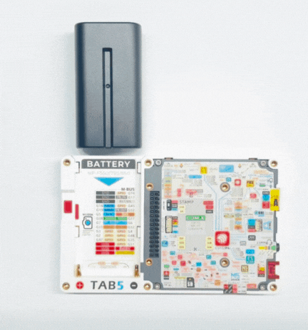

---
layout:
  width: default
  title:
    visible: false
  description:
    visible: false
  tableOfContents:
    visible: true
  outline:
    visible: true
  pagination:
    visible: true
  metadata:
    visible: true
  tags:
    visible: true
  actions:
    visible: true
  anchors:
    visible: true
---

# M5Stack Tab5 IoT Development Kit

### M5Stack Tab5 IoT Development Kit (ESP32-P4)

***

### Product Link



### Description

**Tab5** is a highly extensible, portable smart IoT terminal development device designed for developers, integrating a dual-chip architecture and abundant hardware resources. Its main controller adopts the RISC‑V–based **ESP32‑P4** SoC, equipped with 16 MB Flash and 32 MB PSRAM; the wireless module uses the ESP32‑C6‑MINI‑1U, supporting Wi‑Fi 6. Its antenna system can freely switch between the built-in 3D antenna and the external MMCX antenna interface, flexibly adapting to different deployment environments to ensure data throughput and low-latency control.

In terms of vision and interaction, Tab5 features a 5″ 1280×720 IPS **TFT** display via a MIPI‑DSI interface, with touch handled by the GT911 multi-point **touch** controller (I²C) for a smooth and responsive touch experience; it also includes an SC2356 2 MP **camera** (1600×1200) via a MIPI‑CSI interface, capable of high-definition video recording, image processing, and edge AI applications (e.g., face recognition, object tracking).

For peripheral interfaces, Tab5 offers **USB‑A** (Host) and **USB‑C** (USB 2.0 OTG) ports for connecting traditional peripherals like a mouse or keyboard; industrial scenarios can use **RS‑485** (SIT3088 + DIP switch–selectable 120 Ω termination) bus communication. Grove, M5BUS, GPIO\_EXT header, and **Micro SD** card slot, as well as reserved STAMP pads (supporting Cat.M, NB‑IoT, LoRaWAN, etc.), allow flexible expansion with various sensors and communication modules. It also includes Reset/Boot buttons for quick reset and entering firmware download mode.

In audio/video, Tab5 uses the ES8388 **audio codec**, paired with the ES7210 AEC echo-cancellation front end, a **dual-microphone** array, a 3.5 mm headphone jack, and a speaker for high-fidelity recording/playback and accurate voice recognition. The built-in BMI270 **6-axis sensor** (accelerometer + gyroscope, with interrupt wakeup) can trigger the main controller in motion-tracking and posture-detection scenarios, improving responsiveness in low-power conditions.

For time and power management, Tab5 integrates the RX8130CE **real-time clock** (with timed interrupt wakeup), supports a removable NP‑F550 **lithium battery**, and includes MP4560 boost/buck management, IP2326 charge/discharge control, and INA226 real-time **monitoring** circuitry—ensuring stable operation without external power.

Structurally, Tab5 features a standard 1/4″‑20 tripod mount on the side, allowing direct attachment to tripods or other mounts for easy shooting and deployment.

Tab5 is suitable for smart home control, remote monitoring, industrial automation, IoT prototyping, education, and research—providing developers and enterprises a comprehensive, easily expandable, high-performance development platform.

### Features

* ESP32‑P4 dual-core main controller
* ESP32‑C6 wireless module
* Wi‑Fi 6
* Built-in 3D antenna & MMCX external antenna port
* 5″ 720P MIPI‑DSI display
* GT911 multi-point touch
* SC2356 2 MP camera
* USB‑A Host + USB‑C OTG
* RS‑485 industrial interface
* Grove & M5BUS expansion
* Micro SD card slot
* STAMP expansion
* ES8388 audio codec
* ES7210 AEC dual microphone
* 1 W speaker + 3.5 mm headphone jack
* BMI270 6-axis sensor
* RX8130CE real-time clock
* Reset/Boot & Power buttons
* NP‑F550 removable battery
* Standard 1/4″‑20 tripod mount
* Development platform:
  * ESP-IDF

### Specifications

| Specification         | Parameters                                                                                                                                                                                                                                                                         |
| --------------------- | ---------------------------------------------------------------------------------------------------------------------------------------------------------------------------------------------------------------------------------------------------------------------------------- |
| Main Controller SoC   | ESP32-P4NRW32 (RISC-V 32-bit HP dual-core 400 MHz + RISC-V 32-bit LP single-core 40 MHz)                                                                                                                                                                                           |
| Wireless Module SoC   | ESP32‑C6‑MINI‑1U (supports Wi‑Fi 6 @ 2.4 GHz / Thread / ZigBee)                                                                                                                                                                                                                    |
| Antenna               | Built‑in 3D antenna & 2 x MMCX external antenna port                                                                                                                                                                                                                               |
| Flash                 | 16 MB                                                                                                                                                                                                                                                                              |
| PSRAM                 | 32 MB                                                                                                                                                                                                                                                                              |
| Display               | 5 Inch IPS TFT (1280×720)                                                                                                                                                                                                                                                          |
| Touch                 | GT911 multi-point touch controller (I²C)                                                                                                                                                                                                                                           |
| Camera                | SC2356 @ 2 MP (1600×1200), via MIPI‑CSI                                                                                                                                                                                                                                            |
| Audio Chip            | ES8388 codec; ES7210 AEC front end                                                                                                                                                                                                                                                 |
| Microphone            | Dual-microphone system (AEC echo cancellation)                                                                                                                                                                                                                                     |
| Speaker               | 1 W@8 Ω NS4150B                                                                                                                                                                                                                                                                    |
| Headphone Jack        | 3.5 mm                                                                                                                                                                                                                                                                             |
| USB Ports             | USB‑A (Host), USB‑C (USB 2.0 OTG)                                                                                                                                                                                                                                                  |
| RS485 Port            | <p>SIT3088 (120 Ω selectable termination)<br>Supply: 6 ~ 24 V</p>                                                                                                                                                                                                                  |
| Expansion Interfaces  | 1 × Grove, 1 × M5BUS, GPIO\_EXT header                                                                                                                                                                                                                                             |
| Storage Expansion     | Micro SD card slot                                                                                                                                                                                                                                                                 |
| Stamp Expansion Pads  | Supports Stamp Cat.M / NB‑IoT / LoRaWAN modules                                                                                                                                                                                                                                    |
| Motion Sensor         | BMI270 6-axis (accelerometer + gyroscope, interrupt wakeup support)                                                                                                                                                                                                                |
| RTC                   | RX8130CE real-time clock (timed interrupt wakeup support)                                                                                                                                                                                                                          |
| Reset/Boot Buttons    | 1× button for power on/off and download mode entry                                                                                                                                                                                                                                 |
| Charge Management     | IP2326 charge management chip                                                                                                                                                                                                                                                      |
| Power Monitoring      | INA226 (bus current/voltage monitoring)                                                                                                                                                                                                                                            |
| Battery               | NP‑F550 removable lithium battery, 7.4 V @ 2000 mAh (14.8 Wh)                                                                                                                                                                                                                      |
| Battery life          | Under standard usage conditions (50% screen brightness, continuous Wi‑Fi connection, background tasks running, etc.), the Tab5’s built-in battery discharges from full charge (8.23 V) to the shutdown threshold (6.0 V), providing approximately 6 hours of continuous operation. |
| Operating Temperature | 0 \~ 40 °C                                                                                                                                                                                                                                                                         |
| Product Size          | <p>Tab5: 128.0 × 80.0 × 12.0 mm<br>Tab5 Kit: 128.0 × 80.0 × 26.7 mm</p>                                                                                                                                                                                                            |
| Product Weight        | <p>Tab5: 124.5 g<br>Tab5 Kit: 277.4 g<br>Battery: 97.9 g</p>                                                                                                                                                                                                                       |
| Package Size          | <p>Tab5: 148.0 × 103.0 × 21 mm<br>Tab5 Kit: 191.0 × 103.0 × 25.0 mm</p>                                                                                                                                                                                                            |
| Gross Weight          | <p>Tab5: 162.5 g<br>Tab5 Kit: 277.4 g</p>                                                                                                                                                                                                                                          |


Power Consideration:

Before disconnecting power or swapping the battery, shut down the Tab5. If you remove power directly, wait 5 seconds before re-powering to avoid IMU initialization failures due to unstable voltage.



Download Mode:

With USB cable or battery connected, long‑press the Reset button (2 seconds) until the internal green LED rapidly blinks; release to enter download mode and await firmware flashing.


<figure><figcaption></figcaption></figure>


Battery Installation:

With device powered off, press and hold the red latch button on the board edge, align the metal contacts on the back of the battery module to the “BATTERY” slot, slide downward along the guide rails until flush, then release the red button to complete installation and power on.


<figure><figcaption></figcaption></figure>


Power On/Off:

When powered by USB cable or battery: to power on from off, single-click the power button; to power off from on, double-click the power button.


<div><figure><figcaption></figcaption></figure> <figure><figcaption></figcaption></figure></div>

### Schematics <a href="#schematics" id="schematics"></a>

* [Tab5 Overall Design Block Diagram](https://m5stack-doc.oss-cn-shenzhen.aliyuncs.com/1132/Tab5_Overall_Design_Block_Diagram.pdf)
* [Tab5 Schematics PDF](https://m5stack-doc.oss-cn-shenzhen.aliyuncs.com/1132/Tab5_Schematics_PDF.pdf)

### PinMap <a href="#pinmap" id="pinmap"></a>

#### PI4IOE5V6408 <a href="#pi4ioe5v6408" id="pi4ioe5v6408"></a>

| ESP32-P4     | G32 | G31 | CHIP\_PU |
| ------------ | --- | --- | -------- |
| PI4IOE5V6408 | SCL | SDA | RST      |

#### CAM <a href="#cam" id="cam"></a>

| ESP32‑P4                | CAM           |
| ----------------------- | ------------- |
| G32                     | CAM\_SCL      |
| G31                     | CAM\_SDA      |
| G36                     | CAM\_MCLK     |
| CSI\_DATAP1 (dedicated) | CAM\_D1P      |
| CSI\_DATAN1 (dedicated) | CAM\_D1N      |
| CSI\_CLKP (dedicated)   | CAM\_CSI\_CKP |
| CSI\_CLKN (dedicated)   | CAM\_CSI\_CKN |
| CSI\_DATAP0 (dedicated) | CSI\_DOP      |
| CSI\_DATAN0 (dedicated) | CSI\_DON      |

| PI4IOE5V6408 | P6       |
| ------------ | -------- |
| CAM          | CAM\_RST |

#### NS4150B <a href="#ns4150b" id="ns4150b"></a>

| PI4IOE5V6408 | P1      |
| ------------ | ------- |
| NS4150B      | SPK\_EN |

#### ES8388 <a href="#es8388" id="es8388"></a>

| ESP32-P4 | G30  | G27  | G26   | G29  | G32  | G31   |
| -------- | ---- | ---- | ----- | ---- | ---- | ----- |
| ES8388   | MCLK | SCLK | DSDIN | LRCK | CCLK | CDATA |

#### ES7210 <a href="#es7210" id="es7210"></a>

| ESP32-P4 | G30  | G27  | G28    | G29  | G32  | G31   |
| -------- | ---- | ---- | ------ | ---- | ---- | ----- |
| ES7210   | MCLK | SCLK | ASDOUT | LRCK | CCLK | CDATA |

#### LCD <a href="#lcd" id="lcd"></a>

| ESP32‑P4                | ILI9881C   |
| ----------------------- | ---------- |
| G22                     | LEDA       |
| G23                     | TP\_INT    |
| G31                     | SDA        |
| G32                     | SCL        |
| DSI\_CLKN (dedicated)   | DSI\_CK\_N |
| DSI\_CLKP (dedicated)   | DSI\_CK\_P |
| DSI\_DATAN1 (dedicated) | DSI\_D1\_N |
| DSI\_DATAP1 (dedicated) | DSI\_D1\_P |
| DSI\_DATAN0 (dedicated) | DSI\_D0\_N |
| DSI\_DATAP0 (dedicated) | DSI\_D0\_P |

| PI4IOE5V6408 | P5      | P4       |
| ------------ | ------- | -------- |
| ILI9881C     | TP\_RST | LCD\_RST |

#### BMI270 & RTC (RX8130CE) & INA226 <a href="#bmi270-rtc-rx8130ce-ina226" id="bmi270-rtc-rx8130ce-ina226"></a>

| ESP32-P4 | G32 | G31 |
| -------- | --- | --- |
| BMI270   | SCL | SDA |
| RX8130CE | SCL | SDA |
| INA226   | SCL | SDA |

* Interrupt Wakeup (PMS150G-U06 power management)

| PMS150G-U06 | PA6/CIN‑    |
| ----------- | ----------- |
| BMI270      | INT(E\_TRG) |
| RX8130CE    | INT(E\_TRG) |

#### ESP32-C6 <a href="#esp32-c6" id="esp32-c6"></a>

| ESP32-P4 | G11       | G10       | G9        | G8        | G13        | G12       |
| -------- | --------- | --------- | --------- | --------- | ---------- | --------- |
| ESP32-C6 | SDIO2\_D0 | SDIO2\_D1 | SDIO2\_D2 | SDIO2\_D3 | SDIO2\_CMD | SDIO2\_CK |

#### microSD <a href="#microsd" id="microsd"></a>

| ESP32-P4          | G39  | G40  | G41  | G42  | G43 | G44  |
| ----------------- | ---- | ---- | ---- | ---- | --- | ---- |
| microSD SPI Mode  | MISO |      |      | CS   | SCK | MOSI |
| microSD SDIO Mode | DAT0 | DAT1 | DAT2 | DAT3 | CLK | CMD  |

#### RS485 <a href="#rs485" id="rs485"></a>

| ESP32-P4 | G21 | G20 | G34 |
| -------- | --- | --- | --- |
| SIT3088  | RX  | TX  | DIR |

#### IP2326 <a href="#ip2326" id="ip2326"></a>

| PI4IOE5V6408 | P7      | P6        |
| ------------ | ------- | --------- |
| IP2326       | CHG\_EN | CHG\_STAT |

#### HY2.0-4P <a href="#hy2.0-4p" id="hy2.0-4p"></a>

| HY2.0-4P | Black | Red | Yellow | White |
| -------- | ----- | --- | ------ | ----- |
| PORT.A   | GND   | 5V  | G53    | G54   |

#### MBUS <a href="#mbus" id="mbus"></a>

<figure><figcaption></figcaption></figure>

#### Tab5 Board PinMap Overview <a href="#tab5-board-pinmap-overview" id="tab5-board-pinmap-overview"></a>

<figure><figcaption></figcaption></figure>

### Model Size <a href="#model-size" id="model-size"></a>

<figure><figcaption></figcaption></figure>

### Datasheets <a href="#datasheets" id="datasheets"></a>

* [ESP32-P4](https://m5stack-doc.oss-cn-shenzhen.aliyuncs.com/1132/ESP32-P4_Datasheet.pdf)
* [BMI270](https://m5stack.oss-cn-shenzhen.aliyuncs.com/resource/docs/products/app/Stamp%20Fly/BMI270.PDF)
* [ESP32-C6](https://m5stack.oss-cn-shenzhen.aliyuncs.com/resource/docs/products/core/M5NanoC6/esp32-c6_datasheet_cn.pdf)
* [NS4150B](https://m5stack.oss-cn-shenzhen.aliyuncs.com/resource/docs/products/atom/Atomic%20Echo%20Base/NS4150B.pdf)
* [ES7210](https://m5stack.oss-cn-shenzhen.aliyuncs.com/resource/docs/datasheet/core/K128%20CoreS3/ES7210.PDF)
* [ES8388](https://m5stack-doc.oss-cn-shenzhen.aliyuncs.com/1141/ES8388.pdf)
* [INA226](https://m5stack-doc.oss-cn-shenzhen.aliyuncs.com/1132/INA226.pdf)
* [IP2326](https://m5stack-doc.oss-cn-shenzhen.aliyuncs.com/1132/IP2326.pdf)
* [NP‑F550 Battery Report](https://m5stack-doc.oss-cn-shenzhen.aliyuncs.com/1132/K145_Battery_Product_Report.zip)

### Softwares <a href="#softwares" id="softwares"></a>

#### Quick Start <a href="#quick-start" id="quick-start"></a>

* [Tab5 Restore Factory Firmware](https://docs.m5stack.com/en/guide/restore_factory/m5tab5)

#### Arduino <a href="#arduino" id="arduino"></a>

* [M5Unified](https://github.com/m5stack/M5Unified)
* [M5GFX](https://github.com/m5stack/M5GFX)

#### PlatformIO <a href="#platformio" id="platformio"></a>

```
[env:esp32p4_pioarduino]
platform = https://github.com/pioarduino/platform-espressif32.git#54.03.20
upload_speed = 1500000
monitor_speed = 115200
build_type = debug
framework = arduino
board = esp32-p4-evboard
board_build.mcu = esp32p4
board_build.flash_mode = qio

build_flags =  
    -DBOARD_HAS_PSRAM
    -DCORE_DEBUG_LEVEL=5
    -DARDUINO_USB_CDC_ON_BOOT=1
    -DARDUINO_USB_MODE=1
lib_deps = 
    https://github.com/M5Stack/M5Unified.git
    https://github.com/M5Stack/M5GFX.git
```

#### ESP-IDF <a href="#esp-idf" id="esp-idf"></a>

* [Tab5 User Demo](https://github.com/m5stack/M5Tab5-UserDemo)
* [Tab5 User Demo Compilation](https://docs.m5stack.com/en/esp_idf/m5tab5/userdemo)

#### Easyloader <a href="#easyloader" id="easyloader"></a>

| Easyloader     | Download Link                                                                             | Notes |
| -------------- | ----------------------------------------------------------------------------------------- | ----- |
| Tab5 User Demo | [download](https://m5stack-doc.oss-cn-shenzhen.aliyuncs.com/1132/C145_Tab5_User_Demo.exe) | /     |
