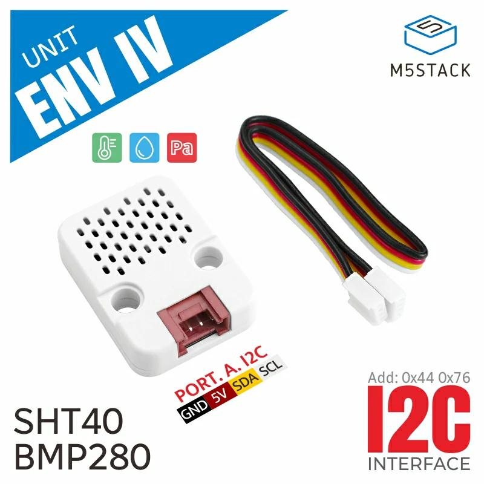

---
layout:
  width: default
  title:
    visible: false
  description:
    visible: false
  tableOfContents:
    visible: true
  outline:
    visible: true
  pagination:
    visible: true
  metadata:
    visible: true
  tags:
    visible: true
  actions:
    visible: true
  anchors:
    visible: true
---

# M5Stack Temperature Humidity Air Pressure Sensor (SHT40+BMP280)


**Manufacturer reference.** A matching current OpenELAB global-store listing has not been verified for this model/revision. Use the hardware label and the exact official reference below; do not select firmware or wiring from a similar store product.


### M5Stack Temperature Humidity Air Pressure Sensor (SHT40+BMP280)

***

### Product Link

No matching current OpenELAB.io listing was found for the product version documented here.

### Introduction

**ENV IV** is an environmental sensor that integrates the SHT40 and BMP280 sensors, designed for measuring **temperature, humidity, and atmospheric pressure data**. The SHT40 is a high-precision, low-power digital temperature and humidity sensor, supporting the I2C interface (SHT40 address: 0x44). The BMP280, on the other hand, is an absolute pressure sensor known for its high accuracy in atmospheric pressure measurements, with an I2C address of 0x76. This sensor unit finds applications in various fields, including meteorological monitoring, indoor environmental control, agriculture and horticulture, and industrial automation.

### Features

* Integrated sensors (temperature and humidity sensor SHT40, pressure sensor BMP280)
* High precision and low power consumption
* I2C communication interface (SHT40 I2C address: 0x44, BMP280 I2C address: 0x76)
* real-time monitor
* Multi platform programming Arduino UIFlow

### Specifications

| Resources                                | Parameters                   |
| ---------------------------------------- | ---------------------------- |
| SHT40 measure range(Temperture/Humidity) | -40 \~ 125 °C，0 \~ 100 %RH   |
| BMP280 measure range(Presure)            | 300 \~ 1100hPa               |
| SHT40 measure accuracy                   | ±0.1 °C，±1.5 %RH             |
| BMP280 measure accuracy                  | ±0.12hPa                     |
| communication protocol                   | I2C:SHT30(0x44),BMP280(0x76) |
| Shell material                           | Plastic ( PC )               |
| Product Size                             | 32\*24\*8mm                  |
| Package Size                             | 136\* 92\*13mm               |
| Product Weight                           | 3.9g                         |
| Package Weight                           | 9.3g                         |

### Pinout

<figure><figcaption>
Manufacturer image: <a href="https://docs.m5stack.com/en/unit/Unit_ENV-IV">M5Stack Unit ENV-IV official guide</a>.
</figcaption></figure>

### Dimensions

<figure><figcaption></figcaption></figure>

### How to Use

* **Connect to a Microcontroller**: Use the I2C interface to connect the sensor unit to your microcontroller (e.g., Arduino, ESP32).
* **Install Necessary Libraries**: Ensure you have the correct libraries installed in your development environment to communicate with the SHT40 and BMP280 sensors.
* **Initialize the Sensors**: Write initialization code to set up the sensors and start measurements.
* **Read Sensor Data**: Use provided functions to read temperature, humidity, and pressure data from the sensors.
* **Process and Display Data**: Process the data as needed for your application and display it on a screen or send it to a cloud service for analysis.

### FAQ

<strong>Can I use the M5Stack SHT40+BMP280 sensor with any microcontroller?</strong>

Yes, as long as the microcontroller supports I2C communication, you can integrate the SHT40+BMP280 sensor.

<strong>How do I power the sensor?</strong>

The sensor operates at 3.3V, so ensure your power supply matches this requirement.

<strong>Is the sensor suitable for outdoor use?</strong>

The sensor is designed for indoor use. If using it outdoors, ensure it is protected from extreme weather conditions.

<strong>What libraries are needed to operate the sensor with Arduino?</strong>

You will need the Adafruit SHT4x library and the Adafruit BMP280 library.

<strong>How accurate are the sensor readings?</strong>

The sensor provides high accuracy for temperature (±0.2°C), humidity (±1.8% RH), and pressure (±1 hPa).

<strong>Can the sensor detect specific weather patterns?</strong>

The sensor provides data on temperature, humidity, and air pressure, which can be used to infer weather patterns, but it does not directly detect specific weather conditions.

## Official documentation and development resources

Use [Unit ENV-IV](https://docs.m5stack.com/en/unit/Unit_ENV-IV) for the manufacturer's complete model reference, diagrams and maintained examples. The official product code is **`U001-D`**; match the board/Unit label before choosing a firmware or host example. The references below complement this guide's local instructions.

| Development need                        | Model-specific reference                                                                                                                           |
| --------------------------------------- | -------------------------------------------------------------------------------------------------------------------------------------------------- |
| Electrical schematic                    | [Read electrical schematic](https://m5stack-doc.oss-cn-shenzhen.aliyuncs.com/573/Sch_UNIT_ENVIV.pdf)                                               |
| Arduino development tutorial            | [Read arduino development tutorial](https://docs.m5stack.com/en/arduino/projects/unit/unit_env)                                                    |
| Example source: Unit\_ENVIV\_M5Core.ino | [Read example source: unit\_enviv\_m5core.ino](https://github.com/m5stack/M5Unit-ENV/blob/master/examples/Unit_ENVIV_M5Core/Unit_ENVIV_M5Core.ino) |

Keep the example's host model, interface pins and dependency versions together when reproducing a result. A schematic or SDK link does not establish that another revision uses the same wiring. Official model pages and accessible tutorial links reviewed **23 November 2026**. Other downloads above are manufacturer-listed resources; listing a file is not a test of its contents. Compilation, firmware flashing and hardware operation were **not performed** in this review.
