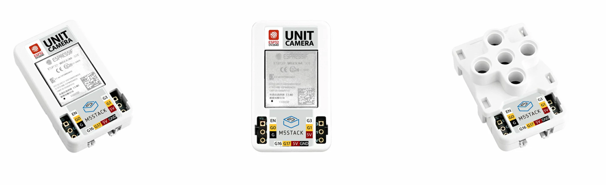

---
layout:
  width: default
  title:
    visible: false
  description:
    visible: false
  tableOfContents:
    visible: true
  outline:
    visible: true
  pagination:
    visible: true
  metadata:
    visible: true
  tags:
    visible: true
  actions:
    visible: true
  anchors:
    visible: true
---

# M5Stack Unit Cam Wi-Fi Camera

### M5Stack Unit Cam Wi-Fi Camera with Enclosure

***

### Product Link



### Description <a href="#description" id="description"></a>

**Unit Camera** is a high-cost-performance WiFi camera from M5Stack, featuring the ESP32-WROOM-32E control core and a 2-megapixel image sensor (OV2640). Its minimalist design includes no unnecessary peripherals. The pre-installed software integrates image transmission firmware, offering interfaces for image data acquisition and adjustment of image parameters such as white balance, exposure, gain, and size. Users can directly obtain image data and interact with the camera via UART or WiFi. It supports UIFlow graphical programming, allowing for a zero-development, out-of-the-box user experience. Additionally, the reserved program download interface enables users to easily update or customize the firmware, enhancing functionality and performance. The camera also comes with a mounting clip, making it easy to fix in the desired position. Its compact design and high cost-performance make it suitable for various wireless camera application scenarios.

### Features <a href="#features" id="features"></a>

* ESP32 control core
* Simplified design
* 2 MegaPixel camera (OV2640)
* UART communication (supports image data acquisition and image parameter adjustments)
* WiFi image transmission
* Programmable LED indicator (blue)
* Programming platforms: ESP-IDF / Arduino / UIFlow

### Applications <a href="#applications" id="applications"></a>

* Home Security
* Smart Home
* Industrial Monitoring
* Agricultural Monitoring
* Education and Research
* Pet Monitoring

### Specification <a href="#specification" id="specification"></a>

| Resources             | Parameters                                                                                                                                              |
| --------------------- | ------------------------------------------------------------------------------------------------------------------------------------------------------- |
| ESP32-WROOM-32E       | 240MHz dual core, 600 DMIPS, 520KB SRAM, Wi-Fi                                                                                                          |
| Flash                 | 4MB                                                                                                                                                     |
| Camera                | <p>Focal length 4.8±5% mm<br>Aperture 2.4±5%<br>Lens type 1/4 inch<br>Field of view 65°<br>Pixels 2M<br>Sensitivity &#x3C;1%<br>Image sensor OV2640</p> |
| Support output format | YUV (422/420)/YCbCr422, 8-bit compressed data, RGB565/555, 8-/10-bit Raw RGB data                                                                       |
| DFOV                  | 65°                                                                                                                                                     |
| Product Size          | 40\*24\*11m                                                                                                                                             |
| Package Size          | 136\*92\*13mm                                                                                                                                           |
| Product Weight        | 10.6g                                                                                                                                                   |
| Package Weight        | 15.7g                                                                                                                                                   |

<figure><figcaption></figcaption></figure>

### Flash Burning Download <a href="#flash-burning-download" id="flash-burning-download"></a>

Unit CAM does not include a program download circuit. When the user needs to download the ESP32 update program, the program can be burned through an external connection with a USB-TTL downloader. [Click here to buy ESP32 download board](https://shop.m5stack.com/products/esp32-downloader-kit)

<figure><figcaption></figcaption></figure>

### Pin Mapping <a href="#pin-mapping" id="pin-mapping"></a>

**OV2640 Interface**

| interface            | camera pins | unit Camera |
| -------------------- | :---------: | :---------: |
| SCCB Clock           |     SIOC    |     IO23    |
| SCCB Data            |     SIOD    |     IO25    |
| System Clock         |     XCLK    |     IO27    |
| Vertical Sync        |    VSYNC    |     IO22    |
| Horizontal Reference |     HREF    |     IO26    |
| Pixel Clock          |     PCLK    |     IO21    |
| Pixel Data Bit 0     |      D0     |     IO32    |
| Pixel Data Bit 1     |      D1     |     IO35    |
| Pixel Data Bit 2     |      D2     |     IO34    |
| Pixel Data Bit 3     |      D3     |     IO5     |
| Pixel Data Bit 4     |      D4     |     IO39    |
| Pixel Data Bit 5     |      D5     |     IO18    |
| Pixel Data Bit 6     |      D6     |     IO36    |
| Pixel Data Bit 7     |      D7     |     IO19    |
| Camera Reset         |    RESET    |     IO15    |
| Camera Power Down    |     PWDN    |      -1     |
| Power Supply 3.3V    |     3V3     |     3V3     |
| Ground               |     GND     |     GND     |

**HY2.0-4P Interface**.

| HY2.0-4P | Unit Camera |
| :------: | :---------: |
|    RX    |     IO16    |
|    TX    |     IO17    |
|    5V    |      5V     |
|    GND   |     GND     |

**LED (Blue)**

| LED | Unit Camera |
| :-: | :---------: |
|  D1 |     IO4     |

### Related Link <a href="#related-link" id="related-link"></a>

* [ESP32-WROOM-32E](https://m5stack.oss-cn-shenzhen.aliyuncs.com/resource/docs/datasheet/unit/unit_cam/ESP32-WROOM-32E-EN.pdf)
* [OV2640](https://m5stack.oss-cn-shenzhen.aliyuncs.com/resource/docs/datasheet/unit/OV2640DS_en.pdf)

### Schematic <a href="#schematic" id="schematic"></a>

<figure><figcaption></figcaption></figure>

### Module Size <a href="#module-size" id="module-size"></a>

<figure><figcaption></figcaption></figure>

### Example <a href="#example" id="example"></a>

#### UIFlow <a href="#uiflow" id="uiflow"></a>

* [UART transmission / TIMER timer shooting](https://docs.m5stack.com/en/guide/wifi_camera/timer_cam/uiflow)

#### Arduino <a href="#arduino" id="arduino"></a>

* [Camera UART to Core / This program is suitable for M5Core, used to receive images from UNIT Camera via UART, please do not burn to UNIT Camera](https://github.com/m5stack/M5-ProductExampleCodes/tree/master/Unit/UNIT_CAM/CAM2CORE)

#### ESP IDF <a href="#esp-idf" id="esp-idf"></a>

* [AWS-S3-PUT](https://github.com/m5stack/M5_Camera_Examples/tree/main/idf/AWS-S3-PUT)
* [Ali-OSS-PUT](https://github.com/m5stack/M5_Camera_Examples/tree/main/idf/Ali-OSS)
* [SMB-OSS-PUT](https://github.com/m5stack/M5_Camera_Examples/tree/main/idf/SMB-PUT)
* [Timer Wake-up](https://github.com/m5stack/M5_Camera_Examples/tree/main/idf/Wake-up)
* [HTTP Stream](https://github.com/m5stack/M5_Camera_Examples/tree/main/idf/http-stream)
* [Wireless-send](https://github.com/m5stack/M5_Camera_Examples/tree/main/idf/wireless-send)

```cpp
idf.py menuconfig
```

`Component config`->`ESP32-specific`->`Hardware brownout detect & reset`（disable）

<figure><figcaption></figcaption></figure>

### Version comparison <a href="#version-comparison" id="version-comparison"></a>

| Product             | SKU    | Camera                                                                                | Appearance                         |
| ------------------- | ------ | ------------------------------------------------------------------------------------- | ---------------------------------- |
| Unit Camera         | U109-B | <p>Regular viewing angle FOV: 65°<br>OV2640</p>                                       | Includes case and camera back clip |
| Unit CAM            | U109   | <p>Regular viewing angle FOV: 65°<br>OV2640</p>                                       | Does not include case              |
| Unit Camera DIY KIT | U109-X | <p>Regular viewing angle FOV: 65°, OV2640<br>Wide-angle fisheye FOV: 160°, OV2640</p> | Includes case and camera back clip |

### FAQ <a href="#faq" id="faq"></a>

<details>

<summary><strong>Unit RFID(U031),Unit RFID2(U031-B) program is compatible?</strong></summary>

Unit RFID(U031),Unit RFID2(U031-B) program is totally compatible

</details>

<details>

<summary><strong>Is Unit CAM support output the raw picture data?</strong></summary>

Unit CAM supports output format JPEG, RAW,RGB565,RGB88 etc. but when output the raw data the picture buffer size would be huge, so the picture size would be limited.

</details>

<details>

<summary><strong>RoverC, JoyC battery charge</strong></summary>

RoverC, JoyC, 's battery is in parallel connection with the M5StickC controller, you can connect the USB cable to the M5StickC to charge the battery of RoverC, JoyC. Also, When charging the M5StickC and RoverC, JoyC power switch can be turned off.

</details>
